# WellnessZ OHCM – Technology Architecture and Technology Selection

**Version 1.0** – *WellnessZ OHCM platform – increments 1–5*

| | |
|---|---|
| **Document** | 01 – Technology Architecture and Technology Selection |
| **Version** | 1.0 (2026-10-30) – first complete edition after the final increment |
| **System** | WellnessZ Airline Occupational Health Case Management (OHCM) – complete platform: base framework, 13 business modules (E01–E12, E14), 10 platform modules, BFF and four web front ends |
| **Audience** | Chief Information Officer, Cyber Governance, Risk & Compliance (GRC) team, architecture board |
| **Baseline** | Repository working tree, Maven version `0.1.0-SNAPSHOT`, Helm chart `0.1.0`; covers **increment 1** (E01 case intake, E02 clinical triage), **increment 2** (E03 OH record & clinical encounters, E05 fitness for duty, restrictions & return to work), **increment 3** (E06 absence & sickness management, E07 medical surveillance, statutory medicals & immunisation, E14 scheduling, clinic operations & resource management), **increment 4** (E04 injury & illness management, treatment coordination & partner referrals, E08 workers' compensation, insurance & claims coordination, partner portal) and **increment 5** (E09 mental health, psychosocial risk & peer support, E10 drug, alcohol & psychoactive substance testing, E11 travel health, immunisation campaigns & communicable disease / exposure management, E12 health promotion, wellbeing & prevention; DEV / UAT / PROD environment engineering and client customisation) |
| **Status** | Version 1.0 for steering-committee and Cyber GRC review |
| **Increment 1 documents** | [Solution Design E01/E02](../increment-01/01-Solution-Design-E01-E02.md) · [Requirements Traceability Matrix](../increment-01/02-Requirements-Traceability-Matrix.md) · [Release Notes](../increment-01/03-Release-Notes-Increment-1.md) · [API Contract](../increment-01/API-Contract-E01-E02.md) |
| **Increment 2 documents** | [Solution Design E03/E05](../increment-02/01-Solution-Design-E03-E05.md) · [Requirements Traceability Matrix](../increment-02/02-Requirements-Traceability-Matrix.md) · [Release Notes](../increment-02/03-Release-Notes-Increment-2.md) · [API Contract](../increment-02/API-Contract-E03-E05.md) |
| **Increment 3 documents** | [Solution Design E06/E07/E14](../increment-03/01-Solution-Design-E06-E07-E14.md) · [Requirements Traceability Matrix](../increment-03/02-Requirements-Traceability-Matrix.md) · [Release Notes](../increment-03/03-Release-Notes-Increment-3.md) · [API Contract](../increment-03/API-Contract-E06-E07-E14.md) |
| **Increment 4 documents** | [Solution Design E04/E08](../increment-04/01-Solution-Design-E04-E08.md) · [Requirements Traceability Matrix](../increment-04/02-Requirements-Traceability-Matrix.md) · [Release Notes](../increment-04/03-Release-Notes-Increment-4.md) · [API Contract](../increment-04/API-Contract-E04-E08.md) |
| **Increment 5 documents** | [API Contract E09/E10/E11/E12](../increment-05/API-Contract-E09-E10-E11-E12.md) · environment matrix [`deploy/environments/README.md`](../../deploy/environments/README.md) |
| **Companion documents** | 02 – Security and SOC 2 Control Mapping · 03 – Developer Guide · [04 – Technology Standards Comparison by Layer](04-Technology-Standards-Comparison-by-Layer.md) · [Deployment Architecture](../deployment/Deployment-Architecture.md) |

> **How to read this document.** Every statement about the platform was checked against the source code in the
> repository. Capabilities are labelled consistently:
> **Implemented** – present in the code and covered by tests where noted;
> **Extension point** – an interface/SPI, endpoint or configuration hook exists, but the production adapter, mapping or
> content is delivered in a later increment;
> **Planned** – catalogued in the architecture (for example in `ModuleRegistry` or `ConnectorRegistry`) but not yet built.
> Target figures (RPO/RTO, retention) are proposals for decision, not commitments.

## 1. Executive summary

WellnessZ is the airline's Occupational Health (OH) case-management platform. After five increments the repository
contains the **complete platform**: the platform services that every business module depends on, the primary intake
feed from the EHS incident-management system, the case kernel, **13 business modules** (E01–E12 and E14; E13
self-service is delivered through the kernel and the employee and manager front ends), a Backend-for-Frontend, **four
web front ends** (employee/crew portal with a mobile shell, manager & HR workspace, OH clinical workspace, partner
portal) and the deployment assets for a local MacBook Pro, Azure, Google Cloud and a hybrid set-up, each with DEV, UAT
and PROD environments. The business modules were added incrementally on top of the framework through a defined
module SPI; no module depends on a later one.

**At a glance (Version 1.0):**

| Dimension | Figure | Source |
|---|---|---|
| Business modules | 13 (E01–E12, E14) | `pom.xml` modules, `ModuleRegistry` |
| Platform modules | 10 (`wz-common`, `wz-secrets`, `wz-security`, `wz-masterdata`, `wz-integration`, `wz-notification`, `wz-analytics`, `wz-case-kernel`, `wz-documents`, `wz-ehs-intake`) | `platform/` |
| Deployables | core API, BFF, four web apps (six container images) | `apps/`, `web/`, `deploy/docker` |
| Database | one PostgreSQL 16 database, 18 Flyway-managed schemas plus the BFF session schema; 20 product migrations (V1–V20) | `application.yml`, `db/migration` |
| Roles | 38 canonical roles | `wz-common Roles` |
| Architecture rules | 22 ArchUnit rules | `ArchitectureTest` |
| API surface | 647 OpenAPI paths | `docs/api/openapi.json` |
| Verification | 450 Java tests, 1,373 web unit tests, 121 live end-to-end checks, 0 SpotBugs / FindSecBugs findings | Section 15 |
| Environments | local; Azure, GCP and hybrid × DEV / UAT / PROD | `deploy/environments/README.md` |

**What exists today (implemented):**

- A **modular monolith** core API (`apps/wz-core-app`) on Java 21 and Spring Boot 4.1.2, composed of **ten platform
  Maven modules and 13 business modules**; module boundaries are enforced by **22 ArchUnit rules**. Delivery history:
  increment 1 added `modules/wz-e01-intake` and `modules/wz-e02-triage`; increment 2 the tenth platform module
  (`platform/wz-documents`) with `modules/wz-e03-record` and `modules/wz-e05-fitness`; increment 3
  `modules/wz-e06-absence`, `modules/wz-e07-surveillance` and `modules/wz-e14-scheduling`; increment 4
  `modules/wz-e04-treatment` and `modules/wz-e08-claims`; increment 5 `modules/wz-e09-mentalhealth`,
  `modules/wz-e10-substance`, `modules/wz-e11-travelhealth` and `modules/wz-e12-promotion`.
- **Identity, access control and audit (E16):** OAuth2 resource server that accepts tokens from several trusted OIDC
  issuers at once (Microsoft Entra ID, Keycloak, Okta and others), vendor-neutral role-claim mapping including Entra ID
  group object-IDs, an attribute-based access-control (ABAC) policy engine with *deny-overrides* and four disclosure
  levels, a consent register, and a **tamper-evident, hash-chained, append-only audit trail** with a verification API.
- **The status-only disclosure rule** enforced in three independent places: ABAC projection on every case read
  (managers/HR receive a data type that structurally has no clinical fields), an outbound field allow-list on every
  enterprise destination (default deny), and content rules on notifications.
- **Integration (E15):** transactional-outbox event bus with at-least-once delivery, exponential back-off,
  dead-lettering and operator replay; idempotent consumers; IETF `Idempotency-Key` handling on inbound APIs; HL7 FHIR R4
  and HL7 v2.5 inbound endpoints; a terminology registry for SNOMED CT, ICD-10/11, LOINC and ODH.
- **EHS incident intake** – the primary trigger feed – from a mailbox (IMAP or Microsoft Graph) or Excel upload,
  hardened against malicious workbooks and spoofed senders, de-duplicated, and turned into OH cases by a rule SPI.
- **Data protection:** AES-256-GCM field-level encryption of clinical free text with versioned, HKDF-derived keys;
  encrypted configuration secrets (`ENC(...)`); file-mounted secrets via the Kubernetes Secrets Store CSI driver and
  workload identity; encrypted BFF session store.
- **Analytics (E17):** de-identified database view, KPI API with k-anonymity small-cell suppression (minimum group
  size default 5, floor 3) and complementary suppression; HMAC pseudonymisation utility.
- **Front-ends:** React 19 employee/crew portal delivered as web, installable PWA and Capacitor 8 iOS/Android app
  (OIDC Authorization Code + PKCE, MDM managed app configuration); React 19 manager/HR workspace (status-only).
  Browser apps use a **Backend-for-Frontend** (`apps/wz-bff`) so that tokens never reach the browser. Increment 1 adds
  the React **OH clinical workspace** (`web/oh-workspace`) for nurses, physicians, AMEs, the CMO, the Nursing Head,
  OH administrators, clinic reception and first aiders. Increment 4 adds a fourth browser front end, the **partner
  portal** (`web/partner-portal`, host `partners.<domain>`) for external partner providers and TPA / insurer adjusters,
  who are admitted only with multi-factor authentication proven in the token. Increment 5 extends all four front
  ends (support, peer support, testing, travel health, campaigns, ergonomics; EAP referrals in the partner portal).
- **Restricted classes (increment 5):** mental-health support and substance-testing records are
  `RESTRICTED_CLINICAL`; only the named mental-health clinician (`PSYCH_CLINICIAN`) or the medical review officer
  (`MRO`, for test results) open them, general OH staff see a count-only placeholder, managers / HR / rostering see
  duty status only, peer support is pseudonymous, and every aggregate is small-cell suppressed (Section 8.6).
- **Deployment assets** for Azure (AKS), Google Cloud (GKE) and a hybrid on-premises option (RKE2/OpenShift with
  CloudNativePG): hardened Helm chart with **per-environment overlays** (`environments/{azure,gcp,hybrid}/{dev,uat,prod}.yaml`),
  Terraform with per-environment variable files and back ends, Dockerfiles, local Docker Compose stack, and a GitHub
  Actions **promotion pipeline** (DEV → UAT → PROD by signed image digest, required reviewers, automatic rollback).
- **Authentication integration** with Microsoft Entra ID, Keycloak or any standards-compliant OIDC provider (Okta,
  Ping, Auth0, ADFS 2019 or later) for the core API, the BFF and the four web apps (Section 8.5), and **encrypted
  database connector passwords** that never appear in plain configuration (Section 9.9).

**What increment 1 added (Section 19):** E01 case intake (EHS webhook with dead-letter queue, configurable intake rule
table, referral templates, walk-in/emergency registration, system triggers, duplicate detection, recordability
classifier, notification matrix) and E02 clinical triage (server-side triage protocols with red-flag hard stop, SLA
timers, assignment engine, work queues, escalations, complexity score, status-only APIs for crew scheduling and
catering hygiene), the `triage` schema, nine new roles and the OH workspace.

**What increment 2 added (Section 20):** E03 OH record & clinical encounters (employee chart with problems, allergies,
medications, immunisations and job history; eight versioned encounter templates with body map, coded diagnosis,
e-signature, addenda and photographs; terminology search over SNOMED CT / ICD / LOINC; laboratory orders and results
over a pull queue and HL7 v2; device capture; clinical decision support; FHIR R4 and ODH export; a consent-gated
AI-assistant extension point with no provider enabled) and E05 fitness for duty (decisions against versioned fitness
standards with AME / CMO sign-off, restriction catalogue and job-demand matching, modified duty, return-to-work plans,
job offers, crew assessment with a status-only roster feed and acknowledgement / reconciliation, food-handler
exclusion and clearance, ill-health retirement with appeals). The new platform document service generates PDFs with
Apache PDFBox, signs them with a SHA-256 integrity hash, shares them with consent and a disclosure log, indexes them for
search through keyed blind-index tokens and applies a retention schedule with legal hold. Security additions are the
`DPO` role, break-glass access, the disclosure log, consent-withdrawal listeners and record-level ABAC
(`EmployeeRecordAccess`). New schemas: `docs`, `ohrecord`, `fitness` (migrations V6–V8).

**What increment 3 added (Section 21):** E06 absence & sickness management (absence feed from HRIS, time & attendance
and crew systems with reconciliation, versioned trigger rules and an early-intervention queue, sick certificates with
validation, a long-term absence pathway with milestones and case conferences, management advice requests answered by
an OH advice report that the employee reviews before release, absence analytics with small-group suppression), E07
medical surveillance (13 hazard-driven programmes, due lists and invitations, exposure registers for industrial-hygiene
measurements and cosmic radiation, result follow-up, a return-after-serious-illness clearance guard, pre-employment
assessment with a candidate portal and 12-month purge, crew medical certificates, an immunisation registry with GS1
barcode entry, compliance reporting and anonymised audit packs) and E14 scheduling & clinic operations (service
catalogue, clinic resources and diary templates, booking with conflict detection, waitlist offers, employee
self-booking, badge / app check-in and a queue board without names, screening campaigns, an equipment register whose
calibration state blocks device results, cold-chain temperature logging from staff and IoT fridges with excursion
handling, capacity forecasting and telehealth links). Seven new kernel SPIs connect the three modules with each other
and with E03 / E05 without any module-to-module dependency. Platform additions: clinic sites, new hazards and job codes,
the roles `CLINIC_SCHEDULER`, `BIOMEDICAL`, `CREW_LICENSING` and `CANDIDATE`, three document templates, 23 content-free
notification templates and two proposed retention classes. New schemas: `absence`, `surveillance`, `scheduling`
(migrations V9–V12).

**What increment 4 added (Section 22):** E04 injury & illness management, treatment coordination & partner referrals
(treatment plans from eight injury templates with follow-ups and a recovery-variance alert against duration guidelines,
an employee view in plain language; e-referrals with a required data set, consent check, signed referral letter and a
FHIR R4 `ServiceRequest`, chased and escalated when reports are overdue; a provider network directory with contracts,
rate cards, SLAs, network gaps and monthly scorecards; pre-authorisation shared with the payer under consent and
decided by the TPA adjuster; provider invoices matched against the approval; clinic medication administration with
allergy and batch checks; outcome measures with a closure guard; telehealth sessions with consent, single-use join
tokens and secure chat) and E08 workers' compensation, insurance & claims coordination (claim record and lifecycle with
a case-header badge, statutory and insurer first reports with deadline timers, consent-gated disclosure sets with
redaction, automatic nurse case manager for lost-time claims and adjuster collaboration through tasks and messages,
a cost ledger with roll-ups by subsidiary, budget versus actual and a monthly ERP export with reconciliation,
litigation hold, privilege and medico-legal reports). The **partner portal** is the first front end for external
users; `PARTNER_PROVIDER` and `TPA_ADJUSTER` are granted by the core API only when the token proves MFA. Platform
additions: 25 partner organisations (providers, insurers, a TPA, authorities), the `INSURER` share target, four
document templates, the retention class `CLAIM_RECORD` with case-level legal hold, the consent purpose
`TELEHEALTH_CONSULTATION`, 13 content-free notification templates, three reference-only outbound destinations
(`insurer-gateway`, `authority-gateway`, `erp-finance`), four kernel SPIs and the roles `CLAIMS_COORDINATOR`,
`TPA_ADJUSTER`, `LEGAL_COUNSEL`, `FINANCE` and `PROCUREMENT`. New schemas: `treatment`, `claims` (migrations V13–V15).

**What increment 5 added (Section 23):** E09 mental health, psychosocial risk & peer support (confidential
restricted-class support cases, self-referral with signposting and an emergency banner, PHQ-9 / GAD-7 screening with a
same-day urgent call-back on any self-harm answer, an EAP partner in the partner portal with attendance-only feedback,
pseudonymous crew peer support, critical-incident stress management (CISM) from the flight roster, a psychosocial risk
register, safety-critical mental-health fitness with temporary relief from flight duties), E10 drug, alcohol &
psychoactive substance testing (approved policies per role group, auditable and reproducible random selection,
post-incident and for-cause triggers, electronic chain of custody, a bound toxicology-laboratory interface, MRO review,
positive / refusal pathway with removal from safety-sensitive duty and a confidential support referral, return to
duty, suppressed statistics), E11 travel health, immunisation campaigns & communicable disease / exposure management
(travel consultations and certificates, contact tracing from roster and shift data within a 4-hour target, needle-stick
and other exposure pathways with protocol timers, vaccination campaigns, destination advisories, notifiable-disease
reports) and E12 health promotion, wellbeing & prevention (anonymised hotspot insights, campaign planner and reports,
biometric screening with a 48-hour follow-up, education attendance, ergonomic assessments, consented wearable daily
totals). Platform additions: duty assignments (`masterdata.duty_assignment`, V16), the kernel SPI
`SupportProgrammeReferral`, partners `EAP_WELLBEING`, `TOXLAB` and `UKHSA_LOCAL`, retention classes
`RESTRICTED_RECORD` and `PUBLIC_HEALTH`, four document templates, content-free notification templates, the outbound
destinations `campaign-app` and `sms-safety`, eight roles, `400 malformed_request` / `invalid_parameter` handling,
DEV / UAT / PROD environment engineering and client customisation hooks. New schemas: `mentalhealth`, `substance`,
`travelhealth`, `promotion` (migrations V16–V20).

**What is deliberately not yet built:** the clinical business modules E03, E04, E06–E12 and E14 (E05 and E13 exist
only as kernel seeds; E01 and E02 were delivered in increment 1), production broker adapters (Kafka / Azure Service Bus / Google Pub/Sub), enterprise connector
mappings (HRIS, rostering transport, ERP, insurers), the partner provider portal, the data-warehouse feed and predictive
models, retention/deletion jobs for OH records (only outbox, idempotency and session purges exist), the master-key
re-encryption job, break-glass access and maker-checker approval of configuration changes. Section 18 lists
the increments; Section 17 lists the decisions the steering committee is asked to take.
*Update for increment 2:* E03 and E05 are now implemented, break-glass access exists (Section 20), and documents
have a retention schedule with legal hold and DPO flagging – but still **no automatic deletion** of OH records. The
partner provider portal is limited to reading documents shared with the partner organisation under consent.
*Update for increment 3:* E06, E07 and E14 are implemented (E14 was pulled forward from increment 5). The first
automatic deletion exists for pre-employment data of candidates who were not hired (anonymised after 12 months);
OH records are still only flagged. Production connectors to HRIS / time & attendance / crew systems, the IoT fridge
gateway and a telehealth video platform are extension points (Section 21).
*Update for increment 4:* E04 and E08 are implemented and the partner portal exists, so the remaining planned
business modules are E09–E12 (increment 5). Real insurer, authority and ERP connectors (`ClaimsSubmissionGateway`
default = outbox event plus content-free e-mail), a live FHIR exchange with a partner hospital, a telehealth video
platform (`TelehealthProvider` default = link provider) and e-prescribing (`EPrescribingGateway` no-op) are extension
points (Section 22). OH records are still only flagged; claim records follow the same approach, and a litigation hold
suspends retention for every document of the case.
*Update for increment 5 (final):* all planned business modules are implemented. What remains outside the delivered
scope, and is stated honestly in the release notes and in Sections 16–17, is: real external connectors for the EAP
provider system, the toxicology laboratory LIMS (the bound machine client and API are ready), the health-campaign app,
wearable vendor APIs, the public-health authority submission (outbox + e-mail by default) and the SMS gateway;
production broker adapters; envelope encryption with a re-encryption job; automatic deletion of OH records (still
flagging, apart from the pre-employment purge and the wearable / peer call-back purges); the data-warehouse feed and
predictive models; mounting client extension JARs into the core image (client code customisation is a fork / branch
with its own build, or a client module added to the Maven build – SQL migrations and configuration are supported
without forking); product features switched by the `WZ_FEATURE_*` flags (the flags are delivered to core and BFF as
plumbing only). Clinical content (screening instruments and cut-offs, testing policy cut-offs, travel recommendations,
PEP timers) is configurable reference data awaiting Clinical Governance, MRO and Legal sign-off.

**Assessment for the CIO.** The framework established the controls that are hardest to retrofit – identity federation,
ABAC with disclosure levels, tamper-evident audit, encryption and key derivation, the outbox/idempotency backbone and the
status-only boundary – before any clinical module was written, and all 13 modules were then built on them without a
structural change; increment 5 added the most sensitive data classes (mental health, substance testing) by tightening
the same mechanisms rather than introducing new ones. The principal residual risks are operational (key management and
rotation procedure, retention of OH records, external connectors, MFA enrolment in the production IdP, GitHub
Environment protection settings) rather than structural; the consolidated GRC risk register is in Section 16.3 and the
decision log in Section 17.1. Section 15 summarises the verification evidence. The technology choices are mainstream,
long-term-supported and portable across Azure, Google Cloud and on-premises Kubernetes; the layer-by-layer comparison
of the standards used in each set-up is document 04.

## 2. Scope, context and assumptions

**In scope** of this document: the repository content under `platform/`, `apps/`, `web/`, `deploy/`, `config/` and
the CI/CD design. **Out of scope:** the clinical content of modules E01–E14 (forms, pathways, rules), organisational
policies, and the operating model of the airline's IT organisation, which are referenced where they are a dependency.

**Assumptions** (to be confirmed – see Section 17):

| # | Assumption |
|---|---|
| A1 | The airline uses Microsoft Entra ID as the workforce identity provider; Keycloak or another OIDC provider may be used for partners and for local development. Increment 4: external partner and adjuster users authenticate with MFA enforced at the IdP (Entra ID B2B with Conditional Access, or a Keycloak partner realm with OTP / WebAuthn) and the token carries `amr` / `acr`. |
| A2 | The primary hosting target is a managed Kubernetes service (AKS or GKE) in an EU region; a hybrid variant keeps PHI on-premises. |
| A3 | PostgreSQL 16 is acceptable as the system of record (managed: Azure Database for PostgreSQL Flexible Server or Cloud SQL; on-premises: CloudNativePG). |
| A4 | The EHS incident-management system can deliver incidents as e-mail alerts and/or Excel exports; an API feed may follow. |
| A5 | Occupational-health data is special-category data under GDPR Art. 9 and is treated as PHI-equivalent; HIPAA is used as a reference framework, not necessarily as a legal obligation. |
| A6 | The organisation intends to obtain a SOC 2 Type 2 report for the operated service. |

## 3. Architectural principles

| # | Principle | How the code realises it |
|---|---|---|
| P1 | **Clinical data stays in the OH domain; operations and HR receive status-only outputs.** | `CaseViews.StatusOnly` record has no clinical fields; `PolicyEngine` grants `STATUS_ONLY` to MANAGER/HR within org scope; `OutboundPayloadGuard` allow-lists fields per destination; notification `ContentRules`. |
| P2 | **Default deny.** | Core API `anyRequest().denyAll()`; ABAC returns *deny* when no policy applies; outbound destinations without allow-list are refused; Kubernetes NetworkPolicies default-deny. |
| P3 | **Least privilege at every layer.** | Separate DB roles (migrator owner vs. runtime DML-only with `${app_role}` grants); restricted class E09 visible only to the named `PSYCH_CLINICIAN`, E10 results only to the `MRO`; programme managers, collectors and managers never see results; non-root containers with dropped capabilities. |
| P4 | **Tamper-evidence and accountability.** | Hash-chained `platform.audit_event`, append-only trigger plus grants, `/api/v1/audit/verify`; correlation id on every request and event. |
| P5 | **Security by construction rather than by convention.** | Projection types instead of field filtering, allow-listed SQL dimensions, typed configuration, ArchUnit rules, ESLint bans on `console`/`localStorage`. |
| P6 | **Modular monolith, extractable modules.** | One deployable, ten platform Maven modules plus 13 business modules under `modules/` (E01, E02 since increment 1; E03, E05 since increment 2; E06, E07, E14 since increment 3; E04, E08 since increment 4; E09, E10, E11, E12 since increment 5), communication across business modules via events and kernel SPIs only; any module can later become a service (Section 14.31). |
| P7 | **Reliability through idempotency.** | Transactional outbox, idempotent consumers, `Idempotency-Key`, de-duplication of incidents by `(source_system, external_ref)`, cases by `(source, source_ref)`. |
| P8 | **Cloud-portable, vendor-neutral.** | Standard OIDC, PostgreSQL, Kubernetes/Helm, OpenTelemetry, pluggable publisher and channel SPIs; Azure, GCP and on-premises values files. |
| P9 | **Secrets never in source, images or Terraform state.** | `ENC(...)`/`file:` resolution, CSI-mounted files, workload identity, Terraform write-only arguments (`>= 1.11`). |
| P10 | **Incremental delivery.** | `CaseModule` SPI, `ModuleRegistry` catalogue E01–E18 with configuration flags, `ConnectorRegistry` catalogue. |

## 4. Logical-to-technical mapping

The client's logical architecture has four tiers: entry points → OH case-management core (E01–E14) → platform services
(E15–E18, notifications) → enterprise and external systems. The tables below map **every box** to the concrete
component and give an honest delivery status.


*Figure 1 – System context (source: `docs/images/01-c4-context.svg`).*

### 4.1 Entry points

| Logical entry point | Technical realisation | Status |
|---|---|---|
| EHS incident-management system (primary feed) – mailbox | `wz-ehs-intake`: `MailboxIngestionJob` with `ImapMailboxReader` (IMAPS, server-identity check) or `GraphMailboxReader` (Microsoft Graph, client-credentials, `Mail.ReadWrite` scoped to one mailbox); `MailBodyParser` for `Key: Value` alert bodies; `.xlsx` attachments routed to the Excel parser. Mode selected by `WZ_EHS_MAILBOX_MODE` (`none`/`imap`/`graph`). | Implemented |
| EHS incident-management system – Excel import | `POST /api/v1/intake/ehs/excel` → `ExcelIncidentParser` (Apache POI 5.5.1, hardened) → `IncidentIntakeService`. | Implemented |
| EHS incident-management system – webhook (increment 1) | `POST /api/v1/intake/ehs/incidents` (role `INTEGRATION`, client-credentials token, mandatory `Idempotency-Key`, ≤ 500 incidents per call) → `IncidentWebhookService` (per-item schema validation; invalid items to the dead-letter queue `intake.incident_dlq`, operator view `/api/v1/intake/dlq`). | Implemented |
| EHS → case | `ehs.incident.received.v1` event → E01 `IncidentIntakeListener` → `RuleEngine` over the admin-editable table `intake.intake_rule` (AUTO_CREATE / SUGGEST / IGNORE, first match by priority); every incident's fate recorded in `intake.incident_evaluation` for reconciliation. Replaces the code-based `IncidentToCaseRule` seed of the base framework. | Implemented (increment 1) |
| Employee / crew mobile app & portal | `web/employee-app` (React 19.3.1, Capacitor 8.6.0): my cases, self-referral, consents, profile; web/PWA via BFF; iOS/Android with OIDC + PKCE and MDM AppConfig. | Implemented (E13 seed); native projects generated on demand (`npx cap add`) |
| Manager & HR workspace (status-only) | `web/manager-workspace`: team case status, case status detail, KPI tile with suppression; manager and HR referral forms (increment 1) with server-side clinical-text guard. | Implemented |
| OH clinical workspace (increment 1) | `web/oh-workspace`: work queues, case view (triage, recordability, assignment, escalation, complexity, checklists, duplicates, tasks, timeline), intake operations, configuration screens, reception / first-aid registration. | Implemented |
| Group clinics | Clinic devices can send results via HL7 v2 / FHIR R4 inbound; increment 3: E14 runs the clinic diaries, check-in (badge, app or kiosk), queue board and call-next for six seeded clinic sites (`masterdata.clinic_site`: HQ medical centre, airside post, catering room, cargo / engineering clinic, outstation, mobile unit) | Implemented (increment 3) |
| Candidate (pre-employment) portal (increment 3) | `web/employee-app` with role `CANDIDATE` (identity not in the HRIS master, e.g. `C9001`): only the own pre-employment questionnaire, consent, documents and booking (`/api/v1/me/pre-employment/**`) | Implemented; candidate identity provisioning (IdP) open |
| IoT fridge gateway (increment 3) | `POST /api/v1/integration/cold-chain/readings` (role `INTEGRATION`, ≤ 5,000 readings per call, device id + temperature + time) → E14 cold-chain log and excursion detection | Endpoint implemented; gateway integration open |
| Partner provider / TPA portal (increment 4) | `web/partner-portal` (host `partners.<domain>`, dev port 5176, same-origin BFF login): `PARTNER_PROVIDER` – referral inbox, accept / decline, appointment, seen, report and invoice upload, telehealth sessions and chat, shared documents; `TPA_ADJUSTER` – claims where the organisation is payer (RTW status and milestones only), shared tasks, secure messages, consented documents, pre-authorisation decisions. Organisation = last segment of `org_scope` (`/PARTNERS/<CODE>`); the core grants both roles only with MFA proof in the token (Section 8.2). Partner hospital systems use `GET /integration/referrals/{id}/fhir` (FHIR R4 `ServiceRequest`) and `POST /integration/referrals/fhir/document-reference`. | Implemented (increment 4); production MFA enrolment and a live FHIR partner open |
| Roster, shift and facility duties (increment 5) | `POST /api/v1/integration/duty-assignments` (role `INTEGRATION`, **internal clients only** – a client bound to a partner organisation is refused) with `source` `CREW_ROSTER` / `SHIFT` / `FACILITY` → `masterdata.duty_assignment`; read by OH roles, `SAFETY_MANAGER` and `CREW_SCHEDULING` at `GET /api/v1/masterdata/duty-assignments` (≤ 62 days). Used by E09 CISM (affected crew from the flight roster), E11 contact tracing (shared duties, proximity groups) and advisories (crew rostered to a destination) | Implemented (increment 5); rostering transport adapter open |
| Toxicology laboratory (increment 5) | `GET /api/v1/integration/testing/lab-orders`, `POST /integration/testing/lab-results` – only the machine client bound to `org_scope=/PARTNERS/TOXLAB` (`substance.laboratory-code`); any other or unbound client gets `404` and an audit entry | API and binding implemented; LIMS connector simulated |
| EAP counselling partner (increment 5) | Partner portal `/eap-referrals` for `PARTNER_PROVIDER` users of `/PARTNERS/EAP_WELLBEING`: minimal referral data for the own organisation, attendance-only feedback; any extra field (free text) refused with `422 field_not_allowed` | Implemented; EAP provider system integration open |
| Campaign participation and wearables (increment 5) | `POST /api/v1/integration/promotion/participation`, `POST /integration/wearables/data` (role `INTEGRATION`, internal clients only): daily aggregates only, accepted only for enrolments with an active `WEARABLE_DATA` consent | Implemented; campaign app and wearable vendor APIs simulated |
| System triggers | E01 `TriggerController`: absence episodes, surveillance results and D&A test triggers (role `INTEGRATION`), crew fitness self-declaration (role `EMPLOYEE`); absence thresholds configurable in E18 (`intake.absence.*`). Increment 3: scheduled triggers – E06 absence trigger rules (`absence-triggers` job), E07 surveillance due list and re-invitation (`surveillance-due`), crew certificate expiry (`crew-certificates`), E14 reminders and no-shows. Increment 4: recovery variance and follow-up reminders (`treatment-variance`), referral report chasing (`referral-chase`), monthly provider scorecards, statutory / insurer report deadlines (`claims-report-deadlines`, hourly). Increment 5: in-process listeners on `ehs.incident.received.v1` open CISM events (E09), post-incident test requirements (E10) and exposure pathways (E11), each idempotent per incident; scheduled triggers for CISM follow-ups, testing windows and follow-up tests, exposure protocol timers (every 5 minutes), public-health report deadlines, campaign screening follow-ups and ergonomic actions (Section 23.3). | Implemented |

### 4.2 OH case-management core (E01–E14)

Status per module is taken from `ModuleRegistry` (`platform/wz-case-kernel/.../module/ModuleRegistry.java`), exposed
at `GET /api/v1/modules`. `KERNEL` means a minimal seed exists in the case kernel; `PLANNED` means not built;
`IMPLEMENTED` is reported automatically once a `CaseModule` bean with that code is deployed.

| Code | Module | Registry status | What exists in the base framework |
|---|---|---|---|
| E01 | Case intake & incident-triggered case initiation | IMPLEMENTED (increment 1, `modules/wz-e01-intake`) | Configurable intake rule table, EHS webhook + DLQ, self / manager / HR referral templates (en/ar/fr) with body map, walk-in and emergency encounters, system triggers, duplicate detection and merge, recordability classifier with local mapping and closure guard, notification matrix, reconciliation report and dashboard. Case reference `UNIT-YYYY-NNNNNN` per unit and year (`CaseRefGenerator`). |
| E02 | Clinical triage, risk stratification & case assignment | IMPLEMENTED (increment 1, `modules/wz-e02-triage`) | Versioned triage protocols (JSON, 13 DRAFT protocols awaiting CMO approval) with red-flag hard stop, SLA timers (amber / breach / pause), assignment engine and work queues, escalations and case conferences, complexity score, safety checklists, crew and food-handler status-only APIs, triage QA sampling, telephone triage mode. |
| E03 | OH record & clinical encounters | IMPLEMENTED (increment 2, `modules/wz-e03-record`) | Chart (problems, allergies, medications, immunisations, job history / ODH, record timeline), 8 versioned encounter templates (JSON, DRAFT until CMO approval) with body map, SOAP, coded diagnosis, e-signature, addenda, entered-in-error and photographs; terminology catalogue; lab orders (HL7 v2 ORM^O01 pull queue) and results (LIS JSON, HL7 v2 ORU^R01, device capture with flagging rules), result worklist with 72 h escalation; CDS (allergy / drug-class, rules, override log); case summary; FHIR R4 and ODH export; AI documentation SPI (no provider). Base-framework seed: encrypted `clinical_summary`, FHIR inbound store. |
| E04 | Injury & illness management, treatment coordination & partner referrals | IMPLEMENTED (increment 4, `modules/wz-e04-treatment`) | Treatment plans from 8 injury templates (goals, interventions, follow-ups booked through `AppointmentBooking`), recovery-variance alerts against E02 duration guidelines, employee plan view and printable `TREATMENT_PLAN`; e-referrals for 14 services with required data set, `TREATMENT_SHARING_PARTNER` consent, signed `REFERRAL_LETTER` and FHIR R4 `ServiceRequest`, partner-portal workflow (accept, appointment, seen, report, invoice), chase and escalation; provider directory with contracts, rate cards, SLAs, network gaps, monthly scorecards and CSV review pack; pre-authorisation (`PREAUTH_REQUEST` shared `INSURER`, SLA 48 h, adjuster / coordinator / insurer-system decision) and invoice matching with costs posted through `CaseCostRecorder`; clinic formulary, stock batches and administration with allergy and batch checks mirrored to the E03 medication list; `EPrescribingGateway` (no-op); outcome measures (NPRS, ODI, QuickDASH, PSFS, LEFS) with `outcome_required` close guard; telehealth sessions (`TelehealthProvider` SPI, consent `TELEHEALTH_CONSULTATION`, single-use hashed tokens, encrypted chat, draft E03 encounter on completion); KPIs; implements `ExternalReferralGateway`. |
| E05 | Fitness for duty, restrictions & return to work | IMPLEMENTED (increment 2, `modules/wz-e05-fitness`) | Fitness decisions against versioned standards (12 seeded, incl. Part-MED Class 1/2 and cabin crew) with AME / CMO sign-off and certificates; restriction catalogue, job-demand matching, modified-duty proposals; RTW plans with acknowledgements and reviews; HR job offers; crew assessment with limitation codes, roster feed with acknowledgement and reconciliation, CMO crew dashboard; food-handler exclusion / clearance; ill-health retirement and redeployment with appeals; daily expiry / review job. Base-framework seed: `FitnessStatus`, `restrictionUntil`, `POST /cases/{id}/fitness`, status-only `fitness.status.changed.v1`. |
| E06 | Absence & sickness management | IMPLEMENTED (increment 3, `modules/wz-e06-absence`) | Absence feed (push `POST /integration/absence/episodes`, daily pull through the `AbsenceFeedConnector` SPI – no-op by default) with reconciliation of unknown employees; versioned trigger rules (8 seeded, e.g. 10+ days, frequency, Monday / Friday and post-holiday patterns) with subsidiary overrides and an early-intervention queue; sick certificates (employee photo upload, OH validation, HR sees validity only); long-term absence pathway (milestones at weeks 2, 4, 8, 12, 26, case conferences); management advice requests and OH advice reports (`OH_ADVICE_REPORT`) released after employee review; absence analytics with small-group suppression; `AbsenceSignalListener` to E07. |
| E07 | Surveillance, statutory medicals & immunisation | IMPLEMENTED (increment 3, `modules/wz-e07-surveillance`) | 13 hazard-driven programmes (content pending CMO validation) with eligibility from job code, hazards and age; due lists, invitations with re-invitation and manager escalation; exposure registers (industrial-hygiene measurements, cosmic dose, pregnancy declarations); result follow-up rules on E03 results (`ResultFollowUpListener`); return-after-serious-illness requirement enforced through `FitnessClearanceGuard`; pre-employment with candidate portal, HR status-only outcome and 12-month purge; crew medical certificates with expiry alerts and a crew-licensing status view; immunisation registry (GS1 barcode lots, titres, reminders, `VACCINATION_CERTIFICATE`); compliance and audit packs (anonymised by default). Base-framework seed: hazard catalogue, job-code hazard profiles, FHIR `Immunization` inbound. |
| E08 | Workers' compensation, insurance & claims coordination | IMPLEMENTED (increment 4, `modules/wz-e08-claims`) | Claim record per case and type (workers' compensation, employer's liability, group medical, third party) with lifecycle NOTIFIED → OPEN → UNDER_REVIEW → SETTLED → CLOSED / LITIGATED, reserves, subrogation and a case-header badge (`ClaimContextProvider`); first reports of injury for three seeded forms (`GB_OSH_F2508`, `AE_LABOUR_INJURY`, `INSURER_FNOL` – pending Legal / HSE sign-off) with deadline timers, `ClaimsSubmissionGateway` SPI and acknowledgements; consent-gated disclosure sets with allowed document types, privilege exclusion and redacted copies; automatic nurse case manager for lost-time claims (48 h KPI) and adjuster collaboration (tasks, messages, RTW status); cost ledger (`CaseCostRecorder` implementation), roll-ups with small-group suppression, budgets, monthly ERP export with checksum and reconciliation; litigation hold (`legalHoldForCase`), privilege, medico-legal / expert / IME requests (IME through `ExternalReferralGateway`); HR status view, DPO disclosure report. Never reads the E03 record (ArchUnit). |
| E09 | Mental health, psychosocial risk & peer support programmes – restricted class | IMPLEMENTED (increment 5, `modules/wz-e09-mentalhealth`, schema `mentalhealth`, V17) | Confidential support cases on restricted kernel cases (category `PSYCHOLOGICAL`, `RESTRICTED_CLINICAL`) readable only by the named mental-health clinicians (`mentalhealth.named-clinicians`); general OH roles get a count-only placeholder (`GET /support/placeholder`); employee sharing choice `NOTHING` / `FITNESS_ONLY` / `FITNESS_AND_ADJUSTMENTS`; self-referral with signposting and emergency banner; PHQ-9 / GAD-7 screening (server-side scoring and bands, any self-harm answer → urgent same-day call-back); EAP referrals to `EAP_WELLBEING` with attendance-only partner feedback; pseudonymous peer support (alias + `PS-XXXX-XXXX` contact code, no employee column in peer tables, callback phones purged after 30 days); CISM events from the flight roster with offers inside 72 h; psychosocial risk register with actions and suppressed rates; safety-critical fitness assessments and temporary relief from flight duties decided by the AME (rostering receives status only); quarterly aggregated peer-support report to the safety management system (`sms-safety` – not a text-message gateway); implements `SupportProgrammeReferral`. |
| E10 | Drug, alcohol & psychoactive substance testing programme – restricted class | IMPLEMENTED (increment 5, `modules/wz-e10-substance`, schema `substance`, V18) | Testing policies per role group (approval required, optimistic versioning), pools and exclusions, auditable random selection (stored seed, pool hash and seed commitment – `/verify` reproduces it), coverage; post-incident requirements from EHS incidents with alcohol and drug windows; for-cause requests with observation checklist and second observer; collection with signed `CHAIN_OF_CUSTODY_FORM` (restricted class) and append-only custody events; laboratory orders and results only for the bound `TOXLAB` client; MRO queue and decisions (MRO, or a configured acting-MRO physician), split specimens; positive / refusal pathway → restricted `SUBSTANCE` case, removal from safety-sensitive duty, HR and crew scheduling status only, confidential support referral through `SupportProgrammeReferral`, draft return-to-duty plan with unannounced follow-up tests; masked status for employees and managers; suppressed statistics and annual report (PDF / CSV). |
| E11 | Travel health, immunisation campaigns & communicable disease / exposure management | IMPLEMENTED (increment 5, `modules/wz-e11-travelhealth`, schema `travelhealth`, V19) | Destination table and travel consultations with recommendations, vaccines recorded in E07, signed `TRAVEL_HEALTH_CERTIFICATE`; communicable-disease cases with exclusion (status-only to rostering / HR, food handlers through E05), contact tracing from duty assignments (HIGH / MEDIUM / LOW, KPI 4 h) with content-free contact notices and symptom check-ins, return criteria for clearance; exposure pathways (needle-stick / body fluid, chemical, fume, heat, bite / sting) with protocol timers and serology tasks; vaccination campaigns with GS1 lot entry, declines, adverse events and suppressed uptake; destination advisories with acknowledgement tracking (suppressed counts); notifiable-disease reports to `UKHSA_LOCAL` with statutory deadlines and correspondence (`PUBLIC_HEALTH_REPORT`, `AUTHORITY_CORRESPONDENCE`). |
| E12 | Health promotion, wellbeing & prevention campaigns | IMPLEMENTED (increment 5, `modules/wz-e12-promotion`, schema `promotion`, V20) | Anonymised hotspot insights from cases, incidents, audiometry and screenings (restricted class excluded, small cells suppressed with complementary suppression); campaign planner (clinical-text screened) and publication to `campaign-app`; participation and outcome reports by unit / subsidiary / job code / location with suppression and CSV export; biometric screening events booked through `AppointmentBooking`, configurable thresholds, abnormal result → follow-up case within 48 h and signed `RESULT_LETTER`; education attendance; ergonomic assessments (RAG score, job-demand profile, photos as `ERGONOMIC_PHOTO`, actions to closure, manager status updates in own unit); wearable enrolment only with an active `WEARABLE_DATA` consent, daily totals only, purge on withdrawal. |
| E13 | Employee & manager self-service | KERNEL | Self-referral, my cases, consents, profile (employee app); status-only team view (workspace). |
| E14 | Scheduling, clinic operations & resource management | IMPLEMENTED (increment 3, `modules/wz-e14-scheduling`) | Service catalogue (appointment types with duration, roles, room and equipment needs, telehealth flag, charging code), clinic resources and diary templates per site, booking with resource-conflict detection (`409 resource_conflict`), waitlist offers, employee self-booking / reschedule / cancel, check-in window and ticketed queue board without names, call-next hand-off to the chart, campaigns with cohort booking, equipment register with calibration certificates (blocks device results via `DeviceCalibrationCheck`), cold-chain readings (manual and IoT) with excursion acknowledgement, capacity forecast from `CapacityDemandSource`, telehealth join links; implements `AppointmentBooking` for E06 / E07. |

> Module enablement: the flag `modules.eXX.enabled` (E18 configuration) is enforced by
> `ModuleRegistry.requireEnabled(code)`, which answers **503** with problem code `module_disabled`. Today
> `CaseService.selfReferral` requires E13, and the E01 `IncidentIntakeListener` skips case creation when E01 is disabled
> (the incident stays in intake and can be processed later). The integration test `disabledModuleIsRefused` covers the guard. New
> modules must call it on every entry point (see the Developer Guide). Increment 3 seeds `modules.e06.enabled=true` in
> V10. Note: the business modules of increments 2 and 3 (E03, E05, E06, E07, E14) register through `CaseModule` and
> report the flag at `GET /api/v1/modules`, but their services do not yet call `requireEnabled` – switching one of
> > them off is therefore not enforced today (open item O17). The same applies to E04 and E08 (V14 / V15 seed
> `modules.e04.enabled` and `modules.e08.enabled`). Increment 5: E10 calls `requireEnabled("E10")` on its
> programme and operations controllers; E09 seeds `modules.e09.enabled` but does not enforce it, and E11 / E12 seed no
> flag yet (O17).
> The static catalogue in `ModuleRegistry` still lists E09–E12 as `PLANNED`; the API reports them as `IMPLEMENTED`
> because each module registers a `CaseModule` bean.

### 4.3 Platform services

| Logical service | Technical realisation | Status |
|---|---|---|
| **E15 Integration & API gateway** – HL7 FHIR R4 | `FhirController`: `POST /api/v1/integration/fhir/{type}` (JSON only, 11 allow-listed resource types, strict parser), `GET .../metadata` CapabilityStatement; HAPI FHIR structures R4 8.12.1. Raw resources stored encrypted in `platform.inbound_message`; `integration.inbound.received.v1` emitted. | Implemented (inbound store); increment 2: HL7 v2 ORU^R01 results mapped into `ohrecord.result` (`OruResultListener`), FHIR R4 `Bundle` export of the OH record (`GET /employees/{id}/fhir`); increment 4: FHIR R4 partner exchange for e-referrals (`ServiceRequest` out, `DocumentReference` in – E04 `FhirMapper`, Section 14.27); FHIR inbound mapping for E07 planned |
| E15 – HL7 v2 | `Hl7v2Controller`: ER7 over HTTPS, HAPI HL7 v2 2.6.0 (`hapi-structures-v25`), ACK `AA`/`AR`. MLLP is terminated by an integration engine/gateway. | Implemented |
| E15 – ODH / SNOMED / ICD / LOINC | `CodeSystem` enum with canonical URIs; `TerminologyService` over `platform.code_concept` (7 illustrative seed concepts). Licensed releases or terminology server: planned. Increment 2: `TerminologyCatalog` (E03) adds word- and code-prefix search, favourites, recently used codes, local mappings, bulk import and a release register (`platform.terminology_release`); ODH work information exported as FHIR (`GET /employees/{id}/odh`) – Section 14.19 | Extension point (starter content implemented) |
| E15 – OAuth2 | All integration endpoints require role `INTEGRATION`, `PLATFORM_ADMIN` or `OH_ADMIN` via client-credentials tokens from a trusted issuer. | Implemented |
| E15 – Event bus with idempotency & replay | `EventBus` → `platform.outbox_event` → `OutboxRelay` → `EventPublisher` SPI; `IdempotentConsumer`; `IdempotencyService` (`Idempotency-Key`); `GET /integration/events`, `POST /integration/events/{id}/replay`. | Implemented (in-process); broker adapters extension point |
| E15 – API gateway | Kubernetes ingress plus WAF (Azure Front Door/App Gateway WAF_v2, GCP Cloud Armor) in Terraform; no dedicated API-management product. | Implemented (infra); APIM optional |
| **E16 Identity, ABAC, consent, immutable audit** | `wz-security`: multi-issuer resource server, `WellnessZJwtConverter`, `PolicyEngine` + `DefaultPolicies`, `ConsentService`, `AuditService` (hash chain), `SecurityEventAuditor`. Increment 4: MFA gate for external roles in `WellnessZJwtConverter` (`wellnessz.security.mfa-required-roles`, Section 8.2), consent purpose `TELEHEALTH_CONSULTATION`. Increment 5: eight roles (38 in total), `MRO` reported with `RESTRICTED_CLINICAL` disclosure at `GET /me`; restricted-class enforcement in Section 8.6. | Implemented |
| **E17 Analytics, KPIs, regulatory reporting, predictive models** | `wz-analytics`: `analytics.v_case_facts`, `KpiService` (one KPI: cases by status), `SmallCellSuppression`, `Pseudonymizer`. Increment 3: module-level aggregates with the same minimum group size (`wellnessz.analytics.min-group-size`) – E06 absence analytics per unit (`UnitAggregator`: absence rate, frequency, average duration, Bradford mean, KPIs) and E07 surveillance compliance (`ComplianceMaths`); groups below the minimum are published as `suppressed: true` without counts. Increment 4: E04 treatment cost and KPI views and E08 cost roll-ups by subsidiary / department / cost centre (`CostMath`) suppress units with fewer cases than the minimum group size; finance never sees names. Increment 5: every programme aggregate is suppressed below the minimum group size – E09 psychosocial rates and the quarterly peer-support report, E10 testing statistics, E11 campaign uptake and advisory acknowledgement counts, E12 insights (with complementary suppression), participation and outcome reports; restricted-class cases never feed insights. | KPI + suppression implemented; regulatory reports, warehouse feed and models planned |
| **E18 Master data & no-code configuration** | `wz-masterdata`: org units (materialised path), job codes, hazards, `ConfigService` key/value configuration (JSON values allowed, versioned, audited). Increment 3: clinic sites (`masterdata.clinic_site`, `GET /api/v1/masterdata/clinic-sites`), nine further hazards and five job codes for the surveillance programmes, business keys `absence.*`, `surveillance.*`, `scheduling.*`, `notifications.*` (Section 21.4). Increment 4: partner organisations (`masterdata.partner_organisation`, `GET\|POST /api/v1/masterdata/partner-organisations`, 25 seeded), business keys `treatment.*`, `claims.*` (Section 22.4). Increment 5: duty assignments (`masterdata.duty_assignment`, V16) from crew roster, shift and facility feeds; partner organisations `EAP_WELLBEING`, `TOXLAB`, `UKHSA_LOCAL`; business keys `mentalhealth.*`, `cism.*`, `substance.*`, `travelhealth.*`, `promotion.*` (Section 23.4). | Implemented (data model + API); HRIS sync and configuration UI planned |
| **Notification gateways** with content rules & quiet hours | `wz-notification`: approved templates with allow-listed placeholders, `ContentRules` (clinical-term and ICD-code detector), `QuietHours` (recipient time zone, URGENT bypass), SMTP channel; SMS/push channel SPI with logging stand-ins. Increment 3: 23 further content-free templates (absence, advice, certificates, surveillance invitations, crew medical expiry, immunisation due, appointments, waitlist offers, calibration and cold-chain alerts); `NotificationRulesTest` renders every template through the content rules. Increment 4: 13 content-free templates (`referral.*`, `treatment.*`, `preauth.status`, `telehealth.invite`, `claim.*`, `legal.request`), placeholder `reference`, partner-portal links (`wellnessz.notification.partner-portal-url`). Increment 5: content-free templates `support.*`, `cism.*`, `testing.*`, `travel.consultation-due`, `tracing.*`, `exposure.timer-alert`, `advisory.published`, `public-health.report-due`, `campaign.invitation`, `screening.follow-up`, `ergonomic.action-due`; `ContentRules` additionally reject words such as *positive*, *result*, *drug* and *alcohol* in any notification, and campaign invitations never name a vaccine or disease. | Implemented (e-mail); SMS/push adapters extension point; event-driven triggering planned |
| **Document service** (increment 2) | `wz-documents`: template catalogue (`DocumentTemplates`), PDF rendering with Apache PDFBox 3.0.8 (`PdfRenderer`), SHA-256 integrity hash and e-signature, versioning, sharing with consent and disclosure log, scanned-document ingestion (PDF text layer, `OcrProvider` SPI), blind-index full-text search, retention schedule and legal hold (`RetentionService`). Schema `docs`. Increment 3: templates `OH_ADVICE_REPORT`, `VACCINATION_CERTIFICATE`, `PRE_EMPLOYMENT_OUTCOME`; module-level API `storeUpload`, `generateSigned`, `shareAsSystem`, `systemContent` for documents created by modules and jobs rather than by a user in the OH workspace. Increment 4: share target `INSURER` (active `INSURER_SHARING` consent, disclosure purpose `CLAIM`), `shareAsSystem(actor, id, target, org, consentId)`, `legalHoldForCase`, upload types `PROVIDER_REPORT`, `PROVIDER_INVOICE`, `INSURER_ACKNOWLEDGEMENT`, `REDACTED_COPY`, templates `TREATMENT_PLAN`, `PREAUTH_REQUEST`, `FIRST_REPORT_OF_INJURY`, `MEDICO_LEGAL_REPORT`, retention class `CLAIM_RECORD`. Increment 5: `generateSigned(..., DataClassification)` stores restricted-class documents (`RESTRICTED_CLINICAL`), templates `AUTHORITY_FITNESS_REPORT`, `CHAIN_OF_CUSTODY_FORM`, `TRAVEL_HEALTH_CERTIFICATE`, `PUBLIC_HEALTH_REPORT` (`RESULT_LETTER` reused), upload types `ERGONOMIC_PHOTO`, `AUTHORITY_CORRESPONDENCE`, retention classes `RESTRICTED_RECORD` and `PUBLIC_HEALTH` (10 years each, proposed). | Implemented; qualified e-signature and cloud OCR adapters are extension points |

### 4.4 Enterprise and external systems

Catalogued in `ConnectorRegistry` (`GET /api/v1/integration/connectors`). The *data contract* column is the agreed
boundary content.

| System | Direction | Data contract | Status in the base framework |
|---|---|---|---|
| HRIS / HCM | in | employees, org hierarchy, job codes, lifecycle events | Generic idempotent `POST /integration/inbound/hris` and master-data upsert APIs exist; since increment 1 the HRIS employee master `masterdata.employee` is loaded through `POST /api/v1/masterdata/employees` (batch upsert ≤ 5,000, INTEGRATION / OH_ADMIN / PLATFORM_ADMIN, audited `HRIS_SYNC`); scheduled mapping job planned |
| Time & attendance / crew sickness | in | absence episodes (source reference, employee or badge / crew id, dates, absence type, reason category, certified flag) | Increment 3 (E06): push `POST /integration/absence/episodes` (≤ 5,000 rows, reconciliation of unmatched employees) and `POST /integration/absence/certificates`; daily pull through the `AbsenceFeedConnector` SPI – the shipped implementation is a no-op, site adapters for HRIS / T&A / crew management are open (connector E15) |
| Industrial hygiene, cosmic-radiation dosimetry | in | measurements per exposure group; annual crew dose | Increment 3 (E07): `POST /integration/ih-measurements`, `POST /integration/cosmic-dose` (role `INTEGRATION`) |
| Recruiting / applicant tracking | in / out | offer reference, candidate id; pre-employment status | Increment 3 (E07): `POST /integration/pre-employment` opens the assessment; HR receives `preEmploymentStatus` only (allow-list `hr-systems`) |
| Crew training & licensing | out | crew medical certificate validity and expiry | Increment 3 (E07): status-only view for `CREW_LICENSING` and `crew.certificate.status.v1`; roster status through the existing kernel feed |
| IoT fridge monitoring | in | device id, temperature, timestamp | Increment 3 (E14): `POST /integration/cold-chain/readings`; gateway product not selected (decision D16) |
| Telehealth video platform | out (link) | join URL per appointment / session | Increment 3 (E14): link only (`scheduling.telehealth-base-url` + random room id). Increment 4 (E04): telehealth sessions through the provider-agnostic `TelehealthProvider` SPI – default link provider (`treatment.telehealth.base-url`) with single-use participant tokens that the video platform redeems at `POST /integration/telehealth/tokens/redeem`; platform not yet procured (decision D15, Section 14.26) |
| Crew rostering | out | `fitnessStatus`, `restrictionUntil`, `effectiveFrom` (+ `caseRef`, `employeeId` keys); increment 2: `crew.roster-status.changed.v1` with `messageId`, `rosterStatus` (FIT / LIMITED / UNFIT / PENDING), `validFrom`, `validUntil`, `operationalLimitations` | Event produced and guarded; transport adapter is an extension point (logging publisher today). Increment 2 adds a pull feed for the rostering gateway (`GET /integration/roster-feed`, `POST /integration/roster-feed/{messageId}/ack`, reconciliation report; people use `/crew/roster-feed`) |
| HR systems / catering hygiene | out | fitness & restriction status only | Allow-lists `hr-systems` and (increment 1) `catering-hygiene`; `CaseService.publishFitness` sends every fitness change to `hr-systems`, aeromedical / unclassified cases to `crew-rostering` and food-handler cases to `catering-hygiene`; increment 3 adds `ohEngaged` (absence), `certificateValidity`, `offerRef`, `candidateId`, `preEmploymentStatus` to the `hr-systems` list; transport adapters are an extension point |
| Laboratories & clinic devices | both | orders / results | Inbound HL7 v2 / FHIR implemented; increment 2: the lab gateway **pulls** new orders (`GET /integration/lis/orders`, HL7 v2 ORM^O01 per order) and acknowledges them, posts results as JSON (`POST /integration/lis/results`) or HL7 v2 ORU^R01 (`POST /integration/hl7v2`); devices or their middleware post to `POST /employees/{id}/results/device` (audiometry, spirometry, vision, ECG with calibration id); increment 3: a device that is out of calibration or out of service in the E14 equipment register is refused (`422 device_out_of_calibration` / `device_out_of_service`) |
| Partner hospitals, specialists, physio | both | referrals / reports, consent required | Increment 4 (E04): e-referrals through the partner portal (letter and attachments shared under `TREATMENT_SHARING_PARTNER`, report and invoice upload) or FHIR R4 (`GET /integration/referrals/{id}/fhir` → `ServiceRequest`, `POST /integration/referrals/fhir/document-reference` → report received); tested with a simulated partner, no live partner hospital yet (E04-BL-006). Increment 2: signed documents (for example referral letters) can be shared with a partner organisation only with an active `TREATMENT_SHARING_PARTNER` consent; `PARTNER_PROVIDER` users read them at `GET /partner/documents` (organisation from the `org_scope` claim); withdrawal revokes the share immediately |
| Insurers / TPAs | both | first report of injury, pre-authorisation, documents, acknowledgements, consent required | Increment 4 (E04 / E08): reference-only event `claim.report.submitted.v1` to `insurer-gateway` (allow-list `messageId, claimRef, reportRef, formCode, payerCode, employeeId, incidentDate, submittedAt, deadlineAt`) plus content-free e-mail pointing to the partner portal; documents only through consent-checked `INSURER` shares; adjusters decide pre-authorisations in the portal or insurer systems call `POST /integration/preauthorisations/{ref}/decision` and `POST /integration/claims/reports/{ref}/acknowledgement`. Real insurer FNOL / pre-auth APIs are a `ClaimsSubmissionGateway` extension point |
| Reporting authorities (OSH / labour inspectorates) | out | statutory injury notice reference, form code, jurisdiction, deadline | Increment 4 (E08): `claim.report.submitted.v1` to `authority-gateway` (allow-list `messageId, reportRef, formCode, jurisdiction, employerRef, incidentDate, submittedAt, deadlineAt`); legal obligation – no consent, disclosure log with legal basis; authority API connectors are an extension point; form mapping pending Legal / HSE sign-off (E08-BL-003) |
| ERP / finance | out | cost centre, subsidiary, category, amount, currency (no names) | Increment 4 (E08): monthly export (CSV with SHA-256 checksum) and `claim.cost.export.v1` to `erp-finance` (allow-list `messageId, batchId, month, costCentre, subsidiaryCode, category, amount, currency, entryCount, checksum`); reconciliation against the ERP total (`RECONCILED` / `MISMATCH`); ERP transport adapter is an extension point |
| SMS (safety management system) / EHS dashboards | out | anonymised OH metrics | KPI API with suppression implemented; increment 5: quarterly peer-support figures to the safety management system through the allow-listed destination `sms-safety` (`messageId, quarter, reportRef, category, count, base` – suppressed counts only); push feed for other metrics planned |
| Health-campaign app & wearables | both | campaigns, participation, daily wearable totals, consent required | Increment 5 (E12): campaign publication as a flat event to `campaign-app` (`messageId, campaignId, title, risk, startDate, endDate, targetUnits`); participation and wearable daily totals inbound through `INTEGRATION` endpoints, wearables only with an active `WEARABLE_DATA` consent; campaign app and wearable vendor APIs simulated |
| Crew rostering, shift and facility systems (duties) | in | duty reference, date, times, employee or badge, role, location, destination, proximity group | Increment 5: `POST /integration/duty-assignments` (internal clients only); demo rosters only – rostering connector open |
| EAP provider | both | referral reference, sessions authorised, attendance, closure reason – no clinical content | Increment 5 (E09): partner portal for `EAP_WELLBEING` users; the EAP system integration is simulated |
| Toxicology laboratory (LIMS) | both | lab orders (specimen, panel), results per analyte | Increment 5 (E10): pull / push endpoints bound to the `TOXLAB` machine client; LIMS connector simulated |
| Public-health authority | out | notifiable-disease report, correspondence | Increment 5 (E11): reports to `UKHSA_LOCAL` with statutory deadline timers; default submission is outbox event plus content-free e-mail; authority API connector open |
| SMS text-message gateway (not the safety management system) | out | urgent call-back and tracing contact messages | Increment 5: SMS channel SPI with a logging stand-in; no SMS provider contracted |

## 5. C4 views

### 5.1 Container view

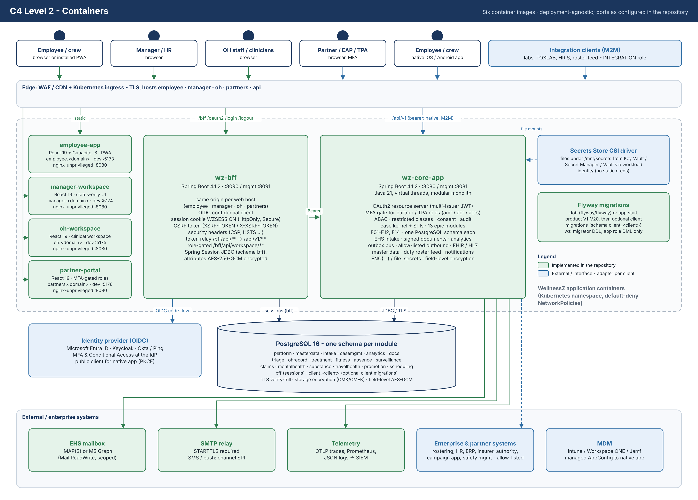

*Figure 2 – Containers (source: `docs/images/02-c4-container.svg`).*

| Container | Technology (pinned in repo) | Responsibility | Exposure |
|---|---|---|---|
| `employee-app` | React 19.3.1, TypeScript 6.0.3, Vite 8.3.5, Capacitor 8.6.0; image `nginxinc/nginx-unprivileged:1.30.6-alpine3.24` | Employee/crew portal, PWA shell, native app source | Static files on `:8080`; `/bff/**` routed to BFF by ingress |
| `manager-workspace` | React 19.3.1, same toolchain, same nginx image | Status-only workspace for managers, HR, OH | Static files on `:8080` |
| `oh-workspace` (increment 1) | React 19.3.1, same toolchain, same nginx image | OH clinical workspace (E01 intake, E02 triage, queues, SLA; increment 2 chart, encounters, fitness; increment 3 absence, surveillance, scheduling, reception kiosk, queue board, equipment and cold chain; increment 4 treatment, referrals, claims, finance, legal; increment 5 support cases, urgent call-backs, restricted chart placeholder, peer support, CISM, psychosocial register, testing programme and MRO, contact tracing, exposure timers, travel, advisories, public health, vaccination and promotion campaigns, screening, ergonomics) | Static files on `:8080`; host `oh.<domain>`; `/bff/**` routed to BFF by ingress |
| `partner-portal` (increment 4) | React 19.3.1, same toolchain, same nginx image | External partner providers and TPA adjusters (referrals, reports, invoices, telehealth, claims, pre-authorisations, shared documents); MFA sign-in page | Static files on `:8080`; host `partners.<domain>` (the only host intended for users outside the airline); `/bff/**` routed to BFF by ingress |
| `wz-bff` | Spring Boot 4.1.2, Spring Security OAuth2 client, Spring Session JDBC; `eclipse-temurin:21.0.12_8-jre-noble` | OIDC login, session, CSRF, token relay; workspace gate also admits `SAFETY_MANAGER` and `CREW_SCHEDULING` since increment 5 | `:8090`, management `:8091` |
| `wz-core-app` | Spring Boot 4.1.2 modular monolith, Java 21 (virtual threads enabled) | All APIs, business logic, jobs (outbox relay, mailbox poll, notification dispatch, idempotency purge, SLA timer poller; increment 2: retention flagging, fitness daily job, result escalation; increment 3: absence feed / triggers / LTA, surveillance due list, crew certificates, pre-employment purge, appointment reminders and no-shows, equipment calibration; increment 4: treatment variance, referral chase, provider scorecards, claims report deadlines; increment 5: CISM follow-ups, peer call-back purge, testing follow-ups and windows, exposure timers, public-health deadlines, travel-health daily job, ergonomic actions, screening follow-up) | `:8080` API, `:8081` management (health, Prometheus) |
| Flyway migrations | Flyway via Spring Boot starter or `flyway/flyway:11.20.3-alpine` Job | Schema migration with owner role | Job / start-up |
| PostgreSQL 16 | Managed service or CloudNativePG (`postgresql:16.15`) | System of record | Private endpoint, TLS |
| Identity provider | Entra ID / Keycloak 26.8.1 (local) / Okta etc. | Authentication, MFA (mandatory for partner and adjuster users since increment 4), tokens | External |

### 5.2 Component view (wz-core-app)

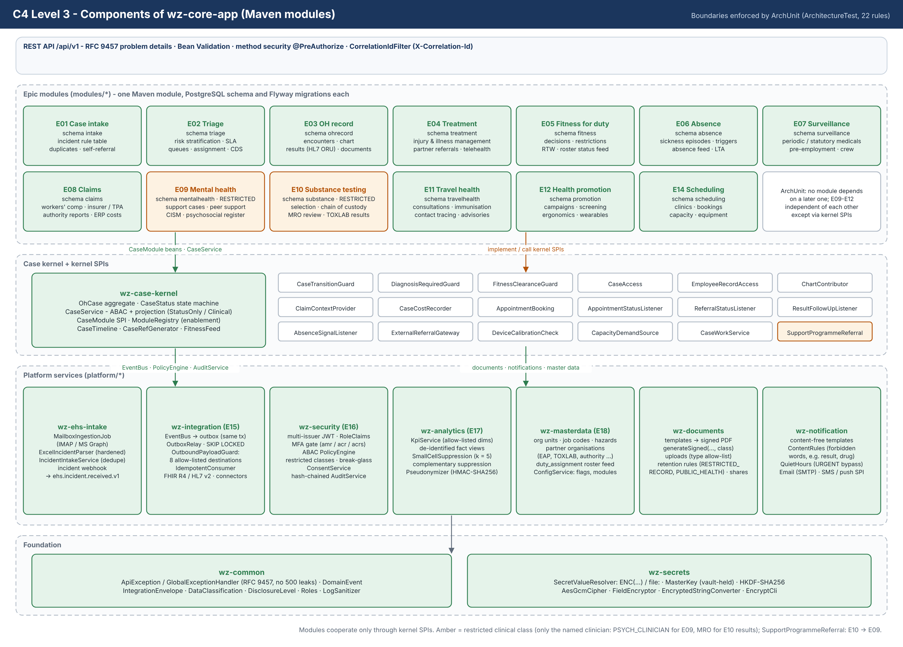

*Figure 3 – Components of the core API (source: `docs/images/03-component-view.svg`).*

| Maven module | Package root | Depends on | Key components |
|---|---|---|---|
| `wz-common` | `com.wellnessz.common` | – (no Spring Security, ArchUnit-enforced) | `ApiException`, `GlobalExceptionHandler` (RFC 9457), `DomainEvent`, `IntegrationEnvelope`, `DataClassification`, `DisclosureLevel`, `Roles`, `RoleClaims`, `CorrelationIdFilter`, `LogSanitizer`, UTC `Clock` |
| `wz-secrets` | `com.wellnessz.secrets` | common | `SecretsEnvironmentPostProcessor`, `SecretValueResolver`, `MasterKey`, `Hkdf`, `AesGcmCipher`, `FieldEncryptor`, `EncryptedStringConverter`, `EncryptCli` |
| `wz-security` (E16) | `com.wellnessz.security` | common | `ResourceServerSecurityConfig`, `WellnessZJwtConverter`, `CurrentUserProvider`, `PolicyEngine`, `AccessPolicy`, `DefaultPolicies`, `ConsentService`, `AuditService`, `SecurityEventAuditor` |
| `wz-masterdata` (E18) | `com.wellnessz.masterdata` | security | `OrgUnit`, `JobCode`, `Hazard`, `ConfigService`, `MasterDataController`; increment 1: `Employee` (HRIS master), `StaffMember` (OH staff roster, caseload caps, out-of-office cover), `EmployeeController` |
| `wz-integration` (E15) | `com.wellnessz.integration` | security, secrets | `EventBus`, `OutboxRelay`, `EventPublisher`, `OutboundPayloadGuard`, `IdempotentConsumer`, `IdempotencyService`, `FhirController`, `Hl7v2Controller`, `TerminologyService`, `ConnectorRegistry` |
| `wz-notification` | `com.wellnessz.notification` | common | `NotificationService`, `NotificationTemplates`, `ContentRules`, `QuietHours`, `NotificationChannel` |
| `wz-analytics` (E17) | `com.wellnessz.analytics` | security | `KpiService`, `SmallCellSuppression`, `Pseudonymizer`, `AnalyticsController` |
| `wz-case-kernel` | `com.wellnessz.casekernel` | masterdata, integration, security, secrets | `OhCase`, `CaseService`, `CaseViews`, `CaseModule`, `ModuleRegistry`; increment 1: `OpenCaseCommand`, `CaseRefGenerator`, `CaseTimeline`, `CaseWorkService` (tasks, links, attachments), `CaseAccess`, **`CaseTransitionGuard` SPI**; increment 3: seven SPIs (Section 21.1); increment 4: **`CaseCostRecorder`, `ExternalReferralGateway`, `ReferralStatusListener`, `ClaimContextProvider`**; increment 5: **`SupportProgrammeReferral`** |
| `wz-ehs-intake` | `com.wellnessz.ehsintake` | integration, security, secrets | `ExcelIncidentParser`, `MailboxIngestionJob`, `ImapMailboxReader`, `GraphMailboxReader`, `IncidentIntakeService`; increment 1: `IncidentWebhookService`, `DeadLetterController` |
| `wz-e01-intake` (increment 1) | `com.wellnessz.e01` | case-kernel, ehs-intake, notification | `E01Module`, `IncidentIntakeListener`, `RuleEngine`, `IntakeRule`, `ReferralService`, `TemplateCatalog`, `EncounterService`, `TriggerService`, `DuplicateService`, `RecordabilityService` (a `CaseTransitionGuard`), `ReconciliationService`, `IntakeNotificationDispatcher`, **`RecipientResolver` SPI** |
| `wz-e02-triage` (increment 1) | `com.wellnessz.e02` | e01-intake (only for the `RecipientResolver` SPI and notification types) | `E02Module`, `ProtocolCatalog`, `ProtocolEvaluator`, `TriageService`, `SlaService`, `AssignmentEngine`, `AssignmentService`, `QueueService`, `EscalationService`, `ComplexityService`, `SafetyService` (a `CaseTransitionGuard`), `TriageAuditService`, `OhRecipientResolver` |
| `wz-documents` (increment 2) | `com.wellnessz.documents` | case-kernel, notification, Apache PDFBox | `DocumentService`, `DocumentTemplates`, `PdfRenderer`, `RetentionService`, `OcrProvider` / `TesseractOcrProvider` |
| `wz-e03-record` (increment 2) | `com.wellnessz.e03` | e02-triage, documents | `E03Module`, `ChartService`, `ClinicalEncounterService`, `TerminologyCatalog`, `OrderService`, `ResultService` (calls `DeviceCalibrationCheck` and `ResultFollowUpListener` since increment 3), `CdsService`, `FhirExportService` |
| `wz-e05-fitness` (increment 2) | `com.wellnessz.e05` | e02-triage, documents | `E05Module`, `FitnessDecisionService` (calls `FitnessClearanceGuard` since increment 3), `RestrictionService`, `MatchingEngine`, `RtwService`, `JobOfferService`, `CrewService`, `RosterFeedLog`, `FitnessChartContributor` |
| `wz-e06-absence` (increment 3) | `com.wellnessz.e06` | e05-fitness, documents | `E06Module`, `AbsenceFeedService` + `AbsenceFeedConnector` SPI, `RuleEngine` / `AbsenceTriggerEngine`, `AbsenceQueueService`, `CertificateService`, `LtaService` (calls `AbsenceSignalListener`, books through `AppointmentBooking`), `AdviceService`, `AbsenceAnalyticsService` / `UnitAggregator`, `AbsenceCapacityDemand`, `AbsenceJobs` |
| `wz-e07-surveillance` (increment 3) | `com.wellnessz.e07` | e03-record, e05-fitness, documents | `E07Module`, `ProgrammeService` / `EnrolmentEngine`, `DueService`, `ExposureService`, `FollowUpService` (a `ResultFollowUpListener`), `RaiService` (`AbsenceSignalListener` + `FitnessClearanceGuard`), `PreEmploymentService`, `CrewCertificateService`, `ImmunisationService` (`Gs1Lot`), `ComplianceService`, `AuditPackService`, `SurveillanceSpi`, `SurveillanceChartContributor`, `SurveillanceJobs` |
| `wz-e14-scheduling` (increment 3) | `com.wellnessz.e14` | e02-triage, documents | `E14Module`, `CatalogueService`, `SlotEngine` / `BookingRules`, `AppointmentService`, `AppointmentBookingAdapter` (`AppointmentBooking`), `StatusNotifier`, `ClinicQueueService`, `CampaignService` / `CampaignPlanner`, `EquipmentService` / `EquipmentRules`, `EquipmentCalibrationCheck` (`DeviceCalibrationCheck`), `CapacityService`, `SchedulingJobs` |
| `wz-e04-treatment` (increment 4) | `com.wellnessz.e04` | e03-record, e05-fitness, documents | `E04Module`, `PlanService` / `PlanMaths`, `EReferralService` / `ReferralCore` / `DataSetValidator` / `ChaseRules` / `FhirMapper` (implements `ExternalReferralGateway`), `PartnerReferralService`, `ProviderDirectoryService` / `ScorecardMaths`, `PreauthService` / `InvoiceMatcher` (calls `CaseCostRecorder`, `ClaimContextProvider`), `MedicationAdminService` / `MedicationChecks`, `EPrescribingGateway` (SPI, no-op default), `OutcomeService`, `OutcomeClosureGuard` (`CaseTransitionGuard`), `TelehealthService` / `TokenWindow` + `TelehealthProvider` SPI, `TreatmentChartContributor`, `TreatmentAppointmentListener`, `TreatmentJobs` |
| `wz-e08-claims` (increment 4) | `com.wellnessz.e08` | e05-fitness (RTW status), documents | `E08Module`, `ClaimService` / `ClaimWorkflow` (implements `ClaimContextProvider`), `NurseAssignmentService`, `ReportService` / `ReportDeadlines` + `ClaimsSubmissionGateway` SPI (`DefaultClaimsSubmissionGateway`), `DisclosureSetService` / `DisclosureRules` / `Redaction`, `CollaborationService`, `CostService` / `CostMath` / `ErpExport` (implements `CaseCostRecorder`), `LegalService` (implements `ReferralStatusListener` for `CLAIM_IME`), `ClaimsJobs`, `ClaimsDemoSeeder` (local / test only) |
| `wz-e09-mentalhealth` (increment 5) | `com.wellnessz.e09` | e05-fitness (fitness / roster status), documents | `E09Module`, `SupportCaseService` / `SupportAccess` (named-clinician check, placeholder, break-glass), `PathwayService` (`Screening`, urgent-risk protocol), `EapService`, `SupportProgrammeReferralAdapter` (implements `SupportProgrammeReferral`), `PeerSupportService` (`ContactCodes`), `CismService` / `CismIncidentListener` (`CismRules`), `PsychosocialService` (`PsychosocialScoring`, `Suppression`), `ReliefService`, `MhFitnessService`, `MentalHealthJobs`, `MentalHealthDemoSeeder` (local / test only) |
| `wz-e10-substance` (increment 5) | `com.wellnessz.e10` | e05-fitness, documents – **not** e09 (support referral only through the kernel SPI) | `E10Module`, `PolicyService`, `SelectionEngine` / `SelectionService` / `CoverageMath`, `TriggerService` / `IncidentTestListener` / `PostIncidentRules` / `TestWindows`, `CollectionService` / `CustodyLog`, `LabService` (bound `TOXLAB` client), `MroService` / `MroStateMachine`, `PathwayService` (calls `SupportProgrammeReferral`), `RtdService` / `FollowUpScheduler`, `StatisticsService` / `Suppression`, `SubstanceJobs`, `SubstanceDemoSeeder` (local / test only) |
| `wz-e11-travelhealth` (increment 5) | `com.wellnessz.e11` | e07-surveillance (immunisation registry; E05 food-handler service through E07's dependency chain), documents | `E11Module`, travel consultations and `TravelRecommendations`, communicable-disease cases with `TracingRules`, exposure pathways with `ProtocolTimers`, vaccination campaigns (`UptakeMaths`, GS1 lots), advisories (`AdvisoryTargeting`), public-health reports, `TravelHealthJobs`, `TravelHealthDemoSeeder` (local / test only) |
| `wz-e12-promotion` (increment 5) | `com.wellnessz.e12` | e03-record (audiometry results, `EmployeeRecordAccess`), documents | `E12Module`, `PromotionCampaignService`, `PromotionAnalyticsService` (`InsightRules`, `Suppression`), `ScreeningService` (`ScreeningThresholds`), `EducationService`, `ErgonomicsService` (`ErgonomicScoring`), `WearableService` / `WearableConsentListener` (`WearableGate`), `PromotionJobs`, `PromotionDemoSeeder` (local / test only) |

ArchUnit rules (`apps/wz-core-app/src/test/java/com/wellnessz/app/ArchitectureTest.java`, **22 rules** since increment 5):

1. Platform packages must not depend on `casekernel`, `ehsintake`, `documents` or any business module (`e01`–`e14`).
2. `casekernel` must not depend on any business module or on `documents` – modules plug into the kernel through SPIs
   (`CaseModule`, `CaseTransitionGuard`, `ChartContributor`, the increment-3, increment-4 and increment-5 SPIs) and
   events, never the reverse.
3. `documents` must not depend on any business module (increment 2).
4. `e03` must not depend on `e05` (increment 2).
5. `e05` must not depend on `e03` (increment 2).
6. `e01` / `e02` must not depend on any later module (increments 2–5).
7. `e03` / `e05` must not depend on `e06`, `e07` or `e14` – they call increment-3 behaviour only through
   `DeviceCalibrationCheck`, `ResultFollowUpListener` and `FitnessClearanceGuard` (increment 3).
8. `e03`, `e05`, `e06`, `e07`, `e14` must not depend on `e04` or `e08` – increment-4 modules plug in through
   `ExternalReferralGateway`, `CaseCostRecorder` and `ClaimContextProvider` (increment 4).
9. **Earlier modules (`e01`–`e08`, `e14`) must not depend on `e09`–`e12`** – increment-5 modules plug in through
   kernel SPIs (`SupportProgrammeReferral`) and in-process events (increment 5).
10. **`e09` / `e10` must not depend on `e03`, `e04`, `e06`, `e07`, `e08`, `e11`, `e12` or `e14`** – restricted-class
    programmes keep their own records (increment 5).
11. **`e10` must not depend on `e09`** – the testing programme refers into the support programme only through the
    kernel SPI (increment 5).
12. **`e11` / `e12` must not depend on `e04`, `e06`, `e08`, `e09`, `e10` or `e14`** – E11 builds on the E07
    immunisation registry, E12 on the E03 record; bookings go through `AppointmentBooking` (increment 5).
13. **`e12` must not depend on `e11`** (increment 5).
14. `e04` must not depend on `e08`, `e06`, `e07` or `e14` – it posts costs through `CaseCostRecorder` and reads the
    claim context through `ClaimContextProvider` (increment 4).
15. `e08` must not depend on `e04`, `e03`, `e06`, `e07` or `e14` – **claims never read the clinical record**; IMEs go
    through `ExternalReferralGateway` (increment 4).
16. `e06` must not depend on `e07` or `e14` (increment 3).
17. `e07` must not depend on `e06` or `e14` (increment 3).
18. `e14` must not depend on `e03`, `e05`, `e06` or `e07` – scheduling never reads clinical content (increment 3).
19. `e01` must not depend on `e02` – E02 depends on E01 through the `RecipientResolver` SPI; the reverse would create
    a cycle (increment 1).
20. `ehsintake` must not depend on `casekernel` – the two communicate only via `ehs.incident.received.v1`.
21. `common` must not depend on Spring Security.
22. No code outside `com.wellnessz.secrets` (the CLI) may use `System.out`/`System.err`.

### 5.3 Deployment view


*Figure 4 – Deployment reference (source: `docs/images/07-deployment-reference.svg`). The deployment assets are
maintained under `deploy/`; since increment 5 each cloud set-up exists as DEV, UAT and PROD (Terraform variable files,
Helm overlays, GitHub Environments – `deploy/environments/README.md`). The standards used per layer and set-up are
compared in document 04; the infrastructure code has been validated but not yet applied to a real subscription,
project or on-premises cluster.*

## 6. Data architecture

### 6.1 Schemas and stores

All schemas live in one PostgreSQL 16 database; the BFF uses its own schema and migration history.

| Schema | Tables / views (migration) | Content | Classification (highest) |
|---|---|---|---|
| `platform` | `audit_event`, `consent`, `outbox_event`, `processed_message`, `idempotency_record`, `inbound_message`, `code_concept`, `notification` (V1) | Cross-cutting platform state | CLINICAL (inbound and outbox payloads field-encrypted) |
| `masterdata` | `org_unit`, `job_code`, `hazard`, `config_entry` (V2); `employee` (HRIS master), `staff_member` (OH staff roster) (V3); fitness standards, restriction catalogue, job-demand profiles (V6); `clinic_site` (V9); `partner_organisation` (V13) | Organisation, job/hazard catalogue, configuration, employee and OH staff master data, clinic sites, partner organisations (providers, insurers, TPA, authorities) | CONFIDENTIAL (`employee`), otherwise INTERNAL |
| `intake` | `import_batch`, `ehs_incident` (V2); `incident_dlq`, `intake_rule`, `incident_evaluation`, `encounter`, `absence_episode`, `trigger_event`, `recordability_assessment`, `recordability_mapping`, `notification_rule` (V4) | EHS incidents, import provenance, E01 rules, encounters, triggers, recordability | CLINICAL (`description`, DLQ payload, encounter clinical fields, recordability rationale encrypted) |
| `casemgmt` | `oh_case`, sequence `case_ref_seq` (V2); `case_sequence`, `case_link`, `case_event`, `case_task`, `case_attachment` (V3) | Case aggregate, timeline, tasks, links, attachments | CLINICAL / RESTRICTED_CLINICAL (`clinical_summary` and attachment content encrypted) |
| `triage` (increment 1) | `work_queue`, `sla_policy`, `sla_timer`, `assignment_rule`, `case_assignment`, `triage_protocol`, `triage_assessment`, `escalation`, `case_conference`, `case_risk_flags`, `complexity_assessment`, `duration_guideline`, `case_checklist`, `handover`, `saved_view`, `triage_audit_sample`, `case_advice` (V5) | E02 triage, queues, SLA, assignment, escalation | CLINICAL (triage answers and notes, escalation notes, conference minutes, handover notes, checklist answers encrypted) |
| `docs` (increment 2) | `document`, `document_share`, `document_sequence`, `retention_schedule` (V6) | Generated and scanned documents, shares, retention schedule | CLINICAL / RESTRICTED_CLINICAL (content, merge fields and extracted text encrypted; `search_vector` holds keyed tokens only) |
| `ohrecord` (increment 2) | `problem`, `allergy`, `medication`, `immunisation`, `job_history`, `encounter`, `encounter_diagnosis`, `encounter_observation`, `encounter_addendum`, `encounter_photo`, `encounter_template`, `lab_order`, `order_sequence`, `result`, `drug_class`, `cds_rule`, `cds_alert_log`, `term_favourite`, `term_usage`, `term_mapping` (V7) | E03 OH record, encounters, orders, results, CDS, terminology preferences | CLINICAL / RESTRICTED_CLINICAL (mental-health encounters and restricted result codes) |
| `fitness` (increment 2) | `fitness_decision`, `restriction_instance`, `duty_proposal`, `rtw_plan`, `rtw_review`, `job_offer`, `crew_profile`, `roster_feed_message`, `food_handler_episode`, `ihr_assessment` (V8) | E05 decisions, restrictions, duties, RTW, job offers, crew feed log, food handlers, IHR | CLINICAL (rationale and clinical notes); status / functional restriction columns are CONFIDENTIAL |
| `absence` (increment 3) | `feed_run`, `episode`, `feed_mismatch`, `trigger_rule`, `trigger_rule_version`, `queue_item`, `contact`, `certificate`, `certificate_call`, `lta_pathway`, `lta_milestone`, `case_conference`, `advice_request`, `advice_report`, sequence `advice_ref_seq` (V10) | E06 absence episodes and feed reconciliation, trigger rules and queue, certificates, LTA pathway, advice requests and reports | CLINICAL (contact, milestone and conference notes, certificate extraction and validation notes, advice context and decline reason encrypted); episodes with dates, type and reason category are CONFIDENTIAL and never shown to managers with the reason |
| `surveillance` (increment 3) | `programme`, `employee_profile`, `enrolment`, `completion`, `invitation`, `pre_employment`, `crew_certificate`, `immunisation_requirement`, `vaccine_administration`, `titre`, `immunisation_reminder`, `exposure_group`, `ih_measurement`, `cosmic_dose`, `pregnancy_declaration`, `evaluation_rule`, `follow_up`, `return_after_illness`, `compliance_snapshot`, `audit_pack` (V11) | E07 programmes and enrolments, invitations, pre-employment, crew certificates, immunisations, exposure registers, follow-ups, return after illness, compliance and audit packs | CLINICAL (pre-employment questionnaire and conditions, crew certificate answers, follow-up and return-after-illness notes, exemption reasons encrypted); `employee_profile` holds date of birth and licence types (CONFIDENTIAL) for age-based frequencies |
| `scheduling` (increment 3) | `appointment_type`, `resource`, `diary_template`, `campaign`, `appointment`, `campaign_slot`, `waitlist_entry`, `equipment`, `calibration`, `temperature_reading`, `excursion` (V12) | E14 service catalogue, resources and diaries, appointments, campaigns, waitlist, equipment register, calibration certificates (`bytea` + SHA-256), cold-chain readings and excursions | CONFIDENTIAL (who has which appointment type when; no clinical content by design); equipment and cold-chain data INTERNAL |
| `treatment` (increment 4) | `ref_sequence`, `plan_template`, `treatment_plan`, `follow_up`, `variance_alert`, `service_catalogue`, `referral`, `referral_history`, `provider_profile`, `provider_contract`, `provider_scorecard`, `preauth`, `invoice`, `formulary_item`, `stock_batch`, `administration`, `outcome`, `telehealth_session`, `telehealth_token`, `telehealth_message` (V14) | E04 treatment plans and follow-ups, variance alerts, e-referrals and history, provider profiles / contracts / scorecards, pre-authorisations, invoices, clinic formulary, stock and administrations, outcomes, telehealth sessions, tokens and chat | CLINICAL (plan goals and interventions, referral reason, question, data set, report summary and FHIR payload, pre-auth justification, administration dose and allergy override, outcome and follow-up notes, chat text encrypted); telehealth participant tokens stored as hashes only; provider contracts and rates INTERNAL |
| `claims` (increment 4) | `ref_counter`, `claim`, `claim_history`, `report_form`, `first_report`, `disclosure_set`, `disclosure_set_document`, `claim_task`, `claim_message`, `message_read`, `cost_entry`, `budget`, `cost_export`, `legal_request`, `legal_report` (V15) | E08 claims and lifecycle history, report forms and first reports, disclosure sets, adjuster tasks and messages, cost ledger, budgets, ERP exports, legal requests and medico-legal report versions | CONFIDENTIAL (claim status, payer, amounts); CLINICAL for encrypted free text (claim notes, first-report fields, messages, legal questions); medico-legal reports live in `docs` and are restricted to the legal access set |
| `mentalhealth` (increment 5) | `ref_counter`, `support_case`, `support_note`, `support_contact`, `support_event`, `instrument`, `instrument_item`, `instrument_option`, `instrument_band`, `screen_result`, `urgent_item`, `protocol`, `signposting`, `eap_referral`, `peer_volunteer`, `peer_training`, `peer_contact_request`, `peer_contact`, `trusted_referral`, `sms_report`, `relief`, `cism_event`, `cism_affected`, `psychosocial_assessment`, `psychosocial_action`, `fitness_assessment` (V17) | E09 support cases, notes, screening instruments and results, urgent items, EAP referrals, peer volunteers and pseudonymous contacts, CISM, psychosocial register, relief and fitness assessments | **RESTRICTED_CLINICAL** (notes, screening detail, urgent items, EAP clinical detail, contact phones encrypted); peer tables have **no employee column** (verified against `information_schema` in the integration test); psychosocial register is INTERNAL at unit level |
| `substance` (increment 5) | `ref_counter`, `panel`, `policy`, `pool_exclusion`, `selection`, `test`, `specimen`, `custody_event`, `duty_status`, `rtd_plan`, `post_incident_rule` (V18) | E10 policies, selections (seed, pool hash, commitment), tests, specimens, chain-of-custody events, duty status, return-to-duty plans | **RESTRICTED_CLINICAL** (laboratory results, breath readings, MRO interview notes, treatment provider encrypted); `custody_event` append-only (no `UPDATE` / `DELETE` grant, trigger rejects changes even for the owner); `duty_status` is CONFIDENTIAL status only |
| `travelhealth` (increment 5) | `ref_counter`, `destination`, `consultation`, `consultation_reminder`, `condition`, `cd_case`, `contact`, `check_in`, `pathway`, `chemical`, `exposure`, `exposure_task`, `campaign`, `campaign_invitation`, `campaign_decline`, `adverse_event`, `advisory`, `advisory_target`, `ph_report`, `ph_correspondence` (V19) | E11 destinations and consultations, communicable-disease cases, contacts and check-ins, exposure pathways and tasks, vaccination campaigns, advisories, public-health reports | CLINICAL (consultation advice and prophylaxis, exposure details, task notes, decline reasons, adverse-event actions, correspondence summaries encrypted); destination and condition tables INTERNAL |
| `promotion` (increment 5) | `campaign`, `campaign_invitation`, `participation`, `screening_event`, `screening_participant`, `screening_result`, `education_attendance`, `ergonomic_checklist`, `ergonomic_assessment`, `ergonomic_photo`, `ergonomic_action`, `wearable_enrolment`, `wearable_daily` (V20) | E12 campaigns and participation, screening events and results, education, ergonomic assessments, photos and actions, wearable enrolments and daily totals | CLINICAL (screening measures and flags encrypted); wearable data CONFIDENTIAL, daily totals only, purged on withdrawal; campaign and ergonomic action data INTERNAL |
| `analytics` | view `v_case_facts` (V2) | De-identified case facts | INTERNAL (aggregate) |
| `bff` | `spring_session`, `spring_session_attributes` (`db/bff/V1`) | Browser sessions including OAuth2 tokens | CONFIDENTIAL (attributes encrypted) |

Increment 1 adds migrations V3 (kernel and master data), V4 (E01) and V5 (E02, schema `triage`). Synthetic demo people
(`db/demo/R__demo_reference_people.sql`, a repeatable migration) are loaded **only** by the `local` and `test` profiles,
which add `classpath:db/demo` to `spring.flyway.locations`; every other environment uses `WZ_FLYWAY_LOCATIONS`
(default `classpath:db/migration`) and the Helm migration Job reads `db/migration` only. The schema list is maintained
in `spring.flyway.schemas`, the Helm value `migrations.job.core.schemas`, `deploy/local/postgres/01-init-wellnessz.sh`,
`deploy/sql/bootstrap-managed-postgres.sql` and `deploy/hybrid/cnpg/03-cluster.yaml`.

Increment 2 adds migrations V6 (platform: master data for fitness standards, restriction catalogue and job-demand
profiles; `platform.break_glass_grant`, `platform.disclosure_log`, `platform.scheduled_job_run`; schema `docs`; primary
coded diagnosis on `casemgmt.oh_case`), V7 (schema `ohrecord`, terminology starter content and
`platform.terminology_release`) and V8 (schema `fitness`). Demo data for the `local` and `test` profiles only:
`db/demo/R__demo_e03_record.sql` (OH chart of demo employee `E1004`) and `db/demo/R__demo_e05_fitness.sql` (crew
fleet / base). The schema list in all five places named above then read
`platform, masterdata, intake, casemgmt, triage, docs, ohrecord, fitness, analytics` (extended by increment 3, below). The runtime role receives no
`DELETE` on `docs.document`.

Increment 3 adds migrations V9 (platform: `masterdata.clinic_site` with six seeded sites, nine exposure hazards and five
job codes for the surveillance programmes, retention classes `ABSENCE_RECORD` and `PRE_EMPLOYMENT`), V10 (schema
`absence`), V11 (schema `surveillance`) and V12 (schema `scheduling`). Demo data for the `local` and `test` profiles
only: `R__demo_e06_absence.sql`, `R__demo_e07_surveillance.sql`, `R__demo_e14_scheduling.sql` and five more HRIS
employees (`E1006`–`E1010`) in `R__demo_reference_people.sql`; encrypted columns are left empty in demo data because
field keys differ per environment. The schema list in all five places named above then read
`platform, masterdata, intake, casemgmt, triage, docs, ohrecord, fitness, absence, surveillance, scheduling, analytics`
(extended by increment 4, below).
The runtime role has no `DELETE` on clinical tables in the new schemas (corrections are state changes); exceptions are
technical rows (`surveillance.immunisation_reminder`, `surveillance.compliance_snapshot`, `scheduling.diary_template`).

Increment 4 adds migrations V13 (platform: `masterdata.partner_organisation` with 25 seeded organisations – 20
providers including hub, outstation and layover-city partners and a travel-assistance partner, the payers `GULFTPA`
(TPA), `AVIA_INSURE` and `GROUPMED` (insurers) and the authorities `AUTH_OSH` and `AUTH_LABOUR_AE` – and the retention
class `CLAIM_RECORD`), V14 (schema `treatment`, service catalogue, plan templates, provider profiles, contracts and the
clinic formulary) and V15 (schema `claims`, report forms). Each module migration starts with
`create schema if not exists`. Demo data for the `local` and `test` profiles only: `R__demo_e04_treatment.sql`,
`R__demo_e08_claims.sql` and `ClaimsDemoSeeder` (a `local` / `test` bean that fills the encrypted demo fields of E08,
which SQL cannot do). The schema list in all five places named above now reads
`platform, masterdata, intake, casemgmt, triage, docs, ohrecord, fitness, absence, surveillance, scheduling, treatment,
claims, analytics` (extended by increment 5, below).

Increment 5 adds migrations V16 (platform: `masterdata.duty_assignment`, partner organisations `EAP_WELLBEING`,
`TOXLAB`, `UKHSA_LOCAL`, retention classes `RESTRICTED_RECORD` and `PUBLIC_HEALTH`), V17 (schema `mentalhealth`, with
signposting, PHQ-9 / GAD-7 items and bands, the urgent-risk protocol and configuration keys), V18 (schema `substance`,
panels, post-incident rules), V19 (schema `travelhealth`: 15 destinations, 9 conditions, 5 exposure pathways with
timers, 6 chemicals with safety-data-sheet links) and V20 (schema `promotion`: five planned portfolio campaigns, three
ergonomic checklists). Demo data for the `local` and `test` profiles only: `R__demo_reference_duties.sql` (flight,
shift and facility rosters), `R__demo_e09_mentalhealth.sql`, `R__demo_e10_substance.sql`,
`R__demo_e11_travelhealth.sql`, `R__demo_e12_promotion.sql` and four `*DemoSeeder` beans that write the encrypted demo
values (SQL cannot). The schema list in all five places named above now reads
`platform, masterdata, intake, casemgmt, analytics, triage, docs, ohrecord, fitness, absence, surveillance, scheduling,
treatment, claims, mentalhealth, substance, travelhealth, promotion`. Client-specific migrations run after these in
their own schema and history table (Section 23.6).

Flyway migrations (`apps/wz-core-app/src/main/resources/db/migration`) run as an owner role (`WZ_DB_MIGRATOR_USERNAME`,
`wz_migrator` in Terraform/CNPG). Each migration grants the runtime role (`${app_role}`, the value of
`WZ_DB_USERNAME`) the minimum DML it needs; for example `audit_event` receives `SELECT, INSERT` only and `consent` has
no `DELETE`. Hibernate runs with `ddl-auto: validate`, so the application never changes the schema at runtime.

### 6.2 Data classification scheme

`com.wellnessz.common.model.DataClassification` defines five levels, driving encryption, disclosure and (in future)
retention:

| Level | Definition (from code) | Examples | Controls |
|---|---|---|---|
| `PUBLIC` | Publicly releasable | – | none specific |
| `INTERNAL` | Internal operational data | org hierarchy, hazard catalogue, suppressed aggregates | authenticated access |
| `CONFIDENTIAL` | Personal data that is not health data | employee id, name, notification address, consent records | authenticated, role-based, TLS, storage encryption |
| `CLINICAL` | OH clinical data; never leaves the OH domain | case clinical summary, incident narrative, lab results | + field-level AES-256-GCM, ABAC `CLINICAL`, status-only projection for non-OH roles, outbound allow-list |
| `RESTRICTED_CLINICAL` | Special-category clinical data (psychological health, substance testing) | cases of category `PSYCHOLOGICAL`, `SUBSTANCE`; since increment 5 E09 support cases, screening, urgent call-backs, EAP clinical detail, E10 results and chain-of-custody forms (documents generated with `DataClassification.RESTRICTED_CLINICAL`) | + visible only to the named `PSYCH_CLINICIAN` (E09), the `MRO` through the E10 endpoints (results), break-glass holders (read-only, reviewed) and the data subject; count-only placeholder for general OH; excluded from the analytics view and from E12 insights (Section 8.6) |

The case classification is derived from the category (`CaseCategory.classification()`), so it cannot be set
inconsistently by a client.

### 6.3 Field-level encryption, key derivation and blind index

Field-level encryption complements storage encryption (Azure customer-managed keys, Cloud SQL CMEK, CNPG volume
encryption), so that database dumps, replicas, backups or DBA access do not reveal clinical text.

| Aspect | Implementation |
|---|---|
| Algorithm | AES-256-GCM (`AesGcmCipher`), random 96-bit IV per value, 128-bit tag; wire format `base64(iv‖ciphertext‖tag)`. |
| Associated data | Context string bound into the tag (`wellnessz-field` for columns, `wellnessz-config` for configuration, `bff-session` for sessions), so ciphertexts cannot be moved between purposes. |
| Master key | 256-bit, from `WZ_MASTER_KEY` (base64) or `WZ_MASTER_KEY_FILE` (CSI-mounted file); the application refuses to start without it. |
| Key derivation | HKDF-SHA256 (RFC 5869) with purpose labels: `wellnessz/field/<version>`, `wellnessz/config/v1`, `wellnessz/bff-session/v1`, `wellnessz/blind-index/v1`. |
| Versioning | Stored values are prefixed with the key version (`v1:...`). New writes use `wellnessz.crypto.active-key-version` (`WZ_FIELD_KEY_VERSION`); old versions remain readable. |
| JPA integration | `@Convert(converter = EncryptedStringConverter.class)` – used today on `oh_case.clinical_summary`, `ehs_incident.description`, `inbound_message.payload`, `outbox_event.payload`; verified by integration tests (raw column starts with `v1:` and does not contain the plaintext, for case summaries and outbox payloads). |
| Blind index | `FieldEncryptor.blindIndex()` – keyed HMAC-SHA256 for equality search over encrypted columns. Available; no column uses it yet. Increment 2: used for document full-text search – each word becomes a keyed token in `docs.document.search_vector` (Section 14.17). |

**Key-rotation properties (important for GRC).** Changing the *active version* rotates the data-encryption sub-key for
new writes without downtime. Because all versions are derived from the same master key, this does **not** protect
against compromise of the master key itself. Rotating the master key requires re-encrypting existing values; the
re-encryption job referred to in `FieldEncryptor`'s documentation is **planned, not implemented**. The blind-index key
is not versioned. Recommendation (decision D5): adopt envelope encryption with the master key wrapped by Azure Key
Vault / Cloud KMS / Vault Transit, and deliver the re-encryption job before go-live.

### 6.4 Data that is not field-encrypted

To set expectations precisely: the following columns rely on storage encryption and access control only.
(`outbox_event.payload` is field-encrypted and delivered rows are purged – see 7.1.)

| Column(s) | Content | Mitigation / recommendation |
|---|---|---|
| `oh_case.employee_id`, `employee_display_name`, `org_unit_*`, `category`, `status`, `fitness_status` | Identifiers and status needed for queries and status-only views | ABAC on every read; `category` reveals the restricted class to a database reader (E09 / E10 cases exist as restricted kernel cases) – the API exposes only a count to general OH roles; encrypting the category of restricted rows remains a recommendation (R28) |
| `masterdata.duty_assignment` (increment 5) | Employee, duty, date, times, location, destination, proximity group | Read only by OH roles, `SAFETY_MANAGER`, `CREW_SCHEDULING`; contact-tracing notices never name the index case |
| `substance.selection` (increment 5) | Role group, period, seed, pool hash, selected employees | Programme manager and auditor read selections and verification, never results |
| `ehs_incident.employee_name`, `location`, `incident_type`, `severity`, `injury` | Incident metadata | Description (free text) is encrypted and not exposed in list API |
| `idempotency_record.response_body` | Stored API responses | Purged after 7 days by `IdempotencyService.purge()` |
| `notification.address`, `body` | Recipient address and content-free message | Body is content-free by construction |
| `audit_event` | Actor, action, resource id, reason, client IP | Reasons are sanitised; must not contain PHI by coding standard |
| `absence.episode` (increment 3) | Employee, dates, absence type, reason category, certified flag | ABAC (status-only for managers / HR within org scope); managers never receive `reasonCategory`; only sickness and injury episodes (`SICKNESS`, `INJURY_WORK`, `INJURY_NON_WORK`) feed the trigger rules |
| `scheduling.appointment` (increment 3) | Employee, appointment type, site, time, status, check-in ticket | Visible to OH, schedulers and reception (no clinical read); queue board shows tickets, not names |
| `surveillance.employee_profile` (increment 3) | Date of birth, licence types | OH roles only; used for age-based examination frequencies (e.g. Class 1 every 6 months from age 40) |
| `scheduling.calibration.document_content` (increment 3) | Calibration certificate (vendor PDF) | Not personal data; integrity by stored SHA-256 |
| `treatment.referral` status columns, `treatment.preauth` / `invoice` amounts (increment 4) | Service, provider, urgency, dates, status; estimate, approved and invoiced amounts | OH roles and claims coordinators only; partners see their own organisation's referrals (404 otherwise); adjusters see their payer's pre-authorisations without justification |
| `claims.claim`, `claims.cost_entry`, `claims.cost_export` (increment 4) | Claim type, status, payer, reserves, cost ledger, ERP export rows | Money only for CLAIMS_COORDINATOR, FINANCE, CMO; finance views aggregate by unit with suppression; export rows carry cost centre and category, no names |

### 6.5 De-identified analytics view

`analytics.v_case_facts` exposes only `org_unit_code`, `category`, `source`, `status`, `fitness_status` and the month of
opening; it has no identifiers, names or free text and excludes `RESTRICTED_CLINICAL` cases entirely. The runtime role
has `SELECT` on the view only within the `analytics` schema (it still has table access in `casemgmt`, so a separate
read-only reporting role is recommended for warehouse extraction).

### 6.6 Retention and deletion – to be defined for OH records

The code implements purges only for technical data: delivered outbox events after `wellnessz.integration.outbox.retention`
(default `P30D`, `OutboxRelay.purgeDelivered`, cron `wellnessz.integration.outbox.purge-cron`, default 02:30 daily),
idempotency records after 7 days, and Spring Session expiry. There are **no retention or deletion jobs for OH records**
(cases, incidents, consents, audit) yet. Retention periods for OH records are governed by national occupational-health and
aviation-medicine rules (often decades for exposure records) and must be set by the Data Protection Officer and OH
governance. Proposed approach (decision D6): a retention schedule per `DataClassification` and record type in E18
configuration, a scheduled purge/anonymisation job per module, legal-hold flags, and audit events for every purge.
Audit records must be retained at least as long as the records they describe.

**Increment 2 update.** Documents now carry a retention schedule and legal hold (`platform/wz-documents`,
`RetentionService`): `docs.retention_schedule` holds one rule per record class (`OH_RECORD` 40 years from the last
encounter, `EXPOSURE_RECORD` 40, `AEROMEDICAL_RECORD` 10, `FITNESS_CERTIFICATE` 6, `CORRESPONDENCE` 6, `PHOTO` 6,
`EXTERNAL_REPORT` 10 years – **proposals pending DPO / CMO approval**), editable only by the DPO (audited
`RETENTION_SCHEDULE_APPROVED`). A daily job (`wellnessz.documents.retention-cron`, default `0 30 2 * * *` UTC, once per
day across replicas through `JobRunGuard`) lists documents past retention and not on legal hold for DPO review
(`GET /documents/retention/due`). **Nothing is deleted automatically**: destruction remains a reviewed, audited
decision outside the job, and the runtime role has no `DELETE` grant on documents. Triggers other than the document
date (`LAST_ENCOUNTER`, `EMPLOYMENT_END`) need HRIS employment end dates. Retention of the structured E03/E05 tables
(chart, encounters, results, decisions) and of cases is still open (decision D6, open item O12).

**Increment 3 update.** Two proposed retention classes were added (pending DPO / CMO approval): `ABSENCE_RECORD`
6 years from the document date (sick certificates, OH advice reports – limitation period of employment claims) and
`PRE_EMPLOYMENT` 1 year (health data of candidates who are not hired; hired candidates move to `OH_RECORD`). E07
implements the **first automatic purge** of personal data: the nightly `pre-employment-purge` job
(`wellnessz.surveillance.purge-job-cron`, default `0 10 3 * * *` UTC, once across replicas) anonymises pre-employment
records whose 12-month retention has passed – name replaced, e-mail, questionnaire, conditions, documents and
government reference cleared – and audits each purge (`PRE_EMPLOYMENT_PURGE`). Everything else in the new schemas
follows the document approach (flagging, legal hold, no automatic deletion).

**Increment 4 update.** One proposed retention class was added (pending DPO approval): `CLAIM_RECORD` 10 years from
the document date (claim, pre-authorisation, first-report and medico-legal records – limitation period for injury
claims plus margin). A **litigation hold** set by `LEGAL_COUNSEL` on a claim calls `DocumentService.legalHoldForCase`,
which puts every document of the case on legal hold, so the retention job no longer lists them; releasing the hold
releases them again. Medico-legal reports stay in the legal access set (legal counsel and physicians). No new
automatic purge.

**Increment 5 update.** Two proposed retention classes were added (pending DPO / CMO approval): `RESTRICTED_RECORD`
10 years from the last encounter (mental-health and substance-programme records, reviewed by the DPO and the CMO) and
`PUBLIC_HEALTH` 10 years from the document date (notifiable-disease, contact-tracing and exposure reports and authority
correspondence). Two further **automatic purges** of personal data exist: the daily `peer-callback-purge` job clears
peer-support call-back phone numbers after 30 days (`mentalhealth.peer-callback-retention-days`), and withdrawing a
wearable enrolment or the `WEARABLE_DATA` consent purges that employee's wearable daily totals immediately
(`WearableConsentListener`). OH records of the new modules follow the document approach (flagging, legal hold, no
automatic deletion). Chain-of-custody events are immutable by design.

## 7. Integration architecture


*Figure 5 – EHS incident → OH case → status-only outputs (source: `docs/images/04-dataflow-ehs-intake.svg`).*

### 7.1 Transactional outbox event bus

| Concern | Implementation |
|---|---|
| Publishing | `EventBus.publish(event[, destination])` requires an active transaction (`Propagation.MANDATORY`) and inserts into `platform.outbox_event` in the **same transaction** as the business change – no dual-write problem. |
| Envelope | `IntegrationEnvelope(messageId, eventType, aggregateType, aggregateId, payload, headers{correlationId}, occurredAt)`; event types are versioned (`ehs.incident.received.v1`, `case.opened.v1`, `fitness.status.changed.v1`, `integration.inbound.received.v1`; increment 1: `case.assigned.v1`, `case.triaged.v1`, `case.escalated.v1`, `sla.at-risk.v1`, `sla.breached.v1`; increments 2–5: Sections 20.1, 21.1, 22.1 and 23.1). |
| Relay | `OutboxRelay` every `PT2S` on every replica; claims due rows with `FOR UPDATE SKIP LOCKED` (batch 50) so replicas never deliver the same row concurrently. |
| Delivery semantics | At-least-once. Failures increment `attempts`, back-off `2^attempts` seconds capped at one hour; after `max-attempts` (10) the row becomes `DEAD`. |
| Destinations | `internal` → `InProcessEventPublisher` (Spring application event); any other destination → an `EventPublisher` adapter. Today `LoggingExternalPublisher` (metadata only) stands in. Kafka / Azure Service Bus / Google Pub/Sub adapters are **extension points**. |
| Idempotent consumers | `IdempotentConsumer.handleOnce(consumer, envelope, handler)` inserts `(consumer, messageId)` into `platform.processed_message` in a new transaction together with the handler's effects; duplicates are skipped. |
| Protection at rest & retention | `payload` is field-encrypted with `EncryptedStringConverter` (AES-256-GCM); `PUBLISHED` rows are deleted after `wellnessz.integration.outbox.retention` (default 30 days) by `OutboxRelay.purgeDelivered`; `FAILED`/`DEAD` rows are kept for diagnosis and replay. |
| Monitoring & replay | `GET /api/v1/integration/events?status=DEAD` (metadata only, never payloads); `POST /api/v1/integration/events/{id}/replay` (PLATFORM_ADMIN/OH_ADMIN, audited `EVENT_REPLAY`). Replay re-sends the same `messageId`, so consumers that already processed the message ignore it – replay is intended for `FAILED`/`DEAD` events. |

### 7.2 Inbound APIs

| Endpoint | Behaviour |
|---|---|
| `POST /api/v1/integration/inbound/{source}` | JSON only; **requires** `Idempotency-Key` (8–200 chars, `[A-Za-z0-9._:-]`). First request executes; retry with same key and payload returns the stored response with `Idempotent-Replayed: true`; same key with different payload → `422`. Advisory lock prevents concurrent first-execution. Records purged after 7 days. |
| `POST /api/v1/integration/fhir/{resourceType}` | `application/fhir+json` only (no XML parser – no XXE surface); allow-list: Patient, Observation, DiagnosticReport, ServiceRequest, Condition, Encounter, Immunization, DocumentReference, Bundle, Appointment, Claim; strict parser; URL type must match body type; responds with `OperationOutcome` and `Location: urn:uuid:<id>`. |
| `GET /api/v1/integration/fhir/metadata` | FHIR 4.0.1 CapabilityStatement listing the supported `create` interactions. |
| `POST /api/v1/intake/ehs/incidents` (increment 1) | EHS webhook. Role `INTEGRATION`; **requires** `Idempotency-Key` (same `IdempotencyService` as above, scope `ehs-webhook`); body is one incident or `{"incidents":[…]}` (≤ 500). Each item is validated against an allow-listed schema (identifier regexes, known `incidentClass` and `severity` values, ISO-8601 instants, length caps); invalid items are stored encrypted in `intake.incident_dlq`, a WARN alert is logged and `EHS_WEBHOOK_DLQ` is audited; valid items follow the common de-duplicating ingestion path. Answers `202` with `{accepted, duplicates, deadLettered, batchId}`. Operators list, replay or discard dead letters at `/api/v1/intake/dlq` (OH_ADMIN, PLATFORM_ADMIN; audited). |
| `POST /api/v1/intake/absence-episodes`, `/intake/triggers/surveillance-result`, `/intake/triggers/da-test` (increment 1) | System triggers for E01 (role `INTEGRATION`). |
| `POST /api/v1/integration/hl7v2` | ER7 over HTTPS; HAPI default validation; `MSA\|AA` on success, `AR` + HTTP 400 when unparseable. |
| `POST /api/v1/integration/absence/episodes`, `/integration/absence/certificates` (increment 3) | E06 absence feed push (≤ 5,000 rows per batch, `sourceSystem` `HRIS` / `TNA` / `CREW` / `MANUAL`, allow-listed absence types and reason categories) and certificate metadata from source systems; unmatched employees go to the reconciliation list (`absence.feed_mismatch`). Role `INTEGRATION`. |
| `POST /api/v1/integration/ih-measurements`, `/integration/cosmic-dose`, `/integration/pre-employment` (increment 3) | E07 industrial-hygiene measurements per exposure group (action / limit values evaluated), annual cosmic dose per crew member (AME review above `surveillance.cosmic-dose-alert-msv`), new pre-employment assessments from recruiting. Role `INTEGRATION`. |
| `POST /api/v1/integration/cold-chain/readings` (increment 3) | E14 IoT fridge readings (≤ 5,000 per call, device id pattern, −90…60 °C, timestamp); unknown devices are reported back, out-of-range readings open or extend an excursion. Role `INTEGRATION`. |
| `GET /api/v1/integration/referrals/{id}/fhir`, `POST /integration/referrals/fhir/document-reference` (increment 4) | E04 FHIR R4 partner exchange: the partner hospital system reads the referral as a `ServiceRequest` and returns its report as a `DocumentReference` (`context.related` = ServiceRequest id, base64 attachment) → stored as `PROVIDER_REPORT`, referral `REPORT_RECEIVED`. Role `INTEGRATION`. |
| `POST /api/v1/integration/preauthorisations/{ref}/decision`, `/integration/claims/reports/{ref}/acknowledgement` (increment 4) | Insurer / TPA systems decide a pre-authorisation (same body as the adjuster in the portal) and acknowledge or reject a submitted first report. Role `INTEGRATION`. |
| `POST /api/v1/integration/telehealth/tokens/redeem` (increment 4) | The video platform redeems a single-use participant token (hash compared, window 15 minutes before start to the end) and learns the session reference and role – no clinical content. Role `INTEGRATION`. |
| `POST /api/v1/integration/duty-assignments` (increment 5) | Crew roster, shift and facility duties (`source` `CREW_ROSTER` / `SHIFT` / `FACILITY`), upserted by source reference; unmatched employees reported back. Role `INTEGRATION`, internal clients only (a client with a partner `org_scope` is refused). |
| `GET /api/v1/integration/testing/lab-orders`, `POST /integration/testing/lab-results` (increment 5) | E10 laboratory interface; only the client bound to `org_scope=/PARTNERS/TOXLAB` (configurable `substance.laboratory-code`); others get `404` and an audit entry; the lab client may also record the `LAB_RECEIVED` custody event. |
| `POST /api/v1/integration/promotion/participation`, `/integration/wearables/data` (increment 5) | E12 campaign participation (`{received, accepted, duplicates, unmatched, rejected}`) and wearable daily aggregates (only for consented enrolments; rejected with reason codes otherwise). Role `INTEGRATION`, clients bound to a partner organisation refused with `403`. |

All inbound messages are stored encrypted in `platform.inbound_message` with the authenticated client as `received_by`
and audited (`INBOUND_<format>`). FHIR profile validation (e.g. ODH profiles), patient matching and mapping to clinical
records are **planned** with E03/E07.

### 7.3 Outbound disclosure allow-list guard

`OutboundPayloadGuard` is invoked by `EventBus.publish(event, destination)` before the outbox row is written. For each
external destination a list of permitted top-level JSON fields is configured; any other field aborts the business
transaction (`disclosure_violation`), and a destination without a list is refused (`destination_not_allowed`).

```yaml
wellnessz.integration.outbound-allowlist:          # as shipped after increment 5
  crew-rostering:   [messageId, employeeId, fitnessStatus, rosterStatus, restrictionUntil, validFrom, validUntil,
                     operationalLimitations, effectiveFrom]                                  # roster feed: increment 2
  hr-systems:       [caseRef, employeeId, fitnessStatus, restrictionUntil, effectiveFrom,
                     messageId, offerId, accepted, respondedAt,                              # job offers: increment 2
                     offerRef, candidateId, preEmploymentStatus, ohEngaged, certificateValidity]  # increment 3
  catering-hygiene: [caseRef, employeeId, fitnessStatus, restrictionUntil, effectiveFrom,
                     foodHandlerStatus, excludedFrom, expectedReturn]                       # increments 1–2
  # increment 4 (E08): references only – documents travel through consent-checked shares
  insurer-gateway:   [messageId, claimRef, reportRef, formCode, payerCode, employeeId, incidentDate, submittedAt, deadlineAt]
  authority-gateway: [messageId, reportRef, formCode, jurisdiction, employerRef, incidentDate, submittedAt, deadlineAt]
  erp-finance:       [messageId, batchId, month, costCentre, subsidiaryCode, category, amount, currency, entryCount, checksum]
  # increment 5: campaign publication (E12) and suppressed peer-support figures to the safety management system (E09)
  campaign-app:      [messageId, campaignId, title, risk, startDate, endDate, targetUnits]
  sms-safety:        [messageId, quarter, reportRef, category, count, base]
```

The integration test `fitnessOutcomeIsPublishedToRosteringAsStatusOnly` verifies that a fitness decision produces a
rostering payload without the clinical narrative or case category. The guard also **rejects nested objects and
arrays**: payloads to enterprise destinations must be flat records, so every transmitted field is visible to the
allow-list check. Values are not content-inspected – the allow-list defines *which* fields may leave, and each new
destination's allow-list is a change subject to privacy review.

### 7.4 EHS mailbox and Excel intake hardening

| Threat | Control |
|---|---|
| Spoofed or unsolicited e-mail | `wellnessz.ehs.mailbox.allowed-senders` (addresses or `@domain`); others rejected and audited `EHS_MAIL_REJECTED`. Recommend DMARC enforcement on the sending domain. |
| Over-privileged mailbox access | Graph: client-credentials with `Mail.ReadWrite` **scoped to the single feed mailbox** via Exchange RBAC for Applications / application access policy (documented in code). IMAP: IMAPS with server-identity check; plain IMAP only for the local GreenMail. |
| Oversized content | Attachments ≤ 10 MB, ≤ 25 messages per poll, upload limit 10 MB (`spring.servlet.multipart`). |
| Malicious workbook | OOXML magic-byte check (`PK\3\4`), POI `ZipSecureFile` inflate-ratio 0.01 and 100 MB entry limit (zip bombs), ≤ 10,000 rows, formulas never evaluated (cached values only), POI XML parsers with external entities disabled, `.xlsx` only. |
| Injection into downstream systems | Control characters stripped, lengths capped, identifiers validated by regex (`[A-Za-z0-9._/-]{1,100}` for incident ids). |
| Duplicates / replays | Unique `(source_system, external_ref)`; mail marked read only after commit; re-processing is safe. |
| Traceability | `import_batch` with SHA-256 of the file, counts and row-level errors; audit `EHS_IMPORT`. |
| Clinical free text exposure | Description encrypted; list API omits description. |

The mailbox job runs on every replica (in-JVM `synchronized` only); duplicate processing across replicas is harmless
because of the unique constraint, but a scheduler lock (e.g. ShedLock) is recommended for efficiency.

### 7.5 Connector catalogue

See Section 4.4. Each connector, when implemented, follows the same pattern: inbound through an idempotent endpoint or
a scheduled reader → encrypted inbound store → event → idempotent consumer; outbound through `EventBus.publish(event,
destination)` → allow-list → outbox → broker adapter. The broker choice is decision D3 (Section 14.4).

## 8. Identity and access management


*Figure 6 – Browser login and API call through the BFF (source: `docs/images/05-identity-bff-flow.svg`).*

### 8.1 Multi-issuer OIDC

The core API is a stateless OAuth2 resource server. `JwtIssuerAuthenticationManagerResolver` accepts a token only if
its `iss` claim exactly matches one of `WZ_OIDC_ISSUERS` (comma-separated); untrusted issuers are rejected **before any
network call**, so the API cannot be induced to fetch arbitrary JWKS URLs. For trusted issuers the decoder is built from
OIDC discovery and validates signature (algorithms constrained by the JWKS), `exp`, `nbf`, `iss` and the audience
`WZ_OIDC_AUDIENCE` (default `wellnessz-api`).

| IdP | Typical use | Notes |
|---|---|---|
| Microsoft Entra ID | Workforce (employees, crew, managers, OH staff); increment 4: partner and adjuster users as B2B guests | App roles in `roles`; security groups in `groups` mapped by object id; v2.0 issuer `https://login.microsoftonline.com/<tenant>/v2.0`. Conditional Access and MFA are configured in Entra ID; for guests a Conditional Access policy with an authentication strength is mandatory (Section 14.30). |
| Keycloak | Local development (realm import in `deploy/local/keycloak`), optionally a partner realm | Realm roles in `realm_access.roles`; MFA through the OTP (`CONFIGURE_TOTP`) or WebAuthn required action and a step-up flow that sets `acr` (Section 14.30). |
| Okta, Ping, Auth0, ADFS 2019+, Google, others | Alternatives | Any claim path configurable; configuration per provider in Section 8.5. |

### 8.2 Role claim mapping

`RoleClaims.extract` reads the configured claim paths (default `realm_access.roles`, `roles`, `groups`), maps raw values
through `wellnessz.security.group-role-mapping` (used for **Entra ID group GUIDs**, e.g.
`"6f1c…": OH_CLINICIAN`), normalises to upper case, and accepts only names matching `[A-Z][A-Z0-9_]{0,63}` (defence
against claim injection). Roles become `ROLE_<NAME>` authorities. Employee id and org scope come from configurable
claims (`employee_id`, `org_scope`), which the IdP must populate (e.g. Entra ID directory extension or claims mapping
policy fed from HRIS).

Canonical roles (`wz-common Roles`): `EMPLOYEE`, `MANAGER`, `HR`, `OH_CLINICIAN`, `OH_ADMIN`, `CASE_MANAGER`,
`PSYCH_CLINICIAN`, `AUDITOR`, `PLATFORM_ADMIN`, `INTEGRATION`, `PARTNER_PROVIDER`; increment 1 adds `OH_PHYSICIAN`,
`AME`, `CMO`, `NURSING_HEAD`, `HSE_OFFICER`, `CREW_SCHEDULING`, `HYGIENE_MANAGER`, `CLINIC_RECEPTION` and
`FIRST_AIDER`; increment 2 adds `DPO`; increment 3 adds `CLINIC_SCHEDULER` (diaries, bookings, campaigns, waitlists –
demographics and appointment type only), `BIOMEDICAL` (equipment register, calibration, cold-chain logs),
`CREW_LICENSING` (crew medical certificate validity, status only) and `CANDIDATE` (pre-employment candidate who is not
yet in the HRIS master – own questionnaire, consent, documents and booking only); increment 4 adds
`CLAIMS_COORDINATOR` (claims, e-reporting, costs, disclosure sets, pre-authorisation follow-up – no clinical record),
`TPA_ADJUSTER` (external adjuster of the payer organisation, partner portal only), `LEGAL_COUNSEL` (litigation hold,
privilege, medico-legal requests), `FINANCE` (cost roll-ups, budgets, ERP export – money by unit, never names) and
`PROCUREMENT` (provider directory, contracts, rates, SLAs), and gives the existing `PARTNER_PROVIDER` its first
access; increment 5 adds `PEER_SUPPORT_VOLUNTEER` (own pseudonymous contact log), `PEER_SUPPORT_COORDINATOR`
(volunteer register, training, aggregated figures), `SAFETY_MANAGER` (safety-management-system reports, CISM counts, post-incident and
for-cause requirements – never results), `DA_PROGRAMME_MANAGER` (testing policies, pools, selections, coverage – no
results), `MRO` (medical review officer – verification of laboratory results), `COLLECTOR` (specimen collection and
chain of custody – no results), `HEALTH_PROMOTION_LEAD` (campaigns, screening events, anonymised analytics) and
`ERGONOMIST` (ergonomic assessments and actions), and uses `PARTNER_PROVIDER` for the EAP partner – **38 roles in
total**. `Roles.OH_TEAM` groups the clinical roles (`OH_CLINICIAN`, `OH_PHYSICIAN`, `AME`, `CMO`, `NURSING_HEAD`,
`CASE_MANAGER`, `PSYCH_CLINICIAN`); `Roles.FITNESS_DECIDERS` lists who may record a fitness decision. The role
responsibilities and segregation of duties are described in document 02, Sections 11, 12.1, 13.1 and 14.1.

**MFA gate for external roles (increment 4).** `WellnessZJwtConverter` drops every role listed in
`wellnessz.security.mfa-required-roles` (env `WZ_MFA_REQUIRED_ROLES`, default `PARTNER_PROVIDER,TPA_ADJUSTER`) unless
the token proves multi-factor authentication: an `amr` value in `wellnessz.security.mfa-amr-values` (default `mfa`,
`otp`, `totp`, `hwk`, `swk`, `sms`, `webauthn`, `fido` – RFC 8176 plus common IdP values), or an `acr` value or an
entry of the Entra ID **`acrs`** array (satisfied authentication contexts such as `c1`) in
`wellnessz.security.mfa-acr-values` (default `2`, `3`, `mfa`, `c1`). A partner who signed in with a password only
therefore holds no partner role, `GET /api/v1/me` reports no partner role and the portal shows its *multi-factor
sign-in required* page; every partner endpoint answers `403`. The gate is on by default and switched off only in the
`local` profile (the demo realm has no OTP enrolment; set `WZ_MFA_REQUIRED_ROLES=PARTNER_PROVIDER,TPA_ADJUSTER` to
rehearse it). The IdP enforces MFA; the gate makes the API independent of a misconfigured IdP policy. Unit test:
`MfaRoleGateTest`. How each IdP produces the claim is described in Section 14.30.

> The BFF maps roles from the ID and access token for **UI gating** (session roles and the `/bff/api/workspace/**`
> gate), applying the same group mapping as the core API through `wellnessz.bff.group-role-mapping` (Entra group object
> ids → roles). Authoritative decisions are always taken by the core API.

### 8.3 ABAC policy engine and disclosure levels

`PolicyEngine.decide(user, action, resource)` evaluates all `AccessPolicy` beans with **deny-overrides**: any
applicable deny policy wins; otherwise the permit with the highest disclosure level wins; otherwise **default deny**.
Resource attributes are resource type, owner employee id, org-unit path and classification. Business modules contribute
their own policies as Spring beans.

| Disclosure level | Meaning | Granted by (DefaultPolicies) |
|---|---|---|
| `NONE` | no access | default |
| `STATUS_ONLY` | case status, fitness status, dates – no clinical content | `statusOnlyPolicy`: MANAGER/HR, READ, resource org path within the user's `org_scope` (otherwise explicit deny) |
| `SELF` | data subject's own record | `selfAccessPolicy`: employee id matches, READ |
| `CLINICAL` | standard OH clinical access | `clinicianPolicy`: OH_CLINICIAN / CASE_MANAGER and, since increment 1, OH_PHYSICIAN / AME / CMO / NURSING_HEAD; not restricted class |
| `RESTRICTED_CLINICAL` | includes psychological health / substance testing | `clinicianPolicy`: PSYCH_CLINICIAN |
| (deny) | restricted class for anyone else | `restrictedClassPolicy` (deny policy): RESTRICTED_CLINICAL unless PSYCH_CLINICIAN, data subject, or MANAGER/HR (who still only get status) |

`CaseService` applies the decision on **every** read and returns a projection chosen by the disclosure level:
`CaseViews.StatusOnly` (no clinical fields exist in the type) or `CaseViews.Clinical`. Denied reads return **404**, not
403, so that existence is not disclosed; every read, list and denial is audited. Integration tests verify: manager in
scope receives status-only without the narrative; manager outside scope receives 404; general clinician cannot see a
psychological case; psychological-health clinician can.

Increment 3 adds no new disclosure level and no new ABAC policy: the four new roles receive **no clinical
disclosure**. `GET /api/v1/me` reports `STATUS_ONLY` for `CREW_LICENSING` and `CLINIC_SCHEDULER` and `SELF` for
`CANDIDATE`; `BIOMEDICAL` has `NONE`. What each role may call is fixed per endpoint with `@PreAuthorize` (for example
`E14Roles`, E07 `Spel`), and the responses for these roles are projection types without clinical fields (appointment
type instead of reason, certificate validity instead of findings).

Increment 4 again adds no disclosure level. `GET /api/v1/me` reports `STATUS_ONLY` for `CLAIMS_COORDINATOR`,
`TPA_ADJUSTER`, `LEGAL_COUNSEL`, `FINANCE`, `PROCUREMENT` and `PARTNER_PROVIDER`. External users are isolated by
**organisation**: the organisation code is the last segment of `org_scope` (`/PARTNERS/CITYHOSP` → `CITYHOSP`); a partner
sees only referrals, telehealth sessions and shares addressed to that organisation, an adjuster only claims and
pre-authorisations where the organisation is the payer – anything else answers `404`. Claims coordinators, finance,
legal and procurement have no clinical read (endpoint-level `@PreAuthorize`, projection types, ArchUnit rule 10:
E08 cannot even reference the E03 record); clinical free text entered in claims, tasks, messages and first reports is
screened by `ClinicalContentException.screen` (`422 clinical_content_not_allowed`).

Coarse-grained RBAC complements ABAC: URL rules (`/api/v1/integration/**` → INTEGRATION/PLATFORM_ADMIN/OH_ADMIN;
`/api/v1/audit/**` → AUDITOR/PLATFORM_ADMIN) and `@PreAuthorize` on controllers.

Increment 5 adds no new disclosure level but uses `RESTRICTED_CLINICAL` for the first time at scale: `GET /api/v1/me`
reports `RESTRICTED_CLINICAL` for `PSYCH_CLINICIAN` and `MRO`; the other new roles receive `STATUS_ONLY` or `NONE`.
Restricted-class access is enforced in two layers – the platform `restrictedClassPolicy` on kernel cases and documents,
and module-level access checks on the E09 and E10 endpoints (named-clinician list, MRO / acting-MRO list) – described
in Section 8.6.

**Not yet implemented:** delegation; time-bound access other than break-glass (break-glass with justification,
4-hour validity, DPO alert and review exists since increment 2); an external policy decision point (OPA/Cedar) – the
in-code engine is adequate for the current rule set (decision D8).

### 8.4 Consent model

`platform.consent` records employee consent per purpose – `TREATMENT_SHARING_PARTNER`, `EAP_REFERRAL`,
`INSURER_SHARING`, `WEARABLE_DATA`, `HEALTH_CAMPAIGNS`, `RESEARCH_DEIDENTIFIED` – with optional scope, privacy-notice
version (`wellnessz.consent.notice-version`, currently `2026.1`), capture time and actor. Withdrawal is a state change
(the runtime role has no `DELETE` grant), preserving evidence. Only the data subject can withdraw; others receive 404.
Grant and withdrawal are audited. `ConsentService.hasActiveConsent(employeeId, purpose)` is the gate that sharing
modules (E04, E08, E12) must call – **it is not yet called anywhere**, because no consent-dependent outbound flow exists
yet. Consent is only one lawful basis; the DPO should confirm where GDPR Art. 9(2)(h) (occupational medicine) or (b)
(employment law) applies instead, so that consent is not relied on where it cannot be freely given.
*Since increment 2* the document service calls the gate for partner sharing. *Increment 3* adds two employee
decisions that are recorded in the module rather than in `platform.consent`: the release decision on an OH advice
report (the employee consents to or declines its release to the requester) and the candidate's pre-employment
consent (questionnaire processing and the purposes listed in the portal). Both are audited.
*Increment 4* makes consent the gate for every external flow: e-referrals and the partner shares of letters and
attachments require an active `TREATMENT_SHARING_PARTNER` consent; pre-authorisation requests, insurer first reports
and disclosure sets require an active `INSURER_SHARING` consent (the new share target `INSURER`, disclosure purpose
`CLAIM`); joining a telehealth session requires `TELEHEALTH_CONSULTATION` (new purpose) – each answers
`422 consent_required` otherwise. Statutory reports to an authority are a legal obligation: no consent, but a
disclosure-log entry with the legal basis. The UIs offer consent pickers (no free-text consent ids).
*Increment 5* uses the remaining purposes: `WEARABLE_DATA` gates wearable enrolment and every inbound daily total
(withdrawal purges the data); EAP referrals require `EAP_REFERRAL` or `TREATMENT_SHARING_PARTNER`. In addition the
employee records a **sharing choice** for a support case (`NOTHING` / `FITNESS_ONLY` / `FITNESS_AND_ADJUSTMENTS`,
revocable, every change audited) that decides what the manager sees in `/workspace/psychosocial/shared-outcomes`.
Health-campaign participation is voluntary and reported only in suppressed aggregates.

### 8.5 Authentication integration options (Entra ID, Keycloak, other OIDC providers)

Every component that authenticates people or machines speaks **standard OpenID Connect / OAuth 2.0** and nothing
vendor-specific is compiled in. The same images therefore run against Microsoft Entra ID, Keycloak or any compliant
provider (Okta, Ping Identity, Auth0, Microsoft AD FS 2019 or later, Google); changing the IdP is configuration only.
The core accepts several issuers at the same time (`WZ_OIDC_ISSUERS`), so a migration between providers – or a
workforce IdP plus a separate partner IdP – needs no downtime.

| Component | Role in the flow | What to configure | Where |
|---|---|---|---|
| Core API (`wz-core-app`) | OAuth2 resource server; validates bearer tokens from the BFF, the mobile app and machine clients | `WZ_OIDC_ISSUERS` (exact `iss` values, comma-separated), `WZ_OIDC_AUDIENCE` (the API's audience / application id), `wellnessz.security.role-claims` (claim paths, default `realm_access.roles,roles,groups`), `wellnessz.security.group-role-mapping` (group id → role), `employee-id-claim` / `org-scope-claim` (default `employee_id`, `org_scope`), `WZ_MFA_REQUIRED_ROLES`, `mfa-amr-values`, `mfa-acr-values` | Helm `core.env` per environment overlay |
| BFF (`wz-bff`) | Confidential OIDC client (authorisation code + PKCE); holds tokens server-side for the four browser apps | `WZ_BFF_ISSUER_URI`, `WZ_BFF_CLIENT_ID`, `WZ_BFF_CLIENT_SECRET` (as `file:` reference to a mounted secret, never plain), scope list (`SPRING_SECURITY_OAUTH2_CLIENT_REGISTRATION_WELLNESSZ_SCOPE`, e.g. `openid,profile,email,offline_access,api://wellnessz-api/access_as_user` for Entra ID), `WZ_BFF_POST_LOGOUT_URI`, `wellnessz.bff.group-role-mapping` | Helm `bff.env`, secret store |
| Four web apps | No OIDC code in the browser; they call `/bff/**` on their own origin | Redirect URI per host `https://<host>/login/oauth2/code/wellnessz` (employee, manager, oh, partners) and post-logout URIs registered at the IdP | IdP client registration |
| Employee mobile app (Capacitor) | Public client, authorisation code + PKCE (S256) in the system browser | `wz.oidcIssuer`, `wz.oidcClientId`, `wz.redirectUri` through MDM managed configuration or `/config.json` | MDM / app configuration |
| Machine clients (EHS, laboratory, rostering, insurer, EAP, campaign app) | Client-credentials tokens with role `INTEGRATION` | One client per system; external systems carry a fixed `org_scope=/PARTNERS/<CODE>` claim; certificate credentials preferred over secrets | IdP client registration |

**Microsoft Entra ID (recommended for the workforce).**

1. App registrations: `wellnessz-api` (exposes the scope `access_as_user` and the **app roles** – all 38 canonical
   roles or the subset in use), `wellnessz-bff` (web, confidential – certificate or secret in Key Vault – with the four
   redirect URIs), `wellnessz-mobile` (public client, PKCE), and one registration per machine client with application
   permissions on `wellnessz-api` (role `INTEGRATION`).
2. Assign app roles to security groups; alternatively emit `groups` and map object ids in `group-role-mapping`
   (prefer app roles – group overage above 200 groups drops the `groups` claim).
3. Emit `employee_id` and `org_scope` through directory extension attributes with optional claims or a claims-mapping
   policy fed from the HRIS; partner guests get `/PARTNERS/<CODE>`.
4. Conditional Access: MFA (authentication strength) for all users, compliant device or app-protection policy for the
   mobile app, a phishing-resistant strength for guests; authentication contexts appear in the `acrs` claim, which the
   MFA gate reads.
5. Core: `WZ_OIDC_ISSUERS=https://login.microsoftonline.com/<tenant>/v2.0`, `WZ_OIDC_AUDIENCE=<api application id>`;
   the Helm overlays already carry per-environment registrations (`api://wellnessz-api-dev`, `…-uat`,
   `api://wellnessz-api`).

**Keycloak (local development; option for partners or for organisations without a cloud IdP).** The repository
ships the realm `wellnessz` (`deploy/local/keycloak/wellnessz-realm.json`) with clients `wellnessz-bff`
(confidential, PKCE S256), `wellnessz-mobile` (public, PKCE), `wellnessz-api` (audience) and
`wellnessz-integration` (client credentials); all 38 roles are realm roles in the scope mappings (`fullScopeAllowed=false`);
`employee_id` and `org_scope` are admin-only user-profile attributes; brute-force protection, password policy,
5-minute access tokens and a 15-minute SSO idle timeout are set. For production: run Keycloak highly available on its
own database, enforce OTP / WebAuthn (required action plus a level-of-authentication flow so that `acr` = `2`, or the
AMR mapper), use hardcoded-claim mappers for partner machine clients, and set
`WZ_OIDC_ISSUERS=https://<host>/realms/<realm>`.

**Other OIDC providers.**

| Provider | Issuer to trust | Roles | ABAC attributes | MFA proof |
|---|---|---|---|---|
| Okta | custom authorisation server `https://<org>.okta.com/oauth2/<server-id>` (the org server cannot add custom access-token claims) | `groups` claim filtered to WellnessZ groups, or a `roles` claim; map names in `group-role-mapping` if they differ | custom claims `employee_id`, `org_scope` from profile attributes | `amr` (for example `mfa`, `otp`) – default values already accepted |
| Ping Identity (PingFederate / PingOne) | the authorisation server's issuer | attribute contract `roles` | attribute contract `employee_id`, `org_scope` | `amr` / `acr` per policy – extend `mfa-acr-values` with the policy's ACR values |
| Auth0 | `https://<tenant>.<region>.auth0.com/` | an Action that adds a **plain** claim name such as `roles` (claim paths are dot-separated, so URL-style namespaced claims cannot be addressed) | Action adds `employee_id`, `org_scope` | `amr` contains `mfa` after MFA |
| Microsoft AD FS 2019 or later | `https://<adfs-host>/adfs` | issuance transform rule emitting `roles` from AD groups | issuance rules for `employee_id`, `org_scope` | `amr` / authentication method reference via access control policy requiring MFA |
| Google Workspace / Cloud Identity | `https://accounts.google.com` | no role claim – use a broker (Keycloak or Entra ID) in front | – | – |

Whatever the provider, the release checklist requires a decoded access token per environment showing the expected
`iss`, `aud`, role, `employee_id`, `org_scope` and MFA claims before go-live (O1, O23).

### 8.6 Restricted-class architecture (increment 5)

Mental-health support (E09) and substance testing (E10) hold the most sensitive data of the platform. The design goal
is that **the existence of the data is known only to the people who must act on it**, and that everyone else sees, at
most, a status or a suppressed count. The controls are layered so that no single defect exposes the content.

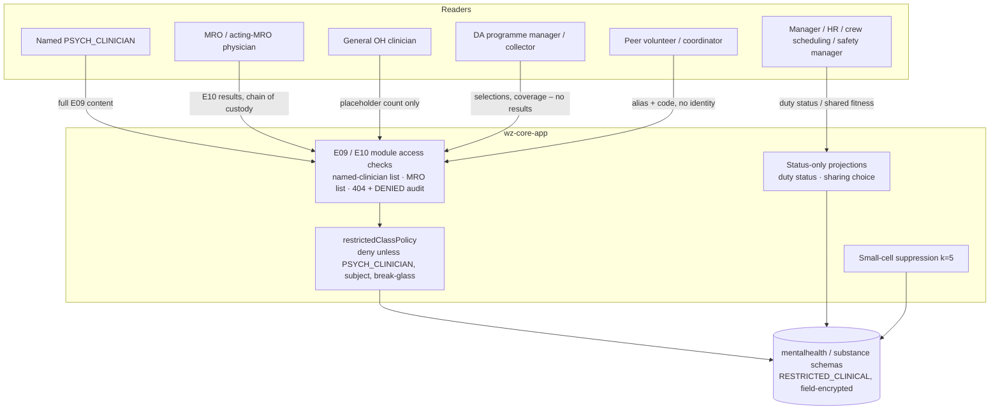

| Layer | Control | Implementation |
|---|---|---|
| Classification | Records are `RESTRICTED_CLINICAL`, derived from the case category (`PSYCHOLOGICAL`, `SUBSTANCE`) and set explicitly on generated documents | restricted kernel cases; `DocumentService.generateSigned(..., DataClassification.RESTRICTED_CLINICAL)` |
| Named reader | E09 content only for the clinicians in `mentalhealth.named-clinicians` (empty = every `PSYCH_CLINICIAN`; **V17 seeds the demo user `psych1` in every environment – must be replaced with the real named clinicians before go-live, O38**); E10 results only for `MRO` or a physician listed in `substance.acting-mro-physicians` (empty by default) | `SupportAccess`, `MroService`; anyone else gets `404` (E09) or `403` (MRO queue) and a `DENIED` audit entry |
| Platform policy | `restrictedClassPolicy` denies `RESTRICTED_CLINICAL` kernel cases and documents to everyone except `PSYCH_CLINICIAN`, the data subject and break-glass holders | `DefaultPolicies` (deny-overrides) |
| Placeholder | General OH roles see only `{restrictedCases: n}` on the chart ("1 restricted item – hidden") | `GET /support/placeholder` |
| Break-glass | An OH clinician with an active, justified grant reads the employee's support cases read-only (`accessBasis: BREAK_GLASS`); DPO alert and review | increment-2 break-glass service |
| Status only | Managers, HR, crew scheduling and safety managers receive duty status (available / removed / return pending) or the fitness / adjustments the employee chose to share – never scores, conditions, test reasons or results; employee and manager views mask test states (`COLLECTED`, `COMPLETED`, `CLOSED`) | projections, `/workspace/testing/status`, `/workspace/psychosocial/shared-outcomes`; every row disclosure-logged |
| Pseudonymity | Peer-support requests reach a trained volunteer as alias + random `PS-XXXX-XXXX` code; peer tables have no employee column; the audit entry for a contact request carries no code | `PeerSupportService`, integration test against `information_schema` |
| Bound machine clients | Laboratory results only from the client bound to `TOXLAB` (unbound or other → `404`); EAP portal users see minimal data for their own organisation and return attendance only (free text → `422 field_not_allowed`) | `LabService`, `EapService` |
| Aggregates | Every programme figure suppressed below `wellnessz.analytics.min-group-size` (default 5): psychosocial rates, peer-support quarterly report, testing statistics, campaign uptake, insights, advisory acknowledgements | module `Suppression` classes |
| Notifications | Content-free templates; `ContentRules` reject *positive*, *result*, *drug*, *alcohol* and clinical terms | `NotificationRulesTest` |
| Module isolation | E09 / E10 depend on no other clinical module; E10 reaches E09 only through `SupportProgrammeReferral` | ArchUnit rules 10–11 |
| Analytics | Restricted-class cases excluded from `analytics.v_case_facts` and from E12 insights | view definition, `InsightRules` |

**Known limitation (follow-up item O29).** The platform ABAC rule recognises `PSYCH_CLINICIAN` only. An MRO opens
results and the chain-of-custody form through the E10 MRO endpoints, but probably **not** through the generic
`/documents` API for `RESTRICTED_CLINICAL` documents. The safe direction (deny) applies; the fix is a restricted-class
policy that also admits `MRO` for documents of the substance programme.

## 9. Security architecture

This section summarises the technical controls; document 02 maps them to SOC 2 criteria and other frameworks.

### 9.1 Secrets management

| Mechanism | Detail |
|---|---|
| `ENC(...)` configuration values | AES-256-GCM with HKDF sub-key `wellnessz/config/v1`; produced by `EncryptCli` (reads plaintext from console without echo or stdin – never from arguments). Decrypted by `SecretsEnvironmentPostProcessor` into an in-memory, highest-precedence property source; original sources untouched; values never logged. Used for e.g. database passwords in non-Kubernetes deployments. |
| `file:` references | For property names containing password/secret/key/token/credential, `file:/mnt/secrets/<name>` is read from a file mounted by the **Secrets Store CSI driver** (Azure Key Vault provider, GCP Secret Manager provider, HashiCorp Vault provider). Helm values map `wz-db-password`, `wz-master-key`, `wz-pseudonym-key`, BFF client secret and migrator password. |
| Workload identity | AKS workload identity (user-assigned identity + federated credential), GKE Workload Identity (KSA→GSA), Vault Kubernetes auth on-premises; no static cloud credentials in pods. CI uses GitHub OIDC federation (Terraform `github_deployer`, `github_wif`). |
| Terraform state | Write-only arguments (`>= 1.11`) for database passwords so secrets are not stored in state; remote state with Entra ID auth (Azure) or CMEK-encrypted GCS bucket. |
| Master key | Single 256-bit key per environment (see 6.3); stored in Key Vault / Secret Manager / Vault, mounted as file. |
| Database connector passwords | Never in plain configuration: `file:` reference to a CSI- or External-Secrets-mounted file in Kubernetes, `ENC(...)` elsewhere; full description in Section 9.9. |

### 9.2 Transport security

| Hop | Control |
|---|---|
| Client → edge | TLS 1.2+ (Azure Front Door/App Gateway policy, GCP SSL policy, profile `RESTRICTED`, minimum TLS 1.2); WAF rate limits on login endpoints (App Gateway `RateLimitLogin`, Cloud Armor `rate_based_ban`), HSTS (1 year, includeSubDomains) sent by APIs, BFF and nginx. |
| Ingress → pods | TLS at ingress (`wellnessz-tls`); in-cluster traffic restricted by NetworkPolicies. A service mesh for in-cluster mTLS is optional (open item O6). |
| Apps → PostgreSQL | `sslmode=verify-full` by default (local profile relaxes to `prefer`); Azure `ssl_min_protocol_version TLSv1.2`; CNPG `TLSv1.3`, `hostssl` + SCRAM-SHA-256 only. |
| Mailbox | IMAPS with server-identity check; Graph over HTTPS. |
| SMTP | STARTTLS **required** outside the local profile. |
| HL7 v2 | over HTTPS instead of plaintext MLLP. |

### 9.3 BFF pattern, CSRF and security headers

The BFF implements the *OAuth 2.0 for Browser-Based Apps* recommendation: the BFF is a confidential client; the browser
holds only the session cookie `WZSESSION` (`HttpOnly`, `Secure`, **`SameSite=Lax`**). `Lax` is a deliberate choice:
after authentication the IdP returns the browser to the BFF callback with a cross-site top-level navigation; with
`Strict` the browser would not send the session cookie on that navigation, so the BFF could not correlate the
authorization response with the session (state/nonce) and the login would fail. `Lax` still withholds the cookie from
cross-site sub-requests and cross-site `POST`s, and every state-changing call additionally requires the CSRF token
described below. The design brief and the web READMEs state the same. Session attributes, including access and refresh
tokens, are AES-256-GCM-encrypted before Spring Session writes them to PostgreSQL. Sessions expire after 15 minutes of
inactivity; at most three concurrent sessions per user; session id rotated on login.

CSRF uses Spring Security's SPA mode (`XSRF-TOKEN` cookie, `X-XSRF-TOKEN` header) on every state-changing request
including logout. The proxy forwards only `content-type`, `accept` and `idempotency-key` upstream (cookies are never
forwarded) and returns only `content-type`, `location`, `x-correlation-id`, `idempotent-replayed`; paths containing `..`
or `//` are rejected; bodies are capped at 11 MB. `/bff/api/workspace/**` is role-gated for workspace roles, and the
core API enforces ABAC again.

| Header | Core API | BFF | nginx (web apps) |
|---|---|---|---|
| Content-Security-Policy | `default-src 'none'; frame-ancestors 'none'` | same | `default-src 'self'`, no inline script/style, `object-src 'none'`, `frame-ancestors 'none'` (+ build-time CSP meta) |
| Strict-Transport-Security | 1 year, subdomains | 1 year, subdomains | 1 year, subdomains |
| X-Frame-Options | DENY | DENY | DENY |
| Referrer-Policy | no-referrer | same-origin | no-referrer |
| Others | – | – | `X-Content-Type-Options: nosniff`, `Permissions-Policy`, COOP, CORP |

CORS on the core API is closed by default and is only opened (`WZ_CORS_ORIGINS`) for native app WebView origins;
credentials are not allowed. (The `local` profile and the Docker Compose stack list the four dev servers
`http://localhost:5173`–`5176`; the partner portal on 5176 was added in increment 4.)

### 9.4 Mobile security and MDM


*Figure 7 – Native app sign-in with PKCE and MDM configuration (source: `docs/images/06-mobile-pkce-mdm-flow.svg`).*

| Control | Implementation (`web/employee-app`) | Status |
|---|---|---|
| OIDC Authorization Code + PKCE (S256), `state`, `nonce` | `src/auth/pkce.ts`, `nativeOidcAuthClient.ts`; WebCrypto; system browser via `@capacitor/browser` (RFC 8252); public client `wellnessz-mobile` | Implemented |
| Token storage | Access/ID token in memory only; refresh token through `SecureStorage` abstraction – **in-memory fallback by default**; Keychain/Keystore plugin must be registered for production | Extension point (plugin registration) |
| Biometric gate | `wz.requireBiometric=true` releases the refresh token only after `verifyBiometric()`; fails closed without a verifier | Extension point (plugin) |
| Token revocation | RFC 7009 on logout when the IdP advertises a revocation endpoint | Implemented |
| MDM managed app configuration | `ManagedConfig` reads `wz.apiBaseUrl`, `wz.oidcIssuer`, `wz.oidcClientId`, `wz.redirectUri`, `wz.requireBiometric` (Intune App Configuration, Workspace ONE, Jamf; iOS managed dictionary, Android restrictions) via a `ManagedConfigurations` plugin hook; precedence MDM → `/config.json` → defaults | Implemented (hook); native plugin to be added |
| App protection (MAM): copy/paste, screenshot, selective wipe, conditional launch | Requires Intune App SDK / Workspace ONE SDK or app wrapping in the native projects; Entra Conditional Access "require app protection policy" | Planned (native integration) |
| No PHI caching | ESLint bans `localStorage`/`sessionStorage`/`console`; all API calls `cache: 'no-store'`; service worker caches app shell only and is not registered in native app | Implemented |
| WebView hardening | `androidScheme: https`, no cleartext, no mixed content, WebView debugging off, link previews off | Implemented |
| Session | 15-minute wall-clock idle logout; privacy screen on background (web best effort; native plugin recommended) | Implemented / plugin recommended |
| Redirect hijacking | Custom scheme today; Universal Links / App Links recommended for production | Planned |

### 9.5 Audit trail

| Property | Implementation |
|---|---|
| Content | time, actor, actor roles, action, resource type/id, outcome (`SUCCESS`/`DENIED`/`FAILURE`), sanitised reason, correlation id, client IP. |
| Tamper evidence | Each row stores `prev_hash` and `hash = SHA-256(prev_hash ‖ canonical(row))`; `GET /api/v1/audit/verify` recomputes the chain and returns `{intact, recordsChecked, firstBrokenId}`. |
| Append-only | Trigger rejects `UPDATE`, `DELETE`, `TRUNCATE` for every role; runtime role has only `SELECT, INSERT`. Integration test proves both. |
| Ordering | `pg_advisory_xact_lock` serialises writers across replicas so the chain stays linear. |
| Independence from business transaction | `REQUIRES_NEW` – denied or failed operations are still recorded. |
| Coverage | case list/read/status read, self-referral, transition, fitness, consent grant/withdraw, config change, master-data upserts, EHS imports and rejected mails, inbound messages, event replay, analytics queries, audit reads, authentication failures, authorisation denials. |
| Access | `GET /api/v1/audit?from&to&limit` (AUDITOR/PLATFORM_ADMIN, max 5,000 rows, itself audited). |

**Limits:** a database owner could drop the trigger and rewrite the whole chain consistently. Mitigation (open item O2):
periodically anchor the latest hash outside the database (SIEM, immutable/WORM storage such as Azure immutable blob or
GCS bucket lock) and stream audit rows to the SIEM. Platform audit logs (Azure activity/diagnostic logs, GCP Data
Access audit logs enabled in Terraform, pgaudit) complement the application trail.

### 9.6 Logging without PHI

JSON logs (logstash encoder 9.0) outside local/test profiles, with `correlationId`, `traceId`, `spanId`. Code logs ids
and metadata only; `LogSanitizer` neutralises CR/LF (CWE-117); the error handler never returns stack traces, SQL or
messages (`server.error.include-*: never`) and returns a correlation id instead; log statements in intake, outbox and
notification code log exception class names, not messages; ArchUnit forbids `System.out`/`err`. Web apps log static
event codes only.

### 9.7 Container and platform hardening

Non-root images (Java uid 10001, nginx uid 101), `readOnlyRootFilesystem`, all capabilities dropped, seccomp
`RuntimeDefault`, no privilege escalation, `/tmp` as size-limited `emptyDir`; OS packages patched at build; layered
Spring Boot jars. Default-deny NetworkPolicies per workload (ingress controller, DNS, monitoring, database, HTTPS
egress excluding RFC 1918). AKS: private cluster option, local accounts disabled, Azure Policy, Defender, Key Vault CSI
with rotation, Cilium network policy. GKE: private nodes, Workload Identity, application-layer secrets encryption,
Binary Authorization (enforced), shielded nodes, Cloud Armor WAF.

### 9.8 Secure SDLC pipeline

| Stage | Tool / control | Where | Status |
|---|---|---|---|
| Unit, integration, architecture tests | JUnit 5, Spring Boot test, Testcontainers (PostgreSQL 16) or CI service DB, ArchUnit 1.5.1; Vitest 5.0.5 | Maven / npm | Implemented |
| Coverage | JaCoCo 0.8.16 | root `pom.xml` | Implemented |
| SAST | CodeQL (`java-kotlin`, `javascript-typescript`) on push, PR and weekly; SpotBugs 4.10.5.0 + FindSecBugs 1.14.0, effort Max (`mvn -Psecurity verify`) – a CI step that fails on any finding | `.github/workflows/codeql.yml`, `ci.yml`; `pom.xml` | Implemented (0 findings, 6 justified exclusions) |
| SCA | OWASP dependency-check 13.0.0 aggregate (fail CVSS ≥ 7, SARIF to code scanning); GitHub dependency review on PRs (fail on high); `npm audit --omit=dev --audit-level=high`; exact pins and lockfiles | `ci.yml`, `pom.xml`, `config/dependency-check-suppressions.xml` | Implemented |
| SBOM | CycloneDX Maven plugin 2.9.3 (Java), `@cyclonedx/cyclonedx-npm` 6.0.1 (web), Syft image SBOMs; uploaded as CI artefacts and attested to images | `pom.xml`, `ci.yml`, `container.yml` | Implemented |
| Secret scanning | gitleaks v8.30.1 (full history, SARIF) | `ci.yml` | Implemented |
| Image & IaC scan | Trivy image gate (CRITICAL/HIGH with fix → build fails) + SARIF; Trivy config scan of Dockerfiles, Helm, Terraform; `helm lint`/template for all values files; `terraform fmt` | `container.yml`, `ci.yml` | Implemented |
| Signing / admission | cosign keyless signing (GitHub OIDC, Fulcio/Rekor), SBOM and SLSA build-provenance attestations, Binary Authorization attestation for Artifact Registry; deploy job verifies cosign signatures before `helm upgrade` | `container.yml`, `deploy-env.yml`, Terraform `binauthz.tf` | Implemented (cluster-side admission enforced on GKE; AKS/on-prem admission policy recommended) |
| DAST | OWASP ZAP baseline against a test deployment | – | Recommended (not yet defined) |
| Deployment (increment 5) | `cd.yml`: every `main` build → DEV automatically; `vX.Y.Z-rc.N` → DEV → UAT; `vX.Y.Z` → DEV → UAT → PROD, per cloud (`DEPLOY_CLOUDS`); digests resolved and cosign-verified once and passed to every stage. `deploy-env.yml` per stage: tag policy (dev `sha-*`/`v*`, uat `vX.Y.Z[-rc.N]`, prod `vX.Y.Z`), OIDC login, cosign verify (uat/prod must be built by `container.yml` on `main`), `cosign copy` by digest into the environment registry, Binary Authorization attestation on GKE, `helm upgrade --atomic` with the environment overlay and all images pinned by digest (`global.requireImageDigests` in uat/prod), smoke tests (rollout, running digests, `SMOKE_URLS`), automatic `helm rollback`; AKS private-cluster path through `az aks command invoke` (`deploy/scripts/helm-release.sh`) | `cd.yml`, `deploy-env.yml`, `deploy/scripts/helm-release.sh`, Terraform | Implemented; **required reviewers** and protection rules for the `*-uat` / `*-prod` GitHub Environments must be configured in repository settings – they cannot be set from code (organisation control) |

> All third-party actions are pinned to full commit SHAs. CI artefacts (test and coverage reports, SBOMs,
> dependency-check and gitleaks reports, SARIF in GitHub code scanning, attestations) are the evidence sources listed in
> document 02. Not yet in the pipeline: DAST. Not yet validated on real infrastructure: `cosign copy` digest preservation, the
> `az aks command invoke` output format and the Binary Authorization attestation check (no cloud credentials in the
> build environment).

### 9.9 Database connector password management

Database passwords are the credentials most often found in plain text in configuration files, container images and
CI logs. WellnessZ removes them from every artefact; the resolver lives in `platform/wz-secrets` and runs before Spring
binds the data source.

| Mechanism | How it works | Used in |
|---|---|---|
| `file:` reference | For property names containing *password*, *secret*, *key*, *token* or *credential*, a value `file:/mnt/secrets/<name>` is replaced by the content of that file (`SecretValueResolver`); ordinary `file:` URLs of other properties are untouched. The file is mounted by the Secrets Store CSI driver (Azure Key Vault, GCP Secret Manager, HashiCorp Vault providers) or by External Secrets; Kubernetes Secret sync is off, so the value is not written to etcd | AKS, GKE, hybrid – Helm `secrets.<component>.files` with `format: fileRef` maps `wz-db-password` → `WZ_DB_PASSWORD=file:…`, `wz-bff-db-password`, `wz-migrator-db-password`, BFF client secret |
| `ENC(...)` value | AES-256-GCM ciphertext with the HKDF sub-key `wellnessz/config/v1` and associated data `wellnessz-config`; produced by `EncryptCli` / `tools/encrypt-secret.sh` (plaintext read without echo, never from arguments); decrypted at start-up by `SecretsEnvironmentPostProcessor` into an in-memory property source of highest precedence; values never logged | VM / on-premises installations without CSI, developer machines (IDE env files hold every secret as `ENC(...)`), client values files |
| Master key | 256-bit key from `WZ_MASTER_KEY_FILE` (preferred) or `WZ_MASTER_KEY`; mounted from Key Vault / Secret Manager / Vault; the application refuses to start without it. The BFF has its own key (session encryption), never the core key | all environments |
| Generation | Terraform creates application and migrator passwords as ephemeral random values and writes them with write-only arguments (`>= 1.11`), so they never enter state; PostgreSQL uses SCRAM-SHA-256 | `deploy/terraform/azure/postgres.tf`, `deploy/terraform/gcp/sql.tf` |
| Workload identity | Pods read their secrets with an Azure user-assigned identity, a GCP service account (Workload Identity) or a Vault Kubernetes-auth role – no static cloud credentials; each secret is readable only by its component | Terraform `identity.tf` / `iam.tf`, `deploy/hybrid/external-secrets` |
| Human access | DBA access through Entra ID authentication (Azure) or Cloud SQL IAM database authentication (GCP), not shared passwords | Terraform |
| Least privilege | `wz_migrator` owns schemas and runs DDL only; `wz_app` gets per-table DML from the migrations; `wz_bff` reaches the `bff` schema only | Flyway grants, `deploy/sql/bootstrap-managed-postgres.sql` |
| Clinical columns | Separate from connector passwords: field-level AES-256-GCM via `EncryptedStringConverter` with HKDF-derived, versioned keys (Section 6.3) | JPA entities |

Rotation: a new password is written to the secret store; the CSI driver refreshes the mounted file (Azure rotation
polling every 2 minutes) and pods pick it up on the next restart (rolling restart, no downtime). Every secret read is
logged by the store (Key Vault `AuditEvent`, Secret Manager Data Access logs, Vault audit device). Residual
dependency: the master key protects every `ENC(...)` value of an environment – envelope encryption with a KMS-wrapped
key remains decision D5.

### 9.10 Error handling without information leakage (increment 5)

`GlobalExceptionHandler` (`wz-common`) maps every failure to an RFC 9457 problem with a stable `code` and the
correlation id, never a stack trace, SQL or exception message. Increment 5 closed a gap found during testing: a
malformed JSON body (including an unknown enum value) previously surfaced as `500`; it now answers
**`400 malformed_request`**, and a path or query parameter of the wrong type (for example a non-UUID id) answers
**`400 invalid_parameter`** naming the parameter only. This removes misleading `500` alerts, keeps WAF and SIEM
signal clean and prevents parser messages from reaching clients (SOC 2 CC7.1 / CC8.1, OWASP API8).

## 10. Analytics and reporting architecture

| Layer | Today | Planned |
|---|---|---|
| Source | `analytics.v_case_facts` (de-identified, restricted class excluded); increment 3: E06 absence aggregates per unit and E07 compliance per programme / unit computed in the modules with the same minimum group size; increment 4: E04 treatment KPIs, costs per unit and provider scorecards, E08 cost roll-ups by subsidiary / department / cost centre, budget versus actual and the ERP export | Per-module fact views (health promotion) and a warehouse feed with the same rules |
| Query API | `GET /api/v1/analytics/kpis/cases-by-status?groupBy=orgUnit\|category\|source\|month` – dimensions are allow-listed and mapped to SQL expressions (no user input in SQL) | Further KPIs, regulatory reports (e.g. occupational-disease notifications, statutory surveillance coverage) |
| Disclosure control | `SmallCellSuppression`: primary suppression of cells with `0 < n < k`; complementary suppression when exactly one cell is suppressed (next-smallest cell also hidden); `k` from `WZ_ANALYTICS_MIN_GROUP` (default 5), values below 3 rejected at start-up | Row/column-wise complementary suppression for multi-dimensional tables; differencing protection across successive queries |
| Pseudonymisation | `Pseudonymizer`: HMAC-SHA256 with `WZ_PSEUDONYM_KEY` (≥ 256-bit), key held only by the platform | Used for warehouse extracts and model training sets (not yet called) |
| Warehouse / BI | – | Scheduled extract of pseudonymised, aggregated facts to Azure Synapse/Fabric or BigQuery; Power BI or Looker with row-level security; no direct BI access to OLTP schemas |
| Predictive models | – | Model governance: purpose approval by OH governance and DPO, DPIA, `RESEARCH_DEIDENTIFIED` consent or other lawful basis, pseudonymised training data, bias/performance review, human-in-the-loop for any individual-level output, model cards and versioned approval records |

Increment 3 aggregates follow the same disclosure rules without using the view: `UnitAggregator` (E06) publishes a
unit only when its headcount reaches the minimum group size, otherwise `{key, label, suppressed: true}` without any
counts; reason categories appear only in the OH variant. `ComplianceMaths` (E07) suppresses programme / unit rows
with fewer enrolled people. Audit packs are anonymised by default (pseudonymous subject ids, no names, small groups as
`<k`); only the CMO and the Nursing Head may generate identifiable packs. With the small demo population most groups
are therefore suppressed – this is intended.

Increment 4: E08 `CostMath` suppresses roll-up units with fewer cases than the minimum group size (`suppressed:
true`, no amounts, no names); budget versus actual is reported per unit without suppression because it contains no
person-level dimension. Roll-ups, budget versus actual and the ERP export count `INVOICE` and `PAYMENT` entries only
(`ESTIMATE` and `RESERVE` are exposure on the claim) and convert amounts to `claims.base-currency` (GBP) with
`claims.fx-rates`; E04 cost and KPI views sum base-currency amounts only (`treatment.base-currency`).

Increment 5: each programme module applies the same minimum group size (`wellnessz.analytics.min-group-size`) in a
small module-local `Suppression` class rather than depending on `wz-analytics` (module isolation). E12 insights apply
complementary suppression (when only one cell of a series is hidden, the next smallest is hidden too) and exclude the
restricted class entirely; mental-wellbeing insights come only from E12 wellbeing screenings, never from E09 cases.
Participation reports hide `invited`, `participated` and the rate when fewer than *k* were invited or between 1 and
*k*−1 took part; the UIs leave suppressed rows out of totals so that they cannot be recovered by subtraction.

Two clarifications for GRC: (1) the seeded configuration key `analytics.min-group-size` in `masterdata.config_entry`
is informational – `KpiService` reads the application property; (2) the KPI endpoint is open to MANAGER and HR at
organisation-wide level; suppression is the control, not org scope.

## 11. Observability

| Signal | Implementation |
|---|---|
| Metrics | Micrometer with Prometheus registry on management port (`/actuator/prometheus`), tag `application`; Helm `ServiceMonitor` optional. |
| Traces | OpenTelemetry via `spring-boot-starter-opentelemetry`, OTLP/HTTP export (`OTEL_EXPORTER_OTLP_ENDPOINT` is used as the full URL including `/v1/traces`, as set in the Helm values), sampling 10 % by default (`WZ_TRACE_SAMPLING`), per environment since increment 5 (DEV 1.0, UAT 0.25, PROD 0.05 through `observability.traceSampling`), 100 % locally; collector `otel/opentelemetry-collector-contrib:0.164.0` in the local stack. |
| Logs | JSON to stdout → Log Analytics / Cloud Logging → SIEM (Sentinel, Chronicle, Splunk). |
| Correlation | `X-Correlation-Id` accepted if well-formed (`[A-Za-z0-9._-]{8,64}`), otherwise generated; propagated by the BFF, stored on outbox events and audit rows, returned in problem responses. |
| Health | Liveness/readiness probes on management port; details hidden; startup probe allows Flyway on first start. |
| Operational KPIs to alert on (proposal) | outbox `DEAD` count > 0, outbox lag, mailbox poll failures (`EHS_MAILBOX_POLL` FAILURE audits), audit-chain verification result (scheduled), authentication-failure rate, 5xx rate, DB connection saturation, notification `FAILED` count. |

## 12. Scalability, high availability and disaster recovery

| Aspect | Design |
|---|---|
| Stateless compute | Core API and BFF are stateless (BFF sessions in PostgreSQL); 2 replicas minimum, HPA 2–6 on CPU 70 % / memory 80 %, PDB `minAvailable: 1`, topology spread across zones. |
| Concurrency in jobs | Outbox relay, notification dispatch and (increment 1) the SLA timer poller use `SKIP LOCKED`; audit chain uses an advisory lock (a throughput ceiling for audit writes – acceptable for expected volumes, to be load-tested); mailbox job tolerant of concurrent runs. Daily, hourly and quarter-hourly jobs of increments 2–4 run once per run key across replicas through `JobRunGuard` (`platform.scheduled_job_run`). |
| Virtual threads | Enabled (`spring.threads.virtual.enabled`), reducing thread-pool tuning for I/O-bound workloads. |
| Database HA | Azure Flexible Server zone-redundant HA (standby zone 2), Cloud SQL `REGIONAL`, CNPG 3 instances with at least one synchronous standby (`dataDurability: required`). |
| Backups | Azure: 35-day retention, geo-redundant backup (default on), CMK; GCP: 30 retained backups, 7 days of transaction logs (PITR); CNPG: continuous WAL archiving + scheduled base backups to object storage. |
| Region failure | Not automated in the current IaC (single region). |
| Per-environment profile (increment 5) | DEV: one zone, no database HA, 7-day backups, 1–2 core replicas; UAT: three zones, zone-redundant / `REGIONAL` database, 14-day backups, 2–4 replicas, PDB `minAvailable: 1`; PROD: three zones, HA, Azure 35-day geo-redundant / GCP 30 backups with 7-day PITR, 3–10 replicas, PDB `minAvailable: 2`, `DoNotSchedule` zone spread, resource locks / deletion protection (`deploy/environments/README.md`, document 04). |

**Proposed targets (decision D9):**

| Tier | Scenario | Proposed RPO | Proposed RTO | Basis |
|---|---|---|---|---|
| Zone failure | AZ outage | 0 (synchronous standby) | ≤ 15 min | Zone-redundant DB HA + multi-zone pods |
| Data corruption / operator error | logical error | ≤ 15 min (PITR) | ≤ 4 h | PITR restore to new server, re-point application |
| Region failure | regional outage | ≤ 1 h (geo-backup) – lower with cross-region replica | ≤ 24 h (≤ 4 h with warm standby region) | Geo-redundant backup today; cross-region read replica + IaC re-deploy as increment |

OH case management is important but not flight-safety-critical in real time: rostering keeps its last known fitness
status, and fitness outcomes are re-sent by outbox replay after recovery. BCP must define the manual fallback for
fitness-for-duty decisions during an outage.

## 13. Licensing notes

| Item | Licence / obligation |
|---|---|
| SNOMED CT | Use requires an **affiliate licence** from SNOMED International, free of charge in member countries via the National Release Centre; non-member countries pay fees. The airline's operating countries determine obligations; national extensions may apply. Seed data contains no SNOMED content. |
| LOINC | Free under the LOINC licence (Regenstrief); attribution and licence-notice requirements; seed contains three LOINC codes. |
| ICD-10 / ICD-11 | ICD-11 under CC BY-ND 3.0 IGO (WHO); ICD-10 – WHO copyright, national modifications (ICD-10-GM, ICD-10-CM, ICD-10-AM) have their own terms; seed contains three ICD-10 codes. |
| HL7 FHIR / v2 / ODH | HL7 specifications are free to use (FHIR CC0 for the specification); HAPI FHIR and HAPI HL7 v2 libraries are Apache 2.0 / MPL-style dual licences (HAPI HL7 v2: MPL 1.1 or GPL – use under MPL). |
| Open-source stack | Spring (Apache 2.0), Hibernate (Apache 2.0 for Hibernate 7), PostgreSQL (PostgreSQL licence), Apache POI (Apache 2.0), React (MIT), Capacitor (MIT), Keycloak (Apache 2.0), Flyway Community (Apache 2.0). The CycloneDX SBOM is the authoritative inventory for licence review. |
| Apache PDFBox (increment 2) | Apache License 2.0 – permissive, no copyleft, attribution via NOTICE; pure Java, no native components. Selected over AGPL / commercial PDF engines (Section 14.15). |
| Fonts for generated PDFs (increment 2) | Not shipped. The default is the PDF standard font Helvetica (no embedding). For Arabic and other scripts the operator mounts a TrueType font (`wellnessz.documents.font-path`); Noto fonts are under the SIL Open Font License 1.1, which permits embedding. |
| OCR (increment 2, optional) | Tesseract OCR – Apache License 2.0, installed separately on the host / image (not bundled). Cloud alternatives (Azure AI Document Intelligence, Google Document AI) are pay-per-page services under the cloud agreement; a DPA and data-residency review apply. |
| Terminology starter content (increment 2) | V7 seeds a small starter subset of ICD-10, LOINC and SNOMED CT concepts for development, demos and tests, recorded in `platform.terminology_release` with its licence note. Production loads the licensed national editions through `POST /api/v1/terminology/concepts/import`; the SNOMED CT sample requires the affiliate licence wherever the software is used (open item O13). |
| GS1 barcodes (increment 3) | Vaccine packs are scanned as GS1 DataMatrix / GS1-128 element strings (GTIN, lot, expiry) and parsed server-side by `Gs1Lot`; the GS1 General Specifications are freely available and reading barcodes needs no GS1 membership. No barcode library is bundled (a keyboard-wedge scanner types the element string). |
| FHIR R4 partner exchange, telehealth, e-prescribing (increment 4) | No new library: the FHIR `ServiceRequest` / `DocumentReference` mapping is plain JSON in `FhirMapper` (HAPI FHIR structures already present); no video SDK is bundled. Licences of the telehealth video platform, insurer / authority connectors and a national e-prescription service are procurement items (decisions D15, D18, D19). |
| Commercial options | Eclipse Temurin is free; commercial Java support (e.g. from Microsoft, Red Hat, Azul) optional. Terminology servers (Ontoserver – commercial; Snowstorm – Apache 2.0) to be chosen. |

## 14. Technology selection rationale

Each table records the options assessed and why the repository's choice was made. Versions are those pinned in the
repository.

**Selection summary (Version 1.0).** One line per technology choice of the whole platform; the detailed assessment is
in the subsection named in the last column. "Rejected because" states the decisive reason – most alternatives are
viable products that lost on fit, cost, operating effort or risk for this system.

| Layer / concern | Selected | Alternatives considered | Rejected because | Detail |
|---|---|---|---|---|
| Architecture style | Modular monolith (one core deployable, 23 Maven modules, ArchUnit boundaries) | Microservices per epic; serverless functions; packaged OH product | Microservices multiply PHI data stores, network hops, IAM and audit surface for a workload of hundreds of concurrent users; serverless fragments transactions and the outbox; packaged products did not meet the status-only and restricted-class rules | 14.31 |
| Language / framework | Java 21 LTS, Spring Boot 4.1.2 (Spring Security 7, Hibernate 7) | Quarkus, Micronaut, Jakarta EE, .NET 8, Node.js | Spring has multi-issuer resource server, OIDC client and JDBC sessions out of the box and the largest skills market; .NET / Node would split the HL7 / FHIR / PDF library base | 14.1 |
| Database | PostgreSQL 16 | SQL Server, Oracle, MySQL, document stores | Licence cost and lower portability (SQL Server, Oracle); weaker `SKIP LOCKED` / row-security / extension story (MySQL); document stores lack the transactional guarantees the outbox and audit chain rely on | 14.2 |
| Schema migration | Flyway (versioned SQL, owner role, `ddl-auto: validate`) | Liquibase, Hibernate auto-DDL, hand-run scripts | Liquibase adds an abstraction layer the SQL-literate team does not need; auto-DDL and manual scripts are not auditable change control | 14.32 |
| Messaging | Transactional outbox + in-process delivery; broker via `EventPublisher` SPI | Kafka, Azure Service Bus, Google Pub/Sub as the primary bus | Every broker still needs an outbox for atomicity; choose one per hosting decision (D3) | 14.4 |
| Interoperability | HAPI FHIR R4 structures, HAPI HL7 v2 (library only) | FHIR server (HAPI JPA, Azure Health Data Services, Google Healthcare API); integration engine in the core | A FHIR server is a second PHI store; MLLP and routing belong to an integration engine in front | 14.5, 14.27 |
| Web front ends | React 19, TypeScript 6, Vite 8, no UI framework | Angular, Vue, Next.js (SSR), webpack | No decisive advantage (Angular, Vue); SSR puts a Node runtime holding sessions in the PHI path; webpack is slower with no benefit | 14.7 |
| Browser authentication | Backend-for-Frontend (confidential client, encrypted server-side session) | Tokens in the SPA (public client + PKCE), API gateway token handler | Tokens reachable by XSS in the SPA pattern; the IETF browser-apps guidance recommends a BFF for sensitive data | 14.7 |
| Mobile | Capacitor 8 + PWA from the same React code | Flutter, React Native, native Swift / Kotlin | Second codebase and skills set for a form- and status-centric app | 14.6 |
| Identity | Any OIDC provider; Entra ID primary for the workforce; Keycloak locally and optionally for partners | Proprietary SDKs, SAML-only integration, application-managed passwords | Vendor lock-in; SAML does not serve APIs and mobile; local passwords fail MFA / joiner-mover-leaver controls | 14.3, 8.5 |
| Authorisation | In-code ABAC with deny-overrides + endpoint RBAC | OPA / Rego, AWS Cedar, Keycloak Authorization Services | An external decision point adds a network hop and policy-language skills for a rule set that fits in reviewed, tested code (D8) | 8.3 |
| Field encryption | AES-256-GCM per column, HKDF-derived versioned keys, blind index | Database TDE only, `pgcrypto`, cloud client-side encryption SDKs | TDE does not protect against DBA, dump or replica access; `pgcrypto` puts keys in SQL sessions; SDKs are cloud-specific | 6.3, 14.36 |
| Secrets | CSI-mounted files + `ENC(...)` + workload identity | Kubernetes Secrets only, environment variables from CI, Vault agent injector everywhere | Secrets in etcd and CI logs; injector ties every set-up to Vault | 9.1, 9.9, 14.36 |
| Container platform | Managed Kubernetes (AKS, GKE) or RKE2 / OpenShift on-premises | Azure Container Apps, Cloud Run, VMs, Nomad | PaaS runtimes differ per cloud and limit NetworkPolicy, CSI and admission control; VMs need bespoke hardening and scaling | 14.8 |
| Packaging | Helm chart with schema-validated values and environment overlays | Kustomize, raw manifests, Operators | No values schema / typed validation (Kustomize, raw); an Operator is over-sized | 14.33 |
| Infrastructure as code | Terraform `>= 1.11` (write-only arguments) | Bicep / ARM, Pulumi, Crossplane, OpenTofu | Azure-only (Bicep); general-purpose code and smaller ops footprint (Pulumi); cluster-hosted control plane (Crossplane); OpenTofu is a drop-in alternative if the BSL licence is a concern | 14.9 |
| CI/CD | GitHub Actions with environments and OIDC federation | Azure DevOps, GitLab CI, Jenkins | Supported alternative (ADO); not the client's platform (GitLab); self-hosted controller and plug-in supply-chain risk (Jenkins) | 14.10, 14.38 |
| Supply chain | cosign keyless signing, SLSA provenance, CycloneDX SBOMs, Binary Authorization on GKE | Notary v2 / Notation, Docker Content Trust, unsigned images with scanning only | Notation viable but weaker keyless / transparency-log story; DCT deprecated in practice; scanning alone does not prove origin | 14.34 |
| Security testing | CodeQL, SpotBugs + FindSecBugs, OWASP dependency-check, gitleaks, Trivy | Commercial SAST / SCA suites | Licence cost; the open toolchain produces SARIF evidence in code scanning; a commercial suite can be added without changing the gates | 9.8 |
| Observability | OpenTelemetry (OTLP), Micrometer / Prometheus, JSON logs | Vendor agents (Application Insights SDK, Datadog, Dynatrace), Zipkin / Jaeger clients | Vendor agents lock the code to one back end; OTLP reaches Azure Monitor, Cloud Trace, Tempo or a commercial APM through the collector | 14.35 |
| Documents | Apache PDFBox | iText, commercial engines, headless Chromium | AGPL / licence cost; native browser binary in the PHI image | 14.15 |
| Scheduling of jobs | Database-backed timers and `JobRunGuard` | Quartz, ShedLock, Kubernetes CronJobs, workflow engines | Extra tables / infrastructure or loss of transactional coupling with the business change | 14.12 |
| Restricted classes | Same platform (separate schemas, named readers, ABAC deny, suppression) | Separate system or database instance for mental health and testing | Duplicates identity, audit, encryption and operations; the layered controls give equivalent separation with one evidence base | 14.37 |

### 14.1 Language and application framework

**Choice:** Java 21 LTS (Eclipse Temurin `21.0.12_8`), Spring Boot **4.1.2** (Spring Security 7, Hibernate 7 via the
Boot BOM), Maven 3.9 (`maven:3.9.16-eclipse-temurin-21-noble`).

| Criterion | Spring Boot 4 | Quarkus | Micronaut | Jakarta EE (e.g. Open Liberty / WildFly) |
|---|---|---|---|---|
| OAuth2 resource server with multi-issuer, OIDC client for BFF | Built-in (`JwtIssuerAuthenticationManagerResolver`, OAuth2 client) | OIDC extension; multi-tenant via tenant resolver | Security module; less mature multi-issuer | MicroProfile JWT; BFF needs custom work |
| Session store for BFF | Spring Session JDBC | custom / Infinispan | custom | container sessions |
| Ecosystem (HAPI FHIR, POI, Flyway, Testcontainers) | first-class | good | good | good |
| Talent availability (airline IT, integrators) | highest | medium | low–medium | medium |
| Start-up time / memory | moderate (mitigated by virtual threads, CDS/AOT optional) | best (native) | very good | moderate |
| Long-term support | VMware/Broadcom OSS + commercial support | Red Hat build | Oracle-backed OSS | vendor-dependent |
| **Verdict** | **Selected** – security features needed by this design exist out of the box; broadest skills market | Strong alternative if native images or very low footprint become a requirement | Not selected | Not selected |

### 14.2 Database

**Choice:** PostgreSQL **16** with Flyway (Spring Boot managed; Job image `flyway/flyway:11.20.3-alpine`).

| Criterion | PostgreSQL 16 | SQL Server | Oracle |
|---|---|---|---|
| Managed service on Azure / GCP / on-prem | Azure Flexible Server, Cloud SQL, CloudNativePG | Azure SQL / MI; Cloud SQL for SQL Server; on-prem | Oracle DB@Azure/Google, Exadata; on-prem |
| Features used (`SKIP LOCKED`, advisory locks, partial indexes, `timestamptz`, triggers) | all native | mostly available (different syntax) | available |
| Licence cost | none | per-core licensing | highest |
| Portability across target clouds | highest | medium | medium |
| Audit extension | pgaudit (configured on Azure and CNPG) | SQL Server Audit | Unified Auditing |
| **Verdict** | **Selected** | Viable if the airline standardises on Microsoft data platform | Not selected |

### 14.3 Identity provider

**Choice:** any OIDC provider; Microsoft Entra ID assumed for workforce; Keycloak 26.8.1 for local and optionally
partners.

| Criterion | Microsoft Entra ID | Keycloak (self-hosted) | Okta / Ping |
|---|---|---|---|
| Workforce SSO, MFA, Conditional Access, device compliance (Intune) | native | via external IdP brokering | native (own policy engine) |
| Partner / external identities | Entra External ID (B2B/B2C) | realms per audience | Okta CIC / Ping |
| MFA proof in the access token (increment 4) | `amr` (for example `mfa`) after Conditional Access, or an authentication context (`c1`) in the `acrs` array, which the core reads (Section 14.30) | `acr` level of authentication (`2` after OTP / WebAuthn step-up) and optional AMR mapper | `amr` / `acr` / `acrs` configurable |
| Operating effort | SaaS | must be operated, patched, made HA | SaaS |
| Cost | often included in M365 E3/E5 | none (support optional) | per user |
| Framework support | app roles + group GUID mapping | realm/client roles | configurable claim paths |
| **Verdict** | **Primary** (assumption A1) | Local/dev; partner realm option | Supported alternatives |

### 14.4 Messaging

**Choice now:** transactional outbox in PostgreSQL + in-process delivery; external brokers via the `EventPublisher` SPI.

| Criterion | Outbox + in-process (current) | Apache Kafka (e.g. Confluent, Event Hubs Kafka API) | Azure Service Bus | Google Pub/Sub |
|---|---|---|---|---|
| Atomicity with DB change | yes (outbox) | needs outbox anyway | needs outbox | needs outbox |
| Additional infrastructure | none | significant (or managed service) | managed | managed |
| Ordering / replay | per row, operator replay | partitions, long retention, consumer replay | sessions, dead-letter queue | ordering keys, seek/replay |
| Fit for enterprise fan-out (rostering, HR, ERP, SMS) | limited (logging stand-in) | strong | strong (Azure estates) | strong (GCP estates) |
| Hybrid / on-prem | yes | yes | Azure only | GCP only |
| **Verdict** | **Sufficient for module-to-module events and for first increments** | Choose if a group-wide Kafka platform exists | Choose for Azure-hosted deployment | Choose for GCP-hosted deployment |

Recommendation (decision D3): keep the outbox as the reliability boundary in all cases and select **one** broker per
hosting decision; the adapter is a small component implementing `EventPublisher`.

### 14.5 FHIR and HL7 libraries

**Choice:** HAPI FHIR structures R4 **8.12.1**, HAPI HL7 v2 **2.6.0** (`hapi-structures-v25`).

| Option | Assessment |
|---|---|
| HAPI FHIR (library only, embedded) | **Selected** – de-facto Java reference implementation, parsing/validation, no separate server to operate. |
| HAPI FHIR JPA server / Azure Health Data Services / Google Cloud Healthcare API | Candidates if a full FHIR repository becomes a requirement (e.g. partner query access, SMART on FHIR); adds a second data store for PHI. |
| Firely .NET SDK | Not applicable (Java stack). |
| Integration engine (Rhapsody, InterSystems HealthShare, Mirth/NextGen Connect) | Complementary for MLLP, routing and mapping to many lab systems; can terminate MLLP and forward to the HTTPS endpoint. |

### 14.6 Mobile

**Choice:** Capacitor **8.6.0** wrapping the same React codebase, plus installable PWA.

| Criterion | Capacitor | Flutter | React Native | Native (Swift/Kotlin) |
|---|---|---|---|---|
| Code reuse with web portal | ~100 % (same React app) | none (Dart) | partial (shared logic) | none |
| Access to MDM AppConfig, Keychain/Keystore, biometrics | via plugins | via plugins | via modules | native |
| Intune / Workspace ONE SDK integration | native projects can embed SDKs | supported (wrapper plugins) | supported | best |
| UX fidelity for simple form-based app | adequate | high | high | highest |
| Team skills / cost | lowest (web skills) | new language | medium | two teams |
| **Verdict** | **Selected** – the app is form- and status-centric; one codebase across web, PWA and both stores | Not selected | Not selected | Reconsider only if offline clinical use or heavy device integration is required |

### 14.7 Web framework and authentication pattern

**Choice:** React **19.3.1**, TypeScript **6.0.3**, Vite **8.3.5**, no UI framework, hash routing; BFF for browser apps.

| Criterion | React | Angular |
|---|---|---|
| Shared code with Capacitor app | direct | possible (Ionic Angular) |
| Ecosystem / hiring | largest | large (strong in enterprises) |
| Built-in structure (DI, forms, router) | assembled from libraries | batteries included |
| Bundle and dependency surface | small (only React + React DOM at runtime) | larger |
| **Verdict** | **Selected** | Valid alternative; no decisive advantage here |

| Build tool / language | Selected | Alternatives | Why the alternatives were not chosen |
|---|---|---|---|
| Build | Vite 8 (ES modules dev server, Rollup-based production build) | webpack, Parcel, Create React App | webpack: slower builds and larger configuration surface; CRA is unmaintained; Parcel: smaller ecosystem |
| Language | TypeScript 6 (strict) | JavaScript, Flow | Types on every API mapper catch contract drift at build time (the mappers whitelist response fields); Flow has little community support |
| Rendering | Client-side SPA served by unprivileged nginx with strict CSP | Server-side rendering (Next.js, Remix) | SSR adds a Node runtime that would hold sessions and render PHI on the server, a second hardened runtime for no user benefit in an authenticated line-of-business app |
| Testing | Vitest + Testing Library, ESLint (0 warnings), Playwright for live E2E | Jest, Cypress | Vitest shares the Vite pipeline; Playwright drives real Keycloak logins through the BFF across all four apps |

| Criterion | BFF (selected) | SPA holds tokens (public client + PKCE in browser) |
|---|---|---|
| Token theft via XSS | tokens not reachable by JavaScript | access/refresh tokens exposed to XSS |
| Refresh-token handling | server-side, encrypted at rest | browser storage or rotation tricks |
| CSRF | needs CSRF tokens (implemented) | not applicable |
| Infrastructure | one more service + session store | none |
| Alignment with IETF *OAuth 2.0 for Browser-Based Apps* | recommended pattern for sensitive data | discouraged for high-value data |

### 14.8 Container platform

| Criterion | AKS | GKE | OpenShift / RKE2 (on-prem, hybrid) |
|---|---|---|---|
| Fit with Entra ID / Intune estate | strongest | good (federation) | good |
| Supply-chain enforcement | Azure Policy, Defender, image integrity (preview features) | Binary Authorization (configured) | OpenShift policy / Kyverno, sigstore |
| Managed PostgreSQL alongside | Flexible Server | Cloud SQL | CloudNativePG (self-operated) |
| Data residency / PHI on-prem | EU regions | EU regions | full control |
| Repository support | `deploy/terraform/azure` (+ `environments/{dev,uat,prod}.tfvars`), `values-azure.yaml`, `environments/azure/*.yaml` | `deploy/terraform/gcp` (+ `environments/*.tfvars`), `values-gcp.yaml`, `environments/gcp/*.yaml` | `deploy/hybrid`, `values-hybrid.yaml`, `environments/hybrid/*.yaml`, `values-hybrid-cloud-edge.yaml` |
| **Verdict** | Default if Microsoft-centric | Equivalent alternative | Hybrid option where PHI must remain on-premises |

Helm chart `0.1.0` requires Kubernetes `>= 1.30`.

### 14.9 Infrastructure as code

**Choice:** Terraform `>= 1.11` with `hashicorp/azurerm ~> 4.81`, `hashicorp/google ~> 8.9` (+ `google-beta`),
`hashicorp/random ~> 3.7`; Helm for workloads.

| Option | Assessment |
|---|---|
| Terraform (selected) | Multi-cloud, write-only arguments keep secrets out of state, large module ecosystem; licence is BSL 1.1 for Terraform ≥ 1.6 – acceptable for internal use; **OpenTofu** is a drop-in open-source alternative. |
| Bicep / ARM | Azure only. |
| Pulumi | General-purpose languages; smaller operational footprint in airline IT. |
| Crossplane | Kubernetes-native; more operational complexity. |

### 14.10 CI/CD

**Choice:** GitHub Actions (design brief), with an Azure DevOps equivalent to be documented.

| Criterion | GitHub Actions | Azure DevOps Pipelines | GitLab CI |
|---|---|---|---|
| OIDC federation to Azure/GCP (no stored cloud secrets) | yes (configured in Terraform) | yes (workload identity federation) | yes |
| Security tooling (CodeQL, secret scanning, Dependabot) | native (GitHub Advanced Security) | via extensions / GHAzDO | native (Ultimate) |
| Environments with approvals | yes | yes | yes |
| **Verdict** | **Selected** | Supported alternative where the airline standardises on ADO | Not selected |

Since increment 5 the pipeline promotes **one signed digest** through DEV, UAT and PROD (Section 14.38); Jenkins was
also considered and rejected (self-hosted controller, plug-in supply-chain risk, no native OIDC federation).

### 14.11 Version summary

| Component | Version pinned in repository | Source |
|---|---|---|
| Java runtime | Temurin 21 (`eclipse-temurin:21.0.12_8-jre-noble`) | `deploy/docker/Dockerfile.core`, `.bff` |
| Build image | `maven:3.9.16-eclipse-temurin-21-noble` | Dockerfiles |
| Spring Boot | 4.1.2 | `pom.xml` parent |
| HAPI FHIR / HAPI HL7 v2 | 8.12.1 / 2.6.0 | `pom.xml` |
| Apache POI | 5.5.1 | `pom.xml` |
| Apache PDFBox (increment 2) | 3.0.8 | `pom.xml` (`pdfbox.version`) |
| springdoc-openapi | 3.0.2 | `pom.xml` |
| logstash-logback-encoder | 9.0 | `pom.xml` |
| ArchUnit / JaCoCo | 1.5.1 / 0.8.16 | `pom.xml` |
| CycloneDX / dependency-check | 2.9.3 / 13.0.0 | `pom.xml` |
| SpotBugs plugin / FindSecBugs | 4.10.5.0 / 1.14.0 | `pom.xml` |
| PostgreSQL | 16 (compose `postgres:16.15-bookworm`; CNPG `16.15`; Testcontainers `postgres:16-alpine`) | `deploy/`, tests |
| Flyway CLI image | 11.20.3-alpine | `values.yaml` |
| Keycloak (local) | 26.8.1 | `deploy/local/docker-compose.yml` |
| OpenTelemetry Collector (local) | contrib 0.164.0 | `deploy/local/docker-compose.yml` |
| React / React DOM | 19.3.1 | `web/*/package.json` |
| TypeScript / Vite / Vitest / ESLint | 6.0.3 / 8.3.5 / 5.0.5 / 10.13.0 | `web/*/package.json` |
| Capacitor core/iOS/Android/CLI | 8.6.0 (`@capacitor/app` 8.1.2, `@capacitor/browser` 8.0.5) | `web/employee-app/package.json` |
| Node build image / nginx | `node:24.22.2-alpine3.24` / `nginx-unprivileged:1.30.6-alpine3.24` | `web/*/Dockerfile` |
| Terraform / azurerm / google | `>= 1.11` / `~> 4.81` / `~> 8.9` | `deploy/terraform/*/versions.tf` |
| Helm chart / Kubernetes | 0.1.0 / `>= 1.30` | `deploy/helm/wellnessz/Chart.yaml` |

### 14.12 SLA timer scheduling (increment 1)

**Choice:** database-backed timers plus an in-application poller. Each case milestone (today `TRIAGE` and
`ESCALATION_RESPONSE`) has a row in `triage.sla_timer` with `started_at`, `amber_at`, `due_at` and a status
(`RUNNING`, `PAUSED`, `MET`, `BREACHED`, `CANCELLED`). Targets and the amber percentage come from `triage.sla_policy`
(per urgency, optionally per case type; seeded: EMERGENCY 15 min, URGENT 60 min, SEMI_URGENT 240 min, ROUTINE 480 min,
ADVICE 960 min, amber at 75 %). `SlaService.monitor()` runs on every replica every `wellnessz.triage.sla.poll-interval`
(`WZ_SLA_POLL_INTERVAL`, default `PT60S`) and claims due rows with
`select … from triage.sla_timer where status = 'RUNNING' and (amber due or due_at <= now) order by due_at limit 500 for update skip locked`
(partial index `ix_sla_timer_due`). In the **same transaction** it marks the breach, flags the case as escalated,
writes the timeline entry and publishes `sla.at-risk.v1` / `sla.breached.v1` to the outbox. Waiting for the employee
or an external party pauses the timer (remaining seconds stored) and resumes it later.

| Criterion | DB timers + `SKIP LOCKED` (selected) | Quartz with JDBC job store | Scan job + ShedLock | External scheduler or workflow engine (Kubernetes CronJob, cloud scheduler, Temporal, Camunda timers) | Broker delayed messages (e.g. Service Bus scheduled messages) |
|---|---|---|---|---|---|
| Atomic with the case change (no dual write) | yes – same transaction as case, timeline and outbox | yes (same DB) but separate tables and API | yes | no – needs callbacks into the API and idempotency | no – needs the outbox anyway |
| Additional infrastructure / operating effort | none | library + 11 tables | library + lock table | separate service or cluster, credentials, HA | broker, and only on some clouds |
| Safe on several replicas | yes – rows are claimed, never double-processed | yes (clustered mode) | one active node only | yes | yes |
| Pause / resume, re-targeting by policy change | simple row update | reschedule triggers | simple | engine-specific | cancel and re-send messages |
| Hybrid / on-premises portability | PostgreSQL only | yes | yes | depends on product | Azure / GCP specific |
| Reporting (MET / BREACHED per milestone) | plain SQL on the timer table | needs extra history | plain SQL | export from engine | not retained |
| **Verdict** | **Selected** – same reliability pattern as the outbox relay; no new moving parts | Over-sized for one timer type | Single active node wastes replicas | Reconsider if multi-step clinical workflows with long-running timers arrive (E04, E05) | Not selected |

Trade-offs accepted: alert latency is bounded by the poll interval (≤ 60 s against targets of 15–960 min); the SLA
state shown in queues and the case header is computed on read from the timestamps, so it is exact. Durations are
elapsed minutes – "one working day" is configured as 480 minutes until a business calendar exists in E18 (open item
O10). The integration test `QueuePerformanceTest` seeds 5,000 open cases with running timers and requires three queue
calls to complete in under 2 seconds.

### 14.13 Intake and assignment rule engine (increment 1)

**Choice:** an **in-house declarative rule table** in PostgreSQL rather than a rules engine such as Drools. E01 intake
rules (`intake.intake_rule`) and E02 assignment rules (`triage.assignment_rule`) are rows with nullable conditions
(null = wildcard: incident class, minimum severity, lost time, injury, exposure type, unit, body part; for assignment:
subsidiary, site, language, case type, safety category) and an action (`AUTO_CREATE` / `SUGGEST` / `IGNORE` with case
type and urgency; queue and owner strategy). The **first active rule by priority wins**. OH administrators and the
Nursing Head edit them in the OH workspace, a dry-run endpoint (`POST /intake/rules/test`, `POST /assignment/rules/test`)
shows which rule would fire, and every change is audited (`INTAKE_RULE_CREATE`, `INTAKE_RULE_UPDATE`,
`ASSIGNMENT_RULE_SAVE`).

| Criterion | Declarative rule rows (selected) | Drools / KIE (DRL or decision tables) | DMN engine (e.g. Camunda / Kogito DMN) | Rules hard-coded in Java (base framework seed) |
|---|---|---|---|---|
| Who changes rules | OH admin / Nursing Head in the UI, audited | developers (DRL) or analysts (spreadsheets) with a deployment | analysts with a modelling tool | developers, release required |
| Expressiveness needed by E01/E02 | sufficient – conjunctions of equality / threshold conditions, first match | far beyond the need (forward chaining, CEP) | sufficient (hit policy FIRST) | unlimited |
| Explainability for reconciliation and audit | rule id stored on each `incident_evaluation` and assignment | requires rule-firing listeners | decision trace available | log statements only |
| Testability | unit test of `RuleEngine.firstMatch`, dry-run API | KIE test harness | DMN test tooling | unit tests |
| Dependency and security surface | none (plain JPA) | large (MVEL / executable model, compiler at runtime, frequent CVE handling) | medium–large | none |
| Change control / SOC 2 | data change audited in the hash-chained trail; maker-checker planned (RR6 in doc 02) | artefact release through CI/CD | model release | code review |
| **Verdict** | **Selected** | Reconsider if rules need chaining across facts or temporal reasoning | Candidate if business analysts want standard decision models | Superseded |

### 14.14 Triage protocol content as versioned JSON (increment 1)

**Choice:** triage protocols are **data, not code**: one JSON document per protocol version stored in
`triage.triage_protocol` (`code`, `version`, `status` `DRAFT` → `APPROVED` → `RETIRED`, `approved_by`, `approved_at`,
unique `(code, version)`). A document holds the start question, questions (`BOOLEAN`, `NUMBER`, `SELECT`) with
`onYes` / `onNo` / `next` branches, threshold `rules` (`>=8`, `4..7`, `else`), `redFlag` markers and outcomes. The
13 draft protocols (body fluid, cardiac, chemical, crew fatigue, eye, fume event, head injury, heat, infectious GI,
laceration/burn, MSK, psychological, respiratory) ship in `modules/wz-e02-triage/src/main/resources/triage/protocols/`
and are seeded as `DRAFT` at start-up only when the code does not exist yet – existing versions are never
overwritten. Only the CMO can approve a version (`POST /triage/protocols/{code}/approve`, audited
`PROTOCOL_APPROVE`); approving retires the previous approved version. `TriageService` uses the latest approved
version and falls back to the latest draft (for test environments; the UI shows the status). Each assessment stores
the protocol code and version it was evaluated against.

Urgency is **always computed on the server** (`ProtocolEvaluator`): the client sends answers only, a red-flag "yes" is
a hard stop at `EMERGENCY` that cannot be overridden downwards (`422 red_flag_hard_stop`), and any other override
needs a reason. The OH workspace runs the same JSON for navigation and a preview only.

| Criterion | Versioned JSON in the DB (selected) | Protocols coded in Java | Commercial triage content / decision-support service | FHIR `Questionnaire` + `PlanDefinition` |
|---|---|---|---|---|
| Clinical governance (draft → CMO approval → retire, audit) | built in | code review only, not clinical sign-off | vendor-governed | needs a FHIR server and tooling |
| Change without a software release | yes (new version) | no | yes | yes |
| Same definition drives server evaluation and UI | yes | no | vendor UI | yes, with a renderer |
| Reproducibility of past decisions | version stored per assessment | git history only | vendor-dependent | yes |
| Licensing / cost | none | none | per-use licence | none (tooling effort) |
| **Verdict** | **Selected** | Not selected | Option if the airline licenses validated content | Candidate for E03 interoperability; the JSON grammar can be mapped later |

The protocol content in the repository is **draft clinical content** that must be reviewed and approved by the CMO
and the Nursing Head before clinical use (open item O11).

### 14.15 Document generation – Apache PDFBox (increment 2)

**Choice:** Apache PDFBox **3.0.8** (Apache-2.0), used by `PdfRenderer` in `platform/wz-documents`. Templates are
**defined in code** (`DocumentTemplates`: code, type, audience, `containsClinical`, record class, generator and signer
roles, merge fields with length caps, paragraph bodies with `{{placeholder}}` merge). The renderer lays out A4 pages
with a header, document number and version, the merged paragraphs, a generation line and a confidentiality footer,
and returns the PDF together with its text layer (used for the search index). Unknown merge fields are rejected,
required fields enforced, and for templates flagged `containsClinical=false` (fitness certificate, restriction note,
food-handler clearance, RTW plan, job offer, IHR decision letter) every merge field is **screened by the clinical-text
guard** (`ClinicalContentException.screen`), so a diagnosis cannot be typed into a document that managers or HR may
receive. Uploaded PDFs are read with the same library (text layer of up to 50 pages).

| Criterion | Apache PDFBox (selected) | iText 7/8 | Commercial engines (e.g. Aspose.PDF, PDFTron/Apryse) | HTML-to-PDF (headless Chromium / Puppeteer, wkhtmltopdf, OpenHTMLtoPDF / Flying Saucer) | Apache FOP (XSL-FO) / JasperReports |
|---|---|---|---|---|---|
| Licence | Apache-2.0 | AGPL-3.0 or commercial licence | commercial, per-server / per-developer | Chromium BSD-style; wkhtmltopdf LGPL (project archived); OpenHTMLtoPDF / Flying Saucer LGPL | Apache-2.0 / LGPL |
| Runtime footprint | pure Java library, no native dependencies, fits the read-only, non-root core image | pure Java | Java library (some with native parts) | separate browser binary or native renderer; larger attack surface and image size, sandbox flags inside containers | Java, heavier template tooling |
| Maturity / maintenance | Apache top-level project since 2009, regular 3.0.x releases | mature | vendor-supported | varies; wkhtmltopdf unmaintained | mature, slower moving |
| Fit for the requirement (short letters and certificates, text extraction of uploads, later signing) | yes – generation and extraction in one library | yes | yes, plus conversion features not needed | layout power not needed; no text extraction of uploads | over-sized |
| **Verdict** | **Selected** | Not selected (AGPL obligations or licence cost) | Not selected (cost, lock-in) | Not selected (native dependency, CVE handling) | Not selected |

Trade-offs accepted: layout is programmatic (no WYSIWYG designer); template wording changes need a release and is a
**draft for DPO / CMO approval** (open item O14). Non-Latin scripts need a mounted Unicode font
(`wellnessz.documents.font-path`, environment variable `WZ_DOCUMENTS_FONT_PATH`); without it Helvetica is used.

### 14.16 Electronic signature and document integrity (increment 2)

Every stored document records the **SHA-256** of its content. Signing a draft (`POST /documents/{id}/sign`, signer
roles per template – clinicians for certificates, AME / CMO for aeromedical reports, CMO for IHR letters, HR for job
offers) locks it and stores a signature hash `SHA-256(contentHash | signer | signing time)` with signer and time;
scanned documents are sealed on upload with `SHA-256(contentHash | user who filed them)`. A new version supersedes the
previous signed version and **revokes its shares**. This is a *simple electronic signature with integrity evidence*
(eIDAS terminology) – it proves who signed what and when inside WellnessZ and detects later modification, backed by
the hash-chained audit trail (`DOCUMENT_SIGN`). Advanced or qualified electronic signatures (PAdES with certificates
from a trust service provider or a remote signing service) are an extension point for documents that leave the
organisation with legal effect (decision D12).

### 14.17 Search over encrypted documents – blind-index tokens (increment 2)

Document content and extracted text are field-encrypted, so a plaintext full-text index would undo that protection.
`DocumentService` therefore indexes **keyed tokens**: the text is lower-cased, split into words of 3–40 letters or
digits, each word is turned into an HMAC-SHA256 blind-index value (`FieldEncryptor.blindIndex`, key purpose
`wellnessz/blind-index/v1`, domain prefix `doc-search:`), truncated and stored as a lexeme in the PostgreSQL `tsvector`
column `docs.document.search_vector` (configuration `simple`, GIN index, at most 5,000 distinct words per document).
A query is tokenised the same way and matched with `to_tsquery` (all words must match), scoped to one employee and to
callers with clinical access; restricted-class documents are filtered for callers without restricted access; every
search is audited (`DOCUMENT_SEARCH`). Snippets are cut from the decrypted text after the access check.

| Criterion | Blind-index tokens in `tsvector` (selected) | Plaintext PostgreSQL full-text index | External search engine (Elasticsearch / OpenSearch, Azure AI Search) | Decrypt and scan on query |
|---|---|---|---|---|
| Plaintext in the database or index | none (keyed tokens only) | yes | yes, in a second PHI store | none |
| Extra infrastructure | none | none | cluster to operate, secure and back up | none |
| Query features | exact word match only (no stemming, prefix, fuzzy or ranking) | full | full | full but slow |
| Performance | GIN index | GIN index | fast | linear in document volume |
| **Verdict** | **Selected** | Not selected (defeats field encryption) | Not selected (second PHI store) | Not selected |

Residual properties: equal words produce equal tokens, so token frequencies inside one document are visible to a
database reader (no plaintext); the blind-index key is not versioned (existing risk R1 / decision D5 – re-indexing
must be part of the key-rotation job).

### 14.18 OCR for scanned images (increment 2)

PDFs are indexed from their text layer. Images (JPEG, PNG) need OCR, which is **off by default**. The `OcrProvider`
SPI (`platform/wz-documents`) has one implementation, `TesseractOcrProvider`, that activates only when
`wellnessz.documents.ocr.tesseract-path` is set. The binary must be one of three allow-listed install paths
(`/usr/bin/tesseract`, `/usr/local/bin/tesseract`, `/opt/homebrew/bin/tesseract`) and
`wellnessz.documents.ocr.languages` one of six allow-listed values (`eng`, `ara`, `fra`, `eng+ara`, `eng+fra`,
`eng+ara+fra`); the only other argument is a JVM-created temporary file that is deleted afterwards; output is capped
at 1 MB and the process at 60 s. No data leaves the host.

| Option | Assessment |
|---|---|
| No OCR (default) | Images are stored and classified by type only; acceptable while most external reports arrive as PDFs with a text layer |
| Tesseract via the SPI (implemented, optional) | Apache-2.0, on-host, no data transfer; needs the binary and language packs in the image (a derived core image) and adequate accuracy testing for Arabic |
| Azure AI Document Intelligence / Google Document AI (extension point) | Higher accuracy and layout extraction; PHI leaves the cluster to a regional cloud service – needs a DPA, regional endpoint, private endpoint / VPC-SC and egress allow-listing; implement as another `OcrProvider` bean |

### 14.19 Clinical terminology approach (increment 2)

Codes are stored as `(system, code, display)` with `system` one of `SNOMED_CT`, `ICD_10`, `ICD_11`, `LOINC`, `ODH`. E03
uses a **local concept cache** (`platform.code_concept`) rather than calling a terminology server on every keystroke:
`TerminologyCatalog` offers word-prefix search on the display (GIN `to_tsvector('simple', display)` index) and
code-prefix search, per-user and per-role favourites, recently used codes, a local reporting-category mapping and a bulk
import (`POST /api/v1/terminology/concepts/import`, OH_ADMIN, ≤ 20,000 concepts per call) that records every release in
`platform.terminology_release` with its licence note. Diagnoses are coded on encounters and the primary coded diagnosis
is copied to the case; `DiagnosisRequiredGuard` refuses to close a clinical case without one
(`wellnessz.case.diagnosis-required-on-close`, default `true`). Licensing obligations are in Section 13. A terminology
server (Snowstorm, Ontoserver or a national service, decision D10) can later feed the same cache.

### 14.20 Interoperability standards in use (increment 2)

| Standard | Use in increment 2 | Component |
|---|---|---|
| HL7 v2.5 ORM^O01 | One message per new lab order, placed in a **pull queue** for the laboratory gateway (`GET /integration/lis/orders?status=QUEUED`, `POST /integration/lis/orders/{id}/ack`) – no outbound connection from the core | `Hl7Messages`, `OrderService` |
| HL7 v2.5 ORU^R01 | Results accepted on the existing `POST /integration/hl7v2` endpoint and mapped exactly once per message (OBX → results, grouped per patient and placer order) | `OruResultListener` |
| JSON LIS results | `POST /integration/lis/results` for gateways that prefer JSON | `ResultService` |
| HL7 FHIR R4 | `Bundle` export of the OH record (Patient, Condition, AllergyIntolerance, MedicationStatement, Immunization, Observation, DocumentReference, Encounter), audited; restricted-class items omitted for callers without restricted access | `FhirExportService` |
| HL7 ODH (FHIR profile) | Work information (PastOrPresentJob, UsualWork, exposures) from the job history as FHIR | `FhirExportService`, `JobHistoryService` |
| LOINC | Result and device observation codes; restricted result codes `wellnessz.record.restricted-result-codes` | `ResultService`, `DeviceRules` |

MLLP remains terminated by an integration engine (Section 14.5); the core only exposes HTTPS endpoints protected by
client-credentials tokens with the `INTEGRATION` role.

### 14.21 AI-assisted documentation – extension point only (increment 2)

E03 defines the SPI `AiDocumentationProvider` (draft structured note from a consented consultation transcript) and the
consent-gated `AiAssistantService`. **No provider ships enabled** (`wellnessz.record.ai.provider` defaults to `none`;
the API answers that no provider is configured). Rules fixed in the code and the SPI contract: the employee's consent
(purpose `AI_DOCUMENTATION`, captured by the clinician and recorded) is required per encounter; the provider sees only
the encounter type, the template field keys and the transcript; drafts are **returned, never saved automatically** –
the clinician reviews and saves, and the encounter is flagged `aiAssisted`; every use is audited; implementations must
not retain transcripts and must process data only in approved hosting locations. The choice between a locally hosted
model and a vendor service is an evaluation spike (privacy, accuracy, clinician acceptance, DPIA) and a steering
decision (D13); no vendor or model is selected in this architecture.

### 14.22 Scheduling and clinic operations engine (increment 3)

**Choice:** an **in-house scheduling engine** inside the modular monolith (`modules/wz-e14-scheduling`, schema
`scheduling`) rather than a commercial clinic-scheduling product or a generic booking service. Availability is derived
from diary templates per site and clinician (sessions with the appointment types they offer); `SlotEngine` computes
free slots from the service catalogue (duration, required role, room type and device category) and existing
appointments; `BookingRules` rejects double booking of a clinician, room or device (`409 resource_conflict`) and
bookings outside a session (`422 no_session`, unless a named clinician books an administrative override). Campaigns
(`CampaignPlanner`) book whole cohorts into campaign slots and report `{booked, waitlisted, alreadyBooked, rejected}`;
a freed slot produces a **waitlist offer**, never an automatic booking. Other modules book through the kernel SPI
`AppointmentBooking` and learn about attendance through `AppointmentStatusListener`, so E06 and E07 work (as
"invited, not booked") even when E14 is not deployed. Bookings are conflict-checked under PostgreSQL advisory locks, so
two replicas cannot book the same resource concurrently. Reminders and no-shows are quarter-hourly jobs; a booked or
checked-in appointment that has not started 30 minutes after its end becomes `NO_SHOW`
(`scheduling.no-show.grace-minutes`).

| Criterion | In-house engine in the core (selected) | Commercial OH / clinic scheduling suite | Generic booking SaaS (e.g. Microsoft Bookings, Calendly-type services) | Calendar integration only (Exchange / Google resource calendars) |
|---|---|---|---|---|
| Fit for OH rules (role, room, device and calibration constraints; campaigns; surveillance recall; queue without names) | built for them, unit-tested (`SlotEngine`, `BookingRules`, `CampaignPlanner`) | usually good, but a second system of record for OH data | weak – no device or calibration constraints, no surveillance cohorts | none |
| Where person-level health context lives | stays in the OH database under the same ABAC, audit and encryption | copied to the vendor; DPA, residency and integration needed | appointment type reveals health context to a general SaaS | appointment titles leak into corporate calendars |
| Integration effort | none (SPIs inside the monolith) | HL7 SIU / FHIR `Appointment` interfaces both ways | APIs and webhooks | free/busy only |
| Licence / cost | none | per-site / per-user licences | per-user subscription | existing |
| **Verdict** | **Selected** | Reconsider if the airline already operates one for its group clinics | Not selected (privacy, constraints) | Not selected |

Trade-offs accepted: no external calendar synchronisation (clinician calendars are the WellnessZ diary); the queue board
and kiosk run in the OH workspace, not on dedicated signage hardware; capacity forecasting is a monthly count
comparison (supply from the diary templates versus demand from `CapacityDemandSource`), not an optimiser.

### 14.23 Cold-chain monitoring and IoT ingestion (increment 3)

**Choice:** vaccine fridges are registered as equipment (`VACCINE_FRIDGE`, default range 2–8 °C, configurable per
device). Readings arrive in two ways – manual entry by clinicians or biomedical staff, and **batched HTTPS push** from an
IoT gateway to `POST /api/v1/integration/cold-chain/readings` (client-credentials token with the `INTEGRATION` role,
≤ 5,000 readings per call, device id pattern, plausible temperature range). `EquipmentRules.evaluate` opens, extends
or ends an **excursion**; an open excursion raises the content-free `coldchain.excursion` notification and must be
**acknowledged** by a clinician with the action taken before it can be closed. The core never connects to devices.

| Criterion | HTTPS batch push from a gateway (selected) | Direct MQTT from sensors to the core | Cloud IoT platform (Azure IoT Hub, AWS IoT Core; Google Cloud IoT Core was retired in 2023) feeding the API | Vendor monitoring portal only (no integration) |
|---|---|---|---|---|
| Attack surface on the core | none new – same authenticated API path as other gateways, WAF in front | broker and device credentials inside the PHI zone | none new (platform pushes through the API) | none |
| Works on Azure, GCP and on-premises alike | yes | yes, with an extra broker | Azure / AWS specific | yes |
| Device provisioning, firmware and offline buffering | gateway / vendor responsibility | core team responsibility | platform features | vendor |
| Audit trail next to vaccine administrations | yes (readings, excursions and acknowledgements in `scheduling`) | yes | yes | no – manual transcription |
| **Verdict** | **Selected** | Not selected | Option for the gateway side if the airline standardises on it | Not selected |

The gateway product is open (decision D16); until then readings are entered manually. Excursion decisions about vaccine
usability stay clinical and are recorded as the acknowledgement action.

### 14.24 Telehealth – link only (increment 3)

Appointment types flagged `telehealth` get a join link built from `scheduling.telehealth-base-url` (E18 configuration,
fallback `wellnessz.scheduling.telehealth-base-url`) plus a random room id; the link is shown to the employee and the
clinician and is never sent with clinical content. **No video platform is integrated**: the platform choice (an
enterprise meeting service with healthcare terms, a dedicated telehealth service, or a self-hosted WebRTC service),
recording policy, waiting room and identity checks belong to E04 (treatment coordination) and decision D15. Until then
the base URL must point to a service that the DPO has approved for consultations.

### 14.25 Absence data feed and vaccine barcodes (increment 3)

**Absence feed.** Absence data is owned by HRIS, time & attendance and crew-management systems. E06 accepts it in two
ways that share one reconciliation path: **push** to `POST /api/v1/integration/absence/episodes` (batches of up to 5,000
rows) and a daily **pull** (`absence-feed` job) through the `AbsenceFeedConnector` SPI, whose shipped implementation is
a no-op. Each source system gets its own connector bean (CSV/SFTP drop, REST or database view – decided per system with
E15); unknown employees or badges are listed for reconciliation instead of being dropped. Only the reason **category**
is accepted (allow-listed values), never a diagnosis. Rule evaluation runs nightly (`absence-triggers`) over open
episodes and those ended within 30 days; only `SICKNESS`, `INJURY_WORK` and `INJURY_NON_WORK` count; rule thresholds are versioned data
(`absence.trigger_rule_version`), with subsidiary-specific overrides of the same type and action.

**Vaccine barcodes.** Immunisation fast entry accepts the GS1 element string of the vaccine pack (GTIN, expiry, lot,
serial – human-readable or raw scanner form with group separators) and parses it in `Gs1Lot`; a keyboard-wedge scanner
types it into the lot field, so no barcode library or camera permission is needed. Vaccine, lot, site and route stay
filled between people for clinic sessions.

### 14.26 Telehealth provider – selection criteria (increment 4)

**Choice now:** E04 owns telehealth sessions (scheduling, consent, participants, chat, completion into a draft E03
encounter) and talks to the video platform only through the **`TelehealthProvider` SPI**
(`joinUrl(sessionRef, mode, token)`). The shipped default is a link provider on `treatment.telehealth.base-url`
(E18 key, default `https://telehealth.wellnessz.local/room/`). Each participant receives a **single-use token**
(stored as a hash, valid from 15 minutes before the start to the scheduled end); the platform redeems it at
`POST /api/v1/integration/telehealth/tokens/redeem` (role `INTEGRATION`) and learns only the session reference, the
participant role and the user name. Employees must give `TELEHEALTH_CONSULTATION` consent before joining. The
employee-facing consent text says that video and sound are not stored – this depends on the platform and must be
confirmed when it is selected.

| Criterion (weight) | Enterprise meeting service with healthcare terms | Dedicated telehealth service | Self-hosted WebRTC service |
|---|---|---|---|
| Data protection: DPA, EU / regional hosting, no secondary use, sub-processor list (must) | usually available under the enterprise agreement | available; check sub-processors | full control |
| Recording off by default, no transcript retention (must) | configurable per tenant / meeting policy | usually default | default |
| Token or lobby join without employee accounts, waiting room, identity check by the clinician (must) | lobby and guest join; token redemption needs an app integration | built for it | must be built |
| Works for crew on layover: browser join without install, low bandwidth, mobile, chat fallback (high) | good | good | depends on TURN infrastructure |
| Partner specialists can host (`providerCode`, for example `TELEDOC`) (medium) | guest organiser policies | multi-organisation | own accounts |
| Integration effort with the SPI (medium) | adapter on the vendor's meeting API | adapter on the vendor API | adapter + operations |
| Operating effort and cost (medium) | included in many enterprise licences | per consultation / per clinician | servers, TURN, patching |

Selection is decision D15. Whatever is chosen implements `TelehealthProvider` as a `@Primary` bean (or replaces the
default by being present) and calls the redeem endpoint; nothing else in E04 changes.

### 14.27 FHIR R4 partner exchange for e-referrals (increment 4)

**Choice:** three channels per referral (`Channel` `PORTAL` | `FHIR` | `SECURE_EMAIL`), one data model. The **partner
portal** is the default for providers without a capable system. For partner hospitals with a FHIR R4 interface, E04
publishes the referral as a FHIR **`ServiceRequest`** (`GET /api/v1/integration/referrals/{id}/fhir`, identifiers in
the `urn:wellnessz:*` systems, status mapped from the referral status) and accepts the report as a **`DocumentReference`**
(`POST /api/v1/integration/referrals/fhir/document-reference`, `context.related` = the ServiceRequest id, base64
attachment). Both endpoints use the existing `INTEGRATION` client-credentials pattern; the provider's integration
client is registered like every other gateway, but is additionally **bound to its organisation**: its token must carry
the fixed claim `org_scope=/PARTNERS/<CODE>` (Keycloak hardcoded-claim mapper; in Entra ID an app role / optional
claim or claims-mapping policy), `CurrentUser.partnerOrganisation()` extracts `<CODE>`, and only the referral's
provider organisation may read the `ServiceRequest` or post a `DocumentReference` – any other client, including
unbound gateway clients, gets `404` and a `DENIED` audit entry. The insurer endpoints (pre-authorisation decision,
first-report acknowledgement) are bound the same way to the payer / report recipient. The mapping (`FhirMapper`) is plain JSON over the HAPI structures that
the platform already ships – no FHIR server is introduced.

| Option | Assessment |
|---|---|
| Partner portal (selected as default) | Works for every provider; MFA, organisation isolation and consent are enforced in one place |
| FHIR R4 REST pull / push (selected for capable partners) | Standard, structured; tested with a simulated partner – no live partner hospital yet (E04-BL-006, P3) |
| HL7 v2 `REF^I12` / `RRI^I12` | Only if a partner can do nothing else; would go through the integration engine |
| Secure e-mail with attachments | Allowed as a channel value for manual exchange; no automation, letter and attachments still shared under consent |
| Shared FHIR repository (HAPI JPA server, cloud FHIR service) | Not needed for point-to-point referrals; a second PHI store |

### 14.28 E-prescribing – decision pending (increment 4)

Clinic medicines are administered from the clinic formulary with batch and expiry checks, recorded in E04 and mirrored
into the E03 medication list. **No prescriptions are issued electronically.** The `EPrescribingGateway` SPI exposes
`GET /api/v1/treatment/eprescribing/status` → `{enabled: false, route, decisionMemo}` with a no-op default
(`treatment.eprescribing.route` = `NONE`). Options for the decision memo (E04-BL-013 spike, owner Legal and the CMO):
a national e-prescription service (where an occupational-health provider is allowed to connect), a contracted partner
pharmacy with an electronic order interface, or paper prescriptions / the employee's own doctor (today). Each option
has its own legal route, prescriber identity requirements and audit obligations; the gateway is the only code that
changes (decision D19).

### 14.29 Insurer, authority and ERP gateways (increment 4)

**Choice:** the same pattern as the enterprise destinations of increments 1–3 – **reference-only outbox events to
allow-listed destinations**, documents only through consent-checked shares, machine replies through `INTEGRATION`
endpoints:

| Destination | Outbound | Inbound | Replaceable part |
|---|---|---|---|
| `insurer-gateway` | `claim.report.submitted.v1` (claim / report references, form, payer, employee id, dates); content-free e-mail to the payer pointing to the partner portal, where the consented `INSURER` share is available | `POST /integration/preauthorisations/{ref}/decision`, `POST /integration/claims/reports/{ref}/acknowledgement` | `ClaimsSubmissionGateway` (`DefaultClaimsSubmissionGateway`: outbox + e-mail); an insurer FNOL API adapter is declared `@Primary` |
| `authority-gateway` | `claim.report.submitted.v1` (report reference, form, jurisdiction, employer reference, dates) | acknowledgement endpoint above | same SPI; one adapter per authority API (for example the national OSH reporting service) once Legal / HSE sign off the form mapping (E08-BL-003) |
| `erp-finance` | `claim.cost.export.v1` (batch, month, cost centre, subsidiary, category, amount, currency, entry count, SHA-256 checksum); CSV download for finance | reconciliation `POST /claims/costs/exports/{id}/reconcile` (`RECONCILED` / `MISMATCH`) | an `EventPublisher` adapter or file transfer per ERP (decision D18) |

Options assessed for the transport: direct API connectors in the core (most coupling, credentials in the PHI zone),
an integration platform / iPaaS consuming the outbox through the broker of decision D3 (recommended for ERP and insurers
with several endpoints), or file transfer (SFTP) for the ERP. In every case the allow-list guarantees that no clinical
field leaves the core.

### 14.30 MFA for external users (increment 4)

External users reach patient-identifiable data from devices the airline does not manage, so MFA is required twice:
**enforced by the IdP** and **verified by the core API** (Section 8.2). The gate accepts either claim:

| IdP | How MFA is enforced | What the core sees | Configuration |
|---|---|---|---|
| Microsoft Entra ID – partners and adjusters as B2B guests | Conditional Access policy for *guest or external users* on the WellnessZ applications (`wellnessz-bff`, `wellnessz-api`) with grant *Require authentication strength* (*Multifactor authentication* or *Phishing-resistant MFA*); optionally trust the home tenant's MFA in the cross-tenant access settings; sign-in frequency 12 h, no persistent browser session | `amr` contains `mfa`; with an authentication context, `acrs` contains it (e.g. `c1`) | Default `mfa-amr-values` already contains `mfa`. Authentication contexts are emitted in the **`acrs`** array; the gate accepts an entry listed in `mfa-acr-values` (default contains `c1`; add other context ids you use). Verify with a decoded guest access token in a test tenant before go-live |
| Keycloak (partner realm or the workforce realm) | Required action `CONFIGURE_TOTP` (or *WebAuthn Register*) for every partner / adjuster account; the browser flow's conditional OTP step then always runs for them | `acr` = `2` when a step-up flow with *Condition – Level of Authentication* (level 1 password, level 2 OTP / WebAuthn) is used; or `amr` containing `otp` / `webauthn` with the *Authentication Method Reference (AMR)* mapper | Without a level-of-authentication flow or the AMR mapper the token carries `acr` = `1` and the gate drops the partner role – test with a decoded token |
| Other OIDC providers | Provider policy | `amr` / `acr` per provider | Extend `wellnessz.security.mfa-amr-values` / `mfa-acr-values` |

`WZ_MFA_REQUIRED_ROLES` stays at its default in every shared environment; an empty value is acceptable only in the
`local` profile. Workforce roles are not gated by the core (MFA for employees remains an Entra ID Conditional Access
decision of the airline).

### 14.31 Architecture style – modular monolith versus microservices

**Choice:** a **modular monolith**: one core deployable (`apps/wz-core-app`) composed of ten platform and 13 business
Maven modules, plus a separately deployed BFF and four static web apps. Module boundaries are compile-time Maven
dependencies and 22 ArchUnit rules; business modules communicate only through kernel SPIs and transactional events.

| Criterion | Modular monolith (selected) | Microservices per epic | Serverless functions |
|---|---|---|---|
| PHI data stores to secure, back up, audit | one PostgreSQL database, schema per module, one key hierarchy | one database per service (13+), each with its own credentials, backups and encryption | many functions sharing stores; hard to evidence data flows |
| Consistency (case + timeline + audit + outbox in one transaction) | local ACID transactions | sagas / distributed transactions, compensations | same as microservices, with cold starts |
| Security surface | one resource server, one ABAC engine, one audit chain | service-to-service authentication, mTLS mesh, policy per service | per-function IAM, gateway configuration |
| Operating effort for an airline OH workload (tens of thousands of employees, hundreds of concurrent users) | small – 2–10 replicas | high – platform team for mesh, tracing, contract testing | medium, cloud-specific |
| Change isolation | enforced by ArchUnit; modules can be switched off by configuration | strongest | strong |
| Extraction path | any module can become a service later: it already talks through SPIs and events | – | – |
| **Verdict** | **Selected** | Rejected for now – cost and attack surface without a scaling need | Rejected – vendor-specific, weak fit for long transactions |

Trade-off accepted: a defect in one module can affect the shared JVM; mitigated by per-module tests, ArchUnit,
virtual threads, readiness probes and rolling updates. Reconsider extraction only if one module needs a different
scaling profile or release cadence.

### 14.32 Schema migration – Flyway

**Choice:** Flyway with versioned, immutable SQL migrations (`V1`–`V20` product, repeatable `R__demo_*` for local /
test only), run by the owner role `wz_migrator` either in the application (`migrations.mode=app`, DEV) or as a Helm
pre-upgrade Job (`flyway/flyway:11.20.3-alpine`, UAT / PROD); Hibernate validates only. Client-specific migrations run
afterwards in their own schema and history table (Section 23.6).

| Criterion | Flyway (selected) | Liquibase | Hibernate `ddl-auto=update` | Manual DBA scripts |
|---|---|---|---|---|
| Change format | plain SQL reviewed like code; grants to `${app_role}` in the same file | XML / YAML / SQL change sets | generated at runtime | ad hoc |
| Audit evidence (SOC 2 CC8.1) | `flyway_schema_history` with checksums | `DATABASECHANGELOG` | none | change tickets only |
| Separation of owner and runtime role | yes | yes | no – runtime role needs DDL | depends |
| Expand / contract with rollback by redeploy | supported (forward-only discipline) | supported, plus rollback scripts | no | depends |
| **Verdict** | **Selected** | Viable; abstraction not needed | Rejected – no change control | Rejected – not reproducible |

### 14.33 Kubernetes packaging – Helm

**Choice:** one Helm chart (`deploy/helm/wellnessz`, chart `0.1.0`, Kubernetes `>= 1.30`) with a JSON schema
(`values.schema.json`) that makes the hardening settings impossible to switch off, cloud values files
(`values-{azure,gcp,hybrid,local}.yaml`) and, since increment 5, nine environment overlays
(`environments/{azure,gcp,hybrid}/{dev,uat,prod}.yaml`); `global.requireImageDigests` makes rendering fail when a
UAT / PROD image is not pinned by digest.

| Option | Assessment |
|---|---|
| Helm (selected) | Typed values with schema validation, `--atomic` upgrades and `rollback`, widely supported by AKS, GKE, OpenShift and Arc / GKE Enterprise GitOps |
| Kustomize | Good for overlays, but no values schema and no release history / rollback primitive |
| Raw manifests | Unmaintainable across four platforms and three environments |
| Kubernetes Operator | Over-sized for a stateless application; the database operator (CloudNativePG) is used where an operator adds value |

### 14.34 Software supply chain – cosign, SLSA provenance and SBOM

**Choice:** every image is built once by `container.yml`, gated by Trivy (CRITICAL / HIGH with a fix → fail), pushed,
given CycloneDX SBOMs (Syft for images, CycloneDX plugins for Maven and npm) and SLSA build-provenance attestations,
and signed **keyless** with cosign (GitHub OIDC identity, Fulcio certificate, Rekor transparency log). The deploy job
verifies the signature and the signer identity (UAT / PROD: `container.yml` on `main`) before copying the image by
digest; GKE additionally enforces Binary Authorization with a KMS-backed attestor (dry-run in DEV, enforced in UAT /
PROD).

| Option | Assessment |
|---|---|
| cosign keyless + SLSA provenance + SBOM attestations (selected) | No long-lived signing keys to protect; signatures and attestations travel with the image (`cosign copy`); verifiable by Binary Authorization, Kyverno or the Sigstore policy-controller |
| cosign with a KMS key | Option for air-gapped hybrid sites that cannot reach the public transparency log |
| Notary v2 / Notation | Viable (Azure-native signing with Key Vault); weaker keyless story; would need a second verification path on GKE |
| Scanning only, no signatures | Does not prove origin or prevent a substituted image – rejected |

Residual: admission enforcement of signatures is configured on GKE only; AKS and on-premises need Azure Policy image
integrity, Ratify / Kyverno or the Sigstore policy-controller (risk R7, document 04).

### 14.35 Observability – OpenTelemetry

**Choice:** vendor-neutral instrumentation – Micrometer metrics with a Prometheus endpoint on the management port,
OpenTelemetry traces over OTLP to a collector, JSON logs with correlation, trace and span ids – and a back end chosen per
hosting set-up (Azure Monitor / Managed Prometheus, Cloud Logging / Cloud Trace / Managed Prometheus, or
Prometheus / Tempo / Loki on-premises).

| Option | Assessment |
|---|---|
| OpenTelemetry + Micrometer (selected) | CNCF standard; the collector can redact attributes and fan out to any back end; Spring Boot 4 starter |
| Vendor agents (Application Insights Java agent, Datadog, Dynatrace) | Richer out-of-the-box dashboards but binds the code or image to one vendor; can still be fed from the collector |
| Logs only | Insufficient to diagnose cross-component latency (BFF → core → database) |

PHI rule: traces and logs carry identifiers and metadata only; the collector is the place to add attribute redaction
before export to a SaaS back end.

### 14.36 Secrets and key management

**Choice:** secrets live in the platform secret store (Key Vault, Secret Manager, Vault) and reach pods as files
through the Secrets Store CSI driver or External Secrets; applications read them via `file:` references or
`WZ_MASTER_KEY_FILE`; non-Kubernetes installations use `ENC(...)` values (Section 9.9). Field-level encryption uses an
application master key with HKDF-derived, versioned sub-keys (Section 6.3).

| Option | Assessment |
|---|---|
| CSI-mounted files + `ENC(...)` + workload identity (selected) | Same application contract on all four set-ups; no secret in etcd, images, Terraform state or CI logs |
| Kubernetes Secrets (base64 in etcd) | Rejected as primary – etcd exposure and wide RBAC reach; External Secrets sync used only where an operator needs a Secret (CloudNativePG roles, backups) |
| Vault agent injector / Vault-only | Strong, but forces Vault on Azure and GCP where native stores exist |
| Envelope encryption with KMS-wrapped data keys | Recommended next step for the field-encryption master key (decision D5, risk R1) |

### 14.37 Restricted-class enforcement (increment 5)

**Choice:** keep mental-health and substance-testing data **inside the same platform**, in their own schemas
(`mentalhealth`, `substance`), with layered controls: restricted classification, named readers, the platform deny
policy, status-only projections, pseudonymity, bound machine clients, suppression and module isolation (Section 8.6).

| Option | Assessment |
|---|---|
| Same platform, layered controls (selected) | One identity, audit, encryption and operating model; evidence collected once; the employee's OH journey (fitness, roster status, support referral) works without cross-system integration |
| Separate application and database for restricted classes | Strongest physical separation but duplicates IdP integration, audit chain, key management, backups and SOC 2 evidence; integration with fitness and rostering would reintroduce data flows |
| Separate database instance, same application | Adds operational cost; access is still decided by the application, so it adds little beyond schema separation and field encryption |

Residual: the platform ABAC rule admits `PSYCH_CLINICIAN` but not yet `MRO` for restricted documents (O29); the case
`category` column is not encrypted (R28).

### 14.38 Environment promotion and client customisation (increment 5)

**Choice:** environments differ only in **Terraform variable files** (`deploy/terraform/{azure,gcp}/environments/{dev,uat,prod}.tfvars`
with a separate back end per environment), **Helm overlays** and **GitHub Environments** (`azure-dev` … `gcp-prod`); the
same image digest moves DEV → UAT → PROD. Client-specific settings are a small values file
(`deploy/clients/<client>/values.yaml`, passed through `EXTRA_VALUES_FILES`) with a `customisation:` block – client id,
feature flags delivered as `WZ_FEATURE_<NAME>` to core and BFF, client SQL migrations in schema `client_<client>` with
history table `flyway_schema_history_client`, and `core.extraEnv` – so no chart fork is needed.

| Option | Assessment |
|---|---|
| Overlays + promotion by signed digest (selected) | Configuration drift is visible in Git; what was tested in UAT is byte-identical in PROD; rollback is a Helm revision |
| Rebuild per environment | Rejected – PROD would run an untested artefact |
| GitOps controller (Argo CD, Flux, Config Sync) | Compatible alternative, recommended for hybrid fleets (GKE Enterprise Config Sync, Arc GitOps); the overlays are usable unchanged |
| Client extension JARs mounted into the core image | **Not implemented** – would require the `PropertiesLauncher` and a signed-extension policy; client Java code is a fork / branch with its own build or a client module in the Maven build |

Limitations stated in the release notes: feature flags are plumbing only (no product feature reads them yet); GitHub
Environment required reviewers and protection rules must be set in repository settings; real `terraform plan /
apply` and workflow runs on GitHub were not possible in the build environment.

## 15. Verification evidence

The following results were produced against the baseline described on the cover and can be reproduced from the
repository.

| Check | Result | How to reproduce |
|---|---|---|
| Java tests | **42 tests, all passing**: unit tests in the platform modules, integration tests on a real PostgreSQL 16 (Testcontainers or `WZ_TEST_DB_URL`), 4 ArchUnit rules, BFF security tests | `mvn verify` (CI job *Java build & test*) |
| SAST – SpotBugs + FindSecBugs (effort Max, threshold Medium) | **0 findings**; 4 justified exclusions in `config/spotbugs-exclude.xml` (entity/record representation exposure, constructor fail-fast, CSRF disabled on the stateless bearer API, validated SPA logout redirect) | `mvn -Psecurity verify` |
| Web unit tests (Vitest) | employee-app **30**, manager-workspace **35**, all passing | `npm test` in each app (CI job *Web*) |
| End-to-end (Playwright, real Keycloak 26.8.1) | Login through the BFF; session cookie `WZSESSION` is `HttpOnly`; no tokens in `localStorage`; employee self-referral → manager sees a status-only row without clinical text | `tools/e2e/e2e.js` with the local stack; screenshots in `docs/images/screens/` |

Integration tests covering security properties include: status-only projection for managers and 404 outside org scope,
restricted class hidden from general clinicians, clinical text and outbox payloads encrypted at rest, status-only
rostering payload, append-only audit table and intact hash chain, Idempotency-Key replay/conflict, FHIR/HL7 validation,
Excel import hardening and de-duplication, small-cell suppression, notification content rules and the disabled-module
guard (`disabledModuleIsRefused`).

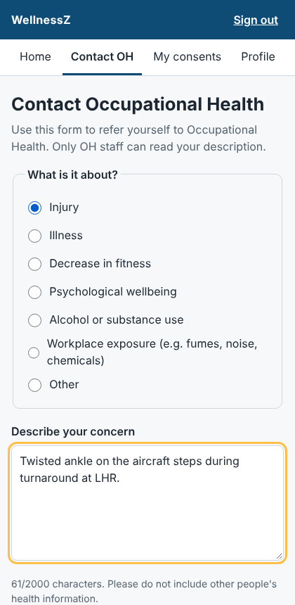

*Figure 8 – Employee app (BFF session): self-referral to Occupational Health (E2E run).*

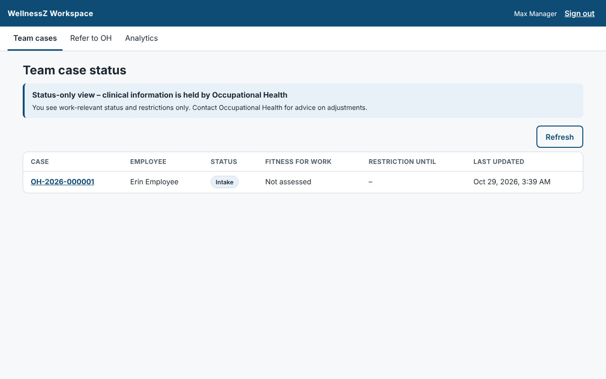

*Figure 9 – Manager workspace after the self-referral: status-only row – case reference, name, status, fitness status,
restriction date – with no clinical text (E2E run).*

**Increment 1 (E01, E02).** Results of the increment-1 verification run (details in the
[Release Notes](../increment-01/03-Release-Notes-Increment-1.md)):

| Check | Result | How to reproduce |
|---|---|---|
| Java tests | **65 tests, all passing**, including `Increment1IntegrationTest`, `QueuePerformanceTest` (5,000 open cases, < 2 s), `RuleEngineTest`, `RecordabilityClassifierTest`, `ProtocolEvaluatorTest`, `ClinicalTextDetectorTest` and the 6 ArchUnit rules | `./mvnw verify` |
| SAST – SpotBugs + FindSecBugs | **0 findings**; 5 justified exclusions (the fifth covers the queue SQL in `QueueService`, assembled from constant fragments with every user value bound as a parameter) | `./mvnw -Psecurity -DskipTests -Ddependency-check.skip=true verify` |
| Web unit tests (Vitest) | oh-workspace **151**, employee-app **81**, manager-workspace **55**, all passing | `npm test` in each app |
| End-to-end (Playwright, real Keycloak) | **18 / 18 checks** of `tools/e2e/e2e-increment1.js`: EHS webhook → auto-created and routed case, self-referral through the UI, manager referral clinical-text guard and org scope, status-only manager view, queue counts, reassignment by the Nursing Head, red-flag hard stop, triage, escalation, SLA clock, first-aid suggestion, DLQ, reception and crew-scheduling restrictions | `node tools/e2e/e2e-increment1.js`; screenshots in `docs/images/screens/increment-01/` |


*Figure 10 – OH workspace, team work queue with SLA state, urgency and owner (increment-1 E2E run).*


*Figure 11 – OH workspace, server-computed triage result for an EHS-triggered case (increment-1 E2E run).*

**Increment 2 (E03, E05).** Results of the increment-2 verification run (details in the
[Release Notes](../increment-02/03-Release-Notes-Increment-2.md)):

| Check | Result | How to reproduce |
|---|---|---|
| Java tests | **128 tests, all passing**, including `Increment2RecordIntegrationTest`, `Increment2FitnessIntegrationTest`, `Increment2PlatformIntegrationTest`, unit tests for HL7 messages, device rules, result flags, CDS, terminology, decision rules, matching engine and crew dashboard, and **10 ArchUnit rules** (new: document service independent of business modules, E03 ↔ E05 independence, earlier modules do not depend on later ones) | `./mvnw verify` |
| SAST – SpotBugs + FindSecBugs | **0 findings**; **6** justified exclusions (the sixth covers the allow-listed Tesseract command line in `TesseractOcrProvider`) | `./mvnw -Psecurity -DskipTests -Ddependency-check.skip=true verify` |
| Web unit tests (Vitest) | oh-workspace **305**, employee-app **138**, manager-workspace **99**, all passing | `npm test` in each app |
| End-to-end (Playwright, real Keycloak) | **25 / 25 checks** of `tools/e2e/e2e-increment2.js`: chart summary, CDS block, terminology, signed injury encounter, device audiogram, fitness decision, certificate shared, job-demand matching, modified duty and RTW plan, manager functional-restriction view and denial of the chart, HR job offer, employee acknowledgements and disclosure log, AME crew assessment and roster feed, restricted class and break-glass, DPO review and DPO without clinical access | `node tools/e2e/e2e-increment2.js`; screenshots in `docs/images/screens/increment-02/` |
| OpenAPI | **240 paths** in `docs/api/openapi.json` | `GET /v3/api-docs` (local profile) |

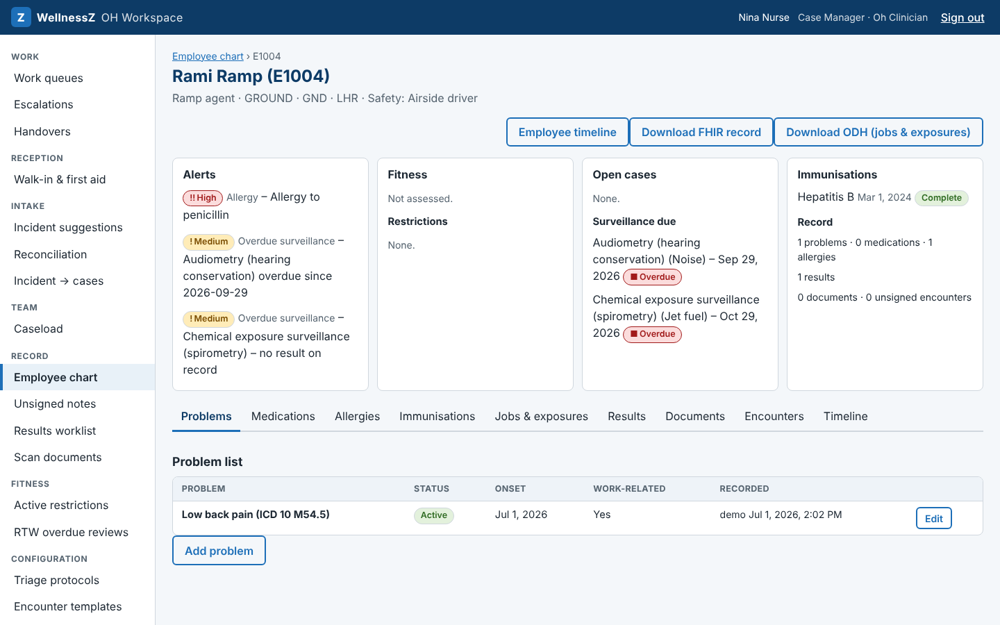

*Figure 12 – OH workspace, employee chart summary with allergy alert and surveillance status (increment-2 E2E run).*

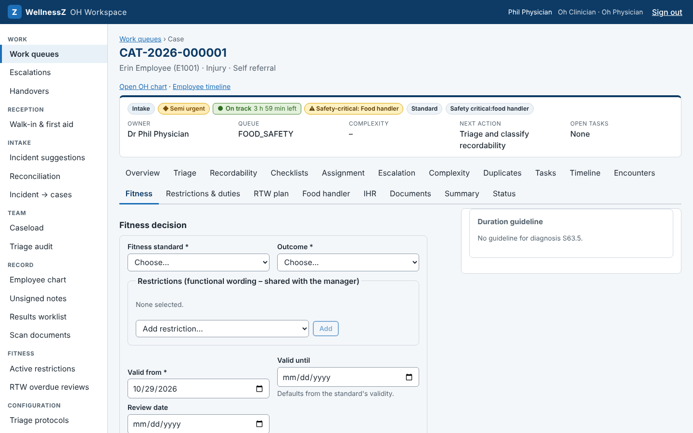

*Figure 13 – OH workspace, fitness decision against a versioned standard with restrictions and certificate
(increment-2 E2E run).*

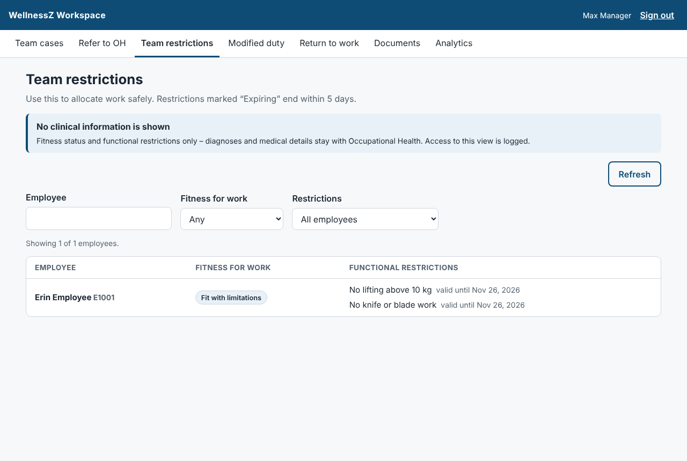

*Figure 14 – Manager workspace, functional restrictions of the team without diagnosis or clinical text (increment-2
E2E run).*

**Increment 3 (E06, E07, E14).** Results of the increment-3 verification run on 2026-10-29 (details in the
[Release Notes](../increment-03/03-Release-Notes-Increment-3.md)):

| Check | Result | How to reproduce |
|---|---|---|
| Java tests | **210 tests, all passing** – wz-core-app 89 including `Increment3AbsenceIntegrationTest` (10), `Increment3SurveillanceIntegrationTest` (9), `Increment3SchedulingIntegrationTest` (9) and **14 ArchUnit rules**; module unit tests E06 18 (rule engine, patterns, certificate checks, milestone plan, unit aggregation), E07 13 (eligibility, surveillance rules), E14 18; `NotificationRulesTest` renders every template through the content rules | `./mvnw verify` (with `WZ_TEST_DB_URL`: recreate the test database first – Section 21.5) |
| SAST – SpotBugs + FindSecBugs | **0 findings**; still **6** justified exclusions (none added) | `./mvnw -Psecurity -DskipTests -Ddependency-check.skip=true verify` |
| Web unit tests (Vitest) | oh-workspace **463**, employee-app **191**, manager-workspace **154**, all passing; lint 0 warnings | `npm test` in each app |
| End-to-end (Playwright, real Keycloak) | **32 / 32 checks** of `tools/e2e/e2e-increment3.js` (and 18/18, 25/25 for the earlier scripts): absence feed and reconciliation, trigger rules and early intervention, certificates (HR sees validity only), LTA milestones, clinical-text guard on HR stages and advice reports, employee consent before release, analytics suppression; surveillance simulation, scheduler booking, IH measurement above the action level, calibration block then acceptance, follow-up cases, `422 clearance_required`, candidate portal and HR status, crew certificates, GS1 vaccine entry, anonymised audit pack; double booking `409`, self-booking, check-in and queue board without names, call-next, cold-chain excursion, campaign and capacity | `node tools/e2e/e2e-increment3.js`; 37 screenshots in `docs/images/screens/increment-03/` |
| Defect found by E2E | BFF parsed multipart uploads itself and forwarded an empty body (`400` on browser uploads); fixed with `spring.servlet.multipart.enabled=false` in `apps/wz-bff` | Release Notes |
| OpenAPI | **391 paths** in `docs/api/openapi.json` (was 240) | `GET /v3/api-docs` (local profile) |

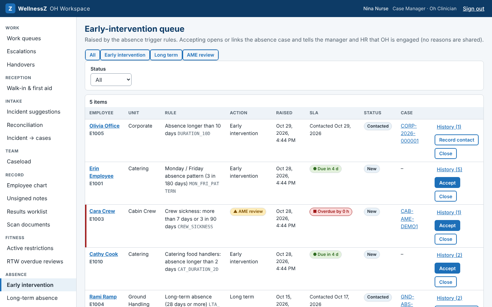

*Figure 15 – OH workspace, early-intervention queue raised by versioned absence trigger rules (increment-3 E2E run).*

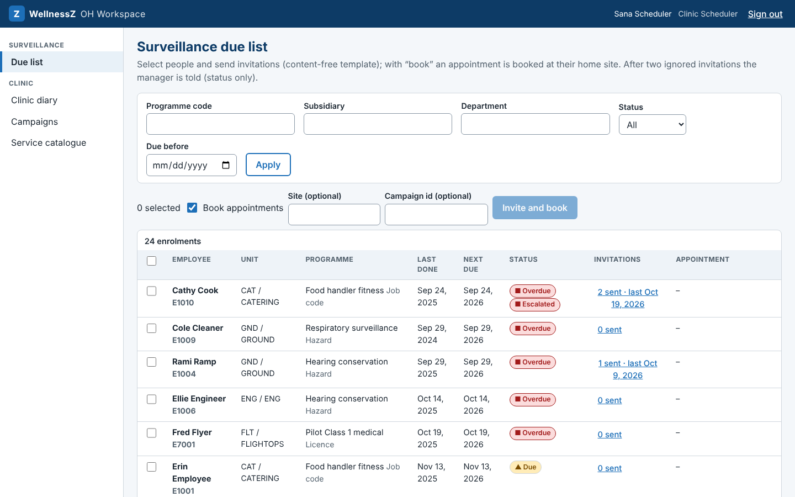

*Figure 16 – OH workspace, surveillance due list with invitations and booking status (increment-3 E2E run).*

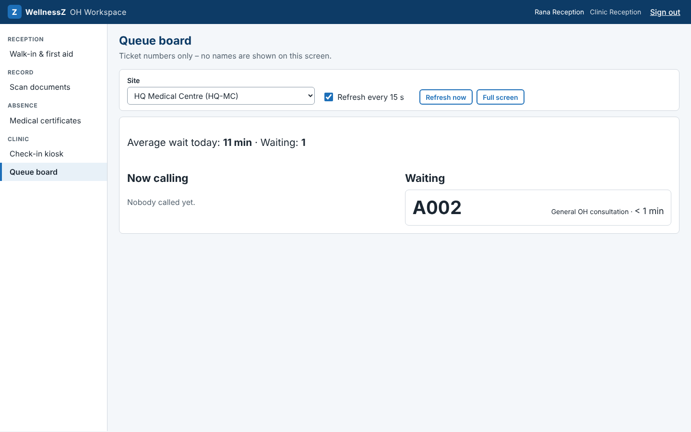

*Figure 17 – Clinic queue board showing ticket numbers only, no names (increment-3 E2E run).*

**Increment 4 (E04, E08, partner portal).** Results of the increment-4 verification run on 2026-10-29 (details in the
[Release Notes](../increment-04/03-Release-Notes-Increment-4.md)):

| Check | Result | How to reproduce |
|---|---|---|
| Java tests | **275 tests, all passing** – wz-core-app 112 including `Increment4TreatmentIntegrationTest` (10), `Increment4ClaimsIntegrationTest` (10) and **17 ArchUnit rules**; module unit tests E04 11 (`TreatmentRulesTest`), E08 28 (`ClaimRulesTest`, `CostMathTest`, `DisclosureRulesTest`, `ReportDeadlinesTest`); `wz-security` 7 including `MfaRoleGateTest` (3) | `./mvnw verify` (with `WZ_TEST_DB_URL`: recreate the test database first – Section 21.5) |
| SAST – SpotBugs + FindSecBugs | **0 findings**; still **6** justified exclusions (none added) | `./mvnw -Psecurity -DskipTests -Ddependency-check.skip=true verify` |
| Web unit tests (Vitest) | oh-workspace **570**, employee-app **223**, manager-workspace **164**, partner-portal **119** (new) – 1,076, all passing; lint 0 warnings; all four builds clean | `npm test` in each app |
| Helm | `helm lint`, `helm template` and kubeconform clean for all values files with the new `partnerPortal` component | CI job *IaC* |
| End-to-end (Playwright, real Keycloak, four apps) | **22 / 22 checks** of `tools/e2e/e2e-increment4.js` (regressions 18/18, 25/25, 32/32 – 97 checks): employee injury report with partner and insurer consent, treatment plan and employee plan view, referral data-set and consent checks, FHIR payload, partner accept / appointment / seen / report / invoice, another organisation `404`, provider directory and scorecards, pre-authorisation decided by the adjuster, medication batch check, outcomes, telehealth consent and chat, treatment KPIs; claim with automatic nurse assignment and case badge, first report with deadline, consent-gated disclosure set and DPO report, adjuster collaboration with clinical wording refused and providers without claim access, finance roll-up and reconciled ERP export without claim detail, legal hold and medico-legal report, HR status only | `node tools/e2e/e2e-increment4.js`; 26 screenshots in `docs/images/screens/increment-04/` |
| OpenAPI | **509 paths** in `docs/api/openapi.json` (was 391) | `GET /v3/api-docs` (local profile) |


*Figure 18 – Partner portal, referral inbox of a partner provider (own organisation only, MFA-gated role;
increment-4 E2E run).*


*Figure 19 – OH workspace, consent-gated disclosure set for the insurer with non-disclosable documents shown disabled
(increment-4 E2E run).*


*Figure 20 – Partner portal, TPA adjuster view of a claim: RTW status and milestones, shared tasks and secure messages,
no clinical content (increment-4 E2E run).*

**Increment 5 (E09, E10, E11, E12, environments).** Results of the final verification run on 2026-10-30:

| Check | Result | How to reproduce |
|---|---|---|
| Java tests | **450 tests, 0 failures** – including `Increment5MentalHealthIntegrationTest` (11), `Increment5SubstanceIntegrationTest` (6), `Increment5TravelHealthIntegrationTest` (14), `Increment5PromotionIntegrationTest` (13), `ClientMigrationsConfigTest` (5) and **22 ArchUnit rules**; module unit tests E09 48, E11 26, E12 24 and the E10 selection, window, MRO, follow-up and suppression tests | `./mvnw verify` (with `WZ_TEST_DB_URL`: recreate the test database first – Section 21.5) |
| SAST – SpotBugs + FindSecBugs | **0 findings**; still **6** justified exclusions | `./mvnw -Psecurity -DskipTests -Ddependency-check.skip=true verify` (also a CI step) |
| Web unit tests (Vitest) | oh-workspace **769**, employee-app **285**, manager-workspace **188**, partner-portal **131** – **1,373**, all passing; ESLint 0 warnings; four builds clean | `npm test` in each app |
| IaC | `terraform fmt` / `validate` for Azure and GCP; `helm lint` + kubeconform on 21 value combinations (4 base, 9 environment overlays, 6 hybrid-edge, 2 customisation); rendering without a digest fails in UAT / PROD as intended; `actionlint` with shellcheck on all workflows | CI job *IaC & config checks*; `deploy/environments/README.md` |
| End-to-end (Playwright, real Keycloak logins through the BFF) | **24 / 24 checks** of `tools/e2e/e2e-increment5.js`; regressions 18/18, 25/25, 32/32, 22/22 – **121 checks** green. Highlights: restricted class (named clinician sees the case, general nurse `404` + placeholder), fitness-only sharing, EAP free text `422 field_not_allowed`, pseudonymous peer support, CISM counts only for the safety manager, reproducible random selection with the programme manager denied the MRO queue (`403`), MRO-verified positive → duty removed, HR status only, support referral, unbound laboratory client `404`, contact tracing in 1.03 h against the 4-hour target, suppressed uptake, participation and statistics, wearable data rejected without consent | `node tools/e2e/e2e-increment5.js`; 35 screenshots in `docs/images/screens/increment-05/` |
| Defect found and fixed | Malformed JSON enum values answered `500`; now `400 malformed_request` / `400 invalid_parameter` (Section 9.10) | Release notes |
| OpenAPI | **647 paths** in `docs/api/openapi.json` (was 509) | `GET /v3/api-docs` (local profile) |

Not validated in the build environment (no cloud credentials, no live cluster): real `terraform plan` / `apply`,
workflow runs on GitHub, `cosign copy` digest preservation, the `az aks command invoke` output format, the Binary
Authorization attestation listing and client migrations against a real database.

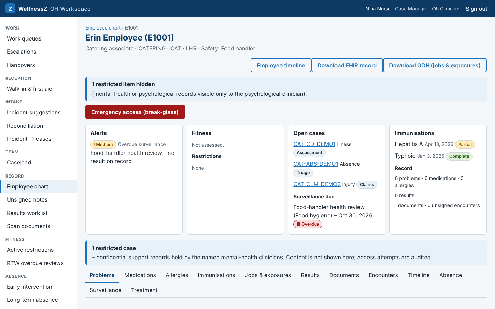

*Figure 21 – OH workspace, employee chart seen by a general OH nurse: only a placeholder count of restricted items
(increment-5 E2E run).*

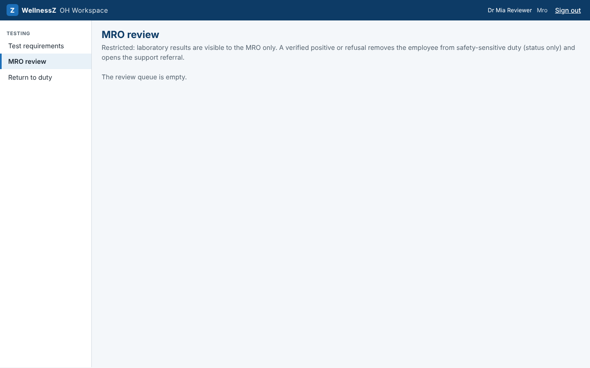

*Figure 22 – OH workspace, MRO review queue – results visible only to the medical review officer (increment-5 E2E run).*

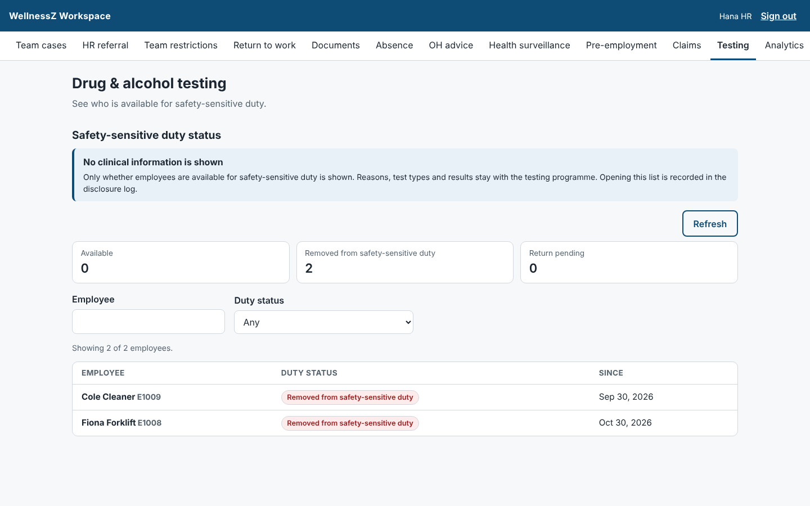

*Figure 23 – Manager workspace, HR view of testing: duty status only, no reasons or results (increment-5 E2E run).*

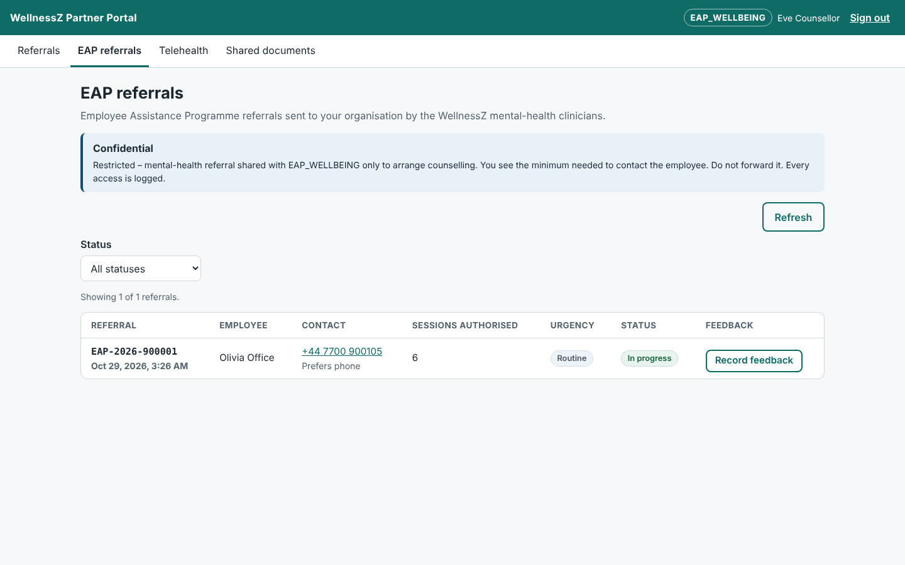

*Figure 24 – Partner portal, EAP referrals: minimal data for the own organisation and attendance-only feedback
(increment-5 E2E run).*

## 16. Risks, assumptions and open items

### 16.1 Architecture risks

| ID | Risk | Likelihood | Impact | Mitigation / owner |
|---|---|---|---|---|
| R1 | Master-key compromise exposes all field-encrypted data (single key, HKDF-derived versions) | Low | High | Envelope encryption with KMS/HSM, strict Key Vault RBAC, re-encryption job, rotation runbook (D5) |
| R3 | No retention/deletion jobs → GDPR storage-limitation non-compliance | High | High | Retention schedule and purge jobs before go-live (D6) |
| R4 | DB owner could rewrite audit chain | Low | High | External hash anchoring, SIEM streaming, separation of duties for DB owner role (O2) |
| R5 | Outbound guard checks field names, not values | Low | High | Flat payloads enforced (nested objects/arrays rejected), allow-list review by DPO, contract tests per destination |
| R6 | Mobile refresh token in memory only until secure-storage plugin registered; MAM SDK not integrated | Medium (functional) | Medium | Register Keychain/Keystore plugin and MAM SDK in native projects before store release |
| R7 | Supply-chain gaps: no DAST, signature admission enforcement only on GKE (SpotBugs became a CI step – closed) | Medium | Medium | ZAP baseline against UAT; Kyverno / Ratify / Sigstore policy-controller or Azure Policy image integrity on AKS and on-premises |
| R8 | Single-region deployment | Low | High | Cross-region replica and DR runbook (D9) |
| R9 | Audit advisory lock serialises writers – throughput ceiling | Low | Medium | Load test; partitioned chains per shard if needed |
| R10 | Authentication-failure audit writes per invalid token could be abused to amplify load | Medium | Low | WAF rate limiting; sampling or aggregation of failure events |
| R13 | Terminology licensing (SNOMED CT) in non-member countries | Medium | Medium | Licence assessment per operating country (D10) |
| R14 | Increment 2: document retention flags but never deletes; structured OH tables have no retention yet | High | Medium | DPO-approved schedule, reviewed destruction procedure, extend schedule to `ohrecord` / `fitness` (D6, O12) |
| R15 | Increment 2: blind-index search leaks token frequency per document and depends on the unversioned blind-index key | Low | Medium | Access restricted to OH roles and DB owners; re-index as part of the key-rotation job (D5) |
| R16 | Increment 2: simple electronic signature may not be accepted by external parties (CAA, courts) where advanced / qualified signatures are expected | Medium | Medium | Qualified signing provider for external-effect documents (D12); CAA format confirmation of crew medical reports |
| R17 | Increment 2: break-glass could be misused by an authorised clinician | Low | High | Justification ≥ 20 characters, 4 h validity, DPO alert, 24 h review, monthly report, no self-review |
| R18 | Increment 3: absence data in OH and HR systems diverges because only a no-op `AbsenceFeedConnector` ships | High (until connectors exist) | Medium | Push endpoint and reconciliation list today; one connector per source system with E15 (O18) |
| R19 | Increment 3: managers or HR infer health information from absence patterns, advice reports or surveillance status | Medium | High | Status-only projections (no `reasonCategory` for managers), clinical-text guard on advice reports and HR stages, employee review before release, disclosure log, small-group suppression |
| R20 | Increment 3: candidate identities outside the HRIS master (role `CANDIDATE`) need an identity source and de-provisioning | Medium | Medium | Short-lived candidate accounts, 12-month purge of non-hired candidates; candidate IdP decision (D17) |
| R21 | Increment 3: device results recorded on unregistered devices are accepted (`wellnessz.record.require-registered-devices=false` by default) | Medium | Medium | Register all audiometers, spirometers, ECGs and vision screeners; then set the flag to `true` |
| R22 | Increment 3: telehealth link points to an external service not yet assessed; IoT gateway not selected | Medium | Medium | DPO approval of the video service (D15); manual cold-chain logging until the gateway exists (D16) |
| R23 | Increment 4: external users (partners, adjusters) access personal health data from unmanaged devices; a phished password would expose referrals or claims | Medium | High | MFA enforced at the IdP **and** verified by the core (`mfa-required-roles`); organisation isolation (`404`); consent-gated shares; WAF and rate limits on `partners.<domain>`; disclosure log; quarterly access review of partner accounts |
| R24 | Increment 4: MFA claims differ per IdP (Entra ID `amr` or authentication context in `acrs`, Keycloak `acr` only with a level-of-authentication flow) – a correct IdP policy may still be rejected, or an operator may disable the gate to "fix" it | Medium → Low (the core reads `amr`, `acr` and the Entra ID `acrs` array) | High | The gate accepts all three claims (`MfaRoleGateTest`); decode a test token per IdP before go-live (Section 14.30) – the Keycloak `acr` = `1` case still needs a level-of-authentication flow or the AMR mapper; never empty `WZ_MFA_REQUIRED_ROLES` outside `local`; configuration review in the release checklist |
| R25 | Increment 4: over-disclosure to insurers (wrong document in a disclosure set, unredacted clinical detail) | Low | High | Allowed document types, provider / external reports only by OH roles, privileged and medico-legal material excluded, redacted copies, consent check per send, revocation, DPO disclosure report |
| R26 | Increment 4: statutory deadlines missed because authority and insurer connectors are not built (default outbox + e-mail) and form mappings await sign-off | Medium | High | Deadline dashboard and hourly reminders, manual submission channel, sign-off of the three forms (E08-BL-003), connectors (D18) |
| R27 | Increment 4: partner network data, rates and SLAs are illustrative; scorecards and network gaps are only as good as procurement's data | High (until replaced) | Medium | Procurement loads the contracted network (master data API, contracts endpoint) before go-live |
| R28 | Increment 5: restricted-class existence visible to database readers (`oh_case.category`, schema names) although content is encrypted | Low | Medium | DBA access through IdP-authenticated, audited accounts only; encrypt the category of restricted rows or move restricted kernel cases to a separate schema |
| R37 | Increment 5: `mentalhealth.named-clinicians` is seeded with the demo user `psych1` in every environment – in PROD the real clinicians would be locked out (urgent call-backs unseen) or a `psych1` account could read all support cases | Medium | High | Go-live configuration item (O38): set the named clinicians per environment, never create a `psych1` account outside local / test, include the key in the release checklist and quarterly access review |
| R29 | Increment 5: MRO cannot open `RESTRICTED_CLINICAL` documents through the generic `/documents` API (ABAC admits `PSYCH_CLINICIAN` only) – risk of a workaround that widens access | Medium | Medium | MRO uses the E10 endpoints; add `MRO` to the restricted-class policy for substance-programme documents (O29) |
| R30 | Increment 5: clinical reference content (PHQ-9 / GAD-7 cut-offs, urgent-risk protocol, testing cut-offs, travel recommendations, PEP timers) used without governance sign-off | Medium | High | Configurable reference data marked pending; Clinical Governance, MRO and Legal sign-off before go-live (O31) |
| R31 | Increment 5: real connectors (EAP system, toxicology LIMS, campaign app, wearable vendors, public-health authority, SMS gateway) are simulated – manual workarounds may leak data by e-mail | High (until built) | Medium | Content-free e-mail defaults, partner portal for the EAP, bound laboratory client ready; connector projects per partner with DPAs (O30) |
| R32 | Increment 5: an urgent self-harm screening answer not followed up in time | Low | High | Server-side urgent rule, same-day call-back item with countdown, named clinician notification, governance view; operating procedure and cover rota (organisation) |
| R33 | Increment 5: re-identification from small programme aggregates (testing statistics, peer-support figures, campaign uptake) | Low | High | Suppression below k = 5 everywhere, complementary suppression for insights, UIs exclude suppressed rows from totals; DPO review of new reports |
| R34 | Increment 5: GitHub Environment protection (required reviewers, prevent self-review, tag rules) not configured – promotion to PROD without approval | Medium | High | Configure in repository settings before the first UAT deployment; quarterly evidence export (O33) |
| R35 | Increment 5: `WZ_FEATURE_*` flags and client migrations misunderstood as tested product features; client SQL could weaken grants | Medium | Medium | Flags documented as plumbing only; client migrations run in their own schema and history table, reviewed like product migrations (O34) |
| R36 | Increment 5: promotion pipeline steps not yet executed against real clouds (`cosign copy`, private-AKS command invoke, Binary Authorization) | Medium | Medium | First DEV / UAT deployment is the acceptance test; dry-run the pipeline in a sandbox subscription / project |

### 16.2 Open items

| ID | Item |
|---|---|
| O1 | Confirm IdP claims for `employee_id` and `org_scope` (Entra directory extensions or claims-mapping policy fed from HRIS). |
| O2 | Implement audit-hash anchoring and audit export to SIEM; scheduled `/audit/verify` with alerting. |
| O5 | Add a scheduler lock (e.g. ShedLock) for mailbox polling. |
| O6 | Decide on in-cluster mTLS (service mesh) vs NetworkPolicies only. |
| O7 | Add a read-only reporting DB role for warehouse extraction. |
| O8 | Define DAST in the pipeline (ZAP baseline). SpotBugs runs as a CI step since the environment-engineering change (closed). |
| O9 | Increment 1: the OH staff roster (`masterdata.staff_member` – usernames, roles, sites, languages, caseload caps) has no API or HRIS feed yet; it is loaded by SQL (demo rows only in the `local` profile). Define the source of truth (IdP group membership or HRIS) and an import before go-live. |
| O10 | Increment 1: SLA targets are elapsed minutes; a business / site calendar (working days, public holidays per station) is needed in E18. |
| O11 | Increment 1: the 13 triage protocols, advice texts (en/ar/fr) and recordability mapping are draft content; CMO / Nursing Head approval and a clinical safety case are required before clinical use. |
| O12 | Increment 2: retention for the structured E03 / E05 tables and for cases; destruction procedure and HRIS employment end dates for the `EMPLOYMENT_END` trigger. |
| O13 | Increment 2: replace the terminology starter subset by licensed national editions; confirm the SNOMED CT affiliate licence for every environment that holds the sample. |
| O14 | Increment 2: CMO / DPO approval of the 8 encounter templates, the document template wording, CDS rules, the 12 fitness standards, restriction catalogue, job-demand profiles and the CAA layout of crew medical reports. |
| O15 | Increment 2: transport adapters for the crew-rostering, HR and catering-hygiene destinations and the laboratory gateway (pull queue client) are not built; rostering must acknowledge each roster-feed message within 15 minutes. |
| O16 | Increment 2: Entra ID needs the `DPO` app role and an `org_scope` claim for partner users (`/PARTNERS/<ORG>`); a partner identity solution (decision D2) is still open. |
| O17 | Increments 2–3: business modules E03, E05, E06, E07, E14 do not call `ModuleRegistry.requireEnabled`; add the guard to their use cases and jobs (listeners skip) so that `modules.eXX.enabled=false` is enforced. |
| O18 | Increment 3: HRIS / time & attendance / crew-management absence connectors (`AbsenceFeedConnector` beans) and the crew roster status transport (E15). |
| O19 | Increment 3: CMO validation of the 13 surveillance programmes, the evaluation (follow-up) rules and the absence trigger rules; CAA confirmation of the crew medical examination formats. |
| O20 | Increment 3: Entra app roles `CLINIC_SCHEDULER`, `BIOMEDICAL`, `CREW_LICENSING`, `CANDIDATE`; identity source and lifecycle for candidates (`employee_id` = candidate id, `org_scope=/CANDIDATES`). |
| O21 | Increment 3: pre-employment outcome documents are shared with HR only when the candidate is already in the HRIS master; otherwise HR sees the status view and the disclosure is logged. Decide the hand-over of the outcome document at hire. |
| O22 | Increment 3: DPO / CMO approval of the retention classes `ABSENCE_RECORD` (6 years) and `PRE_EMPLOYMENT` (1 year) and of the public-holiday list per country (`absence.public-holidays`). |
| O23 | Increment 4: MFA enrolment in the production IdP for every partner and adjuster account (Entra ID Conditional Access with authentication strength for guests, or Keycloak OTP / WebAuthn required action with a level-of-authentication flow or AMR mapper); verify `amr` / `acr` in a decoded token. |
| O24 | Increment 4: insurer FNOL / pre-authorisation, authority reporting and ERP connectors (`ClaimsSubmissionGateway` beans, `erp-finance` transport); Legal / HSE sign-off of the forms `GB_OSH_F2508`, `AE_LABOUR_INJURY`, `INSURER_FNOL` (E08-BL-003, `claims.forms.sign-off`). |
| O25 | Increment 4: live FHIR exchange with a first partner hospital (E04-BL-006, tested with a simulated partner only). |
| O26 | Increment 4: e-prescribing decision memo (E04-BL-013) and telehealth video platform procurement (D15, D19); confirm the "video and sound are not stored" statement of the employee consent text with the chosen platform. |
| O27 | Increment 4: procurement replaces the illustrative provider network (25 organisations, profiles, contracts, rates, SLAs); DPO approval of the retention class `CLAIM_RECORD` (10 years); exchange rates (`claims.fx-rates`) and employer reference per environment. |
| O28 | Increment 4: demo data cannot hold encrypted narrative text (referral reason and question, data set, justification, chat) – demo referral `RFL-2026-900001` has no letter; `ClaimsDemoSeeder` fills E08 encrypted demo fields in `local` / `test` only. |
| O29 | Increment 5: extend the platform restricted-class ABAC policy so that `MRO` can open `RESTRICTED_CLINICAL` documents of the substance programme through `/documents` (today only through the E10 MRO endpoints). |
| O30 | Increment 5: build the real connectors – EAP provider system, toxicology laboratory LIMS (bound client and API ready), campaign app, wearable vendor APIs, public-health authority submission (default outbox + e-mail), SMS gateway, rostering duty feed. |
| O31 | Increment 5: Clinical Governance / MRO / Legal sign-off of PHQ-9 / GAD-7 cut-offs and bands, the urgent-risk protocol, signposting texts, testing policy cut-offs and panels, the travel recommendations table, exposure pathways and PEP timers, screening thresholds and ergonomic checklists. |
| O32 | Increment 5: enforce MFA enrolment in the production IdP (Entra ID Conditional Access authentication strength, or Keycloak OTP / WebAuthn); include the new external user type (EAP counsellors) in the partner MFA scope. |
| O33 | Increment 5: configure GitHub Environments `azure-dev` … `gcp-prod` – required reviewers for UAT and PROD (PROD: CAB / security group, prevent self-review), tag rules, variables; these cannot be set from code. |
| O34 | Increment 5: decide whether client features read `WZ_FEATURE_*` flags and how flags are governed; extension JAR mounting is not implemented (client Java code = fork / branch or a client module in the Maven build). |
| O35 | Increment 5: decide whether to commit `.devcontainer/` at the repository root (the developer guide ships it under `docs/developer-setup/ide/devcontainer`). |
| O36 | Increment 5: DPO / CMO approval of the retention classes `RESTRICTED_RECORD` and `PUBLIC_HEALTH` (10 years each, proposed); E09 / E11 / E12 module flags enforcement (extends O17). |
| O38 | Increment 5: migration V17 seeds `mentalhealth.named-clinicians = psych1` (a demo user) in **every** environment; set the real named mental-health clinicians through `PUT /api/v1/masterdata/config/mentalhealth.named-clinicians` before go-live and evidence the change (go-live configuration item). |
| O37 | Increment 5: demo data cannot contain encrypted narrative text; the four increment-5 demo seeders fill encrypted fields in the `local` and `test` profiles only. |

### 16.3 Consolidated risk register for GRC (Version 1.0)

The register consolidates the architecture risks of all five increments into the view the Cyber GRC team needs for
the risk committee: inherent and residual rating, the controls already in the product, the owner and the framework
references (SOC 2 Trust Services Criteria; ISO/IEC 27001:2022 Annex A). Ratings use likelihood × impact on a
three-point scale (L / M / H); *residual* assumes the product controls listed and the organisation controls in
document 02, Section 10 and the increment sections.

| ID | Risk | Source IDs | Inherent | Product controls in place | Residual | Treatment / next step | Owner (proposed) | SOC 2 | ISO 27001:2022 |
|---|---|---|---|---|---|---|---|---|---|
| G1 | Unauthorised disclosure of special-category health data to managers, HR or operations | R19, R23, R25, R33 | H | Status-only projections, ABAC deny-overrides, outbound allow-lists, clinical-text guard, content-free notifications, disclosure log | L | Monitor DPO disclosure reports; review each new destination | DPO + OH service owner | CC6.1, C1.1, P6.1 | A.5.12, A.5.34, A.8.3 |
| G2 | Exposure of restricted-class data (mental health, substance testing) | R28, R29, R32 | H | Named readers, `restrictedClassPolicy`, placeholder, break-glass review, pseudonymous peer support, bound lab client, suppression, ArchUnit isolation | L–M | Fix O29 (MRO documents), replace the seeded demo value of `mentalhealth.named-clinicians` (`psych1`) before go-live (O38), encrypt restricted category (R28), quarterly access review of PSYCH_CLINICIAN / MRO and of the named-clinician list | CMO + DPO | CC6.1, CC6.3, C1.1 | A.5.15, A.8.2, A.8.3 |
| G3 | Account takeover of external users (partners, adjusters, EAP counsellors) | R23, R24, RR29–RR30 | H | MFA at the IdP and MFA gate in the core (`amr` / `acr` / `acrs`), organisation isolation (`404`), WAF and rate limits, BFF without browser tokens | M until enrolment verified | Enforce MFA enrolment (O23, O32); phishing-resistant strength for partners | IAM | CC6.1, CC6.2 | A.5.16, A.5.17, A.8.5 |
| G4 | Compromise or loss of the field-encryption master key | R1, R15 | H | Key in Key Vault / Secret Manager / Vault, file-mounted, workload identity, audit of every read, HKDF purpose separation | M | Envelope encryption with KMS / HSM and re-encryption job (D5); key ceremony with dual control | Security architecture | CC6.1, C1.1 | A.8.24 |
| G5 | Retention non-compliance (OH records kept indefinitely or destroyed too early) | R3, R14 | H | Retention schedule with legal hold, DPO review list, three automatic purges (pre-employment, peer call-back phones, wearable data), no `DELETE` grant on documents | M | Approve retention classes (D6, O12, O22, O27, O36); reviewed destruction procedure | DPO | C1.2, P4.2 | A.5.33, A.8.10 |
| G6 | Tampering with or repudiation of audit evidence | R4, R9 | M | Hash-chained append-only audit with verification API, `REQUIRES_NEW`, advisory-lock ordering | L–M | External hash anchoring and SIEM streaming (O2) | SOC | CC7.2, CC4.1 | A.8.15, A.8.16 |
| G7 | Software supply-chain compromise (malicious dependency or image) | R7, R36 | H | SCA gates, CodeQL, SpotBugs, gitleaks, Trivy gate, SBOMs, SLSA provenance, keyless signing, verify-before-deploy, Binary Authorization on GKE, digests required in UAT / PROD | L–M | Admission enforcement on AKS / on-premises; DAST (O8); first pipeline run as acceptance test | Platform team | CC7.1, CC8.1 | A.8.8, A.8.25, A.8.28, A.8.30 |
| G8 | Unauthorised or untested change reaching production | R34, R35 | H | Promotion by signed digest, tag policy per stage, `helm --atomic`, smoke tests and automatic rollback, Flyway history | M until GitHub Environment protection is configured | Configure required reviewers and protection rules (O33); CAB evidence | Release manager | CC8.1 | A.8.32 |
| G9 | Service unavailability or data loss | R8, R9 | M | Zone-redundant HA in UAT / PROD, PITR backups, PDBs, HPA, outbox replay, job run guard | M | Approve RPO / RTO (D9); cross-region replica; quarterly restore test | Infrastructure | A1.2, A1.3 | A.5.30, A.8.13, A.8.14 |
| G10 | Clinical safety: decisions based on unapproved reference content or missed urgent follow-up | R30, R32, O11, O14, O19 | H | Versioned content with DRAFT / APPROVED status, server-side urgency rules, SLA timers, countdowns, escalation | M | Clinical Governance / MRO / Legal sign-off (O31); clinical safety case | CMO | PI1.2 | A.5.8 |
| G11 | Statutory and third-party obligations missed because connectors are simulated | R26, R31 | M | Deadline timers and escalation, outbox + content-free e-mail, manual channels, reference-only payloads | M | Build connectors (O24, O30) with DPAs | Integration lead | CC7.2, CC9.2 | A.5.19, A.5.20 |
| G12 | Configuration error in identity claims (wrong `org_scope`, missing roles, MFA gate disabled) | R24, RR30, RR33 | M | Strict role-name pattern, issuer allow-list before network calls, gate on by default, `404` on organisation mismatch | L–M | Decoded-token checks per environment in the release checklist (Section 8.5); alert on configuration change | IAM | CC6.1, CC8.1 | A.8.9 |
| G13 | Infrastructure code defects on first apply (never applied to a real subscription or project) | R36, deployment doc item 1 | M | `terraform validate`, kubeconform, Trivy config scan, separate state per environment, DEV first | L–M | Treat the first DEV build as acceptance test; record defects as change requests | Infrastructure | CC8.1 | A.8.9, A.8.32 |
| G14 | Mobile device data leakage | R6 | M | No PHI caching, in-memory tokens, MDM configuration hook, WebView hardening | M | Secure-storage and MAM SDK plug-ins before store release (D4) | Mobile lead | CC6.7 | A.8.1 |

## 17. Decisions requested from the steering committee

| ID | Decision | Options | Recommendation |
|---|---|---|---|
| D1 | Primary hosting | AKS · GKE · hybrid (on-prem PHI) | AKS in EU region unless data-residency analysis requires hybrid |
| D2 | Workforce and partner identity | Entra ID + External ID / B2B guests · Entra ID + Keycloak partner realm | Entra ID for workforce; increment 4: partners and adjusters as Entra B2B guests with a Conditional Access authentication strength (or a Keycloak partner realm with OTP / WebAuthn); the core verifies MFA either way |
| D3 | Enterprise broker | Service Bus · Pub/Sub · group Kafka | Follow D1; keep outbox in all cases |
| D4 | Mobile distribution | Public stores + MAM · managed (MDM-only) distribution | MDM-managed distribution with Intune APP for crew devices |
| D5 | Key management | Master key in secret store (today) · envelope encryption with KMS/HSM | Envelope encryption + re-encryption job before go-live |
| D6 | Retention schedule | per classification and record type | DPO + OH governance to define; purge jobs in increment 2 |
| D7 | Outbox retention period | default 30 days (implemented) · other | Confirm 30 days with DPO and operations (replay window) |
| D8 | Policy engine | in-code ABAC (today) · OPA/Cedar externalised | Keep in-code until policy count/complexity justifies externalisation |
| D9 | RPO/RTO targets | as proposed in Section 12 | Approve proposals; fund cross-region replica |
| D10 | Terminology | local tables · terminology server (Snowstorm/Ontoserver) · national service | Terminology server with licensed national editions |
| D11 | CI/CD platform | GitHub Actions · Azure DevOps | GitHub Actions with GitHub Advanced Security |
| D12 | Electronic signature level (increment 2) | simple signature with SHA-256 integrity (today) · advanced / qualified via a trust service provider | Keep simple signature internally; qualified signing for documents with external legal effect |
| D13 | AI-assisted documentation (increment 2) | no provider (today) · locally hosted model · vendor service | Run the evaluation spike with DPIA before enabling any provider |
| D14 | OCR for scanned images (increment 2) | off (today) · Tesseract on-host · Azure AI Document Intelligence / Google Document AI | Tesseract on-host if image volumes justify it; cloud OCR only with DPA and regional endpoint |
| D15 | Telehealth video platform (increments 3–4) | link provider with token redemption (today) · enterprise meeting service with healthcare terms · dedicated telehealth service · self-hosted WebRTC | Score the options against Section 14.26; require DPA, regional hosting, waiting room, token join, no recording by default |
| D16 | Cold-chain IoT gateway (increment 3) | manual readings (today) · fridge-vendor gateway pushing to the API · cloud IoT platform feeding the API | Vendor gateway with HTTPS push and certificate credential; keep the core free of device protocols |
| D17 | Candidate identity (increment 3) | local accounts in a candidate realm / External ID tenant · recruiting-system federation | Separate candidate identity with short-lived accounts; never in the workforce directory |
| D18 | Insurer, authority and ERP transport (increment 4) | outbox + e-mail (today) · direct API connectors in the core · integration platform consuming the outbox · SFTP file transfer (ERP) | Integration platform on the broker of D3; keep payloads reference-only (Section 14.29) |
| D19 | E-prescribing route (increment 4) | paper / own doctor (today) · national e-prescription service · partner pharmacy | Decide after the Legal / CMO decision memo (E04-BL-013); implement as an `EPrescribingGateway` |
| D20 | MRO access to restricted documents (increment 5) | E10 endpoints only (today) · extend the platform restricted-class policy to `MRO` for substance-programme documents | Extend the policy, scoped to documents of the substance programme (O29) |
| D21 | Restricted-class connectors (increment 5) | simulated / portal (today) · EAP system API · toxicology LIMS API · public-health authority API · SMS provider | Prioritise the LIMS (bound client ready) and the authority submission; EAP stays portal-first until the provider offers an API; DPA per partner |
| D22 | Client customisation model (increment 5) | configuration + SQL migrations + feature flags (today) · client extension JARs mounted into the core image · client fork / module | Keep configuration and SQL without forking; client Java code as a client module in the Maven build; extension JARs only with signing and a launcher change |
| D23 | Developer container location (increment 5) | under `docs/developer-setup/ide/devcontainer` (today) · committed `.devcontainer/` at the repository root | Commit at the root if Codespaces / one-click containers are wanted; otherwise keep it in the guide |
| D24 | GitOps for hybrid fleets (increment 5) | pipeline push with `helm --atomic` (today) · Argo CD / Flux / Config Sync pulling the same overlays | Pipeline push for cloud set-ups; GitOps (Arc / GKE Enterprise) for the on-premises cluster |

### 17.1 Architecture decision log (ADR summary)

Decisions already taken and embodied in the code (*Accepted*), decisions proposed for confirmation (*Proposed*) and
decisions explicitly left open (*Open*, see the table above). Each entry is short; the reasoning is in the referenced
section.

| ADR | Decision | Status | Increment | Alternatives rejected | Consequence | Reference |
|---|---|---|---|---|---|---|
| ADR-01 | Modular monolith with ArchUnit-enforced module boundaries | Accepted | 0 | microservices, serverless | one database and audit chain; module extraction possible later | 14.31, 5.2 |
| ADR-02 | Java 21 + Spring Boot 4.1 | Accepted | 0 | Quarkus, Micronaut, Jakarta EE, .NET | security features out of the box; widest skills market | 14.1 |
| ADR-03 | PostgreSQL 16, schema per module, Flyway with separate owner and runtime roles | Accepted | 0 | SQL Server, Oracle, Liquibase, auto-DDL | portable; least-privilege grants per table | 14.2, 14.32 |
| ADR-04 | Transactional outbox as reliability boundary; broker behind `EventPublisher` | Accepted (broker Open – D3) | 0 | direct broker publishing | no dual writes; broker chosen per hosting decision | 7.1, 14.4 |
| ADR-05 | Multi-issuer OIDC resource server; any OIDC IdP | Accepted | 0 | vendor SDKs, SAML | IdP change is configuration; several IdPs at once | 8.1, 8.5 |
| ADR-06 | BFF for all browser apps; tokens never in the browser | Accepted | 0 | SPA with tokens | extra service and session store; CSRF tokens required | 9.3, 14.7 |
| ADR-07 | In-code ABAC with deny-overrides and projection types per disclosure level | Accepted (externalisation Open – D8) | 0 | OPA, Cedar | policies reviewed and tested with the code | 8.3 |
| ADR-08 | Field-level AES-256-GCM with HKDF-derived versioned keys; blind index for search | Accepted (envelope encryption Proposed – D5) | 0, 2 | TDE only, pgcrypto | DBA / backup access does not reveal clinical text | 6.3, 14.17 |
| ADR-09 | Hash-chained, append-only audit trail | Accepted (external anchoring Proposed – O2) | 0 | log files only | tamper evidence verifiable by API | 9.5 |
| ADR-10 | Secrets as CSI-mounted files, `ENC(...)` values and workload identity; Terraform write-only arguments | Accepted | 0, 5 | Kubernetes Secrets, CI variables | no secret in etcd, images, state or logs | 9.1, 9.9, 14.36 |
| ADR-11 | Status-only boundary enforced three times (projection, allow-list, notification rules) | Accepted | 0 | field filtering in controllers | structural guarantee rather than convention | 3, 7.3 |
| ADR-12 | Rules, protocols and templates as versioned data with clinical approval | Accepted | 1–2 | Drools, code-only rules | changes without release; governance status per version | 14.13, 14.14 |
| ADR-13 | Database-backed timers and `JobRunGuard` for SLAs and jobs | Accepted | 1–3 | Quartz, external schedulers | atomic with the business change; replica-safe | 14.12 |
| ADR-14 | Apache PDFBox and simple electronic signature with SHA-256 integrity | Accepted (qualified signature Open – D12) | 2 | iText, Chromium | no copyleft or native binaries | 14.15, 14.16 |
| ADR-15 | Kernel SPIs for every cross-module interaction | Accepted | 1–5 | direct module calls | earlier modules never depend on later ones | 19–23 |
| ADR-16 | Consent as gate for every external sharing flow; legal basis logged for statutory reports | Accepted | 2–5 | implicit consent | `422 consent_required`; disclosure log | 8.4 |
| ADR-17 | MFA verified in the core for external roles | Accepted | 4 | trust the IdP alone | resilient against an IdP policy misconfiguration | 8.2, 14.30 |
| ADR-18 | Machine clients of external partners bound to their organisation (`org_scope`) | Accepted | 4–5 | role-only authorisation | `404` for any other organisation's records | 14.27, 8.6 |
| ADR-19 | Restricted classes inside the platform with layered controls | Accepted | 5 | separate system | one evidence base; MRO document gap (D20) | 8.6, 14.37 |
| ADR-20 | Pseudonymous peer support without employee identity in the data model | Accepted | 5 | encrypted identity column | identity cannot leak because it is never stored | 8.6 |
| ADR-21 | Small-cell suppression (k = 5, floor 3) on every aggregate, implemented per module | Accepted | 0–5 | central reporting service only | module isolation preserved; consistent threshold | 10 |
| ADR-22 | `400 malformed_request` / `invalid_parameter` instead of `500` for client errors | Accepted | 5 | default framework errors | no parser detail leaks; clean alerting | 9.10 |
| ADR-23 | Environments as Terraform variable files + Helm overlays + GitHub Environments; promotion by signed digest | Accepted | 5 | rebuild per environment | PROD runs the artefact tested in UAT | 14.38 |
| ADR-24 | Keyless cosign signing, SLSA provenance, SBOM attestations; digests required in UAT / PROD | Accepted (admission on AKS / on-prem Proposed) | 0, 5 | unsigned images | origin verifiable before deployment | 14.34 |
| ADR-25 | Client customisation through values, feature-flag environment variables and client SQL migrations in their own schema | Accepted (extension JARs Open – D22) | 5 | chart fork | no fork for configuration and SQL | 14.38 |
| ADR-26 | OpenTelemetry and Micrometer as the only instrumentation APIs | Accepted | 0 | vendor agents | back end chosen per hosting set-up | 14.35 |
| ADR-27 | Managed Kubernetes on Azure / GCP, RKE2 / OpenShift with CloudNativePG for hybrid | Accepted (primary hosting Open – D1) | 0 | PaaS runtimes, VMs | same chart and controls on all set-ups | 14.8, document 04 |

## 18. Roadmap of increments

| Increment | Scope | Key platform work |
|---|---|---|
| **0 – Base framework** (this repository) | Platform services, EHS intake, case kernel, BFF, employee app, workspace, deployment assets, CI/CD workflows | outbox encryption & purge, module flag enforcement, flat-payload guard, BFF group mapping (done) |
| **1 – E01 intake & E02 triage** (delivered, Section 19) | E01 case intake and incident-triggered case initiation; E02 clinical triage, risk stratification, triage queue, SLA and case assignment; OH workspace | `triage` schema, nine new roles, SKIP LOCKED SLA poller, EHS webhook with DLQ, case kernel SPIs (`CaseTransitionGuard`), HRIS employee master |
| **1b – Production readiness** (rescheduled; runs alongside the next increments; SpotBugs CI step done) | DAST, envelope encryption + re-encryption job, versioned blind-index key, audit anchoring, secure-storage & MAM plugins, broker adapter (D3), rostering transport, HRIS sync, DR runbook | pen test, SOC 2 readiness assessment |
| **2 – Core pathway** (delivered, Section 20) | E03 OH record & encounters (FHIR mapping), E05 full fitness/RTW, retention jobs (E01 and E02 were pulled forward into increment 1) | terminology server, notification triggers from events; delivered: document service (PDFBox), DPO role, break-glass, disclosure log, retention schedule with legal hold (flagging, no deletion), schemas `docs` / `ohrecord` / `fitness` |
| **3 – Prevention, absence & clinic operations** (delivered, Section 21) | E06 absence & sickness (feed, triggers, certificates, LTA, advice), E07 surveillance / statutory medicals / immunisation (hazard-driven recall, pre-employment, crew certificates), E14 scheduling & clinic operations (pulled forward from increment 5) | delivered: seven kernel SPIs, clinic sites, four roles, schemas `absence` / `surveillance` / `scheduling`, first automatic purge (pre-employment), IoT and telehealth extension points; E11 travel health moved to increment 4 |
| **4 – Treatment, claims & external parties** (delivered, Section 22) | E04 injury & illness management, treatment coordination & partner referrals (provider network, pre-authorisation, clinic medication, outcomes, telehealth), E08 workers' compensation, insurance & claims coordination, partner portal | delivered: MFA gate for external roles, consent enforcement for partner / insurer / telehealth flows, four kernel SPIs, partner organisations, schemas `treatment` / `claims`, `INSURER` shares, case-level legal hold, reference-only insurer / authority / ERP destinations; E09, E10, E11 moved to increment 5 |
| **5 – Restricted classes & health promotion** (delivered, final increment, Section 23) | E09 mental health, psychosocial risk & peer support, E10 drug, alcohol & substance testing, E11 travel health, immunisation campaigns & communicable disease / exposure management, E12 health promotion, wellbeing & prevention (including wearables); E13 self-service extended in the employee and manager apps | delivered: restricted-class controls, duty-assignment feed, `SupportProgrammeReferral`, schemas `mentalhealth` / `substance` / `travelhealth` / `promotion`, eight roles, `400` error handling, DEV / UAT / PROD environment engineering with signed-digest promotion, client customisation hooks. Not delivered (open items): warehouse / BI feed and governed predictive models, real external connectors (O30), MRO document access (O29) |

## 19. Increment 1 – E01 intake and E02 triage on the framework

Increment 1 is the first use of the module SPI by real business modules. The detailed design, requirement
traceability and release notes are in [`docs/increment-01/`](../increment-01/); the endpoint contract is
[`API-Contract-E01-E02.md`](../increment-01/API-Contract-E01-E02.md). This section records the architectural facts.

### 19.1 Module map

| Layer | Component | Increment-1 content |
|---|---|---|
| Business modules (`modules/`) | `wz-e01-intake` → depends on `wz-case-kernel`, `wz-ehs-intake`, `wz-notification` | Intake rules, referrals, encounters, triggers, duplicates, recordability, notification matrix, reconciliation |
| | `wz-e02-triage` → depends on `wz-e01-intake` | Protocols, triage, SLA, assignment, queues, escalation, complexity, safety checklists, QA sampling |
| Case kernel | `wz-case-kernel` | `OpenCaseCommand`, case numbering, timeline (`casemgmt.case_event`), tasks, links, attachments, `CaseTransitionGuard` SPI, new statuses / urgency / safety category |
| Platform | `wz-common`, `wz-security`, `wz-masterdata`, `wz-ehs-intake`, `wz-notification` | Nine roles, `ClinicalTextDetector`, ABAC for new OH roles, HRIS employee and OH staff master, EHS webhook + DLQ, notification templates |
| Front-ends | `web/oh-workspace` (new), `web/employee-app`, `web/manager-workspace` | OH clinical workspace (dev port 5175); self-referral templates with body map, fitness declaration and advice in the employee app; manager and HR referral forms |
| Delivery | Helm component `ohWorkspace`, image `oh-workspace`, host `oh.<domain>`; CI web matrix, `container.yml`, `deploy-env.yml`, Dependabot | See document 04 and the CI/CD Guide |

How the modules plug in (no kernel → module dependency, enforced by ArchUnit):

| Extension point | Provided by | Implemented by |
|---|---|---|
| `CaseModule` (registration, `GET /api/v1/modules` → `IMPLEMENTED`) | kernel | `E01Module`, `E02Module` |
| `CaseTransitionGuard` (veto a status change with `422`) | kernel; called by `CaseService` and `TriageService` | `RecordabilityService` (`422 recordability_required`: an injury / illness case cannot leave `INTAKE` before recordability is classified), `SafetyService` (`422 fitness_required` / `checklist_required`: a safety-critical case cannot close without a fitness decision and the checklist of its safety category) |
| `RecipientResolver` (who receives an intake notification) | E01 | E02 `OhRecipientResolver` (queue distribution lists, case owner, Nursing Head) |
| Events on the outbox | kernel, E01, E02 | E01 consumes `ehs.incident.received.v1` and `case.opened.v1` (duplicates); E02 consumes `case.opened.v1` (assignment and SLA start); E01 dispatches notifications on `case.opened/assigned/escalated` and `sla.at-risk/breached` |

### 19.2 Main runtime flows

1. **EHS incident → case.** Webhook / mailbox / Excel → `intake.ehs_incident` → `ehs.incident.received.v1` →
   E01 rule table → `AUTO_CREATE` opens a case (`CaseService`, `case.opened.v1`), `SUGGEST` parks the incident for
   nurse review (`/intake/suggestions`), `IGNORE` / `NO_MATCH` are recorded for reconciliation. Unidentified employees
   always become suggestions.
2. **Case opened → queue and SLA.** E02 `AssignmentService` reacts to `case.opened.v1`: restricted class →
   `MENTAL_HEALTH`; safety-critical roles → `AME_AEROMEDICAL`, `FOOD_SAFETY` or `PHYSICIAN` with urgency raised to at
   least `SEMI_URGENT`; otherwise the first matching assignment rule. The owner is chosen by least load / round robin
   within caseload caps and out-of-office cover; the `TRIAGE` SLA timer starts.
3. **Triage.** The nurse runs the protocol in the OH workspace; the server evaluates the answers, sets urgency and
   case type, stops the `TRIAGE` timer and publishes `case.triaged.v1`. Advice can be released to the employee
   (`GET /me/advice`).
4. **Escalation.** To physician, CMO, external specialist or emergency services; addressee roles are checked
   server-side; an `ESCALATION_RESPONSE` timer runs.
5. **Status-only outputs.** Fitness changes go to the outbound allow-listed destinations; crew scheduling and the
   catering hygiene manager read status rows through `GET /status/crew` and `GET /status/food-handlers`.

### 19.3 Configuration keys added

| Key | Environment variable | Default | Purpose |
|---|---|---|---|
| `spring.flyway.locations` | `WZ_FLYWAY_LOCATIONS` | `classpath:db/migration` (`local`/`test` profiles add `classpath:db/demo`) | Keeps demo data out of shared environments |
| `wellnessz.triage.sla.poll-interval` | `WZ_SLA_POLL_INTERVAL` | `PT60S` | SLA poller interval (Section 14.12) |
| `wellnessz.notification.oh-workspace-url` | `WZ_OH_WORKSPACE_URL` | `https://oh.wellnessz.local` | Link placed in OH-team notification e-mails |
| `wellnessz.notification.oh-contact` | `WZ_OH_CONTACT` | `Occupational Health service desk` | Contact line in stakeholder notifications |
| `wellnessz.integration.outbound-allowlist.catering-hygiene` | – | status fields only | Outbound destination for food-handler cases |
| `wellnessz.security.cors-origins` (local profile) | `WZ_CORS_ORIGINS` | adds `http://localhost:5175` | OH workspace dev server |
| E18 keys `modules.e02.enabled`, `intake.absence.*`, `triage.complexity.intensive-threshold` | – | seeded by V4 | Business configuration |

## 20. Increment 2 – E03 OH record and E05 fitness for duty on the framework

Increment 2 adds the clinical record and the fitness-for-duty pathway. The detailed design is in
[Solution Design E03/E05](../increment-02/01-Solution-Design-E03-E05.md), requirement coverage in the
[Requirements Traceability Matrix](../increment-02/02-Requirements-Traceability-Matrix.md), the change list in the
[Release Notes](../increment-02/03-Release-Notes-Increment-2.md) and the endpoints in the
[API Contract E03/E05](../increment-02/API-Contract-E03-E05.md). This section records the architectural facts.

### 20.1 Module map

| Layer | Component | Increment-2 content |
|---|---|---|
| Platform | `wz-documents` (new) → depends on `wz-case-kernel`, `wz-notification`, Apache PDFBox | Templates, PDF rendering, e-signature, versioning, sharing with consent and disclosure log, scanned documents with text extraction / OCR SPI, blind-index search, retention schedule and legal hold; schema `docs` |
| Business modules (`modules/`) | `wz-e03-record` → depends on `wz-e02-triage`, `wz-documents` | Chart, encounters, terminology, orders and results, devices, CDS, case summary, FHIR / ODH export, AI SPI; schema `ohrecord` |
| | `wz-e05-fitness` → depends on `wz-e02-triage`, `wz-documents` | Fitness decisions and sign-off, restrictions and matching, duty proposals, RTW plans, job offers, crew and roster feed, food handlers, IHR; schema `fitness` |
| Case kernel | `wz-case-kernel` | `ChartContributor`, `FitnessPublicationListener`, `FitnessFeed`, `EmployeeRecordAccess`, `DiagnosisRequiredGuard`, `CaseEvents.RosterStatusChanged`, primary coded diagnosis on the case |
| Platform services | `wz-security`, `wz-masterdata`, `wz-integration`, `wz-notification`, `wz-common` | `DPO` role, break-glass (`BreakGlassService`, policy in `DefaultPolicies`), disclosure log, `ConsentWithdrawalListener`, consent purpose `AI_DOCUMENTATION`; fitness standards, restriction catalogue, job-demand profiles; `JobRunGuard` (once-per-day jobs across replicas); 11 content-free notification templates and `SecurityAlertListener`; extended `ClinicalTextDetector` |
| BFF | `wz-bff` | `/bff/api/workspace/{team-restrictions,duty-proposals,rtw-plans,documents}` are passed to the core unchanged (other `/workspace/...` paths keep the increment-1 alias behaviour) |
| Front-ends | `web/oh-workspace`, `web/employee-app`, `web/manager-workspace` | Chart, encounters, results, documents, fitness, restrictions, RTW, crew, food handler, IHR, DPO and admin screens; employee documents, RTW plans, job offers, privacy (disclosure log, consent withdrawal); manager / HR restrictions, duty proposals, RTW plans, documents, job offers |
| Delivery | No new image or Helm component; new schemas in all bootstrap paths; new Keycloak role and users | Document 04, Section 18 |

How the modules plug in (no kernel → module, no E03 ↔ E05 dependency, enforced by ArchUnit):

| Extension point | Provided by | Implemented by |
|---|---|---|
| `ChartContributor` (sections and alerts on the chart summary) | kernel; called by E03 `ChartService` | E05 `FitnessChartContributor` (fitness, restrictions) |
| `FitnessPublicationListener` (called inside the transaction that queues a roster message) | kernel `CaseService.publishFitness` | E05 `RosterFeedLog` (acknowledgement and reconciliation log) |
| `CaseTransitionGuard` | kernel | kernel `DiagnosisRequiredGuard` (`422 diagnosis_required`) in addition to the increment-1 guards |
| `ConsentWithdrawalListener` | `wz-security` `ConsentService.withdraw` | `DocumentConsentListener` (revokes partner shares) |
| `OcrProvider` | `wz-documents` | `TesseractOcrProvider` (optional); cloud OCR as an extension point |
| `AiDocumentationProvider` | E03 | none shipped |
| `CrewStatusEnricher` | E02 (crew status view) | E05 (roster status and validity) |

Events added: `encounter.signed.v1`, `result.received.v1` (E03); `fitness.decision.made.v1`,
`fitness.restriction.expiring.v1`, `fitness.job-offer.responded.v1` (to `hr-systems`),
`fitness.food-handler.status.changed.v1` (to `catering-hygiene`) (E05); `crew.roster-status.changed.v1` (kernel, to
`crew-rostering`). The outbound allow-lists were extended accordingly (Section 20.3).

### 20.2 Main runtime flows

1. **Encounter.** The clinician opens an encounter from a case or the chart, fills the versioned template (body map,
   SOAP, observations), codes the diagnosis (terminology search, CDS checks) and signs; corrections are addenda or
   *entered in error*. The primary diagnosis is copied to the case; unsigned encounters are reminded after
   `wellnessz.record.unsigned-after` (default `PT1H`).
2. **Orders and results.** An order creates an HL7 v2 ORM^O01 message in the pull queue; the lab gateway fetches and
   acknowledges it and returns results as JSON or ORU^R01. Device results are captured with calibration ids and rules
   (audiometry standard threshold shift against the baseline, spirometry, vision, ECG). Abnormal results enter the
   worklist; unacknowledged items escalate after `wellnessz.record.result-overdue-after` (default `PT72H`).
3. **Fitness decision.** A clinician decides against a fitness standard; licensed roles need AME / CMO sign-off. The
   kernel publishes status only: `fitness.status.changed.v1` to `hr-systems`, `crew.roster-status.changed.v1` to
   `crew-rostering` (status, dates and operational limitation codes, logged for acknowledgement; unacknowledged after
   15 minutes → audited `ROSTER_FEED_UNACKNOWLEDGED`), food-handler status to `catering-hygiene`. A certificate is
   generated, signed and shared with the employee and manager.
4. **Restrictions and RTW.** Functional restrictions are matched against job-demand profiles; OH proposes modified
   duty; the manager accepts or declines; an RTW plan is acknowledged by employee and manager and reviewed on
   schedule; HR may issue a job offer that the employee answers in the portal. A daily job
   (`wellnessz.fitness.daily-job-cron`) alerts expiring restrictions, reminds / escalates RTW reviews and expires offers.
5. **Restricted class and break-glass.** Mental-health encounters and restricted result codes are
   `RESTRICTED_CLINICAL`. A clinician without restricted access may declare an emergency (justification ≥ 20
   characters) and receives 4 hours of access; the DPO is alerted, reviews within 24 hours and receives a monthly
   report.
6. **Disclosure and consent.** Every share outside OH is recorded in the disclosure log, visible to the employee
   (`GET /me/disclosures`). Withdrawing a consent revokes partner shares made under it immediately.

### 20.3 Configuration keys added

| Key | Environment variable | Default | Purpose |
|---|---|---|---|
| `spring.flyway.schemas` | – | adds `docs, ohrecord, fitness` | Flyway-managed schemas |
| `wellnessz.documents.font-path` | `WZ_DOCUMENTS_FONT_PATH` | empty (Helvetica) | Unicode TrueType font for non-Latin scripts in generated PDFs |
| `wellnessz.documents.retention-cron` | `WZ_DOCUMENTS_RETENTION_CRON` | `0 30 2 * * *` (UTC) | Daily retention flagging run |
| `wellnessz.documents.ocr.tesseract-path` | (relaxed binding `WELLNESSZ_DOCUMENTS_OCR_TESSERACTPATH`) | unset = OCR off | Allow-listed Tesseract binary (Section 14.18) |
| `wellnessz.documents.ocr.languages` | (`WELLNESSZ_DOCUMENTS_OCR_LANGUAGES`) | `eng` | Allow-listed language list |
| `wellnessz.case.diagnosis-required-on-close` | `WZ_DIAGNOSIS_REQUIRED_ON_CLOSE` | `true` | Close guard for clinical cases |
| `wellnessz.notification.employee-portal-url` | `WZ_EMPLOYEE_PORTAL_URL` | `https://employee.wellnessz.local` | Link in employee notifications |
| `wellnessz.notification.manager-workspace-url` | `WZ_MANAGER_WORKSPACE_URL` | `https://manager.wellnessz.local` | Link in manager / HR notifications |
| `wellnessz.notification.dpo-email` | `WZ_DPO_EMAIL` | `dpo@wellnessz.local` | Recipient of content-free break-glass alerts |
| `wellnessz.record.unsigned-after` | – | `PT1H` | Reminder for unsigned encounters |
| `wellnessz.record.result-overdue-after` | – | `PT72H` | Escalation of unacknowledged abnormal results |
| `wellnessz.record.overdue-cron` | – | `0 15 * * * *` | Hourly escalation job |
| `wellnessz.record.restricted-result-codes` | – | `5643-2,19659-3` | LOINC codes stored in the restricted class |
| `wellnessz.record.ai.provider` | – | `none` | Name of an `AiDocumentationProvider` bean (none shipped) |
| `wellnessz.fitness.daily-job-cron` | – | `0 20 2 * * *` (UTC) | Restriction expiry, RTW reviews, offer expiry |
| `wellnessz.fitness.roster-reconciliation-interval` | – | `PT5M` | Check for roster messages unacknowledged after 15 minutes |
| `wellnessz.fitness.ihr-appeal-window-days` | – | `28` | Appeal window after an IHR decision |
| `wellnessz.fitness.ihr-appeal-decision-days` | – | `30` | Target for the appeal decision |
| `wellnessz.integration.outbound-allowlist.crew-rostering` | – | `messageId, employeeId, fitnessStatus, rosterStatus, restrictionUntil, validFrom, validUntil, operationalLimitations, effectiveFrom` | Status-only roster feed |
| `wellnessz.integration.outbound-allowlist.hr-systems` | – | adds `messageId, offerId, accepted, respondedAt` | Job-offer outcome only |
| `wellnessz.integration.outbound-allowlist.catering-hygiene` | – | adds `foodHandlerStatus, excludedFrom, expectedReturn` | Food-handler status only |

## 21. Increment 3 – E06 absence, E07 surveillance and E14 scheduling on the framework

Increment 3 adds absence and sickness management, medical surveillance (including pre-employment, crew medical
certificates and immunisation) and clinic operations. The detailed design is in
[Solution Design E06/E07/E14](../increment-03/01-Solution-Design-E06-E07-E14.md), requirement coverage in the
[Requirements Traceability Matrix](../increment-03/02-Requirements-Traceability-Matrix.md), the change list in the
[Release Notes](../increment-03/03-Release-Notes-Increment-3.md) and the endpoints in the
[API Contract E06/E07/E14](../increment-03/API-Contract-E06-E07-E14.md). This section records the architectural facts
for the CIO and Cyber GRC.

### 21.1 Module map

| Layer | Component | Increment-3 content |
|---|---|---|
| Business modules (`modules/`) | `wz-e06-absence` → depends on `wz-e05-fitness`, `wz-documents` | Absence feed and reconciliation, trigger rules and queue, certificates, LTA pathway, advice requests and reports, analytics; schema `absence` (V10) |
| | `wz-e07-surveillance` → depends on `wz-e03-record`, `wz-e05-fitness`, `wz-documents` | Programmes and enrolment, due lists and invitations, exposure registers, follow-ups, return after illness, pre-employment and candidate portal, crew certificates, immunisation, compliance and audit packs; schema `surveillance` (V11) |
| | `wz-e14-scheduling` → depends on `wz-e02-triage`, `wz-documents` | Service catalogue, resources and diaries, booking, waitlist, self-booking, check-in and queue, campaigns, equipment and calibration, cold chain, capacity; schema `scheduling` (V12) |
| Case kernel | `wz-case-kernel` (`casekernel.support`) | Seven SPIs: `AppointmentBooking`, `AppointmentStatusListener`, `DeviceCalibrationCheck`, `ResultFollowUpListener`, `FitnessClearanceGuard`, `AbsenceSignalListener`, `CapacityDemandSource` |
| Existing modules | `wz-e03-record`, `wz-e05-fitness` | `ResultService` consults `DeviceCalibrationCheck` before device results and notifies `ResultFollowUpListener` for LIS and device results; `FitnessDecisionService` consults `FitnessClearanceGuard` before FIT / FIT_WITH_LIMITATIONS (`422 clearance_required`) |
| Platform services | `wz-common`, `wz-security`, `wz-masterdata`, `wz-documents`, `wz-notification` | Roles `CLINIC_SCHEDULER`, `BIOMEDICAL`, `CREW_LICENSING`, `CANDIDATE` (and their disclosure level in `/me`); clinic sites, hazards, job codes (V9); document templates `OH_ADVICE_REPORT`, `VACCINATION_CERTIFICATE`, `PRE_EMPLOYMENT_OUTCOME` and the module-level API (`storeUpload`, `generateSigned`, `shareAsSystem`, `systemContent`); 23 content-free notification templates; retention classes `ABSENCE_RECORD`, `PRE_EMPLOYMENT` |
| BFF | `wz-bff` | `/bff/api/workspace/{absence,advice-requests,surveillance,pre-employment}` keep the `/workspace` prefix and are passed to the core unchanged; multipart parsing switched off (`spring.servlet.multipart.enabled=false`) so uploads are streamed untouched |
| Front-ends | `web/oh-workspace`, `web/employee-app`, `web/manager-workspace` | OH: absence queue, rules, feed quality, certificates, LTA, advice, analytics; programmes, due list, exposure, equipment, follow-ups, return after illness, pre-employment, crew, immunisation, compliance; diary, reception kiosk, queue board, campaigns, capacity, catalogue; chart tabs *Absence* and *Surveillance*. Employee: absence and certificate upload, advice-report review, surveillance and immunisations, appointments (self-booking, reschedule, check-in), candidate portal. Manager / HR: team absence (managers: table only), advice requests, surveillance compliance, pre-employment (HR) |
| Delivery | No new image or Helm component; three schemas in all bootstrap paths; four realm roles and users | Document 04, Section 19 |

The modules plug in as follows (no kernel → module dependency, E06 / E07 / E14 mutually independent, E03 / E05
independent of increment 3 – all enforced by ArchUnit):

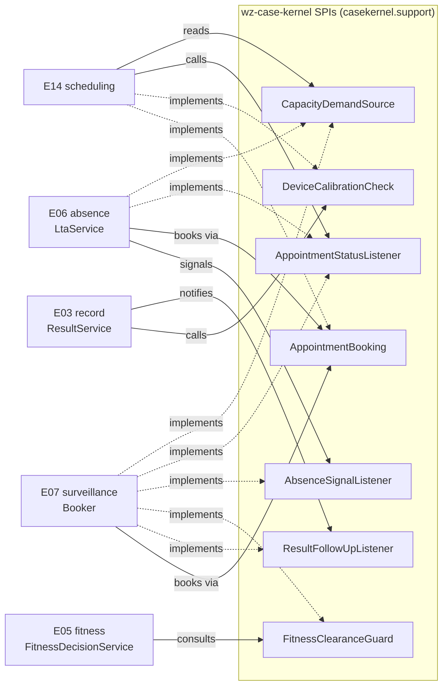

| Extension point | Called by | Implemented by | Contract |
|---|---|---|---|
| `AppointmentBooking` | E07 invitations and campaigns (`Booker`), E06 LTA contact schedule | E14 `AppointmentBookingAdapter` | `bookNext` books the first free slot or returns empty; with no implementation deployed callers degrade to "invited, not booked" |
| `AppointmentStatusListener` | E14 `StatusNotifier` (inside the appointment transaction) | E07 `SurveillanceSpi` (re-invitation after a no-show), E06 `AbsenceCapacityDemand` | `BOOKED`, `CHECKED_IN`, `ATTENDED`, `NO_SHOW`, `CANCELLED` for appointments whose `sourceType` the listener supports |
| `DeviceCalibrationCheck` | E03 `ResultService` (device results) | E14 `EquipmentCalibrationCheck` | `OUT_OF_CALIBRATION` / `OUT_OF_SERVICE` → `422 device_out_of_calibration` / `device_out_of_service`; `UNKNOWN` accepted unless `wellnessz.record.require-registered-devices=true` |
| `ResultFollowUpListener` | E03 `ResultService` (LIS, HL7 ORU, device results; same transaction) | E07 `FollowUpService` | Evaluates programme rules (for example audiometric standard threshold shift) and opens follow-up cases; identifiers and codes only |
| `FitnessClearanceGuard` | E05 `FitnessDecisionService` | E07 `RaiService` | Returns a non-clinical reason when a return-after-serious-illness medical is outstanding → `422 clearance_required` |
| `AbsenceSignalListener` | E06 `LtaService` (once, when the long-term threshold is crossed) | E07 `RaiService` | Creates the return-after-illness requirement for safety-critical jobs; never receives the absence reason |
| `CapacityDemandSource` | E14 `CapacityService` | E07 `SurveillanceSpi` (due examinations), E06 `AbsenceCapacityDemand` (LTA contacts) | Monthly counts per site and service – never person-level data |
| `ChartContributor` (increment 2) | E03 `ChartService` | E07 `SurveillanceChartContributor` (in addition to E05) | Surveillance section and alerts on the chart |
| `AbsenceFeedConnector` (module SPI) | E06 `absence-feed` job | `NoopAbsenceFeedConnector` (default) | One bean per source system (`HRIS`, `TNA`, `CREW`); rows reconciled like pushed rows |

Events added: `absence.trigger.raised.v1`, `absence.lta.started.v1`, `absence.advice.released.v1`,
`absence.hr-status.v1` (to `hr-systems`: `ohEngaged`, `certificateValidity`) (E06); `surveillance.enrolment.due.v1`,
`surveillance.followup.created.v1`, `preemployment.status.v1` (to `hr-systems`: `offerRef`, `candidateId`,
`preEmploymentStatus`), `crew.certificate.status.v1` (E07); `appointment.status.v1`, `equipment.calibration.v1`,
`coldchain.excursion.v1` (E14). Crew roster status continues to flow through the kernel (`CaseService.publishFitness`).

### 21.2 Main runtime flows

1. **Absence feed → early intervention.** Episodes arrive by push or the nightly pull and are reconciled against the
   HRIS master. The `absence-triggers` job evaluates the versioned rules (for example `DURATION_10D`, frequency,
   Monday / Friday and post-holiday patterns; `minDays` means "at least"); a match opens a queue item. When OH accepts
   it, a case is opened or linked and the first contact is recorded (KPI trigger → contact); the line manager and HR receive the content-free
   `absence.oh-engaged` notice and HR receives `ohEngaged` through the outbound allow-list.
2. **Certificates.** The employee photographs a sick certificate in the app (`storeUpload`, stored as an OH document);
   OH validates it; HR sees **validity only** (`certificateValidity`), never the content. Reception may scan
   certificates and run the validity checks but can neither open their content nor verify them.
3. **Long-term absence.** Crossing the threshold starts the LTA pathway (milestones at weeks 2, 4, 8, 12 and 26 with
   overdue alerts, fortnightly contacts, case conferences, an HR stage that rejects clinical text with
   `422 clinical_content_not_allowed`), signals `AbsenceSignalListener` and books the first contact through
   `AppointmentBooking`; completing the RTW review closes the pathway.
4. **Management advice.** A manager or HR asks OH a structured question (answers capped at 400 characters); OH writes
   the advice report (functional advice only – clinical text is rejected), signs it, and the report waits in
   `AWAITING_EMPLOYEE` until the employee consents to its release (`absence.advice.employee-review-required`). Release
   generates `OH_ADVICE_REPORT`, shares it with the requester (line manager for manager requests, HR otherwise) and
   writes the disclosure log; a declined report is withheld.

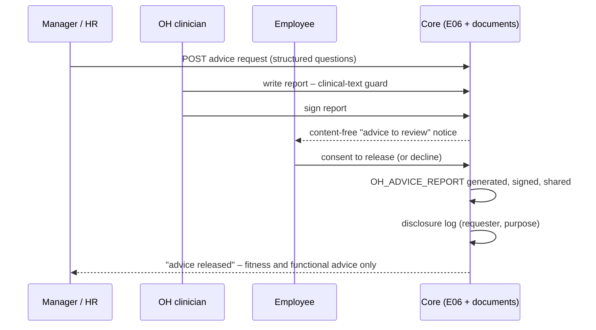

5. **Surveillance recall.** The nightly `surveillance-due` job enrols employees from job code, hazards and age (13
   programmes), raises due events, sends invitations, books slots through `AppointmentBooking`, re-invites after a
   no-show and asks the line manager to support attendance after `surveillance.max-invitations`. IH measurements above
   the action level bring the similar-exposure group into the programme.
6. **Results → follow-up and clearance.** Device and LIS results recorded in E03 are evaluated by E07 rules; abnormal
   findings open follow-up cases. A long-term absence in a safety-critical job creates a return-after-illness
   requirement; until it is completed, a FIT decision in E05 is refused with `422 clearance_required`.
7. **Pre-employment.** Recruiting posts the offer; the candidate (role `CANDIDATE`, not in the HRIS master) completes
   questionnaire and consent and books in the portal; OH records the outcome; HR receives the status only
   (`preEmploymentStatus`), with the disclosure logged. Non-hired candidates are purged after 12 months.
8. **Crew certificates and immunisation.** Crew medical certificates are tracked with expiry alerts to the crew member,
   AME and crew licensing (status view `EXPIRING` / without valid medical); immunisations are entered quickly with GS1
   barcodes, titres and reminders, and a `VACCINATION_CERTIFICATE` can be issued.
9. **Clinic day.** Scheduler or employee books (conflict-checked); the employee checks in by badge, app or kiosk
   (window from 60 minutes before the start); the queue board shows tickets only; *call next* hands the clinician to
   the chart. Device results are refused on out-of-calibration equipment; fridge readings outside 2–8 °C open an
   excursion that a clinician must acknowledge. Campaigns book cohorts; capacity compares diary supply with module
   demand.

### 21.3 Scheduled jobs added

All jobs run in the core, use cron expressions in UTC and run once per run key across replicas (`JobRunGuard`).

| Job | Property (default) | Purpose |
|---|---|---|
| `absence-feed` | `wellnessz.absence.feed-cron` (`0 40 2 * * *`) | Pull from every `AbsenceFeedConnector`, reconcile |
| `absence-triggers` | `wellnessz.absence.triggers-cron` (`0 0 3 * * *`) | Evaluate trigger rules, fill the early-intervention queue |
| `absence-lta` | `wellnessz.absence.lta-cron` (`0 10 3 * * *`) | Start LTA pathways, milestone and overdue alerts |
| `surveillance-due` | `wellnessz.surveillance.due-job-cron` (`0 40 1 * * *`) | Enrolment, due events, invitations, re-invitations, immunisation reminders |
| `crew-certificates` | `wellnessz.surveillance.crew-job-cron` (`0 50 1 * * *`) | Expiry alerts and expiry of crew medical certificates |
| `pre-employment-purge` | `wellnessz.surveillance.purge-job-cron` (`0 10 3 * * *`) | Anonymise non-hired candidates after 12 months |
| `appointment-reminders` | `wellnessz.scheduling.reminder-cron` (`0 */15 * * * *`) | Appointment reminders |
| `appointment-no-show` | `wellnessz.scheduling.no-show-cron` (`0 5/15 * * * *`) | Mark no-shows, notify the source module |
| `equipment-calibration` | `wellnessz.scheduling.calibration-cron` (`0 40 2 * * *`) | Calibration-due alerts to biomedical engineering |

### 21.4 Configuration keys added

| Key | Where | Default | Purpose |
|---|---|---|---|
| `spring.flyway.schemas` | `application.yml` | adds `absence, surveillance, scheduling` | Flyway-managed schemas |
| `wellnessz.integration.outbound-allowlist.hr-systems` | `application.yml` | adds `offerRef, candidateId, preEmploymentStatus, ohEngaged, certificateValidity` | Pre-employment status, OH engagement, certificate validity – status only |
| `wellnessz.record.require-registered-devices` | property (relaxed binding `WELLNESSZ_RECORD_REQUIREREGISTEREDDEVICES`) | `false` | Refuse device results from devices not in the E14 register |
| Job crons of Section 21.3 | properties | see 21.3 | Job schedules |
| `wellnessz.scheduling.telehealth-base-url` | property | `https://telehealth.wellnessz.local/room/` | Fallback when the E18 key below is not set |
| `spring.servlet.multipart.enabled` (BFF) | `apps/wz-bff/.../application.yml` | `false` | BFF streams uploads to the core untouched |
| `modules.e06.enabled`, `absence.notify-hr-on-engagement`, `absence.advice.employee-review-required`, `absence.hr-email`, `absence.queue.sla-days`, `absence.queue.ame-sla-days`, `absence.advice.sla-working-days`, `absence.lta.contact-interval-days`, `absence.public-holidays` | E18 (V10) | `true`, `true`, `true`, `hr-absence@wellnessz.local`, `5`, `1`, `5`, `14`, UK 2026–2027 holidays | Absence business configuration |
| `surveillance.max-invitations`, `surveillance.cosmic-dose-alert-msv`, `surveillance.new-enrolment-grace-days`, `surveillance.pre-employment-sla-days`, `surveillance.crew.issuing-authority`, `notifications.crew-licensing.email`, `notifications.hr-onboarding.email` | E18 (V11) | `2`, `6.0`, `30`, `10`, `UK CAA`, `crew-licensing@…`, `hr-onboarding@…` | Surveillance business configuration and status-only mailboxes |
| `scheduling.self-booking.min-notice-hours`, `.max-days-ahead`, `.one-open-per-type`, `scheduling.check-in.window-minutes`, `scheduling.no-show.grace-minutes`, `scheduling.telehealth-base-url`, `scheduling.calibration.due-alert-days`, `notifications.biomedical.email` | E18 (V12) | `24`, `60`, `true`, `60`, `30`, `https://telehealth.wellnessz.local/room/`, `30`, `biomedical@…` | Scheduling business configuration |

Mailbox addresses and the telehealth URL must be set per environment through `PUT /api/v1/masterdata/config/{key}`
(OH_ADMIN / PLATFORM_ADMIN, audited) before go-live.

### 21.5 Testing note – per-run keys

`IntegrationTestBase` generates `WZ_MASTER_KEY` and `WZ_PSEUDONYM_KEY` randomly for every test JVM, so values
encrypted by an earlier run cannot be decrypted by the next one. With Testcontainers this is invisible (fresh
container per run); with a persistent test database (`WZ_TEST_DB_URL`) **drop and recreate the test database before
every run**. The E07 demo return-after-illness requirement for `E1004` is skipped on databases whose name contains
`_test` so that it does not interfere with the E05 integration tests.

## 22. Increment 4 – E04 treatment coordination and E08 claims coordination on the framework

Increment 4 adds treatment coordination with external providers, claims coordination with insurers, TPAs and
authorities, and the first front end for users outside the airline. The detailed design is in
[Solution Design E04/E08](../increment-04/01-Solution-Design-E04-E08.md), requirement coverage in the
[Requirements Traceability Matrix](../increment-04/02-Requirements-Traceability-Matrix.md), the change list in the
[Release Notes](../increment-04/03-Release-Notes-Increment-4.md) and the endpoints in the
[API Contract E04/E08](../increment-04/API-Contract-E04-E08.md). This section records the architectural facts for the
CIO and Cyber GRC.

### 22.1 Module map

| Layer | Component | Increment-4 content |
|---|---|---|
| Business modules (`modules/`) | `wz-e04-treatment` → depends on `wz-e03-record`, `wz-e05-fitness`, `wz-documents` | Treatment plans and follow-ups, variance, e-referrals (portal, FHIR), provider directory and scorecards, pre-authorisation and invoices, clinic medication, outcomes, telehealth; schema `treatment` (V14) |
| | `wz-e08-claims` → depends on `wz-e05-fitness` (RTW status), `wz-documents` – **not** on `wz-e03-record` | Claims and lifecycle, first reports and deadlines, disclosure sets and redaction, nurse assignment and adjuster collaboration, cost ledger and ERP export, legal hold, privilege and medico-legal requests; schema `claims` (V15) |
| Case kernel | `wz-case-kernel` (`casekernel.support`) | Four SPIs: `CaseCostRecorder`, `ExternalReferralGateway`, `ReferralStatusListener`, `ClaimContextProvider` |
| Platform services | `wz-common`, `wz-security`, `wz-masterdata`, `wz-documents`, `wz-notification`, `wz-integration` | Roles `CLAIMS_COORDINATOR`, `TPA_ADJUSTER`, `LEGAL_COUNSEL`, `FINANCE`, `PROCUREMENT`; **MFA gate** for `PARTNER_PROVIDER` / `TPA_ADJUSTER`; consent purpose `TELEHEALTH_CONSULTATION`; partner organisations (V13); `INSURER` share target, `shareAsSystem` with consent id, `legalHoldForCase`, four upload types and four templates, retention class `CLAIM_RECORD`; 13 notification templates and `partner-portal-url`; allow-lists `insurer-gateway`, `authority-gateway`, `erp-finance` |
| BFF | `wz-bff` | `/bff/api/workspace/claims/**` keeps its prefix (HR claim status) |
| Front-ends | `web/partner-portal` (new), `web/oh-workspace`, `web/employee-app`, `web/manager-workspace` | Partner portal (port 5176, teal theme, MFA sign-in page): provider referral inbox and actions, telehealth, documents; adjuster claims, tasks, messages, pre-authorisation decisions. OH: case tabs treatment / referrals / costs / outcomes / claim with the claim badge, referral worklist, variance, providers and scorecards, medications, telehealth, claims, reports, disclosure sets, nurse assignment, finance costs, legal, DPO disclosure report, chart tab *Treatment*. Employee: my treatment plan, telehealth (consent, join, chat). HR: claim status |
| Delivery | New image `partner-portal`, Helm component `partnerPortal` (host `partners.<domain>`), Keycloak redirect URIs / origins for 5176, CI web matrix, container build, deploy-env image list, Dependabot; two schemas in all bootstrap paths; five realm roles and six users | Document 04, Section 20; CI/CD Guide |

The modules plug in as follows (no kernel → module dependency, E04 and E08 independent of each other, E08 without
access to the clinical record, earlier modules independent of increment 4 – all enforced by ArchUnit):

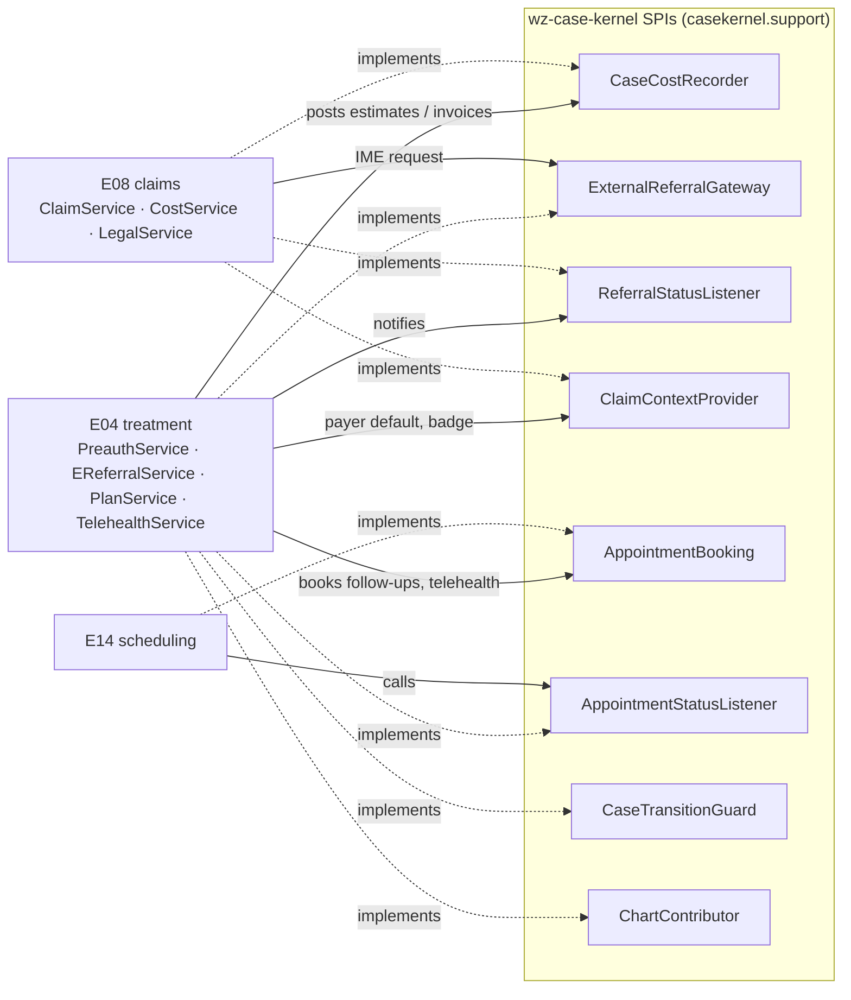

| Extension point | Called by | Implemented by | Contract |
|---|---|---|---|
| `CaseCostRecorder` | E04 `PreauthService` (estimate on submission / approval), invoice capture | E08 `CostService` | `record(actor, CostEntry)` → ledger id; idempotent on (sourceType, sourceRef, kind); amounts, category and provider only – never clinical detail; entries of a case without a claim stay case-level and still roll up |
| `ExternalReferralGateway` | E08 `LegalService` (IME / expert opinion) | E04 `EReferralService` | Creates a DRAFT referral (service code, provider, urgency, source type / ref) that OH completes – data set and consent are still checked on send; without E04 the legal request records `referralStatus NOT_AVAILABLE` and raises an OH task |
| `ReferralStatusListener` | E04 (inside the referral transaction, every status change) | E08 `LegalService` for `CLAIM_IME` | Status and the report document id once `REPORT_RECEIVED` |
| `ClaimContextProvider` | E04 pre-authorisation (payer default), OH case header | E08 `ClaimService` | `ClaimContext(claimId, claimRef, claimType, status, payerCode, lostTime, litigationHold)` – no reserves or costs |
| `CaseTransitionGuard` | kernel `CaseService` | E04 `OutcomeClosureGuard` | A case with a treatment plan or referral cannot close without a CLOSURE outcome → `422 outcome_required` |
| `ChartContributor` | E03 `ChartService` | E04 `TreatmentChartContributor` | Treatment section (active plan, open referrals, outcomes) |
| `AppointmentStatusListener` | E14 | E04 `TreatmentAppointmentListener` (`TREATMENT_FOLLOW_UP`, `TELEHEALTH_SESSION`) | Appointment status updates follow-ups (a no-show marks the follow-up `MISSED`) and telehealth sessions |
| `TelehealthProvider` (module SPI) | E04 `TelehealthService` | link provider (default) | Join URL from session reference, mode and single-use token (Section 14.26) |
| `EPrescribingGateway` (module SPI) | E04 `MedicationController` | no-op (default) | Status and decision memo (Section 14.28) |
| `ClaimsSubmissionGateway` (module SPI) | E08 `ReportService` | `DefaultClaimsSubmissionGateway` | Outbox event to `insurer-gateway` / `authority-gateway` + content-free e-mail; replace with a `@Primary` connector (Section 14.29) |

Events added: `referral.status.v1`, `preauth.status.v1`, `treatment.variance.v1` (E04); `claim.status.v1`,
`claim.nurse.assigned.v1`, `claim.report.submitted.v1` (to `insurer-gateway` / `authority-gateway`),
`claim.cost.export.v1` (to `erp-finance`) (E08). All carry identifiers and status only.

### 22.2 Main runtime flows

1. **Treatment plan.** A clinician creates a plan from one of eight injury templates (for example `WRIST_SPRAIN`);
   follow-ups become case tasks and may be booked through `AppointmentBooking`. The employee sees the plan in plain
   language (no OH-only fields), confirms or declines follow-ups and can receive the signed `TREATMENT_PLAN`. The
   nightly `treatment-variance` job compares elapsed days with the E02 duration guideline (threshold 20 % or the plan's
   override) and raises a variance alert to the responsible clinician.
2. **E-referral.** The referral wizard requires the service's data set (`422 data_set_incomplete` with the field) and
   an active `TREATMENT_SHARING_PARTNER` consent; sending signs the `REFERRAL_LETTER`, builds the FHIR `ServiceRequest`,
   shares letter and attachments with the provider organisation and sets the report due date. The provider works the
   referral in the partner portal (accept → appointment → seen → report → invoice) or through FHIR; another
   organisation receives `404`. The daily `referral-chase` job chases overdue reports and escalates after two chases.
3. **Pre-authorisation and costs.** A clinician (justification required, clinical) or the claims coordinator raises a
   pre-authorisation for the payer from the claim context; submission generates `PREAUTH_REQUEST`, shares it with the
   payer under `INSURER_SHARING` and records an `ESTIMATE` cost; the adjuster decides in the portal (or the insurer
   system through the integration endpoint). Provider invoices are matched against the approval (tolerance 5 %) and
   posted as `INVOICE` costs through `CaseCostRecorder`.
4. **Telehealth.** A clinician schedules a session (optionally hosted by a partner specialist, crew on layover); the
   employee consents (`TELEHEALTH_CONSULTATION`), every participant receives a single-use join token, chat is encrypted
   at rest, and completion creates a draft E03 encounter for signature.
5. **Claim and nurse case manager.** The claims coordinator opens a claim from the case; a lost-time claim gets a nurse
   case manager automatically (case owner if a case manager, else the least-loaded case manager through the E02
   assignment service), KPI: assigned within 48 h. The case header shows the claim badge.
6. **First report of injury.** The report is auto-populated from incident, case and HRIS data, with a deadline per form
   (for example 10 days for a specified injury on `GB_OSH_F2508`); the hourly `claims-report-deadlines` job reminds
   24 h before and marks late reports. Submission signs `FIRST_REPORT_OF_INJURY`, shares it with an insurer under
   consent (authorities: legal basis, logged) and calls `ClaimsSubmissionGateway`.
7. **Consent-gated disclosure and collaboration.** A disclosure set contains only allowed document types (provider
   reports and external reports only when an OH role adds them; never medico-legal reports, photos, restricted-class or
   privileged material); OH can replace a document by a `REDACTED_COPY`; sending checks the consent, shares each
   document with the payer and writes the disclosure log. The adjuster sees own-payer claims, RTW status and milestones,
   shared tasks and messages – clinical wording is refused (`422 clinical_content_not_allowed`).
8. **Finance.** Costs roll up by subsidiary / department / cost centre with small-group suppression and no names;
   budget versus actual; one ERP export per month (`409 export_exists` unless the previous one is `MISMATCH`) with a
   checksum and reconciliation.
9. **Legal.** Legal counsel sets a litigation hold (all case documents on legal hold, retention suspended), marks the
   claim privileged and requests medico-legal reports (versioned, legal access set) or an IME through
   `ExternalReferralGateway`.

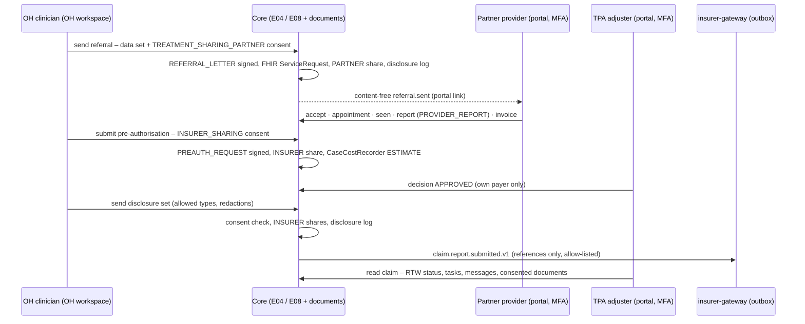

### 22.3 Scheduled jobs added

All jobs run in the core, use cron expressions in UTC and run once per run key across replicas (`JobRunGuard`).

| Job | Property (default) | Purpose |
|---|---|---|
| `treatment-variance` | `wellnessz.treatment.variance-job-cron` (`0 20 2 * * *`) | Recovery-variance alerts, follow-up reminders (`treatment.follow-up.reminder-days`), expiry of approved pre-authorisations past `validUntil` without an invoice |
| `referral-chase` | `wellnessz.treatment.chase-job-cron` (`0 40 6 * * *`) | Chase overdue provider reports, escalate after `treatment.referral.max-chases` |
| `provider-scorecards` | `wellnessz.treatment.scorecard-job-cron` (`0 15 3 1 * *`) | Monthly provider scorecards for the previous month |
| `claims-report-deadlines` | `wellnessz.claims.report-deadlines-cron` (`0 5 * * * *`) | Hourly reminders 24 h before a statutory / insurer deadline, mark late reports and escalate to the claims mailbox |

### 22.4 Configuration keys added

| Key | Where | Default | Purpose |
|---|---|---|---|
| `spring.flyway.schemas` | `application.yml` | adds `treatment, claims` | Flyway-managed schemas |
| `wellnessz.security.mfa-required-roles` | `application.yml`, env `WZ_MFA_REQUIRED_ROLES` | `PARTNER_PROVIDER,TPA_ADJUSTER` (empty in the `local` profile) | Roles granted only with MFA proof |
| `wellnessz.security.mfa-amr-values`, `wellnessz.security.mfa-acr-values` | properties (relaxed binding `WELLNESSZ_SECURITY_MFAAMRVALUES`, `…_MFAACRVALUES`) | `mfa,otp,totp,hwk,swk,sms,webauthn,fido` / `2,3,mfa,c1` | Claim values accepted as MFA proof (`amr`; `acr` and the Entra ID `acrs` array) |
| `wellnessz.notification.partner-portal-url` | `application.yml`, env `WZ_PARTNER_PORTAL_URL` (set in Helm `values.yaml` to `https://partners.wellnessz.example.com`, `values-local.yaml` `http://partners.localtest.me`) | `https://partners.wellnessz.local` | Links in partner and adjuster notifications |
| `wellnessz.integration.outbound-allowlist.{insurer-gateway,authority-gateway,erp-finance}` | `application.yml` | Section 7.3 | Reference-only claim, report and cost destinations |
| `wellnessz.security.cors-origins` (local profile) | `application.yml`, env `WZ_CORS_ORIGINS` | adds `http://localhost:5176` | Partner portal dev server |
| Job crons of Section 22.3 | properties | see 22.3 | Job schedules |
| `modules.e04.enabled`, `treatment.variance.threshold-pct`, `treatment.follow-up.reminder-days`, `treatment.referral.max-chases`, `treatment.referral.chase-interval-days`, `treatment.preauth.sla-hours`, `treatment.invoice.tolerance-pct`, `treatment.base-currency`, `treatment.contract.expiring-days`, `treatment.network.cities`, `treatment.telehealth.base-url`, `treatment.eprescribing.route` | E18 (V14) | `true`, `20`, `2`, `2`, `2`, `48`, `5`, `GBP`, `60`, `London:HUB,Dubai:OUTSTATION,New York:LAYOVER,Singapore:LAYOVER,Hong Kong:LAYOVER`, `https://telehealth.wellnessz.local/room/`, `NONE` | Treatment business configuration |
| `modules.e08.enabled`, `claims.legal-email`, `claims.mailbox-email`, `claims.nurse-sla-hours`, `claims.report-reminder-hours`, `claims.base-currency`, `claims.fx-rates`, `claims.employer-name`, `claims.employer-ref`, `claims.forms.sign-off` | E18 (V15) | `true`, `legal@wellnessz.local`, `claims@wellnessz.local`, `48`, `24`, `GBP`, `GBP:1,AED:0.21,USD:0.79,EUR:0.85,SGD:0.58,HKD:0.10`, `WellnessZ Airline`, `WZ-EMP-0001`, `PENDING` | Claims business configuration |

The mailboxes, employer reference, exchange rates, telehealth URL and partner-portal URL must be set per environment
before go-live (E18 keys through `PUT /api/v1/masterdata/config/{key}`, the URL as an environment variable).

### 22.5 Testing note

`Increment4TreatmentIntegrationTest` (10) and `Increment4ClaimsIntegrationTest` (10) run on the shared integration
base (per-run keys, Section 21.5). The end-to-end script `tools/e2e/e2e-increment4.js` drives all four browser apps
with real Keycloak logins; like the increment-3 script it consumes demo state (referrals, claims, exports), so run it
on a freshly purged local database after the earlier scripts.

## 23. Increment 5 – E09, E10, E11 and E12 on the framework (final increment)

Increment 5 adds the restricted-class programmes (mental health, substance testing), travel health and communicable
disease, and health promotion, and completes the platform with DEV / UAT / PROD environment engineering. The
endpoints, roles and rules are in the [API Contract E09/E10/E11/E12](../increment-05/API-Contract-E09-E10-E11-E12.md).
This section records the architectural facts for the CIO and Cyber GRC.

### 23.1 Module map

| Layer | Component | Increment-5 content |
|---|---|---|
| Business modules (`modules/`) | `wz-e09-mentalhealth` → `wz-e05-fitness`, `wz-documents` | Support cases, screening and urgent-risk protocol, EAP, peer support, CISM, psychosocial register, relief and fitness; schema `mentalhealth` (V17) |
| | `wz-e10-substance` → `wz-e05-fitness`, `wz-documents` – **not** E09 | Policies, pools, random selection, triggers, collection and chain of custody, laboratory, MRO, pathway and return to duty, statistics; schema `substance` (V18) |
| | `wz-e11-travelhealth` → `wz-e07-surveillance`, `wz-documents` | Travel consultations, communicable disease and contact tracing, exposure pathways, vaccination campaigns, advisories, public-health reports; schema `travelhealth` (V19) |
| | `wz-e12-promotion` → `wz-e03-record`, `wz-documents` | Insights, campaigns, screening events, education, ergonomics, wearables; schema `promotion` (V20) |
| Case kernel | `wz-case-kernel` (`casekernel.support`) | SPI `SupportProgrammeReferral` (implemented by E09, called by E10 – and available to E11) |
| Platform services | `wz-common`, `wz-security`, `wz-masterdata`, `wz-documents`, `wz-notification`, `wz-integration` | Eight roles; `GlobalExceptionHandler` `400` codes; duty assignments (V16); partners `EAP_WELLBEING`, `TOXLAB`, `UKHSA_LOCAL`; restricted-class documents and four templates, two upload types, retention classes `RESTRICTED_RECORD`, `PUBLIC_HEALTH`; content-free templates and stricter `ContentRules`; allow-lists `campaign-app`, `sms-safety` |
| BFF | `wz-bff` | Workspace resources `/workspace/testing`, `/workspace/psychosocial`, `/workspace/campaigns`, `/workspace/ergonomics`; workspace gate admits `SAFETY_MANAGER` and `CREW_SCHEDULING` |
| Front ends | all four web apps | OH workspace (support, peer support, CISM, psychosocial, testing, travel, communicable disease, exposures, campaigns, advisories, public health, promotion, ergonomics, chart placeholder); employee app (support with emergency banner, peer support, travel health, campaigns, workplace-check notices, check-ins); manager workspace (psychosocial risk, testing duty status for HR, for-cause request, ergonomics, unit campaigns); partner portal (EAP referrals) |
| Delivery | Terraform `environment` = `dev` / `uat` / `prod` with per-environment variable files and back ends; nine Helm overlays; `cd.yml` / `deploy-env.yml` promotion; `deploy/scripts/helm-release.sh`; `customisation:` values and `ClientMigrationsConfig` | `deploy/environments/README.md`, document 04 |

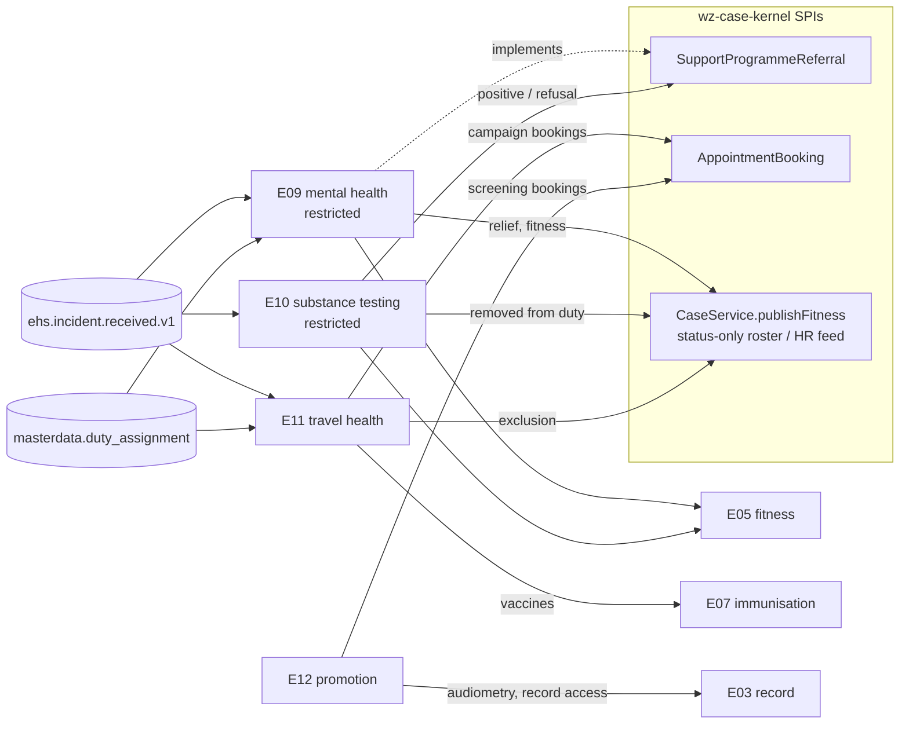

Events added (identifiers and status only): `substance.duty-status.v1` (E10), `peer-support.quarterly-report.v1`
(E09, to `sms-safety`), `promotion.campaign.published.v1` (E12, to `campaign-app`), `promotion.screening.follow-up.v1`
(E12); fitness and exclusion changes reuse the kernel status-only roster and HR feed.

### 23.2 Main runtime flows

1. **Confidential self-referral and urgent risk.** The employee self-refers from the employee app (signposting and an
   emergency banner are shown first, even before data has loaded); a PHQ-9 / GAD-7 screen is scored on the server and
   any self-harm answer creates an urgent item with a same-day call-back for the named clinician. The case is a
   restricted kernel case; a general OH nurse sees `404` and the chart placeholder count only.
2. **Sharing choice and EAP.** The employee decides what the manager sees (`FITNESS_ONLY` in the E2E run – no
   screening, no notes). An EAP referral reaches `EAP_WELLBEING`; counsellors see minimal data for their own
   organisation and return attendance only (free text `422 field_not_allowed`); every partner read is
   disclosure-logged.
3. **Peer support and CISM.** Crew request a peer as alias + code; the request is routed to a trained, available
   volunteer; the contact log has no identity. A fume event on flight WZ101 opens a CISM event; affected crew come from
   the duty roster and receive offers within 72 h; the safety manager sees counts only. The AME can relieve a crew
   member from flight duties – rostering receives status only.
4. **Random selection to MRO decision.** The programme manager runs a random selection from the role-group pool
   (seed, pool hash and commitment stored – `/verify` reproduces it) and never sees results; the collector records
   collection with a signed chain-of-custody form; the bound `TOXLAB` client posts results; the MRO verifies. A
   positive removes the employee from safety-sensitive duty, HR and crew scheduling see status only, a confidential
   support referral opens through `SupportProgrammeReferral` and a draft return-to-duty plan with unannounced
   follow-up tests is created.
5. **Contact tracing.** A confirmed communicable-disease case is excluded (status only to rostering / HR; food handlers
   through E05) and traced from shared duties and proximity groups within the 4-hour KPI (1.03 h in the E2E run);
   contacts are notified without naming the case and complete symptom check-ins.
6. **Exposure pathway.** An EHS needle-stick incident opens a pathway with protocol timers (PEP decision within hours);
   the five-minute timer job alerts before and at the due time.
7. **Travel, advisories and public health.** Travel consultations produce recommendations and a signed certificate;
   advisories reach crew rostered to the destination with suppressed acknowledgement counts; notifiable-disease reports
   go to the health protection team within the statutory time with correspondence logged.
8. **Health promotion.** Campaigns are planned from anonymised hotspots, published to the campaign app and reported
   with suppression; a biometric screening with abnormal blood pressure opens a follow-up case within 48 h and a result
   letter; ergonomic assessments are scored with RAG and actions tracked to closure; wearable data is accepted only for
   consented enrolments as daily totals.

### 23.3 Scheduled jobs added

All jobs run in the core with cron expressions in UTC and once per run key across replicas (`JobRunGuard`).

| Job | Property (default) | Purpose |
|---|---|---|
| `cism-follow-ups` | `wellnessz.mentalhealth.cism-follow-ups-cron` (`0 20 8 * * *`) | CISM follow-up offers |
| `peer-callback-purge` | `wellnessz.mentalhealth.peer-callback-purge-cron` (`0 40 1 * * *`) | Clear peer call-back phone numbers after `mentalhealth.peer-callback-retention-days` (30) |
| `substance-follow-ups` | `wellnessz.substance.follow-ups-cron` (`0 15 6 * * *`) | Notify follow-up tests whose random date has arrived |
| `substance-windows` | `wellnessz.substance.windows-cron` (`0 20 * * * *`) | Move uncollected tests to `WINDOW_MISSED` when the window closes |
| `exposure-timers` | `wellnessz.travelhealth.exposure-timer-cron` (`0 */5 * * * *`) | Protocol timer alerts (due soon, overdue) |
| `public-health-deadlines` | `wellnessz.travelhealth.public-health-cron` (`0 7 * * * *`) | Statutory report deadline reminders |
| `travelhealth-daily` | `wellnessz.travelhealth.daily-cron` (`0 20 6 * * *`) | Check-in reminders, advisory re-targeting, consultation-due reminders |
| `ergonomic-actions` | `wellnessz.promotion.ergonomic-job-cron` (`0 20 2 * * *`) | Ergonomic action due reminders |
| `screening-follow-up` | `wellnessz.promotion.follow-up-job-cron` (`0 15 * * * *`) | Open follow-up cases for abnormal results without one |

### 23.4 Configuration keys added

| Keys (E18 configuration, seeded by migration) | Purpose |
|---|---|
| `modules.e09.enabled`, `mentalhealth.named-clinicians`, `mentalhealth.urgent-callback-hours`, `mentalhealth.first-contact-working-days`, `mentalhealth.eap-first-appointment-working-days`, `mentalhealth.emergency-text`, `mentalhealth.emergency-phone`, `mentalhealth.peer-callback-retention-days`, `mentalhealth.governance.sign-off`, `cism.trigger-classes`, `cism.offer-sla-hours`, `cism.duty-window-hours` (V17) | E09 named readers, response times, emergency guidance, CISM triggers |
| `modules.e10.enabled`, `substance.laboratory-code`, `substance.acting-mro-physicians`, `substance.breath-alcohol-cutoff`, `substance.collection-site`, `substance.hr-status-email` (V18) | E10 laboratory binding, MRO delegation, cut-offs |
| `travelhealth.tracing.high-risk-minutes`, `travelhealth.tracing.kpi-hours`, `travelhealth.tracing.max-window-days`, `travelhealth.exposure.alert-before-minutes`, `travelhealth.public-health.alert-before-hours`, `travelhealth.public-health.exposure-report-hours`, `travelhealth.check-in.fever-threshold-c`, `travelhealth.consultation.lookahead-days` (V19) | E11 tracing rules, timers, deadlines |
| `promotion.screening.threshold.systolic` / `.diastolic` / `.bmi`, `promotion.screening.follow-up-hours`, `promotion.ergonomics.closure-target-days`, `promotion.ergonomics.reminder-days`, `promotion.participation.target-pct`, `promotion.wearables.max-age-days` (V20) | E12 thresholds and targets |
| `wellnessz.integration.outbound-allowlist.{campaign-app,sms-safety}` (`application.yml`) | Outbound destinations (Section 7.3) |
| `wellnessz.flyway.client.*` (`WZ_FLYWAY_EXTRA_LOCATIONS`, `WZ_FLYWAY_CLIENT_SCHEMAS`, `WZ_FLYWAY_CLIENT_TABLE`) | Client migrations (Section 23.6) |
| `WZ_CLIENT_ID`, `WZ_FEATURE_<NAME>` | Client id and feature flags from Helm `customisation:` (plumbing only) |

Clinical values among these keys are reference data awaiting sign-off (O31).

### 23.5 Testing note

The four increment-5 integration tests run on the shared integration base (per-run keys, Section 21.5). The demo
seeders write encrypted demo values only in the `local` and `test` profiles. `tools/e2e/e2e-increment5.js` drives all
four browser apps with real Keycloak logins (users `psych1`, `peer1`, `peercoord1`, `safety1`, `damanager1`, `mro1`,
`collector1`, `promo1`, `ergo1`, `eap1` and earlier users) and consumes demo state; run it on a freshly purged local
database after the earlier scripts.

### 23.6 Environments and client customisation

* **Terraform:** `environment` must be `dev`, `uat` or `prod` (no default; `test` was renamed to `uat`). Each
  environment has its own variable file and back-end configuration; network ranges never overlap so all can peer with
  a hub; GitHub OIDC trusts only the environment's own GitHub Environment; only DEV accepts image pushes from `main`.
* **Helm:** nine overlays set replicas, HPA / PDB, resources, hosts, OIDC issuer / audience / scope, MFA roles (off in
  DEV), log level and trace sampling, namespace default-deny (off in DEV only), migration mode (in-app in DEV, Job in
  UAT / PROD) and network-policy ranges matching Terraform; `global.requireImageDigests` in UAT / PROD.
* **Promotion:** Section 9.8 and Section 14.38.
* **Client customisation:** `customisation.client` (`WZ_CLIENT_ID` and label `wellnessz.io/client`),
  `customisation.featureFlags` (`WZ_FEATURE_<NAME>` on core and BFF – not yet read by any feature),
  `customisation.migrations` (SQL from an extension image or a ConfigMap, `*.sql` only, run after the product
  migrations in schema `client_<client>` – default `client_ext` in the application – with history table
  `flyway_schema_history_client`; job mode: extra `flyway-client` step; app mode: `ClientMigrationsConfig`),
  `core.extraEnv` / `bff.extraEnv`; per-client values in `deploy/clients/<client>/values.yaml` through
  `EXTRA_VALUES_FILES`. Not implemented: mounting extension JARs into the core image.

## Appendix A – API surface of the base framework

| Method & path | Roles | Module |
|---|---|---|
| `GET /api/v1/me` | authenticated | wz-security |
| `GET /api/v1/cases`, `GET /cases/{id}`, `GET /cases/{id}/status` | authenticated, ABAC-filtered | wz-case-kernel |
| `POST /api/v1/cases/self-referral` | EMPLOYEE | wz-case-kernel |
| `POST /api/v1/cases/{id}/transition` | OH_CLINICIAN, CASE_MANAGER, PSYCH_CLINICIAN + ABAC | wz-case-kernel |
| `POST /api/v1/cases/{id}/fitness` | OH_CLINICIAN, PSYCH_CLINICIAN + ABAC | wz-case-kernel |
| `GET /api/v1/modules` | authenticated | wz-case-kernel |
| `POST /api/v1/consents`, `GET /consents/me`, `DELETE /consents/{id}` | data subject | wz-security |
| `GET /api/v1/audit`, `GET /audit/verify` | AUDITOR, PLATFORM_ADMIN | wz-security |
| `GET /api/v1/masterdata/{org-units\|job-codes\|hazards}` | authenticated | wz-masterdata |
| `POST /api/v1/masterdata/{org-units\|job-codes\|hazards}` | OH_ADMIN, PLATFORM_ADMIN, INTEGRATION | wz-masterdata |
| `GET\|PUT /api/v1/masterdata/config/{key}` | OH_ADMIN, PLATFORM_ADMIN | wz-masterdata |
| `POST /api/v1/integration/inbound/{source}` (Idempotency-Key) | INTEGRATION, PLATFORM_ADMIN, OH_ADMIN | wz-integration |
| `GET /api/v1/integration/connectors`, `GET /integration/events` | INTEGRATION, PLATFORM_ADMIN, OH_ADMIN | wz-integration |
| `POST /api/v1/integration/events/{id}/replay` | PLATFORM_ADMIN, OH_ADMIN | wz-integration |
| `GET /api/v1/integration/fhir/metadata`, `POST /integration/fhir/{type}` | INTEGRATION, PLATFORM_ADMIN, OH_ADMIN | wz-integration |
| `POST /api/v1/integration/hl7v2` | INTEGRATION, PLATFORM_ADMIN, OH_ADMIN | wz-integration |
| `POST /api/v1/intake/ehs/excel` | OH_ADMIN, CASE_MANAGER, INTEGRATION | wz-ehs-intake |
| `POST /api/v1/intake/ehs/mailbox/poll` | OH_ADMIN, PLATFORM_ADMIN | wz-ehs-intake |
| `GET /api/v1/intake/ehs/incidents` | OH_ADMIN, CASE_MANAGER, OH_CLINICIAN | wz-ehs-intake |
| `GET /api/v1/analytics/kpis/cases-by-status` | MANAGER, HR, OH_CLINICIAN, OH_ADMIN, CASE_MANAGER, PLATFORM_ADMIN | wz-analytics |
| `POST /api/v1/notifications/test` | PLATFORM_ADMIN | wz-notification |
| BFF: `/oauth2/authorization/wellnessz`, `/login/oauth2/code/wellnessz`, `POST /logout`, `GET /bff/session`, `/bff/api/**` | session | wz-bff |

Increment 1 adds endpoints under `/api/v1/intake/**`, `/api/v1/triage/**`, `/api/v1/queues/**`,
`/api/v1/cases/{id}/…`, `/api/v1/escalations/**`, `/api/v1/assignment/**`, `/api/v1/sla/**`, `/api/v1/staff/**`,
`/api/v1/status/**`, `/api/v1/employees/{id}/timeline`, `/api/v1/me/advice` and `/api/v1/masterdata/employees`. The
authoritative list with roles is the [API Contract E01/E02](../increment-01/API-Contract-E01-E02.md); selected entries:

| Method & path | Roles | Module |
|---|---|---|
| `POST /api/v1/intake/ehs/incidents` (Idempotency-Key) | INTEGRATION | wz-ehs-intake |
| `GET /api/v1/intake/dlq`, `POST /intake/dlq/{id}/replay\|discard` | OH_ADMIN, PLATFORM_ADMIN | wz-ehs-intake |
| `POST /api/v1/intake/referrals/self\|manager\|hr` | EMPLOYEE / MANAGER / HR (clinical-text guard on manager and HR) | wz-e01-intake |
| `GET\|POST\|PUT /api/v1/intake/rules`, `POST /intake/rules/test` | read: OH roles, OH_ADMIN, HSE_OFFICER; write: OH_ADMIN, NURSING_HEAD | wz-e01-intake |
| `POST /api/v1/intake/encounters`, `POST /intake/encounters/{id}/convert` | CLINIC_RECEPTION, FIRST_AIDER, OH roles / convert: OH clinical roles | wz-e01-intake |
| `GET /api/v1/queues/{queue}`, `GET /queues/counts` | OH roles | wz-e02-triage |
| `POST /api/v1/cases/{id}/triage` | OH triage roles | wz-e02-triage |
| `POST /api/v1/triage/protocols/{code}/approve` | CMO | wz-e02-triage |
| `GET /api/v1/status/crew`, `GET /status/food-handlers` | CREW_SCHEDULING / HYGIENE_MANAGER (status fields only) | wz-e02-triage |
| `POST /api/v1/masterdata/employees` | INTEGRATION, OH_ADMIN, PLATFORM_ADMIN | wz-masterdata |

Increment 2 adds endpoints under `/api/v1/employees/{id}/…` (chart, problems, allergies, medications,
immunisations, jobs, encounters, orders, results, fitness, `fhir`, `odh`), `/api/v1/encounters/**`,
`/api/v1/encounter-templates/**`, `/api/v1/terminology/**`, `/api/v1/results/**`, `/api/v1/cds/**`,
`/api/v1/documents/**`, `/api/v1/break-glass/**`, `/api/v1/disclosures`, `/api/v1/me/{documents,disclosures,rtw-plans,job-offers}`,
`/api/v1/workspace/{team-restrictions,duty-proposals,rtw-plans,documents}`, `/api/v1/partner/documents`,
`/api/v1/fitness/**`, `/api/v1/restrictions/**`, `/api/v1/rtw-plans/**`, `/api/v1/crew/**`,
`/api/v1/masterdata/{fitness-standards,restrictions,job-demands}` and the machine endpoints
`/api/v1/integration/lis/**` and `/api/v1/integration/roster-feed/**` (240 paths in total). The authoritative list
with roles is the [API Contract E03/E05](../increment-02/API-Contract-E03-E05.md); selected entries:

| Method & path | Roles | Module |
|---|---|---|
| `GET /api/v1/employees/{id}/chart`, `GET /employees/{id}/fhir`, `GET /employees/{id}/odh` | OH roles + record-level ABAC | wz-e03-record |
| `POST /api/v1/encounters/{id}/sign` | clinicians | wz-e03-record |
| `GET /api/v1/integration/lis/orders`, `POST /integration/lis/orders/{id}/ack`, `POST /integration/lis/results` | INTEGRATION | wz-e03-record |
| `POST /api/v1/employees/{id}/results/device` | OH roles, INTEGRATION | wz-e03-record |
| `POST /api/v1/documents/generate`, `POST /documents/{id}/sign`, `POST /documents/{id}/share` | OH roles; HR for its own non-clinical templates (job offer, employee target only) | wz-documents |
| `GET\|PUT /api/v1/documents/retention…`, `POST\|DELETE /documents/{id}/legal-hold` | DPO (schedule read also OH_ADMIN) | wz-documents |
| `POST /api/v1/break-glass`; `GET /break-glass`, `POST /break-glass/{id}/review`; `GET /break-glass/report` | clinicians; DPO; DPO, CMO | wz-security |
| `POST /api/v1/cases/{id}/fitness-decisions`, `POST /fitness-decisions/{id}/signoff` | fitness deciders; AME / CMO per standard | wz-e05-fitness |
| `GET /api/v1/integration/roster-feed`, `POST /integration/roster-feed/{messageId}/ack` (`/crew/roster-feed` for people) | INTEGRATION; CREW_SCHEDULING (read) | wz-e05-fitness |
| `GET /api/v1/workspace/team-restrictions`, `GET /workspace/duty-proposals`, `GET /workspace/rtw-plans` | MANAGER, HR (functional restrictions and status only) | wz-e05-fitness |

Increment 3 adds endpoints under `/api/v1/absence/**` (32 paths), `/api/v1/surveillance/**` (47),
`/api/v1/scheduling/**` (39), `/api/v1/me/{absence,advice-reports,appointments,immunisations,pre-employment,pregnancy-declaration,surveillance}`,
`/api/v1/workspace/{absence,advice-requests,surveillance,pre-employment}`, `/api/v1/masterdata/clinic-sites` and the
machine endpoints `/api/v1/integration/absence/**`, `/integration/ih-measurements`, `/integration/cosmic-dose`,
`/integration/pre-employment` and `/integration/cold-chain/readings` (391 paths in total). The authoritative list with
roles is the [API Contract E06/E07/E14](../increment-03/API-Contract-E06-E07-E14.md); selected entries:

| Method & path | Roles | Module |
|---|---|---|
| `POST /api/v1/integration/absence/episodes`, `POST /integration/absence/certificates` | INTEGRATION | wz-e06-absence |
| `GET /api/v1/absence/queue`, `POST /absence/queue/{id}/accept` | OH roles | wz-e06-absence |
| `GET /api/v1/workspace/absence/team`, `/workspace/absence/lta`, `/workspace/absence/certificates`; `GET\|POST /workspace/advice-requests` | MANAGER, HR within org scope (status only, no reason category; LTA and certificate validity shown to HR in the UI) | wz-e06-absence |
| `POST /api/v1/me/advice-reports/{id}/decision` | EMPLOYEE (consent to release or decline) | wz-e06-absence |
| `GET /api/v1/surveillance/due`, `POST /surveillance/invitations` | OH roles, CLINIC_SCHEDULER | wz-e07-surveillance |
| `GET /api/v1/surveillance/crew/certificates`, `/surveillance/crew/without-valid-medical` | AME, CMO; CREW_LICENSING, CREW_SCHEDULING without answers or documents | wz-e07-surveillance |
| `GET /api/v1/me/pre-employment`, `POST /me/pre-employment/{questionnaire,consent,documents,book}` | CANDIDATE | wz-e07-surveillance |
| `POST /api/v1/surveillance/audit-packs` | CMO, NURSING_HEAD (identifiable or anonymised), AUDITOR, HSE_OFFICER (anonymised only) | wz-e07-surveillance |
| `POST /api/v1/integration/ih-measurements`, `/integration/cosmic-dose`, `/integration/pre-employment` | INTEGRATION | wz-e07-surveillance |
| `GET /api/v1/me/appointments/slots`, `POST /me/appointments`, `POST /me/appointments/{id}/{reschedule,cancel,check-in}` | EMPLOYEE | wz-e14-scheduling |
| `POST /api/v1/scheduling/appointments`, diary, waitlist, campaigns | OH roles, CLINIC_SCHEDULER (reception: diary, attendance, check-in, queue) | wz-e14-scheduling |
| `GET\|POST /api/v1/scheduling/equipment/**`, calibrations | BIOMEDICAL, OH_ADMIN (write); OH roles, CLINIC_SCHEDULER (read) | wz-e14-scheduling |
| `POST /api/v1/integration/cold-chain/readings` | INTEGRATION | wz-e14-scheduling |

Increment 4 adds endpoints under `/api/v1/treatment/**`, `/api/v1/treatment-plans/**`, `/api/v1/referrals/**`,
`/api/v1/providers/**`, `/api/v1/preauthorisations/**`, `/api/v1/invoices/**`, `/api/v1/telehealth/**`,
`/api/v1/cases/{id}/{treatment-plans,referrals,preauthorisations,invoices,medications,outcomes,consents,claims,claim-status}`,
`/api/v1/claims/**`, `/api/v1/legal-requests/**`, `/api/v1/partner/{referrals,telehealth,claims,preauthorisations}`,
`/api/v1/me/{treatment-plans,telehealth}`, `/api/v1/workspace/claims`, `/api/v1/masterdata/partner-organisations`
and the machine endpoints `/api/v1/integration/referrals/**`, `/integration/preauthorisations/{ref}/decision`,
`/integration/claims/reports/{ref}/acknowledgement` and `/integration/telehealth/tokens/redeem` (509 paths in total).
The authoritative list with roles is the [API Contract E04/E08](../increment-04/API-Contract-E04-E08.md); selected
entries:

| Method & path | Roles | Module |
|---|---|---|
| `POST /api/v1/cases/{id}/referrals`, `POST /referrals/{id}/send` | Clinicians (data set + `TREATMENT_SHARING_PARTNER` consent) | wz-e04-treatment |
| `GET /api/v1/partner/referrals`, `POST /partner/referrals/{id}/{accept,decline,appointment,seen,report,invoice}` | PARTNER_PROVIDER (MFA, own organisation) | wz-e04-treatment |
| `GET /api/v1/integration/referrals/{id}/fhir`, `POST /integration/referrals/fhir/document-reference` | INTEGRATION | wz-e04-treatment |
| `GET /api/v1/providers`, `POST /providers/{code}/contracts`, `GET /providers/scorecards` | OH roles, PROCUREMENT, CLAIMS_COORDINATOR (read); PROCUREMENT (contracts); CMO, NURSING_HEAD, PROCUREMENT (scorecards) | wz-e04-treatment |
| `POST /api/v1/preauthorisations/{id}/submit`; `POST /partner/preauthorisations/{id}/decision` | Clinicians, CLAIMS_COORDINATOR (`INSURER_SHARING` consent); TPA_ADJUSTER (payer organisation) | wz-e04-treatment |
| `POST /api/v1/cases/{id}/medications/administer` | Clinicians (allergy and batch checks) | wz-e04-treatment |
| `POST /api/v1/telehealth/sessions/{id}/join`, `/me/telehealth/{id}/join`, `/partner/telehealth/sessions/{id}/join` | participants (`TELEHEALTH_CONSULTATION` consent) | wz-e04-treatment |
| `POST /api/v1/cases/{id}/claims`, `POST /claims/{id}/status` | CLAIMS_COORDINATOR, CASE_MANAGER; LEGAL_COUNSEL may set LITIGATED | wz-e08-claims |
| `POST /api/v1/claims/reports/{id}/submit` | CLAIMS_COORDINATOR, HSE_OFFICER | wz-e08-claims |
| `POST /api/v1/claims/disclosure-sets/{id}/send`, `GET /claims/disclosure-report` | CLAIMS_COORDINATOR, OH roles (consent check); DPO | wz-e08-claims |
| `GET /api/v1/partner/claims`, `GET\|POST /claims/{id}/{tasks,messages}` | TPA_ADJUSTER (payer organisation), claims coordinator, nurse case manager | wz-e08-claims |
| `GET /api/v1/claims/costs/rollup`, `POST /claims/costs/exports` | FINANCE (CMO, CLAIMS_COORDINATOR read roll-ups) | wz-e08-claims |
| `POST\|DELETE /api/v1/claims/{id}/legal-hold`, `POST /claims/{id}/legal-requests` | LEGAL_COUNSEL (requests also CLAIMS_COORDINATOR) | wz-e08-claims |
| `GET /api/v1/workspace/claims` | HR within org scope (status only) | wz-e08-claims |

Increment 5 adds endpoints under `/api/v1/support/**`, `/api/v1/peer-support/**`, `/api/v1/cism/**`,
`/api/v1/psychosocial/**`, `/api/v1/testing/**`, `/api/v1/travel/**`, `/api/v1/communicable/**`,
`/api/v1/exposures/**`, `/api/v1/vaccination-campaigns/**`, `/api/v1/advisories/**`, `/api/v1/public-health/**`,
`/api/v1/promotion/**`, `/api/v1/ergonomics/**`, `/api/v1/me/{support,peer-support,cism,testing,travel,check-ins,vaccination-campaigns,advisories,campaigns,wearables}`,
`/api/v1/workspace/{psychosocial,testing,campaigns,ergonomics}`, `/api/v1/partner/eap-referrals`,
`/api/v1/masterdata/duty-assignments` and the machine endpoints `/api/v1/integration/duty-assignments`,
`/integration/testing/**`, `/integration/promotion/participation` and `/integration/wearables/data` (**647 paths** in
total). The authoritative list with roles is the
[API Contract E09/E10/E11/E12](../increment-05/API-Contract-E09-E10-E11-E12.md); selected entries:

| Method & path | Roles | Module |
|---|---|---|
| `GET /api/v1/support/cases`, `GET /support/cases/{id}` | named PSYCH_CLINICIAN (others `404` + `DENIED` audit) | wz-e09-mentalhealth |
| `GET /api/v1/support/placeholder?employeeId=` | OH roles (count only) | wz-e09-mentalhealth |
| `GET\|PUT /api/v1/me/support/sharing` | EMPLOYEE | wz-e09-mentalhealth |
| `GET /api/v1/partner/eap-referrals`, `POST /partner/eap-referrals/{id}/feedback` | PARTNER_PROVIDER of `EAP_WELLBEING` (MFA; attendance only) | wz-e09-mentalhealth |
| `POST /api/v1/me/peer-support/contact-request`; `GET /peer-support/my-requests` | EMPLOYEE; PEER_SUPPORT_VOLUNTEER (alias + code) | wz-e09-mentalhealth |
| `GET\|POST /api/v1/cism/events` | PSYCH_CLINICIAN, SAFETY_MANAGER (counts only) | wz-e09-mentalhealth |
| `POST /api/v1/testing/selections`, `GET /testing/selections/{id}/verify` | DA_PROGRAMME_MANAGER (verify also AUDITOR) | wz-e10-substance |
| `POST /api/v1/testing/tests/{id}/collection` | COLLECTOR | wz-e10-substance |
| `GET /api/v1/testing/mro/queue`, `POST /testing/tests/{id}/mro-decision` | MRO, configured acting-MRO physician | wz-e10-substance |
| `GET /api/v1/integration/testing/lab-orders`, `POST /integration/testing/lab-results` | INTEGRATION bound to `TOXLAB` | wz-e10-substance |
| `GET /api/v1/workspace/testing/status` | HR, CREW_SCHEDULING within scope (duty status only) | wz-e10-substance |
| `POST /api/v1/communicable/cases/{id}/trace`, `/contacts/notify` | clinicians | wz-e11-travelhealth |
| `POST /api/v1/exposures`, `POST /exposures/{id}/tasks/{code}/complete` | clinicians | wz-e11-travelhealth |
| `POST /api/v1/public-health/reports/{id}/submit` | OH_PHYSICIAN, CMO | wz-e11-travelhealth |
| `GET /api/v1/promotion/insights`, `GET /promotion/campaigns/{id}/report` | HEALTH_PROMOTION_LEAD, CMO (NURSING_HEAD insights) | wz-e12-promotion |
| `POST /api/v1/promotion/screening-events/{id}/results` | clinicians (record-level access check) | wz-e12-promotion |
| `POST /api/v1/me/wearables/enrolments`; `POST /integration/wearables/data` | EMPLOYEE (`WEARABLE_DATA` consent); INTEGRATION | wz-e12-promotion |
| `POST /api/v1/integration/duty-assignments` | INTEGRATION (internal clients only) | wz-masterdata |

## Appendix B – Glossary

| Term | Meaning |
|---|---|
| ABAC | Attribute-based access control – decisions based on attributes of user, action and resource |
| BFF | Backend-for-Frontend – server component holding OAuth tokens on behalf of a browser app |
| CSI | Container Storage Interface; the Secrets Store CSI driver mounts secrets from a vault as files |
| EHS | Environment, Health & Safety incident-management system |
| HKDF | HMAC-based key derivation function (RFC 5869) |
| MAM / MDM | Mobile application management / mobile device management |
| Blind-index token | Keyed HMAC of a value (here: of a word) that allows equality search without storing the plaintext |
| Break-glass | Time-limited, justified and reviewed emergency access to restricted records |
| DPO | Data Protection Officer |
| ODH | HL7 Occupational Data for Health |
| Outbox | Pattern that writes events in the same DB transaction as the business change and relays them afterwards |
| PKCE | Proof Key for Code Exchange (RFC 7636) |
| RPO / RTO | Recovery point / recovery time objective |
| Status-only | Disclosure level exposing case status, fitness status and dates without clinical content |
| Bradford factor | Absence measure S² × D (spells squared times days); reported only as a suppressed unit mean |
| Cold chain | Temperature-controlled storage of vaccines (2–8 °C); an excursion is a period outside the range |
| GS1 | Global barcode standard; vaccine packs carry GTIN, lot, expiry and serial as application identifiers |
| IH / SEG | Industrial hygiene / similar-exposure group – workers with comparable exposure, measured as a group |
| LTA | Long-term absence |
| RAI | Return after (serious) illness – medical required before a safety-critical employee returns |
| `amr` / `acr` | OIDC claims for the authentication methods used (RFC 8176, e.g. `mfa`, `otp`) and the authentication context class (e.g. Keycloak level `2`) – used as MFA proof |
| FNOL / FROI | First notice of loss / first report of injury to an insurer or authority |
| IME | Independent medical examination requested for a claim |
| Pre-authorisation | Payer approval of a treatment cost before it is incurred |
| TPA | Third-party administrator handling claims on behalf of an insurer or self-insured employer |
| Litigation hold | Legal hold on all documents of a case while a claim is litigated – retention is suspended |
| Small-group suppression | Not publishing an aggregate whose group is smaller than the minimum group size (k) |
| CISM | Critical-incident stress management – structured support offers after a traumatic event (for example a fume event) |
| EAP | Employee assistance programme – external counselling partner |
| MRO | Medical review officer – physician who verifies laboratory test results before an outcome is recorded |
| Chain of custody | Signed, append-only record of every hand-over of a specimen from collection to laboratory |
| PHQ-9 / GAD-7 | Public-domain screening questionnaires for depression and anxiety; scored on the server, cut-offs pending sign-off |
| PEP | Post-exposure prophylaxis after a needle-stick or body-fluid exposure, with protocol timers |
| Restricted class | `RESTRICTED_CLINICAL` data (mental health, substance testing) readable only by named clinicians or the MRO |
| Pseudonymous peer support | Peer contact by alias and random code; the data model has no employee identity |
| RAG | Red / amber / green rating, used for ergonomic and psychosocial risk scores |
| ADR | Architecture decision record – a short entry recording a decision, its alternatives and consequences |
| UAT | User acceptance test environment (between DEV and PROD) |
| SBOM / SLSA | Software bill of materials (CycloneDX) / Supply-chain Levels for Software Artifacts provenance attestation |
