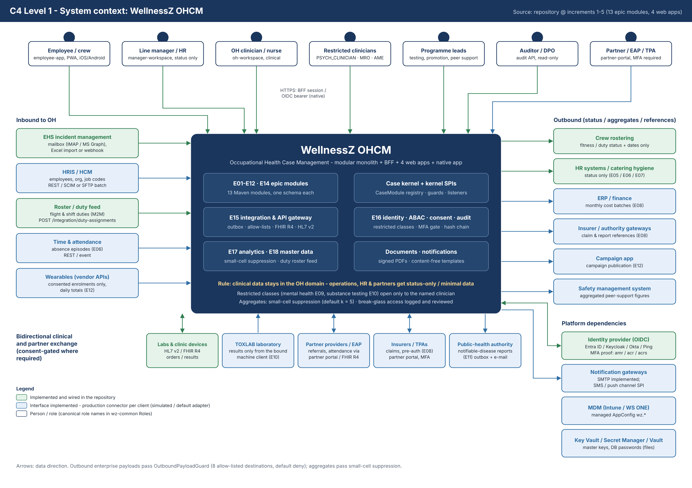
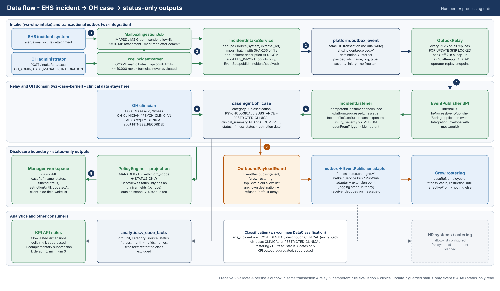
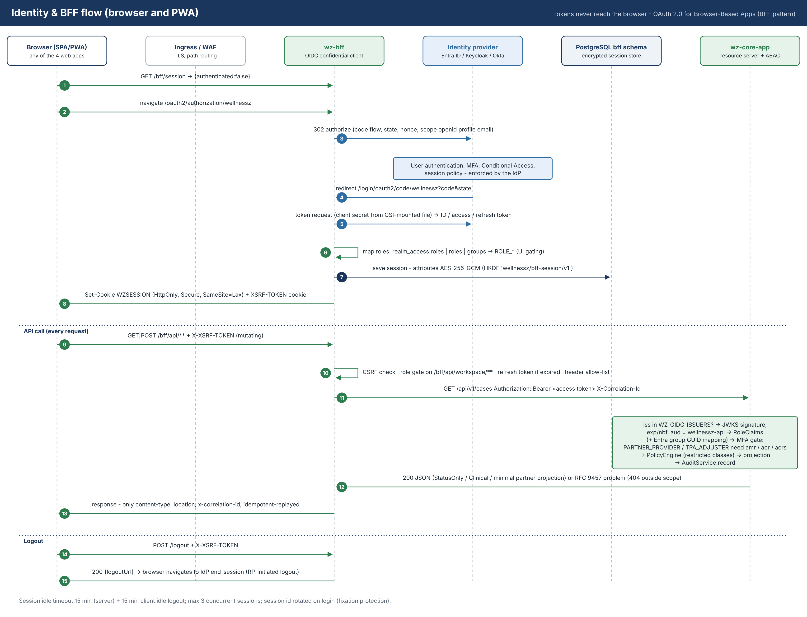
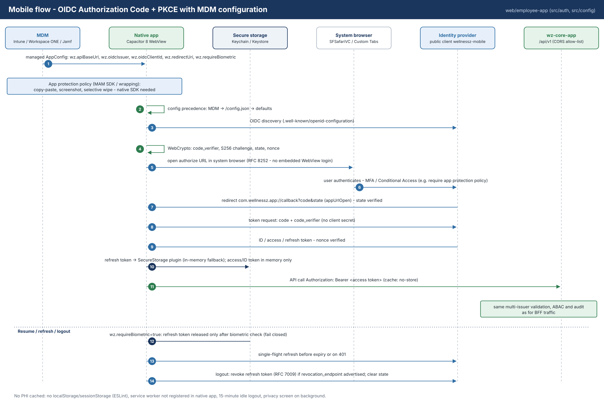

# WellnessZ OHCM – Security and SOC 2 Control Mapping

| | |
|---|---|
| **Document** | 02 – Security and SOC 2 Control Mapping |
| **System** | WellnessZ Airline Occupational Health Case Management (OHCM) – base framework |
| **Audience** | Cyber GRC team, CISO, internal audit, Data Protection Officer, CIO |
| **Baseline** | Repository working tree, Maven version `0.1.0-SNAPSHOT`; updated for **increment 1** (E01, E02 – Section 11), **increment 2** (E03, E05 – Section 12) and **increment 3** (E06, E07, E14 – Section 13) |
| **Companion documents** | 01 – Technology Architecture and Technology Selection · 03 – Developer Guide |
| **Increment 2 documents** | [Solution Design E03/E05](../increment-02/01-Solution-Design-E03-E05.md) · [Requirements Traceability Matrix](../increment-02/02-Requirements-Traceability-Matrix.md) · [Release Notes](../increment-02/03-Release-Notes-Increment-2.md) · [API Contract](../increment-02/API-Contract-E03-E05.md) |
| **Increment 3 documents** | [Solution Design E06/E07/E14](../increment-03/01-Solution-Design-E06-E07-E14.md) · [Requirements Traceability Matrix](../increment-03/02-Requirements-Traceability-Matrix.md) · [Release Notes](../increment-03/03-Release-Notes-Increment-3.md) · [API Contract](../increment-03/API-Contract-E06-E07-E14.md) |

> **Important – what SOC 2 is and is not.** A SOC 2 Type 2 report is an attestation by an independent CPA firm about
> the controls of a **service organisation** – the organisation that operates WellnessZ – over a review period
> (typically 6–12 months). Software cannot be "SOC 2 compliant" on its own. This document shows which technical
> controls the WellnessZ framework provides that are **designed to support** the Trust Services Criteria (TSC),
> which controls belong to the cloud provider, and which must be **operated by the organisation** to obtain an
> unqualified opinion. Statements reflect the code at the stated baseline; items marked *planned* or *extension point*
> do not yet exist and cannot be evidenced.

## 1. Scope and system boundary

**In scope for this mapping:** the core API (`apps/wz-core-app` and `platform/*`), the BFF (`apps/wz-bff`), the web and
mobile clients (`web/*`), the PostgreSQL schemas they own, the deployment assets (`deploy/*`) and the software
development lifecycle around the repository.

**Data in scope:** occupational-health records (special-category health data, GDPR Art. 9; treated as PHI-equivalent),
employee identifiers and contact details, consent records, audit records, integration messages.

**Out of scope (subservice organisations / carve-out candidates):** the cloud provider (Microsoft Azure or Google Cloud
– physical security, hypervisor, managed PostgreSQL, Key Vault/Secret Manager), the identity provider (Microsoft Entra
ID or other OIDC IdP), the MDM provider, SMTP/SMS/push gateways, and enterprise systems that receive status-only data.
Their SOC 2 / ISO 27001 reports must be obtained and reviewed (complementary subservice organisation controls, CSOCs).

**Applicable TSC categories recommended for the report:** Security (Common Criteria, mandatory), Availability,
Confidentiality, Privacy. Processing Integrity is recommended for fitness-for-duty outputs because rostering decisions
depend on them.

## 2. Shared-responsibility model

| Control domain | Framework (this repository) provides | Cloud provider / SaaS provides | Organisation (WellnessZ operator) must operate |
|---|---|---|---|
| Governance, policies, risk | Documentation, data classification enum, ArchUnit-enforced architecture rules | Their own SOC 2 / ISO 27001 reports | ISMS, policies, risk register, management review, vendor management, training |
| Identity & authentication | OIDC multi-issuer validation, role mapping, no local passwords, session controls in BFF, PKCE in mobile | IdP availability, MFA, Conditional Access engine | IdP configuration (MFA, CA policies), joiner/mover/leaver, **quarterly access reviews**, role assignment approval, privileged-access management |
| Authorisation | RBAC rules, ABAC policy engine (deny-overrides, default deny), status-only projection, restricted class | – | Role definitions, approval of policy changes, segregation of duties |
| Encryption & keys | AES-256-GCM field encryption, HKDF key separation, `ENC()` secrets, TLS `verify-full` to DB, encrypted BFF sessions | Storage encryption, KMS/HSM, Key Vault / Secret Manager durability | Key generation ceremony, **key rotation**, key-access reviews, envelope-encryption decision, certificate lifecycle |
| Logging & monitoring | Hash-chained append-only audit, audit verification API, JSON logs without PHI, correlation ids, metrics, traces | Log storage, platform audit logs (Activity Log / Cloud Audit Logs) | SIEM onboarding, alert rules, **24×7 or business-hours monitoring**, log review, retention settings, incident response |
| Change & SDLC | Tests (unit, integration, architecture), SAST, SCA, SBOM tooling in the build, pinned versions, migration discipline | GitHub/ADO platform security | Branch protection, mandatory PR review, CAB/approval records, release evidence retention, pipeline completion |
| Vulnerability management | dependency-check fail ≥ CVSS 7, dependency review, npm audit, CodeQL, Trivy image gate, FindSecBugs (Maven profile), patched base images | Managed-service patching (DB, AKS/GKE control plane) | Patch SLAs, **annual penetration test**, vulnerability triage, exception register |
| Network | NetworkPolicies default deny, private endpoints (IaC), WAF (IaC), strict headers, CORS closed by default | DDoS protection, network fabric | Firewall rule reviews, WAF tuning, exposure reviews |
| Availability & DR | Stateless replicas, HPA, PDB, zone spread, outbox replay, idempotency | Zone-redundant DB HA, backups, region services | **BCP/DR tests**, backup-restore tests, capacity planning, RPO/RTO approval |
| Physical | – | Data-centre security | Office/endpoint security, on-prem DC for hybrid option |
| Privacy | Consent register, data-subject self-access, status-only rule, de-identified analytics with suppression, pseudonymisation utility | Data-processing terms | Privacy notices, lawful-basis assessment, DPIA, **retention schedule and deletion**, data-subject request handling, breach notification |
| Mobile | PKCE, no PHI caching, idle logout, MDM AppConfig hook | MDM/MAM platform | Device enrolment policy, app protection policies, Conditional Access, store/distribution management |

## 3. Trust Services Criteria mapping – Common Criteria (Security)

Legend for **Responsibility**: **F** = framework control (technical, in repository), **C** = cloud/SaaS provider,
**O** = organisation-operated. **Status**: Implemented · Partial · Planned · Org (organisational, outside software).

### 3.1 CC1 – Control environment

| Criterion | Framework contribution | Evidence source | Resp. | Status |
|---|---|---|---|---|
| CC1.1 Integrity and ethical values | – | Code of conduct, HR records | O | Org |
| CC1.2 Board oversight | Steering-committee decisions (doc 01, Section 17) | Committee minutes | O | Org |
| CC1.3 Structures, reporting lines, authorities | Canonical roles (`Roles`) map to job functions; module ownership by Maven module | RACI, CODEOWNERS (recommended) | O/F | Partial |
| CC1.4 Competence | Developer Guide with secure-coding standards | Training records | O | Org |
| CC1.5 Accountability | Every action attributed to an authenticated subject in the audit trail | `/api/v1/audit` | F/O | Implemented |

### 3.2 CC2 – Communication and information

| Criterion | Framework contribution | Evidence source | Resp. | Status |
|---|---|---|---|---|
| CC2.1 Quality information for internal control | Structured audit records with correlation ids; metrics; OpenAPI contract | audit export, Prometheus, `/v3/api-docs` (non-prod) | F | Implemented |
| CC2.2 Internal communication of objectives and responsibilities | Architecture and developer documentation in repo | Git history of `docs/` | O/F | Implemented (docs) |
| CC2.3 External communication | Privacy notice version recorded with each consent (`notice_version`) | `platform.consent` | F/O | Implemented (notice content: Org) |

### 3.3 CC3 – Risk assessment

| Criterion | Framework contribution | Evidence source | Resp. | Status |
|---|---|---|---|---|
| CC3.1 Objectives specified | Principles P1–P10 (doc 01) | doc 01 | O | Implemented (docs) |
| CC3.2 Risks identified and analysed | STRIDE threat model (Section 7), risk register in doc 01 Section 16 | this document | O | Partial (formal register: Org) |
| CC3.3 Fraud risk | Segregation: clinicians record fitness, managers cannot; replay/config changes audited | audit trail, tests | F/O | Implemented |
| CC3.4 Changes affecting controls | ArchUnit rules fail the build if boundaries erode; migration review | CI test reports | F/O | Implemented |

### 3.4 CC4 – Monitoring activities

| Criterion | Framework contribution | Evidence source | Resp. | Status |
|---|---|---|---|---|
| CC4.1 Ongoing / separate evaluations | `GET /api/v1/audit/verify` integrity check; health probes; test suite on every build | verification results (schedule + retain), CI runs | F/O | Implemented (scheduling: Org) |
| CC4.2 Deficiencies communicated | Problem responses carry correlation id for tickets; dead-letter visibility (`/integration/events?status=DEAD`) | ticketing system | O | Org |

### 3.5 CC5 – Control activities

| Criterion | Framework contribution | Evidence source | Resp. | Status |
|---|---|---|---|---|
| CC5.1 Control activities selected | Default deny at URL, ABAC, outbound and network layers | code, Helm NetworkPolicies | F | Implemented |
| CC5.2 Technology general controls | IaC (Terraform), Helm, pinned versions, hardened containers | Terraform plans/state, Git | F/O | Implemented |
| CC5.3 Policies and procedures deployed | Coding standards and Definition of Done (doc 03) | PR templates, reviews | O | Partial |

### 3.6 CC6 – Logical and physical access controls

| Criterion | Framework control | Evidence source | Resp. | Status |
|---|---|---|---|---|
| CC6.1 Logical access security, infrastructure and architecture | OIDC resource server with trusted-issuer allow-list and audience check; RBAC URL rules; `@PreAuthorize`; ABAC `PolicyEngine` with deny-overrides and default deny; status-only projection type; restricted class policy; field-level AES-256-GCM; DB roles least privilege (`${app_role}` DML-only); secrets via CSI + workload identity | code (`ResourceServerSecurityConfig`, `DefaultPolicies`, migrations), integration tests, Helm values | F | Implemented |
| CC6.2 Registration and authorisation of users | No local accounts; users provisioned in IdP; role claims mapped (`RoleClaims`, Entra group GUID mapping) | IdP provisioning logs, access requests | O/C | Org (IdP) |
| CC6.3 Role-based access, least privilege, segregation of duties | 20 canonical roles (9 added in increment 1, Section 11.1); disclosure levels; clinicians vs managers; AUDITOR read-only to audit; INTEGRATION limited to `/integration/**` | role matrix (doc 01 App. A), **quarterly access review** | F/O | Implemented / Org |
| CC6.4 Physical access | – | cloud provider SOC 2 | C | Carve-out |
| CC6.5 Disposal of data and assets | Consent withdrawal preserves evidence; delivered outbox events purged after 30 days (configurable), idempotency records after 7 days; **no retention/deletion jobs for OH records yet**; increment 2: document retention schedule, DPO flagging and legal hold, no automatic deletion (Section 12.6) | purge configuration, DB counts, `docs.retention_schedule` | F/O | Partial |
| CC6.6 Protection against threats from outside the boundary | WAF (Front Door / App Gateway WAF_v2 / Cloud Armor) in Terraform; TLS 1.2+; CSP, HSTS, X-Frame-Options; CORS closed; EHS sender allow-list; hardened Excel parser; FHIR JSON-only (no XXE) | Terraform, response headers (scan), tests | F/C | Implemented |
| CC6.7 Restriction of transmission and movement of information | TLS everywhere incl. DB `verify-full`; **OutboundPayloadGuard** allow-list per destination (default deny); notification content rules; BFF header allow-list; mobile no-store, no localStorage | config `outbound-allowlist`, test `fitnessOutcomeIsPublishedToRosteringAsStatusOnly` | F | Implemented |
| CC6.8 Prevention/detection of unauthorised or malicious software | Trivy image gate (CRITICAL/HIGH with fix fails the build), cosign keyless signatures with SBOM and SLSA provenance attestations, signature verification in the deploy job, Binary Authorization (GKE); CodeQL, gitleaks; read-only root FS, non-root, dropped capabilities; no formula evaluation in Excel | `container.yml`, `deploy-env.yml`, Terraform `binauthz.tf`, code-scanning alerts | F/O | Implemented (cluster admission enforcement on AKS/on-prem: recommended) |

### 3.7 CC7 – System operations

| Criterion | Framework control | Evidence source | Resp. | Status |
|---|---|---|---|---|
| CC7.1 Detection of configuration changes and vulnerabilities | dependency-check (CVSS ≥ 7 fails), SpotBugs/FindSecBugs, CycloneDX SBOM; Dependabot proposed for images; config changes audited (`CONFIG_CHANGE`) | SARIF/HTML reports, SBOM, audit | F/O | Implemented (build) |
| CC7.2 Monitoring for anomalies | Audit of authentication failures and authorisation denials (`SecurityEventAuditor`), denied case reads, rejected mails; JSON logs with correlation; metrics; GCP Data Access audit logs; pgaudit | SIEM, audit trail | F/O | Implemented (SIEM rules: Org) |
| CC7.3 Evaluation of security events | Audit chain verification; correlation id across BFF, API, outbox | incident tickets | O | Org |
| CC7.4 Incident response | Replay of dead-lettered events; fail-safe defaults (guard aborts transaction) | IR plan, post-incident reviews | O | Org |
| CC7.5 Recovery from incidents | Idempotent re-processing (mailbox, outbox, Idempotency-Key); PITR backups (IaC) | restore test records | F/O | Implemented / Org |

### 3.8 CC8 – Change management

| Criterion | Framework control | Evidence source | Resp. | Status |
|---|---|---|---|---|
| CC8.1 Changes authorised, designed, developed, tested, approved, implemented | Git history; Flyway versioned, immutable migrations (owner role separate from runtime role); `ddl-auto: validate`; CI on every PR and push (`ci.yml`: tests incl. architecture tests, SCA, dependency review, secret scan, IaC checks); SBOM per build; CD (`cd.yml`) promotes signed images dev → test → prod through GitHub Environments with atomic Helm deploys; suppression files require justification/owner/expiry | PRs with approvals, CI run logs and artefacts, deployment records, `flyway_schema_history`, release tags, Terraform plans | F/O | Implemented (branch protection and Environment required reviewers: Org settings) |

### 3.9 CC9 – Risk mitigation

| Criterion | Framework control | Evidence source | Resp. | Status |
|---|---|---|---|---|
| CC9.1 Business disruption risk | Multi-replica, zone spread, PDB, zone-redundant DB HA (IaC), outbox buffering when downstream is unavailable | DR plan, test results | F/O | Implemented / Org |
| CC9.2 Vendor and business-partner risk | Data contracts per connector (`ConnectorRegistry`); status-only outbound; consent purposes for partner/insurer sharing | vendor assessments, DPAs | O/F | Partial |

## 4. Additional criteria

### 4.1 Availability (A1)

| Criterion | Framework control | Evidence | Resp. | Status |
|---|---|---|---|---|
| A1.1 Capacity | HPA 2–6 replicas, resource requests/limits, virtual threads, DB pool size configurable | Helm values, monitoring | F/O | Implemented |
| A1.2 Environmental protections, backup, recovery infrastructure | Zone-redundant HA, geo-redundant backups 35 d (Azure), REGIONAL + PITR (GCP), CNPG synchronous replica + WAL archive | Terraform, backup reports | C/F | Implemented (IaC) |
| A1.3 Recovery testing | – | **semi-annual restore test, annual DR exercise** | O | Org |

### 4.2 Confidentiality (C1)

| Criterion | Framework control | Evidence | Resp. | Status |
|---|---|---|---|---|
| C1.1 Identify and maintain confidential information | `DataClassification` (5 levels), classification derived from case category, field encryption, ABAC disclosure levels, restricted class, PHI-free logging | code, data inventory | F/O | Implemented |
| C1.2 Dispose of confidential information | Retention schedule & purge jobs; increment 2: retention schedule per record class for documents (DPO-approved, audited), daily flagging of documents past retention, legal hold; destruction is a reviewed manual decision (Section 12.6) | `GET /documents/retention`, `/documents/retention/due`, audit `RETENTION_*`, `LEGAL_HOLD_*` | O/F | **Partial** (documents); structured records planned |

### 4.3 Processing integrity (PI1)

| Criterion | Framework control | Evidence | Resp. | Status |
|---|---|---|---|---|
| PI1.1 Processing specifications | Versioned event types, OpenAPI contract, FHIR CapabilityStatement | `/v3/api-docs`, `/integration/fhir/metadata` | F | Implemented |
| PI1.2 Input completeness and accuracy | Bean Validation, regex validation of ids, strict FHIR parser, HL7 validation, Excel row-level error reporting, import batch counts and SHA-256 | `intake.import_batch`, tests | F | Implemented |
| PI1.3 Processing | Case state machine (`CaseStatus` allowed transitions), optimistic locking (`@Version`), idempotent consumers and incident/case de-duplication | tests (`CaseStatusTest`, integration tests) | F | Implemented |
| PI1.4 Output completeness and accuracy | Outbox at-least-once delivery, dead-letter and replay, receiver de-duplication on `messageId` | `/integration/events` | F/O | Implemented (adapter: extension point) |
| PI1.5 Storage of inputs and outputs | Encrypted inbound store; encrypted outbox history (delivered events kept 30 days by default; failed/dead kept for replay) | DB | F/O | Implemented (OH-record retention: planned) |

### 4.4 Privacy (P-series)

| Criterion | Framework control | Organisation responsibility | Status |
|---|---|---|---|
| P1.1 Notice | `notice_version` on every consent | Publish privacy notice for OH processing | F: Implemented; O: Org |
| P2.1 Choice and consent | Consent per purpose, grant/withdraw by data subject, audited, evidence preserved | Decide lawful basis per purpose (Art. 9(2)(h)/(b) vs (a)) | Implemented; gate `hasActiveConsent` not yet called (no sharing flows yet). Increment 2: partner sharing checks `ConsentService.isActive` (`TREATMENT_SHARING_PARTNER`); AI documentation requires an `AI_DOCUMENTATION` consent; withdrawal triggers `ConsentWithdrawalListener`s |
| P3.1–P3.2 Collection limited to purpose; explicit consent for sensitive data | Status-only rule; minimal event payloads; restricted class | DPIA, data-minimisation review per module | Implemented (base) |
| P4.1 Use limited to purpose | ABAC per purpose of role; analytics on de-identified view only | Purpose specification per module | Implemented |
| P4.2 Retention | – ; increment 2: `docs.retention_schedule` (7 record classes, proposed periods, DPO approval audited) | Retention schedule | **Partial** (documents) |
| P4.3 Disposal | – ; increment 2: flagging of documents past retention, legal hold; no automatic deletion | Secure deletion procedures | **Partial** (flagging only) |
| P5.1 Data-subject access | `GET /cases` (own), `/consents/me`, `/me` in the employee app; increment 2: `/me/documents`, `/me/disclosures`, `/me/rtw-plans`, `/me/job-offers` | DSAR process for full export (FHIR export `GET /employees/{id}/fhir` is OH-operated) | Partial (no self-service export) |
| P5.2 Correction | – | Correction process via OH | Planned |
| P6.1 Disclosure to third parties with consent | Outbound allow-list (default deny); consent purposes `TREATMENT_SHARING_PARTNER`, `INSURER_SHARING` | Processor/controller agreements | Partial |
| P6.2–P6.3 Record of disclosures | Outbox records every external disclosure with destination and time (encrypted payload, 30-day default retention); audit trail; increment 2: **disclosure log** `platform.disclosure_log` for every document share outside OH (recipient, purpose, consent, revocation), visible to the employee | Records of processing (Art. 30); export to long-term store if disclosures must be kept longer | Implemented (retention to be confirmed) |
| P6.4–P6.5 Third-party commitments and notification | – | DPAs, breach-notification clauses | Org |
| P6.6–P6.7 Breach notification; accounting of disclosures | Audit and outbox provide data for the accounting | Breach procedure (GDPR 72 h) | Org |
| P7.1 Data quality | Validation, master data from HRIS (planned sync) | Data-quality ownership | Partial |
| P8.1 Inquiries, complaints, disputes | – | DPO contact and process | Org |

## 5. Evidence catalogue

| Evidence | How to obtain | Supports |
|---|---|---|
| Application audit trail | `GET /api/v1/audit?from=...&to=...&limit=5000` as AUDITOR (each read is itself audited) | CC6.1, CC6.3, CC7.2, P6.2 |
| Audit integrity proof | `GET /api/v1/audit/verify` → `{intact, recordsChecked, firstBrokenId}`; schedule daily, store results and the head hash in WORM storage | CC4.1, CC7.2, PI1.5 |
| Integration event log | `GET /api/v1/integration/events?status=DEAD\|FAILED\|PUBLISHED` (metadata only) | PI1.4, CC7.4, P6.2 |
| Test reports | CI artefact `java-test-reports` (Surefire/Failsafe, JaCoCo), Vitest results per build (`ci.yml`) | CC8.1, CC3.4 |
| Secret-scan and SCA reports | CI artefacts `gitleaks-report`, `dependency-check-report`; SARIF in GitHub code scanning; dependency-review results on PRs | CC7.1, CC8.1 |
| Deployment records | `cd.yml` / `deploy-env.yml` run history per GitHub Environment (who approved, which digest, Helm status) | CC8.1 |
| SAST / SCA reports | SpotBugs + FindSecBugs (`mvn -Psecurity verify`), OWASP dependency-check HTML + SARIF, CodeQL alerts | CC7.1, CC8.1 |
| SBOM | CI artefacts `sbom-java` (CycloneDX `target/bom.json`/`.xml`), `sbom-employee-app`, `sbom-manager-workspace`; image SBOMs attested to each image | CC7.1, CC9.2 |
| Container scan & signatures | Trivy SARIF in code scanning, cosign signatures, SBOM and SLSA provenance attestations (`container.yml`), signature verification step in `deploy-env.yml`, Binary Authorization admission logs (GKE) | CC6.8, CC8.1 |
| Infrastructure configuration | Terraform plans and state (remote, access-controlled), `terraform show` of security settings; Helm values per environment | CC5.2, CC6.6, A1.2 |
| Change history | Git history, pull requests with reviewers and approvals, release tags, `flyway_schema_history` / `flyway_schema_history_bff` | CC8.1 |
| Identity configuration | Entra ID app registrations, app-role assignments, Conditional Access policies, sign-in logs; access-review records | CC6.2, CC6.3 |
| Cloud audit logs | Azure Activity / diagnostic logs (Key Vault, PostgreSQL with pgaudit), GCP Admin + Data Access audit logs | CC7.2 |
| Backups and restore tests | Backup policy screenshots/exports, restore test reports | A1.2, A1.3 |
| Consent records | `platform.consent` extract (via DPO-approved query) | P2.1 |
| Increment 1: rule and protocol governance | Audit actions `INTAKE_RULE_*`, `ASSIGNMENT_RULE_SAVE`, `SLA_POLICY_UPDATE`, `NOTIFICATION_MATRIX_UPDATE`, `PROTOCOL_APPROVE`; `triage.triage_protocol` (status, approver, time) | CC8.1, PI1.3 |
| Increment 1: intake completeness | `GET /api/v1/intake/reconciliation[/export]`, `GET /intake/dlq`, audit `EHS_WEBHOOK_DLQ`, `EHS_DLQ_REPLAY`, `EHS_DLQ_DISCARD` | PI1.2, PI1.4 |
| Increment 1: status-only consumption | Audit `CREW_STATUS_READ`, `HYGIENE_STATUS_READ`; E2E log of `tools/e2e/e2e-increment1.js` (18 checks) | CC6.7, P3.1 |
| Increment 2: break-glass | `GET /api/v1/break-glass?status=PENDING` and `GET /break-glass/report?month=YYYY-MM` as DPO; audit `BREAK_GLASS`, `BREAK_GLASS_REVIEW`; Mailpit / mail log of `break-glass.alert` | CC6.1, CC6.3, CC7.2 |
| Increment 2: disclosures and consent | `GET /api/v1/disclosures?employeeId=` (DPO / OH), employee view `GET /me/disclosures`; audit `DOCUMENT_SHARE`, `DOCUMENT_SHARE_REVOKE`, `DISCLOSURE_REVOKED`, `CONSENT_WITHDRAW` (with `disclosuresRevoked=n`) | P6.1–P6.3, P2.1 |
| Increment 2: document integrity and retention | `docs.document` (`sha256`, `signature_sha256`, `signed_by`, `signed_at`, `legal_hold`); `GET /documents/retention[/due]`; audit `DOCUMENT_SIGN`, `RETENTION_SCHEDULE_APPROVED`, `RETENTION_DUE_LISTED`, `LEGAL_HOLD_SET/RELEASED` | PI1.5, C1.2, P4.2 |
| Increment 2: roster feed completeness | `GET /api/v1/crew/roster-feed/reconciliation` (sent, acknowledged, latency); audit `ROSTER_FEED_UNACKNOWLEDGED` | PI1.4, CC7.2 |
| Increment 2: segregation tests | `Increment2RecordIntegrationTest.f08HrManagersEmployeesAndReceptionNeverOpenClinicalRecords`, `Increment2PlatformIntegrationTest`; E2E log of `tools/e2e/e2e-increment2.js` (25 checks) and screenshots in `docs/images/screens/increment-02/` | CC6.1, CC6.3, CC8.1 |
| Increment 3: advice release and disclosures | `absence.advice_report` (status, employee decision), audit `ADVICE_REPORT_SIGN`, `ADVICE_EMPLOYEE_DECISION`; `GET /api/v1/disclosures?employeeId=` (purposes `SURVEILLANCE_STATUS`, `IMMUNISATION_STATUS`, `PRE_EMPLOYMENT_OUTCOME`, advice reports) | P6.1–P6.3, CC6.7 |
| Increment 3: candidate purge | Audit `PRE_EMPLOYMENT_PURGE`; `surveillance.pre_employment.purged_at`; job run rows in `platform.scheduled_job_run` (`pre-employment-purge`) | C1.2, P4.2 |
| Increment 3: data integrity | `scheduling.calibration` (certificate SHA-256), `scheduling.excursion` (acknowledgement), audit of rejected device results, `absence.feed_run` / `feed_mismatch` | PI1.2–PI1.4 |
| Increment 3: segregation tests | `Increment3AbsenceIntegrationTest`, `Increment3SurveillanceIntegrationTest`, `Increment3SchedulingIntegrationTest`, `NotificationRulesTest`; E2E log of `tools/e2e/e2e-increment3.js` (32 checks) and screenshots in `docs/images/screens/increment-03/` | CC6.1, CC6.3, CC8.1 |

## 6. Cross-reference to other frameworks

| Framework control | WellnessZ control(s) | Status |
|---|---|---|
| **HIPAA §164.312(a)(1)** Access control | RBAC + ABAC, default deny, restricted class | Implemented |
| §164.312(a)(2)(i) Unique user identification | IdP subject per user; no shared accounts in app | Implemented (IdP: Org) |
| §164.312(a)(2)(ii) Emergency access procedure | Break-glass access | **Planned** |
| §164.312(a)(2)(iii) Automatic logoff | BFF session 15 min idle; client idle logout 15 min | Implemented |
| §164.312(a)(2)(iv) Encryption and decryption | AES-256-GCM field encryption; storage encryption | Implemented |
| §164.312(b) Audit controls | Hash-chained append-only audit trail | Implemented |
| §164.312(c)(1) Integrity | GCM authentication tags, audit hash chain, optimistic locking | Implemented |
| §164.312(d) Person or entity authentication | OIDC (MFA at IdP), client credentials for M2M | Implemented |
| §164.312(e)(1) Transmission security | TLS everywhere, DB `verify-full`, HL7 v2 over HTTPS | Implemented |
| §164.308(a)(1)(ii)(D) Information system activity review | Audit API; SIEM review | Org |
| §164.308(a)(7) Contingency plan | Backups/HA in IaC; DR tests | Org |
| **GDPR Art. 5(1)(c)** Data minimisation | Status-only rule, minimal event payloads, de-identified analytics | Implemented |
| Art. 5(1)(e) Storage limitation | Retention jobs | **Planned** |
| Art. 9 Special categories | Classification CLINICAL / RESTRICTED_CLINICAL, restricted class, consent register | Implemented (lawful basis: Org) |
| Art. 15 Right of access | Employee self-view of cases and consents | Partial |
| Art. 25 Data protection by design and default | Default deny, projection types, suppression, pseudonymisation | Implemented |
| Art. 30 Records of processing | Connector catalogue with data contracts supports the record | Org |
| Art. 32 Security of processing | Encryption, access control, audit, resilience | Implemented / Org |
| Art. 33/34 Breach notification | Audit + logs support investigation | Org |
| Art. 35 DPIA | This document and doc 01 as inputs | Org |
| **ISO/IEC 27001:2022 A.5.15–5.18** Access control, identity, authentication information, access rights | OIDC, role mapping, ABAC; access reviews | Implemented / Org |
| A.5.33 Protection of records | Append-only audit, consent evidence | Implemented |
| A.5.34 Privacy and protection of PII | Classification, status-only, suppression | Implemented |
| A.8.2 Privileged access rights | PLATFORM_ADMIN/OH_ADMIN separated; DB owner vs runtime role | Implemented / Org (PAM) |
| A.8.3 Information access restriction | ABAC disclosure levels | Implemented |
| A.8.5 Secure authentication | OIDC, PKCE, MFA at IdP | Implemented |
| A.8.8 Management of technical vulnerabilities | SCA, SAST, image scan | Implemented (build) / Org |
| A.8.9 Configuration management | IaC, Helm, E18 audited configuration | Implemented |
| A.8.10 Information deletion | Retention jobs | Planned |
| A.8.11 Data masking | Status-only projection, pseudonymisation, small-cell suppression | Implemented |
| A.8.12 Data leakage prevention | Outbound allow-list, notification content rules, no PHI in logs/caches | Implemented |
| A.8.13 / 8.14 Backup / redundancy | IaC HA + backups | Implemented (IaC) / Org tests |
| A.8.15 / 8.16 Logging / monitoring | Audit trail, JSON logs, metrics, traces | Implemented / Org (SIEM) |
| A.8.20–8.22 Network security, segregation | NetworkPolicies, private endpoints, WAF | Implemented (IaC) |
| A.8.24 Use of cryptography | AES-256-GCM, HKDF, TLS 1.2+/1.3 | Implemented; key management Org |
| A.8.25–8.29 Secure development, coding, testing | SDLC in Section 8, Developer Guide | Implemented / Partial |
| A.8.31 Separation of environments | Spring profiles, per-environment values, Swagger disabled in prod | Implemented |
| A.8.32 Change management | Git/PR, Flyway, approvals | Implemented / Org |
| A.8.33 Test information | Test keys only in test profile; synthetic test data | Implemented (policy: Org) |

## 7. Threat model (STRIDE)

The model covers the main data flows of the base framework. Ratings are qualitative (L/M/H) for residual risk after
the listed controls.

### 7.1 Flows in scope

| ID | Flow |
|---|---|
| F1 | EHS system → feed mailbox → `MailboxIngestionJob` (IMAP/Graph) → intake |
| F2 | OH administrator → `POST /intake/ehs/excel` → `ExcelIncidentParser` |
| F3 | Browser/PWA → ingress → BFF → core API (session, CSRF, token relay) |
| F4 | Native app → IdP (PKCE) → core API (bearer) |
| F5 | Core API case reads/writes under ABAC |
| F6 | Outbox → relay → external destination (status-only, e.g. crew rostering) |
| F7 | Labs/partners → FHIR R4 / HL7 v2 / generic inbound with Idempotency-Key |
| F8 | Managers/HR → KPI API (aggregates) |
| F9 | Auditor → audit API; integrity verification |
| F10 | Administrators → configuration, master data, event replay, mailbox poll |
| F11 | Pods → secrets (CSI, workload identity) and master key |
| F12 | Developer → Git → CI/CD → registry → cluster (supply chain) |

The diagrams below show the trust boundaries for the main flows (system context, EHS-to-status-only data flow, browser
identity flow, mobile flow); they are the same views as in document 01.

*Figure 1 – System context and trust boundary (F1, F6, F7).*

*Figure 2 – Data flow F1, F2, F5, F6, F8 with processing order.*

*Figure 3 – Browser identity flow F3.*

*Figure 4 – Native app flow F4.*

### 7.2 STRIDE analysis

| Flow | Threat (STRIDE) | Scenario | Controls | Residual |
|---|---|---|---|---|
| F1 | **S**poofing | Attacker e-mails a forged incident to the feed mailbox | Sender allow-list; Graph app scoped to one mailbox; audit of rejections | M – sender addresses can be spoofed without DMARC; enforce DMARC `p=reject` and consider DKIM verification |
| F1 | **T**ampering | Malicious attachment (zip bomb, XXE, formulas) | Size caps, magic bytes, POI zip limits, no formula evaluation, XXE-safe parsers | L |
| F1 | **D**oS | Mail flood | ≤ 25 messages/poll, 10 MB cap, poll interval | L |
| F1 | **E**levation | Graph app with tenant-wide `Mail.ReadWrite` | Exchange application access policy / RBAC for Applications (required configuration) | M until verified by Org |
| F2 | **T**ampering / **E**levation | Crafted workbook exploits parser | Same hardening as F1; role restriction to OH_ADMIN/CASE_MANAGER/INTEGRATION; test rejects non-OOXML | L |
| F2 | **R**epudiation | Uploader denies import | `import_batch.created_by`, SHA-256 of file, audit `EHS_IMPORT` | L |
| F3 | **S**poofing | Session hijacking | HttpOnly/Secure cookie, session-id rotation, 15-min timeout, max 3 sessions, TLS + HSTS | L |
| F3 | **T**ampering | CSRF against BFF | Spring Security SPA CSRF token on all mutating requests and logout; SameSite=Lax | L |
| F3 | **I**nformation disclosure | XSS stealing tokens | Tokens never in browser (BFF); strict CSP without inline script; React escaping | L |
| F3 | **I**nformation disclosure | Session store dump reveals tokens | AES-256-GCM-encrypted session attributes | L (master-key dependent) |
| F3 | **E**levation | Path traversal via proxy to admin endpoints | `..`/`//` rejected; core re-checks authorisation; header allow-list | L |
| F4 | **S**poofing | Authorization-code interception / custom-scheme hijack | PKCE S256, `state` + `nonce`; Universal/App Links recommended | M until App Links adopted |
| F4 | **I**nformation disclosure | Token or PHI left on device | Access token in memory; refresh token in Keychain/Keystore (plugin to be registered); no localStorage; no-store; privacy screen; MAM | M until secure-storage and MAM integrated |
| F5 | **I**nformation disclosure | Manager reads clinical details | ABAC status-only projection type; org-scope check; 404 for out-of-scope; tests | L |
| F5 | **I**nformation disclosure | Clinician reads psychological case | Restricted-class deny policy; test | L |
| F5 | **E**levation | Forged role claims | Trusted-issuer allow-list, signature + audience validation, role-name regex | L |
| F5 | **R**epudiation | User denies access to a record | Every read/list/denial audited with actor, roles, correlation id, IP | L |
| F5 | **I**nformation disclosure | DB/backup exfiltration | Field-level encryption of clinical text; storage encryption; private endpoints | M – identifiers and categories not field-encrypted |
| F6 | **I**nformation disclosure | Clinical field leaks to rostering/HR | OutboundPayloadGuard: field allow-list per destination, default deny, nested objects/arrays rejected; encrypted outbox payloads | L – values not content-inspected; allow-lists reviewed by DPO |
| F6 | **T**ampering / **R**epudiation | Message altered or disputed | Outbox history; TLS; broker adapter authentication (to be implemented); messageId | M until adapter + message signing decided |
| F6 | **D**oS | Downstream outage | Back-off, dead-letter, replay; outbox absorbs backlog | L |
| F7 | **S**poofing | Unauthorised system posts lab results | Client-credentials token from trusted issuer + INTEGRATION role | L |
| F7 | **T**ampering | Malformed/hostile FHIR or HL7 | JSON-only FHIR (no XXE), strict parser, type allow-list, HL7 validation | L |
| F7 | Replay / duplication | Retry storms create duplicates | Idempotency-Key with request hash; HL7 control id stored | L |
| F8 | **I**nformation disclosure | Re-identification from small groups or differencing | k ≥ 5 (floor 3), complementary suppression, restricted class excluded, allow-listed dimensions | M – no protection against differencing across time windows/dimensions |
| F9 | **T**ampering | Audit rows altered or deleted | Trigger + grants block UPDATE/DELETE/TRUNCATE; hash chain; verify API | M – DB owner could rewrite chain; external anchoring planned |
| F9 | **I**nformation disclosure | Audit contains PHI | Reasons sanitised; coding standard forbids PHI in reasons | L |
| F10 | **E**levation / **T**ampering | Admin changes config (e.g. module flag, min group size) maliciously | Role-restricted, audited `CONFIG_CHANGE`; disabled modules answer 503 `module_disabled` (fail closed); analytics floor k ≥ 3 enforced in code | M – no maker-checker; old/new values not in audit |
| F10 | **T**ampering | Operator replays events to re-send data | Replay restricted to PLATFORM_ADMIN/OH_ADMIN, audited; consumers idempotent | L |
| F11 | **I**nformation disclosure | Master key theft | Key in vault, CSI file mount, workload identity, never in image or Git | M – single master key; envelope encryption recommended |
| F11 | **E**levation | Pod identity abused | Per-workload service accounts, least-privilege vault roles (Vault policies in `deploy/hybrid`) | L–M |
| F12 | **T**ampering | Malicious dependency or image | SHA-pinned actions, pinned versions, lockfiles, SCA and dependency review, SBOM, Trivy gate, cosign signing + provenance, signature verification at deploy, Binary Authorization (GKE) | L–M – cluster-side admission not yet enforced on AKS/on-prem |
| F12 | **I**nformation disclosure | Secrets committed to Git | `ENC()`/`file:` pattern, gitleaks on full history in CI (SARIF), `deploy/local/.env` git-ignored | L |

## 8. Secure software development lifecycle

| Phase | Practice | Tooling / artefact |
|---|---|---|
| Requirements | Classify data (`DataClassification`), decide disclosure level and outbound contract per module; DPIA screening | Module design note, ConnectorRegistry entry |
| Design | Threat-model new flows (extend Section 7); define `AccessPolicy` beans; events as flat records | design review |
| Implementation | Developer Guide standards: no PHI in logs/errors/audit reasons, validation, RFC 9457, parameterised SQL / allow-listed dimensions, `EncryptedStringConverter` for clinical text | IDE, code review |
| Verification | Unit, integration (real PostgreSQL), ArchUnit, web unit tests, Playwright E2E; SAST (CodeQL in CI; SpotBugs/FindSecBugs via `mvn -Psecurity`); SCA (dependency-check, dependency review, npm audit); gitleaks; IaC scan (Trivy config, helm lint); DAST (recommended) | `ci.yml`, `codeql.yml` reports |
| Release | SBOM, image build from pinned bases, Trivy gate, cosign keyless signing + attestations, signature verification, atomic Helm deploy per GitHub Environment | `container.yml`, `cd.yml`, `deploy-env.yml`, Helm |
| Operations | Patch base images (Dependabot), monitor, audit verification, incident response | SIEM, runbooks |
| Exceptions | Suppression/exclusion files require justification, owner, expiry; reviewed each release | `config/dependency-check-suppressions.xml`, `config/spotbugs-exclude.xml` |

## 9. Residual risks and compensating controls

| ID | Residual risk | Compensating control (now) | Target remediation |
|---|---|---|---|
| RR1 | Single master key; master-key rotation requires re-encryption tooling not yet built | Vault RBAC, purge protection, access logging on Key Vault/Secret Manager | Envelope encryption via KMS/HSM; re-encryption job (increment 1) |
| RR2 | Delivered outbox events kept 30 days (needed for replay window) | Payloads field-encrypted; metadata-only operations API | Confirm retention with DPO |
| RR3 | No retention/deletion jobs | Data volume small at start; manual deletion procedure via DPO | Retention schedule and purge jobs (increment 2: schedule, flagging and legal hold delivered for documents – see RR18) |
| RR4 | Audit chain rewritable by DB owner | Separate owner role used only by migration Job; pgaudit DDL/role logging; cloud audit logs | External hash anchoring + SIEM streaming |
| RR5 | No break-glass access | OH_ADMIN escalation via IdP role assignment (audited in IdP) | Break-glass flow with justification and alerting (delivered in increment 2, Section 12.2) |
| RR6 | No maker-checker on configuration | Audited changes; limited admin population | Approval workflow in E18 UI |
| RR7 | Mobile secure storage / MAM not yet integrated | In-memory fallback (re-login), idle logout, no-store | Keychain/Keystore plugin, Intune APP SDK before store release |
| RR8 | External broker adapter and message authentication not implemented | Only logging publisher; no PHI leaves the system externally yet | Adapter with mTLS/managed identity per D3 |
| RR9 | Outbound guard checks field names, not values | Flat payloads enforced; allow-list per destination; integration test | Schema-based contract tests per destination |
| RR10 | Differencing attacks on KPI API | Single KPI, allow-listed dimensions, k ≥ 5 | Query auditing thresholds, row/column suppression, fixed reporting periods |
| RR11 | SpotBugs not a CI job; no DAST; admission enforcement only on GKE | SpotBugs run via Maven profile before release (0 findings at baseline); deploy job verifies cosign signatures | Add SpotBugs CI job, ZAP baseline, Kyverno/Ratify or Azure Policy image verification |
| RR12 | Branch protection and Environment required reviewers are repository settings, not code | Workflows designed for approvals (`test`, `prod` environments) | Configure and evidence settings; review quarterly |

## 10. Controls the organisation must operate

| Control | Frequency | Owner (proposed) | TSC |
|---|---|---|---|
| User access review of WellnessZ app roles and Entra group memberships (incl. PSYCH_CLINICIAN, AUDITOR, PLATFORM_ADMIN) | Quarterly; privileged roles monthly | OH service owner + IAM | CC6.2, CC6.3 |
| Joiner / mover / leaver in IdP, HRIS-driven | Continuous | IAM | CC6.2 |
| Review of Graph application access policy for the EHS mailbox | Semi-annual | M365 admin | CC6.1 |
| Key rotation: master key (with re-encryption), pseudonym key, BFF client secret, DB passwords, certificates | Annual (keys), 90–180 days (secrets), on compromise immediately | Platform security | CC6.1, A.8.24 |
| Audit-chain verification and head-hash anchoring; review of verification failures | Daily automated, monthly review | Security operations | CC4.1, CC7.2 |
| SIEM use cases: auth-failure spikes, DENIED bursts, DEAD events, config changes, audit verification failure | Continuous | SOC | CC7.2, CC7.3 |
| Vulnerability management (patch SLAs: critical 7 d, high 30 d), base-image refresh | Continuous / monthly | Platform team | CC7.1 |
| Penetration test (web, API, mobile, BFF), including authorisation testing across disclosure levels | Annual and before major release | Security | CC4.1, CC7.1 |
| Backup restore test (PITR) | Semi-annual | DBA / platform | A1.3 |
| BCP/DR exercise incl. manual fitness-for-duty fallback | Annual | Service owner + BCM | A1.3, CC9.1 |
| Change approval (CAB or PR approvals), release evidence retention | Each change | Engineering lead | CC8.1 |
| Vendor reviews (cloud, IdP, MDM, messaging, SMS/e-mail providers) – SOC 2 bridge letters | Annual | Vendor management | CC9.2 |
| Privacy: DPIA per module, records of processing, retention schedule, DSAR handling, breach procedure | Per module / annual | DPO | P-series |
| Security awareness and secure-coding training for developers | Annual | CISO office | CC1.4 |
| Review of outbound allow-lists and consent purposes | Each new destination / annual | DPO + architecture | CC6.7, P6.1 |
| Review of suppression/exclusion files (SCA/SAST exceptions) | Each release | Security champion | CC7.1 |
| Mobile: MDM enrolment, app protection policies, Conditional Access | Continuous | Endpoint team | CC6.1, CC6.7 |

## 11. Increment 1 – E01 intake and E02 triage

Increment 1 adds the first two business modules (`modules/wz-e01-intake`, `modules/wz-e02-triage`), the OH clinical
workspace (`web/oh-workspace`), nine roles and the `triage` schema. The design is in
[`docs/increment-01/01-Solution-Design-E01-E02.md`](../increment-01/01-Solution-Design-E01-E02.md), requirement
coverage in [`02-Requirements-Traceability-Matrix.md`](../increment-01/02-Requirements-Traceability-Matrix.md). This
section records the security controls they introduce and how they map to the criteria above. Statements were
checked against the code at the increment-1 baseline.

### 11.1 New roles and segregation of duties

The canonical role list grows from 11 to 20 (`com.wellnessz.common.model.Roles`). Clinical disclosure (`CLINICAL`) is
granted by `DefaultPolicies.clinicianPolicy` to `OH_CLINICIAN`, `CASE_MANAGER`, `OH_PHYSICIAN`, `AME`, `CMO` and
`NURSING_HEAD`; `RESTRICTED_CLINICAL` remains exclusive to `PSYCH_CLINICIAN`. All other new roles receive **no**
clinical disclosure: they reach only dedicated endpoints that return status, configuration or registration data.

| Role | Function | Data reach | Notable permissions | Cannot (enforced server-side) |
|---|---|---|---|---|
| `OH_PHYSICIAN` | OH physician | CLINICAL | Decide physician escalations; `FOOD_SAFETY` and `PHYSICIAN` queues; fitness decisions | Approve protocols |
| `AME` | Aeromedical examiner | CLINICAL | `AME_AEROMEDICAL` queue (crew, ATC); decide physician escalations | Approve protocols |
| `CMO` | Chief Medical Officer | CLINICAL | **Only role that approves triage protocols** (`PROTOCOL_APPROVE`); decides CMO escalations; schedules case conferences; complexity calibration | – |
| `NURSING_HEAD` | Head of OH nursing | CLINICAL | Reassign and bulk-reassign, caseload and out-of-office cover, SLA-breach recipient, triage QA sampling, edit intake rules, assignment rules and SLA policies | Audit a triage they performed themselves (`409 self_review`) |
| `OH_ADMIN` (extended) | OH service administrator | none (configuration only) | Notification matrix and recordability mapping (only writer), intake / assignment rules, SLA policies, DLQ replay / discard, intake dashboard | Read case clinical content (no ABAC permit) |
| `HSE_OFFICER` | Health & safety officer | status / aggregate | Reconciliation report and CSV export, weekly exceptions, incident → cases (status), recordability report | Open queues or case clinical content |
| `CREW_SCHEDULING` | Crew scheduling desk | status-only | `GET /api/v1/status/crew` (≤ 500 employee ids per call, audited `CREW_STATUS_READ`) | Anything else |
| `HYGIENE_MANAGER` | Catering hygiene manager | status-only | `GET /api/v1/status/food-handlers?department=` (audited `HYGIENE_STATUS_READ`) | Anything else |
| `CLINIC_RECEPTION` | Clinic front desk | registration data | Badge / name lookup, walk-in and emergency registration (five fields), encounter list (chief complaint and action taken are returned only to OH clinical roles) | Clinical queues (`403`, E2E-tested), convert an encounter into a case |
| `FIRST_AIDER` | Workplace first aider | registration data | Register encounters; enrich only **own** encounters | Enrich others' encounters (`403`), queues, cases |

Segregation-of-duties controls in the code:

* **Protocol governance.** Draft protocols are seeded by the system; only the CMO can approve a version
  (`TriageService.approve` re-checks the role in addition to `@PreAuthorize`). Nurses use but cannot change protocols.
* **Triage QA.** `TriageAuditService` refuses a review by the clinician who performed the sampled triage
  (`self_review`).
* **Escalation decisions** are restricted to the addressed level (physician level: OH_PHYSICIAN / AME / CMO; CMO
  level: CMO), otherwise `403`.
* **Configuration vs. clinical work.** OH_ADMIN configures but has no clinical read access; reception and first aiders
  register but cannot convert encounters into cases (OH clinical roles only).
* **Status-only consumers.** Crew scheduling and hygiene managers receive `StatusRow(employeeId, displayName,
  fitnessStatus, restrictionUntil, updatedAt)` – a record type without clinical fields, the same pattern as
  `CaseViews.StatusOnly` (the E2E test asserts that no diagnosis, description or triage text appears).
* **Rule changes** (intake rules, assignment rules, SLA policies, notification matrix) are audited
  (`INTAKE_RULE_CREATE/UPDATE`, `ASSIGNMENT_RULE_SAVE`, `SLA_POLICY_UPDATE`, `NOTIFICATION_MATRIX_UPDATE`); maker-checker
  remains open (RR6).

Role-to-group assignment, access reviews and joiner/mover/leaver for the new roles are organisation-operated
(Section 10). Identity configuration: Keycloak realm roles and scope mappings for `wellnessz-bff` and
`wellnessz-mobile` (both clients have `fullScopeAllowed=false`, so a role missing from the scope mapping silently
disappears from tokens – this defect was found and fixed during the increment-1 E2E run); Entra ID app roles on the
`wellnessz-api` app registration assigned to groups (setup guide 06, Section 5).

### 11.2 Clinical-text guard

`com.wellnessz.common.text.ClinicalTextDetector` is a deliberately conservative heuristic (clinical vocabulary such as
diagnosis, depression, fracture, medication, positive test, plus ICD-10-style codes such as `F32.1`). It is applied to:

* the free-text fields of **manager and HR referrals** (`ReferralService.guard`) – a match answers
  `422 clinical_content_not_allowed` naming the field, never echoing the text; fields are capped at 1,000 characters;
  the manager's org scope is checked first (out of scope → `404`, audited `REFERRAL_SCOPE` DENIED);
* **notification content** (`ContentRules`, now delegating to the shared detector plus result keywords).

It is a guard-rail, not a classifier: it errs on rejection and cannot catch paraphrases. The control objective
(managers and HR do not put health data into the system) is supported by UI guidance in the forms and by the
status-only rule on the read side. Unit tests: `ClinicalTextDetectorTest`; E2E check *manager referral with clinical
wording is rejected*.

### 11.3 EHS webhook: authentication, idempotency, dead-letter queue

| Aspect | Control |
|---|---|
| Authentication | Bearer token from a trusted issuer (client-credentials), role `INTEGRATION` (`@PreAuthorize`); Keycloak client `wellnessz-integration` locally, an Entra app registration with the `INTEGRATION` application role in production |
| Replay / retries | `Idempotency-Key` **mandatory** (8–200 chars); same key + same body returns the stored response, same key + different body → `422`; scope `ehs-webhook` |
| Input validation | Per-item allow-list schema: identifier regexes, closed sets for `incidentClass` and `severity`, ISO-8601 instants, length caps (description ≤ 4,000), ≤ 500 items per call; unknown fields ignored |
| Invalid items | Stored **encrypted** in `intake.incident_dlq` with a reason; WARN log `ALERT ehs-webhook dead-lettered=<n>` for SIEM alerting; audit `EHS_WEBHOOK_DLQ` (FAILURE) |
| DLQ operations | `GET /api/v1/intake/dlq` (metadata only, no payload), replay (re-validated) and discard; OH_ADMIN / PLATFORM_ADMIN; audited `EHS_DLQ_REPLAY`, `EHS_DLQ_DISCARD` |
| Duplicates | Unique `(source_system, external_ref)` as for mailbox and Excel intake |
| Exposure | Published only on the API host (`api.<domain>`), behind the WAF; hybrid: internal API ingress on-prem |

### 11.4 Attachments and other input / output controls

* **Attachments** (`CaseWorkService`): file type decided by **magic bytes** (JPEG `FF D8 FF`, PNG `89 50 4E 47`,
  PDF `%PDF`), never by the client header or extension; 1 byte – 5 MB; at most 5 per case; file name sanitised;
  SHA-256 recorded; content stored with `EncryptedStringConverter`; upload and download audited
  (`CASE_ATTACHMENT_UPLOAD`, `CASE_ATTACHMENT_READ`); downloads go through the BFF (`content-disposition` and
  `cache-control` are the only added forwarded response headers).
* **CSV export** of the reconciliation report neutralises spreadsheet formula injection (cells starting with `=`, `+`,
  `-`, `@` are prefixed) and is limited to OH roles and HSE officers.
* **Intake dashboard** applies small-cell suppression with the analytics minimum group size (`k`, default 5); the OH
  workspace additionally renders positive counts below `k` as `<k`.
* **Triage integrity.** Urgency is computed on the server from the protocol version; red-flag answers are a hard stop
  (`422 red_flag_hard_stop` on a downgrade attempt, E2E-tested); overrides need a reason and are stored with computed
  and final urgency; the protocol version is stored with every assessment.
* **Encryption at rest** of the new clinical free text: encounter complaint / action / notes, recordability answers
  and rationale, triage answers / override reason / call log, escalation notes and decisions, conference agenda /
  minutes / decisions, handover summaries, checklist answers, QA comments, DLQ payloads.
* **OH workspace (browser).** BFF only (no tokens in the browser), strict CSP, no `localStorage` / `sessionStorage`
  (ESLint-enforced), 15-minute idle logout; the walk-in offline retry queue is in memory only and its unit test
  asserts that no browser storage is touched.
* **SAST exclusion.** `config/spotbugs-exclude.xml` now has **5** justified entries; the new one covers
  `QueueService`, whose SQL is assembled only from constant fragments selected by a closed switch, with every user
  value bound as a JDBC parameter (covered by `Increment1IntegrationTest` and `QueuePerformanceTest`).

### 11.5 Threat model additions (STRIDE)

| ID | Flow |
|---|---|
| F13 | EHS system → API host → `POST /intake/ehs/incidents` → rule table → case |
| F14 | Manager / HR → BFF → referral endpoints (clinical-text guard, org scope) |
| F15 | OH team → OH workspace → BFF → queues, triage, escalation, configuration |
| F16 | Clinic reception / first aider → OH workspace → encounter registration |
| F17 | Crew scheduling / hygiene manager → status-only endpoints |
| F18 | SLA poller and notification dispatcher → e-mail to OH team and stakeholders |

| Flow | Threat (STRIDE) | Scenario | Controls | Residual |
|---|---|---|---|---|
| F13 | **S**poofing | Attacker posts forged incidents | Client-credentials token + `INTEGRATION` role, trusted-issuer allow-list, WAF | L |
| F13 | **T**ampering / **D**oS | Malformed or oversized payloads, retry storms | Schema validation per item, ≤ 500 items, DLQ instead of failure, mandatory `Idempotency-Key`, de-duplication | L |
| F13 | **E**levation | Crafted rule-matching data auto-creates many cases | Rules evaluated on validated fields only; unidentified employees become suggestions; reconciliation shows every incident's fate | L |
| F14 | **I**nformation disclosure | Manager writes a diagnosis into a referral | Clinical-text guard (`422`), field caps, status-only read side | M – heuristic cannot catch every paraphrase |
| F14 | **E**levation | Manager refers an employee outside their org scope | Org-scope check against the HRIS master (`404`, audited) | L |
| F15 | **I**nformation disclosure | Clinician of the wrong team reads restricted cases | ABAC restricted-class deny, `MENTAL_HEALTH` queue requires `PSYCH_CLINICIAN` | L |
| F15 | **T**ampering | Client manipulates triage urgency or bypasses red flags | Server-side evaluation, hard stop, override reason, versioned protocol per assessment | L |
| F15 | **T**ampering | Unapproved protocol used clinically | CMO-only approval; draft fallback visible in the UI | M – drafts are usable while no approved version exists (O11 in doc 01) |
| F15 | **R**epudiation | Disputed reassignment or rule change | Assignment history with reason, audited rule/SLA/matrix changes | L |
| F15 | **I**nformation disclosure | Queue SQL injection | Constant SQL fragments, bound parameters, SAST exclusion reviewed, integration tests | L |
| F16 | **I**nformation disclosure | Reception or first aider browses clinical data | No ABAC permit; `403` on queues (E2E-tested); encounter views omit chief complaint and action taken for non-clinical roles; enrichment limited to the registering user | L – the encounter list shows names, times and locations of recent encounters to all registrars |
| F16 | **I**nformation disclosure | PHI left on a shared reception PC | No browser storage, in-memory retry queue, idle logout, `no-store` | L |
| F17 | **I**nformation disclosure | Status consumer infers diagnoses | Status record type without clinical fields, ≤ 500 ids per call, read audited | L – fitness status itself is disclosed by design |
| F18 | **I**nformation disclosure | Clinical content in e-mail | Approved templates, `ContentRules` with the clinical-text detector, link to the OH workspace instead of content | L |
| F18 | **D**oS | Poller contention on several replicas | `FOR UPDATE SKIP LOCKED`, batch 500, partial index | L |

### 11.6 Control mapping additions

| Criterion | Increment-1 control | Evidence source | Resp. | Status |
|---|---|---|---|---|
| CC6.1 | ABAC extended to OH_PHYSICIAN, AME, CMO, NURSING_HEAD; `@PreAuthorize` on every E01/E02 endpoint; webhook bound to `INTEGRATION` | `DefaultPolicies`, controllers, `Increment1IntegrationTest`, E2E | F | Implemented |
| CC6.2 | Nine roles defined in IdP (Keycloak realm / Entra app roles) and assigned through groups; client scope mappings include the new roles | realm export, Entra app-role assignments | O/F | Implemented (assignment: Org) |
| CC6.3 | Segregation of duties per Section 11.1 (CMO-only approval, no self-review, OH_ADMIN without clinical access, reception without clinical access) | code, tests, access reviews | F/O | Implemented |
| CC6.6 | Webhook schema validation, DLQ, idempotency; attachment magic-byte check; CSV formula-injection neutralisation | code, `IncidentWebhookService`, `CaseWorkService` | F | Implemented |
| CC6.7 | Status-only APIs for crew scheduling and hygiene; `catering-hygiene` outbound allow-list; clinical-text guard on referrals and notifications | `SafetyService.StatusRow`, `application.yml`, `ContentRules` | F | Implemented |
| CC7.2 | DLQ alert log line and audit; SLA breach events and notifications; audited configuration changes | logs, `platform.audit_event` | F/O | Implemented (SIEM rule: Org) |
| CC8.1 | Protocol versions with CMO approval and audit; Flyway V3–V5 under the same migration discipline; demo data excluded from shared environments by profile | `triage.triage_protocol`, `flyway_schema_history` | F/O | Implemented |
| PI1.2 | Webhook per-item validation with DLQ; referral template validation | tests, DLQ | F | Implemented |
| PI1.3 | Server-side triage evaluation with red-flag hard stop; transition guards (recordability, safety); SLA state machine | `ProtocolEvaluatorTest`, `Increment1IntegrationTest` | F | Implemented |
| PI1.4 | Reconciliation report: every incident's fate (auto-created, suggested, ignored, no match) | `/intake/reconciliation` | F/O | Implemented |
| C1.1 | New clinical free-text fields encrypted; `triage` schema classified CLINICAL | entities, migrations | F | Implemented |
| P3.1 | Manager / HR referrals limited to non-clinical fields; status-only consumers | tests, E2E | F | Implemented |

### 11.7 Organisation-operated controls and residual risks added

| Control | Frequency | Owner (proposed) | TSC |
|---|---|---|---|
| Clinical approval of triage protocols, advice texts and the recordability mapping; review on every new version | Before go-live, then per version | CMO + Nursing Head | CC8.1, PI1.3 |
| Access review including `CMO`, `NURSING_HEAD`, `OH_ADMIN`, `CREW_SCHEDULING`, `HYGIENE_MANAGER` | Quarterly | OH service owner + IAM | CC6.2, CC6.3 |
| SIEM rule on `ALERT ehs-webhook dead-lettered` and on `sla.breached.v1` volume | Continuous | SOC | CC7.2 |
| Review of DLQ items (replay or discard) | Daily on business days | OH administrator | PI1.2 |
| Review of intake / assignment rule and SLA policy changes | Monthly | Nursing Head | CC8.1 |
| Integration client credential rotation for the EHS webhook | 90–180 days | IAM / integration team | CC6.1 |

| ID | Residual risk | Compensating control (now) | Target remediation |
|---|---|---|---|
| RR13 | Clinical-text guard is heuristic | Status-only read side, UI guidance, audited referrals | Periodic review of rejected / accepted samples; vocabulary maintained by OH governance |
| RR14 | Draft protocols usable when no approved version exists | UI shows the status; CMO approval workflow | Go-live gate: all protocols in use approved; option to block drafts in prod by configuration |
| RR15 | OH staff roster loaded by SQL (no API, no HRIS feed) | Small population; changes by DBA under change control | Roster import from IdP groups or HRIS (doc 01, O9) |
| RR16 | No maker-checker on rule / SLA / matrix changes | Audited, limited to NURSING_HEAD / OH_ADMIN | Approval workflow (RR6) |

## 12. Increment 2 – E03 OH record and E05 fitness for duty

Increment 2 adds the platform document service (`platform/wz-documents`), the business modules
`modules/wz-e03-record` (schema `ohrecord`) and `modules/wz-e05-fitness` (schema `fitness`), the `DPO` role,
break-glass access, a disclosure log and consent-withdrawal listeners. The design is in
[`docs/increment-02/01-Solution-Design-E03-E05.md`](../increment-02/01-Solution-Design-E03-E05.md), requirement
coverage in [`02-Requirements-Traceability-Matrix.md`](../increment-02/02-Requirements-Traceability-Matrix.md) and the
endpoints in [`API-Contract-E03-E05.md`](../increment-02/API-Contract-E03-E05.md). Statements were checked against the
code at the increment-2 baseline.

### 12.1 DPO role and segregation of duties

The canonical role list grows from 20 to 21 (`Roles.DPO`). The DPO receives **no clinical disclosure**: no ABAC policy
grants the role a disclosure level, so every chart, encounter, result and document endpoint answers `403` / `404`
(integration test `f08…` and E2E check *DPO has no clinical access*). The DPO reaches only privacy-governance
endpoints.

| Role | New in increment 2 | Data reach | Notable permissions | Cannot (enforced server-side) |
|---|---|---|---|---|
| `DPO` | new | metadata only | Review break-glass uses (`/break-glass`, `/break-glass/{id}/review`), monthly report (with CMO), disclosure log per employee (`/disclosures`), approve the retention schedule, list documents due, set / release legal hold | Read any clinical content; review a break-glass use made by themselves |
| Clinicians (`OH_CLINICIAN`, `OH_PHYSICIAN`, `AME`, `CMO`, `NURSING_HEAD`, `PSYCH_CLINICIAN`) | extended | CLINICAL (+ RESTRICTED for PSYCH) | Document clinically, sign encounters and documents per template; declare break-glass (not `PSYCH_CLINICIAN`, who already has restricted access) | Break-glass on their own record |
| `CASE_MANAGER` | extended | CLINICAL read | Read the chart and case work | Write clinical record entries (`403`, tested) |
| `AME`, `CMO` | extended | CLINICAL | Sign-off of licensed-role fitness decisions (per standard `requires_signoff_role`); crew medical reports; CMO approves encounter templates and IHR decisions, sees the crew dashboard | – |
| `HR` | extended | status-only | Generate, sign and issue the non-clinical **job offer** template to the employee only; read shared non-clinical documents, team restrictions and RTW plans in scope | Open any clinical record (tested, denials audited `CHART_READ` DENIED); share to manager / partner; use OH document APIs |
| `MANAGER` | extended | status-only + functional restrictions | Team restrictions, duty-proposal decisions, RTW acknowledgement, shared non-clinical documents | Chart, results worklist, case summary (`403`, tested) |
| `CLINIC_RECEPTION` | extended | none | File scanned documents for an employee (`/documents/scan`) | Read the record or the filed document |
| `PARTNER_PROVIDER` | now used | shared documents only | `GET /partner/documents` for its organisation (last segment of `org_scope`, e.g. `CITYHOSP`) while the consent is active | Anything else |
| `CREW_SCHEDULING` | extended | status-only | Roster feed via `/crew/roster-feed` and reconciliation | `/integration/**` (machine-only) |
| `INTEGRATION` | extended | machine | LIS pull queue and results, device results, roster feed and acknowledgements | User-facing endpoints |

Segregation-of-duties controls added:

* **Break-glass review** by the DPO, never by the user of the grant (`403`).
* **Sign-off** of licensed-role fitness decisions by AME / CMO (decision status `AWAITING_SIGNOFF` until then).
* **Governance content** (encounter templates, fitness standards) is approved by the CMO; the restriction catalogue
  and job-demand profiles are maintained by OH_ADMIN / NURSING_HEAD; the retention schedule only by the DPO. All
  changes are audited (`ENCOUNTER_TEMPLATE_APPROVE`, `FITNESS_STANDARD_VERSION`, `RESTRICTION_CATALOGUE_UPDATE`,
  `JOB_DEMAND_UPDATE` / `_IMPORT`, `RETENTION_SCHEDULE_APPROVED`).
* **HR versus OH documents.** HR may only issue templates whose generator roles include HR and that contain no clinical
  content (today: `JOB_OFFER`), only to the employee, and only within its org scope (`requireIssuer`).

Identity configuration: Keycloak realm role `DPO`, users `dpo1` (DPO) and `partner1` (PARTNER_PROVIDER,
`org_scope=/PARTNERS/CITYHOSP`), and `DPO` added to the scope mappings of `wellnessz-bff` and `wellnessz-mobile`;
Entra ID: a `DPO` app role assigned to a DPO group, and an `org_scope` claim for partner users.

### 12.2 Break-glass access

| Aspect | Control |
|---|---|
| Who | `OH_CLINICIAN`, `OH_PHYSICIAN`, `AME`, `CMO`, `NURSING_HEAD` (`@PreAuthorize` and a service re-check); never on the user's own employee record |
| Justification | Mandatory free text of 20–2,000 characters, stored with the grant |
| Scope and duration | One employee, one user, **4 hours** (`BreakGlassService.VALIDITY`) |
| Enforcement | ABAC: `DefaultPolicies.breakGlassPolicy` permits `RESTRICTED_CLINICAL` and `restrictedClassPolicy` stops denying while an active grant exists (`hasActiveGrant(username, employeeId)` evaluated on every request) |
| Alerting | In-process event `BreakGlassGranted` → `SecurityAlertListener` sends the content-free `break-glass.alert` e-mail (URGENT, bypasses quiet hours) to `wellnessz.notification.dpo-email` (`WZ_DPO_EMAIL`) |
| Review | Review item due after **24 hours**; overdue items are flagged; DPO decides `APPROPRIATE` / `INAPPROPRIATE` with a note |
| Reporting | Monthly report (`/break-glass/report?month=`): totals, appropriate / inappropriate / pending / overdue, uses per user |
| Audit | `BREAK_GLASS` (grant), `BREAK_GLASS_REVIEW`, `BREAK_GLASS_REVIEW_LIST`; every read under the grant is audited like any clinical read |

Tests: `Increment2PlatformIntegrationTest.breakGlassOpensARestrictedRecordForFourHoursAndIsReviewedByTheDpo`,
`Increment2RecordIntegrationTest.f02MentalHealthEncountersAreRestrictedAndBreakGlassOpensThem`, `PolicyEngineTest`,
E2E checks *break-glass reveals the restricted case for a limited time* and *DPO reviews the break-glass use*.

### 12.3 Record-level segregation (`EmployeeRecordAccess`)

Increment 1 protected **cases**; increment 2 adds records that belong to an **employee** rather than a case (chart,
encounters, orders, results, documents, fitness decisions). `EmployeeRecordAccess` (kernel) builds the ABAC resource
from the HRIS employee master (org path, owner employee id, classification) and calls the same `PolicyEngine`:
`requireClinical` for OH work (restricted class needs `RESTRICTED_CLINICAL` disclosure), `requireStatus` for manager /
HR status access within org scope. A denial is **audited and answered with 404**, so the existence of a record is not
revealed. Further rules:

* **Negative tests** (`f08HrManagersEmployeesAndReceptionNeverOpenClinicalRecords`): HR, a manager, clinic reception,
  the DPO and even the employee through the clinical API receive `403` / `404` on all twelve record reads (`/chart`,
  `/problems`, `/allergies`, `/medications`, `/immunisations`, `/jobs`, `/encounters`, `/results`, `/orders`, `/fhir`,
  `/odh`, `/record-timeline`) and the bodies never contain clinical text; HR cannot acknowledge results, write
  problems or read encounter templates; managers cannot open the results worklist or a case summary; reception cannot
  start an encounter; case managers read but cannot write. Employees see their own information through the portal
  (`/me/documents`, `/me/rtw-plans`, `/me/disclosures`) rather than the clinical API.
* **Functional restrictions only for managers.** `/workspace/team-restrictions` returns restriction labels (for example
  *No lifting above 10 kg*) and dates, never the diagnosis (E2E check *manager sees functional restrictions only*).
* **Restricted class.** Mental-health encounters and results with codes in `wellnessz.record.restricted-result-codes`
  are `RESTRICTED_CLINICAL`; the chart reports `restrictedItemsHidden` instead of the items; FHIR exports omit them.
* **Diagnosis-required close guard.** `DiagnosisRequiredGuard` refuses to close INJURY, ILLNESS, EXPOSURE, FITNESS,
  MENTAL_HEALTH and SURVEILLANCE_FOLLOW_UP cases without a coded diagnosis (`422 diagnosis_required`), supporting
  complete records (PI1.3).
* **BFF.** `/bff/api/workspace/{team-restrictions,duty-proposals,rtw-plans,documents}` are forwarded unchanged to the
  core (`ApiProxyController.isCoreWorkspaceResource`, unit-tested); the core re-applies role and ABAC checks.
* **Machine-only integration paths.** `/api/v1/integration/**` stays restricted to `INTEGRATION`, `PLATFORM_ADMIN`,
  `OH_ADMIN` by `ResourceServerSecurityConfig`; crew scheduling reads the same roster feed through `/crew/roster-feed`.

### 12.4 Disclosure log and consent withdrawal

Every share of a document outside the OH team (employee excluded) writes a row to `platform.disclosure_log`
(recipient type and name, resource, title, purpose, consent id, actor, time). The employee sees the log without actor
names (`GET /me/disclosures`); OH roles and the DPO see it with actors (`GET /disclosures?employeeId=`, audited
`DISCLOSURE_LOG_READ`). Sharing with a **partner** requires an active consent with purpose
`TREATMENT_SHARING_PARTNER` belonging to that employee; the partner's access is re-checked against the consent on
every read. When the employee **withdraws** a consent, `ConsentService.withdraw` calls every
`ConsentWithdrawalListener` inside the same transaction – `DocumentConsentListener` revokes the partner shares made
under it **immediately** – and marks the matching disclosures `REVOKED`; the audit record carries the number of
revoked disclosures. Signing a new version revokes the shares of the superseded version. Test:
`partnerSharingNeedsConsentAndStopsWhenConsentIsWithdrawn`.

### 12.5 Document integrity, e-signature and sharing rules

* **Integrity.** SHA-256 of every stored document; signature hash `SHA-256(contentHash | signer | time)` on signing;
  signed documents are immutable (changes create a new version that supersedes the old one); `DOCUMENT_SIGN` audit
  carries the signature hash. The runtime role has no `DELETE` grant on `docs.document`.
* **Confidentiality.** Content, merge fields and extracted text are field-encrypted (`EncryptedStringConverter`).
  Footer text states whether a document is *medical-in-confidence* or *contains no clinical information*.
* **What may leave OH.** Only signed documents can be shared. Templates with clinical content (referral letter, result
  letter, crew medical reports) can never go to managers or HR (`403`); clinical photographs are never shared outside
  OH; non-clinical templates have their merge fields screened by the clinical-text guard.
* **Uploads.** Scanned documents and photographs: type by magic bytes (PDF, JPEG, PNG), 1 byte – 10 MB; photographs
  require recorded consent; PDF text extraction limited to 50 pages.
* **Clinical-text guard.** The vocabulary of `ClinicalTextDetector` was extended with common occupational-health
  diagnoses (for example hernia, sciatica, dermatitis, infection, norovirus, hypertension, sleep apnoea, physiotherapy,
  counselling) because certificates, RTW plans and restriction notes are written for managers.
* **Notifications** remain content-free: 11 new templates (`document.shared`, `certificate.available`,
  `rtw.plan-ack`, `rtw.review-due`, `restriction.expiring`, `result.abnormal`, `result.overdue`, `duty.proposal`,
  `job-offer.issued`, `break-glass.alert`, `fitness.signoff-required`) with two new allow-listed placeholders
  (`documentNumber`, `employeeName`); links point to the portal, workspace or OH workspace.
* **Status-only feeds.** Roster messages (`crew.roster-status.changed.v1`) carry status, dates and operational limitation
  codes only; the outbound allow-lists in `application.yml` were extended for `crew-rostering`, `hr-systems` (job-offer
  outcome) and `catering-hygiene` (food-handler status). Rostering acknowledges each message; messages not acknowledged
  within 15 minutes are audited (`ROSTER_FEED_UNACKNOWLEDGED`) while the outbox keeps retrying.

### 12.6 Retention and legal hold (SOC 2 C1.2, privacy P4)

| Aspect | Control |
|---|---|
| Schedule | `docs.retention_schedule`: one rule per record class (`OH_RECORD`, `EXPOSURE_RECORD`, `AEROMEDICAL_RECORD`, `FITNESS_CERTIFICATE`, `CORRESPONDENCE`, `PHOTO`, `EXTERNAL_REPORT`) with years, trigger (`LAST_ENCOUNTER`, `DOCUMENT_DATE`, `EMPLOYMENT_END`) and legal basis; seeded values are **proposals** |
| Approval | Only the DPO changes a rule (1–100 years, valid trigger), recorded with approver and time, audited `RETENTION_SCHEDULE_APPROVED` |
| Flagging | Daily job (`wellnessz.documents.retention-cron`, once per day across replicas) and `GET /documents/retention/due` list documents past retention and not on legal hold; audited `RETENTION_DUE_LISTED` |
| Legal hold | DPO sets / releases a hold with a reason (`POST` / `DELETE /documents/{id}/legal-hold`, audited `LEGAL_HOLD_SET` / `LEGAL_HOLD_RELEASED`); held documents are never listed as due |
| Disposal | **No automatic deletion.** Destruction is a reviewed, documented decision executed under change control; the application role cannot delete documents |
| Gaps | Structured E03/E05 records and cases are not yet covered; `LAST_ENCOUNTER` / `EMPLOYMENT_END` triggers need HRIS end dates (doc 01, O12) |

### 12.7 Search over encrypted documents

Full-text search uses **blind-index tokens** (doc 01, Section 14.17): every word is replaced by a keyed HMAC-SHA256
token in a PostgreSQL `tsvector`; no plaintext index exists. Search is limited to OH roles with clinical access to the
employee, per employee, at most 50 hits, restricted-class documents filtered, snippets cut after the access check from
the decrypted text, and every query audited (`DOCUMENT_SEARCH`). Residual: token frequencies per document are visible
to database administrators; the blind-index key is not versioned (RR1, RR19). Test:
`scannedReportsAreClassifiedAndSearchableWithoutAPlaintextIndex`.

### 12.8 OCR command constraints

OCR is off unless `wellnessz.documents.ocr.tesseract-path` is set. `TesseractOcrProvider` accepts the binary only from
a fixed switch of three install paths and the languages only from six fixed values; configuration therefore cannot
select an arbitrary executable or inject arguments. The only other argument is a JVM-created temporary file, deleted
in a `finally` block; output is capped at 1 MB and runtime at 60 seconds; failures are logged without content. The
SpotBugs `COMMAND_INJECTION` finding on this class is the **sixth** justified exclusion in
`config/spotbugs-exclude.xml`. Cloud OCR services (Azure AI Document Intelligence, Google Document AI) are an
extension point; enabling one requires a DPA, a regional endpoint and an egress rule.

### 12.9 Threat model additions (STRIDE)

| ID | Flow |
|---|---|
| F19 | OH clinician → OH workspace → BFF → chart, encounters, results, documents |
| F20 | Clinician → break-glass → restricted record; DPO review |
| F21 | OH / HR → document generation, signing, sharing → employee, manager, HR, partner |
| F22 | Laboratory gateway / device middleware → `/integration/lis/**`, `/integration/hl7v2`, `/employees/{id}/results/device` |
| F23 | Kernel → outbox / roster feed → crew rostering gateway (pull + acknowledgement) |
| F24 | Manager / HR → `/workspace/{team-restrictions,duty-proposals,rtw-plans,documents}` |
| F25 | Clinic reception → scanned document upload → text extraction / OCR → search index |

| Flow | Threat (STRIDE) | Scenario | Controls | Residual |
|---|---|---|---|---|
| F19 | **I**nformation disclosure | Non-OH user enumerates employee records | `EmployeeRecordAccess` on every read, audited 404, id pattern validation | L |
| F19 | **T**ampering / **R**epudiation | Signed encounter altered or disputed | Signed encounters immutable; addenda and entered-in-error with reason; audit chain | L |
| F20 | **E**levation | Clinician abuses break-glass | Justification, 4 h limit, DPO alert, 24 h review, monthly report, no self-review, no own-record grant | M – detective, not preventive |
| F20 | **R**epudiation | User denies emergency access | Grant, reason, reads and review audited in the hash chain | L |
| F21 | **I**nformation disclosure | Diagnosis typed into a certificate or job offer for managers / HR | Clinical-text guard on non-clinical templates, clinical templates not shareable with managers / HR, photographs never shared | M – heuristic guard |
| F21 | **I**nformation disclosure | Partner keeps access after consent withdrawal | Listener revokes shares in the withdrawal transaction; consent re-checked on each partner read | L |
| F21 | **T**ampering | Document changed after signing | SHA-256 content and signature hashes, immutable signed versions, no DELETE grant | L – signature not qualified (RR20) |
| F21 | **E**levation | HR shares or reads OH documents | `requireIssuer` (own non-clinical templates only, employee target only, org scope) | L |
| F22 | **S**poofing / **T**ampering | Forged results or device readings | Client-credentials token with `INTEGRATION`; schema validation; HL7 validation; each inbound message processed once; calibration id required for device-captured (non-manual) readings | L |
| F22 | **D**oS | Result flood | WAF, batch caps, idempotent processing | L |
| F23 | **I**nformation disclosure | Clinical detail in roster messages | Flat payload, field allow-list per destination (default deny), limitation codes only | L |
| F23 | **R**epudiation / availability | Rostering misses a status change | Acknowledgement per `messageId`, 15-minute unacknowledged audit, reconciliation report, outbox retry | L |
| F24 | **I**nformation disclosure | Manager infers diagnosis from restrictions | Functional labels only, no diagnosis fields in the view type | L – restrictions are disclosed by design |
| F25 | **E**levation | Command injection through OCR configuration or file names | Allow-listed binary and languages, temp file from the JVM, timeout, output cap | L |
| F25 | **I**nformation disclosure | Search index reveals content | Blind-index tokens only; access check before snippets | L – token frequencies (RR19) |
| F25 | **T**ampering | Malicious file disguised as PDF / image | Magic-byte check, size cap, PDFBox parsing bounded to 50 pages, files never rendered server-side for others | M – parser vulnerabilities depend on PDFBox patching (dependency scanning) |

### 12.10 Control mapping additions

| Criterion | Increment-2 control | Evidence source | Resp. | Status |
|---|---|---|---|---|
| CC6.1 | Record-level ABAC (`EmployeeRecordAccess`), break-glass policy, `@PreAuthorize` on every E03 / E05 / document endpoint; `/integration/**` machine-only | `DefaultPolicies`, controllers, `Increment2*IntegrationTest`, E2E | F | Implemented |
| CC6.2 | `DPO` role and test users in the realm; Entra `DPO` app role; partner `org_scope` | realm export, Entra assignments | O/F | Implemented (assignment: Org) |
| CC6.3 | DPO without clinical access; break-glass review not by the user; AME / CMO sign-off; HR limited to the job-offer template; case manager read-only on the chart | code, tests, access reviews | F/O | Implemented |
| CC6.6 | Magic-byte checks and size limits on scans and photos; OCR command allow-lists; HL7 / LIS / device validation | code, SpotBugs exclusion rationale | F | Implemented |
| CC6.7 | Status-only roster, HR and hygiene feeds (allow-lists extended); clinical documents not shareable with managers / HR; content-free notifications | `application.yml`, `DocumentService.share`, `NotificationTemplates` | F | Implemented |
| CC7.2 | Break-glass alert to the DPO, review queue and monthly report; `ROSTER_FEED_UNACKNOWLEDGED`; result escalation after 72 h | audit, mail log, reconciliation | F/O | Implemented (SIEM rules: Org) |
| CC8.1 | Flyway V6–V8; CMO approval of encounter templates and fitness standards; versioned standards; E2E `e2e-increment2.js` 25/25 | `flyway_schema_history`, audit, release record | F/O | Implemented |
| PI1.2 | LIS JSON and HL7 ORU validation; device rules with calibration; terminology codes from the catalogue | tests (`Hl7MessagesTest`, `DeviceRulesTest`, `ResultFlagsTest`) | F | Implemented |
| PI1.3 | Diagnosis-required close guard; sign-off state machine; CDS hard stops with logged overrides | `DiagnosisRequiredGuard`, `CdsServiceTest`, integration tests | F | Implemented |
| PI1.4 | Roster-feed acknowledgement and reconciliation; LIS order acknowledgement | `/crew/roster-feed/reconciliation`, `/integration/lis/orders` | F/O | Implemented (gateway adapters: Org / later increment) |
| PI1.5 | Document SHA-256 and signature hash; immutable signed versions | `docs.document` | F | Implemented |
| C1.1 | `docs`, `ohrecord`, `fitness` classified; content and free text encrypted; blind-index search | migrations, entities | F | Implemented |
| C1.2 / P4.2 / P4.3 | Retention schedule, flagging, legal hold for documents; no automatic deletion | Section 12.6 | F/O | Partial |
| P2.1 / P6.1 | Consent-gated partner sharing and AI documentation; withdrawal revokes partner shares | `partnerSharingNeedsConsentAndStopsWhenConsentIsWithdrawn`, `f07AiAssistant…` | F | Implemented |
| P6.2–P6.3 / P6.7 | Disclosure log visible to the employee and the DPO | `platform.disclosure_log`, `/me/disclosures` | F | Implemented |

### 12.11 Organisation-operated controls and residual risks added

| Control | Frequency | Owner (proposed) | TSC |
|---|---|---|---|
| Review of every break-glass use within 24 hours; monthly report to the CMO and privacy committee | Daily / monthly | DPO | CC6.3, CC7.2 |
| Approval of the retention schedule; documented destruction of documents due (outside the application); legal-hold register | Before go-live, then annual / per request | DPO + legal | C1.2, P4.2, P4.3 |
| Approval of encounter templates, document template wording, CDS rules, fitness standards, restriction catalogue and job-demand profiles | Before go-live, then per version | CMO + Nursing Head + DPO | CC8.1, PI1.3 |
| Access review including `DPO`, `PARTNER_PROVIDER` (partner organisations and their `org_scope`) and `INTEGRATION` clients of the laboratory and rostering gateways | Quarterly | OH service owner + IAM | CC6.2, CC6.3 |
| Partner data-sharing agreements and consent wording for `TREATMENT_SHARING_PARTNER` | Per partner | DPO + procurement | P6.1, P6.4 |
| SIEM rules on `BREAK_GLASS`, `ROSTER_FEED_UNACKNOWLEDGED`, denied record reads (`CHART_READ` DENIED bursts) | Continuous | SOC | CC7.2 |
| DPIA before enabling OCR in the cloud or any AI documentation provider | Before enablement | DPO | P3.1, CC9.2 |
| PDFBox and other document-parsing dependencies patched within the vulnerability SLA | Continuous | Platform team | CC7.1 |

| ID | Residual risk | Compensating control (now) | Target remediation |
|---|---|---|---|
| RR17 | Break-glass is detective, not preventive | Justification, 4 h limit, alert, 24 h review, monthly report | Optional second-person approval for non-emergency use |
| RR18 | No automatic deletion; structured records outside the schedule | Flagging, legal hold, DPO review, no DELETE grant | Destruction workflow and schedule for `ohrecord` / `fitness` / cases |
| RR19 | Blind-index token frequency visible; unversioned blind-index key | Access to the database restricted; tokens keyed | Versioned key and re-indexing in the key-rotation job |
| RR20 | Simple electronic signature only | SHA-256 integrity, audit chain | Qualified signing provider for external-effect documents (doc 01, D12) |
| RR21 | Template and CDS content is draft | Status visible; CMO approval workflow | Go-live gate: all templates and rules approved (doc 01, O14) |
| RR22 | Gateway adapters (LIS, rostering, HR, hygiene) not built | Pull APIs with acknowledgement and reconciliation | Gateway clients with certificate credentials and monitoring |

## 13. Increment 3 – E06 absence, E07 surveillance and E14 scheduling

Increment 3 adds the business modules `modules/wz-e06-absence` (schema `absence`), `modules/wz-e07-surveillance`
(schema `surveillance`) and `modules/wz-e14-scheduling` (schema `scheduling`), seven kernel SPIs, clinic sites, four
roles, three document templates and 23 notification templates. The design is in
[`docs/increment-03/01-Solution-Design-E06-E07-E14.md`](../increment-03/01-Solution-Design-E06-E07-E14.md), requirement
coverage in [`02-Requirements-Traceability-Matrix.md`](../increment-03/02-Requirements-Traceability-Matrix.md), the
change list in [`03-Release-Notes-Increment-3.md`](../increment-03/03-Release-Notes-Increment-3.md) and the endpoints in
[`API-Contract-E06-E07-E14.md`](../increment-03/API-Contract-E06-E07-E14.md). Statements were checked against the code
at the increment-3 baseline (2026-10-29).

Absence and surveillance data are among the most sensitive inputs to employment decisions. The controls below
therefore concentrate on one question: **what can a manager, HR, a scheduler or another non-OH party learn about an
employee's health?**

### 13.1 New roles and the status-only rule

The canonical role list grows from 21 to 25. None of the new roles receives a clinical disclosure level: no ABAC
policy grants them `CLINICAL`, `GET /api/v1/me` reports `STATUS_ONLY` for `CLINIC_SCHEDULER` and `CREW_LICENSING`,
`SELF` for `CANDIDATE` and `NONE` for `BIOMEDICAL`, and every endpoint they can call is gated by `@PreAuthorize` and
returns a projection without clinical fields.

| Role | New in increment 3 | Data reach | Notable permissions | Cannot (enforced server-side) |
|---|---|---|---|---|
| `CLINIC_SCHEDULER` | new | names, appointment type, time, site | Diaries and diary templates, booking / move / cancel, waitlist, campaigns, surveillance due list and invitations, capacity | Read absence data, results, encounters or the reason for an appointment (integration test `schedulerAndOtherNonOhRolesCannotReadAbsenceData`, `catalogueTemplatesTelehealthAndRoleDenials`) |
| `BIOMEDICAL` | new | equipment and cold-chain data only | Equipment register, calibration certificates, status changes (reason screened by the clinical-text guard), fridge readings and cold-chain reports | Any person-level data; acknowledge excursions (clinical decision about vaccine usability) |
| `CREW_LICENSING` | new | status only | Crew medical certificate validity, `EXPIRING` list, crew without a valid medical | Examination answers, findings or the medical report document |
| `CANDIDATE` | new | own pre-employment record | Own questionnaire, consent, documents and booking (`/me/pre-employment/**`) | Any other endpoint; the candidate is not in the HRIS master (`employee_id` = candidate id, e.g. `C9001`, `org_scope=/CANDIDATES`) |
| `MANAGER` | extended | status only | Team absence table (no reason category), advice requests and released advice (fitness and functional advice only), team surveillance compliance | Absence reason, certificates' content, LTA notes, clinical findings |
| `HR` | extended | status only | As manager plus LTA status and HR stage, certificate **validity**, pre-employment clearance status | Certificate content, advice drafts, clinical notes; clinical text in the HR stage note (`422 clinical_content_not_allowed`) |
| `CLINIC_RECEPTION` | extended | registration data | Badge / app check-in, diary and attendance, queue board (tickets, no names), certificate scan and validity checks | Open or verify certificates; read clinical content |
| `HYGIENE_MANAGER`, `CREW_SCHEDULING` | extended | status only | Food-handler immunisation status (disclosure logged); crew certificate status and the without-valid-medical list | Vaccine lots, titres, examination content |
| `AUDITOR`, `HSE_OFFICER` | extended | aggregates | Surveillance compliance and audit packs – always anonymised | Identifiable packs (CMO and Nursing Head only) |
| `INTEGRATION` | extended | machine | Absence feed and certificates, IH measurements, cosmic dose, pre-employment, cold-chain readings | User-facing endpoints |

Segregation-of-duties controls added: excursions are acknowledged by clinicians, not by biomedical staff; programme
content is changed by OH_ADMIN / CMO / Nursing Head (versioned, audited) and absence trigger rules are versioned with
a test mode; identifiable audit packs are limited to the CMO and the Nursing Head; reception can check in and scan
but not read.

Identity configuration: Keycloak realm roles `CLINIC_SCHEDULER`, `BIOMEDICAL`, `CREW_LICENSING`, `CANDIDATE`, users
`scheduler1`, `biomed1`, `crewlicensing1`, `candidate1`, and the four roles added to the scope mappings of
`wellnessz-bff` and `wellnessz-mobile` (`fullScopeAllowed=false` – a missing scope mapping silently drops the role);
Entra ID: app roles on `wellnessz-api` assigned to groups; candidates need a separate identity source (doc 01, D17).

### 13.2 Absence data: status only for managers and HR

| Rule | Control | Evidence |
|---|---|---|
| Managers never see the reason | Team absence rows carry dates, days, episode count, `ohEngaged` and certificate validity – no `reasonCategory` field exists in the manager / HR projection | `f01FeedReconciliationMismatchResolveAndStatusOnlyHistory`, E2E *manager never sees reasonCategory* |
| Certificates: validity only | Upload by the employee (photo / PDF, stored as an OH document); OH validates; HR / manager views and the `hr-systems` feed carry `certificateValidity` (`PENDING`, `VALID`, `INVALID`) only; content at `/absence/certificates/{id}/content` for OH roles | `f03CertificatesUploadChecksValidationVerificationAndHrValidityOnly`, E2E |
| No clinical text in HR-facing fields | HR stage notes and every advice-report field go through the clinical-text guard (`422 clinical_content_not_allowed` naming the field) | `f04LongTermAbsencePathwayMilestonesHrStageAndReturnToWork`, E2E *HR stage with clinical note → 422* |
| Org scope | Manager / HR reads go through `EmployeeRecordAccess.requireStatus` (org scope, audited 404 outside) | integration tests |
| Status-only outbound | `absence.hr-status.v1` to `hr-systems` with `ohEngaged` / `certificateValidity` only; the allow-list rejects any other field | `application.yml`, `OutboundPayloadGuard` |
| Encryption | Contact, milestone and conference notes, certificate extraction and validation notes, advice context and decline reason use `EncryptedStringConverter` | entities, migrations |

### 13.3 OH advice reports: employee review before release

Management advice is the main channel through which OH opinion reaches the employer. The release flow is a privacy
control (GDPR transparency and fairness; SOC 2 P3 / P6):

1. The request (manager or HR, within scope) names structured questions; the free-text context is encrypted and
   visible to OH and the requester only.
2. OH drafts the report; **every text field is screened** (fitness, adjustments, restrictions, prognosis, answers ≤ 400
   characters) – a diagnosis is rejected with `422 clinical_content_not_allowed`.
3. Signing moves the report to `AWAITING_EMPLOYEE` when `absence.advice.employee-review-required` is `true`
   (default); the employee receives a content-free `absence.advice-review` notice, reads the report in the app and
   **consents to its release or declines** (audited `ADVICE_EMPLOYEE_DECISION`; an optional comment travels with the
   report).
4. Release generates and signs `OH_ADVICE_REPORT`, shares it with the employee and the requester (line manager for
   manager requests, HR otherwise) and writes the **disclosure log** (visible to the employee at `/me/disclosures`);
   a decline leaves the request `WITHHELD`, and the requester sees the status only.

Test: `f05AdviceRequestReportScreeningConsentReleaseAndDecline`; E2E *advice report with diagnosis → 422*, *signed →
AWAITING_EMPLOYEE*, *employee consent → RELEASED*, *manager sees fitness only*. Switching the review off is a
configuration change (audited) that the DPO should approve.

### 13.4 Disclosure log for manager, HR and hygiene views

Increment 2 logged document shares. Increment 3 also logs **status views** that reveal health-related status of a
named employee outside OH:

* manager / HR **surveillance compliance** (`/workspace/surveillance/compliance`) – one `SURVEILLANCE_STATUS` disclosure per
  employee shown, recipient type `MANAGER` or `HR`;
* the hygiene manager's **food-handler immunisation status** – `IMMUNISATION_STATUS` disclosure;
* **pre-employment outcome** to HR – a `PRE_EMPLOYMENT_OUTCOME` disclosure; the outcome document itself is shared only
  when the candidate is already in the HRIS master, otherwise HR has the status view and the disclosure log entry
  (doc 01, O21);
* **advice reports** on release (Section 13.3).

Every such read is also audited (`SURVEILLANCE_TEAM_COMPLIANCE`, `IMMUNISATION_STATUS_READ`, `PRE_EMPLOYMENT_HR_LIST`).

### 13.5 Aggregates: small-cell suppression and anonymised audit packs

* **Absence analytics** (`UnitAggregator`) and **surveillance compliance** (`ComplianceMaths`) publish a unit or
  programme row only when its population reaches `wellnessz.analytics.min-group-size` (default 5, floor 3); smaller
  groups are returned as `suppressed: true` without counts, and the web apps render `<k`. Reason categories appear only
  in the OH variant; managers and HR receive no person-level analytics. Test:
  `f06AnalyticsSuppressionCategoriesAndExport`; E2E *analytics suppression + KPIs*.
* **Audit packs** (IOSA, CAA, food safety, labour inspectorate templates) are **anonymised by default**: pseudonymous
  subject ids, no names, counts below *k* shown as `<k`, a disclosure-control section in the PDF. `AUDITOR` and
  `HSE_OFFICER` always receive anonymised packs; only the CMO and the Nursing Head may request identifiable packs, which
  are labelled medical-in-confidence. Test: `f08ComplianceSnapshotTrendOverdueAndAuditPacks`; E2E *anonymised
  FOOD_SAFETY audit pack*.
* **Capacity demand** crosses module boundaries as monthly counts per site and service only (`CapacityDemandSource`).

### 13.6 Candidate data: minimisation, retention and purge (privacy P4)

| Aspect | Control |
|---|---|
| Separation | Candidates are not employees: role `CANDIDATE`, own `employee_id` namespace (`C…`), `org_scope=/CANDIDATES`, no HRIS master record; they reach only their own pre-employment endpoints |
| Consent | Questionnaire processing requires the candidate's consent in the portal (audited `PRE_EMPLOYMENT_CONSENT`) |
| HR output | `preEmploymentStatus` (and `offerRef`, `candidateId`) to `hr-systems`; HR sees clearance status only – E2E *HR clearance FIT only* |
| Retention | Class `PRE_EMPLOYMENT`, 1 year (proposed); hired candidates move to `OH_RECORD` |
| Purge | Nightly `pre-employment-purge` anonymises records past retention: name replaced, e-mail, questionnaire, conditions, documents and government reference cleared, `purged_at` set, audited `PRE_EMPLOYMENT_PURGE` – the first automatic deletion of personal data in the platform |
| Encryption | Questionnaire and conditions encrypted (`EncryptedStringConverter`) |

Test: `f03PreEmploymentCandidatePortalOutcomeAndHrStatusOnly`.

### 13.7 Data integrity: calibration blocking, follow-up and clearance guards (PI1)

* **Calibration blocking.** E03 consults `DeviceCalibrationCheck` before storing a device-captured result. A device
  that is out of calibration or out of service in the E14 register is refused (`422 device_out_of_calibration` /
  `device_out_of_service`); once a passing calibration certificate is recorded the same device is accepted. Calibration
  certificates are stored with their SHA-256 in `scheduling.calibration`; the `equipment-calibration` job alerts
  biomedical engineering before the due date. Unregistered devices are accepted unless
  `wellnessz.record.require-registered-devices=true` (RR23). Test:
  `f04EquipmentCalibrationBlocksE03DeviceCapture`; E2E *AUD-LHR-02 blocked 422 then accepted after calibration*.
* **Result follow-up.** Every LIS / HL7 / device result is passed to `ResultFollowUpListener` in the recording
  transaction; E07 rules (for example an audiometric standard threshold shift) open follow-up cases, so abnormal
  surveillance results cannot be filed without action. Test: `f07DeviceStsResultRaisesFollowUpAndCase`.
* **Return-after-illness clearance.** A long-term absence in a safety-critical job creates a requirement; until it is
  completed E05 refuses FIT / FIT_WITH_LIMITATIONS (`422 clearance_required`, reason without clinical content). Test:
  `f07ReturnAfterIllnessBlocksFitDecisionUntilCompleted`; E2E *FIT decision for E1004 blocked*.
* **Booking integrity.** Conflict-checked booking under advisory locks (`409 resource_conflict`), campaign booking of
  500 people in one call without double booking (`f02CampaignGeneratesSlotsAndBooksFiveHundredInOneCall`).
* **Cold chain.** Fridge readings outside the configured range (default 2–8 °C) open an excursion; it can be closed
  only after a clinician has **acknowledged** it with the action taken; readings, excursions and acknowledgements form
  an auditable cold-chain record next to the vaccine administrations; monthly cold-chain reports. IoT readings use the
  machine path (`INTEGRATION`, ≤ 5,000 per call, plausible range). Test:
  `f04ColdChainIotReadingExcursionAcknowledgeAndReport`; E2E *fridge IoT 10.4 °C excursion acknowledged*.

### 13.8 Interfaces: machine endpoints, BFF and uploads

* **Machine-only paths.** All new gateway endpoints live under `/api/v1/integration/**`
  (`absence/episodes`, `absence/certificates`, `ih-measurements`, `cosmic-dose`, `pre-employment`,
  `cold-chain/readings`), limited by `ResourceServerSecurityConfig` and `@PreAuthorize("hasRole('INTEGRATION')")`; batch
  caps (5,000 rows) and allow-listed codes (absence types, reason categories, source systems) bound the input.
* **BFF workspace paths.** `/bff/api/workspace/{absence,advice-requests,surveillance,pre-employment}` are passed to the
  core with their `/workspace` prefix (`ApiProxyController.CORE_WORKSPACE_RESOURCES`, unit-tested in
  `ApiProxyPathTest`); the core re-applies role and scope checks.
* **BFF multipart fix.** The E2E run found that the BFF parsed browser `multipart/form-data` uploads with Spring's
  servlet multipart support and then forwarded an **empty body** – uploads (sick certificates, pre-employment
  documents, calibration certificates) failed with `400`. The BFF now sets `spring.servlet.multipart.enabled=false`
  and streams the body unchanged; size limits and magic-byte checks remain in the core (single point of validation).
  Change control: configuration change with regression coverage by `e2e-increment3.js` (certificate upload).
* **Uploads.** Certificates and candidate documents go through `DocumentService.storeUpload` (PDF / JPEG / PNG by magic
  bytes, ≤ 10 MB, encrypted at rest).

### 13.9 Notification content rules for the new templates

The 23 new templates (absence engagement, milestones, advice requested / review / released / declined, certificate
received / escalation, surveillance invitation and manager escalation, follow-up, crew medical expiring (crew and
licensing), dose review, immunisation due, appointment booked / cancelled, waitlist offer, cold-chain excursion,
calibration due, among others) contain no clinical content and use allow-listed placeholders only. The unit test
`NotificationRulesTest.everyApprovedTemplatePassesTheContentRules` renders **every** template through `ContentRules`, so
a template that introduces clinical vocabulary fails the build (CC8.1, P3). Recipient lists for status-only mail
(`absence.hr-email`, `notifications.crew-licensing.email`, `notifications.hr-onboarding.email`,
`notifications.biomedical.email`) are E18 configuration.

### 13.10 Threat model additions (STRIDE)

| ID | Flow |
|---|---|
| F26 | HRIS / T&A / crew systems → `/integration/absence/**` → E06 feed, rules, queue |
| F27 | Manager / HR → `/workspace/absence`, `/workspace/advice-requests` → advice report → employee review → release |
| F28 | Employee / candidate app → certificate and pre-employment uploads → BFF → core |
| F29 | E03 results → `ResultFollowUpListener` / `DeviceCalibrationCheck` → E07 follow-up, E14 register |
| F30 | IoT gateway → `/integration/cold-chain/readings` → excursions → clinician acknowledgement |
| F31 | Scheduler / reception / kiosk → diary, check-in, queue board |
| F32 | E07 → audit packs and compliance → auditors, HSE, regulators |

| Flow | Threat (STRIDE) | Scenario | Controls | Residual |
|---|---|---|---|---|
| F26 | **S**poofing / **T**ampering | Forged absence data triggers interventions | Client-credentials `INTEGRATION`, allow-listed codes, reconciliation of unknown employees, versioned rules | L |
| F26 | **I**nformation disclosure | Diagnosis delivered in the feed | Only reason categories accepted (pattern), no free text | L |
| F27 | **I**nformation disclosure | Manager infers the illness from the advice report or absence table | Clinical-text guard on every report field, functional advice only, no reason category for managers, employee review before release | M – inference from functional advice cannot be excluded |
| F27 | **R**epudiation | Employee disputes release | Decision audited, disclosure log visible to the employee | L |
| F28 | **D**oS / **T**ampering | Large or malformed upload | Core-side size cap and magic bytes; BFF streams without parsing | L |
| F29 | **T**ampering | Results recorded on an uncalibrated device | Calibration check `422`; registration optional (RR23) | L / M for unregistered devices |
| F30 | **S**poofing | Fake readings hide or fake an excursion | `INTEGRATION` token, plausible range, unknown devices reported, manual readings by authorised roles | M – gateway authentication depends on the gateway product |
| F31 | **I**nformation disclosure | Waiting-room screen reveals who attends which service | Queue board shows ticket numbers only; schedulers see appointment type, not reason | L |
| F32 | **I**nformation disclosure | Re-identification from audit packs | Anonymised by default, pseudonymous ids, `<k` suppression, identifiable packs CMO / Nursing Head only | L |

### 13.11 Control mapping additions

| Criterion | Increment-3 control | Evidence source | Resp. | Status |
|---|---|---|---|---|
| CC6.1 | `@PreAuthorize` on every E06 / E07 / E14 endpoint; record-level ABAC for manager / HR reads; `/integration/**` machine-only | controllers, `Increment3*IntegrationTest`, E2E | F | Implemented |
| CC6.2 | Four roles and test users in the realm with scope mappings; Entra app roles | realm export, Entra assignments | O/F | Implemented (assignment: Org) |
| CC6.3 | No clinical disclosure for the new roles; excursion acknowledgement by clinicians; identifiable audit packs CMO / Nursing Head only | code, tests, access reviews | F/O | Implemented |
| CC6.6 | Batch caps, allow-listed codes, upload checks in the core; BFF streams multipart unchanged | code, `ApiProxyPathTest`, E2E | F | Implemented |
| CC6.7 | Status-only `hr-systems` fields (`ohEngaged`, `certificateValidity`, `preEmploymentStatus`); advice release only after employee review; content-free notifications | `application.yml`, `AdviceService`, `NotificationRulesTest` | F | Implemented |
| CC7.2 | Excursion and calibration alerts; overdue LTA milestones; certificate escalation; crew expiry alerts | audit, mail log | F/O | Implemented (SIEM rules: Org) |
| CC8.1 | Flyway V9–V12; versioned trigger rules and programmes; E2E `e2e-increment3.js` 32/32; template content-rule test | `flyway_schema_history`, audit, release record | F/O | Implemented |
| PI1.2 | Feed reconciliation; GS1 barcode parsing for vaccine lots; IH action / limit validation | tests, `Gs1Lot` | F | Implemented |
| PI1.3 | Calibration blocking; result follow-up; return-after-illness clearance guard; conflict-checked booking | Section 13.7 tests | F | Implemented |
| PI1.4 | Absence feed runs and mismatches; campaign booking result `{booked, waitlisted, alreadyBooked, rejected}` | `absence.feed_run`, `absence.feed_mismatch` | F | Implemented (source connectors: Org / later) |
| C1.1 | `absence`, `surveillance`, `scheduling` classified; free text encrypted | migrations, entities | F | Implemented |
| C1.2 / P4.2 / P4.3 | `PRE_EMPLOYMENT` purge; `ABSENCE_RECORD` retention class (flagging) | Section 13.6, audit `PRE_EMPLOYMENT_PURGE` | F/O | Partial (schedule approval: Org) |
| P3.1 / P3.2 | Minimisation: reason categories only, validity only, counts only for capacity, suppression | code, tests | F | Implemented |
| P6.1–P6.3 / P6.7 | Disclosure log for advice release, compliance status, immunisation status, pre-employment outcome; employee review of advice | `platform.disclosure_log`, `/me/disclosures` | F | Implemented |

### 13.12 Organisation-operated controls and residual risks added

| Control | Frequency | Owner (proposed) | TSC |
|---|---|---|---|
| Approval of absence trigger rules, the 13 surveillance programmes, evaluation rules and immunisation requirements; CAA confirmation of crew examination formats | Before go-live, then per version | CMO + Nursing Head (+ HR for trigger thresholds, works council where required) | CC8.1, PI1.3 |
| Approval of the retention classes `ABSENCE_RECORD` and `PRE_EMPLOYMENT`; review of the purge audit trail | Before go-live, then annual | DPO | C1.2, P4.2 |
| Keep `absence.advice.employee-review-required=true`; any change approved by the DPO | Continuous | DPO + OH service owner | P6.1 |
| Access review including `CLINIC_SCHEDULER`, `BIOMEDICAL`, `CREW_LICENSING`, `CANDIDATE` accounts and the new `INTEGRATION` clients (absence feed, IH, dosimetry, recruiting, IoT gateway); de-provisioning of candidate accounts | Quarterly / at offer close | OH service owner + IAM | CC6.2, CC6.3 |
| Calibration programme for every device that records results; register all devices, then enable `require-registered-devices` | Per manufacturer interval | Biomedical engineering | PI1.3 |
| Cold-chain excursion handling procedure (vaccine quarantine, manufacturer advice) | Per excursion | Nursing Head | PI1.3 |
| SIEM rules on `PRE_EMPLOYMENT_PURGE` failures, excursion alerts, repeated `clinical_content_not_allowed` from one HR / manager account | Continuous | SOC | CC7.2 |
| DPIA update for absence management and pre-employment (employment context, Art. 9(2)(b)/(h)) | Before go-live | DPO | P1.1, CC9.2 |

| ID | Residual risk | Compensating control (now) | Target remediation |
|---|---|---|---|
| RR23 | Device results from unregistered devices are accepted | Calibration check for registered devices; device id stored with each result | Register all devices; set `wellnessz.record.require-registered-devices=true` |
| RR24 | Functional advice and absence patterns allow inference about health | Clinical-text guard, employee review, no reason for managers, suppression | Periodic review of released reports by the CMO; manager training |
| RR25 | Only a no-op absence connector ships; manual or push feeds can diverge from HR records | Reconciliation list, feed runs | Connectors per source system (doc 01, O18) |
| RR26 | IoT gateway and telehealth service not yet assessed | Manual readings; link-only telehealth | Gateway and video-service selection with DPA (doc 01, D15, D16) |
| RR27 | Candidate identities outside the workforce directory | Short role scope, own namespace, 12-month purge | Candidate IdP with automatic de-provisioning (doc 01, D17) |
| RR28 | Business modules of increments 2–3 do not enforce `modules.eXX.enabled` | Modules are deployed together; flag visible in `/modules` | Add `requireEnabled` to use cases and jobs (doc 01, O17) |
