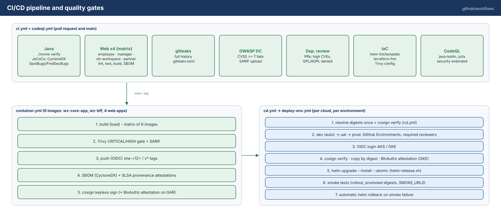

# WellnessZ OHCM – CI/CD Guide

| | |
|---|---|
| **Document** | 09 – CI/CD Guide |
| **Audience** | Developers, DevSecOps engineers, release managers, auditors (change-management evidence) |
| **Scope** | Branching and PR flow, GitHub Actions workflows, quality gates and how to run them locally, repository settings, OIDC federation, image signing and SBOM, releases, database migrations, rollback, extending the pipeline, Azure DevOps equivalent, SOC 2 evidence |
| **Artefacts** | `.github/workflows/*.yml`, `.github/dependabot.yml`, `.github/CODEOWNERS`, `.github/pull_request_template.md`, `.gitleaks.toml`, `.trivyignore`, `config/` |



*Figure 1 – Pipeline and quality gates (source: `docs/images/14-cicd-pipeline.svg`).*

> **Validation status.**
>
> * **Linted and pinned:** all workflows pass actionlint 1.7.12 with shellcheck. Every third-party action is
>   pinned to the full commit SHA of its release tag (resolved with `git ls-remote`).
> * **Run locally with the CI tools:**
>   * gitleaks 8.30.1 (clean on the full history);
>   * Trivy 0.76.1 IaC scan (0 HIGH/CRITICAL);
>   * `helm lint` / `template` + kubeconform;
>   * `terraform fmt` / `validate`.
> * **Not yet run:** the workflows themselves have not run on GitHub-hosted runners, and the OIDC federation to a
>   real Azure or GCP tenant is unexercised. The first pipeline run in your organisation is their acceptance test.

## 1. Branching and pull-request flow

WellnessZ uses **trunk-based development** with short-lived branches.

| Rule | Setting |
|---|---|
| Default branch | `main`, always releasable |
| Work branches | `feature/<ticket>-<slug>`, `fix/<ticket>-<slug>`, `chore/…`; live for days, not weeks |
| Merge | Squash merge via pull request only; linear history; no direct pushes, no force pushes |
| Reviews | 2 approvals. Code Owner review is required for `deploy/`, `.github/`, `platform/wz-security`, `platform/wz-secrets`, migrations, `.gitleaks.toml` and `.trivyignore` (see `CODEOWNERS`) |
| Commits | Signed (SSH or GPG); message references the ticket |
| PR description | `.github/pull_request_template.md`: summary, change type, data-protection checklist, tests, deployment notes |
| Required checks | `Java build & test`, `Web employee-app`, `Web manager-workspace`, `Web oh-workspace` (increment 1), `Secret scan (gitleaks)`, `OWASP dependency-check`, `Dependency review (PR)`, `IaC & config checks`, `Analyze (java-kotlin)`, `Analyze (javascript-typescript)` |
| Releases | Annotated, signed tag `vMAJOR.MINOR.PATCH` on `main` |

The flow:

1. Branch from `main`.
2. Develop. Run the local gates (section 3) before every push.
3. Open a PR with the template filled. CI runs every gate; reviewers check the data-protection checklist.
4. Squash-merge. `container.yml` builds, scans, signs and pushes images tagged `sha-<12>`.
5. Release: create tag `vX.Y.Z`. `cd.yml` builds the release images and promotes them dev → test → prod
   through the environment approvals.

## 2. Workflows

| Workflow | Triggers | Permissions | What it does | Outputs |
|---|---|---|---|---|
| `ci.yml` | `pull_request`, push to `main`, manual | `contents: read` (+ `security-events: write` for SARIF jobs, `pull-requests: write` for dependency review) | Jobs listed below | Test, coverage and SBOM artefacts; SARIF in *Security → Code scanning* |
| `codeql.yml` | PR, push to `main`, weekly (Mon 03:23 UTC) | `security-events: write`, `actions: read` | CodeQL `java-kotlin` (manual build) and `javascript-typescript` with the `security-extended` suite | Code-scanning alerts |
| `container.yml` | Push to `main` and `v*` tags, manual (`registry` = ghcr / acr / gar), `workflow_call` | `packages: write`, `id-token: write`, `attestations: write`, `security-events: write` | Matrix of 5 images (`wz-core-app`, `wz-bff`, `employee-app`, `manager-workspace`, `oh-workspace`); steps listed below | Image digests, attestations, signatures |
| `cd.yml` | Push of tag `v*`; manual (`image_tag`, `start_at`) | Per job; deploy jobs `id-token: write`, `packages: read` | Calls `container.yml` (on tag), resolves the tag, then `deploy-env.yml` for `dev` → `test` → `prod`. Prod accepts only `v*` tags | Deployment records |
| `deploy-env.yml` | `workflow_call` only | `id-token: write`, `packages: read` | Runs in the GitHub Environment; steps listed below | Job summary (actor, tag, run URL) |
| `dependabot.yml` | Weekly (Helm monthly) | – | Updates for Maven, the three npm projects (`web/employee-app`, `web/manager-workspace`, `web/oh-workspace`), GitHub Actions (SHA pins), Docker base images, Docker Compose, Terraform providers and the Helm chart; grouped minor/patch PRs | Dependency PRs |

**`ci.yml` jobs:**

* **java:** `./mvnw verify` (unit + integration tests on PostgreSQL via Testcontainers, ArchUnit, JaCoCo,
  CycloneDX), then **SpotBugs + FindSecBugs** (`-Psecurity -DskipTests -Ddependency-check.skip=true verify`; fails
  on any finding).
* **web (matrix `app: [employee-app, manager-workspace, oh-workspace]`):** `npm ci --ignore-scripts`, lint, test,
  build, `npm audit --omit=dev --audit-level=high`, CycloneDX SBOM. Each matrix entry is a separate check named
  `Web <app>`.
* **gitleaks:** full history.
* **OWASP dependency-check:** fails at CVSS ≥ 7; uses the NVD cache.
* **dependency review:** PRs only; denies high CVEs and GPL/AGPL licences.
* **IaC:** `helm lint`/`template` for every values file, `terraform fmt`, Trivy config scan.

**`container.yml` steps for each image:**

1. Build locally (`load`).
2. Trivy gate: CRITICAL/HIGH vulnerabilities with a fix available, plus secret and misconfiguration scans.
3. Push with OIDC registry login.
4. Syft CycloneDX SBOM.
5. `actions/attest-sbom` and `attest-build-provenance` (SLSA).
6. `cosign sign` (keyless) and `cosign attest` of the SBOM.
7. Binary Authorization attestation (GAR only).

**`deploy-env.yml` steps:**

1. OIDC login: `azure/login` + kubelogin + `aks-set-context`, or `google-github-actions/auth` +
   `get-gke-credentials`.
2. Registry login, then `cosign verify` of all five images (`wz-core-app wz-bff employee-app manager-workspace
   oh-workspace`) against the `container.yml` identity.
3. `helm upgrade --install --atomic --wait --timeout 15m --history-max 10`. Private AKS clusters use
   `az aks command invoke`.

All workflows set top-level `permissions: contents: read` and widen permissions per job only where needed. All
checkouts use `persist-credentials: false`. The only repository secret is `NVD_API_KEY`; cloud access uses OIDC
federation.

## 3. Quality gates and how to run them locally

Run these before pushing. They are the same tools and versions CI uses.

| Gate | Local command | Fails on |
|---|---|---|
| Build, tests, coverage, SBOM | `./mvnw verify` | Test failure, ArchUnit violation |
| SAST (Java) | `./mvnw -Psecurity -DskipTests -Ddependency-check.skip=true verify` | Any SpotBugs/FindSecBugs finding (exclusions only in `config/spotbugs-exclude.xml`, with justification) |
| SCA (Java) | `NVD_API_KEY=… ./mvnw -DskipTests package org.owasp:dependency-check-maven:aggregate` | CVSS ≥ 7 (suppressions only in `config/dependency-check-suppressions.xml`, with justification and expiry) |
| Web | `npm ci && npm run lint && npm test && npm run build && npm audit --omit=dev --audit-level=high` in each `web/*` app | Lint warning, test failure, high vulnerability |
| Secrets | `docker run --rm -v "$PWD:/repo:ro" ghcr.io/gitleaks/gitleaks:v8.30.1 git /repo --config /repo/.gitleaks.toml --redact` | Any finding |
| IaC / misconfiguration | `docker run --rm -v "$PWD:/repo:ro" ghcr.io/aquasecurity/trivy:0.76.1 config --severity CRITICAL,HIGH --ignorefile /repo/.trivyignore --exit-code 1 /repo/deploy` | HIGH/CRITICAL |
| Container image | `docker build -f deploy/docker/Dockerfile.core -t wz-core-app:dev .` then `docker run --rm -v /var/run/docker.sock:/var/run/docker.sock ghcr.io/aquasecurity/trivy:0.76.1 image --severity CRITICAL,HIGH --ignore-unfixed --exit-code 1 wz-core-app:dev` | HIGH/CRITICAL with a fix available |
| Helm | `helm lint deploy/helm/wellnessz -f deploy/helm/wellnessz/values.yaml -f deploy/helm/wellnessz/values-azure.yaml` (repeat per values file) | Lint or `values.schema.json` violation |
| Kubernetes schemas | `helm template wz deploy/helm/wellnessz -f … \| kubeconform -strict -summary -schema-location default -schema-location 'https://raw.githubusercontent.com/datreeio/CRDs-catalog/main/{{.Group}}/{{.ResourceKind}}_{{.ResourceAPIVersion}}.json'` | Invalid manifest |
| Terraform | `terraform fmt -check -recursive deploy/terraform` and `terraform -chdir=deploy/terraform/azure init -backend=false && terraform -chdir=deploy/terraform/azure validate` (same for `gcp`) | Format drift, invalid configuration |
| Workflows | `actionlint .github/workflows/*.yml` (install `shellcheck` too) | Any finding |
| Shell scripts | `shellcheck deploy/local/*.sh deploy/local/postgres/*.sh tools/*.sh` | Any finding |

Optional pre-commit hook (`.git/hooks/pre-commit`, local only):

```bash
#!/usr/bin/env bash
set -e
docker run --rm -v "$PWD:/repo:ro" ghcr.io/gitleaks/gitleaks:v8.30.1 git /repo --pre-commit --staged --config /repo/.gitleaks.toml --redact
```

**Exception handling.** A suppression goes in exactly one of three files:

* `.trivyignore`
* `config/dependency-check-suppressions.xml`
* `config/spotbugs-exclude.xml`

Every entry needs an owner, a justification, a risk-acceptance reference and an expiry date. CODEOWNERS routes
these files to the security team.

### 3.1 End-to-end stage (pre-release)

The Playwright scripts in `tools/e2e/` exercise the running system through real IdP logins and the BFF. They are
**not** part of `ci.yml` today, because they need the full stack (PostgreSQL, Keycloak, core, BFF and the web dev
servers or images). Run them as a release gate:

| When | What | Pass criterion |
|---|---|---|
| Before opening the release PR (developer laptop, setup guide 05) | `node tools/e2e/e2e.js` and `node tools/e2e/e2e-increment1.js` | `e2e.js` ends with the status-only lines; `e2e-increment1.js` prints 18 `PASS` lines and exits 0 |
| After `cd.yml` deploys to **dev** or **test** | `e2e-increment1.js` with `WZ_E2E_*` pointing at the environment and dedicated test accounts | Same; attach the log and screenshots to the release record (CC8.1 evidence) |

Increment 1 baseline: `e2e-increment1.js` 18/18. Screenshots of the reference run are kept in
`docs/images/screens/increment-01/`.

To automate the stage later (recommended), add a `workflow_dispatch` / post-deploy job that starts the Docker Compose
stack with `./deploy/local/up.sh --apps`, serves the three built web apps, installs `playwright@1` with Chromium,
runs both scripts and uploads `tools/e2e/shots` as an artefact. Pin every action by SHA and keep the job's
`permissions` at `contents: read`. Only local, generated secrets may be used; never point an automated run at prod.

## 4. Supply chain: pinning, signing, SBOM, provenance

### 4.1 Pinned actions

Every `uses:` references a full 40-character commit SHA, with the version in a comment. Dependabot proposes
updates. To pin a new action manually:

```bash
git ls-remote https://github.com/<owner>/<repo> refs/tags/<tag> refs/tags/<tag>^{}
```

Use the `^{}` (dereferenced) SHA for annotated tags, or the plain SHA for lightweight tags. Then check the action's
inputs at that SHA (`https://raw.githubusercontent.com/<owner>/<repo>/<sha>/action.yml`) and run actionlint.

### 4.2 Image signatures

Images are signed keyless with the workflow's OIDC identity (Fulcio certificate, Rekor transparency log). Verify:

```bash
cosign verify <registry>/wellnessz/wz-core-app:v1.2.3 --certificate-identity-regexp '^https://github.com/OWNER/WellnessZ/.github/workflows/container.yml@' --certificate-oidc-issuer https://token.actions.githubusercontent.com
```

`deploy-env.yml` runs this verification for all five images before every deployment. Clusters can enforce it at
admission:

* GKE: Binary Authorization (attestor created by Terraform);
* AKS / on-prem: Sigstore policy-controller or Kyverno `verifyImages` with the same identity regexp. Recommended
  for prod.

### 4.3 SBOM and provenance

| Artefact | Where |
|---|---|
| Java SBOM (CycloneDX, aggregate) | `ci.yml` artefact `sbom-java` (`target/bom.json`) |
| Web SBOMs | Artefacts `sbom-employee-app`, `sbom-manager-workspace`, `sbom-oh-workspace` |
| Image SBOM (Syft, CycloneDX) | Artefact `sbom-image-<name>` + registry attestation (`attest-sbom`) + cosign attestation (`--type cyclonedx`) |
| Build provenance (SLSA) | Registry attestation via `attest-build-provenance` and BuildKit `provenance: mode=max` |

Verify a GitHub attestation:

```bash
gh attestation verify oci://<registry>/wellnessz/wz-core-app:v1.2.3 --owner OWNER
```

## 5. Required repository settings

### 5.1 Branch ruleset for `main`

Create a ruleset in the UI (*Settings → Rules → Rulesets*) or with the API:

```bash
gh api -X POST repos/OWNER/WellnessZ/rulesets --input - <<'EOF'
{
  "name": "main-protection",
  "target": "branch",
  "enforcement": "active",
  "conditions": { "ref_name": { "include": ["~DEFAULT_BRANCH"], "exclude": [] } },
  "rules": [
    { "type": "deletion" },
    { "type": "non_fast_forward" },
    { "type": "required_linear_history" },
    { "type": "required_signatures" },
    { "type": "pull_request", "parameters": { "required_approving_review_count": 2, "require_code_owner_review": true,
      "dismiss_stale_reviews_on_push": true, "require_last_push_approval": true, "required_review_thread_resolution": true } },
    { "type": "required_status_checks", "parameters": { "strict_required_status_checks_policy": true, "required_status_checks": [
      { "context": "Java build & test" }, { "context": "Web employee-app" }, { "context": "Web manager-workspace" }, { "context": "Web oh-workspace" },
      { "context": "Secret scan (gitleaks)" }, { "context": "OWASP dependency-check (fail CVSS >= 7)" },
      { "context": "IaC & config checks" }, { "context": "Analyze (java-kotlin)" }, { "context": "Analyze (javascript-typescript)" } ] } }
  ]
}
EOF
```

Add a tag ruleset for `v*`: only release managers may create tags; no updates or deletions.

For an existing ruleset, add the context `Web oh-workspace` (increment 1) to the required status checks; otherwise
pull requests can merge without the OH workspace lint, tests and build.

Also enable, under *Settings → Code security*:

* secret scanning with push protection;
* Dependabot alerts and security updates;
* private vulnerability reporting.

Under *Settings → Actions*: allow only actions pinned to a full SHA, and set the default workflow permissions to
read.

### 5.2 Environments

Create environments with protection rules:

```bash
for e in dev test prod; do gh api -X PUT repos/OWNER/WellnessZ/environments/$e; done
```

```bash
gh api -X PUT repos/OWNER/WellnessZ/environments/prod --input - <<'EOF'
{ "wait_timer": 0, "prevent_self_review": true,
  "reviewers": [ { "type": "Team", "id": <team-id-of-wellnessz-cab> } ],
  "deployment_branch_policy": { "protected_branches": false, "custom_branch_policies": true } }
EOF
```

```bash
gh api -X POST repos/OWNER/WellnessZ/environments/prod/deployment-branch-policies -f name='v*' -f type=tag
```

Configure `test` the same way with the QA team as reviewers. Get team IDs with
`gh api orgs/OWNER/teams/<slug> --jq .id`.

### 5.3 Variables and secrets

| Scope | Name | Example | Used by |
|---|---|---|---|
| Repository secret | `NVD_API_KEY` | – | `ci.yml` dependency-check |
| Repository variable | `IMAGE_REGISTRY_KIND` | `acr` / `gar` / `ghcr` | `cd.yml` → `container.yml` |
| Repository variable | `ACR_NAME`, `AZURE_CLIENT_ID`, `AZURE_TENANT_ID`, `AZURE_SUBSCRIPTION_ID` | registry subscription | `container.yml` (ACR) |
| Repository variable | `GAR_LOCATION`, `GCP_PROJECT_ID`, `GCP_WORKLOAD_IDENTITY_PROVIDER`, `GCP_SERVICE_ACCOUNT`, `BINAUTHZ_ATTESTOR`, `BINAUTHZ_KMS_KEY_VERSION` | – | `container.yml` (GAR) |
| Environment variable | `CLOUD` | `azure` / `gcp` | `deploy-env.yml` |
| Environment variable | `IMAGE_REGISTRY`, `VALUES_FILE`, `ENV_VALUES_FILE`, `HELM_RELEASE`, `K8S_NAMESPACE`, `DEPLOY_RUNNER` | – | `deploy-env.yml` |
| Environment variable (Azure) | `AZURE_CLIENT_ID`, `AZURE_TENANT_ID`, `AZURE_SUBSCRIPTION_ID`, `AKS_RESOURCE_GROUP`, `AKS_CLUSTER_NAME`, `AKS_PRIVATE` | – | `deploy-env.yml` |
| Environment variable (GCP) | `GCP_WORKLOAD_IDENTITY_PROVIDER`, `GCP_SERVICE_ACCOUNT`, `GCP_PROJECT_ID`, `GKE_CLUSTER`, `GKE_LOCATION` | – | `deploy-env.yml` |

Identifiers are **variables**, not secrets: they are not confidential, and keeping them visible makes the audit
trail clearer.

## 6. OIDC federation (no stored cloud credentials)

Terraform creates the federation when `github_repository` is set. The equivalent manual commands follow; use them
for existing subscriptions or projects, or to review what Terraform does.

### 6.1 Azure

```bash
az identity create -g <rg> -n id-wz-github-deployer
```

```bash
for e in dev test prod; do az identity federated-credential create -g <rg> --identity-name id-wz-github-deployer -n github-$e --issuer https://token.actions.githubusercontent.com --subject repo:OWNER/WellnessZ:environment:$e --audiences api://AzureADTokenExchange; done
```

```bash
az identity federated-credential create -g <rg> --identity-name id-wz-github-deployer -n github-main --issuer https://token.actions.githubusercontent.com --subject repo:OWNER/WellnessZ:ref:refs/heads/main --audiences api://AzureADTokenExchange
```

```bash
PRINCIPAL=$(az identity show -g <rg> -n id-wz-github-deployer --query principalId -o tsv); AKS_ID=$(az aks show -g <rg> -n <aks> --query id -o tsv)
```

```bash
az role assignment create --assignee-object-id $PRINCIPAL --assignee-principal-type ServicePrincipal --role AcrPush --scope $(az acr show -n <acr> --query id -o tsv)
```

```bash
az role assignment create --assignee-object-id $PRINCIPAL --assignee-principal-type ServicePrincipal --role "Azure Kubernetes Service Cluster User Role" --scope $AKS_ID
```

```bash
az role assignment create --assignee-object-id $PRINCIPAL --assignee-principal-type ServicePrincipal --role "Azure Kubernetes Service RBAC Writer" --scope $AKS_ID/namespaces/wellnessz
```

The Azure RBAC built-in Kubernetes roles do not cover CRDs. Also bind a namespaced Role for
`secretproviderclasses.secrets-store.csi.x-k8s.io` (Azure guide, section 10). For private clusters, command invoke
additionally needs `Microsoft.ContainerService/managedClusters/runcommand/action`, for example through the
*Azure Kubernetes Service Cluster Admin* role scoped to that cluster. Prefer a self-hosted runner in the VNet.

### 6.2 Subject claims used

| Workflow job | Subject |
|---|---|
| `deploy-env.yml` (environment `prod`) | `repo:OWNER/WellnessZ:environment:prod` |
| `container.yml` on `main` | `repo:OWNER/WellnessZ:ref:refs/heads/main` |
| `container.yml` on a tag | `repo:OWNER/WellnessZ:ref:refs/tags/v1.2.3`. Add a federated credential per tag pattern, or run tag builds in an environment (for example `release`) and federate that environment |

### 6.3 Google Cloud

```bash
gcloud iam workload-identity-pools create github-prod --location=global --display-name="GitHub Actions (prod)"
```

```bash
gcloud iam workload-identity-pools providers create-oidc github --location=global --workload-identity-pool=github-prod --issuer-uri=https://token.actions.githubusercontent.com --attribute-mapping="google.subject=assertion.sub,attribute.repository=assertion.repository,attribute.ref=assertion.ref,attribute.environment=assertion.environment" --attribute-condition="assertion.repository == 'OWNER/WellnessZ'"
```

```bash
gcloud iam service-accounts create github-deployer-prod --display-name="GitHub Actions deployer (prod)"
```

```bash
gcloud iam service-accounts add-iam-policy-binding github-deployer-prod@<project>.iam.gserviceaccount.com --role=roles/iam.workloadIdentityUser --member="principalSet://iam.googleapis.com/projects/<project-number>/locations/global/workloadIdentityPools/github-prod/attribute.repository/OWNER/WellnessZ"
```

```bash
for r in roles/container.developer roles/containeranalysis.notes.attacher roles/containeranalysis.occurrences.editor; do gcloud projects add-iam-policy-binding <project> --member=serviceAccount:github-deployer-prod@<project>.iam.gserviceaccount.com --role=$r; done
```

```bash
gcloud artifacts repositories add-iam-policy-binding wellnessz --location=<region> --member=serviceAccount:github-deployer-prod@<project>.iam.gserviceaccount.com --role=roles/artifactregistry.writer
```

To restrict prod further, bind `workloadIdentityUser` to `attribute.environment/prod` instead of the whole
repository. This requires the `attribute.environment` mapping shown above.

## 7. Releases and tagging

* **Versioning:** semantic versioning. Breaking API or contract changes require a major version and a deprecation
  notice in `docs/api/openapi.json`.
* **Release steps:**
  1. Confirm `main` is green.
  2. Update the changelog section in the release PR.
  3. Create the signed tag:

     ```bash
     git tag -s v1.4.0 -m "WellnessZ 1.4.0"
     ```

     ```bash
     git push origin v1.4.0
     ```

  4. `cd.yml` builds the release images (`container.yml` via `workflow_call`) and deploys **dev** automatically.
     **test** and **prod** wait for the environment reviewers.
  5. Publish GitHub release notes, generated from PR titles. Attach the SBOMs from the run.
* **Image tags:**
  * `vX.Y.Z` (release) and `sha-<12>` (every `main` build);
  * semver tags from `metadata-action`;
  * Artifact Registry tags are immutable; ACR retention removes untagged manifests after 30 days.
* **Hotfix:** branch from the release tag (`hotfix/1.4.1`), apply the fix with a PR into `main`, cherry-pick, then
  tag `v1.4.1`. The pipeline is the same; there is no bypass of approvals.
* **Manual deployment of a specific build:**

  ```bash
  gh workflow run cd.yml -f image_tag=v1.4.0 -f start_at=test
  ```

  Prod accepts only `v*` tags.

## 8. Database migration practice (Flyway)

| Rule | Why |
|---|---|
| Migrations live in `apps/wz-core-app/src/main/resources/db/migration` (core) and `apps/wz-bff/src/main/resources/db/bff` (BFF); name them `V<n>__<description>.sql` | One ordered history per schema set |
| Never edit an applied migration; add a new one | Flyway checksums; audit trail |
| Grant table privileges explicitly to `${app_role}`, with least privilege (for example `SELECT, INSERT` only for append-only tables) | The runtime roles receive no default privileges |
| **Expand / contract**: (1) add columns or tables, nullable or with defaults, compatible with the running version; (2) deploy code that writes both; (3) backfill; (4) remove old structures in a later release | Rolling updates run N and N+1 side by side; `helm --atomic` can roll the app back but not the schema |
| No long-running locks in a migration (use `CREATE INDEX CONCURRENTLY` in a separate, non-transactional migration; batch large backfills) | Availability |
| Test the migration against a copy of production-like data volume in `test` | Duration and lock behaviour |
| PHI never appears in migration scripts (no data seeds with real data) | Data protection |

**Execution modes** (`migrations.mode` in Helm):

* `job` (prod default): a pre-install/pre-upgrade Job runs the Flyway CLI with its own identity and the
  `wz-migrator-db-password` secret. It runs core first, then BFF, with `-placeholders.app_role=wz_app|wz_bff`.
  Runtime pods start with Flyway disabled and **never** hold the schema-owner credential. If the Job fails, the
  Helm release fails and nothing new is rolled out.
* `app` (local / dev): each application runs Flyway on start-up as `wz_migrator` (`WZ_DB_MIGRATOR_*`).

## 9. Rollback

| Situation | Action |
|---|---|
| Deployment fails (readiness, Job failure, timeout) | Automatic: `helm upgrade --atomic` restores the previous release |
| Problem found after a successful deployment, no incompatible schema change | Re-deploy the previous tag: `gh workflow run cd.yml -f image_tag=v1.3.2 -f start_at=prod` (approval applies), or as an emergency `helm rollback wellnessz <revision> -n wellnessz` with a change record |
| Schema change involved | Prefer **roll forward** (fix migration + new release). Expand/contract keeps the previous app version compatible, so the app can still be rolled back |
| Data corruption | Point-in-time restore into a new server (Azure Flexible Server PITR, Cloud SQL clone to timestamp, CNPG `bootstrap.recovery`), verify, then switch `WZ_DB_URL`; incident process |
| Compromised image or dependency | Revoke by deploying the previous signed tag; add the digest to the admission deny list; rotate any affected secrets |

`--history-max 10` keeps ten Helm revisions per release. See them with `helm history wellnessz -n wellnessz`.

## 10. Extending the pipeline

### 10.1 New Maven module (for example a business module `modules/wz-e07-surveillance`)

Increment 1 followed this checklist for `modules/wz-e01-intake` and `modules/wz-e02-triage`:

1. Add `<module>` and the `<dependencyManagement>` entry to the root `pom.xml` and the dependency in
   `apps/wz-core-app/pom.xml`. CI picks it up automatically through `./mvnw verify`, SpotBugs, dependency-check,
   CodeQL and the aggregate SBOM.
2. Extend `apps/wz-core-app/src/test/java/com/wellnessz/app/ArchitectureTest.java` with the new package (platform and
   kernel must not depend on it; no cycles between business modules).
3. Add migrations for its tables (section 8) and grants to `${app_role}`. A **new schema** must also be added to
   `spring.flyway.schemas`, the Helm value `migrations.job.core.schemas`, `deploy/local/postgres/01-init-wellnessz.sh`,
   `deploy/sql/bootstrap-managed-postgres.sql` and `deploy/hybrid/cnpg/03-cluster.yaml` (increment 1: `triage`).
4. New roles: Keycloak realm roles **and** the scope mappings of `wellnessz-bff` / `wellnessz-mobile`; Entra app roles
   (setup guide 06, section 5.2).
5. SpotBugs exclusions only with a justification in `config/spotbugs-exclude.xml` (increment 1 added one: 5 entries).
6. Add the module path (`/modules/<name>/`) to `CODEOWNERS` – today `/modules/` falls under the default owner `*`.
7. Nothing else changes in the pipeline: it ships inside the core image.

### 10.2 New deployable service (new image)

| File | Change |
|---|---|
| `deploy/docker/Dockerfile.<svc>` (+ `.dockerignore`) | Copy `Dockerfile.core`; change the module and jar name |
| `.github/workflows/container.yml` | Add a matrix entry (`image`, `context`, `dockerfile`) |
| `.github/workflows/deploy-env.yml` | Add the image name to the `cosign verify` loop |
| `deploy/helm/wellnessz` | Add a component block to `values.yaml` + `values.schema.json`. Add it to the component lists in `deployment-java.yaml`, `service.yaml`, `serviceaccount.yaml`, `hpa.yaml`, `pdb.yaml` and `networkpolicy.yaml` (explicit allow rules), plus a `SecretProviderClass` set if it needs secrets |
| `deploy/terraform/*` | A workload identity and per-secret access for the new component |
| `.github/dependabot.yml` | Its Dockerfile directory if it is new |
| Docs | Deployment Architecture tables |

### 10.3 New web application

Increment 1 added `web/oh-workspace` this way; use it as the template.

| # | File | Change (OH workspace example) |
|---|---|---|
| 1 | `web/<app>/` | `package.json` (exact versions), `package-lock.json`, `Dockerfile` (build on `node:24.22.2-alpine3.24`, run on nginx-unprivileged, port 8080, `/healthz`), `.dockerignore`, `nginx.conf`, `security-headers.conf`, ESLint config banning `console`, `localStorage`, `sessionStorage`; Vite dev port (5175) with proxy to `WZ_BFF_TARGET` |
| 2 | `.github/workflows/ci.yml` | `matrix.app` += `oh-workspace` |
| 3 | `.github/workflows/container.yml` | Matrix entry `image: oh-workspace`, `context: web/oh-workspace`, `dockerfile: web/oh-workspace/Dockerfile` |
| 4 | `.github/workflows/deploy-env.yml` | Image name in the `cosign verify` loop |
| 5 | `.github/dependabot.yml` | npm entry for `/web/oh-workspace` and the directory in the Docker entry |
| 6 | Branch ruleset | Required check `Web oh-workspace` |
| 7 | `deploy/helm/wellnessz` | Component block `ohWorkspace` in `values.yaml` and `values.schema.json` (required key), the key in every component list (`_helpers.tpl` `wellnessz.componentKeys`, `deployment-web.yaml`, `service.yaml`, `serviceaccount.yaml`, `hpa.yaml`, `pdb.yaml`, `networkpolicy.yaml`, `ingress.yaml`, `gke.yaml`, `NOTES.txt`), `ingress.hosts.ohWorkspace` in each platform values file, `ohWorkspace.enabled: false` in `values-hybrid.yaml` (on-prem) |
| 8 | Core CORS | Host added to `WZ_CORS_ORIGINS` in each values file, `docker-compose.yml` and the `local` profile |
| 9 | Identity | BFF redirect URI `https://<host>/login/oauth2/code/wellnessz` (Keycloak realm, Entra app registration) and post-logout redirect |
| 10 | Docs and E2E | Setup guides, Deployment Architecture, an E2E script or checks in `tools/e2e/` |

### 10.4 New quality gate

Add it as a job in `ci.yml` with its own minimal `permissions`. Pin the action by SHA, run actionlint, and add the
job name to the required status checks in the ruleset.

## 11. Azure DevOps equivalent

Some airline IT departments standardise on Azure DevOps. The equivalent pipeline uses:

* **Workload identity federation** service connections (no secrets);
* **Environments** with approvals and checks;
* the same commands as the GitHub workflows.

```yaml
# azure-pipelines.yml - sketch; adapt service connection and pool names
trigger:
  branches: { include: [main] }
  tags: { include: ['v*'] }
pr:
  branches: { include: [main] }

variables:
  JAVA_VERSION: '21'
  NODE_VERSION: '24.x'
  ACR: 'acrwzprod.azurecr.io'
  IMAGE_TAG: $[ replace(variables['Build.SourceBranch'], 'refs/tags/', '') ]

stages:
- stage: Build
  jobs:
  - job: java
    pool: { vmImage: ubuntu-latest }
    steps:
    - checkout: self
      fetchDepth: 0
      persistCredentials: false
    - task: JavaToolInstaller@1
      inputs: { versionSpec: '$(JAVA_VERSION)', jdkArchitectureOption: x64, jdkSourceOption: PreInstalled }
    - script: ./mvnw -B -ntp verify
      displayName: Maven verify (tests, JaCoCo, CycloneDX)
    - script: ./mvnw -B -ntp -Psecurity -DskipTests -Ddependency-check.skip=true verify
      displayName: SpotBugs + FindSecBugs
    - script: ./mvnw -B -ntp -DskipTests package org.owasp:dependency-check-maven:aggregate -DfailBuildOnCVSS=7
      displayName: OWASP dependency-check
      env: { NVD_API_KEY: $(NVD_API_KEY) }          # secret variable from a Key Vault-linked variable group
    - task: PublishTestResults@2
      condition: always()
      inputs: { testResultsFiles: '**/surefire-reports/TEST-*.xml' }
    - publish: target/bom.json
      artifact: sbom-java
  - job: web
    pool: { vmImage: ubuntu-latest }
    strategy:
      matrix:
        employee: { APP: employee-app }
        manager: { APP: manager-workspace }
    steps:
    - task: NodeTool@0
      inputs: { versionSpec: '$(NODE_VERSION)' }
    - script: npm ci --ignore-scripts && npm run lint && npm test && npm run build && npm audit --omit=dev --audit-level=high
      workingDirectory: web/$(APP)
  - job: scans
    pool: { vmImage: ubuntu-latest }
    steps:
    - checkout: self
      fetchDepth: 0
    - script: docker run --rm -v "$PWD:/repo:ro" ghcr.io/gitleaks/gitleaks:v8.30.1 git /repo --config /repo/.gitleaks.toml --redact
      displayName: gitleaks
    - script: docker run --rm -v "$PWD:/repo:ro" ghcr.io/aquasecurity/trivy:0.76.1 config --severity CRITICAL,HIGH --exit-code 1 /repo/deploy
      displayName: Trivy IaC

- stage: Containers
  dependsOn: Build
  condition: and(succeeded(), or(eq(variables['Build.SourceBranch'], 'refs/heads/main'), startsWith(variables['Build.SourceBranch'], 'refs/tags/v')))
  jobs:
  - job: images
    pool: { vmImage: ubuntu-latest }
    strategy:
      matrix:
        core: { IMG: wz-core-app, CTX: '.', DF: deploy/docker/Dockerfile.core }
        bff: { IMG: wz-bff, CTX: '.', DF: deploy/docker/Dockerfile.bff }
        employee: { IMG: employee-app, CTX: web/employee-app, DF: web/employee-app/Dockerfile }
        manager: { IMG: manager-workspace, CTX: web/manager-workspace, DF: web/manager-workspace/Dockerfile }
    steps:
    - script: docker build -f $(DF) -t $(ACR)/wellnessz/$(IMG):$(IMAGE_TAG) $(CTX)
    - script: docker run --rm -v /var/run/docker.sock:/var/run/docker.sock ghcr.io/aquasecurity/trivy:0.76.1 image --severity CRITICAL,HIGH --ignore-unfixed --exit-code 1 $(ACR)/wellnessz/$(IMG):$(IMAGE_TAG)
      displayName: Trivy gate
    - task: AzureCLI@2                                  # service connection type: workload identity federation
      inputs:
        azureSubscription: sc-wellnessz-acr
        scriptType: bash
        scriptLocation: inlineScript
        inlineScript: |
          az acr login -n ${ACR%%.*}
          docker push $(ACR)/wellnessz/$(IMG):$(IMAGE_TAG)
          # key-based signing with a Key Vault key (keyless Fulcio needs a GitHub/GitLab-style OIDC issuer)
          cosign sign --yes --key azurekms://kv-wz-prod.vault.azure.net/cosign $(ACR)/wellnessz/$(IMG):$(IMAGE_TAG)

- stage: Deploy_dev
  dependsOn: Containers
  jobs:
  - deployment: helm
    environment: wellnessz-dev                          # approvals & checks configured on the environment
    pool: { name: wz-private-agents }                   # self-hosted agents inside the VNet for private AKS
    strategy:
      runOnce:
        deploy:
          steps:
          - checkout: self
          - task: AzureCLI@2
            inputs:
              azureSubscription: sc-wellnessz-dev
              scriptType: bash
              scriptLocation: inlineScript
              inlineScript: |
                az aks get-credentials -g rg-wz-dev -n aks-wz-dev --overwrite-existing && kubelogin convert-kubeconfig -l azurecli
                cosign verify --key azurekms://kv-wz-prod.vault.azure.net/cosign $(ACR)/wellnessz/wz-core-app:$(IMAGE_TAG)
                helm upgrade --install wellnessz deploy/helm/wellnessz -n wellnessz \
                  -f deploy/helm/wellnessz/values.yaml -f deploy/helm/wellnessz/values-azure.yaml -f deploy/env/dev-azure.yaml \
                  --set-string global.imageTag=$(IMAGE_TAG) --atomic --wait --timeout 15m
# Deploy_test and Deploy_prod: copy Deploy_dev with environment wellnessz-test / wellnessz-prod
# (approvals: QA / CAB, branch control check: refs/tags/v*), and the matching service connection.
```

Differences from GitHub Actions:

* Azure DevOps has no first-party keyless Sigstore issuer, so the sketch signs with a **Key Vault key**
  (`azurekms://`) and verifies with the same key.
* CodeQL is available through **GitHub Advanced Security for Azure DevOps** (`AdvancedSecurity-Codeql-Init@1` /
  `-Analyze@1`).
* Environment *Approvals and checks* replace GitHub Environment reviewers. Add the *Branch control* check to allow
  only `refs/tags/v*` in prod.

## 12. SOC 2 change-management evidence checklist

For each production change, the auditor can obtain the following without extra work:

| # | Evidence (TSC) | Source |
|---|---|---|
| 1 | Change request / ticket linked to the PR (CC8.1) | PR description (template), ticket reference in commits |
| 2 | Peer review by an independent reviewer; Code Owner approval for sensitive paths (CC8.1) | PR review history; ruleset `require_code_owner_review`, `prevent_self_review` on environments |
| 3 | Automated tests and security scans passed before merge (CC7.1, CC8.1) | Required status checks on the PR; workflow run logs (retained 90 days by default; export for 1 year) |
| 4 | No secrets committed (CC6.1) | gitleaks job, GitHub push protection |
| 5 | Vulnerability management (CC7.1) | Code-scanning alerts (CodeQL, dependency-check, Trivy SARIF), Dependabot PRs, `.trivyignore` and suppression files with expiry |
| 6 | Software bill of materials and provenance (CC8.1, supply chain) | SBOM artefacts, registry attestations, cosign signatures in Rekor |
| 7 | Deployment approved by an authorised approver before prod (CC8.1) | GitHub Environment deployment history (approver, timestamp) |
| 8 | Only the tested artefact deployed (CC8.1) | Same image digest across environments; `cosign verify` step log in `deploy-env.yml` |
| 9 | Segregation of duties (CC6.3) | Developers cannot approve their own prod deployment; deployer identity has namespace-scoped rights only; no standing cluster-admin |
| 10 | Infrastructure changes reviewed (CC8.1) | Terraform plan in the PR (recommended: attach `terraform plan` output), state in an access-controlled backend with versioning |
| 11 | Emergency change process (CC8.1) | Hotfix branch + same pipeline; retrospective review within 2 business days |
| 12 | Rollback capability tested (A1.2) | `helm --atomic` behaviour; quarterly rollback drill recorded |
| 13 | Database changes controlled (CC8.1) | Flyway history table (`platform.flyway_schema_history`, `bff.flyway_schema_history_bff`) + migration PR |
| 14 | Access to pipelines reviewed (CC6.2) | Quarterly export of repository collaborators, teams, environment reviewers and federated credentials |
| 15 | Functional acceptance of the increment (CC8.1) | E2E log of `tools/e2e/e2e-increment1.js` (18/18 for increment 1) and screenshots attached to the release record |

Retention: export workflow logs, deployment history and attestations to the evidence store (for example a WORM
storage container) monthly. The GitHub default log retention (90 days) is shorter than a SOC 2 Type 2 observation
period.
