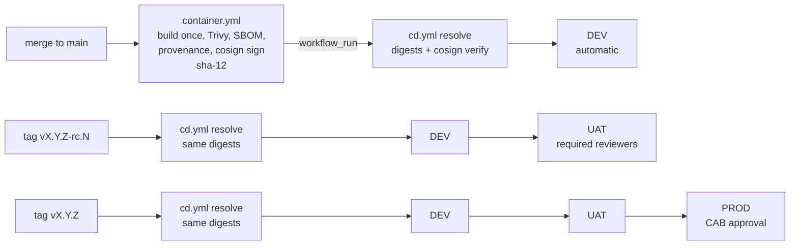

# WellnessZ OHCM – CI/CD Guide

**Version 1.0**

*WellnessZ OHCM platform – increments 1–5*

| | |
|---|---|
| **Document** | 09 – CI/CD Guide |
| **Audience** | Developers, DevSecOps engineers, release managers, auditors (change-management evidence) |
| **Scope** | Branching and PR flow, GitHub Actions workflows, quality gates and how to run them locally, repository settings (branch protection, GitHub Environments and required reviewers), OIDC federation, image signing and SBOM, DEV → UAT → PROD promotion by signed digest, release tagging, database migrations, rollback, extending the platform (new module / feature checklist), client customisation pipelines, Azure DevOps equivalent, SOC 2 evidence |
| **Artefacts** | `.github/workflows/*.yml` (`ci.yml`, `codeql.yml`, `container.yml`, `cd.yml`, `deploy-env.yml`), `deploy/scripts/helm-release.sh`, `deploy/environments/README.md`, `.github/dependabot.yml`, `.github/CODEOWNERS`, `.github/pull_request_template.md`, `.gitleaks.toml`, `.trivyignore`, `config/` |
| **Related** | [Developer Guide](../architecture/03-Developer-Guide.md) · [Client Customisation Guide](../customisation/Client-Customisation-Guide.md) · [Developer Environment & IDE Setup Guide](../developer-setup/README.md) · [Deployment environments](../../deploy/environments/README.md) |


*Figure 1 – Pipeline and quality gates (source: `docs/images/14-cicd-pipeline.svg`).*

> **Validation status.**
>
> * **Linted and pinned:** all workflows pass actionlint 1.7.12 with shellcheck. Every third-party action is
>   pinned to the full commit SHA of its release tag (resolved with `git ls-remote`).
> * **Run locally with the CI tools:**
>   * gitleaks 8.30.1 (clean on the full history);
>   * Trivy 0.76.1 IaC scan (0 HIGH/CRITICAL);
>   * `helm lint` / `template` + kubeconform;
>   * `terraform fmt` / `validate`.
> * **Not yet run:** the workflows themselves have not run on GitHub-hosted runners, and the OIDC federation to a
>   real Azure or GCP tenant is unexercised. The first pipeline run in your organisation is their acceptance test.
>
> **Increment 3** (E06, E07, E14) adds three Maven modules (`modules/wz-e06-absence`, `modules/wz-e07-surveillance`,
> `modules/wz-e14-scheduling`), three integration test classes, the end-to-end script `tools/e2e/e2e-increment3.js`
> and no new image, workflow or third-party dependency. Baseline: 210 Java tests, 0 SpotBugs findings (6 exclusions),
> web tests 463 / 191 / 154, E2E 32/32 (sections 3.1, 3.3).
>
> **Increment 4** (E04, E08) adds two Maven modules (`modules/wz-e04-treatment`, `modules/wz-e08-claims`), two
> integration test classes, a **new web app and image** – the partner portal (`web/partner-portal`): CI web matrix,
> `container.yml` image matrix, the `cosign verify` loop of `deploy-env.yml`, Dependabot (npm and Docker) – the
> end-to-end script `tools/e2e/e2e-increment4.js` and no new workflow or third-party Java dependency. Baseline: 275 Java
> tests, 0 SpotBugs findings (6 exclusions), web tests 570 / 223 / 164 / 119 (OH workspace / employee app / manager
> workspace / partner portal), E2E 22/22 plus the earlier scripts (sections 3.1, 3.4, 10.3).
>
> **Increment 5** (E09, E10, E11, E12 – final increment) adds four Maven modules (`modules/wz-e09-mentalhealth`,
> `modules/wz-e10-substance`, `modules/wz-e11-travelhealth`, `modules/wz-e12-promotion`), Flyway V16–V20, four
> integration test classes, five ArchUnit rules (22 in total), the end-to-end script `tools/e2e/e2e-increment5.js` and
> no new image or third-party dependency. It also replaces the earlier dev → test → prod deployment with the
> **DEV → UAT → PROD promotion by signed digest** (`cd.yml` + `deploy-env.yml` + `deploy/scripts/helm-release.sh`,
> sections 2, 5.2, 7, 9) and adds the **client customisation hooks** (`customisation:` Helm values,
> `EXTRA_VALUES_FILES`, client Flyway migrations – section 10.6). Baseline: 450 Java tests, 0 SpotBugs / FindSecBugs
> findings, web tests 769 / 285 / 188 / 131 = 1,373 with eslint 0 warnings, E2E 24/24 plus the regressions 18/18,
> 25/25, 32/32 and 22/22 (121 checks), OpenAPI 647 paths (sections 3.1, 3.5, 10.5).

## 1. Branching and pull-request flow

WellnessZ uses **trunk-based development** with short-lived branches.

| Rule | Setting |
|---|---|
| Default branch | `main`, always releasable |
| Work branches | `feature/<ticket>-<slug>`, `fix/<ticket>-<slug>`, `chore/…`; live for days, not weeks |
| Merge | Squash merge via pull request only; linear history; no direct pushes, no force pushes |
| Reviews | 2 approvals. Code Owner review is required for `deploy/`, `.github/`, `platform/wz-security`, `platform/wz-secrets`, migrations, `.gitleaks.toml` and `.trivyignore` (see `CODEOWNERS`) |
| Commits | Signed (SSH or GPG); message references the ticket |
| PR description | `.github/pull_request_template.md`: summary, change type, data-protection checklist, tests, deployment notes |
| Required checks | `Java build & test`, `Web employee-app`, `Web manager-workspace`, `Web oh-workspace` (increment 1), `Web partner-portal` (increment 4), `Secret scan (gitleaks)`, `OWASP dependency-check`, `Dependency review (PR)`, `IaC & config checks`, `Analyze (java-kotlin)`, `Analyze (javascript-typescript)` |
| Releases | Annotated, signed tags on a commit of `main` that `container.yml` has built: `vX.Y.Z-rc.N` (release candidate → DEV → UAT) and `vX.Y.Z` (final release → DEV → UAT → PROD) – section 7 |
| Client-specific code | Never on long-lived branches of this repository: client forks `wellnessz-<client>` (Client Customisation Guide, section 10) |

The flow:

1. Branch from `main`.
2. Develop. Run the local gates (section 3) before every push.
3. Open a PR with the template filled. CI runs every gate; reviewers check the data-protection checklist.
4. Squash-merge. `container.yml` builds the six images **once** for that commit, scans, signs and pushes them tagged
   `sha-<12>`; on success `cd.yml` deploys the signed digests to **DEV** automatically.
5. Release: tag the commit `vX.Y.Z-rc.N` (UAT) or `vX.Y.Z` (PROD). Tags do not rebuild anything: `cd.yml` resolves the
   tag to the build of the tagged commit and promotes exactly those digests DEV → UAT → PROD through the GitHub
   Environment approvals (section 7).

## 2. Workflows

| Workflow | Triggers | Permissions | What it does | Outputs |
|---|---|---|---|---|
| `ci.yml` | `pull_request`, push to `main`, manual | `contents: read` (+ `security-events: write` for SARIF jobs, `pull-requests: write` for dependency review) | Jobs listed below | Test, coverage and SBOM artefacts; SARIF in *Security → Code scanning* |
| `codeql.yml` | PR, push to `main`, weekly (Mon 03:23 UTC) | `security-events: write`, `actions: read` | CodeQL `java-kotlin` (manual build) and `javascript-typescript` with the `security-extended` suite | Code-scanning alerts |
| `container.yml` | Push to `main` (one build per commit, tag `sha-<12>`), manual (`registry` = ghcr / acr / gar), `workflow_call` – **not** on tags | `packages: write`, `id-token: write`, `attestations: write`, `security-events: write` | Matrix of 6 images (`wz-core-app`, `wz-bff`, `employee-app`, `manager-workspace`, `oh-workspace`, `partner-portal` – increment 4); steps listed below | Image digests, attestations, signatures |
| `cd.yml` | `workflow_run` of *Container images* on `main` (success only), push of tag `v*`, manual (`cloud` = azure / gcp / all, `start_at` = dev / uat / prod, `image_tag`) | `contents: read`; `resolve` and deploy jobs `id-token: write`, `packages: read` | Job `resolve` maps the tag to the build of the tagged commit (`sha-<12>`), resolves the six digests **once**, verifies their cosign signatures (identity `container.yml@refs/heads/main`) and passes the identical digest list to `dev` → `uat` → `prod` (each a matrix over `DEPLOY_CLOUDS`, calling `deploy-env.yml`). `sha-*` → DEV only; `vX.Y.Z-rc.N` → DEV, UAT; `vX.Y.Z` → DEV, UAT, PROD | Release summary with the digest list; deployment records |
| `deploy-env.yml` | `workflow_call` (from `cd.yml`), manual (`cloud`, `environment`, `image_tag`) | `id-token: write`, `packages: read` | Deploys **one** cloud environment (`azure-dev` … `gcp-prod`) inside its GitHub Environment; steps listed below; uses `deploy/scripts/helm-release.sh` | Job summary (actor, tag, digests, helm and smoke outcome, run URL) |
| `dependabot.yml` | Weekly (Helm monthly) | – | Updates for Maven, the four npm projects (`web/employee-app`, `web/manager-workspace`, `web/oh-workspace`, `web/partner-portal`), GitHub Actions (SHA pins), Docker base images, Docker Compose, Terraform providers and the Helm chart; grouped minor/patch PRs | Dependency PRs |

**`ci.yml` jobs:**

* **java:** `./mvnw verify` (unit + integration tests on PostgreSQL via Testcontainers, ArchUnit, JaCoCo,
  CycloneDX) over every Maven module – since increment 5 the reactor builds the ten platform modules, the thirteen
  business modules `wz-e01-intake`, `wz-e02-triage`, `wz-e03-record`, `wz-e04-treatment`, `wz-e05-fitness`,
  `wz-e06-absence`, `wz-e07-surveillance`, `wz-e08-claims`, `wz-e09-mentalhealth`, `wz-e10-substance`,
  `wz-e11-travelhealth`, `wz-e12-promotion`, `wz-e14-scheduling`, and the two apps – then **SpotBugs + FindSecBugs** (`-Psecurity -DskipTests -Ddependency-check.skip=true verify`; fails
  on any finding).
* **web (matrix `app: [employee-app, manager-workspace, oh-workspace, partner-portal]`):** `npm ci --ignore-scripts`, lint, test,
  build, `npm audit --omit=dev --audit-level=high`, CycloneDX SBOM. Each matrix entry is a separate check named
  `Web <app>`.
* **gitleaks:** full history.
* **OWASP dependency-check:** fails at CVSS ≥ 7; uses the NVD cache.
* **dependency review:** PRs only; denies high CVEs and GPL/AGPL licences.
* **IaC:** `helm lint`/`template` for every values file **and every environment overlay**
  (`environments/{azure,gcp,hybrid}/{dev,uat,prod}.yaml`, rendered with placeholder digests because UAT / PROD require
  digests), the hybrid cloud edge, `terraform fmt`, Trivy config scan.

**`container.yml` steps for each image:**

1. Build locally (`load`).
2. Trivy gate: CRITICAL/HIGH vulnerabilities with a fix available, plus secret and misconfiguration scans.
3. Push with OIDC registry login.
4. Syft CycloneDX SBOM.
5. `actions/attest-sbom` and `attest-build-provenance` (SLSA).
6. `cosign sign` (keyless) and `cosign attest` of the SBOM.
7. Binary Authorization attestation (GAR only).

**`deploy-env.yml` steps** (one cloud environment; the job runs in the GitHub Environment `<cloud>-<env>`, so its
protection rules and required reviewers apply before any step runs):

1. **Promotion policy.** DEV accepts `sha-<12>` builds and release tags, UAT only `vX.Y.Z[-rc.N]`, PROD only
   `vX.Y.Z`. The cloud values, the environment overlay and every `EXTRA_VALUES_FILES` entry must exist. A release tag
   is mapped to the build of its commit (`sha-<12>`).
2. **OIDC login** (no stored cloud credentials): `azure/login` + kubelogin + `aks-set-context`, or
   `google-github-actions/auth` + `get-gke-credentials`. Each cloud identity trusts only its own GitHub Environment.
3. **Resolve digests** (or take the list `cd.yml` passed) and **`cosign verify`** all six images (`wz-core-app wz-bff
   employee-app manager-workspace oh-workspace partner-portal`) against the identity
   `…/.github/workflows/container.yml@refs/heads/main`.
4. **Promote by digest** into the environment registry (`IMAGE_REGISTRY`) with `cosign copy` – digest, signatures and
   attestations unchanged – and verify again at the destination.
5. **Binary Authorization** (GKE): create the attestation for every digest with the environment's attestor and KMS
   key (`BINAUTHZ_ATTESTOR`, `BINAUTHZ_KMS_KEY_VERSION`); skipped when it already exists. The policy is dry-run in DEV
   and enforced in UAT / PROD (Terraform).
6. **Record the previous revision**, then `helm-release.sh upgrade`: `helm upgrade --install --atomic --wait
   --timeout 15m --history-max 10` with `values.yaml` → `values-<cloud>.yaml` → `environments/<cloud>/<env>.yaml` →
   `EXTRA_VALUES_FILES`, every component pinned by `--set-string <component>.image.digest=…`. Private AKS clusters run
   the same script through `az aks command invoke` (bundle with `release.env`).
7. **Smoke tests** (`helm-release.sh smoke`): rollout status of every Deployment of the release, every running
   container uses exactly one of the promoted digests, optional HTTP checks of `SMOKE_URLS` (2xx).
8. **Automatic rollback** when the smoke tests fail: `helm-release.sh rollback <previous revision>` (not on a first
   install). The job then fails, so later stages do not run.
9. **Deployment record** in the job summary (actor, tag, build, digests, helm and smoke outcome).

All workflows set top-level `permissions: contents: read` and widen permissions per job only where needed. All
checkouts use `persist-credentials: false`. The only repository secret is `NVD_API_KEY`; cloud access uses OIDC
federation.

## 3. Quality gates and how to run them locally

Run these before pushing. They are the same tools and versions CI uses.

| Gate | Local command | Fails on |
|---|---|---|
| Build, tests, coverage, SBOM | `./mvnw verify` | Test failure, ArchUnit violation |
| SAST (Java) | `./mvnw -Psecurity -DskipTests -Ddependency-check.skip=true verify` | Any SpotBugs/FindSecBugs finding (exclusions only in `config/spotbugs-exclude.xml`, with justification) |
| SAST (Java, TypeScript) – CodeQL `security-extended` | CI only (`codeql.yml`, required checks `Analyze (java-kotlin)` / `Analyze (javascript-typescript)`); optional locally with the CodeQL CLI (`codeql database create --language=java-kotlin --command='./mvnw -B -DskipTests package'` then `codeql database analyze … codeql/java-queries:codeql-suites/java-security-extended.qls`) | Failed analysis; new alerts are triaged in *Security → Code scanning* before merge |
| SCA (Java) | `NVD_API_KEY=… ./mvnw -DskipTests package org.owasp:dependency-check-maven:aggregate` | CVSS ≥ 7 (suppressions only in `config/dependency-check-suppressions.xml`, with justification and expiry) |
| Web (eslint, Vitest, build, npm audit) | `npm ci && npm run lint && npm test && npm run build && npm audit --omit=dev --audit-level=high` in each `web/*` app | Any eslint warning (0-warning policy; the configs ban `console`, `localStorage`, `sessionStorage`), test failure, high vulnerability |
| Secrets | `docker run --rm -v "$PWD:/repo:ro" ghcr.io/gitleaks/gitleaks:v8.30.1 git /repo --config /repo/.gitleaks.toml --redact` | Any finding |
| IaC / misconfiguration | `docker run --rm -v "$PWD:/repo:ro" ghcr.io/aquasecurity/trivy:0.76.1 config --severity CRITICAL,HIGH --ignorefile /repo/.trivyignore --exit-code 1 /repo/deploy` | HIGH/CRITICAL |
| Container image | `docker build -f deploy/docker/Dockerfile.core -t wz-core-app:dev .` then `docker run --rm -v /var/run/docker.sock:/var/run/docker.sock ghcr.io/aquasecurity/trivy:0.76.1 image --severity CRITICAL,HIGH --ignore-unfixed --exit-code 1 wz-core-app:dev` | HIGH/CRITICAL with a fix available |
| Helm | `helm lint deploy/helm/wellnessz -f deploy/helm/wellnessz/values.yaml -f deploy/helm/wellnessz/values-azure.yaml` (repeat per values file) | Lint or `values.schema.json` violation |
| Kubernetes schemas | `helm template wz deploy/helm/wellnessz -f … \| kubeconform -strict -summary -schema-location default -schema-location 'https://raw.githubusercontent.com/datreeio/CRDs-catalog/main/{{.Group}}/{{.ResourceKind}}_{{.ResourceAPIVersion}}.json'` | Invalid manifest |
| Terraform | `terraform fmt -check -recursive deploy/terraform` and `terraform -chdir=deploy/terraform/azure init -backend=false && terraform -chdir=deploy/terraform/azure validate` (same for `gcp`) | Format drift, invalid configuration |
| Workflows | `actionlint .github/workflows/*.yml` (install `shellcheck` too) | Any finding |
| Shell scripts | `shellcheck deploy/local/*.sh deploy/local/postgres/*.sh tools/*.sh` | Any finding |

Optional pre-commit hook (`.git/hooks/pre-commit`, local only):

```bash
#!/usr/bin/env bash
set -e
docker run --rm -v "$PWD:/repo:ro" ghcr.io/gitleaks/gitleaks:v8.30.1 git /repo --pre-commit --staged --config /repo/.gitleaks.toml --redact
```

**Exception handling.** A suppression goes in exactly one of three files:

* `.trivyignore`
* `config/dependency-check-suppressions.xml`
* `config/spotbugs-exclude.xml`

Every entry needs an owner, a justification, a risk-acceptance reference and an expiry date. CODEOWNERS routes
these files to the security team.

### 3.1 End-to-end stage (pre-release)

The Playwright scripts in `tools/e2e/` exercise the running system through real IdP logins and the BFF. They are
**not** part of `ci.yml` today, because they need the full stack (PostgreSQL, Keycloak, core, BFF and the web dev
servers or images). Run them as a release gate:

| When | What | Pass criterion |
|---|---|---|
| Before tagging a release candidate (developer laptop, setup guide 05) | `node tools/e2e/e2e.js`, `node tools/e2e/e2e-increment1.js`, `node tools/e2e/e2e-increment2.js`, `node tools/e2e/e2e-increment3.js`, `node tools/e2e/e2e-increment4.js` and `node tools/e2e/e2e-increment5.js` (in this order, on a freshly purged local database, with the four dev servers including the partner portal on 5176) | `e2e.js` ends with the status-only lines; `e2e-increment1.js` prints 18, `e2e-increment2.js` 25, `e2e-increment3.js` 32, `e2e-increment4.js` 22 and `e2e-increment5.js` 24 `PASS` lines (121 checks), all exit 0 |
| After `cd.yml` deploys to **DEV** or **UAT** | The five increment scripts with `WZ_E2E_*` (including `WZ_E2E_PARTNER_URL`) pointing at the environment and dedicated test accounts (`e2e-increment3.js` and `e2e-increment4.js` need a fresh dev database with the increment-3 / increment-4 demo data; partner and adjuster test accounts need MFA or a dev core with the MFA gate relaxed for them) | Same; attach the logs and screenshots to the release record (CC8.1 evidence) |

Increment 1 baseline: `e2e-increment1.js` 18/18. Screenshots of the reference run are kept in
`docs/images/screens/increment-01/`.

Increment 2 baseline: `e2e-increment2.js` 25/25, screenshots in `docs/images/screens/increment-02/`. **Both increment
scripts are the pre-release gate from increment 2 on**: a release that touches the case kernel, security, documents
or any business module must pass both, because increment 2 changed shared code that increment 1 relies on (kernel
fitness publication, consent, notification templates, BFF path handling). The increment-2 script needs the realm user
`dpo1` (a realm imported before increment 2 must be re-imported) and the `local` profile demo data.

Increment 3 baseline: `e2e-increment3.js` 32/32, 37 screenshots in `docs/images/screens/increment-03/`. **All three
increment scripts are the pre-release gate from increment 3 on**, because increment 3 changed code that the earlier
increments use: E03 result capture (calibration check, follow-up listener), E05 fitness decisions (clearance guard),
the document service (module-level API, new templates), notification templates and the BFF (workspace paths,
multipart handling). The increment-3 script needs the realm users `scheduler1`, `biomed1`, `crewlicensing1`,
`candidate1` (re-import a realm from before increment 3), the `local` profile demo data, and a database on which it has
not run yet – several checks consume demo state (calibration of `AUD-LHR-02`, release of the demo advice report, the
candidate's consent). Purge and recreate the local stack before a gate run (`./deploy/local/down.sh --purge`,
`./deploy/local/up.sh`, restart the core).

The run on 2026-10-29 found one defect that unit and integration tests could not see: the BFF parsed browser
`multipart/form-data` uploads with Spring's servlet multipart support and forwarded an empty body (`400`). It is fixed
with `spring.servlet.multipart.enabled=false` in `apps/wz-bff/src/main/resources/application.yml`; the certificate
upload check of `e2e-increment3.js` is the regression test.

Increment 4 baseline: `e2e-increment4.js` 22/22 with the regressions 18/18, 25/25 and 32/32 (97 checks), 26
screenshots in `docs/images/screens/increment-04/`. **All four increment scripts are the pre-release gate from
increment 4 on**, because increment 4 changed shared code: the security converter (MFA gate for external roles), the
document service (`INSURER` target, `shareAsSystem` with a consent id, case-level legal hold, new templates), consent
purposes, notification templates, kernel SPIs, `GET /me` disclosure levels and the BFF workspace paths
(`/workspace/claims`). The script drives all four apps (`WZ_E2E_PARTNER_URL`, default `http://localhost:5176`), needs
the realm users `claims1`, `adjuster1`, `legal1`, `finance1`, `procurement1` and `physio1` and the 5176 redirect URI
(re-import a realm from before increment 4), the `local` profile (MFA gate off, increment-4 demo data,
`ClaimsDemoSeeder`) and – like the increment-3 script – a database on which it has not run yet (it opens claims, exports
the month's costs once and sets a litigation hold). Purge and recreate the local stack before a gate run and run the
scripts 1 → 4 in order.

Increment 5 baseline: `e2e-increment5.js` 24/24 with the regressions 18/18, 25/25, 32/32 and 22/22 (**121 checks**),
35 screenshots in `docs/images/screens/increment-05/`. **All five increment scripts are the pre-release gate from
increment 5 on**, because increment 5 changed shared code: the document service (`generateSigned(…, DataClassification)`
for restricted-class documents, new templates and upload types), the duty-assignment feed in master data (V16), the
notification content rules and templates, a new kernel SPI (`SupportProgrammeReferral`), the outbound allow-lists, the
global exception handler and the BFF workspace paths and roles. The script needs the realm users `peer1`,
`peercoord1`, `safety1`, `damanager1`, `mro1`, `collector1`, `promo1`, `ergo1` and `eap1` (re-import a realm from
before increment 5), the `local` profile demo data and – like the earlier scripts – a database on which it has not run
yet. Purge and recreate the local stack before a gate run and run the scripts 1 → 5 in order.

To automate the stage later (recommended), add a `workflow_dispatch` / post-deploy job that starts the Docker Compose
stack with `./deploy/local/up.sh --apps`, serves the four built web apps, installs `playwright@1` with Chromium,
runs all increment scripts in order and uploads `tools/e2e/shots` as an artefact. Pin every action by SHA and keep the job's
`permissions` at `contents: read`. Only local, generated secrets may be used; never point an automated run at prod.

### 3.2 Document-processing dependencies (increment 2)

Increment 2 adds **Apache PDFBox 3.0.8** (`pdfbox.version` in the root `pom.xml`, used by `platform/wz-documents`). It
parses untrusted uploads (scanned PDFs), so it is treated as a security-relevant dependency:

| Control | Where | Notes |
|---|---|---|
| CVE scanning | OWASP dependency-check job (`ci.yml`, fails at CVSS ≥ 7) and the Trivy image gate in `container.yml` (the jar is inside `wz-core-app`) | A PDFBox CVE blocks the build; suppressions only with justification and expiry |
| Updates | Dependabot `maven` ecosystem (weekly, `maven-minor-patch` group; security updates immediately) | Patch releases of 3.0.x are expected to be drop-in |
| Licence | CycloneDX SBOM (`sbom-java`) and dependency review (denies GPL/AGPL) | PDFBox is Apache-2.0; its transitive `fontbox` and `pdfbox-io` are Apache-2.0 too |
| SAST | SpotBugs + FindSecBugs; the OCR command line is the sixth justified exclusion (`TesseractOcrProvider`) | No other exclusion was added for document handling |
| Patch SLA | Critical 7 days, high 30 days (doc 02, Section 10) | Prioritise parser CVEs that are reachable from `/documents/scan` |

Optional runtime additions are **not** part of the repository images: a Unicode font for Arabic PDFs and Tesseract
OCR. If an environment needs them, build a derived image from the signed `wz-core-app` digest in your pipeline
(for example `FROM <registry>/wz-core-app@sha256:…` plus `tesseract-ocr`, `tesseract-ocr-ara`, `tesseract-ocr-fra`
and the font) and run it through the same Trivy gate, SBOM, provenance and cosign signing as the base image; add the
image to the `cosign verify` loop of `deploy-env.yml`. Never install packages at container start (read-only root
filesystem).

### 3.3 Integration tests and the test database (increment 3)

| Test class (`apps/wz-core-app/src/test/java/com/wellnessz/app/`) | Tests | Covers |
|---|---|---|
| `Increment3AbsenceIntegrationTest` | 10 | Feed reconciliation, trigger queue and notifications, rule versioning and test mode, crew sickness → AME review, certificates (HR validity only), LTA pathway and HR stage, advice report screening / consent / release / decline, analytics suppression, non-OH roles denied |
| `Increment3SurveillanceIntegrationTest` | 9 | Programme builder and simulation, due list and invitations with no-show escalation, pre-employment candidate portal and HR status, crew certificates and roster status, immunisation fast entry, IH import, device threshold-shift follow-up, return-after-illness clearance guard, compliance and audit packs |
| `Increment3SchedulingIntegrationTest` | 9 | Booking with conflicts and waitlist, self-booking rules, reminder and no-show jobs with status listeners, campaign of 500 bookings, check-in / queue board / call-next, calibration blocking E03 device capture, cold-chain IoT excursion, capacity, catalogue and role denials |
| `ArchitectureTest` | 14 rules | Four new rules for increment-3 module independence (doc 01, Section 5.2) |

Module unit tests: E06 18 (`RuleEngineTest`, `AbsencePatternsTest`, `CertificateChecksTest`, `MilestonePlanTest`,
`UnitAggregatorTest`), E07 13 (`EligibilityTest`, `SurveillanceRulesTest`), E14 18 (`SlotEngineTest`,
`BookingRulesTest`, `EquipmentRulesTest`, `CampaignAndCapacityTest`); in `wz-notification`,
`NotificationRulesTest` renders every template through the content rules. Total: **210 tests**.

**Test database per run.** `IntegrationTestBase` generates new `WZ_MASTER_KEY` / `WZ_PSEUDONYM_KEY` values for every
test JVM, so encrypted columns are keyed per run. In CI the `java` job uses a fresh Testcontainers PostgreSQL per run,
so nothing needs to be done. A self-hosted runner or Azure DevOps agent that points `WZ_TEST_DB_URL` at a persistent
database must **drop and recreate that database before every run** (for example a pipeline step with
`DROP DATABASE IF EXISTS wellnessz_test WITH (FORCE)` / `CREATE DATABASE … OWNER wz_migrator` / `GRANT CONNECT,
TEMPORARY … TO wz_app`), otherwise the second run fails on data encrypted with the previous run's keys. Keep a
`_test` suffix in the database name (the E07 demo data relies on it).

### 3.4 Integration tests and the partner portal (increment 4)

| Test class / project | Tests | Covers |
|---|---|---|
| `Increment4TreatmentIntegrationTest` | 10 | Treatment plan, follow-ups, variance and employee view; referral send with data set and consent, partner portal flow and organisation denials; chase, escalation, reminders, cancel and FHIR report (only the referral's provider system – payer, other-provider and unbound clients `404`); IME through `ExternalReferralGateway` with listeners; provider directory, contracts, gaps and scorecards; pre-authorisation decided by the adjuster and by the payer's system only (provider system `404`), invoices and costs; formulary, stock, administration with allergy and batch checks; outcomes and closure guard; telehealth consent, join tokens, chat and completion; demo data usable by the partner portal |
| `Increment4ClaimsIntegrationTest` | 10 | Claim lifecycle, roles and case badge; nurse assignment through E02; adjuster sees own payer claims only (RTW milestones, tasks, messages); disclosure sets consent-gated, redactable and revocable; privileged and never-disclosed material excluded; insurer and statutory reports with consent / legal basis, acknowledgement (another insurer's system `404`) and deadlines; cost ledger with E04 entries and finance without names; litigation hold and legal access set; HR status only and disclosure logging; demo data usable by the UIs |
| `ArchitectureTest` | 17 rules | Three new rules: earlier increments independent of E04 / E08, E04 independent of E08 / E06 / E07 / E14, E08 independent of E04 and of the clinical record (doc 01, Section 5.2) |
| `MfaRoleGateTest` (`platform/wz-security`) | 3 | Partner role dropped without `amr` / `acr` / `acrs` proof (other roles of the token kept), granted with `amr` `otp`, `acr` `2` or the Entra ID `acrs` context `c1`, gate switched off with an empty role list |
| `web/partner-portal` (Vitest) | 119 | Access from `/me` roles (MFA / no-access pages), whitelisting mappers, referral actions, uploads, adjuster claims, tasks, messages and pre-authorisation decisions, error handling (`404`, `422`) |

Module unit tests: E04 11 (`TreatmentRulesTest`), E08 28 (`ClaimRulesTest`, `CostMathTest`, `DisclosureRulesTest`,
`ReportDeadlinesTest`). Total: **275 Java tests**; web 570 / 223 / 164 / 119 = 1,076. The increment-4 classes run on
the shared `IntegrationTestBase` (per-run keys, section 3.3): with a persistent `WZ_TEST_DB_URL` database, recreate it
before every run.

### 3.5 Integration tests and restricted classes (increment 5)

| Test class / project | Tests | Covers |
|---|---|---|
| `Increment5MentalHealthIntegrationTest` | 11 | Confidential self-referral and screening with urgent escalation, restricted class (named clinician only; general OH nurse `404` and placeholder count), urgent call-back, employee-controlled sharing (`FITNESS_ONLY`), EAP partner minimal data and attendance-only feedback (`422 field_not_allowed`), pseudonymous peer support, CISM from the roster, psychosocial register with suppression, relief from duties |
| `Increment5SubstanceIntegrationTest` | 7 | Auditable random selection (reproducible seed, programme manager without results), chain of custody, MRO verification with removal from duty, HR status only and the confidential support referral through `SupportProgrammeReferral`, for-cause request, laboratory results from the bound machine client only (unbound `404`), statistics with suppression |
| `Increment5TravelHealthIntegrationTest` | 14 | Contact tracing from duty assignments within the target, needle-stick timers, travel consultation and signed certificate, advisories to rostered crew with suppressed acknowledgement counts, notifiable-disease report, vaccination campaign uptake |
| `Increment5PromotionIntegrationTest` | 13 | Anonymised insights and campaigns with suppression, screening follow-up within 48 h, ergonomic assessment (RAG), wearables for consented enrolments only (daily totals) |
| `ArchitectureTest` | 22 rules | Five new rules: earlier increments independent of E09–E12, E09 / E10 independent of the other business modules, E10 never depends on E09 (only through the SPI), E11 / E12 independence, E12 never depends on E11 |
| Web (Vitest) | 769 / 285 / 188 / 131 | OH workspace, employee app, manager workspace, partner portal – role routing, restricted placeholder, status-only and suppression mappers, error handling |

Total: **450 Java tests**, 0 failures; SpotBugs + FindSecBugs 0 findings; web 1,373 tests, eslint 0 warnings. The
increment-5 classes run on the shared `IntegrationTestBase` (section 3.3): recreate a persistent `WZ_TEST_DB_URL`
database before every run.

## 4. Supply chain: pinning, signing, SBOM, provenance

### 4.1 Pinned actions

Every `uses:` references a full 40-character commit SHA, with the version in a comment. Dependabot proposes
updates. To pin a new action manually:

```bash
git ls-remote https://github.com/<owner>/<repo> refs/tags/<tag> refs/tags/<tag>^{}
```

Use the `^{}` (dereferenced) SHA for annotated tags, or the plain SHA for lightweight tags. Then check the action's
inputs at that SHA (`https://raw.githubusercontent.com/<owner>/<repo>/<sha>/action.yml`) and run actionlint.

### 4.2 Image signatures

Images are signed keyless with the workflow's OIDC identity (Fulcio certificate, Rekor transparency log). Verify:

```bash
cosign verify <registry>/wellnessz/wz-core-app@sha256:<digest> --certificate-identity-regexp '^https://github.com/OWNER/WellnessZ/\.github/workflows/container\.yml@refs/heads/main$' --certificate-oidc-issuer https://token.actions.githubusercontent.com
```

Images are tagged `sha-<12>` (release tags are not image tags any more – `cd.yml` maps a release tag to the build of
its commit). `cd.yml` (`resolve`) and `deploy-env.yml` run this verification for all six images before every
deployment, and again after the digest-preserving copy into the environment registry. Clusters can enforce it at
admission:

* GKE: Binary Authorization (attestor created by Terraform);
* AKS / on-prem: Sigstore policy-controller or Kyverno `verifyImages` with the same identity regexp. Recommended
  for prod.

### 4.3 SBOM and provenance

| Artefact | Where |
|---|---|
| Java SBOM (CycloneDX, aggregate) | `ci.yml` artefact `sbom-java` (`target/bom.json`) |
| Web SBOMs | Artefacts `sbom-employee-app`, `sbom-manager-workspace`, `sbom-oh-workspace`, `sbom-partner-portal` (increment 4) |
| Image SBOM (Syft, CycloneDX) | Artefact `sbom-image-<name>` + registry attestation (`attest-sbom`) + cosign attestation (`--type cyclonedx`) |
| Build provenance (SLSA) | Registry attestation via `attest-build-provenance` and BuildKit `provenance: mode=max` |

Verify a GitHub attestation:

```bash
gh attestation verify oci://<registry>/wellnessz/wz-core-app@sha256:<digest> --owner OWNER
```

## 5. Required repository settings

### 5.1 Branch ruleset for `main`

Create a ruleset in the UI (*Settings → Rules → Rulesets*) or with the API:

```bash
gh api -X POST repos/OWNER/WellnessZ/rulesets --input - <<'EOF'
{
  "name": "main-protection",
  "target": "branch",
  "enforcement": "active",
  "conditions": { "ref_name": { "include": ["~DEFAULT_BRANCH"], "exclude": [] } },
  "rules": [
    { "type": "deletion" },
    { "type": "non_fast_forward" },
    { "type": "required_linear_history" },
    { "type": "required_signatures" },
    { "type": "pull_request", "parameters": { "required_approving_review_count": 2, "require_code_owner_review": true,
      "dismiss_stale_reviews_on_push": true, "require_last_push_approval": true, "required_review_thread_resolution": true } },
    { "type": "required_status_checks", "parameters": { "strict_required_status_checks_policy": true, "required_status_checks": [
      { "context": "Java build & test" }, { "context": "Web employee-app" }, { "context": "Web manager-workspace" }, { "context": "Web oh-workspace" }, { "context": "Web partner-portal" },
      { "context": "Secret scan (gitleaks)" }, { "context": "OWASP dependency-check (fail CVSS >= 7)" },
      { "context": "IaC & config checks" }, { "context": "Analyze (java-kotlin)" }, { "context": "Analyze (javascript-typescript)" } ] } }
  ]
}
EOF
```

Add a tag ruleset for `v*`: only release managers may create tags; no updates or deletions; signed tags. A tag is a
deployment trigger (UAT for `vX.Y.Z-rc.N`, PROD for `vX.Y.Z`), so the tag ruleset is part of the change control:

```bash
gh api -X POST repos/OWNER/WellnessZ/rulesets --input - <<'EOF'
{ "name": "release-tags", "target": "tag", "enforcement": "active",
  "conditions": { "ref_name": { "include": ["refs/tags/v*"], "exclude": [] } },
  "bypass_actors": [ { "actor_type": "Team", "actor_id": <team-id-of-release-managers>, "bypass_mode": "always" } ],
  "rules": [ { "type": "creation" }, { "type": "update" }, { "type": "deletion" }, { "type": "required_signatures" } ] }
EOF
```

**Branch protection summary** (what reviewers and auditors should find): `main` – pull request only, 2 approvals,
Code Owner review, stale approvals dismissed, last-push approval, resolved threads, linear history, signed commits, no
force push or deletion, all required checks strict (up to date with `main`); tags `v*` – release managers only,
immutable; environments – section 5.2. Client forks (Client Customisation Guide, section 10) apply the same rulesets.

For an existing ruleset, add the contexts `Web oh-workspace` (increment 1) and `Web partner-portal` (increment 4) to
the required status checks; otherwise pull requests can merge without the lint, tests and build of those apps.

Also enable, under *Settings → Code security*:

* secret scanning with push protection;
* Dependabot alerts and security updates;
* private vulnerability reporting.

Under *Settings → Actions*: allow only actions pinned to a full SHA, and set the default workflow permissions to
read.

### 5.2 Environments

`cd.yml` and `deploy-env.yml` deploy into **six GitHub Environments**, one per cloud and stage: `azure-dev`,
`azure-uat`, `azure-prod`, `gcp-dev`, `gcp-uat`, `gcp-prod` (create only the clouds listed in `DEPLOY_CLOUDS`). The
earlier environments `dev`, `test` and `prod` are no longer used; `test` was renamed to **UAT**.

> **Manual setting.** Required reviewers, *prevent self-review*, wait timers and deployment branch / tag rules are
> **repository settings** – they cannot be set from the workflow files. Until they are configured, a release tag
> deploys to UAT and PROD **without approval**. Configure them (UI: *Settings → Environments*, or the API calls below)
> before the first release tag and export the configuration as change-management evidence (section 12, row 7).

| Environment | Required reviewers | Prevent self-review | Deployment refs | Wait timer |
|---|---|---|---|---|
| `<cloud>-dev` | none (automatic) | – | branch `main`, tags `v*` | – |
| `<cloud>-uat` | QA lead and business acceptance lead (team `wellnessz-qa`) | yes | tags `v*` | – |
| `<cloud>-prod` | CAB / security group (team `wellnessz-cab`) | yes | tags `v*` | optional (for example 15 minutes) |

```bash
for c in azure gcp; do for e in dev uat prod; do
  gh api -X PUT repos/OWNER/WellnessZ/environments/$c-$e
done; done
```

```bash
gh api -X PUT repos/OWNER/WellnessZ/environments/azure-prod --input - <<'EOF'
{ "wait_timer": 15, "prevent_self_review": true,
  "reviewers": [ { "type": "Team", "id": <team-id-of-wellnessz-cab> } ],
  "deployment_branch_policy": { "protected_branches": false, "custom_branch_policies": true } }
EOF
gh api -X POST repos/OWNER/WellnessZ/environments/azure-prod/deployment-branch-policies -f name='v*' -f type=tag
```

Configure `<cloud>-uat` the same way with the QA team (wait timer 0) and `<cloud>-dev` with the policies `main`
(branch) and `v*` (tag) and no reviewers. Get team IDs with `gh api orgs/OWNER/teams/<slug> --jq .id`. Each cloud
deployer identity trusts only its own environment (Terraform `github_environments`; section 6), so a job outside the
approved environment cannot obtain cloud credentials.

### 5.3 Variables and secrets

| Scope | Name | Example | Used by |
|---|---|---|---|
| Repository secret | `NVD_API_KEY` | – | `ci.yml` dependency-check |
| Repository variable | `DEPLOY_CLOUDS` | `["azure"]`, `["gcp"]`, `["azure","gcp"]` (default `["azure"]`) | `cd.yml` (deploy matrix) |
| Repository variable | `RELEASE_REGISTRY` | default `ghcr.io/<owner>/wellnessz` | `cd.yml`, `deploy-env.yml` (source of the signed digests) |
| Repository variable | `DEPLOY_RUNNER` | self-hosted runner label for private clusters (default `ubuntu-latest`) | `deploy-env.yml` |
| Repository variable | `ACR_NAME`, `AZURE_CLIENT_ID`, `AZURE_TENANT_ID`, `AZURE_SUBSCRIPTION_ID` | registry subscription | `container.yml` (`registry=acr`) |
| Repository variable | `GAR_LOCATION`, `GCP_PROJECT_ID`, `GCP_WORKLOAD_IDENTITY_PROVIDER`, `GCP_SERVICE_ACCOUNT`, `BINAUTHZ_ATTESTOR`, `BINAUTHZ_KMS_KEY_VERSION` | – | `container.yml` (`registry=gar`) |
| Environment variable | `IMAGE_REGISTRY` | `<acr>.azurecr.io/wellnessz` (default: release registry) | `deploy-env.yml` (digest-preserving copy target) |
| Environment variable | `HELM_RELEASE`, `K8S_NAMESPACE` | `wellnessz` / `wellnessz` | `deploy-env.yml`, `helm-release.sh` |
| Environment variable | `SMOKE_URLS` | `https://oh.uat.<domain>/healthz https://api.uat.<domain>/actuator/health/readiness` | `deploy-env.yml` smoke tests |
| Environment variable | `EXTRA_VALUES_FILES` | `deploy/clients/acme/values.yaml` | `deploy-env.yml`, `helm-release.sh` (client overlay, section 10.6) |
| Environment variable (Azure) | `AZURE_CLIENT_ID` (Terraform output `github_deployer_client_id`), `AZURE_TENANT_ID`, `AZURE_SUBSCRIPTION_ID`, `AKS_RESOURCE_GROUP`, `AKS_CLUSTER_NAME`, `AKS_PRIVATE` | – | `deploy-env.yml` |
| Environment variable (GCP) | `GCP_WORKLOAD_IDENTITY_PROVIDER`, `GCP_SERVICE_ACCOUNT`, `GCP_PROJECT_ID`, `GKE_CLUSTER`, `GKE_LOCATION`, `BINAUTHZ_ATTESTOR`, `BINAUTHZ_KMS_KEY_VERSION` | – | `deploy-env.yml` (Binary Authorization attestations) |

Identifiers are **variables**, not secrets: they are not confidential, and keeping them visible makes the audit
trail clearer.

## 6. OIDC federation (no stored cloud credentials)

Terraform creates the federation when `github_repository` is set. The equivalent manual commands follow; use them
for existing subscriptions or projects, or to review what Terraform does.

### 6.1 Azure

```bash
az identity create -g <rg> -n id-wz-github-deployer
```

```bash
ENV=prod   # one deployer identity per environment (Terraform default); repeat for dev and uat with their identities
az identity federated-credential create -g <rg> --identity-name id-wz-github-deployer -n github-azure-$ENV --issuer https://token.actions.githubusercontent.com --subject repo:OWNER/WellnessZ:environment:azure-$ENV --audiences api://AzureADTokenExchange
```

```bash
az identity federated-credential create -g <rg> --identity-name id-wz-github-deployer -n github-main --issuer https://token.actions.githubusercontent.com --subject repo:OWNER/WellnessZ:ref:refs/heads/main --audiences api://AzureADTokenExchange
```

```bash
PRINCIPAL=$(az identity show -g <rg> -n id-wz-github-deployer --query principalId -o tsv); AKS_ID=$(az aks show -g <rg> -n <aks> --query id -o tsv)
```

```bash
az role assignment create --assignee-object-id $PRINCIPAL --assignee-principal-type ServicePrincipal --role AcrPush --scope $(az acr show -n <acr> --query id -o tsv)
```

```bash
az role assignment create --assignee-object-id $PRINCIPAL --assignee-principal-type ServicePrincipal --role "Azure Kubernetes Service Cluster User Role" --scope $AKS_ID
```

```bash
az role assignment create --assignee-object-id $PRINCIPAL --assignee-principal-type ServicePrincipal --role "Azure Kubernetes Service RBAC Writer" --scope $AKS_ID/namespaces/wellnessz
```

The Azure RBAC built-in Kubernetes roles do not cover CRDs. Also bind a namespaced Role for
`secretproviderclasses.secrets-store.csi.x-k8s.io` (Azure guide, section 10). For private clusters, command invoke
additionally needs `Microsoft.ContainerService/managedClusters/runcommand/action`, for example through the
*Azure Kubernetes Service Cluster Admin* role scoped to that cluster. Prefer a self-hosted runner in the VNet.

### 6.2 Subject claims used

| Workflow job | Subject |
|---|---|
| `deploy-env.yml` (environment `azure-prod`, `gcp-prod`, …) | `repo:OWNER/WellnessZ:environment:azure-prod` (one subject per GitHub Environment) |
| `container.yml` on `main` | `repo:OWNER/WellnessZ:ref:refs/heads/main` |
| `container.yml` on a tag | Not used any more – release tags are not rebuilt; `cd.yml` promotes the digests of the `main` build |

### 6.3 Google Cloud

```bash
gcloud iam workload-identity-pools create github-prod --location=global --display-name="GitHub Actions (prod)"
```

```bash
gcloud iam workload-identity-pools providers create-oidc github --location=global --workload-identity-pool=github-prod --issuer-uri=https://token.actions.githubusercontent.com --attribute-mapping="google.subject=assertion.sub,attribute.repository=assertion.repository,attribute.ref=assertion.ref,attribute.environment=assertion.environment" --attribute-condition="assertion.repository == 'OWNER/WellnessZ' && (assertion.sub == 'repo:OWNER/WellnessZ:environment:gcp-prod')"
```

The condition admits only the token subjects the deployer bindings accept (Terraform builds it from
`github_environments` and `github_image_publish_branches`; DEV adds `|| assertion.sub == 'repo:OWNER/WellnessZ:ref:refs/heads/main'`).
It assumes GitHub's default OIDC subject format – with a customised subject claim template, adapt it.

```bash
gcloud iam service-accounts create github-deployer-prod --display-name="GitHub Actions deployer (prod)"
```

```bash
gcloud iam service-accounts add-iam-policy-binding github-deployer-prod@<project>.iam.gserviceaccount.com --role=roles/iam.workloadIdentityUser --member="principalSet://iam.googleapis.com/projects/<project-number>/locations/global/workloadIdentityPools/github-prod/attribute.repository/OWNER/WellnessZ"
```

```bash
for r in roles/container.developer roles/containeranalysis.notes.attacher roles/containeranalysis.occurrences.editor; do gcloud projects add-iam-policy-binding <project> --member=serviceAccount:github-deployer-prod@<project>.iam.gserviceaccount.com --role=$r; done
```

```bash
gcloud artifacts repositories add-iam-policy-binding wellnessz --location=<region> --member=serviceAccount:github-deployer-prod@<project>.iam.gserviceaccount.com --role=roles/artifactregistry.writer
```

To restrict prod further, bind `workloadIdentityUser` to `attribute.environment/prod` instead of the whole
repository. This requires the `attribute.environment` mapping shown above.

## 7. Releases and tagging

### 7.1 Versions and tags

| Tag | Meaning | Deployed to | Who creates it |
|---|---|---|---|
| `sha-<12>` (image tag, not a Git tag) | Every commit on `main`, built once by `container.yml` | DEV (automatic) | the pipeline |
| `vX.Y.Z-rc.N` | Release candidate N of version X.Y.Z | DEV → **UAT** (required reviewers) | release manager |
| `vX.Y.Z` | Final release | DEV → UAT → **PROD** (required reviewers, CAB) | release manager |

* **Semantic versioning.** Breaking API or contract changes require a major version and a deprecation notice in
  `docs/api/openapi.json`; a new module or feature is a minor version; fixes are patch versions.
* Tags must be **annotated and signed** and point to a commit of `main` that `container.yml` has built successfully;
  otherwise `resolve` fails with "not found – was the commit built on main?".
* `cd.yml` accepts only `sha-<12>`, `vX.Y.Z-rc.N` and `vX.Y.Z`; other tags fail the run.

### 7.2 Promotion flow (DEV → UAT → PROD)



The **same digest list** is resolved once in `cd.yml` and handed to every stage; stages differ only in values
overlays, registries and approvals (environment matrix and DEV / UAT / PROD differences:
`deploy/environments/README.md`). Every stage runs the `deploy-env.yml` steps of section 2 (policy, OIDC, `cosign
verify`, digest-preserving copy, Binary Authorization attestation on GKE, `helm --atomic`, smoke tests, automatic
rollback). A failed stage stops the later stages.

### 7.3 Release steps

1. Confirm `main` is green and the pre-release E2E gate (section 3.1) passed on the candidate commit.
2. Update the changelog / release notes in a release PR (for an increment: `docs/increment-NN/03-Release-Notes-…`).
3. Tag the release candidate and push it:

   ```bash
   git tag -s v1.5.0-rc.1 -m "WellnessZ 1.5.0 release candidate 1" <commit-on-main>
   git push origin v1.5.0-rc.1
   ```

4. `cd.yml` deploys DEV, then waits for the UAT reviewers. UAT acceptance (business tests, E2E against UAT with
   dedicated test accounts) is recorded by the approval and the attached logs. Fixes go to `main`; tag `-rc.2`.
5. Tag the accepted commit as the final release (same commit as the accepted candidate – the digests are identical):

   ```bash
   git tag -s v1.5.0 -m "WellnessZ 1.5.0" <same-commit>
   git push origin v1.5.0
   ```

6. `cd.yml` runs DEV → UAT → PROD; PROD waits for the CAB reviewers.
7. Publish GitHub release notes generated from PR titles; attach the SBOMs and the digest list from the run summary.

**Image tags and retention:** images carry `sha-<12>`; Artifact Registry tags are immutable; ACR retention removes
untagged manifests after 30 days – keep promoted digests tagged or excluded from retention in the environment
registries.

**Hotfix:** fix on `main` through a normal PR (expedited review, not skipped), then tag `vX.Y.(Z+1)-rc.1` and
`vX.Y.(Z+1)`. Every deployable build comes from `main`: `cd.yml` and `deploy-env.yml` verify signatures against the
identity `container.yml@refs/heads/main`, so an image built from a hotfix branch is refused. If `main` already holds
unreleased changes that must not ship, keep them behind a feature flag or revert them on `main` before tagging. There
is no bypass of approvals.

**Manual deployment of a specific build:**

```bash
gh workflow run cd.yml -f cloud=azure -f start_at=uat -f image_tag=v1.5.0-rc.1   # UAT and later stages
gh workflow run deploy-env.yml -f cloud=gcp -f environment=dev -f image_tag=sha-0123456789ab   # one environment
```

UAT accepts `vX.Y.Z[-rc.N]`, PROD only `vX.Y.Z`.

## 8. Database migration practice (Flyway)

| Rule | Why |
|---|---|
| Migrations live in `apps/wz-core-app/src/main/resources/db/migration` (core) and `apps/wz-bff/src/main/resources/db/bff` (BFF); name them `V<n>__<description>.sql` | One ordered history per schema set |
| Never edit an applied migration; add a new one | Flyway checksums; audit trail |
| Grant table privileges explicitly to `${app_role}`, with least privilege (for example `SELECT, INSERT` only for append-only tables) | The runtime roles receive no default privileges |
| **Expand / contract**: (1) add columns or tables, nullable or with defaults, compatible with the running version; (2) deploy code that writes both; (3) backfill; (4) remove old structures in a later release | Rolling updates run N and N+1 side by side; `helm --atomic` can roll the app back but not the schema |
| No long-running locks in a migration (use `CREATE INDEX CONCURRENTLY` in a separate, non-transactional migration; batch large backfills) | Availability |
| Test the migration against a copy of production-like data volume in **UAT** | Duration and lock behaviour |
| Client-specific SQL never goes into `db/migration`; it runs as a second Flyway pass in its own schema and history table (section 10.6) | Product and client versions never collide |
| PHI never appears in migration scripts (no data seeds with real data) | Data protection |

**Execution modes** (`migrations.mode` in Helm):

* `job` (prod default): a pre-install/pre-upgrade Job runs the Flyway CLI with its own identity and the
  `wz-migrator-db-password` secret. It runs core first, then BFF, with `-placeholders.app_role=wz_app|wz_bff`.
  Runtime pods start with Flyway disabled and **never** hold the schema-owner credential. If the Job fails, the
  Helm release fails and nothing new is rolled out.
* `app` (local / DEV): each application runs Flyway on start-up as `wz_migrator` (`WZ_DB_MIGRATOR_*`).
* Client migrations (`customisation.migrations`): in `job` mode an extra init step `flyway-client` after `flyway-core`;
  in `app` mode `ClientMigrationsConfig` runs the client pass after the product pass (Client Customisation Guide,
  section 6).

## 9. Rollback

| Situation | Action |
|---|---|
| Deployment fails (migration Job failure, readiness, timeout) | Automatic: `helm upgrade --atomic` restores the previous release; the stage fails and later stages do not run |
| Smoke tests fail after a successful upgrade (rollout, digest mismatch, `SMOKE_URLS`) | Automatic: `deploy-env.yml` runs `helm-release.sh rollback <previous revision>` (not on a first install) and fails the stage |
| Problem found after a successful deployment, no incompatible schema change | Re-deploy the previous release: `gh workflow run cd.yml -f cloud=azure -f start_at=prod -f image_tag=v1.4.2` (approval applies), or `gh workflow run deploy-env.yml -f cloud=azure -f environment=prod -f image_tag=v1.4.2`; as an emergency `deploy/scripts/helm-release.sh rollback <revision>` (inputs as in the script header) or `helm rollback wellnessz <revision> -n wellnessz` with a change record |
| Schema change involved | Prefer **roll forward** (fix migration + new release). Migrations – product and client – are forward-only; expand/contract keeps the previous app version compatible, so the app can still be rolled back |
| Client feature misbehaves | Switch its feature flag off through an overlay PR and the normal stages (Client Customisation Guide, section 12) |
| Data corruption | Point-in-time restore into a new server (Azure Flexible Server PITR, Cloud SQL clone to timestamp, CNPG `bootstrap.recovery`), verify, then switch `WZ_DB_URL`; incident process |
| Compromised image or dependency | Revoke by deploying the previous signed release; add the digest to the admission deny list; rotate any affected secrets |

`--history-max 10` keeps ten Helm revisions per release. See them with `helm history wellnessz -n wellnessz`. Record a
rollback drill per quarter (section 12, row 12).

## 10. Extending the platform and the pipeline

Sections 10.1–10.4 list the pipeline-side changes per kind of addition; section 10.5 is the end-to-end checklist a
developer follows for a new module or feature in future enhancements; section 10.6 covers client customisation
pipelines.

### 10.1 New Maven module (for example a business module `modules/wz-e07-surveillance`)

Increment 1 followed this checklist for `modules/wz-e01-intake` and `modules/wz-e02-triage`; increment 2 for
`platform/wz-documents`, `modules/wz-e03-record` and `modules/wz-e05-fitness`; increment 3 for
`modules/wz-e06-absence`, `modules/wz-e07-surveillance` and `modules/wz-e14-scheduling`; increment 4 for
`modules/wz-e04-treatment` and `modules/wz-e08-claims`; increment 5 for `modules/wz-e09-mentalhealth`,
`modules/wz-e10-substance`, `modules/wz-e11-travelhealth` and `modules/wz-e12-promotion`:

1. Add `<module>` and the `<dependencyManagement>` entry to the root `pom.xml` and the dependency in
   `apps/wz-core-app/pom.xml`. CI picks it up automatically through `./mvnw verify`, SpotBugs, dependency-check,
   CodeQL and the aggregate SBOM.
2. Extend `apps/wz-core-app/src/test/java/com/wellnessz/app/ArchitectureTest.java` with the new package (platform and
   kernel must not depend on it; no cycles between business modules).
3. Add migrations for its tables (section 8) and grants to `${app_role}`. A **new schema** must also be added to
   `spring.flyway.schemas`, the Helm value `migrations.job.core.schemas`, `deploy/local/postgres/01-init-wellnessz.sh`,
   `deploy/sql/bootstrap-managed-postgres.sql` and `deploy/hybrid/cnpg/03-cluster.yaml` (increment 1: `triage`;
   increment 2: `docs`, `ohrecord`, `fitness`; increment 3: `absence`, `surveillance`, `scheduling`; increment 4:
   `treatment`, `claims`; increment 5: `mentalhealth`, `substance`, `travelhealth`, `promotion` – the list is now
   `platform, masterdata, intake, casemgmt, analytics, triage, docs, ohrecord, fitness, absence, surveillance,
   scheduling, treatment, claims, mentalhealth, substance, travelhealth, promotion`). Demo data goes to `db/demo` (`R__demo_*.sql`), never to `db/migration`.
4. New roles: Keycloak realm roles **and** the scope mappings of `wellnessz-bff` / `wellnessz-mobile`; Entra app roles
   (setup guide 06, section 5.2). Increment 2 added `DPO` and the test users `dpo1` and `partner1`; increment 3 added
   `CLINIC_SCHEDULER`, `BIOMEDICAL`, `CREW_LICENSING`, `CANDIDATE` and the test users `scheduler1`, `biomed1`,
   `crewlicensing1`, `candidate1`; increment 4 added `CLAIMS_COORDINATOR`, `TPA_ADJUSTER`, `LEGAL_COUNSEL`, `FINANCE`,
   `PROCUREMENT` and the test users `claims1`, `adjuster1`, `legal1`, `finance1`, `procurement1`, `physio1`; increment 5
   added `PEER_SUPPORT_VOLUNTEER`, `PEER_SUPPORT_COORDINATOR`, `SAFETY_MANAGER`, `DA_PROGRAMME_MANAGER`, `MRO`,
   `COLLECTOR`, `HEALTH_PROMOTION_LEAD`, `ERGONOMIST` and the test users `peer1`, `peercoord1`, `safety1`, `damanager1`,
   `mro1`, `collector1`, `promo1`, `ergo1`, `eap1` (partner organisation `EAP_WELLBEING`). An external role must also
   be added to `wellnessz.security.mfa-required-roles` and `MfaRoleGateTest`.
5. SpotBugs exclusions only with a justification in `config/spotbugs-exclude.xml` (increment 1 added one: 5 entries;
   increment 2 added one for the allow-listed OCR command line: **6 entries**; increments 3, 4 and 5 added none).
6. Add the module path (`/modules/<name>/`) to `CODEOWNERS` – today `/modules/` falls under the default owner `*`.
7. Nothing else changes in the pipeline: it ships inside the core image. A new third-party library (increment 2:
   Apache PDFBox; increments 3 and 4: none) gets a managed version property in the root `pom.xml` and is reviewed for licence
   and CVE exposure (section 3.2).
8. Add an end-to-end script for the increment (`tools/e2e/e2e-incrementN.js`) with published screenshots in
   `docs/images/screens/increment-NN/`, and add it to the pre-release gate (section 3.1) – increment 3:
   `e2e-increment3.js`, `docs/images/screens/increment-03/`; increment 4: `e2e-increment4.js`,
   `docs/images/screens/increment-04/`; increment 5: `e2e-increment5.js`, `docs/images/screens/increment-05/`.
9. Add an integration test class per module in `apps/wz-core-app/src/test/java/com/wellnessz/app/`
   (`IncrementNxxxIntegrationTest`, sections 3.3 and 3.4) covering the eight mandatory cases of the Developer Guide (Section
   9.2), and module unit tests for pure rule classes.

### 10.2 New deployable service (new image)

| File | Change |
|---|---|
| `deploy/docker/Dockerfile.<svc>` (+ `.dockerignore`) | Copy `Dockerfile.core`; change the module and jar name |
| `.github/workflows/container.yml` | Add a matrix entry (`image`, `context`, `dockerfile`) |
| `.github/workflows/deploy-env.yml` | Add the image name to the `cosign verify` loop |
| `deploy/helm/wellnessz` | Add a component block to `values.yaml` + `values.schema.json`. Add it to the component lists in `deployment-java.yaml`, `service.yaml`, `serviceaccount.yaml`, `hpa.yaml`, `pdb.yaml` and `networkpolicy.yaml` (explicit allow rules), plus a `SecretProviderClass` set if it needs secrets |
| `deploy/terraform/*` | A workload identity and per-secret access for the new component |
| `.github/dependabot.yml` | Its Dockerfile directory if it is new |
| Docs | Deployment Architecture tables |

### 10.3 New web application

Increment 1 added `web/oh-workspace` this way, increment 4 `web/partner-portal` (dev port 5176, host
`partners.<domain>`, Helm component `partnerPortal`); use either as the template. For the partner portal every row
below was done: `ci.yml` matrix, `container.yml` matrix entry (`image: partner-portal`, `context: web/partner-portal`),
`deploy-env.yml` cosign loop, Dependabot npm entry for `/web/partner-portal` and the Docker directory, the Helm
component in every list and values file (`partnerPortal.enabled: false` and an empty host in `values-hybrid.yaml`),
the CORS list of the `local` profile and `docker-compose.yml`, and the Keycloak redirect / post-logout URIs and web
origin. Still to do in your repository settings: the required check `Web partner-portal` (row 6).

| # | File | Change (OH workspace example) |
|---|---|---|
| 1 | `web/<app>/` | `package.json` (exact versions), `package-lock.json`, `Dockerfile` (build on `node:24.22.2-alpine3.24`, run on nginx-unprivileged, port 8080, `/healthz`), `.dockerignore`, `nginx.conf`, `security-headers.conf`, ESLint config banning `console`, `localStorage`, `sessionStorage`; Vite dev port (5175) with proxy to `WZ_BFF_TARGET` |
| 2 | `.github/workflows/ci.yml` | `matrix.app` += `oh-workspace` |
| 3 | `.github/workflows/container.yml` | Matrix entry `image: oh-workspace`, `context: web/oh-workspace`, `dockerfile: web/oh-workspace/Dockerfile` |
| 4 | `.github/workflows/deploy-env.yml` | Image name in the `cosign verify` loop |
| 5 | `.github/dependabot.yml` | npm entry for `/web/oh-workspace` and the directory in the Docker entry |
| 6 | Branch ruleset | Required check `Web oh-workspace` |
| 7 | `deploy/helm/wellnessz` | Component block `ohWorkspace` in `values.yaml` and `values.schema.json` (required key), the key in every component list (`_helpers.tpl` `wellnessz.componentKeys`, `deployment-web.yaml`, `service.yaml`, `serviceaccount.yaml`, `hpa.yaml`, `pdb.yaml`, `networkpolicy.yaml`, `ingress.yaml`, `gke.yaml`, `NOTES.txt`), `ingress.hosts.ohWorkspace` in each platform values file, `ohWorkspace.enabled: false` in `values-hybrid.yaml` (on-prem) |
| 8 | Core CORS | Host added to `WZ_CORS_ORIGINS` in each values file, `docker-compose.yml` and the `local` profile |
| 9 | Identity | BFF redirect URI `https://<host>/login/oauth2/code/wellnessz` (Keycloak realm, Entra app registration) and post-logout redirect |
| 10 | Docs and E2E | Setup guides, Deployment Architecture, an E2E script or checks in `tools/e2e/` |

### 10.4 New quality gate

Add it as a job in `ci.yml` with its own minimal `permissions`. Pin the action by SHA, run actionlint, and add the
job name to the required status checks in the ruleset.

### 10.5 Checklist: adding a new module or feature (future enhancements)

The platform is complete after increment 5, so further work arrives as enhancements to existing modules or as new
modules (for example E13 or E15+ capabilities, or a capability first built for one client and then generalised). Use
this checklist; each row names the artefact a reviewer expects in the pull request. Architecture details are in the
Developer Guide (Sections 2–13, worked examples 14–18), IDE steps in the Developer Environment & IDE Setup Guide
(section 8).

| # | Step | Artefacts / command | Gate that proves it |
|---|---|---|---|
| 1 | **Ticket and design.** Requirement IDs, data classification (restricted class?), disclosure levels, retention class, DPIA screening, threat-model delta | Ticket; design note or increment solution design; doc 02 threat model | PR template data-protection checklist |
| 2 | **Branch** `feature/<ticket>-<slug>` from `main` | – | ruleset |
| 3 | **Maven module** `modules/wz-eNN-<name>` (package `com.wellnessz.eNN`), registered in the root `pom.xml` (`<modules>`, `<dependencyManagement>`) and `apps/wz-core-app/pom.xml`; `CaseModule` bean with the enablement flag `modules.eNN.enabled`; `CODEOWNERS` entry | `pom.xml` files, `ENNModule.java` | `./mvnw verify` |
| 4 | **Flyway version.** The next free version in `apps/wz-core-app/src/main/resources/db/migration` (after increment 5 the next is **`V21__…`**); check open PRs for the same number; grants to `${app_role}`; a new schema in the five places of 10.1 step 3; demo data only in `db/demo` | `V21__eNN_<name>.sql` | integration tests on a fresh database; DBA Code Owner review |
| 5 | **ArchUnit rule.** Platform and kernel never depend on the new package; earlier modules never depend on it; it depends on other modules only through kernel / module SPIs; add the package to the existing package lists | `ArchitectureTest.java` (22 rules after increment 5) | `ArchitectureTest` |
| 6 | **Security and access.** `@PreAuthorize` on every endpoint, `AccessPolicy` beans, status-only projections, restricted-class rules (Developer Guide, Section 18), audit, disclosure log, suppression for aggregates, content-free notification templates, outbound allow-list entries | module code, `NotificationTemplates`, `application.yml` | unit tests, `NotificationRulesTest`, integration negative tests |
| 7 | **Tests.** Module unit tests; `IncrementNxxxIntegrationTest` (or `<Feature>IntegrationTest`) on `IntegrationTestBase` with the eight mandatory cases (Developer Guide, Section 9.2) | `apps/wz-core-app/src/test/java/com/wellnessz/app/` | `./mvnw verify` |
| 8 | **Roles and identity.** Realm roles + scope mappings of `wellnessz-bff` / `wellnessz-mobile` (`deploy/local/keycloak/wellnessz-realm.json`), demo users, Entra ID app roles; MFA gate for external roles | realm JSON, setup guides | E2E login |
| 9 | **BFF resource.** If browsers call a new path family, add it to the allow-list in `apps/wz-bff/src/main/java/com/wellnessz/bff/ApiProxyController.java` (increment 5 added `/workspace/testing`, `/workspace/psychosocial`, `/workspace/campaigns`, `/workspace/ergonomics`) and the workspace roles; extend `ApiProxyPathTest` | BFF code + test | `./mvnw verify` |
| 10 | **Web app.** Screens in the right app (`web/oh-workspace`, `web/employee-app`, `web/manager-workspace`, `web/partner-portal`): API client, whitelisting mappers (no clinical fields beyond the disclosure level), role routing in `roles.ts`, Vitest tests; a new app follows 10.3 | `web/<app>/src/…` | CI `Web <app>`: eslint 0 warnings, Vitest, build, `npm audit` |
| 11 | **E2E script.** `tools/e2e/e2e-incrementN.js` (or extend the latest script) with real IdP logins through the BFF; screenshots in `docs/images/screens/increment-NN/`; add it to the pre-release gate (3.1) | script + screenshots | all E2E scripts green on a fresh database |
| 12 | **OpenAPI regeneration.** Start the core with the `local` profile and export the contract: `curl -s http://localhost:8080/v3/api-docs \| jq . > docs/api/openapi.json`; review the diff (new paths, no removed paths without a major version) | `docs/api/openapi.json` (647 paths after increment 5) | PR review |
| 13 | **Docs.** API contract, solution design, RTM and release notes for the increment (`docs/increment-NN/`); module status, schemas, roles and SPIs in doc 01; control mapping in doc 02; Developer Guide section; setup-guide steps; this guide (checks, schemas, roles); `docs/README.md` index; regenerate `docs/dist/` | Markdown | PR review (docs Code Owners) |
| 14 | **Quality gates locally** (section 3), then PR; 2 approvals and Code Owner reviews | – | all required checks |
| 15 | **Feature flag** (optional): ship dark behind `WZ_FEATURE_<NAME>` read by the feature (default off) and switch it on per environment / client through the values (10.6) | values overlay | integration test for both states |
| 16 | **Release.** `vX.Y.0-rc.N` → UAT acceptance → `vX.Y.0` → PROD (section 7) | tags | environment approvals, smoke tests |

Nothing in the pipeline itself changes for a new module: it ships inside the core image. A new image or web app
additionally needs 10.2 or 10.3.

### 10.6 Client customisation pipelines

Client deployments use the same workflows; the client-specific parts are values, data and – only where unavoidable –
an own build. The decision tree and the rules are in the
[Client Customisation Guide](../customisation/Client-Customisation-Guide.md); the pipeline view:

| Customisation | Pipeline mechanics |
|---|---|
| **Client overlay** `deploy/clients/<client>/values.yaml` | Set the GitHub Environment variable `EXTRA_VALUES_FILES` on each `<cloud>-<env>`; `deploy-env.yml` checks the files exist; `helm-release.sh upgrade` layers them after the environment overlay; image digests are always set last. Lint the overlay with the environment overlays before merging (Client Customisation Guide, section 3.2). Add a `CODEOWNERS` entry per client directory |
| **Feature flags** `customisation.featureFlags` | Rendered as `WZ_FEATURE_<NAME>` into the core and BFF ConfigMaps; a change rolls the pods (config checksum) through the normal stages. **Plumbing only** – no product feature reads a flag yet; client features read their own flags |
| **Client Flyway migrations** `customisation.migrations` | Second Flyway pass, schema `client_<client>`, history `flyway_schema_history_client`; UAT / PROD (`migrations.mode=job`): extra `flyway-client` step in the pre-upgrade Job – a failure fails the Helm release; DEV (`mode=app`): `ClientMigrationsConfig` in the core. The SQL image is **not** one of the six images `deploy-env.yml` verifies and copies: the client pipeline must build it (Trivy, SBOM), sign it with cosign, copy it into each environment registry and – on GKE with Binary Authorization enforced (UAT / PROD) – attest it; pin it by digest (`global.requireImageDigests`) |
| **`core.extraEnv` / `bff.extraEnv`** | Raw `EnvVar` lists in the overlay; secrets only as `file:` / `ENC(...)` references |
| **Client Java or UI code** | Client fork `OWNER/wellnessz-<client>` with the same workflows, rulesets (5.1), environments and required reviewers (5.2) and Code Owners. The fork's `container.yml` builds its own six images (product + client module); `cd.yml` / `deploy-env.yml` verify signatures against the fork's own `container.yml@refs/heads/main` identity (`github.repository`), so no workflow change is needed. Product releases are merged into the fork (Client Customisation Guide, section 10.2) |
| **Extension JARs mounted into the product image** | **Not implemented** – there is no plug-in mechanism; client code is always part of an own, signed build |

Release tags in a fork follow the same patterns (`vX.Y.Z-rc.N`, `vX.Y.Z`) on the fork's own version line; fetch the
product with `git fetch upstream --no-tags` so tags do not collide.

## 11. Azure DevOps equivalent

Some airline IT departments standardise on Azure DevOps. The equivalent pipeline uses:

* **Workload identity federation** service connections (no secrets);
* **Environments** with approvals and checks;
* the same commands as the GitHub workflows.

```yaml
# azure-pipelines.yml - sketch; adapt service connection and pool names
trigger:
  branches: { include: [main] }
  tags: { include: ['v*'] }
pr:
  branches: { include: [main] }

variables:
  JAVA_VERSION: '21'
  NODE_VERSION: '24.x'
  ACR: 'acrwzprod.azurecr.io'
  IMAGE_TAG: $[ replace(variables['Build.SourceBranch'], 'refs/tags/', '') ]

stages:
- stage: Build
  jobs:
  - job: java
    pool: { vmImage: ubuntu-latest }
    steps:
    - checkout: self
      fetchDepth: 0
      persistCredentials: false
    - task: JavaToolInstaller@1
      inputs: { versionSpec: '$(JAVA_VERSION)', jdkArchitectureOption: x64, jdkSourceOption: PreInstalled }
    - script: ./mvnw -B -ntp verify
      displayName: Maven verify (tests, JaCoCo, CycloneDX)
    - script: ./mvnw -B -ntp -Psecurity -DskipTests -Ddependency-check.skip=true verify
      displayName: SpotBugs + FindSecBugs
    - script: ./mvnw -B -ntp -DskipTests package org.owasp:dependency-check-maven:aggregate -DfailBuildOnCVSS=7
      displayName: OWASP dependency-check
      env: { NVD_API_KEY: $(NVD_API_KEY) }          # secret variable from a Key Vault-linked variable group
    - task: PublishTestResults@2
      condition: always()
      inputs: { testResultsFiles: '**/surefire-reports/TEST-*.xml' }
    - publish: target/bom.json
      artifact: sbom-java
  - job: web
    pool: { vmImage: ubuntu-latest }
    strategy:
      matrix:
        employee: { APP: employee-app }
        manager: { APP: manager-workspace }
        oh: { APP: oh-workspace }
        partner: { APP: partner-portal }                # increment 4
    steps:
    - task: NodeTool@0
      inputs: { versionSpec: '$(NODE_VERSION)' }
    - script: npm ci --ignore-scripts && npm run lint && npm test && npm run build && npm audit --omit=dev --audit-level=high
      workingDirectory: web/$(APP)
  - job: scans
    pool: { vmImage: ubuntu-latest }
    steps:
    - checkout: self
      fetchDepth: 0
    - script: docker run --rm -v "$PWD:/repo:ro" ghcr.io/gitleaks/gitleaks:v8.30.1 git /repo --config /repo/.gitleaks.toml --redact
      displayName: gitleaks
    - script: docker run --rm -v "$PWD:/repo:ro" ghcr.io/aquasecurity/trivy:0.76.1 config --severity CRITICAL,HIGH --exit-code 1 /repo/deploy
      displayName: Trivy IaC

- stage: Containers
  dependsOn: Build
  condition: and(succeeded(), or(eq(variables['Build.SourceBranch'], 'refs/heads/main'), startsWith(variables['Build.SourceBranch'], 'refs/tags/v')))
  jobs:
  - job: images
    pool: { vmImage: ubuntu-latest }
    strategy:
      matrix:
        core: { IMG: wz-core-app, CTX: '.', DF: deploy/docker/Dockerfile.core }
        bff: { IMG: wz-bff, CTX: '.', DF: deploy/docker/Dockerfile.bff }
        employee: { IMG: employee-app, CTX: web/employee-app, DF: web/employee-app/Dockerfile }
        manager: { IMG: manager-workspace, CTX: web/manager-workspace, DF: web/manager-workspace/Dockerfile }
        oh: { IMG: oh-workspace, CTX: web/oh-workspace, DF: web/oh-workspace/Dockerfile }
        partner: { IMG: partner-portal, CTX: web/partner-portal, DF: web/partner-portal/Dockerfile }   # increment 4
    steps:
    - script: docker build -f $(DF) -t $(ACR)/wellnessz/$(IMG):$(IMAGE_TAG) $(CTX)
    - script: docker run --rm -v /var/run/docker.sock:/var/run/docker.sock ghcr.io/aquasecurity/trivy:0.76.1 image --severity CRITICAL,HIGH --ignore-unfixed --exit-code 1 $(ACR)/wellnessz/$(IMG):$(IMAGE_TAG)
      displayName: Trivy gate
    - task: AzureCLI@2                                  # service connection type: workload identity federation
      inputs:
        azureSubscription: sc-wellnessz-acr
        scriptType: bash
        scriptLocation: inlineScript
        inlineScript: |
          az acr login -n ${ACR%%.*}
          docker push $(ACR)/wellnessz/$(IMG):$(IMAGE_TAG)
          # key-based signing with a Key Vault key (keyless Fulcio needs a GitHub/GitLab-style OIDC issuer)
          cosign sign --yes --key azurekms://kv-wz-prod.vault.azure.net/cosign $(ACR)/wellnessz/$(IMG):$(IMAGE_TAG)

- stage: Deploy_dev
  dependsOn: Containers
  jobs:
  - deployment: helm
    environment: wellnessz-dev                          # approvals & checks configured on the environment
    pool: { name: wz-private-agents }                   # self-hosted agents inside the VNet for private AKS
    strategy:
      runOnce:
        deploy:
          steps:
          - checkout: self
          - task: AzureCLI@2
            inputs:
              azureSubscription: sc-wellnessz-dev
              scriptType: bash
              scriptLocation: inlineScript
              inlineScript: |
                az aks get-credentials -g rg-wz-dev -n aks-wz-dev --overwrite-existing && kubelogin convert-kubeconfig -l azurecli
                cosign verify --key azurekms://kv-wz-prod.vault.azure.net/cosign $(ACR)/wellnessz/wz-core-app:$(IMAGE_TAG)
                helm upgrade --install wellnessz deploy/helm/wellnessz -n wellnessz \
                  -f deploy/helm/wellnessz/values.yaml -f deploy/helm/wellnessz/values-azure.yaml -f deploy/helm/wellnessz/environments/azure/dev.yaml \
                  --set-string global.imageTag=$(IMAGE_TAG) --atomic --wait --timeout 15m
# Deploy_uat and Deploy_prod: copy Deploy_dev with environment wellnessz-uat / wellnessz-prod
# (approvals: QA / CAB, branch control check: refs/tags/v*), and the matching service connection.
```

Differences from GitHub Actions:

* Azure DevOps has no first-party keyless Sigstore issuer, so the sketch signs with a **Key Vault key**
  (`azurekms://`) and verifies with the same key.
* CodeQL is available through **GitHub Advanced Security for Azure DevOps** (`AdvancedSecurity-Codeql-Init@1` /
  `-Analyze@1`).
* Environment *Approvals and checks* replace GitHub Environment reviewers. Add the *Branch control* check to allow
  only `refs/tags/v*` in prod.
* The sketch deploys by tag for brevity. To keep the GitHub Actions guarantees (one signed digest list promoted
  DEV → UAT → PROD, smoke tests, automatic rollback, client overlays), call `deploy/scripts/helm-release.sh`
  (`previous`, `upgrade`, `smoke`, `rollback`) with `DIGESTS_FILE` and `EXTRA_VALUES_FILES` from each stage.

## 12. SOC 2 change-management evidence checklist

For each production change, the auditor can obtain the following without extra work:

| # | Evidence (TSC) | Source |
|---|---|---|
| 1 | Change request / ticket linked to the PR (CC8.1) | PR description (template), ticket reference in commits |
| 2 | Peer review by an independent reviewer; Code Owner approval for sensitive paths (CC8.1) | PR review history; ruleset `require_code_owner_review`, `prevent_self_review` on environments |
| 3 | Automated tests and security scans passed before merge (CC7.1, CC8.1) | Required status checks on the PR; workflow run logs (retained 90 days by default; export for 1 year) |
| 4 | No secrets committed (CC6.1) | gitleaks job, GitHub push protection |
| 5 | Vulnerability management (CC7.1) | Code-scanning alerts (CodeQL, dependency-check, Trivy SARIF), Dependabot PRs, `.trivyignore` and suppression files with expiry |
| 6 | Software bill of materials and provenance (CC8.1, supply chain) | SBOM artefacts, registry attestations, cosign signatures in Rekor |
| 7 | Deployment approved by an authorised approver before UAT and PROD (CC8.1) | GitHub Environment deployment history of `<cloud>-uat` / `<cloud>-prod` (approver, timestamp); exported environment protection settings (required reviewers, prevent self-review – configured manually, section 5.2) |
| 8 | Only the tested artefact deployed (CC8.1) | One digest list resolved by `cd.yml` (`resolve` job summary) and used in every stage; `cosign verify` logs; Binary Authorization attestations (GKE); `helm-release.sh smoke` confirming that running containers use exactly the promoted digests |
| 9 | Segregation of duties (CC6.3) | Developers cannot approve their own prod deployment; deployer identity has namespace-scoped rights only; no standing cluster-admin |
| 10 | Infrastructure changes reviewed (CC8.1) | Terraform plan in the PR (recommended: attach `terraform plan` output), state in an access-controlled backend with versioning |
| 11 | Emergency change process (CC8.1) | Hotfix branch + same pipeline; retrospective review within 2 business days |
| 12 | Rollback capability tested (A1.2) | `helm --atomic` behaviour; quarterly rollback drill recorded |
| 13 | Database changes controlled (CC8.1) | Flyway history table (`platform.flyway_schema_history`, `bff.flyway_schema_history_bff`, client deployments also `client_<client>.flyway_schema_history_client`) + migration PR |
| 14 | Access to pipelines reviewed (CC6.2) | Quarterly export of repository collaborators, teams, environment reviewers and federated credentials |
| 15 | Functional acceptance of the increment (CC8.1) | E2E log of `tools/e2e/e2e-increment1.js` (18/18 for increment 1) and screenshots attached to the release record; from increment 2 on also `tools/e2e/e2e-increment2.js` (25/25), from increment 3 on also `tools/e2e/e2e-increment3.js` (32/32), from increment 4 on also `tools/e2e/e2e-increment4.js` (22/22), from increment 5 on also `tools/e2e/e2e-increment5.js` (24/24; 121 checks in total) – all scripts for every release; UAT approval in the GitHub Environment as the recorded business acceptance |
| 16 | Approval of governed content shipped with the release (CC8.1, PI1.3) | Increment 2: CMO approval of encounter templates and fitness standards, DPO approval of the retention schedule and outbound allow-list changes – audit events `ENCOUNTER_TEMPLATE_APPROVE`, `FITNESS_STANDARD_VERSION`, `RETENTION_SCHEDULE_APPROVED` and the PR review of `application.yml`; increment 3: CMO / Nursing Head approval of the surveillance programmes, evaluation and absence trigger rules, DPO approval of the retention classes `ABSENCE_RECORD` / `PRE_EMPLOYMENT` and of the `hr-systems` allow-list extension, review of the 23 new notification templates (`NotificationRulesTest` green); increment 4: Legal / HSE sign-off of the report forms (`claims.forms.sign-off`), DPO approval of the `CLAIM_RECORD` retention class and of the `insurer-gateway`, `authority-gateway`, `erp-finance` allow-lists, procurement approval of the provider network data, review of the 13 new notification templates |
| 17 | Third-party component review (CC7.1, CC9.2) | SBOM diff between releases; dependency-check result for new libraries (increment 2: Apache PDFBox 3.0.8; increments 3 and 4: none); increment 4: SBOM of the new `partner-portal` image |
| 18 | Configuration changes with security effect (CC8.1) | PR review of BFF and core `application.yml` (increment 3: `spring.servlet.multipart.enabled=false` in the BFF, new `hr-systems` fields; increment 4: `wellnessz.security.mfa-required-roles` / `WZ_MFA_REQUIRED_ROLES` – any change that empties it outside `local` is a security exception – the three new outbound allow-lists, `WZ_PARTNER_PORTAL_URL` and the other portal URLs in the Helm values; `wellnessz.security.mfa-acr-values` and the IdP's `org_scope` claim on partner / insurer machine clients); E18 configuration changes in the audit trail (`CONFIG_CHANGE`) |
| 19 | Exposure of a new internet-facing host (CC6.6) | Increment 4: WAF policy, certificate and DNS change for `partners.<domain>`; Conditional Access / IdP MFA configuration export for partner and adjuster accounts |
| 20 | Increment-5 governed content and restricted classes (CC8.1, PI1.3, C1.1) | Clinical Governance / MRO / Legal sign-off of screening instruments and cut-offs, testing policy cut-offs, travel recommendations and PEP timers; DPO approval of the retention classes `RESTRICTED_RECORD` and `PUBLIC_HEALTH` and of the `campaign-app` and `sms-safety` allow-lists; review of the new content-free notification templates (`NotificationRulesTest` green); confirmation that named restricted-class clinicians (`mentalhealth.named-clinicians`) are configured per client |
| 21 | Client customisation changes (CC8.1) | Overlay / fork PR with change request and security review; `EXTRA_VALUES_FILES` per environment; `flyway_schema_history_client`; signed client migration image; client E2E log (Client Customisation Guide, section 13.3) |

Retention: export workflow logs, deployment history and attestations to the evidence store (for example a WORM
storage container) monthly. The GitHub default log retention (90 days) is shorter than a SOC 2 Type 2 observation
period.
