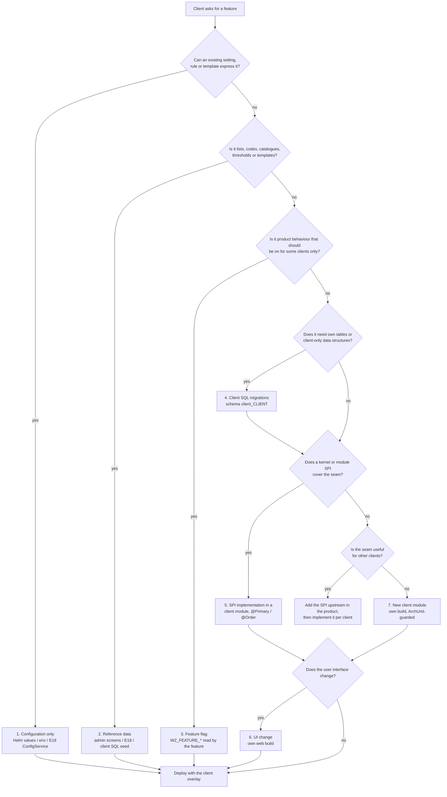
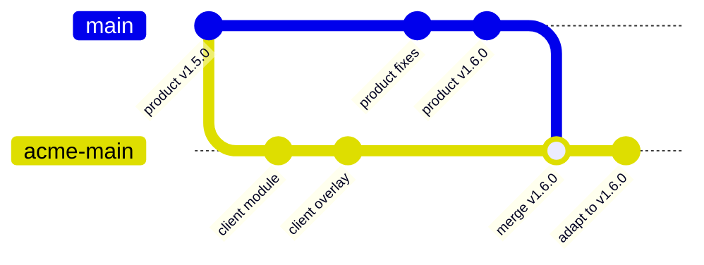

# WellnessZ OHCM – Client Customisation Guide

**Version 1.0**

*WellnessZ OHCM platform – increments 1–5*

| | |
|---|---|
| **Document** | Client Customisation Guide |
| **Audience** | Developers, technical leads, release managers and solution architects who deliver a client-specific feature for one client deployment; reviewers from Cyber GRC and the change advisory board (CAB) |
| **Scope** | Choosing the least invasive customisation mechanism, the client values overlay, feature flags, client database migrations, client Java code through SPIs, UI changes, branching and keeping up with product releases, testing, promotion through DEV / UAT / PROD, governance and SOC 2 evidence; a worked example from end to end |
| **Artefacts** | `deploy/helm/wellnessz/values.yaml` (`customisation:`), `deploy/helm/wellnessz/templates/_helpers.tpl` (client customisation helpers), `deploy/helm/wellnessz/templates/migration-job.yaml`, `deploy/helm/wellnessz/templates/configmap.yaml`, `apps/wz-core-app/src/main/java/com/wellnessz/app/ClientMigrationsConfig.java`, `deploy/scripts/helm-release.sh`, `.github/workflows/cd.yml`, `.github/workflows/deploy-env.yml`, `deploy/environments/README.md`, the kernel SPIs in `platform/wz-case-kernel/src/main/java/com/wellnessz/casekernel/support/` |
| **Related** | [Developer Guide](../architecture/03-Developer-Guide.md) · [CI/CD Guide](../cicd/CI-CD-Guide.md) · [Developer Environment & IDE Setup Guide](../developer-setup/README.md) · [Deployment environments](../../deploy/environments/README.md) · [Security & SOC 2 Control Mapping](../architecture/02-Security-and-SOC2-Control-Mapping.md) |

> **What is and is not supported today (read this first).**
>
> | Mechanism | Status |
> |---|---|
> | Client values overlay (`deploy/clients/<client>/values.yaml` through `EXTRA_VALUES_FILES`) | **Implemented** – layered last by `helm-release.sh`, used by `deploy-env.yml` for every stage |
> | `customisation.client` → `WZ_CLIENT_ID` and the label `wellnessz.io/client` | **Implemented** |
> | Feature flags `customisation.featureFlags` → `WZ_FEATURE_<NAME>` on core and BFF | **Plumbing only.** The variables reach both containers, and a change restarts the pods (config checksum). **No product feature reads a `WZ_FEATURE_*` variable yet.** A client feature must read its own flag (section 5). |
> | Client Flyway migrations in an own schema with an own history table | **Implemented** – image or ConfigMap source, `migrations.mode=job` (Helm Job step `flyway-client`) or `migrations.mode=app` (`ClientMigrationsConfig`) |
> | `core.extraEnv` / `bff.extraEnv` (raw Kubernetes `EnvVar` list) | **Implemented** |
> | Client Java code (an SPI implementation, a client module) | **Supported through an own build only:** a client module in the Maven build of a client fork or client branch, built, scanned and signed by the same pipeline (section 7) |
> | Mounting client extension JARs into the signed core image at deploy time (plug-in directory, `loader.path`, sidecar JARs) | **Not implemented.** There is no plug-in class loader and the core image is immutable and signed. Do not try to add JARs through volumes or `extraEnv`. |
> | Client-specific UI (branding, extra screens) | **Own build only:** the four web apps are static bundles compiled at build time; there is no runtime theming or plug-in API (section 8) |

## Contents

1. [Principles](#1-principles)
2. [Decision tree: which mechanism?](#2-decision-tree-which-mechanism)
3. [The client overlay](#3-the-client-overlay)
4. [Configuration and reference data](#4-configuration-and-reference-data)
5. [Feature flags](#5-feature-flags)
6. [Client database migrations](#6-client-database-migrations)
7. [Client Java code: SPI implementations and client modules](#7-client-java-code-spi-implementations-and-client-modules)
8. [UI changes](#8-ui-changes)
9. [A new module for one client](#9-a-new-module-for-one-client)
10. [Branching strategy for client-specific code](#10-branching-strategy-for-client-specific-code)
11. [Testing](#11-testing)
12. [Promotion through DEV, UAT and PROD](#12-promotion-through-dev-uat-and-prod)
13. [Governance: change request, security review, SOC 2 evidence](#13-governance-change-request-security-review-soc-2-evidence)
14. [Worked example: a client-specific SMS notification gateway](#14-worked-example-a-client-specific-sms-notification-gateway)
15. [Checklists](#15-checklists)

---

## 1. Principles

1. **One product, many deployments.** Every client runs the same signed images and the same Helm chart. Client
   differences live in values files, configuration data, SQL in a client schema and – only where unavoidable – a client
   module built on top of a product release.
2. **Least invasive first.** Prefer configuration over data, data over flags, flags over code, an SPI implementation
   over a change to product code, and a product change made upstream for everyone over a client-only fork delta.
3. **Never weaken the product's controls.** Client code obeys the same rules as product modules: disclosure levels,
   `RESTRICTED_CLINICAL` handling, content-free notifications, small-cell suppression, audit, outbound allow-lists,
   `ENC(...)` / `file:` secrets, ArchUnit boundaries, SpotBugs / FindSecBugs, CodeQL, Trivy.
4. **Same pipeline, same evidence.** A client release is promoted DEV → UAT → PROD by signed digest with the same
   approvals and smoke tests as a product release. There is no "quick path" for client changes.
5. **Client data stays in client structures.** Client tables live in `client_<client>`; client Flyway versions live in
   `flyway_schema_history_client`; nothing is added to product schemas or the product history table.

## 2. Decision tree: which mechanism?



| # | Mechanism | Typical examples | Needs a fork / own build? | Where it lives | Section |
|---|---|---|---|---|---|
| 1 | **Configuration only** | Host names, IdP, MFA roles, notification quiet hours, SLA values, analytics minimum group size, module enablement, connector endpoints | No | Client overlay (`deploy/clients/<client>/values.yaml`), E18 `ConfigService`, environment variables | 3, 4 |
| 2 | **Reference data** | Triage protocols, intake rules, fitness standards, job-demand profiles, surveillance programmes, testing policies and cut-offs, travel recommendations, campaign templates, document templates, retention classes | No (admin screens / E18) – or a client SQL seed (section 6) for bulk loads | Product admin screens and configuration tables; client seed migrations | 4 |
| 3 | **Feature flag** | Switch a client feature (or, once a product feature reads it, a product behaviour) on per client and per environment | No for the flag itself – but the code that reads it is product code or client code | `customisation.featureFlags` | 5 |
| 4 | **Client SQL migrations** | Client-only tables, views for a client report, client lookup data | No | `client_<client>` schema, image or ConfigMap with `V<n>__*.sql` | 6 |
| 5 | **SPI implementation** | A client's own SMS / e-mail gateway, laboratory or EAP connector, insurer or authority submission, a support-programme referral variant | **Yes** – a client module in an own build | `modules/wz-client-<client>` in the client fork | 7 |
| 6 | **UI change** | Logo and colours, an extra screen for a client feature, a client-specific wording | **Yes** – own web build | Client fork of the web app(s) | 8 |
| 7 | **New module** | A capability no product module covers and that no other client needs | **Yes** | Client fork; ArchUnit rules for the client package | 9 |

Two questions are asked of every request before any of the above: **"Would other clients benefit?"** – then it is a
product enhancement, built upstream through the normal product backlog (CI/CD Guide, section 10.5), possibly behind
a feature flag. **"Does it touch restricted classes, consent, disclosure or suppression?"** – then the security review
in section 13 is mandatory regardless of the mechanism.

## 3. The client overlay

Every client deployment has one small values file that is layered **last**, after the chart defaults, the cloud
values and the environment overlay. `deploy/scripts/helm-release.sh upgrade` builds the stack as:

```text
deploy/helm/wellnessz/values.yaml
  -> deploy/helm/wellnessz/values-<cloud>.yaml                (azure | gcp | hybrid)
  -> deploy/helm/wellnessz/environments/<cloud>/<env>.yaml    (dev | uat | prod)
  -> $EXTRA_VALUES_FILES                                      (space separated, in order – client overlay)
  + --set-string <component>.image.digest=<promoted digest>   (always wins)
```

### 3.1 Where the overlay lives

The directory `deploy/clients/` does not exist in the product repository until the first client overlay is added.
Choose one of two layouts and record the choice in the client's runbook:

| Layout | When | Path | Notes |
|---|---|---|---|
| **A – managed in the product repository** | The product team operates the client's environments and the overlay contains no client-confidential information | `deploy/clients/<client>/values.yaml` (+ optional `values-<env>.yaml`) | Add `/deploy/clients/<client>/  @OWNER/wellnessz-platform @OWNER/<client-delivery-team>` to `CODEOWNERS`. The overlay must not contain secrets, personal data or anything the client regards as confidential. |
| **B – in the client fork / deployment repository** | Client code exists (sections 7–9), or the client operates its own environments, or the overlay is confidential | `deploy/clients/<client>/values.yaml` in `OWNER/wellnessz-<client>` | The fork runs the same `cd.yml` / `deploy-env.yml`; see section 10 |

Per environment, set the GitHub Environment variable `EXTRA_VALUES_FILES` (for example on `azure-uat`:
`deploy/clients/acme/values.yaml deploy/clients/acme/values-uat.yaml`). `helm-release.sh` stops with
`extra values file … not found` if a listed file is missing, so a typo fails the deployment before anything changes.

### 3.2 What an overlay contains

```yaml
# deploy/clients/acme/values.yaml – client "acme", all environments
customisation:
  client: acme                        # WZ_CLIENT_ID=acme on core + bff, label wellnessz.io/client=acme
  featureFlags:                       # -> WZ_FEATURE_<NAME> on core and bff (section 5)
    acme-sms-gateway: true            #    WZ_FEATURE_ACME_SMS_GATEWAY="true"
  migrations:                         # client SQL (section 6)
    enabled: true
    image:
      repository: wz-client-acme-migrations    # relative to global.imageRegistry, or a full reference
      digest: sha256:<64 hex>                  # required in uat/prod (global.requireImageDigests)
core:
  extraEnv:                           # raw EnvVar list – technical settings without a dedicated value
    - name: WZ_ANALYTICS_MIN_GROUP
      value: "7"                      # client policy: suppress groups below 7 instead of 5
```

Rules for the overlay:

* `customisation.client` must match `^[a-z][a-z0-9-]{0,30}$` (`values.schema.json`); the default client schema is
  derived from it (`acme` → `client_acme`, hyphens become underscores).
* Feature flag names must match `^[A-Za-z][A-Za-z0-9_.-]*$`; values are booleans, strings or numbers.
* No secrets. A secret is delivered through the platform's secret mechanism (Key Vault / Secret Manager / Vault,
  CSI driver or External Secrets) and referenced as `file:/mnt/secrets/<name>` or as an `ENC(...)` value (Developer
  Guide, Section 11). `extraEnv` may point at a mounted secret file; it never carries the secret itself.
* Do not override security-relevant product settings (`WZ_MFA_REQUIRED_ROLES`, CORS origins, outbound allow-lists,
  disclosure or suppression settings) in a client overlay without the security review in section 13; a **lower**
  value than the product default for `WZ_ANALYTICS_MIN_GROUP` is never acceptable.
* Validate locally before the pull request:

  ```bash
  chart=deploy/helm/wellnessz
  d="sha256:$(printf '0%.0s' $(seq 64))"
  for env in dev uat prod; do
    helm lint "$chart" -f "$chart/values.yaml" -f "$chart/values-azure.yaml" -f "$chart/environments/azure/$env.yaml" \
      -f deploy/clients/acme/values.yaml \
      --set-string core.image.digest=$d --set-string bff.image.digest=$d \
      --set-string employeePortal.image.digest=$d --set-string managerWorkspace.image.digest=$d \
      --set-string ohWorkspace.image.digest=$d --set-string partnerPortal.image.digest=$d
  done
  helm template wz "$chart" -f "$chart/values.yaml" -f "$chart/values-azure.yaml" \
    -f "$chart/environments/azure/dev.yaml" -f deploy/clients/acme/values.yaml | grep -E 'WZ_CLIENT_ID|WZ_FEATURE_'
  ```

## 4. Configuration and reference data

Most client requests are configuration. Use, in this order:

| Need | Mechanism | Change process |
|---|---|---|
| Technical setting per environment (URLs, intervals, sizes) | Environment variables defined in `application.yml` (`${WZ_…:default}`), set through the Helm `env` of the component or `extraEnv` in the client overlay | Pull request on the overlay; promoted with the release |
| Business setting changed by OH administrators without deployment (flags, SLA values, JSON form and rule definitions) | E18 `ConfigService` (`config.flag("…", false)`, `config.get("…")`), changed in the OH workspace configuration screens | Audited as `CONFIG_CHANGE`; approval per the client's configuration governance |
| Clinical and programme content (protocols, standards, surveillance programmes, testing policies, screening instruments, travel recommendations, PEP timers, campaign templates) | The product admin screens and their versioned tables | Clinical Governance / CMO / MRO / Legal sign-off **before go-live** (increment-5 content is configurable reference data that must be signed off per client) |
| Document and notification templates | Product templates (`DocumentTemplates`, `NotificationTemplates`); new templates are product changes | Notification wording must pass `ContentRules` – content-free nudges, no words such as *positive*, *result*, *drug*, *alcohol* |
| Bulk load of client reference data that no screen covers | Repeatable client seed migration in the client schema (section 6), or a one-off load through the admin API | Pull request with DBA and data-owner review; no personal data in migration scripts |

Do not copy client values into the product defaults in `application.yml` or `values.yaml`, and do not put business
configuration into Helm when an administrator should own it.

## 5. Feature flags

### 5.1 What the plumbing does

`customisation.featureFlags` is rendered by `wellnessz.customisationEnv` (`_helpers.tpl`) into the core and BFF
ConfigMaps:

| Values | Environment variable on core and BFF |
|---|---|
| `travel-health-v2: true` | `WZ_FEATURE_TRAVEL_HEALTH_V2="true"` |
| `acme.sms_gateway: true` | `WZ_FEATURE_ACME_SMS_GATEWAY="true"` |
| `campaignLimit: 3` | `WZ_FEATURE_CAMPAIGNLIMIT="3"` |

The name is upper-cased, every run of characters outside `A–Z0–9` becomes `_`, and leading / trailing `_` are
trimmed. Values are strings. Because the ConfigMap content feeds the `checksum/config` pod annotation, changing a flag
and running the pipeline restarts core and BFF in a rolling update – flags are **deploy-time** switches, not runtime
toggles. For a switch that OH administrators flip at runtime, use the E18 `ConfigService` instead.

### 5.2 What it does not do (honest statement)

**No product feature reads a `WZ_FEATURE_*` variable today.** Setting a flag for a product capability has no effect
until that capability is changed to read it. The flags exist so that a client feature – or a future product feature
built behind a flag – can be switched per client and per environment without a new image. The web apps do not see the
flags at all (they are static bundles); if a screen must react to a flag, the core or BFF must expose it through an
API (for example in `GET /api/v1/me`), which is a product change.

### 5.3 Reading a flag in client (or product) code

Spring exposes the operating-system environment as a property source, so the exact variable name can be used as a
placeholder. Prefer a condition, so that a disabled feature has no beans at all:

```java
// switch a whole configuration on or off
@Configuration(proxyBeanMethods = false)
@ConditionalOnProperty(name = "WZ_FEATURE_ACME_SMS_GATEWAY", havingValue = "true")
class AcmeSmsGatewayConfig { /* beans of the feature */ }

// or read the value where a branch is unavoidable
AcmeService(@Value("${WZ_FEATURE_ACME_SMS_GATEWAY:false}") boolean smsGatewayEnabled) { … }
```

Rules:

* Default **off** (`:false`) – an environment without the overlay behaves like the product.
* One flag per feature, named `<client>-<feature>` for client features, so flags of different clients never collide.
* Remove the flag and the dead branch once the feature is on everywhere it is wanted; record flag ownership and the
  planned removal date in the client's runbook.
* Test both states (section 11).

## 6. Client database migrations

### 6.1 How it works

| Aspect | Behaviour |
|---|---|
| Order | Product migrations (`classpath:db/migration`, `V1`–`V20` after increment 5) run first; the client migrations run as a **second Flyway pass** afterwards |
| Schema | `customisation.migrations.schemas`, default `client_<client>` (`ClientMigrationsConfig` default `client_ext` when the application is configured without Helm). Flyway creates the schema (`createSchemas=true`) as the migrator, which owns the database |
| History | Own table `flyway_schema_history_client` (`customisation.migrations.table`) in the first client schema – client versions never collide with product versions, and product upgrades never see client scripts |
| Credentials and placeholders | Same data source, migrator user and placeholders as the product pass, including `${app_role}` for grants |
| Isolation | Product Java migrations, callbacks and resource providers are explicitly **not** inherited by the client pass |
| Source | **Image** (`customisation.migrations.image`, SQL under `path`, default `/client/db/migration`; the image needs `sh` and `cp`) **or** **ConfigMap** (`customisation.migrations.configMap`, keys `V<n>__<desc>.sql`) – exactly one; the chart fails rendering otherwise |
| `migrations.mode=job` (UAT / PROD) | The pre-install / pre-upgrade migration Job copies the client SQL with an init container (`copy-client-migrations`) and runs an extra init step `flyway-client` after `flyway-core`. A failure fails the Helm release before any pod is replaced |
| `migrations.mode=app` (DEV / local) | The SQL is copied into a volume mounted at `customisation.migrations.mountPath` (default `/opt/wellnessz/client-migrations`) in the core pod; the ConfigMap sets `WZ_FLYWAY_EXTRA_LOCATIONS=filesystem:<mountPath>`, `WZ_FLYWAY_CLIENT_SCHEMAS` and `WZ_FLYWAY_CLIENT_TABLE`; `ClientMigrationsConfig` replaces the Flyway migration strategy with "product, then client" |

Locally (no Helm) the same pass is enabled with environment variables on the core:

```bash
export WZ_FLYWAY_EXTRA_LOCATIONS=filesystem:$PWD/client/acme/db/migration
export WZ_FLYWAY_CLIENT_SCHEMAS=client_acme
export WZ_FLYWAY_CLIENT_TABLE=flyway_schema_history_client
./mvnw -pl apps/wz-core-app spring-boot:run -Dspring-boot.run.profiles=local
```

### 6.2 Writing client migrations

```sql
-- V1__acme_sms_delivery.sql (client schema client_acme; Flyway sets it as the default schema)
create table sms_delivery_log (
    id              uuid primary key,
    notification_id uuid         not null,          -- platform notification id; no address, no body
    provider_ref    varchar(80),
    status          varchar(20)  not null check (status in ('ACCEPTED','DELIVERED','FAILED')),
    created_at      timestamptz  not null
);
create index ix_sms_delivery_notification on sms_delivery_log (notification_id);

grant usage on schema client_acme to ${app_role};
grant select, insert, update on sms_delivery_log to ${app_role};
```

| Rule | Why |
|---|---|
| Number client scripts from `V1` in their own sequence; never reuse or edit an applied version | Own history table; checksums |
| Only objects in the client schema. Never `alter` / `insert` into product schemas (`platform`, `casemgmt`, `mentalhealth`, …) | Product upgrades own those schemas; a client change there breaks the next product migration and voids support |
| Read product data through product APIs or SPIs, not through cross-schema views or foreign keys | Product tables change between releases; restricted-class tables must never be joined into client structures |
| `grant usage on schema` plus least-privilege table grants to `${app_role}` | The runtime role has no default privileges |
| Expand / contract, no long locks, no personal data in scripts | Same as product migrations (CI/CD Guide, section 8) |
| Demo or test data only in a separate location loaded in `local` / `test` | Never in UAT / PROD |

### 6.3 Packaging

**Image (recommended for UAT / PROD).** A tiny image that only holds SQL, built, scanned and signed like any other
image in the client pipeline:

```dockerfile
# client/acme/migrations/Dockerfile
FROM busybox:1.37.0-musl@sha256:<digest>          # provides sh and cp; pin by digest
COPY db/migration/ /client/db/migration/
USER 65532:65532
```

Push it to the **environment registry** of every stage and pin it by digest in the overlay. Two consequences of the
current pipeline must be handled by the client pipeline, because `deploy-env.yml` signs, verifies and copies only the
six product images:

* sign it with cosign and copy it to each environment registry (the same `cosign copy` used for product images);
* on GKE with Binary Authorization **enforced** (UAT, PROD) create an attestation for its digest as well – otherwise
  the migration Job's pod is refused at admission and the release fails.

**ConfigMap (DEV, small sets).** Create it in the release namespace before the deployment and reference it:

```bash
kubectl -n wellnessz create configmap acme-migrations --from-file=client/acme/db/migration/ \
  --dry-run=client -o yaml | kubectl apply -f -
```

The copy step takes `*.sql` only (it skips the ConfigMap's internal symlinks). A ConfigMap is not signed; use it only
where an image is not required by policy (DEV), and keep the SQL in Git as the source of truth.

## 7. Client Java code: SPI implementations and client modules

### 7.1 Why an own build

Client Java code runs inside the core process, so it must be compiled, tested, scanned and signed together with the
product. Mounting extension JARs into the core image at deploy time is **not implemented** (no plug-in class loader;
read-only root file system; the running image must match the promoted, signed digest – `helm-release.sh smoke`
checks exactly that). The supported route is a **client module in the Maven build** of a client fork or client branch
(section 10): the fork's `container.yml` builds an own `wz-core-app` image that contains the product plus the client
module, and the fork's `cd.yml` promotes that image.

### 7.2 Seams you can implement

`WellnessZCoreApplication` sits in package `com.wellnessz`, so component, entity and repository scanning pick up any
module below `com.wellnessz` – use `com.wellnessz.client.<client>`. Implement an existing interface; do not patch
product classes.

| SPI | Package / module | Injection in the product | How a client implementation wins |
|---|---|---|---|
| `NotificationChannel` (SMS / push / e-mail delivery) | `com.wellnessz.notification.channel` (`platform/wz-notification`) | `List<NotificationChannel>`; `NotificationService` takes the **first** channel whose `channel()` matches | `@Order(Ordered.HIGHEST_PRECEDENCE)` (list order); optionally switch off the logging stand-ins with `wellnessz.notification.dev-channels=false`. `@Primary` has no effect on a list |
| `ClaimsSubmissionGateway` (insurer / authority submission) | `com.wellnessz.e08.report` | single bean (`DefaultClaimsSubmissionGateway`) | `@Primary` |
| `TelehealthProvider`, `EPrescribingGateway` | E04 | single bean, default `@ConditionalOnMissingBean` | Declare the bean – the default backs off |
| `AbsenceFeedConnector` | E06 | single bean, default no-op | Declare the bean (see Developer Guide, Section 16.5) |
| `SupportProgrammeReferral` (increment 5) | kernel | `ObjectProvider<SupportProgrammeReferral>.orderedStream().findFirst()` in E10 | `@Order(Ordered.HIGHEST_PRECEDENCE)` **and** `@Primary`; prove it with an integration test |
| `ExternalReferralGateway`, `CaseCostRecorder`, `ClaimContextProvider`, `AppointmentBooking` | kernel | `ObjectProvider<…>` (`getIfAvailable()` / all beans) | `@Primary` for `getIfAvailable()`; for "all beans" consumers the client bean is **added** to the product one – check the consumer before relying on replacement |
| `CaseTransitionGuard`, `ChartContributor`, `FitnessClearanceGuard`, `DeviceCalibrationCheck` | kernel | `List<…>` – every bean is called | Add a bean; it runs **in addition** to the product beans (a guard can only add restrictions) |
| Listeners: `AppointmentStatusListener`, `ReferralStatusListener`, `ResultFollowUpListener`, `AbsenceSignalListener`, `FitnessPublicationListener` | kernel | all beans, filtered by `supports(...)` | Add a bean with a client-specific `supports(...)` |
| In-process domain events (`EventBus`) and outbox events | platform | subscribers | Subscribe idempotently (Developer Guide, Section 6.4); publish to an enterprise destination only through an allow-listed connector |

Replacement semantics differ by injection style, so the integration test in section 11 must assert that the client
bean is the one that is actually used.

### 7.3 Client module layout

```text
modules/wz-client-acme/
  pom.xml                       parent wellnessz-parent; depends on wz-common, wz-security, wz-notification,
                                wz-case-kernel (SPIs) – never on another business module's internals
  src/main/java/com/wellnessz/client/acme/
    AcmeClientModule.java       optional: @Configuration guarded by the client's feature flag
    sms/AcmeSmsChannel.java     SPI implementation
  src/main/resources/           no db/migration here – client SQL goes to the client migrations (section 6)
  src/test/java/…               unit tests
```

Register it in the fork's root `pom.xml` (`<modules>` and `<dependencyManagement>`) and as a dependency of
`apps/wz-core-app/pom.xml`. Keep that diff as small as possible – these three lines are the fork delta that every
product upgrade must carry.

### 7.4 Rules for client code

Everything in the Developer Guide applies (Sections 4–12, and Section 18 for restricted classes). In particular:

* Personal data only through product services that enforce disclosure levels (`PolicyEngine`, status-only
  projections). Never read restricted-class (`RESTRICTED_CLINICAL`) content in client code; a client feature that
  needs it is a product change with Clinical Governance and DPO approval.
* Notifications only through approved, content-free templates; client channels transport the rendered body, they do
  not compose clinical text.
* Outbound calls only to destinations catalogued in `ConnectorRegistry` and allow-listed; credentials as `ENC(...)` /
  `file:`; TLS verification on.
* Log identifiers and exception class names only (`LogSanitizer.clean(...)`); no `System.out` / `System.err`
  (ArchUnit `noStandardStreams` covers client packages automatically).
* Audit client actions with `AuditService` (actor `MODULE` for automated actions).

## 8. UI changes

The employee app, manager workspace, OH workspace and partner portal are React 19 / Vite bundles served by
nginx-unprivileged. Branding (the `brand` elements in each `App.tsx` and `styles.css`) and screens are compiled in;
there is no runtime theme or plug-in API, and `WZ_FEATURE_*` flags are not visible to the browser.

| Change | Route |
|---|---|
| Logo, colours, product name for one client | Client fork of the affected web app(s); change `styles.css` / the brand component only; same CSP (no inline styles or scripts) |
| An extra screen for a client feature | Client fork; route and navigation entry guarded by the role from `GET /me`; BFF path must already be proxied (the BFF only forwards allow-listed paths – a new path is a product change in `apps/wz-bff/.../ApiProxyController.java` or a fork delta) |
| Wording change | Client fork, or – preferably – a product change that moves the text into configuration |
| A screen that reacts to a feature flag | Product change: expose the flag through an API first (section 5.2) |

The forked app is built and released through the fork's `ci.yml` (lint with 0 warnings, Vitest, build, `npm audit`)
and `container.yml` (Trivy, SBOM, provenance, cosign). If a UI change would help other clients, raise it upstream.

## 9. A new module for one client

Only when no product module and no SPI covers the capability, and no other client would use it:

1. Create `modules/wz-client-<client>` in the fork (section 7.3) – or, if the capability is a genuine product
   capability, a product module through the product checklist (CI/CD Guide, section 10.5) behind a feature flag.
2. Own tables in `client_<client>` (section 6); register a `CaseModule` only if the client module owns case types.
3. Own REST endpoints under `/api/v1/client/<client>/…` with `@PreAuthorize` and the API conventions of the
   Developer Guide, Section 8; regenerate the fork's OpenAPI contract.
4. BFF: add the path to the fork's BFF allow-list; web: add the screens to the fork's app (section 8).
5. ArchUnit rules for the client package (section 11.1), integration tests on `IntegrationTestBase`, an E2E script
   `tools/e2e/e2e-client-<client>.js`.
6. Roles: realm roles and the scope mappings of `wellnessz-bff` / `wellnessz-mobile` in the client's IdP; Entra ID app
   roles if Entra ID is used.

## 10. Branching strategy for client-specific code

The product uses trunk-based development on `main` with short-lived branches (CI/CD Guide, section 1). Client code
must not turn the product repository into a set of long-lived branches.

### 10.1 Options

| Option | Use when | How |
|---|---|---|
| **No client code** (sections 3–6) | Configuration, data, flags read by product code, client SQL | Product release + client overlay; no fork |
| **Client fork** `OWNER/wellnessz-<client>` (recommended for client code) | Any client Java or UI code | Fork of the product repository with the same workflows, rulesets and environments; the client module and client overlay live there |
| Client branch `client/<client>/main` in the product repository | Short-term only (pilot, proof of concept), when a fork is not yet set up | Same rules as a fork; protected like `main`; migrate to a fork before the first PROD release |

### 10.2 Keeping up with product releases



1. Add the product as `upstream`: `git remote add upstream https://github.com/OWNER/WellnessZ.git`; fetch with
   `git fetch upstream --no-tags` so product tags do not collide with the fork's own release tags.
2. For every product release `vX.Y.Z`, open a pull request in the fork that merges the product tag's commit
   (`git merge <commit of upstream vX.Y.Z>`) into the fork's `main`. Resolve the fork delta (root `pom.xml`, core app
   `pom.xml`, any BFF allow-list or web change), run all gates, and record the product version in the fork's release
   notes.
3. Follow product releases within one minor version; security releases of the product are merged within the patch
   SLA (critical 7 days, high 30 days – doc 02, Section 10).
4. The fork tags its own releases with the same scheme the pipeline accepts (`vX.Y.Z-rc.N`, `vX.Y.Z`; `cd.yml` rejects
   other patterns). Use the fork's own version line and map it to the product version in the release notes. Changing
   the accepted tag pattern is a pipeline change that needs Code Owner (platform and security) review.
5. Images built in the fork are signed with the fork's workflow identity; `cd.yml` and `deploy-env.yml` verify against
   `github.repository`, so verification works unchanged in the fork.

### 10.3 Upstreaming

* Anything generic – a bug fix, a new SPI, a configuration option, a UI improvement – is contributed to the product
  as a pull request against product `main`, not kept in the fork.
* If a client needs a seam that does not exist, add the **SPI upstream first** (kernel or module SPI with a default
  that keeps current behaviour, documented in the Developer Guide), release it, then implement it in the client
  module. This keeps the fork delta at "client module + registration".
* Never cherry-pick product code into the fork with modifications; merge product releases as a whole.

## 11. Testing

### 11.1 ArchUnit rules a client module must respect

The product's `ArchitectureTest` (`apps/wz-core-app/src/test/java/com/wellnessz/app/ArchitectureTest.java`, 22 rules
after increment 5) must stay green in the fork. Of these, `noStandardStreams` applies to client packages
automatically; the others name product packages only. Add these rules for each client package in the fork:

```java
@ArchTest
static final ArchRule productDoesNotDependOnClientCode = noClasses()
        .that().resideOutsideOfPackage("com.wellnessz.client..")
        .should().dependOnClassesThat().resideInAPackage("com.wellnessz.client..")
        .because("product code must build and run without any client module");

@ArchTest
static final ArchRule clientCodeUsesPlatformAndSpisOnly = noClasses()
        .that().resideInAPackage("com.wellnessz.client.acme..")
        .should().dependOnClassesThat().resideInAnyPackage(
                "com.wellnessz.e01..", "com.wellnessz.e02..", "com.wellnessz.e03..", "com.wellnessz.e04..",
                "com.wellnessz.e05..", "com.wellnessz.e06..", "com.wellnessz.e07..", "com.wellnessz.e08..",
                "com.wellnessz.e09..", "com.wellnessz.e10..", "com.wellnessz.e11..", "com.wellnessz.e12..",
                "com.wellnessz.e14..", "com.wellnessz.casekernel.model..")
        .because("client code plugs in through platform services and kernel / module SPIs, never module internals");

@ArchTest
static final ArchRule clientsAreIndependent = noClasses()
        .that().resideInAPackage("com.wellnessz.client.acme..")
        .should().dependOnClassesThat(JavaClass.Predicates.resideInAPackage("com.wellnessz.client..")
                .and(JavaClass.Predicates.resideOutsideOfPackage("com.wellnessz.client.acme..")))
        .because("one client's code never depends on another client's code");
```

Adjust the second rule where a module SPI lives in a module package: implementing
`com.wellnessz.e08.report.ClaimsSubmissionGateway`, for example, needs that one type. Allow exactly that type with a
predicate (`dependOnClassesThat(resideInAnyPackage(…).and(not(type(ClaimsSubmissionGateway.class))))`) rather than
opening the whole package. Restricted programmes
(`com.wellnessz.e09..`, `com.wellnessz.e10..`) are never a dependency of client code.

### 11.2 Integration and unit tests

* Unit tests for every pure rule in the client module.
* An integration test on the product's `IntegrationTestBase` (`apps/wz-core-app/src/test/java/com/wellnessz/app/`),
  for example `ClientAcmeIntegrationTest`, covering at least: the client bean is the one used (section 7.2); the
  feature flag **off** behaves like the product; the client migration ran (`flyway_schema_history_client` row,
  tables present) and the runtime role has only the granted privileges; disclosure / suppression / audit
  expectations of the touched flows; negative tests (wrong role → `403` / `404`).
* Set the flag for the test with `@TestPropertySource(properties = "WZ_FEATURE_ACME_SMS_GATEWAY=true")` and the client
  migrations with `wellnessz.flyway.client.locations=filesystem:…`.
* With a persistent `WZ_TEST_DB_URL` database, recreate it before every run (CI/CD Guide, section 3.3).

### 11.3 End-to-end tests

* Run **all product E2E scripts** (`tools/e2e/e2e.js`, `e2e-increment1.js` … `e2e-increment5.js` – 121 checks) against
  the client build with the client overlay; a client change must not break a product flow.
* Add `tools/e2e/e2e-client-<client>.js` for the client feature (real IdP login through the BFF, screenshots into
  `docs/images/screens/client-<client>/` in the fork).

### 11.4 Quality gates

Exactly the product gates (CI/CD Guide, section 3): `./mvnw verify`, SpotBugs + FindSecBugs (`-Psecurity`, 0
findings), OWASP dependency-check (CVSS ≥ 7), CodeQL, gitleaks, Trivy config and image scans, `helm lint` /
`template` including the client overlay, eslint with 0 warnings and Vitest for changed web apps.

## 12. Promotion through DEV, UAT and PROD

Client releases use the product promotion flow unchanged (`cd.yml` → `deploy-env.yml`, see CI/CD Guide, section 7
and `deploy/environments/README.md`):

| Stage | Trigger | Images | Client overlay | Approval | Migrations |
|---|---|---|---|---|---|
| DEV | merge to `main` (fork or product) | `sha-<12>`, verified signatures | `EXTRA_VALUES_FILES` on `<cloud>-dev` | automatic | `mode=app` – client pass in the core (`ClientMigrationsConfig`) |
| UAT | tag `vX.Y.Z-rc.N` | same digests as DEV | `EXTRA_VALUES_FILES` on `<cloud>-uat` | required reviewers (client acceptance lead + QA) | `mode=job` – `flyway-client` Job step |
| PROD | tag `vX.Y.Z` | same digests as UAT (`global.requireImageDigests`) | `EXTRA_VALUES_FILES` on `<cloud>-prod` | required reviewers (CAB, prevent self-review) | `mode=job` |

Every stage verifies cosign signatures, copies by digest, creates Binary Authorization attestations on GKE, runs
`helm upgrade --install --atomic`, smoke-tests (rollout, running digests, `SMOKE_URLS`) and rolls back automatically
on a smoke failure. Client-specific points:

* A client migration image is **not** part of the six images the pipeline promotes: sign, copy and (on GKE) attest
  it in the client pipeline before the stage, and pin its digest in the overlay (section 6.3).
* Database migrations, including client migrations, are **forward-only**; an automatic Helm rollback does not undo
  them. Write client migrations expand / contract so the previous release still works.
* A flag change is a release of the overlay: it goes through a pull request and the same stage approvals; never
  `kubectl edit` a ConfigMap.
* Client acceptance happens in UAT with the client's test accounts; the UAT approval in the GitHub Environment is the
  recorded acceptance.

## 13. Governance: change request, security review, SOC 2 evidence

### 13.1 Change request

Every client customisation starts with a change request that records: client, requester and business owner;
mechanism chosen from section 2 and why a less invasive one is insufficient; data touched (classification, restricted
classes, personal data, retention class); new outbound destinations; affected roles and disclosure levels;
environments and target dates; rollback / switch-off plan (usually the feature flag); whether the change should be
upstreamed.

### 13.2 Security and privacy review

Mandatory, before UAT, for any client change that: adds or replaces an SPI implementation; adds an outbound connector,
host or credential; adds tables holding personal data; touches restricted classes, consent, disclosure, suppression,
MFA, notifications or audit; changes the BFF allow-list; or overrides a security-relevant setting in the overlay. The
review covers the STRIDE threat model extension (doc 02, Section 7), DPIA screening by the DPO, the connector
catalogue and allow-list entry, and – for clinical content – Clinical Governance sign-off.

### 13.3 SOC 2 change-management evidence

| Evidence (TSC) | Source for a client change |
|---|---|
| Change request linked to the PR (CC8.1) | Ticket reference in the PR template and commits of the fork / overlay PR |
| Independent review, Code Owner approval (CC8.1) | PR reviews; `CODEOWNERS` entries for `deploy/clients/<client>/` and `modules/wz-client-<client>/` |
| Tests and scans passed (CC7.1, CC8.1) | Required status checks of the fork's ruleset (same contexts as the product) |
| Security / privacy review (CC3.2, CC7.1, P-series) | Review record attached to the change request; DPO sign-off for new personal data or connectors |
| Approved deployment, only the tested artefact (CC8.1) | GitHub Environment deployment history (approver, time); identical digests across stages; `cosign verify` log; Binary Authorization attestations |
| Database changes controlled (CC8.1) | `flyway_schema_history_client` in the client schema + migration PR |
| Configuration changes controlled (CC8.1) | Overlay PR history; `CONFIG_CHANGE` audit events for E18 changes |
| Functional acceptance (CC8.1) | Product E2E logs (121 checks) plus the client E2E log and screenshots attached to the release record; UAT approval |
| Third-party components (CC7.1, CC9.2) | SBOM of the fork's images; dependency-check results for any library the client module adds |

## 14. Worked example: a client-specific SMS notification gateway

**Request.** Client *acme* wants SMS notifications (urgent call-backs, contact-tracing notices, appointment reminders)
delivered through its own contracted SMS gateway, with a delivery log for its service desk. Other clients keep the
product behaviour. Decision (section 2): an SPI implementation (`NotificationChannel`) in a client module, a client
table for the delivery log, a feature flag to switch it per environment.

### 14.1 Change request and design review

* Data: the gateway receives a phone number and a **content-free** rendered body (product templates pass
  `ContentRules`); the delivery log stores the platform notification id, provider reference and status only – no
  number, no body. Classification CONFIDENTIAL, retention per the client's policy.
* New outbound destination `acme-sms` (catalogued in `ConnectorRegistry`, allow-listed, DPO approval); credentials in
  the client's Key Vault, mounted as a file.
* Security review: TLS, credential handling, logging, failure behaviour (the platform retries failed notifications
  after five minutes).

### 14.2 Client fork and module

```bash
gh repo fork OWNER/WellnessZ --org OWNER --fork-name wellnessz-acme --clone
cd wellnessz-acme && git remote add upstream https://github.com/OWNER/WellnessZ.git && git fetch upstream --no-tags
git switch -c feature/ACME-12-sms-gateway
mkdir -p modules/wz-client-acme/src/main/java/com/wellnessz/client/acme/sms
```

`modules/wz-client-acme/pom.xml` depends on `wz-common` and `wz-notification`. Register it in the root `pom.xml` and
`apps/wz-core-app/pom.xml` (section 7.3).

### 14.3 SPI implementation behind the flag

```java
package com.wellnessz.client.acme.sms;

@Configuration(proxyBeanMethods = false)
@ConditionalOnProperty(name = "WZ_FEATURE_ACME_SMS_GATEWAY", havingValue = "true")
@EnableConfigurationProperties(AcmeSmsProperties.class)
class AcmeSmsConfig {

    /** Wins over the logging stand-in: NotificationService takes the first SMS channel in list order. */
    @Bean
    @Order(Ordered.HIGHEST_PRECEDENCE)
    NotificationChannel acmeSmsChannel(AcmeSmsClient client, SmsDeliveryLogRepository log, Clock clock) {
        return new AcmeSmsChannel(client, log, clock);
    }
}

final class AcmeSmsChannel implements NotificationChannel {

    private static final Logger LOG = LoggerFactory.getLogger(AcmeSmsChannel.class);
    private final AcmeSmsClient client;               // HTTPS client to the allow-listed acme-sms endpoint
    private final SmsDeliveryLogRepository log;
    private final Clock clock;

    AcmeSmsChannel(AcmeSmsClient client, SmsDeliveryLogRepository log, Clock clock) {
        this.client = client;
        this.log = log;
        this.clock = clock;
    }

    @Override
    public Channel channel() {
        return Channel.SMS;
    }

    @Override
    public void send(String address, String body) throws Exception {
        String providerRef = client.send(address, body);           // throws on failure -> platform retries
        log.save(SmsDeliveryLog.accepted(providerRef, clock.instant()));
        LOG.info("acme sms accepted ({} chars)", body.length());   // never the number or the body
    }
}
```

`AcmeSmsProperties` binds `wellnessz.client.acme.sms.base-url` and
`wellnessz.client.acme.sms.api-key` (`${WZ_ACME_SMS_API_KEY:}`, delivered as `file:/mnt/secrets/acme-sms-api-key`).
The JPA entity `SmsDeliveryLog` maps `@Table(schema = "client_acme", name = "sms_delivery_log")`. (The
`NotificationChannel.send` signature does not carry the notification id; if the service desk needs that link, propose
an upstream SPI extension instead of reading platform tables.)

### 14.4 Client table

`client/acme/db/migration/V1__acme_sms_delivery.sql` as in section 6.2, packaged in the image
`wz-client-acme-migrations` (section 6.3) and published by the fork's pipeline with cosign signature and, on GKE, a
Binary Authorization attestation.

### 14.5 Overlay

```yaml
# deploy/clients/acme/values.yaml (fork)
customisation:
  client: acme
  featureFlags:
    acme-sms-gateway: true
  migrations:
    enabled: true
    image:
      repository: wz-client-acme-migrations
      digest: sha256:<digest of the signed migration image>
core:
  extraEnv:
    - name: WELLNESSZ_NOTIFICATION_DEV_CHANNELS   # drop the logging stand-ins once the real gateway is live
      value: "false"
    - name: WZ_ACME_SMS_API_KEY
      value: file:/mnt/secrets/acme-sms-api-key
```

Mount the secret file through the chart's secret mechanism for core (`secrets.core.files` + the cloud secret store,
Terraform / External Secrets). For DEV a `values-dev.yaml` can set `acme-sms-gateway: false` until the client's test
gateway is available. With `WELLNESSZ_NOTIFICATION_DEV_CHANNELS=false` and the flag off, there would be **no** SMS
channel at all (notifications fail and retry) – switch both together.

### 14.6 Tests

* `AcmeSmsChannelTest` – success, provider failure propagates (so the platform retries), nothing sensitive logged.
* `ClientAcmeIntegrationTest` on `IntegrationTestBase` with `WZ_FEATURE_ACME_SMS_GATEWAY=true` and the client
  migration location: the SMS channel resolved by `NotificationService` is `AcmeSmsChannel` (stubbed client); a due SMS
  notification is sent and logged in `client_acme.sms_delivery_log`; with the flag off the product behaviour is
  unchanged; the runtime role cannot `delete` from the log table.
* `ArchitectureTest` with the client rules of section 11.1 – 22 product rules plus the client rules green.
* Product E2E 121/121 with the overlay; `e2e-client-acme.js` triggers an urgent call-back and checks the delivery log
  through the service-desk report.

### 14.7 Promotion

1. PR in the fork → CI green, Code Owner and security review → merge → DEV (automatic, `mode=app`, client pass in
   core). Check the client history table and a test SMS.
2. Tag `v1.0.0-rc.1` in the fork → UAT after approval (`flyway-client` Job step) → client acceptance with the client's
   test numbers; approval recorded.
3. Tag `v1.0.0` → PROD after CAB approval. Smoke tests verify the promoted digests; switching off = PR setting the
   flag to `false` (and the dev channels back on if no other SMS channel exists) through the same pipeline.
4. When product `v1.6.0` is released, merge it into the fork (section 10.2), rerun all gates, release the fork's next
   version.

## 15. Checklists

**Configuration / flag / client SQL only (no fork)**

- [ ] Change request with mechanism justification
- [ ] Overlay in `deploy/clients/<client>/` (CODEOWNERS entry), no secrets, schema-valid
- [ ] `helm lint` / `template` with the overlay for every environment
- [ ] `EXTRA_VALUES_FILES` set on each GitHub Environment
- [ ] Client migrations: own schema, grants to `${app_role}`, image signed / copied / attested (UAT, PROD)
- [ ] Flag read by the feature, default off, both states tested
- [ ] DEV → UAT (acceptance) → PROD (CAB) through `cd.yml`

**Client code (fork)**

- [ ] Everything above
- [ ] Fork `OWNER/wellnessz-<client>` with the product's rulesets, environments, required reviewers and Code Owners
- [ ] Client module under `com.wellnessz.client.<client>`, minimal fork delta
- [ ] SPI implementation wins as intended (integration test proves it)
- [ ] Client ArchUnit rules added; 22 product rules green
- [ ] Unit, integration, product E2E (121) and client E2E green; SpotBugs / FindSecBugs 0, CodeQL, Trivy, eslint clean
- [ ] Security and privacy review; connector allow-listed; DPO sign-off where personal data or destinations change
- [ ] Upstream candidates raised as product pull requests
- [ ] Product releases merged within one minor version; security releases within the patch SLA
