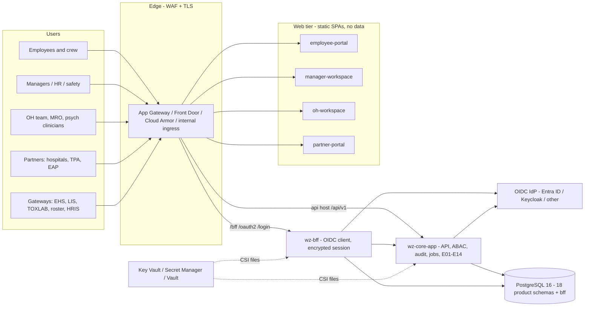
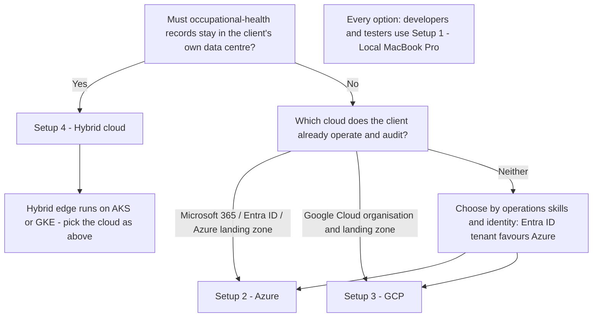
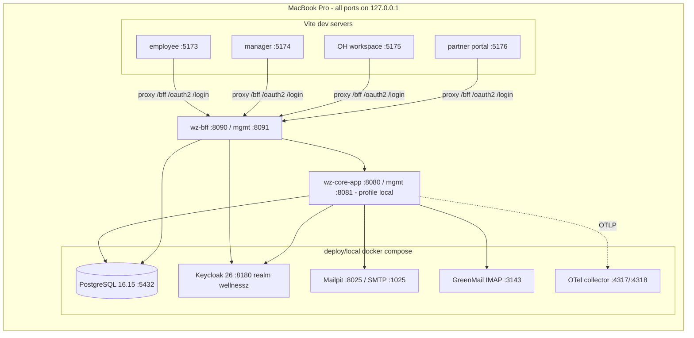
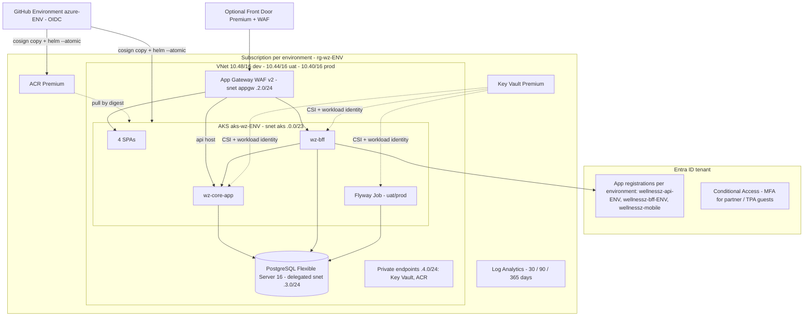
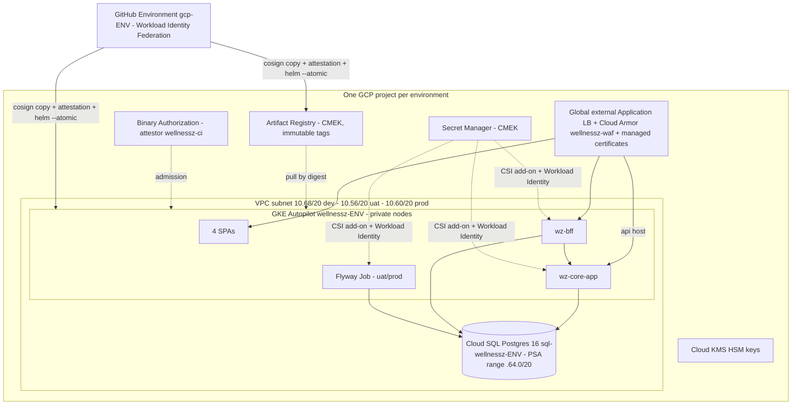
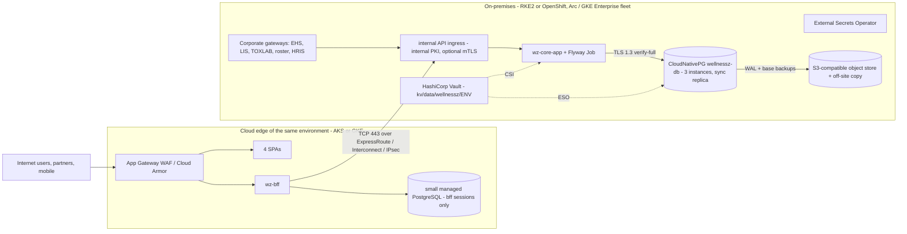
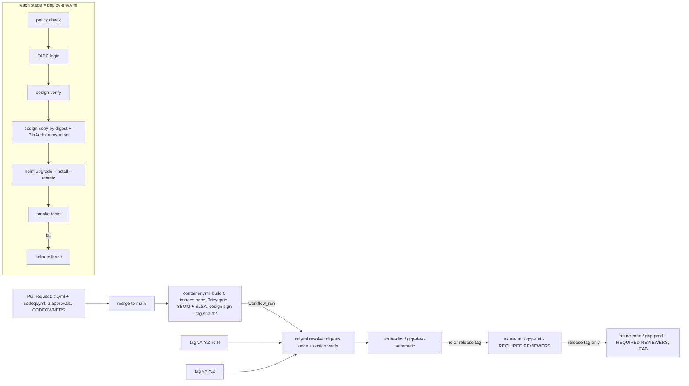

# WellnessZ OHCM – Deployment Architecture

**Version 1.0**

*WellnessZ OHCM platform – increments 1–5*

| | |
|---|---|
| **Document** | 04 – Deployment Architecture |
| **Version** | 1.0 (final, after increment 5 of 5) |
| **Audience** | CIO, Cyber GRC, infrastructure and cloud platform teams, auditors, the client's solution architect |
| **Scope** | The four client-selectable setups – Local MacBook Pro (unit and integration testing), Microsoft Azure DEV/UAT/PROD, Google Cloud DEV/UAT/PROD, Hybrid cloud DEV/UAT/PROD – and how releases move between DEV, UAT and PROD |
| **Artefacts** | `deploy/local`, `deploy/docker`, `deploy/helm/wellnessz` (incl. `environments/{azure,gcp,hybrid}/{dev,uat,prod}.yaml`), `deploy/terraform/azure` and `deploy/terraform/gcp` (incl. `environments/<env>.tfvars`, `environments/backend-<env>.hcl.example`), `deploy/hybrid`, `deploy/sql`, `deploy/scripts/helm-release.sh`, `deploy/environments/README.md`, `.github/workflows/{ci,container,cd,deploy-env}.yml` |
| **Authoritative environment matrix** | [`deploy/environments/README.md`](../../deploy/environments/README.md) – if this document and the matrix ever disagree, the matrix and the files it names win |
| **Companion documents** | 01 – Technology Architecture · 02 – Security & SOC 2 Control Mapping · [04 – Technology Standards Comparison by Layer](../architecture/04-Technology-Standards-Comparison-by-Layer.md) · 05–08 – Setup guides ([local](../setup/01-Local-MacBook-Pro.md), [Azure](../setup/02-Azure.md), [GCP](../setup/03-GCP.md), [hybrid](../setup/04-Hybrid-Cloud.md)) · 09 – CI/CD Guide |

This document describes **where** WellnessZ runs, **how** it is protected in each setup and **how** a release
travels from DEV through UAT to PROD. It is written for decision makers: every statement is backed by an artefact in
the repository. The setup guides contain the commands.

> **Status of validation.** The local setup is executed end to end at every increment: Docker Compose stack, real
> Keycloak logins through the BFF, core and BFF on a read-only root filesystem, Flyway in both migration modes and
> the database least-privilege checks. At the end of increment 5 this covered 450 Java tests, 1,373 web tests and
> 121 live end-to-end checks across the five increment scripts (18 + 25 + 32 + 22 + 24). The Helm chart renders and
> passes `helm lint` / kubeconform for **every cloud × environment overlay** (nine combinations, checked by the
> *IaC & config checks* job of `ci.yml`). Terraform passes `fmt` and `validate` for Azure and GCP with each
> `environments/<env>.tfvars`. The workflows pass actionlint. **Nothing has yet been applied to a real Azure
> subscription, GCP project or on-premises cluster**: the first DEV build of the chosen setup is also the acceptance
> test of the infrastructure code.
>
> **Increment 5** (E09 mental health & peer support, E10 drug & alcohol testing, E11 travel health & communicable
> disease, E12 health promotion) adds no new image, Helm component or host. It adds four schemas (`mentalhealth`,
> `substance`, `travelhealth`, `promotion`), eight roles, the duty-assignment feed, the restricted clinical class,
> the outbound allow-lists `campaign-app` and `sms-safety`, the EAP partner screens in the partner portal and the
> TOXLAB laboratory machine client. Section 21 lists the changes per environment. Increments 1–4 are in sections
> 17–20.

## 1. Reference deployment topology

All four setups share the same building blocks and **the same container images**. Only the platform services
around the cluster, and the size and protection level of each environment, change.

*Figure 1 – Reference deployment view (source: `docs/images/07-deployment-reference.svg`).*

| Building block | Implementation | Notes |
|---|---|---|
| **Employee portal / mobile PWA** | `web/employee-app` – static SPA in `nginx-unprivileged` (port 8080, uid 101) | Same origin as the BFF; mobile builds (Capacitor) call the core API directly with PKCE tokens. Increment 5: *Support* (signposting, emergency banner), *Peer support*, *Travel health*, *Campaigns*, *Workplace checks* (testing notices – where and when to report only), check-ins |
| **Manager & HR workspace** | `web/manager-workspace` – static SPA | Status-only views. Increment 5: psychosocial risk, drug & alcohol duty status (HR, crew scheduling), for-cause requests (managers, safety managers), ergonomics actions, unit campaigns |
| **OH workspace** (increment 1) | `web/oh-workspace` – static SPA, Helm component `ohWorkspace`, host `oh.<domain>` | Clinical console; since increment 4 also claims, finance, legal and procurement users; increment 5 adds support cases, CISM, peer-support coordination, testing / MRO, contact tracing, exposures, travel, advisories, public-health reports, vaccination and promotion campaigns, screening and ergonomics |
| **Partner portal** (increment 4) | `web/partner-portal` – static SPA, Helm component `partnerPortal`, host `partners.<domain>` | External partner providers, TPA adjusters and – since increment 5 – EAP providers (*EAP referrals*: minimal data for the own organisation, attendance-only feedback); partner roles only with MFA proof in the token |
| **BFF** | `apps/wz-bff` – Spring Boot, port 8090, management 8081 (k8s) / 8091 (local) | OIDC confidential client, encrypted JDBC sessions (schema `bff`), CSRF, token relay; tokens never reach the browser. Workspace roles include `SAFETY_MANAGER` and `CREW_SCHEDULING` since increment 5 |
| **Core API** | `apps/wz-core-app` – Spring Boot, port 8080, management 8081 | Multi-issuer JWT resource server, ABAC including the restricted clinical class, audit, integrations, EHS intake, Flyway (20 versions), business modules E01–E12 and E14 and their scheduled jobs |
| **Database** | PostgreSQL 16 | Schemas `platform, masterdata, intake, casemgmt, triage, docs, ohrecord, fitness, absence, surveillance, scheduling, treatment, claims, mentalhealth, substance, travelhealth, promotion, analytics` + `bff`; roles `wz_migrator` (owner), `wz_app`, `wz_bff` |
| **Identity provider** | Microsoft Entra ID, Keycloak 26 or any OIDC provider (Okta, Ping, Auth0, ADFS 2019+) | Roles from `realm_access.roles`, `roles` (Entra app roles) or `groups`; `employee_id` and `org_scope` drive ABAC; MFA proof (`amr`, `acr` or Entra `acrs`) for partner and adjuster users (`WZ_MFA_REQUIRED_ROLES`) |
| **Secrets** | Azure Key Vault, GCP Secret Manager or HashiCorp Vault via the Secrets Store CSI driver | Mounted as files; consumed through `file:` references, `WZ_MASTER_KEY_FILE` and `ENC(...)` values (Section 9) |
| **Edge** | App Gateway WAF v2 / Front Door (Azure), Cloud Armor + global LB (GCP), internal ingress (on-prem) | TLS 1.2+, OWASP rule sets, rate limits on login paths |
| **Observability** | Micrometer/Prometheus, OpenTelemetry (OTLP), JSON logs with PHI masking | Log Analytics / Cloud Logging / SIEM |

### 1.1 Runtime contract shared by every setup

* **Build once, promote unchanged.** `container.yml` builds the six images once per commit on `main`, scans them
  (Trivy gate), attaches SBOM and SLSA provenance and signs them with cosign (keyless). The same **digest** moves
  from DEV to UAT to PROD; release tags never trigger a rebuild (Section 15).
* **Hardened pods.** Every pod runs non-root with a read-only root filesystem, drops `ALL` capabilities, uses the
  `RuntimeDefault` seccomp profile, does not automount a service-account token and has no privilege escalation.
  `values.schema.json` makes these settings impossible to switch off through values.
* **Default-deny networking.** NetworkPolicies allow only: ingress controller → web apps and BFF; BFF → core; core
  and BFF → database; port 443 egress to the identity provider and Microsoft Graph; optionally telemetry. UAT and
  PROD add a namespace-wide default deny (`networkPolicy.defaultDenyNamespace: true`).
* **One identity per component.** Core, BFF and the migration job each have their own Kubernetes ServiceAccount,
  cloud identity and secret set. The BFF never holds the core master key and has no access to clinical schemas.
* **Database least privilege.** `wz_migrator` owns the schemas and runs DDL only. `wz_app` gets exactly the per-table
  privileges granted by the Flyway migrations (for example `platform.audit_event` and the increment-5 chain-of-custody
  events are append-only). `wz_bff` reaches only the `bff` session tables.
* **Environment differences live in three places only:** Terraform variable files
  (`deploy/terraform/<cloud>/environments/<env>.tfvars`), Helm overlays
  (`deploy/helm/wellnessz/environments/<cloud>/<env>.yaml`) and GitHub Environments (`<cloud>-<env>`). Client
  customisation adds one optional values file (`deploy/clients/<client>/values.yaml`, `EXTRA_VALUES_FILES`).

## 2. The four setups and how to choose

| Aspect | 1 · Local MacBook Pro | 2 · Microsoft Azure | 3 · Google Cloud | 4 · Hybrid cloud |
|---|---|---|---|---|
| Purpose | Unit, integration and end-to-end testing; demos; developer loop | DEV / UAT / PROD on Azure | DEV / UAT / PROD on GCP | DEV / UAT / PROD with PHI kept on-premises |
| Environments | one (laptop) | `azure-dev`, `azure-uat`, `azure-prod` | `gcp-dev`, `gcp-uat`, `gcp-prod` (one project each) | `hybrid` dev / uat / prod: on-prem core + the cloud edge of the same environment |
| Compute | Docker Desktop or Colima; IDE processes | AKS (Azure CNI Overlay + Cilium) | GKE Autopilot (or Standard) | AKS/GKE (web tier + BFF) + RKE2/OpenShift (core) |
| Database | PostgreSQL 16.15 container | PostgreSQL Flexible Server 16 | Cloud SQL Postgres 16 | CloudNativePG (3 instances) on-prem + small cloud PG for BFF sessions |
| Identity (users) | Keycloak 26 realm `wellnessz` | Entra ID (or Keycloak / other OIDC) | Entra ID, Keycloak or other OIDC | Entra ID (or Keycloak / other OIDC) |
| Identity (workloads) | n/a | Workload identity (federated credentials) | Workload Identity (KSA → GSA) | Vault Kubernetes auth / Arc workload identity |
| Secrets | `.env` generated locally | Key Vault + CSI (rotation 2 min) | Secret Manager + GKE CSI add-on | Vault + CSI / External Secrets (or Key Vault via Arc) |
| Edge / WAF | none (localhost only) | App Gateway WAF v2 (DRS 2.1), optional Front Door | Cloud Armor (CRS 3.3), managed certificates | Cloud WAF for the web tier; internal ingress on-prem |
| Infrastructure code | `deploy/local` | `deploy/terraform/azure` + `environments/<env>.tfvars` | `deploy/terraform/gcp` + `environments/<env>.tfvars` | `deploy/hybrid` + cloud Terraform of the same environment |
| Helm layering | `values-local.yaml` (optional kind/minikube) | `values.yaml` → `values-azure.yaml` → `environments/azure/<env>.yaml` | `values.yaml` → `values-gcp.yaml` → `environments/gcp/<env>.yaml` | on-prem: `values-hybrid.yaml` → `environments/hybrid/<env>.yaml`; edge: cloud overlay + `deploy/hybrid/values-hybrid-cloud-edge.yaml` |
| Setup guide | 05 – [`setup/01-Local-MacBook-Pro.md`](../setup/01-Local-MacBook-Pro.md) | 06 – [`setup/02-Azure.md`](../setup/02-Azure.md) | 07 – [`setup/03-GCP.md`](../setup/03-GCP.md) | 08 – [`setup/04-Hybrid-Cloud.md`](../setup/04-Hybrid-Cloud.md) |
| Validation status | **Executed** at every increment | Code validated, not applied | Code validated, not applied | Manifests schema-validated, not applied |

### 2.1 How to choose

The client selects **one** production setup; the local setup is always used for development and testing in
addition.

| Criterion | Favours |
|---|---|
| Data residency, works-council agreement or regulator requires PHI on-premises | Hybrid |
| Entra ID is the workforce directory; Microsoft Sentinel is the SIEM; ExpressRoute exists | Azure (or hybrid with an AKS edge) |
| Existing GCP organisation, Chronicle / Security Command Center, Binary Authorization as a hard admission control | GCP |
| Smallest operations team | Azure or GCP (managed database, managed WAF); hybrid needs on-prem Kubernetes, CloudNativePG and Vault skills |
| Lowest fixed cost for non-production | Azure DEV (Free AKS tier, burstable PostgreSQL) or GCP DEV (Autopilot, zonal Cloud SQL) – Section 14 |

The layer-by-layer comparison of the technology standards behind each choice (cloud services, identity providers,
secrets stores, databases, WAFs, observability) is in
[04 – Technology Standards Comparison by Layer](../architecture/04-Technology-Standards-Comparison-by-Layer.md).

## 3. Setup 1 – Local MacBook Pro (unit and integration testing)

*Figure 2 – Local developer topology (source: `docs/images/08-deploy-local-macbook.svg`).*

* **Components.** `deploy/local/docker-compose.yml` runs PostgreSQL 16.15 (databases `wellnessz` and `keycloak`),
  Keycloak 26.8 importing the realm `wellnessz`, Mailpit (SMTP sink), GreenMail (IMAP mailbox
  `ehs-feed@wellnessz.local`) and an OpenTelemetry collector. Core and BFF run either from the IDE (Spring profile
  `local`) or as hardened containers with `./up.sh --apps`. The four web apps run as Vite dev servers on ports
  5173–5176.
* **Network.** All ports bind to `127.0.0.1`; nothing is reachable from the LAN. In the `apps` profile a small
  `apps-net` container forwards loopback port 8180 to Keycloak, so the issuer
  `http://localhost:8180/realms/wellnessz` is identical in the browser and inside the containers.
* **Identity.** Keycloak clients `wellnessz-bff` (confidential, PKCE S256), `wellnessz-mobile` (public, PKCE S256),
  `wellnessz-api` (audience) and `wellnessz-integration` (client credentials, role `INTEGRATION`). The realm holds the
  38 product roles and the demo users of increments 1–5 (increment 5: `peer1`, `peercoord1`, `safety1`,
  `damanager1`, `mro1`, `collector1`, `promo1`, `ergo1`, `eap1`), all with the temporary password `ChangeMe!123`.
  The `local` profile switches the MFA gate off because the demo realm has no OTP enrolment.
* **Tests.** `./mvnw verify` (unit, integration on a real PostgreSQL via Testcontainers or the compose database,
  ArchUnit with 22 rules), the web tests of the four apps and the Playwright scripts
  `tools/e2e/e2e-increment{1..5}.js` against real Keycloak logins.
* **Secrets.** `./up.sh` generates `deploy/local/.env` (mode 600, git-ignored) with random values used nowhere else.
* **Data protection.** Synthetic demo data only. Real or production PHI must never be loaded onto a laptop.

## 4. Setup 2 – Microsoft Azure (DEV / UAT / PROD)

*Figure 3 – Azure topology (source: `docs/images/09-deploy-azure.svg`).*

### 4.1 Components

| Layer | Resource (Terraform `deploy/terraform/azure`) | Key settings |
|---|---|---|
| Network | VNet per environment (`vnet_address_space`), subnets AKS `/23`, App Gateway `/24`, PostgreSQL (delegated) `/24`, private endpoints `/24`; NSGs; private DNS zones | Database and private-endpoint subnets accept 5432/443 only from the AKS subnet |
| Edge | Application Gateway WAF_v2 (autoscale `appgw_min_capacity`–`appgw_max_capacity`), WAF policy | `waf_mode` Detection (DEV) / Prevention (UAT, PROD); Microsoft DRS 2.1 + Bot Manager 1.1; rate limit on `/oauth2/` and `/login/`; TLS policy `AppGwSslPolicy20220101S` |
| Optional global edge | Azure Front Door Premium + WAF (`enable_front_door`) | App Gateway NSG then admits only `AzureFrontDoor.Backend` |
| Compute | AKS, system pool + user pool (`aks_*_node_*`) across `availability_zones` | Entra ID-only access with Azure RBAC, local accounts disabled, private API server in UAT/PROD (`aks_private_cluster`), OIDC issuer + workload identity, Azure Policy, Defender, Key Vault CSI with rotation, Container Insights, host encryption |
| Database | PostgreSQL Flexible Server 16 (`postgres_sku`) | Private access, zone-redundant HA in UAT/PROD, geo-redundant backups in PROD, Entra authentication, `require_secure_transport`, TLS ≥ 1.2, pgaudit, optional CMK |
| Secrets & keys | Key Vault Premium | RBAC, purge protection, soft delete 7 / 30 / 90 days, private endpoint, per-secret role assignments |
| Registry | ACR Premium | No admin user, zone-redundant, private endpoint; DEV receives branch builds, UAT/PROD receive promoted digests only |
| Logging | Log Analytics (`log_retention_days` 30 / 90 / 365) + diagnostic settings on every resource | Defender plans in UAT/PROD |
| Identities | User-assigned identities for core, BFF and migrations (federated to the AKS service accounts); GitHub deployer identity federated **only** to the GitHub Environment of the same environment | No client secrets in the pipeline |

### 4.2 Azure per environment

| | `azure-dev` | `azure-uat` | `azure-prod` |
|---|---|---|---|
| tfvars | `environments/dev.tfvars` | `environments/uat.tfvars` | `environments/prod.tfvars` |
| Names | `rg-wz-dev`, `aks-wz-dev` … | `rg-wz-uat`, `aks-wz-uat` … | `rg-wz-prod`, `aks-wz-prod` … |
| Zones / resource lock | 1 / off | 1–3 / on | 1–3 / on |
| AKS | public API with `aks_authorized_ip_ranges`, Free tier, user nodes D4ds_v5 1–3 | private, Standard tier, user nodes 2–5 | private, Standard tier, system 3–5, user nodes 3–9 |
| PostgreSQL | `B_Standard_B2ms`, 32 GB, no HA, 7-day backups | `GP_Standard_D2ds_v5`, 64 GB, zone-redundant HA, 14 days | `GP_Standard_D4ds_v5`, 128 GB, zone-redundant HA, geo-redundant, 35 days |
| WAF / App Gateway | Detection, 1–2 units | Prevention, 2–4 | Prevention, 2–10 |
| Migrations | `app` | `job` | `job` |
| Data | synthetic only | synthetic or masked | production PHI |

### 4.3 Request path

1. The user resolves `employee.<domain>` (or `manager.`, `oh.`, `partners.`; DEV and UAT use
   `*.dev.<domain>` / `*.uat.<domain>`). Traffic reaches Front Door (optional), then the App Gateway WAF over TLS 1.2+.
2. The AGIC-managed listener routes `/` to the SPA of the host and `/bff`, `/oauth2`, `/login`, `/logout` to `wz-bff`
   on the same origin.
3. The BFF authenticates the user against Entra ID (authorization code + PKCE), stores the encrypted session in
   schema `bff` and relays the access token to `wz-core-app`. For partner, adjuster and EAP guests Entra ID enforces
   MFA through Conditional Access before it issues the token.
4. The core validates the JWT (issuer allow-list and the environment's audience), applies ABAC – including the
   restricted clinical class of increment 5 – writes the audit trail and reaches PostgreSQL over TLS
   (`sslfactory=org.postgresql.ssl.DefaultJavaSSLFactory`, server certificate verified).

## 5. Setup 3 – Google Cloud (DEV / UAT / PROD)

*Figure 4 – Google Cloud topology (source: `docs/images/10-deploy-gcp.svg`).*

| Layer | Resource (Terraform `deploy/terraform/gcp`) | Key settings |
|---|---|---|
| Network | Custom-mode VPC, subnet (`subnet_cidr`) with secondary ranges for pods and services, flow logs, Cloud NAT, Private Service Access (`psa_range`) | Explicit deny for SSH/RDP from the internet |
| Edge | Global external Application Load Balancer via GKE Ingress, Google-managed certificates, FrontendConfig (HTTPS redirect, SSL policy `RESTRICTED`) | Cloud Armor policy through BackendConfig |
| WAF | Cloud Armor | Preconfigured CRS 3.3 rules, rate-based ban on login paths; `cloud_armor_preview` (DEV log-only), adaptive protection (UAT, PROD) |
| Compute | GKE Autopilot (`gke_autopilot`) or Standard, private nodes, Dataplane V2 | Workload Identity, Binary Authorization (`binauthz_enforcement_mode`: DEV dry-run, UAT/PROD enforced), Shielded nodes, CMEK for etcd secrets, Secret Manager CSI add-on |
| Database | Cloud SQL PostgreSQL 16 (`sql_tier`) | Private IP only, `ZONAL` (DEV) / `REGIONAL` HA (UAT, PROD), PITR, `ENCRYPTED_ONLY`, IAM database authentication, pgaudit, CMEK |
| Secrets & keys | Secret Manager with CMEK, Cloud KMS (HSM, 90-day rotation) | Per-secret accessor IAM per workload service account |
| Registry | Artifact Registry | CMEK, immutable tags, cleanup policies |
| Logging | `_Default` bucket retention `log_retention_days` (30 / 90 / 365); Data Access audit logs | Evidence for SOC 2 CC7.2 |

| | `gcp-dev` | `gcp-uat` | `gcp-prod` |
|---|---|---|---|
| tfvars | `environments/dev.tfvars` | `environments/uat.tfvars` | `environments/prod.tfvars` |
| Cloud SQL | `db-custom-1-3840`, 20 GB, `ZONAL`, 7 backups, 1-day PITR | `db-custom-2-7680`, 50 GB, `REGIONAL`, 14 backups, 7-day PITR | `db-custom-4-16384`, 100 GB, `REGIONAL`, 30 backups, 7-day PITR |
| Binary Authorization | `DRYRUN_AUDIT_LOG_ONLY` | `ENFORCED_BLOCK_AND_AUDIT_LOG` | `ENFORCED_BLOCK_AND_AUDIT_LOG` |
| Cloud Armor | preview (log only) | prevention + adaptive | prevention + adaptive |
| Deletion protection | off | on | on |
| Migrations | `app` | `job` | `job` |

## 6. Setup 4 – Hybrid cloud (DEV / UAT / PROD)

*Figure 5 – Hybrid topology (source: `docs/images/11-deploy-hybrid.svg`).*

**Rationale.** Some airlines must keep occupational-health records in their own data centre. The hybrid option keeps
**all PHI at rest on-premises** – including the increment-5 restricted classes (mental-health support, substance
testing results, chain-of-custody forms) – and runs only the stateless, PHI-free web tier and BFF in the cloud.

| Concern | Design |
|---|---|
| Connectivity | ExpressRoute private peering, Cloud Interconnect or IPsec VPN (IKEv2, AES-256-GCM). Only TCP 443 from the edge BFF egress range (the AKS node subnet / GKE subnet of the **same** environment) to the internal API ingress |
| Database | CloudNativePG, 3 instances, synchronous replica (RPO 0), TLS 1.3 with internal-PKI certificates, `hostssl` + SCRAM only, pgaudit, encrypted storage |
| Backups | Barman Cloud plugin: WAL + daily base backups to S3-compatible storage, 35-day retention, replicated to a second site |
| Secrets | Vault through the CSI provider for pods (one KV prefix and Kubernetes auth mount per environment: `kv/data/wellnessz/<env>/…`, `kubernetes-wellnessz-<env>`); External Secrets Operator for operator-consumed secrets. Alternative: Azure Key Vault via Arc |
| Per environment | `environments/hybrid/dev.yaml` (1 replica, branch builds, verbose diagnostics), `uat.yaml` (2–4 replicas, release-candidate digests), `prod.yaml` (3–10 replicas, signed release digests); the edge uses the cloud overlay of the same environment plus `values-hybrid-cloud-edge.yaml` |
| Policy | Same Pod Security, NetworkPolicy and admission policies (Azure Policy / Policy Controller); cosign signatures verified on admission (Sigstore policy-controller or Kyverno) |

## 7. Environments: DEV, UAT and PROD

### 7.1 Environment matrix

| Target | Purpose | Infrastructure | Application config | Images | Approval |
|---|---|---|---|---|---|
| **local** (MacBook Pro) | Unit/integration/e2e tests, developer loop | `deploy/local` docker compose | Spring profile `local`; optional `values-local.yaml` | built locally | – |
| **azure-dev** / **gcp-dev** | Developer integration | `terraform/<cloud>` + `environments/dev.tfvars` | `values-<cloud>.yaml` + `environments/<cloud>/dev.yaml` | every `main` build (`sha-<12>`) | none (automatic) |
| **azure-uat** / **gcp-uat** | Business acceptance, security testing, performance | `terraform/<cloud>` + `environments/uat.tfvars` | `… + environments/<cloud>/uat.yaml` | release candidates `vX.Y.Z-rc.N` (digest) | required reviewers |
| **azure-prod** / **gcp-prod** | Production | `terraform/<cloud>` + `environments/prod.tfvars` | `… + environments/<cloud>/prod.yaml` | final releases `vX.Y.Z` (signed digest) | required reviewers (CAB / security) |
| **hybrid** dev / uat / prod | PHI on-prem | `deploy/hybrid` + the cloud stack of the same environment | on-prem `values-hybrid.yaml` + `environments/hybrid/<env>.yaml`; edge cloud overlay + `values-hybrid-cloud-edge.yaml` | mirrored by digest | as cloud |

### 7.2 What differs between DEV, UAT and PROD

| | DEV | UAT | PROD |
|---|---|---|---|
| Purpose / data | Integration; synthetic data only | Acceptance on the production architecture; synthetic or masked data | Live service; real PHI |
| Availability zones | 1 (Azure) / zonal Cloud SQL | 3 / regional | 3 / regional |
| Database HA | none | zone-redundant (Azure) / `REGIONAL` (GCP) | zone-redundant / `REGIONAL` |
| Backups / PITR | 7 days / 1-day PITR (GCP) | 14 days, 7-day PITR | Azure 35 days + geo-redundant; GCP 30 backups + 7-day PITR; hybrid 35 days + second site |
| Cluster | Public API (authorised IPs), Free tier (AKS) | Private (AKS), Standard tier | Private, Standard tier, resource lock |
| WAF | App Gateway *Detection* / Cloud Armor *preview* | Prevention | Prevention + adaptive protection |
| Binary Authorization (GCP) | dry-run | enforced | enforced |
| Deletion protection / locks | off | on | on |
| Log retention | 30 days | 90 days | 365 days |
| Replicas (core) / PDB | 1–2 / none | 2–4 / `minAvailable: 1` | 3–10 / `minAvailable: 2` |
| Flyway | in the app (`migrations.mode: app`) | pre-upgrade Job | pre-upgrade Job |
| Image policy | branch builds by tag | release-candidate digest | signed release digest (`global.requireImageDigests: true`) |
| `WZ_MFA_REQUIRED_ROLES` | empty (test identities) | `PARTNER_PROVIDER,TPA_ADJUSTER` | `PARTNER_PROVIDER,TPA_ADJUSTER` |
| Log level / trace sampling | DEBUG / 1.0 | INFO / 0.25 | INFO (root WARN) / 0.05 |
| Network policy | Component policies; no namespace-wide deny | Namespace default deny | Namespace default deny |
| Hosts | `employee.dev.<domain>`, `oh.dev.<domain>`, `api.dev.<domain>` … | `*.uat.<domain>` | `employee.<domain>` … |
| OIDC | Per-environment app registrations (`api://wellnessz-api-dev`) | `api://wellnessz-api-uat` | `api://wellnessz-api` |
| GitHub Environment protection | branch `main` + tags `v*`; no reviewers | **required reviewers** (QA / business lead), tags `v*` | **required reviewers** (CAB / security, prevent self-review), tags `v*`, optional wait timer |
| Demo data (`db/demo`) | never in shared environments – only the local / test profiles load it | never | never |

### 7.3 Network ranges

Ranges never overlap between environments, so every environment can peer with a hub VNet / VPC or the on-premises
network. The Helm overlays carry the matching App Gateway / PostgreSQL / Private Service Access CIDRs –
**change Terraform and the overlay together**.

| Range | DEV | UAT | PROD | Source |
|---|---|---|---|---|
| Azure VNet | `10.48.0.0/16` | `10.44.0.0/16` | `10.40.0.0/16` | `vnet_address_space` |
| Azure subnet AKS | `10.48.0.0/23` | `10.44.0.0/23` | `10.40.0.0/23` | `subnet_cidrs.aks` (hybrid: `coreExtraIngressPeers`) |
| Azure subnet App Gateway | `10.48.2.0/24` | `10.44.2.0/24` | `10.40.2.0/24` | `subnet_cidrs.appgw` → `networkPolicy.ingressController.ipBlocks` |
| Azure subnet PostgreSQL | `10.48.3.0/24` | `10.44.3.0/24` | `10.40.3.0/24` | `subnet_cidrs.postgres` → `networkPolicy.database.cidrs` |
| Azure subnet private endpoints | `10.48.4.0/24` | `10.44.4.0/24` | `10.40.4.0/24` | `subnet_cidrs.private_endpoints` |
| AKS service CIDR / DNS IP | `10.49.0.0/16` / `.10` | `10.45.0.0/16` / `.10` | `10.41.0.0/16` / `.10` | `aks_service_cidr`, `aks_dns_service_ip` |
| AKS pod CIDR (overlay, not routed) | `10.244.0.0/16` | `10.244.0.0/16` | `10.244.0.0/16` | `aks_pod_cidr` default |
| GCP subnet | `10.68.0.0/20` | `10.56.0.0/20` | `10.60.0.0/20` | `subnet_cidr` |
| GCP pods | `10.72.0.0/14` | `10.76.0.0/14` | `10.64.0.0/14` | `pods_cidr` |
| GCP services | `10.68.16.0/20` | `10.56.16.0/20` | `10.60.16.0/20` | `services_cidr` |
| GCP control plane | `172.16.0.64/28` | `172.16.0.48/28` | `172.16.0.32/28` | `master_cidr` |
| GCP Private Service Access (Cloud SQL) | `10.68.64.0/20` | `10.56.64.0/20` | `10.60.64.0/20` | `psa_range` → `networkPolicy.database.cidrs` |

### 7.4 Network zones and segmentation

| Zone | Contents | Allowed inbound | Allowed outbound |
|---|---|---|---|
| Internet edge | Front Door / App Gateway / global LB + WAF | 443 (80 redirect only) | Ingress backends only |
| Web tier | `employee-portal`, `manager-workspace`, `oh-workspace`, `partner-portal` | 8080 from the ingress controller / LB ranges | none |
| BFF tier | `wz-bff` | 8090 from the ingress; 8081 from monitoring | Core 8080, database 5432 (`bff` schema), IdP 443 |
| Core tier | `wz-core-app`, Flyway job | 8080 from the BFF and the API ingress (mobile, gateways, partner systems); 8081 from monitoring | Database 5432, IdP 443 (JWKS), Microsoft Graph / IMAPS / SMTP submission, OTLP |
| Data tier | PostgreSQL, Key Vault / Secret Manager / Vault (private endpoints) | 5432 from the AKS subnet or PSA range; 443 from CSI drivers | none |
| Management | Kubernetes API (private in UAT/PROD), bastion / self-hosted runners | Entra ID-authenticated admins; the CI deployer identity of that environment | – |

Kubernetes NetworkPolicies enforce the pod-level rules and fail closed (an empty peer list is never rendered).
Cloud NSGs and firewall rules enforce the subnet level.

## 8. Identity

### 8.1 Supported identity providers

| Provider | Typical use | How WellnessZ consumes it |
|---|---|---|
| **Microsoft Entra ID** | Default for airlines on Microsoft 365; B2B guests for partners, adjusters and EAP providers | App registrations per environment: `wellnessz-api-<env>` (resource with app roles and `access_as_user`; PROD `api://wellnessz-api`), `wellnessz-bff-<env>` (confidential web client), `wellnessz-mobile` (public, PKCE); roles in the `roles` claim; MFA through Conditional Access; authentication contexts in `acrs` |
| **Keycloak 26** | Local setup; on-prem or brokered identity; partner realms | Realm `wellnessz` as a template (users removed, secrets regenerated, real redirect URIs), roles in `realm_access.roles`, OTP / WebAuthn with an AMR mapper or level-of-authentication flow for MFA proof |
| **Other OIDC providers** (Okta, Ping, Auth0, ADFS 2019+) | Existing corporate IdP | Any provider that issues signed JWT access tokens with an audience, a role claim (`roles`, `groups` or a configured claim), `employee_id`, `org_scope` and `amr` / `acr` for MFA. The core accepts several issuers at once (`WZ_OIDC_ISSUERS`) but one audience (`WZ_OIDC_AUDIENCE`); the BFF has one registration (`WZ_BFF_ISSUER_URI`, `WZ_BFF_CLIENT_ID`) |

Each environment has **its own** registrations (or at least its own redirect URIs and audience), so a DEV token is
never accepted by UAT or PROD.

### 8.2 Roles and attributes

* **Roles.** 38 product roles, assigned through groups. Increment 5 adds `PEER_SUPPORT_VOLUNTEER`,
  `PEER_SUPPORT_COORDINATOR`, `SAFETY_MANAGER`, `DA_PROGRAMME_MANAGER`, `MRO`, `COLLECTOR`, `HEALTH_PROMOTION_LEAD` and
  `ERGONOMIST` (`PSYCH_CLINICIAN` and `AME` existed already). In Keycloak every role must also be in the scope mappings
  of `wellnessz-bff` and `wellnessz-mobile` (`fullScopeAllowed=false`).
* **Restricted clinical class (increment 5).** Mental-health support cases, screening, urgent call-backs, EAP clinical
  detail and substance-testing results carry `RESTRICTED_CLINICAL`. Only the named restricted-class clinician
  (`PSYCH_CLINICIAN` for E09; `MRO` for E10 results, through the E10 MRO endpoints) opens them; other OH users get
  `404` and see a placeholder count. Assign `PSYCH_CLINICIAN` and `MRO` to named individuals only and review the
  groups quarterly.
* **ABAC attributes.** `employee_id` and `org_scope` as token claims (Entra directory extensions with optional claims,
  or Keycloak user-profile attributes, admin-only). Partner users and machine clients carry
  `org_scope=/PARTNERS/<CODE>`; increment 5 adds the organisations `EAP_WELLBEING` (EAP portal users), `TOXLAB`
  (toxicology laboratory system – **only** its machine client may post results; unbound clients get `404`) and
  `UKHSA_LOCAL` (public-health authority, reference data for reports).
* **MFA.** The core grants `PARTNER_PROVIDER` and `TPA_ADJUSTER` – and therefore EAP providers – only when the token
  proves MFA (`amr`, `acr` or Entra `acrs`; `WZ_MFA_REQUIRED_ROLES`). Enforcement at the IdP is a **manual** step per
  environment: Entra ID Conditional Access with an authentication strength for guest / external users, or Keycloak
  OTP / WebAuthn. Workforce MFA is the airline's general Conditional Access policy.

### 8.3 Workload identities

| Platform | Mechanism | Scope |
|---|---|---|
| Azure | User-assigned managed identity + federated credential `system:serviceaccount:wellnessz:wellnessz-<component>` | Key Vault Secrets User on the individual secrets of that component |
| GCP | Google service account (`wellnessz-core@`, `wellnessz-bff@`, `wellnessz-migrator@`) + `roles/iam.workloadIdentityUser` binding to the KSA | `roles/secretmanager.secretAccessor` per secret |
| On-prem | Vault Kubernetes auth role per ServiceAccount and environment (`wellnessz-core-<env>` …) | Vault policy per path |
| CI/CD | GitHub OIDC → Entra federated credential per GitHub Environment (`github_environments`) / GCP Workload Identity pool `github-<env>` | DEV: image push from `main` (`github_image_publish_branches`); UAT/PROD: digest-preserving copy and deploy from their own Environment only |

## 9. Secrets flow

*Figure 6 – Secrets flow (source: `docs/images/12-secrets-flow.svg`).*

| Secret | Generated by | Stored in | Consumed as |
|---|---|---|---|
| `wz-db-password` (`wz_app`) | Terraform ephemeral random value (write-only argument, never in state) | Key Vault / Secret Manager / Vault (`kv/data/wellnessz/<env>/core`) | `WZ_DB_PASSWORD=file:/mnt/secrets/core/wz-db-password` |
| `wz-migrator-db-password` | Terraform ephemeral | as above | Flyway job, or `WZ_DB_MIGRATOR_PASSWORD=file:…` in app mode (DEV) |
| `wz-bff-db-password` (`wz_bff`) | Terraform ephemeral | as above | `WZ_BFF_DB_PASSWORD=file:/mnt/secrets/bff/…` |
| `wz-master-key` | Operator, dual control: `openssl rand -base64 32` | as above | `WZ_MASTER_KEY_FILE` – decrypts `ENC(...)` values and derives the field-level keys (HKDF) |
| `wz-pseudonym-key` | Operator | as above | `WZ_PSEUDONYM_KEY=file:…` (analytics pseudonyms) |
| `wz-bff-session-key` | Operator | as above | BFF `WZ_MASTER_KEY_FILE` (session encryption, separate from core) |
| `wz-bff-client-secret`, `wz-graph-client-secret` | IdP app registrations | as above | `file:` references |
| `wz-cloudsql-server-ca` (GCP) | Terraform (public CA certificate) | Secret Manager | `sslrootcert` of the JDBC URLs |
| Other configuration secrets (connector passwords, SMTP / IMAP credentials outside a secret store) | Operator with `tools/encrypt-secret.sh` (`EncryptCli`) | Values file / ConfigMap as `ENC(...)` (AES-256-GCM) | Decrypted at start-up by `SecretsEnvironmentPostProcessor` with the master key from the secret store |

**How `ENC(...)` and `file:` work.** `platform/wz-secrets` resolves, before Spring binds configuration, any value
of the form `ENC(...)` (AES-256-GCM, produced by `EncryptCli`, decrypted with `WZ_MASTER_KEY` / `WZ_MASTER_KEY_FILE`)
and any `file:/path` reference for property names containing *password*, *secret*, *key*, *token* or *credential*.
In Kubernetes the default is `file:` references to CSI-mounted files; `ENC(...)` is used where a value must live in a
values file or ConfigMap. A database connector password is therefore never in plain configuration. Clinical columns
are encrypted at field level (`EncryptedStringConverter`, HKDF-derived keys, `WZ_FIELD_KEY_VERSION` for re-keying).

Kubernetes Secret sync is disabled by default (nothing written to etcd). Every secret read is logged (Key Vault
`AuditEvent`, Secret Manager Data Access logs, Vault audit device).

## 10. Data protection, backup and disaster recovery

| Control | Azure | GCP | Hybrid (on-prem) |
|---|---|---|---|
| TLS at the edge | TLS 1.2+ (App Gateway policy 2022-S, Front Door) | SSL policy `RESTRICTED`, TLS 1.2+ | Internal PKI, TLS 1.2+; private link |
| TLS to database | `require_secure_transport=ON`, TLS ≥ 1.2, server certificate verified | `ENCRYPTED_ONLY`, `verify-ca` with the instance CA | TLS 1.3, `verify-full` against the internal CA |
| Encryption at rest | Platform AES-256; optional CMK for PostgreSQL; AKS host encryption | CMEK (Cloud KMS HSM) for Cloud SQL, etcd secrets, Artifact Registry, Secret Manager | Encrypted StorageClass; backup server-side encryption |
| Application level | Field-level AES-256-GCM, encrypted BFF sessions, `ENC()` configuration, restricted clinical class | same | same |

### 10.1 Backup and DR per environment

| | DEV | UAT | PROD |
|---|---|---|---|
| Azure | 7-day backups, no HA, no geo copy | 14 days, zone-redundant HA (failover tests run here) | 35 days PITR, zone-redundant HA, **geo-redundant** backups (paired region) |
| GCP | 7 backups, 1-day PITR, `ZONAL` | 14 backups, 7-day PITR, `REGIONAL` | 30 backups, 7-day PITR, `REGIONAL`; add a cross-region backup location for region loss |
| Hybrid | CNPG backups to the object store (retention per `02-objectstore.yaml`, default 35 days) | as PROD at reduced size | 3 instances, synchronous replica, WAL + daily base backups, 35 days, replicated to a second site |
| Restore test | on demand | before each major release | **quarterly** (SOC 2 A1.3): restore into an isolated environment, run the smoke tests, verify `GET /api/v1/audit/verify` |
| Data source | synthetic | synthetic or masked | production – **never copied** to lower environments |

### 10.2 Proposed RPO / RTO (PROD; for GRC sign-off)

| Scenario | RPO | RTO | Mechanism |
|---|---|---|---|
| Pod / node failure | 0 | < 1 min | ReplicaSets, PDB, HPA, readiness probes |
| Zone failure | 0 | < 5 min | Zone-redundant / regional DB failover; pods spread over 3 zones |
| Logical corruption / operator error | ≤ 5 min | < 2 h | Point-in-time restore into a new server, then cut over |
| Region / data-centre loss | ≤ 1 h (Azure geo-backup), ≤ 24 h (GCP cross-region backup), second-site object store (hybrid) | < 4 h cloud, < 8 h on-prem | IaC re-provisioning (same tfvars, other region) + restore |

UAT has the same architecture as PROD, so failover and restore drills are rehearsed there first. DEV has no DR
target.

## 11. Ingress, WAF and API exposure

* **Web hosts** (`employee.*`, `manager.*`, `oh.*`, `partners.*`; with `.dev` / `.uat` in the lower environments).
  Each host serves its SPA and the BFF paths on the same origin and needs its own BFF redirect URI
  `https://<host>/login/oauth2/code/wellnessz`. `WZSESSION` is HttpOnly and Secure; CSRF uses the `XSRF-TOKEN`
  cookie/header pair.
* **API host** (`api.*`). Publishes only `/api/v1` for the mobile app and machine clients: the EHS webhook,
  laboratory / device / roster gateways (increment 2), absence, hygiene, dosimetry, recruiting and IoT endpoints
  (increment 3), partner-system endpoints (increment 4) and – increment 5 – `POST /api/v1/integration/duty-assignments`
  (internal roster / shift / facility systems only), `GET /api/v1/integration/testing/lab-orders` and
  `POST /api/v1/integration/testing/lab-results` (TOXLAB-bound client only), `POST /api/v1/integration/promotion/participation`
  and `POST /api/v1/integration/wearables/data` (daily totals for consented enrolments only). The management port is
  never exposed.
* **Recommended exposure.** `partners.<domain>` and `employee.<domain>` internet-facing behind the WAF;
  `manager.<domain>` and `oh.<domain>` preferably corporate network only (Section 20).
* **WAF rule sets.** Microsoft DRS 2.1 + Bot Manager (Azure); Cloud Armor CRS 3.3 (GCP). DEV runs Detection /
  preview to tune false positives; UAT and PROD run Prevention with request-body inspection sized for the 20 MB EHS
  Excel import. Login paths are rate-limited per client IP.
* **TLS certificates.** Key Vault certificate referenced by App Gateway (Azure); Google-managed certificates (GCP);
  cert-manager with the internal PKI (on-prem).

## 12. Observability

| Signal | Source | Destination |
|---|---|---|
| Application logs | JSON (logstash encoder) with PHI-safe masking | Container Insights / Cloud Logging → SIEM (Sentinel, Chronicle, Splunk) |
| Metrics | `/actuator/prometheus` on the management port | Azure / Google Managed Prometheus / Prometheus Operator (`serviceMonitor.enabled`) |
| Traces | OpenTelemetry OTLP (`OTEL_EXPORTER_OTLP_ENDPOINT`); sampling 1.0 / 0.25 / 0.05 by environment | Collector → Azure Monitor / Cloud Trace / Tempo |
| Audit (application) | Hash-chained `platform.audit_event` | `GET /api/v1/audit/verify`; export to the SIEM |
| Audit (platform) | Key Vault, PostgreSQL (pgaudit), AKS (`kube-audit-admin`), App Gateway / Cloud Armor, Data Access logs | Log Analytics / Cloud Logging, 30 / 90 / 365 days |
| IdP events | Entra sign-in and audit logs; Keycloak login and admin events | SIEM |

Recommended PROD alerts (UAT: same rules, lower severity):

* WAF block spikes; database failover; secret access by unexpected principals; pod restarts or OOM;
  `/actuator/health/readiness` failures; audit chain verification failure; certificate expiry under 30 days;
  `cd.yml` smoke-test failure or automatic rollback;
* increment 3: a scheduled job that did not run, unacknowledged cold-chain excursions, IoT gateway silence;
* increment 4: reports in status `LATE`, `claims-report-deadlines` not run in two hours, `403`/`404` spikes for one
  partner account, telehealth redeem denials, WAF blocks on `partners.<domain>`;
* increment 5: `exposure-timers` (every 5 minutes) or `public-health-deadlines` (hourly) not run; a public-health
  report or exposure timer overdue; break-glass access to a `RESTRICTED_CLINICAL` record (review within one working
  day); lab-result posts from an unbound client (`404` + audit `DENIED`); `substance-windows` moving tests to
  `WINDOW_MISSED`; urgent mental-health call-backs not documented on the same day.

## 13. Scaling, sizing and capacity

| Component | Scaling | DEV | UAT | PROD | Notes |
|---|---|---|---|---|---|
| Web apps (×4) | HPA on CPU | 1 replica | 2–3 | 3–6, PDB 2 | Static content, 50m CPU / 64 Mi requests |
| BFF | HPA CPU + memory | 1 | 2–4 | 3–8, PDB 2 | Sessions in PostgreSQL – pods stateless |
| Core | HPA CPU + memory | 1–2 | 2–4 | 3–10, PDB 2 (1 CPU / 1.5 Gi requests) | DB pool (`WZ_DB_POOL_SIZE`, default 20) × replicas must stay below `max_connections`; jobs run once per occurrence regardless of replicas (`JobRunGuard`) |
| Nodes | AKS autoscaler / GKE Autopilot | user 1–3 × D4ds_v5 | 2–5 | 3–9 | Zone spread `DoNotSchedule` in UAT/PROD |
| Database | Vertical + storage auto-grow | B2ms / db-custom-1-3840 | GP D2ds_v5 / db-custom-2-7680 | GP D4ds_v5 / db-custom-4-16384 | Add a read replica for analytics if needed |

**Sizing guidance.** The PROD defaults fit an airline OH service with tens of thousands of employees and hundreds of
concurrent users. Scale up one database tier when: more than 50,000 employees are in the HRIS master; more than
300 concurrent OH users; IoT fridge readings exceed 50 fridges at 5-minute intervals (Section 19); or the duty-assignment
feed carries full crew rosters for more than 10,000 crew (increment 5 – each duty is one row in
`masterdata.duty_assignment`; plan an archive policy). Load-test in **UAT** before go-live, with the same tier as PROD
for the test window if UAT is smaller.

## 14. Cost shape (indicative, not a quote)

| Driver | Azure | GCP | Hybrid |
|---|---|---|---|
| Fixed baseline | App Gateway WAF_v2 (largest fixed item), AKS Standard tier (UAT/PROD), Flexible Server with HA (≈ 2× compute), Key Vault Premium, ACR Premium, Log Analytics | Global LB + Cloud Armor, Cloud SQL `REGIONAL` (≈ 2× compute), Autopilot pod resources, KMS HSM keys | On-prem hardware/licences (OpenShift, Vault Enterprise optional), connectivity, a smaller cloud footprint per environment |
| Variable | Log ingestion, egress, Defender per node | Log ingestion, Cloud Armor requests, egress | Interconnect data, object storage for backups |
| Per environment | DEV is deliberately small (Free AKS tier, burstable DB, 1 zone, 30-day logs); UAT ≈ 40–50 % of PROD; PROD full HA | DEV zonal SQL, preview WAF; UAT ≈ 40–50 % of PROD | DEV/UAT on-prem can share a cluster with separate namespaces and Vault mounts if policy allows |
| Savings levers | Reserved instances / savings plan for PROD nodes and DB; stop DEV out of hours | Committed use discounts; Autopilot right-sizing | Reuse existing DC capacity |

## 15. Promotion flow: build once, promote by signed digest

*Figure 7 – Release and promotion flow (source: `docs/images/13-environment-promotion.svg`).*

Every stage (`.github/workflows/deploy-env.yml`, also dispatchable for one cloud + environment + tag):

1. **Promotion policy.** DEV accepts `sha-*` / `v*`; UAT only `vX.Y.Z[-rc.N]`; PROD only `vX.Y.Z`.
2. **OIDC login** – no stored cloud credentials; each cloud identity trusts only its own GitHub Environment.
3. **Signature verification** – cosign; UAT/PROD only images built by `container.yml` on `main`.
4. **Copy by digest** into the environment registry (`cosign copy` keeps digest, signatures and attestations); on GKE
   the Binary Authorization attestation is created.
5. **`helm upgrade --install --atomic`** with `values.yaml` → `values-<cloud>.yaml` → `environments/<cloud>/<env>.yaml`
   → optional `EXTRA_VALUES_FILES`, every component pinned by digest (`deploy/scripts/helm-release.sh upgrade`).
6. **Smoke tests** – rollout status, running pods use exactly the promoted digests, optional HTTP checks
   (`SMOKE_URLS`) (`helm-release.sh smoke`).
7. **Automatic rollback** to the previous revision on smoke-test failure (`helm-release.sh rollback <rev>`).
   Database migrations are forward-only: write expand/contract migrations so the previous release keeps working.

**Manual controls (cannot be set from code).** Required reviewers, prevent self-review, deployment tag rules and
wait timers are configured in *Settings → Environments* of the GitHub repository for `azure-uat`, `azure-prod`,
`gcp-uat`, `gcp-prod`. Branch protection on `main` is a repository setting too. Both are SOC 2 CC8.1 evidence and
must be screenshotted at go-live.

## 16. Residual risks and open decisions

| # | Item | Proposed handling |
|---|---|---|
| 1 | Infrastructure code not yet applied in a real subscription, project or on-prem cluster | First DEV build is the acceptance test; record defects as change requests |
| 2 | Key material (`wz-master-key`, pseudonym key, BFF session key) created by an operator | Dual control, key-ceremony record; rotation every 12 months (`WZ_FIELD_KEY_VERSION`); escrow copy under dual control |
| 3 | Microsoft Graph mailbox uses a client secret | Prefer a certificate credential; Exchange RBAC for Applications scoped to the EHS mailbox |
| 4 | ingress-nginx retired (March 2026) | Not used in the cloud setups; on-prem uses the OpenShift router or another controller |
| 5 | Private AKS API server (UAT/PROD) | `AKS_PRIVATE=true` (`az aks command invoke`) or a self-hosted runner (`DEPLOY_RUNNER`) |
| 6 | RPO/RTO targets are proposals | GRC and business sign-off; validate in the first DR test (UAT, then PROD) |
| 7 | GitHub Environment protection rules cannot be set from code | Manual configuration, screenshot as evidence, quarterly access review |
| 8 | MFA enrolment for partner, adjuster and EAP users must be enforced in the PROD IdP | Conditional Access / Keycloak OTP–WebAuthn per environment; smoke checks with and without MFA |
| 9 | Increment 5: the generic `/documents` API recognises `PSYCH_CLINICIAN` for `RESTRICTED_CLINICAL`; an MRO opens results and the chain-of-custody form through the E10 MRO endpoints, probably not through `/documents` | Follow-up item; MRO works through the testing screens |
| 10 | Increment 5: external connectors (EAP provider system, TOXLAB LIMS, campaign app, wearable vendors, public-health submission, safety management system) are simulated or default | Bound machine clients and outbox are ready; connectors per client decision; outbox + e-mail until then |
| 11 | Increment 5: clinical reference data (PHQ-9/GAD-7 cut-offs, testing policy cut-offs, travel recommendations, PEP timers) needs sign-off | Clinical Governance / MRO / Legal sign-off before PROD go-live (go-live checklists in guides 06–08) |
| 12 | Feature flags (`customisation.featureFlags` → `WZ_FEATURE_*`) are plumbing only | No product feature is switched by them yet |
| 13 | Client Java extension JARs cannot be mounted into the core image | Fork/branch + own build or a client module in the Maven build; SQL migrations and configuration supported without forking |
| 14 | Increment 5: Flyway V17 sets `mentalhealth.named-clinicians` to the demo user `psych1` in every environment | Change it in UAT and PROD before go-live (go-live checklists) |
| 15 | Client migration images (`customisation.migrations.image`) are not signed, verified or copied by `deploy-env.yml` (six product images only) | The client pipeline signs and copies them by digest (GKE UAT/PROD: plus a Binary Authorization attestation) |
| 16 | Hybrid: `deploy/hybrid/external-secrets/*` and `vault-policies.hcl` use the path `kv/data/wellnessz/<component>` and mount `kubernetes-wellnessz`, the hybrid overlays `kv/data/wellnessz/<env>/<component>` and `kubernetes-wellnessz-<env>` | Adapt the ExternalSecret keys and Vault policies to the per-environment prefix when installing (guide 08, Section 5) |

## 17. Increment 1 deployment changes (E01, E02, OH workspace)

Increment 1 adds one web component, one database schema, nine roles and one inbound integration. Nothing changes in
the topology: the OH workspace is a third static SPA next to the other two, sharing the BFF on its own origin.

| Change | What to deploy / configure | Artefact |
|---|---|---|
| **OH workspace** | Helm component `ohWorkspace` (enabled by default; image `oh-workspace`, nginx-unprivileged on 8080, `/healthz`, HPA 2–4, PDB) on host `oh.<domain>` (`ingress.hosts.ohWorkspace`); same-origin routing of `/bff`, `/oauth2`, `/login`, `/logout` to the BFF; web NetworkPolicy, Service, ServiceAccount, GKE BackendConfig and ManagedCertificate are generated like for the other web apps | `deploy/helm/wellnessz/values*.yaml`, `templates/*` |
| DNS and TLS | A / CNAME record and certificate for `oh.<domain>` (Azure: App Gateway certificate; GCP: `ManagedCertificate` domain added automatically; hybrid: cloud edge) | setup guides 06–08 |
| BFF redirect URI | `https://oh.<domain>/login/oauth2/code/wellnessz` on the BFF client (the BFF builds it from `{baseUrl}`); local: `http://localhost:5175/login/oauth2/code/wellnessz` | Entra app registration / Keycloak client `wellnessz-bff` |
| CORS | `WZ_CORS_ORIGINS` adds `https://oh.<domain>` (already in `values-azure.yaml`, `values-gcp.yaml`, `values-hybrid.yaml`; local `http://localhost:5175`) | Helm values, `docker-compose.yml` |
| Schema `triage` | Created by Flyway V5 (owner `wz_migrator`, `USAGE` granted to `wz_app`); new environments get it from the bootstrap scripts; `migrations.job.core.schemas` lists it | `deploy/sql/bootstrap-managed-postgres.sql`, `deploy/hybrid/cnpg/03-cluster.yaml`, `deploy/local/postgres/01-init-wellnessz.sh` |
| Roles | `OH_PHYSICIAN`, `AME`, `CMO`, `NURSING_HEAD`, `HSE_OFFICER`, `CREW_SCHEDULING`, `HYGIENE_MANAGER`, `CLINIC_RECEPTION`, `FIRST_AIDER`: Entra app roles on `wellnessz-api` assigned to groups; Keycloak realm roles **and** client scope mappings of `wellnessz-bff` and `wellnessz-mobile` (`fullScopeAllowed=false`) | setup guide 06 §5.2, local realm |
| EHS webhook | Machine client with the `INTEGRATION` application role calls `POST https://api.<domain>/api/v1/intake/ehs/incidents` with an `Idempotency-Key`; hybrid: the on-prem internal API host | setup guides 06 §5.6, 08 |
| HRIS and OH staff master | HRIS employees pushed to `POST /api/v1/masterdata/employees`; OH staff roster (`masterdata.staff_member`) loaded by the DBA until an import exists. Demo data (`db/demo`) is loaded only by the `local` profile | doc 01, O9 |
| Configuration | `WZ_OH_WORKSPACE_URL` (link in OH notifications; `values.yaml` sets `https://oh.wellnessz.example.com` – override with `https://oh.<domain>`), `WZ_OH_CONTACT`, `WZ_SLA_POLL_INTERVAL` (default `PT60S`), optionally `WZ_FLYWAY_LOCATIONS` (never add `classpath:db/demo` outside local) | core `env` / `extraEnv` |
| Outbound allow-list | `catering-hygiene` destination (status fields only) for food-handler cases | `application.yml` |
| Pipeline | `oh-workspace` in the CI web matrix, the `container.yml` image matrix, the `cosign verify` loop of `deploy-env.yml` and Dependabot | CI/CD Guide |

**Verification per environment** (details in each setup guide):

| Setup | Verification |
|---|---|
| Local | `tools/e2e/e2e-increment1.js` – 18 checks, all `PASS` |
| Azure / GCP | `curl -sI https://oh.<domain>/` → `200` with HSTS; OH login as a Nursing Head test account; webhook smoke call returns `202`; `GET /api/v1/modules` shows E01 and E02 `IMPLEMENTED`; the E2E script with `WZ_E2E_*` pointing at the environment (DEV/UAT only) |
| Hybrid | As above from the cloud edge; additionally confirm that `triage` exists only in the on-prem database and that the cloud session database still holds only `bff` |

## 18. Increment 2 deployment changes (E03, E05, document service)

Increment 2 adds no image, Helm component or host. The modules ship inside the core image. Everything else is
configuration, identity and database bootstrap.

| Change | What to deploy / configure | Artefact |
|---|---|---|
| Schemas `docs`, `ohrecord`, `fitness` | Created by Flyway V6–V8 (owner `wz_migrator`; `USAGE` granted to `wz_app` by the migrations); new environments get them from the bootstrap scripts; `migrations.job.core.schemas` = `platform,masterdata,intake,casemgmt,triage,docs,ohrecord,fitness,analytics`; `spring.flyway.schemas` lists the same set | `deploy/sql/bootstrap-managed-postgres.sql`, `deploy/hybrid/cnpg/03-cluster.yaml`, `deploy/local/postgres/01-init-wellnessz.sh`, `deploy/helm/wellnessz/values.yaml` |
| Search path | `wz_app` and `wz_migrator`: `platform, masterdata, intake, casemgmt, triage, docs, ohrecord, fitness, analytics` (re-run the idempotent bootstrap on existing environments; increment 3 extends the list – Section 19) | same files |
| Demo data | `R__demo_e03_record.sql` and `R__demo_e05_fitness.sql` in `db/demo` – loaded only by the `local` / `test` profiles; never set `WZ_FLYWAY_LOCATIONS` to include `classpath:db/demo` elsewhere | `apps/wz-core-app/src/main/resources/db/demo` |
| Role `DPO` | Entra app role `DPO` on `wellnessz-api` assigned to a DPO group; Keycloak realm role and scope mappings of `wellnessz-bff` and `wellnessz-mobile` | setup guide 06 §5.1–5.2, local realm |
| Partner users | `PARTNER_PROVIDER` with `org_scope=/PARTNERS/<ORG>` (Entra: directory extension or claims mapping for B2B guests) | setup guide 06 §5.3 |
| Notification settings | `WZ_EMPLOYEE_PORTAL_URL` (`https://employee.<domain>`), `WZ_MANAGER_WORKSPACE_URL` (`https://manager.<domain>`) – both set in `values.yaml` to the `*.wellnessz.example.com` hosts, override with your domain; `WZ_DPO_EMAIL` (DPO mailbox for break-glass alerts) | core `env` |
| Document settings | `WZ_DOCUMENTS_FONT_PATH` (optional Unicode font, for example Noto Sans for Arabic), `WZ_DOCUMENTS_RETENTION_CRON` (default `0 30 2 * * *` UTC), `WZ_DIAGNOSIS_REQUIRED_ON_CLOSE` (default `true`) | core `env` |
| Optional OCR | Off by default. Tesseract: derived core image with `tesseract-ocr` and language packs, then `WELLNESSZ_DOCUMENTS_OCR_TESSERACTPATH=/usr/bin/tesseract` and `WELLNESSZ_DOCUMENTS_OCR_LANGUAGES=eng+ara+fra` (allow-listed values only) in `core.extraEnv`. Cloud OCR (Azure AI Document Intelligence, Google Document AI) is an `OcrProvider` extension point: it needs code, a private endpoint / VPC-SC, a `networkPolicy.extraEgress.core` rule and a DPIA | doc 01 §14.18 |
| Read-only root filesystem | Fonts and Tesseract must be in the image (or a mounted volume); OCR writes only its temporary file to the `/tmp` emptyDir | `deployment-java.yaml` |
| Gateway connectivity | Gateways call the **API host** with client-credentials tokens (`INTEGRATION` role): LIS pull queue `GET /api/v1/integration/lis/orders` + `POST …/{id}/ack`, results `POST /api/v1/integration/lis/results` or HL7 v2 ORU via `POST /api/v1/integration/hl7v2`; device middleware `POST /api/v1/employees/{id}/results/device`; crew rostering `GET /api/v1/integration/roster-feed` + `POST …/{messageId}/ack`. The core opens **no** new outbound connections; MLLP stays on the integration engine | Entra M2M apps (guide 06 §5.6), WAF |
| Outbound allow-lists | `crew-rostering`, `hr-systems`, `catering-hygiene` extended (status, dates, limitation codes, job-offer outcome, food-handler status) | `application.yml` |
| BFF | Passes `/bff/api/workspace/{team-restrictions,duty-proposals,rtw-plans,documents}` to the core unchanged; no configuration | `apps/wz-bff` |
| Pipeline | No new image or matrix entry; PDFBox is scanned by dependency-check, Dependabot and the image Trivy scan | CI/CD Guide |

Gateway connectivity per environment:

| Setup | Laboratory / device / rostering gateways |
|---|---|
| Local | No gateways; the integration client `wellnessz-integration` (secret `change-me-local-only`) plays every gateway; `e2e-increment2.js` drives the roster feed |
| Azure | Gateways reach `https://api.<domain>` through App Gateway WAF (public or private listener); on-prem lab systems via ExpressRoute / VPN to the private listener where possible |
| GCP | Gateways reach `https://api.<domain>` through Cloud Armor; Cloud Armor rules must allow HL7 v2 ER7 bodies (`text/plain`) on `/api/v1/integration/hl7v2` |
| Hybrid | Gateways on the corporate network call the **on-prem** internal API host directly (separate firewall rules per gateway, like the EHS webhook); nothing transits the cloud edge |

**Verification per environment** (details in each setup guide):

| Setup | Verification |
|---|---|
| Local | `tools/e2e/e2e-increment2.js` – 25 checks, all `PASS` (after `e2e-increment1.js` 18/18) |
| Azure / GCP | `\dn` lists `docs`, `ohrecord`, `fitness`; `GET /api/v1/modules` shows E03 and E05 `IMPLEMENTED`; a DPO test account sees *Break-glass reviews* but gets `403`/`404` on a chart; LIS pull-queue smoke call with an `INTEGRATION` token returns `200`; the E2E script with `WZ_E2E_*` pointing at the environment (DEV/UAT only) |
| Hybrid | As above from the cloud edge; additionally confirm that the three new schemas exist only in the on-prem database and that gateway calls reach the on-prem API host |

## 19. Increment 3 deployment changes (E06, E07, E14)

Increment 3 adds no image, Helm component or host. The three modules ship inside the core image; the new screens ship
inside the three existing web images. Everything else is database bootstrap, identity, configuration, jobs and
gateway connectivity.

| Change | What to deploy / configure | Artefact |
|---|---|---|
| Schemas `absence`, `surveillance`, `scheduling` | Created by Flyway V10–V12 (V9 adds platform rows: clinic sites, hazards, job codes, retention classes); owner `wz_migrator`, `USAGE` and table grants for `wz_app` from the migrations; new environments get the schemas from the bootstrap scripts; `migrations.job.core.schemas` = `platform,masterdata,intake,casemgmt,triage,docs,ohrecord,fitness,absence,surveillance,scheduling,analytics`; `spring.flyway.schemas` lists the same set | `deploy/sql/bootstrap-managed-postgres.sql`, `deploy/hybrid/cnpg/03-cluster.yaml`, `deploy/local/postgres/01-init-wellnessz.sh`, `deploy/helm/wellnessz/values.yaml` |
| Search path | `wz_app` and `wz_migrator`: `platform, masterdata, intake, casemgmt, triage, docs, ohrecord, fitness, absence, surveillance, scheduling, analytics` (re-run the idempotent bootstrap on existing environments; on CNPG apply the updated `03-cluster.yaml` post-init SQL by hand on an existing cluster; increment 4 extends the list – Section 20) | same files |
| Demo data | `R__demo_e06_absence.sql`, `R__demo_e07_surveillance.sql`, `R__demo_e14_scheduling.sql` and employees `E1006`–`E1010` – `local` / `test` profiles only; never add `classpath:db/demo` to `WZ_FLYWAY_LOCATIONS` elsewhere | `apps/wz-core-app/src/main/resources/db/demo` |
| Roles | `CLINIC_SCHEDULER`, `BIOMEDICAL`, `CREW_LICENSING`, `CANDIDATE`: Entra app roles on `wellnessz-api` assigned to groups; Keycloak realm roles **and** scope mappings of `wellnessz-bff` and `wellnessz-mobile` | setup guide 06 §5.1–5.2, local realm |
| Candidates | Candidate accounts (role `CANDIDATE`) with `employee_id` = candidate id (`C…`) and `org_scope=/CANDIDATES`; a separate identity source (B2C / External ID tenant or a candidate realm), never the workforce directory; accounts removed when the offer closes | doc 01, D17; setup guide 06 §5.3 |
| Business configuration (E18) | Set per environment through `PUT /api/v1/masterdata/config/{key}` (audited): `absence.hr-email`, `notifications.crew-licensing.email`, `notifications.hr-onboarding.email`, `notifications.biomedical.email`, `scheduling.telehealth-base-url` (an approved video service), `absence.public-holidays` (per country), optionally SLA days and self-booking rules | doc 01 §21.4 |
| Jobs | Nine jobs inside the core (doc 01 §21.3), all UTC, once per run across replicas via `platform.scheduled_job_run`; schedules can be overridden with the `wellnessz.absence.*-cron`, `wellnessz.surveillance.*-job-cron`, `wellnessz.scheduling.*-cron` properties (relaxed binding in `core.extraEnv`, e.g. `WELLNESSZ_ABSENCE_FEEDCRON`) | `AbsenceJobs`, `SurveillanceJobs`, `SchedulingJobs` |
| Optional strict device register | `WELLNESSZ_RECORD_REQUIREREGISTEREDDEVICES=true` in `core.extraEnv` once every result-producing device is in the E14 register | doc 02 §13.7 |
| Outbound allow-list | `hr-systems` extended by `offerRef`, `candidateId`, `preEmploymentStatus`, `ohEngaged`, `certificateValidity` | `application.yml` |
| BFF | Ships with `spring.servlet.multipart.enabled=false` (uploads streamed untouched to the core) and passes `/bff/api/workspace/{absence,advice-requests,surveillance,pre-employment}` unchanged; no configuration – do not override the multipart setting | `apps/wz-bff` |
| Upload limits at the edge | Certificate photos, candidate documents and calibration certificates are ≤ 10 MB; the WAF request-body limit (sized for the 20 MB Excel import) already covers them | WAF policy |
| Pipeline | No new image or matrix entry; no new third-party dependency; `e2e-increment3.js` joins the pre-release gate | CI/CD Guide |

**Integration endpoints (new gateways).** All are machine endpoints on the **API host**, called with client-credentials
tokens carrying the `INTEGRATION` role; the core opens no outbound connection for them:

| Gateway | Endpoint | Volume / sizing note |
|---|---|---|
| HRIS / time & attendance / crew management (absence push) | `POST /api/v1/integration/absence/episodes`, `POST /api/v1/integration/absence/certificates` | Batches ≤ 5,000 rows; daily delta is typically a few hundred rows per 10,000 employees |
| Absence pull (site adapters) | Outbound from the core through an `AbsenceFeedConnector` bean (none shipped) | Needs a `networkPolicy.extraEgress.core` rule per source when an adapter is added |
| Industrial hygiene / dosimetry | `POST /api/v1/integration/ih-measurements`, `POST /api/v1/integration/cosmic-dose` | Periodic batches |
| Recruiting / applicant tracking | `POST /api/v1/integration/pre-employment` | One call per offer |
| **IoT fridge gateway** | `POST /api/v1/integration/cold-chain/readings` | ≤ 5,000 readings per call; at one reading per fridge every 5 minutes, 50 fridges produce ~14,400 rows per day (~5 million per year) in `scheduling.temperature_reading` – plan storage and an archive / partitioning policy before scaling the fridge estate |

**Sizing notes.** The new jobs are light (set-based queries over the employee population, quarter-hourly reminders and
no-shows); campaign booking of 500 people in one call is covered by the integration tests. The main new growth drivers
are `scheduling.temperature_reading` (IoT), `scheduling.appointment` (one row per visit) and `absence.episode` (feed);
the default database tiers in Section 13 still apply. Calibration certificates are stored as `bytea` in
`scheduling.calibration` (vendor PDFs, typically < 1 MB each) and count towards backup size.

Gateway connectivity per environment:

| Setup | Absence feeds, IH / dosimetry, recruiting, IoT gateway |
|---|---|
| Local | No gateways; the integration client `wellnessz-integration` plays all of them; `e2e-increment3.js` posts absence episodes, IH measurements and fridge readings |
| Azure | Gateways reach `https://api.<domain>` through App Gateway WAF; IoT gateways on site networks via ExpressRoute / VPN to the private listener where possible |
| GCP | Gateways reach `https://api.<domain>` through Cloud Armor; allow JSON bodies up to the batch cap on `/api/v1/integration/**` |
| Hybrid | Gateways on the corporate network call the **on-prem** internal API host directly (firewall rule per gateway, like the EHS webhook); fridge readings never transit the cloud edge |

**Verification per environment** (details in each setup guide):

| Setup | Verification |
|---|---|
| Local | `tools/e2e/e2e-increment3.js` – 32 checks, all `PASS` (after `e2e-increment1.js` 18/18 and `e2e-increment2.js` 25/25) |
| Azure / GCP | `\dn` lists `absence`, `surveillance`, `scheduling`; `GET /api/v1/modules` shows E06, E07 and E14 `IMPLEMENTED`; a scheduler test account opens the diary but gets `403` on `/api/v1/absence/queue`; a cold-chain smoke call with an `INTEGRATION` token returns `200` with `unknownDevices` listed; an upload through the BFF (employee certificate) succeeds; the E2E script with `WZ_E2E_*` pointing at the environment (DEV/UAT only) |
| Hybrid | As above from the cloud edge; additionally confirm that the three new schemas exist only in the on-prem database and that gateway calls reach the on-prem API host |

## 20. Increment 4 deployment changes (E04, E08, partner portal)

Increment 4 adds **one new image and Helm component** – the partner portal – and the first host intended for users
outside the airline. The two modules ship inside the core image; the new OH, employee and HR screens ship inside the
existing web images. Everything else is database bootstrap, identity (including MFA for external users),
configuration, jobs and gateway connectivity.

| Change | What to deploy / configure | Artefact |
|---|---|---|
| **Partner portal** | Helm component `partnerPortal` (enabled by default; image `partner-portal`, nginx-unprivileged on 8080, uid 101, `/healthz`, HPA 2–4, PDB `minAvailable: 1`, read-only root filesystem with a `/tmp` emptyDir) on host `partners.<domain>` (`ingress.hosts.partnerPortal`); same-origin routing of `/bff`, `/oauth2`, `/login`, `/logout` to the BFF; web NetworkPolicy, Service, ServiceAccount, HPA, PDB, GKE BackendConfig and ManagedCertificate domain are rendered like for the other web apps; listed in `NOTES.txt`. `values-local.yaml`: `partners.localtest.me`, one replica; `values-azure.yaml` / `values-gcp.yaml`: `partners.wellnessz.example.com`; `values-hybrid.yaml` (on-prem core): disabled – the portal runs on the **cloud edge** (`values-hybrid-cloud-edge.yaml` inherits it from `values.yaml`). `helm lint`, `helm template` and kubeconform are clean for all values files | `deploy/helm/wellnessz/values*.yaml`, `templates/*` |
| DNS and TLS | Public A / CNAME record and certificate for `partners.<domain>` (Azure: App Gateway / Front Door certificate from Key Vault; GCP: `ManagedCertificate` domain added automatically; hybrid: cloud edge) | setup guides 06–08 |
| BFF redirect URI | `https://partners.<domain>/login/oauth2/code/wellnessz`, post-logout `https://partners.<domain>/`; local `http://localhost:5176/…` (already in the realm) | Entra app registration / Keycloak client `wellnessz-bff` |
| CORS | Not needed for the portal (same-origin BFF). Local profile and Docker Compose list `http://localhost:5176` for completeness; cloud `WZ_CORS_ORIGINS` stays limited to native-app origins | `application.yml`, `docker-compose.yml` |
| **MFA for external users** | `PARTNER_PROVIDER` / `TPA_ADJUSTER` accounts must sign in with MFA at the IdP **and** the token must carry `amr` / `acr` / `acrs` proof; the core drops both roles otherwise. Entra ID: B2B guests with a Conditional Access policy (*guest or external users*, authentication strength); Keycloak: OTP / WebAuthn required action and an AMR mapper or level-of-authentication flow. `WZ_MFA_REQUIRED_ROLES` stays at its default (`PARTNER_PROVIDER,TPA_ADJUSTER`) in every shared environment – never set it empty outside `local` | doc 01 §14.30; setup guides 06 §5.3, 07, 08 |
| Schemas `treatment`, `claims` | Created by Flyway V14 / V15 (V13 adds platform rows: 25 partner organisations, retention class `CLAIM_RECORD`); new environments get them from the bootstrap scripts; `migrations.job.core.schemas` = `platform,masterdata,intake,casemgmt,triage,docs,ohrecord,fitness,absence,surveillance,scheduling,treatment,claims,analytics`; `spring.flyway.schemas` lists the same set | `deploy/sql/bootstrap-managed-postgres.sql`, `deploy/hybrid/cnpg/03-cluster.yaml`, `deploy/local/postgres/01-init-wellnessz.sh`, `deploy/helm/wellnessz/values.yaml` |
| Search path | `wz_app` and `wz_migrator`: `platform, masterdata, intake, casemgmt, triage, docs, ohrecord, fitness, absence, surveillance, scheduling, treatment, claims, analytics` (re-run the idempotent bootstrap on existing environments; on CNPG apply the post-init SQL by hand on an existing cluster) | same files |
| Demo data | `R__demo_e04_treatment.sql`, `R__demo_e08_claims.sql` and the `ClaimsDemoSeeder` bean – `local` / `test` profiles only. The partner network in V13 / V14 is **illustrative** and is replaced by procurement's contracted network through `POST /api/v1/masterdata/partner-organisations` and `/api/v1/providers/{code}/contracts` | `db/demo`, doc 01 O27 |
| Roles | `CLAIMS_COORDINATOR`, `TPA_ADJUSTER`, `LEGAL_COUNSEL`, `FINANCE`, `PROCUREMENT`: Entra app roles on `wellnessz-api` assigned to groups (adjusters and partners as guests); Keycloak realm roles **and** scope mappings of `wellnessz-bff` and `wellnessz-mobile` | setup guide 06 §5.1–5.3, local realm |
| Partner and adjuster accounts | Named users only, `org_scope=/PARTNERS/<CODE>` where `<CODE>` is the partner organisation code in master data (for example `/PARTNERS/GULFTPA` for the TPA); set only after the data-sharing agreement is signed; removed at contract end | setup guide 06 §5.3 |
| Notification settings | `WZ_PARTNER_PORTAL_URL` = `https://partners.<domain>` (links in partner / adjuster notifications). Set in `values.yaml` to `https://partners.wellnessz.example.com` (in line with `ingress.hosts.partnerPortal`) and in `values-local.yaml` to `http://partners.localtest.me` (which also adds the host to `WZ_CORS_ORIGINS`) – override it with your domain | core `env` |
| Partner-system clients | FHIR partner and insurer / TPA systems: one `INTEGRATION` client per organisation with a certificate credential and a **fixed `org_scope=/PARTNERS/<CODE>` claim** (Keycloak hardcoded-claim mapper; Entra ID app role / optional claim or claims-mapping policy). The API serves a client only its own organisation's referrals (provider), pre-authorisations (payer) and first reports (recipient); others answer `404`, unbound clients are refused | setup guide 06 §5.6; doc 02 §14.2 |
| Business configuration (E18) | Set per environment through `PUT /api/v1/masterdata/config/{key}`: `claims.mailbox-email`, `claims.legal-email`, `claims.employer-ref`, `claims.employer-name`, `claims.fx-rates`, `treatment.telehealth.base-url` (approved video service), `treatment.network.cities`, optionally SLA / tolerance keys | doc 01 §22.4 |
| Jobs | Four jobs inside the core (`treatment-variance`, `referral-chase`, `provider-scorecards`, hourly `claims-report-deadlines`), UTC, once per run across replicas; overridable with `WELLNESSZ_TREATMENT_VARIANCEJOBCRON`, `WELLNESSZ_TREATMENT_CHASEJOBCRON`, `WELLNESSZ_TREATMENT_SCORECARDJOBCRON`, `WELLNESSZ_CLAIMS_REPORTDEADLINESCRON` in `core.extraEnv` | doc 01 §22.3 |
| Outbound destinations | `insurer-gateway`, `authority-gateway`, `erp-finance` – reference-only allow-lists; events go to the outbox and today to the logging publisher; documents never travel in events | `application.yml`, doc 01 §14.29 |
| BFF | Passes `/bff/api/workspace/claims/**` unchanged (HR claim status); no configuration | `apps/wz-bff` |
| Pipeline | `partner-portal` in the CI web matrix, the `container.yml` image matrix (Trivy, SBOM, provenance, cosign), the `cosign verify` loop of `deploy-env.yml` and Dependabot (npm and Docker); no new Java dependency | CI/CD Guide |

**External exposure: `partners.<domain>` versus the internal apps.** Until increment 3 every browser user was an
employee; increment 4 adds users on devices the airline does not manage. Recommended exposure per host:

| Host | Audience | Exposure (recommended) |
|---|---|---|
| `partners.<domain>` | Partner providers, TPA / insurer adjusters | **Internet**, behind the WAF with OWASP rules, bot protection and rate limits on `/oauth2/` and `/login/`; MFA enforced at the IdP and verified by the core; no IP allow-list (partner networks change), optional geo restriction to the countries of the partner network |
| `employee.<domain>` | Employees and crew (also on layover) | Internet behind the WAF (crew work worldwide); Conditional Access for workforce identities |
| `manager.<domain>`, `oh.<domain>` | Managers / HR; OH team, claims, finance, legal, procurement | Preferably **corporate network only** (App Gateway private listener / Front Door with a WAF IP allow-list / Cloud Armor allow-list or IAP / internal ingress), plus Conditional Access with compliant devices |
| `api.<domain>` | Mobile app, gateways, partner hospital and insurer systems (`/api/v1/integration/**`) | Internet behind the WAF; machine clients with certificate credentials; consider separate WAF policies for user and machine paths |

All browser hosts share one BFF deployment and one BFF client registration, so `/bff`, `/oauth2` and `/login` on
`partners.<domain>` reach the same BFF pods as on the internal hosts. Per-host WAF rules are therefore written on the
**host name**: Azure per-listener WAF policies or custom rules matching the `Host` header (Front Door: security policy
per domain); GCP Cloud Armor rules with CEL expressions such as `request.headers['host'] == 'oh.<domain>' &&
!inIpRange(origin.ip, '<corporate-range>')`. The chart renders one BackendConfig per component, but all of them use
the single `gcp.backendConfig.securityPolicy`; a separate Cloud Armor policy for `partnerPortal` would need a
per-component value in `templates/gke.yaml` (not available today).

**Outbound gateways.** In this increment the core still opens **no** new outbound connection: insurer, authority and
ERP messages are reference-only outbox events delivered by the configured `EventPublisher` (logging today), and
insurers receive a content-free e-mail through the existing SMTP relay. Insurer systems, partner hospitals and the
video platform call **in** on the API host (`/api/v1/integration/preauthorisations/**`, `/claims/reports/**`,
`/referrals/**`, `/telehealth/tokens/redeem`). When a connector (`ClaimsSubmissionGateway` bean, ERP adapter, video
platform adapter) is added:

| Setup | Outbound path for a future connector |
|---|---|
| Azure | Core egress on 443 to public endpoints is already allowed by the NetworkPolicy (RFC 1918 excluded); route through Azure Firewall / NAT Gateway with an FQDN allow-list; private ERP endpoints over private endpoint / ExpressRoute need a `networkPolicy.extraEgress.core` rule |
| GCP | Cloud NAT with a firewall / Secure Web Proxy FQDN allow-list; private ERP via Private Service Connect or Interconnect plus `networkPolicy.extraEgress.core` |
| Hybrid | The on-prem core is the only component that may call insurers, authorities and the ERP: one firewall rule per destination through the corporate proxy; nothing is sent from the cloud edge |
| Local | None; events appear in the outbox (`GET /api/v1/integration/events`) |

**Sizing notes.** Growth drivers are `treatment.referral` / `referral_history`, `treatment.telehealth_message`,
`claims.cost_entry` and the documents of provider reports and invoices (≤ 10 MB each, in `docs`). Hourly
`claims-report-deadlines` and the daily treatment jobs are set-based and light. The default database tiers of
Section 13 still apply; the partner portal adds two small nginx pods (50m CPU / 64 Mi requests).

Partner portal and gateways per environment:

| Setup | Partner portal | Partner / insurer / video-platform systems |
|---|---|---|
| Local | Vite dev server on `http://localhost:5176` (or `partners.localtest.me` with the chart); MFA gate off in the `local` profile | The integration client `wellnessz-integration` plays all of them; `e2e-increment4.js` drives FHIR and insurer calls |
| Azure | `partners.<domain>` on App Gateway WAF v2 (and Front Door if used) with its own listener and certificate; Entra B2B guests with Conditional Access | Call `https://api.<domain>` through the WAF with `INTEGRATION` client credentials (certificate credential) |
| GCP | `partners.<domain>` on the global external Application Load Balancer with Cloud Armor and a Google-managed certificate | Call `https://api.<domain>` through Cloud Armor |
| Hybrid | `partners.<domain>` on the **cloud edge** next to the other SPAs and the BFF; partner data stays on-prem (BFF → on-prem API over the private link) | Call the on-prem internal API host through a published, WAF-protected path or an API gateway in the DMZ (partner systems are outside the corporate network); one firewall rule per partner system |

**Verification per environment** (details in each setup guide):

| Setup | Verification |
|---|---|
| Local | `tools/e2e/e2e-increment4.js` – 22 checks, all `PASS` (after `e2e-increment1.js` 18/18, `e2e-increment2.js` 25/25 and `e2e-increment3.js` 32/32 on a freshly purged database) |
| Azure / GCP | `curl -sI https://partners.<domain>/` → `200` with HSTS and CSP; `\dn` lists `treatment`, `claims`; `GET /api/v1/modules` shows E04 and E08 `IMPLEMENTED`; a partner test account **with** MFA sees its referral inbox, the same account signed in without MFA (or a token without `amr` / `acr`) gets the *multi-factor sign-in required* page and `403` on `/bff/api/partner/referrals`; an adjuster sees only its payer's claims; `GET /api/v1/integration/referrals/{id}/fhir` with an `INTEGRATION` token returns a `ServiceRequest`; the E2E script with `WZ_E2E_*` pointing at the environment (DEV/UAT only, needs MFA-capable test accounts and an adapted login step) |
| Hybrid | As above from the cloud edge; additionally confirm that `treatment` and `claims` exist only in the on-prem database, that the partner portal pods run only on the cloud edge, and that partner system calls reach the on-prem API host |

## 21. Increment 5 deployment changes (E09, E10, E11, E12)

Increment 5 adds no image, Helm component or host. The four modules ship inside the core image; the new screens ship
inside the four existing web images. Everything else is database bootstrap, identity, restricted-class governance,
configuration, jobs and gateway connectivity.

| Change | What to deploy / configure | Artefact |
|---|---|---|
| Schemas `mentalhealth`, `substance`, `travelhealth`, `promotion` | Created by Flyway V17–V20 (V16 adds platform rows: `masterdata.duty_assignment`, partner organisations `EAP_WELLBEING`, `TOXLAB`, `UKHSA_LOCAL`, retention classes `RESTRICTED_RECORD` and `PUBLIC_HEALTH`); new environments get the schemas from the bootstrap scripts; `migrations.job.core.schemas` = `platform,masterdata,intake,casemgmt,triage,docs,ohrecord,fitness,absence,surveillance,scheduling,treatment,claims,mentalhealth,substance,travelhealth,promotion,analytics` | `deploy/sql/bootstrap-managed-postgres.sql`, `deploy/hybrid/cnpg/03-cluster.yaml`, `deploy/local/postgres/01-init-wellnessz.sh`, `deploy/helm/wellnessz/values.yaml` |
| Search path | `wz_app` and `wz_migrator`: the 18 schemas above (re-run the idempotent bootstrap on existing environments; on CNPG apply the post-init SQL by hand on an existing cluster) | same files |
| Demo data | `R__demo_e09_mentalhealth.sql`, `R__demo_e10_substance.sql`, `R__demo_e11_travelhealth.sql`, `R__demo_e12_promotion.sql` and the `MentalHealthDemoSeeder`, `SubstanceDemoSeeder`, `TravelHealthDemoSeeder`, `PromotionDemoSeeder` beans – `local` / `test` profiles only | `apps/wz-core-app/src/main/resources/db/demo` |
| Roles | `PEER_SUPPORT_VOLUNTEER`, `PEER_SUPPORT_COORDINATOR`, `SAFETY_MANAGER`, `DA_PROGRAMME_MANAGER`, `MRO`, `COLLECTOR`, `HEALTH_PROMOTION_LEAD`, `ERGONOMIST`: Entra app roles on `wellnessz-api-<env>` assigned to groups; Keycloak realm roles **and** scope mappings of `wellnessz-bff` and `wellnessz-mobile`. The BFF workspace accepts `SAFETY_MANAGER` and `CREW_SCHEDULING` | guide 06 §5.1–5.2, local realm |
| Restricted clinical class | Flyway V17 sets the E18 key `mentalhealth.named-clinicians` to the demo user `psych1` in **every** environment – replace it with the named clinicians' usernames in UAT and PROD (go-live checklists, guides 06–08). Named individuals only in `PSYCH_CLINICIAN` and `MRO`; break-glass is logged and reviewed by the DPO; quarterly access review of both groups | guide 06 §5.1; doc 02 |
| EAP partner | `PARTNER_PROVIDER` B2B guests with `org_scope=/PARTNERS/EAP_WELLBEING` (or the contracted EAP's code); MFA as for other partners; the partner portal shows *EAP referrals* (attendance-only feedback, free text refused with `422 field_not_allowed`) | guide 06 §5.3, §5.3a |
| TOXLAB laboratory client | One `INTEGRATION` machine client with a fixed `org_scope=/PARTNERS/TOXLAB` (or the code configured in `substance.laboratory-code`); `GET /api/v1/integration/testing/lab-orders`, `POST /api/v1/integration/testing/lab-results`; unbound clients get `404` and an audit entry | guide 06 §5.6 |
| Duty-assignment feed | Internal roster / shift / facility systems post `POST /api/v1/integration/duty-assignments` (`source` `CREW_ROSTER`, `SHIFT`, `FACILITY`); used by CISM (affected crew), contact tracing and travel advisories; internal clients only – never a partner-bound client | guide 06 §5.6 |
| Campaign and wearable feeds | `POST /api/v1/integration/promotion/participation` (campaign app) and `POST /api/v1/integration/wearables/data` (daily totals, consented enrolments only); both refuse partner-bound clients with `403` | guide 06 §5.6 |
| Outbound allow-lists | `campaign-app` (`messageId, campaignId, title, risk, startDate, endDate, targetUnits`) for E12 campaign publication and `sms-safety` (`messageId, quarter, reportRef, category, count, base`) – the **safety management system** receiving aggregated, suppressed peer-support figures; both go to the outbox and today to the logging publisher | `application.yml` (`wellnessz.integration.outbound-allowlist`) |
| Notifications | New content-free templates (`support.*`, `cism.*`, `testing.*`, `tracing.*`, `exposure.timer-alert`, `advisory.published`, `public-health.report-due`, `campaign.invitation`, `screening.follow-up`, `ergonomic.action-due`); content rules forbid result wording in any notification | core |
| Jobs | `cism-follow-ups` (daily), `peer-callback-purge` (daily, clears call-back phone numbers after 30 days), `substance-follow-ups` (daily), `substance-windows` (hourly), `exposure-timers` (every 5 minutes), `public-health-deadlines` (hourly), `travelhealth-daily`, `ergonomic-actions` (daily), `screening-follow-up` (hourly); UTC, once per run across replicas; overridable through `wellnessz.mentalhealth.*-cron` and `wellnessz.travelhealth.*-cron` (relaxed binding in `core.extraEnv`) | E09–E12 `*Jobs` classes |
| Small-cell suppression | Every aggregate (psychosocial register, testing statistics, campaign uptake, insights, advisory acknowledgements) suppresses groups below `WZ_ANALYTICS_MIN_GROUP` (default 5) – do not lower it in UAT or PROD | core `env` |
| Clinical reference data | PHQ-9 / GAD-7 cut-offs, testing policy cut-offs, travel recommendations, PEP timers, screening thresholds are configuration (`PUT /api/v1/masterdata/config/{key}`, testing policies) and need Clinical Governance / MRO / Legal sign-off before PROD | doc 01 |
| Business configuration (E18) | `substance.laboratory-code`, `substance.acting-mro-physicians` (empty by default), mailboxes for crew scheduling / HR testing status, public-health authority contacts, `promotion.screening.threshold.*` | guides 06–08, Section 11 |
| BFF | Passes `/bff/api/workspace/{testing,psychosocial,campaigns,ergonomics}` unchanged | `apps/wz-bff` |
| Pipeline | No new image or matrix entry; `e2e-increment5.js` joins the pre-release gate; ArchUnit 22 rules | CI/CD Guide |

**Integration endpoints per environment:**

| Setup | Duty-assignment feed, TOXLAB, campaign app, wearables |
|---|---|
| Local | `wellnessz-integration` plays all of them; `e2e-increment5.js` drives the lab and wearable checks (an unbound client gets `404` on lab results) |
| Azure | Internal roster / shift systems reach `https://api.<domain>` through the App Gateway private listener (ExpressRoute / VPN); TOXLAB and the campaign / wearable vendors through the WAF with certificate credentials |
| GCP | As Azure through Cloud Armor; allow JSON batches on `/api/v1/integration/duty-assignments` and `/api/v1/integration/testing/lab-results` |
| Hybrid | Roster systems call the **on-prem** API host directly; TOXLAB and external vendors through the DMZ path; restricted-class data (support cases, test results, chain-of-custody forms) never leaves the on-prem database |

**Sizing notes.** Growth drivers are `masterdata.duty_assignment` (one row per duty from the roster feed – archive
after the tracing window), `substance` chain-of-custody events (append-only), `promotion` wearable daily totals (one
row per enrolment per day) and restricted-class documents in `docs`. The default database tiers of Section 13 still
apply.

**Verification per environment** (details in each setup guide):

| Setup | Verification |
|---|---|
| Local | `tools/e2e/e2e-increment5.js` – 24 checks, all `PASS` (after the four earlier scripts on a freshly purged database: 121 checks in total) |
| Azure / GCP | `\dn` lists `mentalhealth`, `substance`, `travelhealth`, `promotion`; `GET /api/v1/modules` shows E09–E12 `IMPLEMENTED`; a general OH test account gets `404` on a restricted support case while the named psych clinician opens it; a TOXLAB-bound token posts lab results (`200`) while another gateway token gets `404`; an EAP partner guest with MFA sees *EAP referrals* and free-text feedback is refused (`422`); the E2E script with `WZ_E2E_*` pointing at a DEV environment prepared with demo data |
| Hybrid | As above from the cloud edge; additionally confirm that the four new schemas exist only in the on-prem database |
