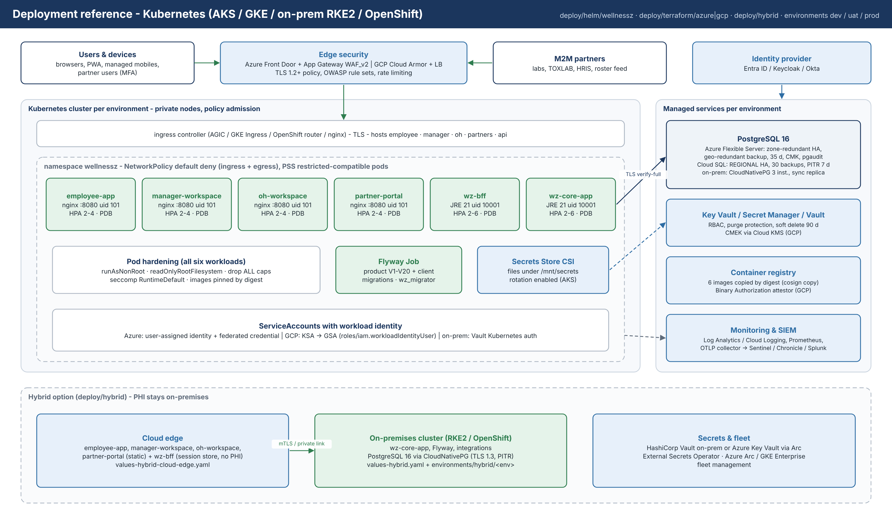
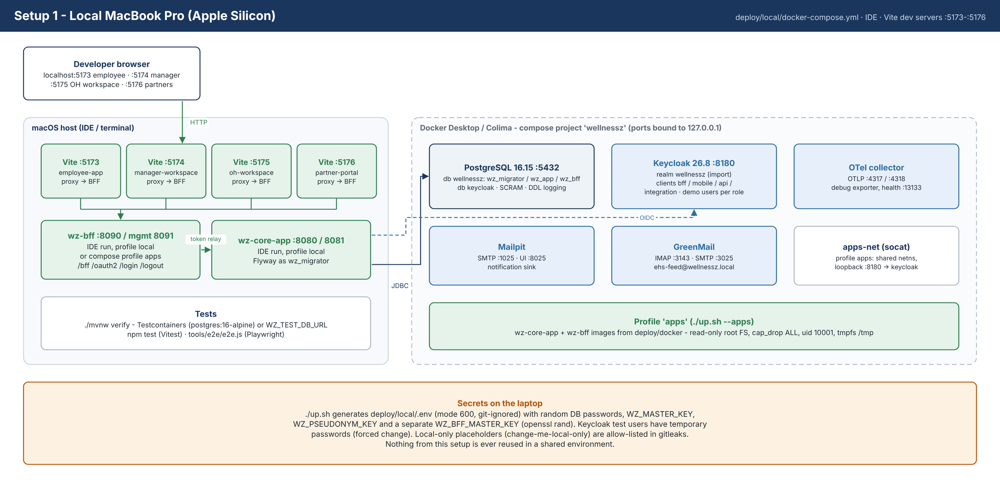
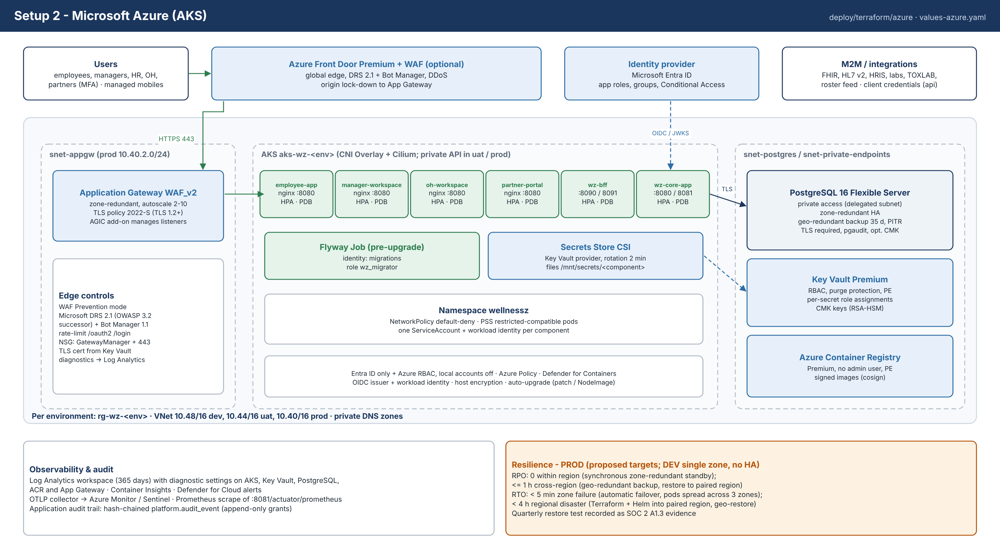
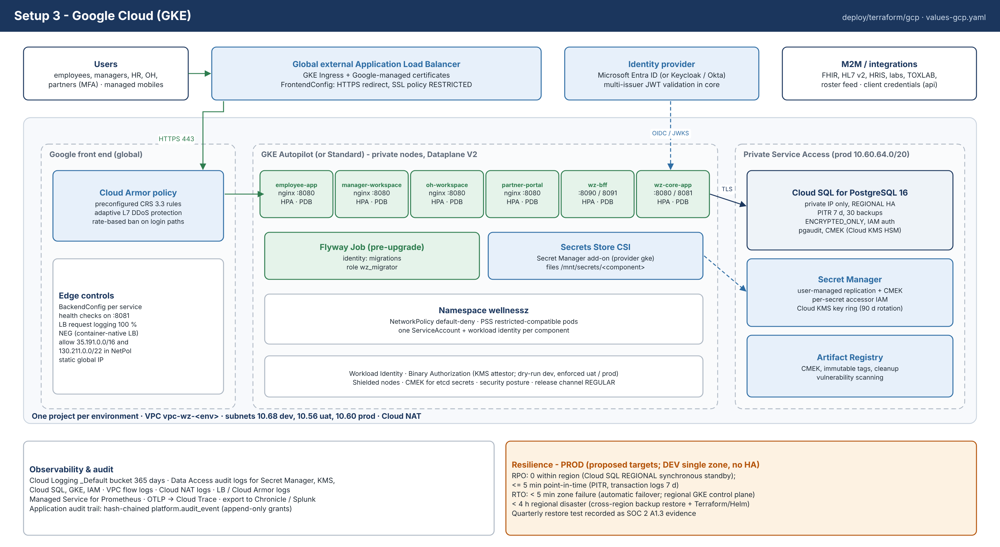
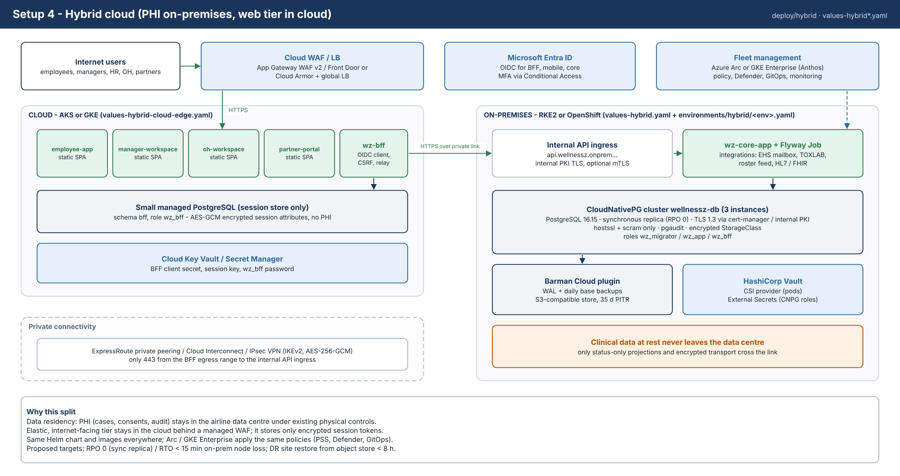
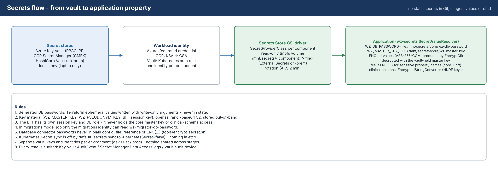
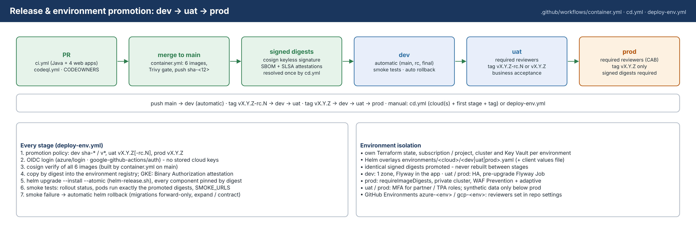

# WellnessZ OHCM – Deployment Architecture

| | |
|---|---|
| **Document** | 04 – Deployment Architecture |
| **Audience** | CIO, Cyber GRC, infrastructure and cloud platform teams, auditors |
| **Scope** | Reference topology and the four supported setups: Local MacBook Pro, Microsoft Azure, Google Cloud, Hybrid cloud |
| **Artefacts** | `deploy/local`, `deploy/docker`, `deploy/helm/wellnessz`, `deploy/terraform/azure`, `deploy/terraform/gcp`, `deploy/hybrid`, `deploy/sql`, `.github/workflows` |
| **Companion documents** | 01 – Technology Architecture · 02 – Security & SOC 2 Control Mapping · 05–08 – Setup guides · 09 – CI/CD Guide |

This document describes **where** WellnessZ runs and **how** it is protected in each deployment option. It is
written for decision makers: every statement is backed by an artefact in the repository, and the final sections
state proposed service levels, cost shape and the validation status of each setup.

> **Status of validation.** The local setup was run end to end in a sandbox. That run covered the full Docker
> Compose stack, real Keycloak tokens, core and BFF containers on a read-only root filesystem, Flyway in both
> migration modes, and the database least-privilege checks. The Helm chart renders and passes schema validation
> for every platform. Terraform passes `validate` for Azure and GCP. **Nothing has yet been applied to a real Azure
> subscription, GCP project or on-premises cluster**; the first environment build is therefore also the
> acceptance test of the infrastructure code.
>
> **Increment 1** (E01 intake, E02 triage) adds the OH workspace web app, the `triage` schema, nine roles and the
> EHS webhook. It was verified on the local setup (Java and web tests, `tools/e2e/e2e-increment1.js` 18/18); Helm
> values for every platform include the new component. Section 17 lists the changes per environment.

## 1. Reference deployment topology

All four setups share the same building blocks and the same container images. Only the platform services
around the cluster change.

*Figure 1 – Reference deployment view (source: `docs/images/07-deployment-reference.svg`).*

| Building block | Implementation | Notes |
|---|---|---|
| **Employee portal / mobile PWA** | `web/employee-app` – static SPA in `nginx-unprivileged` (port 8080, uid 101) | Same origin as the BFF; mobile builds (Capacitor) call the core API directly with PKCE tokens |
| **Manager & HR workspace** | `web/manager-workspace` – static SPA (port 8080) | Status-only views |
| **OH workspace** (increment 1) | `web/oh-workspace` – static SPA (port 8080), Helm component `ohWorkspace`, host `oh.<domain>` | Clinical console for the OH team, reception and first aiders; same origin as the BFF |
| **BFF** | `apps/wz-bff` – Spring Boot, port 8090, management 8081 (k8s) / 8091 (local) | OIDC confidential client, encrypted JDBC sessions (schema `bff`), CSRF, token relay; tokens never reach the browser |
| **Core API** | `apps/wz-core-app` – Spring Boot, port 8080, management 8081 | Multi-issuer JWT resource server, ABAC, audit, integrations, EHS intake, Flyway migrations |
| **Database** | PostgreSQL 16 | Schemas `platform, masterdata, intake, casemgmt, triage, analytics` + `bff` (`triage` since increment 1); roles `wz_migrator` (owner), `wz_app`, `wz_bff` |
| **Identity provider** | Microsoft Entra ID (production), Keycloak 26 (local / alternative), any OIDC IdP | Roles from `realm_access.roles`, `roles` (Entra app roles) or `groups`; `employee_id` and `org_scope` claims drive ABAC |
| **Secrets** | Azure Key Vault, GCP Secret Manager or HashiCorp Vault via Secrets Store CSI | Mounted as files; consumed through `file:` references, `WZ_MASTER_KEY_FILE` and `ENC(...)` values |
| **Edge** | App Gateway WAF v2 / Front Door (Azure), Cloud Armor + global LB (GCP), internal ingress (on-prem) | TLS 1.2+, OWASP rule sets, rate limiting on login paths |
| **Observability** | Micrometer/Prometheus, OpenTelemetry (OTLP), JSON logs with PHI masking | Log Analytics / Cloud Logging / SIEM |

### 1.1 Runtime contract shared by every setup

* **One image per component, promoted unchanged.** The same digest moves from dev to prod; images are signed
  with cosign and carry SBOM and SLSA provenance attestations (`container.yml`).
* **Hardened pods.** Every pod runs non-root with a read-only root filesystem, drops `ALL` capabilities, uses the
  `RuntimeDefault` seccomp profile, does not automount a service-account token and has no privilege escalation.
  `values.schema.json` makes these settings impossible to switch off through values.
* **Default-deny networking.** NetworkPolicies deny all traffic and then allow only these flows:
  * ingress controller → web apps and BFF;
  * BFF → core;
  * core and BFF → database;
  * port 443 egress to the identity provider and Microsoft Graph;
  * optionally, telemetry to the OTel collector.
* **One identity per component.** Core, BFF and the migration job each have their own Kubernetes ServiceAccount,
  cloud identity and secret set. The BFF never holds the core master key and has no access to clinical schemas.
* **Database least privilege.** `wz_migrator` owns the schemas and runs DDL only. `wz_app` gets exactly the
  per-table privileges granted by the Flyway migrations; for example, `platform.audit_event` is SELECT/INSERT only,
  which makes it append-only. `wz_bff` can reach only the `bff` session tables.

## 2. The four setups at a glance

| Aspect | 1 · Local MacBook Pro | 2 · Microsoft Azure | 3 · Google Cloud | 4 · Hybrid cloud |
|---|---|---|---|---|
| Purpose | Development, demos, tests | Production / regulated SaaS-style operation | Production on GCP | Production with PHI kept on-premises |
| Compute | Docker Desktop or Colima; IDE processes | AKS (Azure CNI Overlay + Cilium), 3 zones | GKE Autopilot (or Standard), regional | Cloud AKS/GKE (web tier) + RKE2/OpenShift (core) |
| Database | PostgreSQL 16.15 container | PostgreSQL Flexible Server 16, zone-redundant HA | Cloud SQL Postgres 16, REGIONAL HA | CloudNativePG 3 instances on-prem + small cloud PG for sessions |
| Identity (users) | Keycloak 26 realm `wellnessz` | Entra ID | Entra ID (or Keycloak/Okta) | Entra ID |
| Identity (workloads) | n/a | Workload identity (federated credentials) | Workload Identity (KSA → GSA) | Arc workload identity / Vault Kubernetes auth |
| Secrets | `.env` generated locally | Key Vault + CSI (rotation 2 min) | Secret Manager + GKE CSI add-on | Vault + CSI / External Secrets (or Key Vault via Arc) |
| Edge / WAF | none (localhost only) | App Gateway WAF v2 (DRS 2.1), optional Front Door | Cloud Armor (CRS 3.3), managed certs | Cloud WAF for web tier; internal ingress on-prem |
| Encryption at rest | Docker volume (dev data only) | Platform keys + optional CMK, host encryption | CMEK (Cloud KMS HSM) for SQL, etcd, registry, secrets | Encrypted StorageClass, encrypted backups |
| Backups / PITR | none | 35 days, geo-redundant, PITR | 30 backups, PITR 7 days | Barman Cloud to object storage, 35 days PITR |
| Proposed RPO / RTO | n/a | 0 / < 5 min (zone); ≤ 1 h / < 4 h (region) | 0 / < 5 min (zone); ≤ 5 min PITR / < 4 h (region) | 0 / < 15 min (node); DR restore < 8 h |
| Infrastructure code | `deploy/local` | `deploy/terraform/azure` + `values-azure.yaml` | `deploy/terraform/gcp` + `values-gcp.yaml` | `deploy/hybrid` + `values-hybrid*.yaml` |
| Setup guide | 05 – `setup/01-Local-MacBook-Pro.md` | 06 – `setup/02-Azure.md` | 07 – `setup/03-GCP.md` | 08 – `setup/04-Hybrid-Cloud.md` |
| Validation status | **Executed** in sandbox | Code validated, not applied | Code validated, not applied | Manifests schema-validated, not applied |

## 3. Setup 1 – Local MacBook Pro

*Figure 2 – Local developer topology (source: `docs/images/08-deploy-local-macbook.svg`).*

* **Components.** `deploy/local/docker-compose.yml` runs:
  * PostgreSQL 16.15 (databases `wellnessz` and `keycloak`);
  * Keycloak 26.8.1, importing the realm `wellnessz`;
  * Mailpit (SMTP sink) and GreenMail (IMAP mailbox `ehs-feed@wellnessz.local`);
  * an OpenTelemetry collector.

  Core and BFF run either from the IDE (Spring profile `local`) or as hardened containers with `./up.sh --apps`.
  The three web apps run as Vite dev servers on ports 5173 (employee), 5174 (manager) and 5175 (OH workspace) that
  proxy `/bff`, `/oauth2`, `/login` and `/logout` to the BFF.
* **Network.** All ports bind to `127.0.0.1`; nothing is reachable from the LAN. In the `apps` profile, a small
  `apps-net` container owns the network namespace of core and BFF and forwards loopback port 8180 to Keycloak. As a
  result, the issuer URL `http://localhost:8180/realms/wellnessz` is identical in the browser and inside the
  containers.
* **Identity.** Keycloak realm `wellnessz` with these clients:

  | Client | Type |
  |---|---|
  | `wellnessz-bff` | Confidential, PKCE S256 |
  | `wellnessz-mobile` | Public, PKCE S256 |
  | `wellnessz-api` | Audience |
  | `wellnessz-integration` | Client credentials, role `INTEGRATION` (also used for the EHS webhook) |

  Eighteen test users have temporary passwords (the seven of the base framework plus `nurse1`, `nurse2`,
  `physician1`, `ame1`, `cmo1`, `nursinghead1`, `hse1`, `crewsched1`, `hygiene1`, `reception1`, `firstaider1`). The
  realm defines the nine increment-1 roles, and the scope mappings of `wellnessz-bff` and `wellnessz-mobile` include
  them, because both clients have `fullScopeAllowed=false`. The realm also enforces brute-force protection, a password policy,
  5-minute access tokens, a 15-minute SSO idle timeout and least-privilege scope mappings. The ABAC attributes
  `employee_id` and `org_scope` are editable by administrators only.
* **Secrets.** `./up.sh` generates `deploy/local/.env` (mode 600, git-ignored) containing random values. These
  values are never reused anywhere else.
* **Data protection.** Development data only. Real or production PHI must never be loaded onto a laptop.

## 4. Setup 2 – Microsoft Azure

*Figure 3 – Azure topology (source: `docs/images/09-deploy-azure.svg`).*

### 4.1 Components

| Layer | Resource (Terraform `deploy/terraform/azure`) | Key settings |
|---|---|---|
| Network | VNet `10.40.0.0/16`; subnets AKS `/23`, App Gateway `/24`, PostgreSQL (delegated) `/24`, private endpoints `/24`; NSGs; private DNS zones | Database and private-endpoint subnets accept 5432/443 only from the AKS subnet |
| Edge | Application Gateway WAF_v2 (zone-redundant, autoscale 2–10), WAF policy | Prevention mode, Microsoft DRS 2.1 (successor of OWASP CRS 3.2) + Bot Manager 1.1, rate limit on `/oauth2/` and `/login/`, TLS policy `AppGwSslPolicy20220101S` |
| Optional global edge | Azure Front Door Premium + WAF | App Gateway NSG then admits only `AzureFrontDoor.Backend` |
| Compute | AKS, system pool + user pool across zones 1–3 | Entra ID-only access with Azure RBAC, local accounts disabled, private API server, OIDC issuer + workload identity, Azure Policy, Defender, Key Vault CSI with rotation, Container Insights, host encryption, auto-upgrade channels |
| Database | PostgreSQL Flexible Server 16 | Private access, zone-redundant HA, geo-redundant backups (35 days), Entra authentication, `require_secure_transport`, TLS ≥ 1.2, pgaudit, optional customer-managed key |
| Secrets & keys | Key Vault Premium | RBAC, purge protection, 90-day soft delete, private endpoint, per-secret role assignments, RSA-HSM keys for CMK |
| Registry | Azure Container Registry Premium | No admin user, zone-redundant, private endpoint, 30-day retention for untagged manifests |
| Logging | Log Analytics (365 days) + diagnostic settings on every resource; Defender plans | Evidence for SOC 2 CC7.2 |
| Identities | User-assigned identities for core, BFF and migrations (federated to AKS service accounts); GitHub deployer identity (federated to GitHub Environments) | No client secrets anywhere in the pipeline |

### 4.2 Request path

1. The user resolves `employee.<domain>` (or `manager.<domain>`, `oh.<domain>`). Traffic reaches Front Door
   (optional), then the App Gateway WAF over TLS 1.2+.
2. The AGIC-managed listener routes requests by path:
   * `/` goes to `employee-portal` (or `manager-workspace`, `oh-workspace`);
   * `/bff`, `/oauth2`, `/login` and `/logout` go to `wz-bff` on the same origin.
3. The BFF authenticates the user against Entra ID with the authorization-code flow and PKCE. It stores the
   encrypted session in schema `bff` and relays the access token to `wz-core-app`.
4. The core validates the JWT (issuer allow-list and audience `api://wellnessz-api`), applies ABAC and writes the
   audit trail. It reaches PostgreSQL over TLS with `sslmode=verify-full`.

## 5. Setup 3 – Google Cloud

*Figure 4 – Google Cloud topology (source: `docs/images/10-deploy-gcp.svg`).*

| Layer | Resource (Terraform `deploy/terraform/gcp`) | Key settings |
|---|---|---|
| Network | Custom-mode VPC, subnet with secondary ranges for pods and services, VPC flow logs, Cloud NAT, Private Service Access `10.60.64.0/20` | Explicit deny for SSH/RDP from the internet |
| Edge | Global external Application Load Balancer via GKE Ingress, Google-managed certificates, FrontendConfig (HTTPS redirect, SSL policy `RESTRICTED`, TLS 1.2+) | Cloud Armor policy attached through BackendConfig |
| WAF | Cloud Armor | Preconfigured CRS 3.3 rules (SQLi, XSS, LFI, RFI, RCE, protocol, session fixation, scanner, Java, CVE canary), rate-based ban on login paths, adaptive L7 DDoS protection, verbose logging |
| Compute | GKE Autopilot (default) or Standard, private nodes, Dataplane V2 | Workload Identity, Binary Authorization (KMS-backed attestor, dry-run then enforce), Shielded nodes, CMEK for etcd secrets, Secret Manager CSI add-on, security posture, managed Prometheus |
| Database | Cloud SQL PostgreSQL 16 | Private IP only, `REGIONAL` HA, PITR (7 days of logs), 30 backups, `ENCRYPTED_ONLY`, IAM database authentication, pgaudit, CMEK, password policy |
| Secrets & keys | Secret Manager with CMEK, Cloud KMS key ring (HSM, 90-day rotation) | Per-secret accessor IAM per workload service account |
| Registry | Artifact Registry | CMEK, immutable tags, cleanup policies, vulnerability scanning |
| Logging | `_Default` bucket retention 365 days; Data Access audit logs for Secret Manager, KMS, Cloud SQL, GKE, IAM | Evidence for SOC 2 CC7.2 |

## 6. Setup 4 – Hybrid cloud

*Figure 5 – Hybrid topology (source: `docs/images/11-deploy-hybrid.svg`).*

**Rationale.** Some airlines must keep occupational-health records in their own data centre, for data
residency, works-council agreements or regulator expectations. The hybrid option therefore splits the system:

* the PHI-free, elastic web tier (the three SPAs – employee portal, manager workspace and, since increment 1, OH
  workspace – and the BFF) runs in a cloud cluster behind a managed WAF;
* the core API and PostgreSQL run on-premises, on RKE2 or OpenShift.

Both clusters are managed as one fleet through **Azure Arc** or **GKE Enterprise**.

| Concern | Design |
|---|---|
| Connectivity | ExpressRoute private peering, Cloud Interconnect or IPsec site-to-site VPN (IKEv2, AES-256-GCM). Only TCP 443 is open, from the BFF egress range to the internal API ingress (internal PKI, optional mTLS). |
| Database | CloudNativePG cluster with 3 instances and a synchronous replica (RPO 0). TLS 1.3 uses cert-manager certificates from the internal PKI; `pg_hba` allows only `hostssl` + SCRAM. pgaudit is enabled and storage is encrypted. |
| Backups | Barman Cloud plugin streams WAL and daily base backups to S3-compatible object storage; 35-day PITR, replicated to a second site. |
| Secrets | HashiCorp Vault through the CSI provider for pods; External Secrets Operator for operator-consumed secrets (CNPG role passwords, backup credentials). Alternative: Azure Key Vault via the Arc extension. |
| Cloud session store | A small managed PostgreSQL in the cloud holds only `bff` sessions (encrypted OAuth tokens, no PHI). |
| Policy | The same Pod Security, NetworkPolicy and admission policies (Azure Policy / Policy Controller); image signatures verified on admission. |

## 7. Network zones and segmentation

| Zone | Contents | Allowed inbound | Allowed outbound |
|---|---|---|---|
| Internet edge | Front Door / App Gateway / global LB + WAF | 443 (80 redirect only) from the internet | Ingress backends only |
| Web tier | `employee-portal`, `manager-workspace`, `oh-workspace` | 8080 from the ingress controller / LB ranges | none |
| BFF tier | `wz-bff` | 8090 from the ingress; 8081 from monitoring | Core 8080, database 5432 (`bff` schema), IdP 443 |
| Core tier | `wz-core-app`, Flyway job | 8080 from the BFF and API ingress (mobile, M2M, EHS webhook); 8081 from monitoring | Database 5432, IdP 443 (JWKS), Microsoft Graph / IMAPS / SMTP submission, OTLP |
| Data tier | PostgreSQL, Key Vault / Secret Manager / Vault (private endpoints) | 5432 from the AKS subnet or PSA range; 443 from CSI drivers | none |
| Management | Kubernetes API (private), bastion / self-hosted runners | Entra ID-authenticated admins; CI deployer identity | – |

Kubernetes NetworkPolicies enforce the pod-level rules and fail closed: an empty peer list is never rendered.
Cloud NSGs and firewall rules enforce the subnet level.

## 8. Identity

### 8.1 Human identities

* **Production:** Microsoft Entra ID with three app registrations, configured step by step in the
  [Azure setup guide](../setup/02-Azure.md):

  | App registration | Type | Purpose |
  |---|---|---|
  | `wellnessz-bff` | Confidential web client | Browser login through the BFF |
  | `wellnessz-mobile` | Public client, PKCE | Mobile app login |
  | `wellnessz-api` | Resource | Exposes the app roles (EMPLOYEE, MANAGER, HR, OH_CLINICIAN, …; increment 1 adds OH_PHYSICIAN, AME, CMO, NURSING_HEAD, HSE_OFFICER, CREW_SCHEDULING, HYGIENE_MANAGER, CLINIC_RECEPTION, FIRST_AIDER) |

  Users receive roles through groups. Conditional Access enforces MFA and compliant devices; the mobile app
  additionally requires an app protection policy.
* **ABAC attributes.** `employee_id` and `org_scope` are emitted as token claims: Entra directory extensions with
  optional claims, or Keycloak user-profile attributes. Only administrators can change them.
* **Keycloak** remains a supported alternative IdP. The core accepts several issuers at once (`WZ_OIDC_ISSUERS`),
  so migrating between IdPs needs no downtime.

### 8.2 Workload identities

| Platform | Mechanism | Scope |
|---|---|---|
| Azure | User-assigned managed identity + federated credential `system:serviceaccount:wellnessz:wellnessz-<component>` | Key Vault Secrets User on the individual secrets of that component |
| GCP | Google service account + `roles/iam.workloadIdentityUser` binding to the KSA | `roles/secretmanager.secretAccessor` per secret |
| On-prem | Vault Kubernetes auth role per ServiceAccount | Vault policy per path |
| CI/CD | GitHub OIDC → Entra federated credential per Environment / GCP Workload Identity Federation (repository condition) | AcrPush/Artifact Registry writer, AKS RBAC Writer on the namespace / `container.developer` |

## 9. Secrets flow

*Figure 6 – Secrets flow (source: `docs/images/12-secrets-flow.svg`).*

| Secret | Generated by | Stored in | Consumed as |
|---|---|---|---|
| `wz-db-password` (`wz_app`) | Terraform ephemeral random value (write-only argument) | Key Vault / Secret Manager / Vault | `WZ_DB_PASSWORD=file:/mnt/secrets/core/wz-db-password` |
| `wz-migrator-db-password` | Terraform ephemeral | as above | Flyway job (`FLYWAY_PASSWORD`) or `WZ_DB_MIGRATOR_PASSWORD=file:…` in app mode |
| `wz-bff-db-password` (`wz_bff`) | Terraform ephemeral | as above | `WZ_BFF_DB_PASSWORD=file:/mnt/secrets/bff/…` |
| `wz-master-key` | Operator: `openssl rand -base64 32` | as above | `WZ_MASTER_KEY_FILE` – decrypts `ENC(...)` values and field-level encryption |
| `wz-pseudonym-key` | Operator | as above | `WZ_PSEUDONYM_KEY=file:…` (analytics pseudonyms) |
| `wz-bff-session-key` | Operator | as above | BFF `WZ_MASTER_KEY_FILE` (session encryption, separate from core) |
| `wz-bff-client-secret`, `wz-graph-client-secret` | Entra ID app registrations | as above | `file:` references |
| Other configuration secrets | Developer / operator | Git or ConfigMap as `ENC(...)` (AES-256-GCM, `tools/encrypt-secret.sh`) | Decrypted at start-up |

Generated passwords never enter Terraform state. Kubernetes Secret sync is disabled by default, so nothing is
written to etcd. Every secret read is logged:

* Key Vault `AuditEvent`;
* Secret Manager Data Access logs;
* Vault audit device.

## 10. Data protection

| Control | Azure | GCP | Hybrid (on-prem) |
|---|---|---|---|
| TLS at the edge | TLS 1.2+ (App Gateway policy 2022-S, Front Door) | SSL policy `RESTRICTED`, TLS 1.2+ | Internal PKI, TLS 1.2+; private link |
| TLS to database | `require_secure_transport=ON`, TLS ≥ 1.2, JDBC `verify-full` | `ENCRYPTED_ONLY`, JDBC `verify-ca` with the instance CA | TLS 1.3, `verify-full` against the internal CA |
| Encryption at rest | Platform-managed AES-256; optional CMK for PostgreSQL (Key Vault RSA-HSM 3072, automatic rotation); AKS host encryption; optional disk encryption set | CMEK (Cloud KMS HSM, 90-day rotation) for Cloud SQL, GKE etcd secrets, Artifact Registry, Secret Manager | Encrypted StorageClass; backup server-side encryption |
| Application-level | Field-level AES-256-GCM (`FieldEncryptor`), encrypted BFF sessions, `ENC()` configuration | same | same |
| Backups | 35 days, geo-redundant, PITR | 30 automated backups, PITR (7-day logs) | Barman Cloud WAL + daily base, 35 days, second site |
| HA | Zone-redundant standby (synchronous) | `REGIONAL` (synchronous standby) | Synchronous replica, 3 instances |

### 10.1 Proposed RPO/RTO

These targets are proposals for GRC sign-off.

| Scenario | RPO | RTO | Mechanism |
|---|---|---|---|
| Pod / node failure | 0 | < 1 min | ReplicaSets, PDB, HPA, readiness probes |
| Zone failure | 0 | < 5 min | Zone-redundant DB failover; pods spread over 3 zones |
| Logical corruption / operator error | ≤ 5 min | < 2 h | Point-in-time restore into a new server, then cut over |
| Region / data-centre loss | ≤ 1 h (Azure geo-backup), ≤ 24 h (GCP cross-region backup) | < 4 h cloud, < 8 h on-prem | IaC re-provisioning in the paired region + restore |

Restore tests run every quarter and are recorded as SOC 2 A1.3 evidence. Each test restores into an isolated
environment and runs the smoke tests from the setup guides.

## 11. Ingress, WAF and API exposure

* **Web hosts** (`employee.*`, `manager.*`, `oh.*`). Each host serves its SPA and the BFF paths on the same origin;
  each needs its own BFF redirect URI `https://<host>/login/oauth2/code/wellnessz`. The
  `WZSESSION` cookie is HttpOnly and Secure; CSRF protection uses the `XSRF-TOKEN` cookie and header pair.
* **API host** (`api.*`). Publishes only `/api/v1` for the mobile app and M2M integrations, including the EHS
  webhook `POST /api/v1/intake/ehs/incidents` (increment 1). The management port is
  never exposed through the ingress.
* **WAF rule sets:**
  * Microsoft DRS 2.1 + Bot Manager (Azure);
  * Cloud Armor CRS 3.3 preconfigured rules (GCP).

  Both run in prevention mode with request-body inspection and upload limits sized for the EHS Excel import
  (20 MB). Login paths are rate-limited per client IP.
* **TLS certificates:**
  * Key Vault certificate referenced by App Gateway (Azure);
  * Google-managed certificates (GCP);
  * cert-manager with the internal PKI (on-prem).

## 12. Observability

| Signal | Source | Destination |
|---|---|---|
| Application logs | JSON (logstash encoder) with PHI-safe masking | Container Insights / Cloud Logging → SIEM (Sentinel, Chronicle, Splunk) |
| Metrics | `/actuator/prometheus` on the management port | Azure Managed Prometheus / Google Managed Prometheus / Prometheus Operator (`serviceMonitor.enabled`) |
| Traces | OpenTelemetry OTLP (`OTEL_EXPORTER_OTLP_ENDPOINT`) | Collector → Azure Monitor / Cloud Trace / Tempo |
| Audit (application) | Hash-chained `platform.audit_event` | `GET /api/v1/audit/verify`; export to the SIEM |
| Audit (platform) | Key Vault, PostgreSQL (pgaudit), AKS (`kube-audit-admin`), App Gateway / Cloud Armor, Data Access logs | Log Analytics / Cloud Logging, 365 days |
| IdP events | Entra sign-in and audit logs; Keycloak login and admin events | SIEM |

Recommended alerts:

* WAF block spikes;
* database failover;
* Key Vault or Secret Manager access by unexpected principals;
* pod restarts or OOM;
* `/actuator/health/readiness` failures;
* audit chain verification failure;
* certificate expiry under 30 days.

## 13. Scaling and capacity

| Component | Scaling | Default bounds (Helm) | Notes |
|---|---|---|---|
| Web apps | HPA on CPU | 2–4 | Static content; scale is cheap |
| BFF | HPA on CPU and memory | 2–6 | Sessions in PostgreSQL, so pods are stateless |
| Core | HPA on CPU and memory | 2–6 | Virtual threads; the DB pool (`WZ_DB_POOL_SIZE`, default 20) × replicas must stay below the server's `max_connections` |
| Nodes | AKS cluster autoscaler (3–9 user nodes) / GKE Autopilot | – | Zone spread with `DoNotSchedule` in prod |
| Database | Vertical (SKU / tier) + storage auto-grow | GP D4ds_v5 / db-custom-4-16384 | Add read replicas for analytics if needed |

An airline OH workload (tens of thousands of employees, hundreds of concurrent users) fits comfortably in the
defaults. Load-test in the `test` environment before go-live.

## 14. Cost shape (indicative, not a quote)

| Driver | Azure | GCP | Hybrid |
|---|---|---|---|
| Fixed baseline | App Gateway WAF_v2 (largest fixed item), AKS Standard tier, Flexible Server with HA (≈ 2× compute), Key Vault Premium, ACR Premium, Log Analytics ingestion | Global LB + Cloud Armor (policy + per-request), Cloud SQL `REGIONAL` (≈ 2× compute), Autopilot pod resources, KMS HSM keys, Artifact Registry storage | On-prem hardware/licences (OpenShift subscriptions, Vault Enterprise optional), connectivity (ExpressRoute/Interconnect port), a smaller cloud footprint |
| Variable | Log ingestion (GB/day), egress, Defender per node | Log ingestion, Cloud Armor requests, egress | Interconnect data, object storage for backups |
| Savings levers | Reserved instances / savings plan for nodes and the DB; non-prod without HA and Front Door; log sampling | Committed use discounts; Autopilot right-sizing; non-prod `ZONAL` SQL | Reuse existing DC capacity |

Non-production environments should switch off HA, Front Door and geo-redundancy and scale down.
`terraform.tfvars` per environment controls these settings.

## 15. Environment promotion (dev / test / prod)

*Figure 7 – Release and promotion flow (source: `docs/images/13-environment-promotion.svg`).*

| Environment | Purpose | Data | Approval | Infrastructure |
|---|---|---|---|---|
| dev | Integration of merged work | Synthetic | Automatic on tag | Smaller SKUs, no HA, public API server allowed with authorised IP ranges |
| test | UAT, security testing (DAST), performance | Synthetic / anonymised | Required reviewers (QA lead) | Production-like topology, HA optional |
| prod | Live service | Real PHI | Required reviewers (CAB / security), tags `v*` only | Full HA, private API server, `migrations.mode=job`, CMK optional |

* Each environment has its own subscription or project, Terraform state, Key Vault or Secret Manager and IdP app
  registrations (or redirect URIs).
* The same signed image digest is promoted through every stage. `cd.yml` verifies cosign signatures before every
  Helm upgrade and uses `--atomic` for automatic rollback.
* Production data is never copied to lower environments.

## 16. Residual risks and open decisions

| # | Item | Proposed handling |
|---|---|---|
| 1 | Infrastructure code not yet applied in a real subscription or project | First dev build is the acceptance test; record defects as change requests |
| 2 | Key material (`WZ_MASTER_KEY`, pseudonym key, BFF session key) created by an operator | Dual control, tracked in the key-ceremony record; rotation every 12 months (`WZ_FIELD_KEY_VERSION` supports re-keying) |
| 3 | Microsoft Graph mailbox uses a client secret | Prefer a certificate credential; restrict with Exchange RBAC for Applications to the single EHS mailbox |
| 4 | ingress-nginx retired (March 2026) | Not used in the cloud setups; on-prem uses the OpenShift router or an alternative controller |
| 5 | Private AKS API server requires a self-hosted runner or `az aks command invoke` | Provision runners inside the VNet before prod |
| 6 | RPO/RTO targets are proposals | GRC and business sign-off; validate in the first DR test |
| 7 | Increment 1: OH staff roster has no import path; demo data must never reach shared environments | Roster import before go-live; `WZ_FLYWAY_LOCATIONS` reviewed in each environment's values |

## 17. Increment 1 deployment changes (E01, E02, OH workspace)

Increment 1 adds one web component, one database schema, nine roles and one inbound integration. Nothing changes in
the topology: the OH workspace is a third static SPA next to the other two, sharing the BFF on its own origin.

| Change | What to deploy / configure | Artefact |
|---|---|---|
| **OH workspace** | Helm component `ohWorkspace` (enabled by default; image `oh-workspace`, nginx-unprivileged on 8080, `/healthz`, HPA 2–4, PDB) on host `oh.<domain>` (`ingress.hosts.ohWorkspace`); same-origin routing of `/bff`, `/oauth2`, `/login`, `/logout` to the BFF; web NetworkPolicy, Service, ServiceAccount, GKE BackendConfig and ManagedCertificate are generated like for the other web apps | `deploy/helm/wellnessz/values*.yaml`, `templates/*` |
| DNS and TLS | A / CNAME record and certificate for `oh.<domain>` (Azure: App Gateway certificate; GCP: `ManagedCertificate` domain added automatically; hybrid: cloud edge) | setup guides 06–08 |
| BFF redirect URI | `https://oh.<domain>/login/oauth2/code/wellnessz` on the BFF client (the BFF builds it from `{baseUrl}`); local: `http://localhost:5175/login/oauth2/code/wellnessz` | Entra app registration / Keycloak client `wellnessz-bff` |
| CORS | `WZ_CORS_ORIGINS` adds `https://oh.<domain>` (already in `values-azure.yaml`, `values-gcp.yaml`, `values-hybrid.yaml`; local `http://localhost:5175`) | Helm values, `docker-compose.yml` |
| Schema `triage` | Created by Flyway V5 (owner `wz_migrator`, `USAGE` granted to `wz_app`); new environments get it from the bootstrap scripts; `migrations.job.core.schemas` lists it | `deploy/sql/bootstrap-managed-postgres.sql`, `deploy/hybrid/cnpg/03-cluster.yaml`, `deploy/local/postgres/01-init-wellnessz.sh` |
| Roles | `OH_PHYSICIAN`, `AME`, `CMO`, `NURSING_HEAD`, `HSE_OFFICER`, `CREW_SCHEDULING`, `HYGIENE_MANAGER`, `CLINIC_RECEPTION`, `FIRST_AIDER`: Entra app roles on `wellnessz-api` assigned to groups; Keycloak realm roles **and** client scope mappings of `wellnessz-bff` and `wellnessz-mobile` (`fullScopeAllowed=false`) | setup guide 06 §5.2, local realm |
| EHS webhook | Machine client with the `INTEGRATION` application role calls `POST https://api.<domain>/api/v1/intake/ehs/incidents` with an `Idempotency-Key`; hybrid: the on-prem internal API host | setup guides 06 §5.6, 08 |
| HRIS and OH staff master | HRIS employees pushed to `POST /api/v1/masterdata/employees`; OH staff roster (`masterdata.staff_member`) loaded by the DBA until an import exists. Demo data (`db/demo`) is loaded only by the `local` profile | doc 01, O9 |
| Configuration | `WZ_OH_WORKSPACE_URL` (link in OH notifications, set to `https://oh.<domain>`), `WZ_OH_CONTACT`, `WZ_SLA_POLL_INTERVAL` (default `PT60S`), optionally `WZ_FLYWAY_LOCATIONS` (never add `classpath:db/demo` outside local) | core `env` / `extraEnv` |
| Outbound allow-list | `catering-hygiene` destination (status fields only) for food-handler cases | `application.yml` |
| Pipeline | `oh-workspace` in the CI web matrix, the `container.yml` image matrix, the `cosign verify` loop of `deploy-env.yml` and Dependabot | CI/CD Guide |

**Verification per environment** (details in each setup guide):

| Setup | Verification |
|---|---|
| Local | `tools/e2e/e2e-increment1.js` – 18 checks, all `PASS` |
| Azure / GCP | `curl -sI https://oh.<domain>/` → `200` with HSTS; OH login as a Nursing Head test account; webhook smoke call returns `202`; `GET /api/v1/modules` shows E01 and E02 `IMPLEMENTED`; the E2E script with `WZ_E2E_*` pointing at the environment (dev/test only) |
| Hybrid | As above from the cloud edge; additionally confirm that `triage` exists only in the on-prem database and that the cloud session database still holds only `bff` |
