# WellnessZ OHCM – Increment 2 Solution Design: E03 Occupational Health Record and E05 Fitness for Duty / Return to Work

| | |
|---|---|
| **Document** | Increment 2 – 01 Solution Design (E03 + E05) |
| **System** | WellnessZ Airline Occupational Health Case Management (OHCM) |
| **Scope** | E03 Occupational Health Record & Clinical Encounter Documentation · E05 Fitness for Duty, Work Restrictions & Return-to-Work |
| **Audience** | Chief Medical Officer (CMO), Nursing Head, Data Protection Officer (DPO), Cyber GRC, CIO, project sponsor |
| **Baseline** | Repository working tree, Flyway migrations V1–V8, API contract `docs/increment-02/API-Contract-E03-E05.md`, OpenAPI `docs/api/openapi.json` (240 paths) |
| **Status** | Draft for review – clinical content, templates, standards, retention values and terminology licences await business sign-off (Section 30) |
| **Companion documents** | 02 – Requirements Traceability Matrix · 03 – Release Notes Increment 2 · Increment 1 documents 01–03 · Architecture 01–03 |

> **How to read this document.** Every statement about behaviour was checked against the source code and, where
> named, against an automated test. Where a capability is only partly delivered, or where content (templates,
> standards, drug tables, retention periods, report layouts) is a draft awaiting clinical, legal or DPO sign-off, this is
> stated explicitly. Requirement identifiers (E03-HLR-xx, E03-F0x, E03-BL-0xx, E05-…) refer to the business workbooks
> (v1.0, 27 October 2026); the full mapping is in the Requirements Traceability Matrix (document 02). All API paths are
> relative to `/api/v1`; browser apps call them through the BFF as `/bff/api/...`.

---

## 1. Executive summary

Increment 2 adds the clinical record and the fitness-for-duty workflow on top of the Increment 1 intake and triage
modules:

* **E03 – Occupational health record and clinical encounters** gives every clinician one longitudinal OH chart per
  employee: summary with alerts, fitness status, restrictions, open cases, surveillance due and immunisations; problems,
  allergies, medications, immunisations, results, documents and an ODH-structured job and exposure history. Eight
  versioned encounter templates (injury, illness, fitness assessment, surveillance exam, mental health, travel, crew
  aeromedical, food handler) with body map, coded diagnoses (ICD-10 / SNOMED CT / LOINC search with favourites and
  recent codes), photos with consent, SHA-256 e-signature and signed addenda. Laboratory orders leave as HL7 v2
  ORM^O01 messages and results return as HL7 v2 ORU^R01 or JSON; audiometry, spirometry, vision and ECG results are
  captured with a calibration ID and flagged automatically (including the audiometric standard threshold shift).
  Abnormal results land in a worklist and escalate to the CMO after 72 hours. Clinical decision support checks
  allergies, drug interactions and duplicate tests, and prompts protocol steps, surveillance due dates, duration
  guidelines and the applicable fitness standard. The record exports as FHIR R4 and HL7 ODH bundles.
* **A new platform document service** (`platform/wz-documents`) generates ten templated documents as PDF, e-signs them
  with an integrity hash, versions and shares them (employee, manager, HR, partner provider – partner only with
  consent), ingests scanned reports with text extraction and optional local OCR, makes them searchable without a
  plaintext index, and maintains a retention schedule with legal hold.
* **E05 – Fitness for duty, restrictions and return to work** records fitness decisions against a versioned library of
  twelve role standards (CAA Class 1/2, cabin crew, airside driving, forklift, working at height, food handler,
  respirator, night work, VDU, security screening, general duties) with limitations, validity, review dates and AME / CMO
  sign-off; generates diagnosis-free certificates; matches restrictions against job-demand profiles to propose modified
  duties that managers accept or decline; runs phased return-to-work (RTW) plans with employee agreement, manager
  acknowledgement and review tracking; lets HR issue electronic alternative-duty job offers; handles crew
  decrease-in-fitness, AME assessments with EASA limitation codes and a status-only roster feed with acknowledgement and
  15-minute reconciliation; controls food-handler exclusion and clearance; alerts five days before restrictions expire;
  and supports ill-health retirement / redeployment decisions with CMO sign-off and an independent appeal.
* **Privacy controls** are extended: a new **DPO** role, break-glass access to restricted records (4 hours, DPO alert,
  24-hour review, monthly report), a disclosure log the employee can see, consent withdrawal that immediately revokes
  partner shares, and negative tests proving that HR, managers, reception, employees and the DPO never open clinical
  records.

The **status-only rule** of the workbooks – managers, HR, crew scheduling, catering hygiene and claims roles see fitness
and functional restrictions only, never diagnoses, clinical notes, results or encounter content – is enforced
server-side in every new API, in documents shared outside OH, in notifications and on every outbound feed.

Verification: 128 Java tests pass (24 new Increment-2 acceptance tests on PostgreSQL 16, new unit tests in the E03 and
E05 modules, ArchUnit boundary rules and BFF tests); SpotBugs + FindSecBugs report 0 findings; 542 web unit tests across
the three apps; and 25 / 25 end-to-end checks against a real Keycloak, BFF, core API and the three web apps.
Coverage against the workbooks: 73 requirement items traced – 49 implemented, 23 partially implemented (8 of them
gated mainly by business sign-off) and 1 deferred (a training task). See document 02.

---

## 2. Scope and goals

### 2.1 Business goals (from the epic overviews)

| Epic | KPI | How the design supports it |
|---|---|---|
| E03 | ≥ 95 % encounters documented and signed within 24 h | Unsigned-notes reminder list (drafts older than 1 h, own or all for Nursing Head / CMO); unsigned count on the chart summary; signing is a single action after pre-sign checks |
| E03 | ≥ 98 % diagnoses coded | `DiagnosisRequiredGuard`: clinical cases (injury, illness, exposure, fitness, mental health, surveillance follow-up) cannot close without a coded primary diagnosis; injury, illness and mental-health encounters cannot be signed without one |
| E03 | Documentation time −30 % | Structured templates with mandatory fields, favourites / recent codes, rule-based case summary; AI drafting framework ready but no provider enabled (Section 15) |
| E03 | Record completeness audit ≥ 90 % | Chart counts (problems, medications, allergies, results, documents, unsigned encounters) and alerts make gaps visible; no automated completeness score yet |
| E05 | Lost workdays per lost-time case −25 % | Duration comparison against guideline with mandatory override reason; restriction-to-duty matching; RTW plans with tracked reviews |
| E05 | ≥ 90 % RTW plans started within 5 days of fitness decision | RTW plan builder on the case; the KPI is not yet reported automatically |
| E05 | ≥ 80 % restricted-duty cases with a matched modified duty | Matching engine, duty proposals, manager decision with reason codes, escalation to HR when all are declined |
| E05 | Crew fitness status to scheduling within 15 min, 100 % | Roster message logged in the same transaction as the decision; acknowledgement endpoint; reconciliation with p95 latency and list of messages unacknowledged after 15 minutes; flag job every 5 minutes |

### 2.2 In scope

E03 features F01–F08 and E05 features F01–F07, i.e. all 22 E03 and 20 E05 backlog items, at the depth recorded in the
traceability matrix.

### 2.3 Out of scope (per workbooks and increment plan)

* Primary-care billing, inpatient care, pharmacy stock control (E03 out of scope); long-term disability benefits and
  pre-employment medicals (E05 out of scope, E07).
* Production adapters for the partner laboratory, clinic devices, crew rostering and HRIS transport (E15). Increment 2
  exposes and tests the interfaces (pull queues, inbound result APIs, device-capture API, roster feed with
  acknowledgement, outbox events); the enterprise-side connections are configuration of later increments.
* Licensed terminology editions, a licensed drug knowledge base and licensed disability-duration guidelines (licence
  decisions pending – starter content only).
* Selection and enablement of an AI documentation provider (E03-BL-019 pilot). Increment 2 delivers the consent-gated
  framework and the evaluation spike (Section 15).
* Change and training activities (E05-BL-019).

---

## 3. Actors and roles

Roles are canonical application roles (`com.wellnessz.common.model.Roles`). One role is **new in Increment 2**: `DPO`.
`PARTNER_PROVIDER` existed in the base framework and is used for the first time. Clinic assistants use the existing
`CLINIC_RECEPTION` role (no new role).

| Role | New? | Persona | Disclosure | New rights in Increment 2 |
|---|---|---|---|---|
| `OH_CLINICIAN` | existing | OH nurse / case manager | CLINICAL | Chart read and write, encounters (create, sign, addenda, photos, AI assistant), orders and results worklist, device capture, documents (generate, sign, share, scan), break-glass, fitness decisions for **non-licensed** standards, food-handler exclusion and clearance, matching, duty proposals, RTW plans, restriction extend / close |
| `CASE_MANAGER` | existing | Case manager | CLINICAL (read) | Chart and encounter **read**, documents, fitness reads, matching, duty proposals, RTW plans – no chart writes, no encounter signing, no food-handler clearance |
| `OH_PHYSICIAN` | existing | OH physician | CLINICAL | As OH clinician plus IHR assessments; fitness decisions for non-licensed standards |
| `AME` | existing | Aeromedical examiner | CLINICAL | Licensed-standard decisions (CAA Class 1/2, cabin crew), crew assessment with limitation codes and crew medical reports, sign-off queue |
| `CMO` | existing | Chief Medical Officer | CLINICAL | Sign-off of permanent unfitness, IHR decision and (independent) appeal decision, encounter template approval, fitness-standard maintenance, crew dashboard, roster-feed reconciliation, break-glass report, CDS statistics, restrictions dashboard |
| `NURSING_HEAD` | existing | Nursing Head | CLINICAL | All unsigned notes, RTW overdue reviews (escalation target), restriction catalogue and job-demand maintenance, CDS statistics, restrictions dashboard, may sign the job-offer template |
| `PSYCH_CLINICIAN` | existing | Psychological health clinician | RESTRICTED_CLINICAL | **Only** role that creates mental-health encounters and sees restricted-class record items without break-glass |
| `DPO` | **new** | Data Protection Officer | none (no clinical read) | Break-glass review queue and monthly report, disclosure log per employee, retention schedule approval, records past retention, legal hold |
| `OH_ADMIN` | existing | OH administrator | – | Fitness standards (with CMO), restriction catalogue, job demands incl. bulk import, terminology import and release register, retention schedule (read), roster-feed reconciliation |
| `HR` | existing | HR business partner | STATUS_ONLY within org scope | Issues and withdraws alternative-duty job offers (generates and signs the non-clinical `JOB_OFFER` letter and issues it to the employee), team restrictions, duty proposals escalated to HR, RTW plans (read), documents shared to HR, IHR status and appeal on behalf of the employee |
| `MANAGER` | existing | Line manager | STATUS_ONLY within org scope | Team restrictions, accept / decline modified-duty proposals, acknowledge RTW plans, documents shared to the manager |
| `EMPLOYEE` | existing | Employee / crew member | SELF | My documents (acknowledge), my RTW plans (agree), job offers (accept / decline), disclosure log, consent withdrawal; crew declaration now returns next steps |
| `CREW_SCHEDULING` | existing | Crew scheduling | STATUS_ONLY (crew) | Roster feed (status, dates and operational limitation codes), reconciliation, limitation-code catalogue; `/status/crew` enriched |
| `HYGIENE_MANAGER` | existing | Catering hygiene manager | STATUS_ONLY (food handlers) | `GET /fitness/food-handlers` – status and dates only, audited (API, no dedicated screen) |
| `CLINIC_RECEPTION` | existing | Clinic reception / clinic assistant | write-only | Scan external documents for an employee (cannot read the record) |
| `PARTNER_PROVIDER` | existing, first use | Partner hospital / physiotherapy | consented shares only | `GET /partner/documents` – documents shared to the partner organisation while the employee's consent is active (API only) |
| `INTEGRATION` | existing | Machine client | – | LIS order pull queue and acknowledgement, LIS results, HL7 v2, device results, roster feed read and acknowledgement |

"OH roles" = `OH_CLINICIAN, CASE_MANAGER, OH_PHYSICIAN, AME, CMO, NURSING_HEAD, PSYCH_CLINICIAN`.
"Clinicians" = OH roles minus `CASE_MANAGER`. "Physicians" = `OH_PHYSICIAN, AME, CMO`.

> **Deployment note.** `DPO` must exist in the identity provider **and** be in the role scope mappings of the BFF and
> mobile clients (lesson from Increment 1). Partner users carry the `org_scope` attribute `/PARTNERS/<CODE>`; the last
> path segment is the partner organisation code used in shares (see Release Notes, Section 5).

---

## 4. Component view

### 4.1 Modules and boundaries

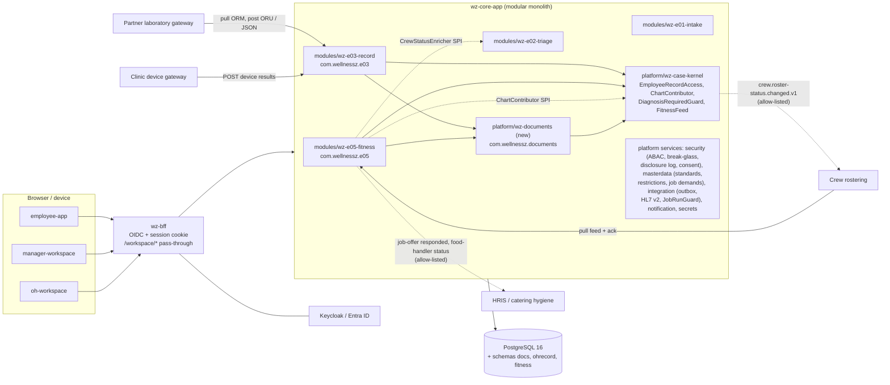

| Component | Responsibility in Increment 2 |
|---|---|
| `platform/wz-documents` (new) | Template catalogue (`DocumentTemplates`), PDF rendering and text extraction (`PdfRenderer`, Apache PDFBox), e-signature and versioning, sharing with disclosure logging, consent listener, scanned documents, OCR SPI (`OcrProvider`, optional `TesseractOcrProvider`), blind-index search, retention schedule and legal hold (`RetentionService`) |
| `platform/wz-case-kernel` | `EmployeeRecordAccess` (ABAC for employee-level records that are not cases), `ChartContributor` SPI, `DiagnosisRequiredGuard`, primary coded diagnosis on the case, `FitnessFeed` (validity, review date, operational limitations), `RosterStatusChanged` event and `FitnessPublicationListener` SPI |
| `platform/wz-security` | Break-glass grants and DPO review, disclosure log, `AI_DOCUMENTATION` consent purpose, `ConsentWithdrawalListener` SPI, restricted-class policy honouring active break-glass grants |
| `platform/wz-masterdata` | Versioned fitness standards, restriction catalogue, job-demand profiles (`FitnessMasterDataController`) |
| `platform/wz-notification` | Content-free templates for the new events; `SecurityAlertListener` (break-glass alert to the DPO) |
| `platform/wz-integration` | `JobRunGuard` (`platform.scheduled_job_run`): daily jobs run once per day across replicas |
| `modules/wz-e03-record` | Chart, record lists, ODH job history, FHIR / ODH export, encounters and templates, terminology, orders / results / devices / HL7, CDS, AI assistant SPI, rule-based case summary |
| `modules/wz-e05-fitness` | Fitness decisions and sign-off, crew assessment, matching and duty proposals, RTW plans and reviews, job offers, roster feed log and dashboard, food handlers, restriction expiry, IHR and appeals, daily jobs, chart contribution |
| E01 / E02 changes | Crew declaration response carries next steps, AME contact and acknowledgement due time (`TriggerService`); `CrewStatusEnricher` SPI lets E05 enrich `/status/crew` without E02 depending on E05 |
| `apps/wz-bff` | `ApiProxyController` passes the core `/workspace/team-restrictions`, `/workspace/duty-proposals`, `/workspace/rtw-plans` and `/workspace/documents` through unchanged (the Increment-1 `/workspace/` alias is otherwise still stripped) |

### 4.2 Boundaries enforced by ArchUnit

`apps/wz-core-app/src/test/java/com/wellnessz/app/ArchitectureTest.java` fails the build when a boundary is crossed.
New or extended rules for Increment 2:

| Rule | Effect |
|---|---|
| `platformDoesNotDependOnBusinessModules` | Common, secrets, security, masterdata, integration, notification and analytics never depend on the kernel, documents, E01, E02, E03 or E05 |
| `kernelDoesNotDependOnBusinessModules` | Kernel never depends on E01/E02/E03/E05 or documents – modules plug in through `CaseModule`, `CaseTransitionGuard`, `ChartContributor`, events |
| `documentServiceIsAPlatformService` | The document service never depends on E01, E02, E03 or E05 – both E03 and E05 use it |
| `recordAndFitnessModulesAreIndependent` | E03 never depends on E05 (E05 contributes to the chart through `ChartContributor`) |
| `fitnessDoesNotDependOnRecord` | E05 never depends on E03; shared needs (diagnosis, documents, standards) go through kernel, document service and master data |
| `earlierModulesDoNotDependOnLaterOnes` | E01 / E02 never depend on E03 / E05 (E05 enriches crew status through `CrewStatusEnricher`) |
| Increment-1 rules kept | `intakeDoesNotDependOnTriage`, `intakeDoesNotCallCaseKernelDirectly`, `commonHasNoSpringSecurity`, `noStandardStreams` |

`E03Module` and `E05Module` register with the module registry like E01 / E02.

### 4.3 Service provider interfaces (SPIs)

| SPI | Owner | Implemented by | Purpose |
|---|---|---|---|
| `ChartContributor` | kernel | `FitnessChartContributor` (E05) | Adds `fitness` and `restrictions` sections to the chart summary; returns nothing for non-OH callers |
| `CaseTransitionGuard` | kernel | `DiagnosisRequiredGuard` (kernel, new) | Blocks closure of clinical case types without a coded diagnosis (`422 diagnosis_required`); switch `wellnessz.case.diagnosis-required-on-close` |
| `FitnessPublicationListener` | kernel | `RosterFeedLog` (E05) | Logs every roster message in the same transaction for acknowledgement and reconciliation |
| `CrewStatusEnricher` | E02 | `RosterFeedLog` (E05) | Adds roster status, validity and operational limitations to `GET /status/crew` |
| `ConsentWithdrawalListener` | security | `DocumentConsentListener` (documents) | Revokes partner shares made under a withdrawn consent |
| `OcrProvider` | documents | `TesseractOcrProvider` (optional) | Local OCR of scanned images; a hosted OCR service could be added as another bean |
| `AiDocumentationProvider` | E03 | none shipped | Turns a consented transcript into a draft note; activated by `wellnessz.record.ai.provider` |

### 4.4 Internal and outbound events

All cross-module communication uses the transactional outbox (at-least-once, idempotent consumers). Outbox payloads
are encrypted at rest (`v1:` prefix).

| Event | Producer | Consumers / destination |
|---|---|---|
| `encounter.signed.v1` | E03 | Internal (audit trail of signing; available to later modules) |
| `result.received.v1` | E03 | Internal |
| `fitness.decision.made.v1` | E05 | In-process only |
| `fitness.status.changed.v1` (extended with `validFrom`, `reviewDate`, `messageId`) | Kernel | `hr-systems`, `catering-hygiene` (food handlers) – allow-listed |
| `crew.roster-status.changed.v1` | Kernel (`RosterStatusChanged`) | `crew-rostering` – allow-list `messageId, employeeId, fitnessStatus, rosterStatus, restrictionUntil, validFrom, validUntil, operationalLimitations, effectiveFrom` |
| `fitness.restriction.expiring.v1` | E05 | Internal |
| `fitness.job-offer.responded.v1` | E05 | `hr-systems` – `messageId, employeeId, offerId, accepted, respondedAt` |
| `fitness.food-handler.status.changed.v1` | E05 | `catering-hygiene` – `foodHandlerStatus, excludedFrom, expectedReturn` (+ status fields) |
| `integration.inbound.received.v1` (HL7 v2 ORU) | Integration | E03 `OruResultListener` (exactly once per inbound message) |

---

## 5. Platform document service (E03-F06, used by E03 and E05)

### 5.1 Templates

`DocumentTemplates` defines ten templates. Each declares merge fields (required flag, maximum length), generator roles,
signer roles, a record class for retention and whether it **contains clinical content**. Wording is a draft for DPO /
CMO approval.

| Template | Clinical? | Shareable with | Generators → signers | Record class |
|---|---|---|---|---|
| `FITNESS_CERTIFICATE` | no | employee, manager, HR | OH roles → clinicians | FITNESS_CERTIFICATE |
| `RESTRICTION_NOTE` | no | employee, manager, HR | OH roles → clinicians | FITNESS_CERTIFICATE |
| `FOOD_HANDLER_CLEARANCE` | no | employee, manager, HR | OH roles → clinicians | FITNESS_CERTIFICATE |
| `RTW_PLAN` | no | employee, manager, HR | OH roles → clinicians | CORRESPONDENCE |
| `JOB_OFFER` | no | employee (issued by HR) | HR, OH clinician, case manager, Nursing Head → HR, Nursing Head | CORRESPONDENCE |
| `IHR_DECISION_LETTER` | no | employee, HR | CMO → CMO | CORRESPONDENCE |
| `REFERRAL_LETTER` | **yes** | employee, partner (consent) | OH roles → clinicians | CORRESPONDENCE |
| `CABIN_CREW_MEDICAL_REPORT` | **yes** | employee | AME, CMO → AME, CMO | AEROMEDICAL_RECORD |
| `CREW_MEDICAL_REPORT` | **yes** | employee | AME, CMO → AME, CMO | AEROMEDICAL_RECORD |
| `RESULT_LETTER` | **yes** | employee | OH roles → clinicians | OH_RECORD |

Merge fields of every **non-clinical** template pass the clinical-text guard (`ClinicalContentException.screen`); a
diagnosis such as "Lumbar disc prolapse" in the restrictions field is rejected with `422 clinical_content_not_allowed`
and the offending `field` (test `certificateIsGeneratedSignedAndSharedWithoutClinicalContent`). Unknown fields, missing
required fields and over-long values are rejected with 400.

### 5.2 Generation, numbering and rendering

`POST /documents/generate` renders a DRAFT PDF with Apache PDFBox (A4, wrapped paragraphs, page numbers, footer
"CONFIDENTIAL – Occupational Health medical-in-confidence" or "CONFIDENTIAL – contains no clinical information").
Documents are numbered `DOC-YYYY-NNNNNN` from `docs.document_sequence` (atomic upsert). The default font is Helvetica
(Latin script); set `wellnessz.documents.font-path` to a Unicode TrueType font (for example Noto Sans with Noto Naskh
Arabic) to render Arabic. PDF content, merge fields and extracted text are stored encrypted at field level.

### 5.3 E-signature and integrity

* `POST /documents/{id}/sign` – only DRAFT documents; the caller must hold one of the template's signer roles. The
  content SHA-256 is recorded at render time; the signature hash is SHA-256 over `contentHash | signer | timestamp`.
  A signed document is immutable (`409 not_draft` on re-sign).
* `POST /documents/{id}/new-version` creates a new DRAFT version in the same series; when it is signed, the previous
  signed version becomes SUPERSEDED **and its shares are revoked** (test: the manager can no longer download version 1).
* Scanned documents and photos are recorded as signed on upload (hash of the bytes and uploader) so their integrity is
  verifiable.

### 5.4 Sharing rules

| Target | Rule |
|---|---|
| EMPLOYEE | Any signed document except photos; employee sees it in *My documents* and can acknowledge certificates, restriction notes, clearances and crew medical reports |
| MANAGER | Only templates with `containsClinical=false`; recipient is the employee's HRIS line manager (`400 no_manager` if none); manager sees it only while the share is active |
| HR | Only non-clinical templates; visible to HR users whose org scope covers the employee |
| PARTNER | Requires a partner code (`[A-Z0-9_]{2,40}`) and the employee's **active** `TREATMENT_SHARING_PARTNER` consent (`422 consent_required` otherwise); the partner user's `org_scope` must end with that code; access is re-checked against the consent on every read |
| Photos | Never shared outside OH (`403`) |
| HR as issuer | HR may generate, sign and share only the non-clinical templates it is a generator of (the job offer), only to the employee, only for employees in its org scope |

Every share other than to the employee writes the **disclosure log** (recipient type and name, document title and
number, purpose FITNESS_FOR_WORK or TREATMENT, consent ID, discloser). Revoking a share marks the disclosure revoked.
Employees and managers receive content-free notifications (`certificate.available`, `document.shared`) with a portal
link. Downloads (`GET /documents/{id}/content`) are audited and served with `Cache-Control: no-store`; for employee,
manager, HR and partner callers the response omits `shares` and `createdBy`.

### 5.5 Scanned documents, text extraction and OCR (E03-BL-016)

`POST /documents/scan` (OH roles and `CLINIC_RECEPTION`; reception files documents without being able to read the
record): multipart PDF, JPEG or PNG, 1 byte–10 MB, type verified by magic bytes. Text is taken from the PDF text layer
(first 50 pages) or, for images, from the configured `OcrProvider`. The document is classified by keywords (discharge
summary, audiometry, spirometry, imaging, laboratory, physiotherapy, specialist letter, unclassified) and titled
"External document – <type>". **Limitation:** image-only PDFs (the usual output of a scanner) are not OCR'd, and images
are only OCR'd when Tesseract is installed and configured (Section 29).

`TesseractOcrProvider` runs the Tesseract command line locally (no data leaves the host): the binary must be one of
three fixed install paths and the language list one of six fixed values (`eng`, `ara`, `fra` and combinations); input
is a private temporary file deleted afterwards; the process is limited to 60 seconds and 1 MB of output. This is the one
new, justified SpotBugs exclusion (`COMMAND_INJECTION`).

### 5.6 Search over encrypted text without a plaintext index

Extracted text is encrypted, so a normal full-text index would leak it. Instead each normalised word (3–40 letters or
digits) is turned into a **keyed blind-index token** – a keyed hash of `doc-search:<word>` produced by the platform
`FieldEncryptor` – and only the tokens are stored in `docs.document.search_vector` (PostgreSQL `tsvector`, GIN index).
A query is tokenised the same way and matched with `to_tsquery`; snippets are cut from the decrypted text only for the
authorised caller. The test `scannedReportsAreClassifiedAndSearchableWithoutAPlaintextIndex` asserts that the stored
vector contains none of the words and the stored text starts with `v1:` (ciphertext). Trade-offs: equality on whole
words only (no stemming, prefix or fuzzy search); token frequency is visible to a database administrator who holds no
key.

### 5.7 Retention and legal hold (E03-BL-017)

`docs.retention_schedule` holds one rule per record class (years, trigger, legal basis, approver). The seeded values
are **proposals pending DPO / CMO approval**:

| Record class | Proposed years | Trigger |
|---|---|---|
| OH_RECORD | 40 | LAST_ENCOUNTER |
| EXPOSURE_RECORD | 40 | DOCUMENT_DATE |
| AEROMEDICAL_RECORD | 10 | DOCUMENT_DATE |
| FITNESS_CERTIFICATE | 6 | DOCUMENT_DATE |
| CORRESPONDENCE | 6 | DOCUMENT_DATE |
| PHOTO | 6 | DOCUMENT_DATE |
| EXTERNAL_REPORT | 10 | DOCUMENT_DATE |

Only the DPO may change a rule (`PUT /documents/retention/{recordClass}`), which records the DPO as approver. A daily job
(`wellnessz.documents.retention-cron`, default 02:30 UTC, single run across replicas) and `GET /documents/retention/due`
list documents past retention and **not on legal hold**; nothing is deleted automatically – destruction is a reviewed
decision. Legal hold (`POST/DELETE /documents/{id}/legal-hold`, DPO, with reason) applies to every version of the
series. Limitations: only the document-date trigger is evaluated (LAST_ENCOUNTER and EMPLOYMENT_END need HRIS end dates);
structured record rows (problems, results, encounters) are not yet covered.

---

## 6. Master data for fitness (E18 content used by E03 and E05)

| Table / API | Content | Maintained by |
|---|---|---|
| `masterdata.fitness_standard` – `GET/PUT /masterdata/fitness-standards` | 12 standards with title, role category, source, reference URL, validity months (and shorter validity over 40 where applicable), sign-off role (AME for CAA Class 1/2 and cabin crew) and allowed limitation codes. Every PUT creates a **new version**; decisions record the version used | OH_ADMIN, CMO |
| `masterdata.restriction` – `GET/PUT /masterdata/restrictions` | 16 functional restrictions on 16 demand dimensions (lifting kg, push/pull kg, climbing, height / ladders, airside driving, night duty, knife work, chemicals, respirator, noise, heat, flight duty, open food, hours per day, screen hours, safety-critical duties); value-bearing ones (`LIFT_MAX_KG`, `PUSH_PULL_MAX_KG`, `MAX_HOURS_PER_DAY`, `MAX_SCREEN_HOURS`) require a value | OH_ADMIN, NURSING_HEAD |
| `masterdata.job_demand_profile` – `GET/PUT /masterdata/job-demands`, `POST …/import` | **28** representative profiles across FLT, CAB, GND, CGO, CAT, DF, DIST, ENG, SEC, HOSP, TRN, CORP with numeric and boolean demands and sitting level; bulk JSON import validates dimensions (an unknown dimension such as `DIAGNOSIS` is rejected). The workbook target is the top 150 job codes validated with unit managers – pending (E05-BL-004) | OH_ADMIN (import), NURSING_HEAD |

---

## 7. E03-F01 – Employee OH chart

* `GET /employees/{id}/chart` returns the **summary**: HRIS identity (job, department, subsidiary, location, safety
  category), alerts (ALLERGY with criticality, OVERDUE_SURVEILLANCE, ABNORMAL_RESULT), fitness and restrictions
  (contributed by E05 through `ChartContributor`), open cases, surveillance due per hazard (programme, last done, due
  date, overdue – computed from the hazards of the employee's job code and their surveillance interval, satisfied by a
  matching result), immunisations, counts (problems, medications, allergies, results, unacknowledged abnormal,
  documents, unsigned encounters) and `restrictedItemsHidden`. The integration test asserts < 2 s; the demo chart for
  E1004 (Rami Ramp) is seeded by `db/demo/R__demo_e03_record.sql` (local / test profiles only).
* Tabs: problems (coded, status, onset / resolved, work-related YES / NO / UNDER_REVIEW), medications (CDS on save),
  allergies, immunisations, **jobs and exposures**, results and orders, documents, encounters, record timeline.
* **ODH job history (E03-BL-003)** – the current job is synchronised from the HRIS master on chart read (source HRIS,
  hazards from the job catalogue); when HRIS reports a new job code the previous HRIS entry is closed and a new current
  entry created. Clinicians add earlier jobs manually (employer, industry, dates, duties, weekly hours, hazards from the
  hazard catalogue).
* **Exports** – `GET /employees/{id}/odh` returns a FHIR R4 collection Bundle of ODH Observations (PastOrPresentJob
  LOINC 11341-5, UsualWork 21843-8, exposures); `GET /employees/{id}/fhir` returns Patient, Condition,
  AllergyIntolerance, MedicationStatement, Immunization, Observation, DocumentReference and Encounter
  (`application/fhir+json`). Both are parsed as valid R4 by the HAPI FHIR parser in the integration test. Procedure,
  Consent, Task and ServiceRequest are not yet mapped.
* Clinical free text (notes, reactions, values) is encrypted; codes stay in clear for search and aggregation. The
  runtime role has no DELETE on clinical tables – corrections are status changes.

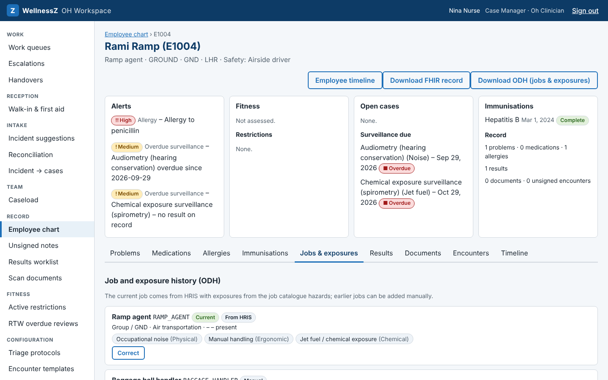

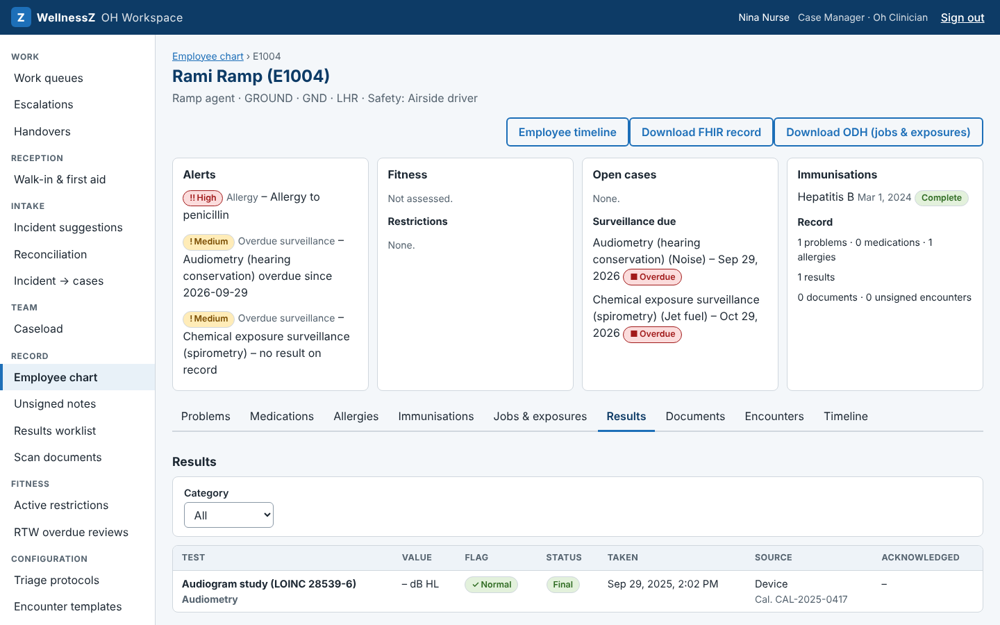

---

## 8. E03-F02 – Encounter templates, body map, signature and addenda

### 8.1 Templates

Eight versioned JSON templates (`modules/wz-e03-record/src/main/resources/encounter-templates/`), all **DRAFT pending
CMO approval** (`POST /encounter-templates/{type}/approve`, CMO only; the UI shows "This template version is awaiting
CMO approval").

| Template | Sections | Fields (required) | Body map | Diagnosis required to sign | Fitness-standard prompt |
|---|---|---|---|---|---|
| INJURY | 3 | 14 (6) | required | yes | – |
| ILLNESS | 3 | 13 (5) | – | yes | – |
| FITNESS_ASSESSMENT | 4 | 16 (5) | – | – | yes |
| SURVEILLANCE_EXAM | 3 | 8 (4) | – | – | – |
| MENTAL_HEALTH | 2 | 8 (4) | – | yes | – |
| TRAVEL | 2 | 9 (3) | – | – | – |
| CREW_AEROMEDICAL | 4 | 18 (6) | – | – | yes |
| FOOD_HANDLER | 2 | 10 (5) | – | – | yes |

Field types: TEXT, TEXTAREA, NUMBER, SELECT, MULTISELECT, BOOLEAN, DATE, CODE. The server rejects unknown fields and
invalid option values (400). Mental-health encounters are classified RESTRICTED_CLINICAL and may only be created by
`PSYCH_CLINICIAN`.

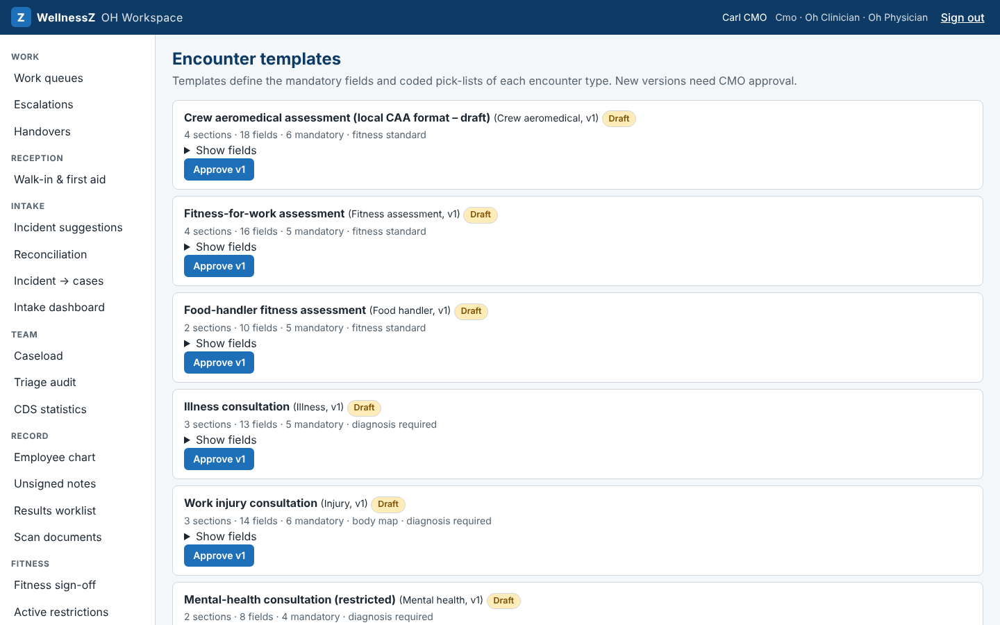

### 8.2 Documenting and signing

* `PUT /encounters/{id}` (author only, while DRAFT) saves answers, SOAP (subjective, objective, assessment, plan –
  encrypted), body map, coded diagnoses (one primary) and optionally a fitness standard. Coded child rows are
  deactivated, not deleted, on edit.
* **Body map (E03-BL-005)** – front / back view, multiple sites, laterality within the region code (e.g. `LEFT_KNEE`),
  mechanism from a 12-value pick-list (fall, struck by, caught between, lifting, push/pull, slip/trip, cut, heat burn,
  chemical burn, repetitive, vehicle, other). Each site is stored as a coded observation in
  `ohrecord.encounter_observation` (local code system `WZ_BODY_MAP`; mapping to SNOMED CT body-structure codes is a
  later refinement).
* **Primary diagnosis** – the primary coded diagnosis is copied to the case (`casemgmt.oh_case.primary_diagnosis_*`), which
  satisfies `DiagnosisRequiredGuard` at case closure.
* **Sign (E03-BL-006)** – author only; pre-sign checks return `422 mandatory_fields_missing` with the field list,
  `diagnosis_required` or `body_map_required`. The signature is SHA-256 over a canonical JSON of encounter ID, employee,
  case, type, template version, answers, SOAP, body map, diagnoses, signer and time. A signed encounter is locked
  (`409 encounter_locked`); `encounter.signed.v1` is published.
* **Addenda** – any clinician may add an addendum to a signed encounter; each addendum is itself hashed (chained to the
  encounter signature) and immutable.
* **Entered in error** – author or CMO, with reason; removed from the unsigned list.
* **Unsigned reminders** – `GET /encounters/unsigned?mine=` lists drafts older than `wellnessz.record.unsigned-after`
  (default 1 h); own drafts, or all for Nursing Head / CMO. This is an on-screen reminder list; no e-mail reminder.
* **Photos (E03-BL-007)** – `POST /encounters/{id}/photos` requires `consent=true` (`400 consent_required` otherwise),
  JPEG / PNG ≤ 10 MB, optional body region; stored as a PHOTO document (never shareable), listed on the encounter and
  in the record timeline as a document entry (no thumbnail rendering yet).

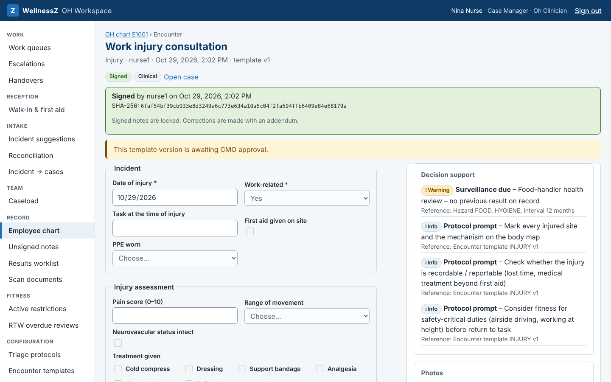

---

## 9. E03-F03 – Terminology services

| Function | Design |
|---|---|
| Search | `GET /terminology/search?system&q&limit` – word-prefix search on the display (GIN index on `to_tsvector('simple', display)`) and code prefix; inputs are bound parameters (an injection attempt returns an empty list). Integration test asserts < 1 s; the 300 ms target has not been formally load-tested |
| Content | `platform.code_concept` starter subset seeded by V7: about 120 ICD-10, 50 SNOMED CT and 40 LOINC concepts. **Development and demo content only** – production loads the licensed national editions |
| Favourites | Role starter sets (`ohrecord.term_favourite`, owner type ROLE) plus personal favourites; a user cannot create role favourites (403). Favourites reach a code in one selection |
| Recent | Last 20 codes the user coded (from `ohrecord.term_usage`) |
| Mappings | `GET /terminology/mappings` – local reporting category by longest code prefix (about 70 seeded prefixes, e.g. A02.0 → FOOD_HANDLER_NOTIFIABLE, H83.3 → NOISE_INDUCED_HEARING_LOSS); draft pending CMO approval |
| Annual update | `POST /terminology/concepts/import?version&licence` (OH_ADMIN) upserts concepts and deactivates retired ones; every load is recorded in `platform.terminology_release` with version, licence text, count, user and time (`GET /terminology/releases`) |
| Closure rule | Clinical cases cannot close without a coded diagnosis (Section 4.3) |

There is no external terminology server; concepts are held in the platform database. An update runbook for the
licensed editions is still to be written (E03-BL-008).

---

## 10. E03-F04 – Orders, results and device integration

### 10.1 Orders

* Order sets (`order-sets.json`): NOISE_SURVEILLANCE, SPIROMETRY_BASELINE, FOOD_HANDLER_SCREEN, PRE_PLACEMENT_BLOODS (6
  items), HEP_B_IMMUNITY, CHEMICAL_EXPOSURE, VISION_SCREEN, RESTING_ECG.
* `POST /employees/{id}/orders` (physicians, OH clinicians) with an order set or LOINC items, priority ROUTINE / URGENT
  and optional clinical note; numbered `ORD-YYYY-NNNNNN`. LAB / IMAGING orders are QUEUED with an HL7 v2 **ORM^O01**
  message for the laboratory gateway; device orders (audiometry, spirometry, vision, ECG) are SENT directly.
* Duplicate-test CDS: the same code within 30 days returns `409 cds_alert DUPLICATE_TEST` unless overridden with a reason.
* Cancel – ordering clinician only.

### 10.2 Results

* JSON results (`POST /integration/lis/results`) and HL7 v2 **ORU^R01** through `/integration/hl7v2` are processed the
  same way: matched to the order by placer order number (the employee must match – a mismatch is `422`), order status
  PARTIAL / RESULTED, flag from the interpretation code or the reference range (NORMAL, LOW, HIGH, ABNORMAL, CRITICAL –
  LL/HH = critical), source LIS / DEVICE / MANUAL.
* Substance-testing results (LOINC `5643-2`, `19659-3`, configurable `wellnessz.record.restricted-result-codes`) are
  stored in the **restricted class**.
* An abnormal result sends the ordering clinician a content-free `result.abnormal` e-mail (no test name or value).

### 10.3 Device capture

`POST /employees/{id}/results/device` (OH roles or `INTEGRATION` for a device gateway). A **calibration ID is
mandatory** when a device ID is given (`400 calibration_required`); manual entry without a device is allowed (source
MANUAL).

| Device | Rule |
|---|---|
| Audiometry | Thresholds L/R 500–8000 Hz. The first audiogram is the baseline. **Standard threshold shift**: average change ≥ 10 dB at 2, 3 and 4 kHz in either ear versus baseline → ABNORMAL with `detail.sts {left,right}` and `baselineId` |
| Spirometry | FEV1/FVC < 0.70 or FEV1 < 80 % predicted → ABNORMAL (LOINC 19926-5) |
| Vision | Binocular worse than 6/12 or colour plates < 12/15 → ABNORMAL |
| ECG | Interpretation ABNORMAL or BORDERLINE → ABNORMAL |

The interface is a JSON contract for a device gateway; device-specific drivers (serial, USB, vendor APIs) are not part of
this increment (E03-BL-011).

### 10.4 Abnormal-result worklist (E03-BL-012)

`GET /results/worklist` lists unacknowledged abnormal or critical results with age and an `overdue` flag (> 72 h,
`wellnessz.record.result-overdue-after`). `POST /results/{id}/acknowledge` records an action (NO_ACTION, REPEAT_TEST,
REFER, FOLLOW_UP_APPOINTMENT, FITNESS_REVIEW) and note, once only (`409` on a second acknowledgement). An hourly job
(`wellnessz.record.overdue-cron`) escalates each overdue result **once** to the CMO with a content-free `result.overdue`
e-mail. `POST /results/{id}/letter` drafts a RESULT_LETTER (clinical, never shareable with managers).

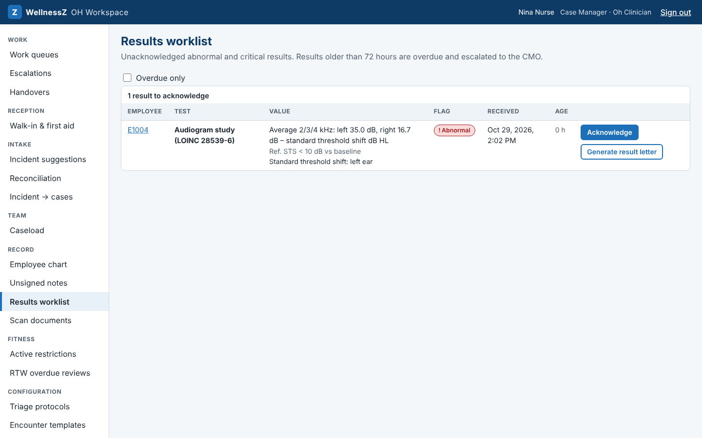

---

## 11. E03-F05 – Clinical decision support

| Alert | Trigger | Severity | Data |
|---|---|---|---|
| `ALLERGY_CLASS` | Medication (reported or administered) whose drug class matches a recorded allergy, or a cross-reactive class (penicillin → cephalosporin) | CRITICAL / WARNING | `ohrecord.drug_class` (about 55 drug names → classes), `ohrecord.cds_rule` |
| `INTERACTION` | Active medication class pair in the interaction table (13 rules, e.g. anticoagulant + NSAID, SSRI + tramadol, opioid + benzodiazepine, statin + macrolide, methotrexate + trimethoprim) | CRITICAL / WARNING | `ohrecord.cds_rule` (draft, pharmacist review pending) |
| `DUPLICATE_TEST` | Same order code within 30 days | WARNING | Orders |
| `SURVEILLANCE_DUE` | Hazard surveillance due / never done for the employee's job | WARNING | Job catalogue hazards |
| `DURATION_EXCEEDED` | Case duration longer than the guideline for the primary ICD-10 code | WARNING | `triage.duration_guideline` (8 illustrative rows) |
| `PROTOCOL_PROMPT` | Template-defined prompts (e.g. mark every injured site, check recordability, consider safety-critical fitness) | INFO | Encounter template |
| `FITNESS_STANDARD` (E03-BL-014) | Fitness assessment, crew aeromedical and food-handler encounters: the standard for the employee's safety category is linked (code, title, version, source, reference URL, sign-off role); the clinician can choose another standard | INFO | Fitness standards |

Blocking alerts (allergy, interaction, duplicate test) return `409 code=cds_alert` with the alert list; the request
succeeds only when it carries an override **with a non-blank reason for every alert** (blank reason → 400). Every firing
and override is logged in `ohrecord.cds_alert_log`. `GET /cds/statistics` (CMO, Nursing Head) reports fired, overridden,
overridden without reason (always 0 by design) and override rate by code.

---

## 12. E03-F06 – Documents in the record

The record uses the platform document service (Section 5): documents tab on the chart and on the case, generation with a
dynamic merge-field form, signing (hash shown), versions, sharing, revoking, PDF download, scan / upload and full-text
search with snippets. Fitness certificates are generated automatically by an E05 decision (Section 16); RTW plans,
job offers, clearances, crew reports and IHR letters by their E05 workflows.

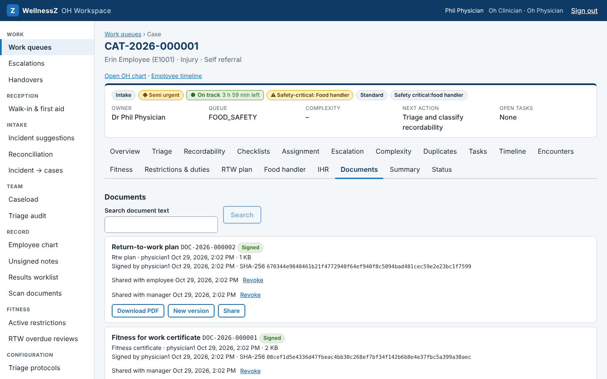

---

## 13. E03-F08 – Record segregation and disclosure control

| Control | Design |
|---|---|
| Domain separation | The OH record lives in schema `ohrecord`, documents in `docs`, fitness in `fitness`; HR data stays in the HRIS. HR and managers never call record APIs – their only views are `/workspace/*` status projections. Primary-care records are not held. |
| Role matrix (E03-BL-020) | Every record endpoint is `@PreAuthorize` OH roles or clinicians; every read goes through `EmployeeRecordAccess` (ABAC with the employee's HRIS org path). Denied reads return **404** and are audited as DENIED. |
| Negative tests | `f08HrManagersEmployeesAndReceptionNeverOpenClinicalRecords`: HR, manager, reception, the employee and the DPO get 403 / 404 on chart, problems, allergies, medications, immunisations, jobs, encounters, results, orders, FHIR, ODH and record timeline; HR reads are audited (`CHART_READ` DENIED); case managers read but cannot write |
| Restricted class | Mental-health encounters and substance-testing results are RESTRICTED_CLINICAL: hidden from non-psychological clinicians (counted in `restrictedItemsHidden` and the `X-Restricted-Items-Hidden` header), visible to `PSYCH_CLINICIAN`, the data subject's own views, or a clinician with an active break-glass grant |
| Break-glass (E03-BL-021) | Section 24.2 |
| Disclosure log and consent (E03-BL-022) | Section 24.3 |

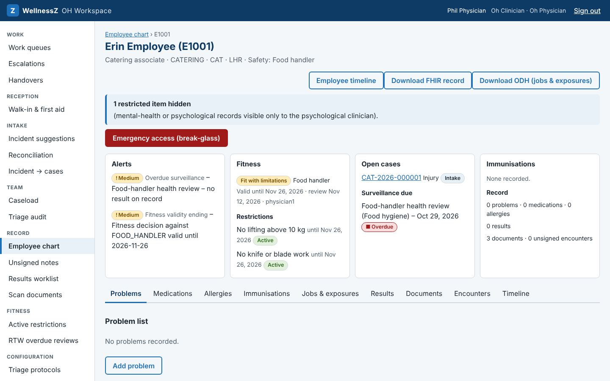

---

## 14. E03-F07 – AI documentation assistant (framework)

The assistant is **consent-gated, draft-only and audited**, and ships **without any provider enabled**.

1. `POST /encounters/{id}/ai-consent` – the clinician records the employee's verbal consent (`verbal` must be true,
   statement ≤ 1000 characters); a consent with purpose `AI_DOCUMENTATION` is created on the employee's behalf and linked
   to the encounter; audit `AI_CONSENT_CAPTURED`.
2. `POST /encounters/{id}/ai-draft` with a transcript (≤ 50,000 characters) – only for DRAFT encounters; without an
   active consent → `409 consent_required` (audited DENIED); without a configured provider → `503 ai_not_configured`
   (audited FAILURE). The provider receives the encounter type, template version, the field keys it may fill and the
   transcript, and returns SOAP and answers. Audit `AI_DRAFT` records provider and transcript length (not the content).
3. The draft is **never saved automatically**. The clinician inserts parts explicitly, edits and saves; saving with
   `aiAssisted=true` flags the encounter (visible as a badge in lists) and is audited `ENCOUNTER_AI_ASSISTED`. The
   clinician signs as usual.
4. `GET /cases/{id}/summary` is a **rule-based, non-AI** handover summary (key dates, diagnoses, fitness, restrictions,
   open tasks, last encounter) with `generator: RULE_BASED`.

The provider SPI contract states that implementations must not retain transcripts and may process data only in
approved hosting locations. There is no audio capture in the platform: the input is a transcript produced by the
chosen capture solution.

---

## 15. E03-BL-018 – AI documentation assistant evaluation (spike output)

### 15.1 Question

Which approach should Occupational Health pilot to reduce documentation time by 30 % (E03 KPI) without weakening
medical confidentiality: a **locally hosted ambient scribe** (speech capture, transcription and note drafting running
inside the group's own infrastructure) or a **vendor software-as-a-service ambient scribe**? The platform side is
already built (Section 14); the spike decides the provider.

### 15.2 Options compared

| Criterion | A. Locally hosted ambient scribe | B. Vendor SaaS ambient scribe |
|---|---|---|
| Data location | Audio, transcript and draft stay on group infrastructure (on-premises GPU nodes or the group's private cloud tenancy in an approved region) | Audio and transcript processed by the vendor, possibly with sub-processors; region commitments and data-residency terms must be contractual |
| Special-category data (GDPR Art. 9 / local PDP law) | Group remains sole controller; no international transfer if hosted in-country | Vendor is processor; requires DPA, transfer assessment, sub-processor list, deletion and no-training commitments |
| Retention | Fully controlled; transcripts can be discarded once the note is signed (the SPI requires no retention) | Depends on contract; must be zero retention or short, verifiable deletion |
| Accuracy (occupational vocabulary, accents, Arabic / French / English, clinic noise) | Depends on the chosen open models and local tuning; needs in-house ML operations | Typically strong for English clinical speech; occupational / aviation terms and Arabic must be tested |
| Integration | Implement `AiDocumentationProvider` against an internal endpoint; template field keys passed in | Implement `AiDocumentationProvider` against the vendor API; same contract |
| Cost profile | Capital and operations (hardware, MLOps, security patching), low marginal cost | Per-clinician or per-encounter subscription; low start-up effort |
| Time to pilot | Longer (infrastructure, model evaluation) | Short |
| Security assurance | Covered by the group ISO 27001 scope; penetration test of the new service | Vendor SOC 2 Type II / ISO 27001 evidence, pen-test reports, right to audit |
| Exit / lock-in | Low | Medium – mitigated by the provider SPI (switching provider is a configuration change) |

The workbook notes the organisation may already run a locally hosted ambient-scribe approach; if it exists, Option A
re-uses it and removes most of its start-up cost.

### 15.3 Privacy and DPIA considerations (draft for the DPO)

A Data Protection Impact Assessment is mandatory before any processing of consultation audio. Draft content:

| DPIA element | Draft position |
|---|---|
| Purpose and lawful basis | Drafting the clinician's note of an occupational health consultation; explicit consent of the employee for the AI processing (purpose `AI_DOCUMENTATION`), in addition to the OH legal basis for the record itself |
| Data | Consultation audio (transient), transcript (transient), draft note; special-category health data; possibly third-party data mentioned in conversation |
| Necessity and proportionality | Optional per consultation; never for restricted-class (psychological, substance) consultations during the pilot; clinician can stop capture at any time |
| Consent | Captured per encounter before capture starts; refusal has no consequence for care; withdrawal stops further drafts (the platform checks consent on every draft request) |
| Human oversight | Draft-only; nothing is saved without clinician action; clinician signs and is accountable; AI involvement flagged on the encounter and in the audit trail |
| Retention | Audio deleted immediately after transcription; transcript deleted after the note is signed; drafts not stored by the platform |
| Security | Encryption in transit and at rest; provider endpoint inside the approved network zone; no transcript in logs (platform logs only length) |
| Transfers / processors | Option A: none. Option B: DPA, transfer impact assessment, sub-processor list, no use of data for vendor model training |
| Data subject rights | Information notice in the employee app; consent visible in *My consents*; access requests cover the signed note |
| Risks | Inaccurate content signed without review (mitigated by mandatory review and pilot accuracy monitoring); over-capture of non-clinical conversation; bystander voices; vendor breach (Option B) |
| Residual risk and sign-off | To be rated by the DPO; Cyber GRC to review the hosting and vendor evidence |

### 15.4 Accuracy and clinician acceptance criteria for the pilot

| Measure | Target |
|---|---|
| Draft available after the consultation | ≤ 60 s (workbook acceptance criterion) |
| Clinically significant errors in the draft (wrong side, wrong drug or dose, fabricated finding) found at review | 0 left in signed notes; < 1 per 20 drafts before review |
| Proportion of draft text kept after clinician editing | ≥ 70 % |
| Documentation time per encounter | −30 % versus the pre-pilot baseline for the same clinicians and encounter types |
| Clinician satisfaction | ≥ 4 / 5 |
| Employee consent rate and complaints | Monitored; any complaint reviewed by the DPO |
| Multilingual quality | Arabic and French consultations evaluated separately before inclusion |

### 15.5 Recommendation

1. Run a **pilot with five clinicians** (for example two OH nurses, two OH physicians, one AME) for eight weeks on
   non-restricted encounter types (injury, illness, surveillance exam, travel), English first.
2. Prefer **Option A (locally hosted)** if the group's existing ambient-scribe capability can be reused or provisioned in
   time; otherwise **Option B** with a zero-retention, no-training, in-region contract – both behind the existing
   `AiDocumentationProvider` SPI.
3. Prerequisites: DPIA approved by the DPO; information notice and consent wording approved; provider security review by
   Cyber GRC; pilot clinicians briefed that drafts must be reviewed line by line.
4. The platform already enforces what the pilot needs: per-encounter consent (`AI_DOCUMENTATION`), draft-only responses,
   explicit insertion, the `aiAssisted` flag and audit events `AI_CONSENT_CAPTURED`, `AI_DRAFT`, `ENCOUNTER_AI_ASSISTED`.
   What remains is the provider bean, the capture front-end that produces the transcript, and pilot measurement.
5. Go / no-go after the pilot against Section 15.4; scale-out decision by the CMO with the DPO.

---

## 16. E05-F01 – Fitness decision module

### 16.1 Recording a decision

`POST /cases/{id}/fitness-decisions` with standard, outcome, limitation codes, catalogue restrictions (with values where
required), valid from / until, review date, OH-only rationale (≤ 4000 characters, encrypted), duration override reason
and optional encounter.

| Rule | Behaviour |
|---|---|
| Licensed standards | Standards with sign-off role AME (CAA Class 1/2, cabin crew) can be decided only by AME or CMO; nurses and other physicians get 403 |
| Nurses | `OH_CLINICIAN` may decide non-licensed standards only |
| FIT_WITH_LIMITATIONS | Requires at least one restriction or limitation code (`422 limitation_required`); value-bearing restrictions need a value (`400 restriction_value_required`) |
| Validity | `validFrom` defaults to today; `validUntil` defaults from the standard (shorter over-40 validity applies when the age is known – the HRIS feed has no date of birth today) |
| Permanent unfitness | Saved as AWAITING_SIGNOFF; the case shows UNDER_REVIEW (roster PENDING) until a **CMO** approves (AME and physicians get 403); CMOs receive `fitness.signoff-required` |
| Duration (E05-BL-020) | `GET /cases/{id}/duration-comparison` – expected days from the guideline for the case's primary ICD-10 code vs actual days since the event; when exceeded, a decision that extends unfitness needs `durationOverrideReason` (`422 duration_override_required`) |
| Effects of a FINAL decision | Kernel fitness status updated (FIT, FIT_WITH_RESTRICTIONS, TEMPORARILY_UNFIT, PERMANENTLY_UNFIT, UNDER_REVIEW) → status feeds; one `RestrictionInstance` per catalogue restriction; a **draft FITNESS_CERTIFICATE** (no diagnosis) generated unless `generateCertificate=false` |
| Closure guard | Safety-critical cases still cannot close without a fitness decision and checklist (Increment 1 `SafetyService`) |

Decisions store the standard **version**. `GET /fitness-decisions/awaiting-signoff` (AME, CMO) lists the sign-off queue;
permanent-unfitness items appear only for the CMO.

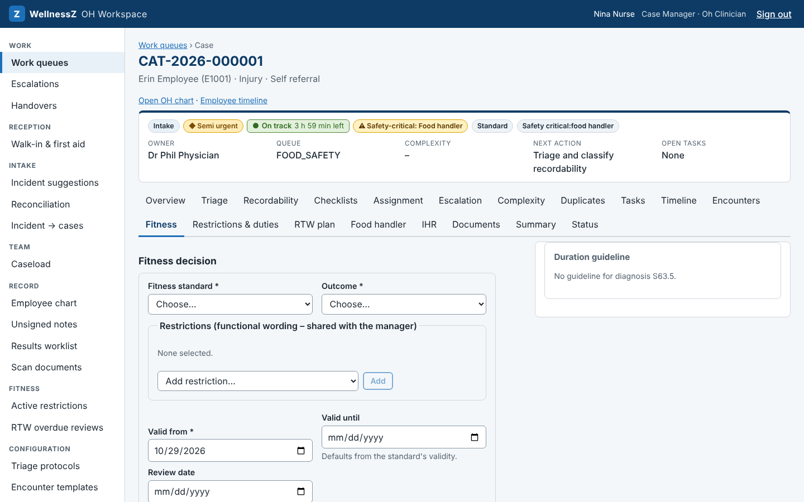

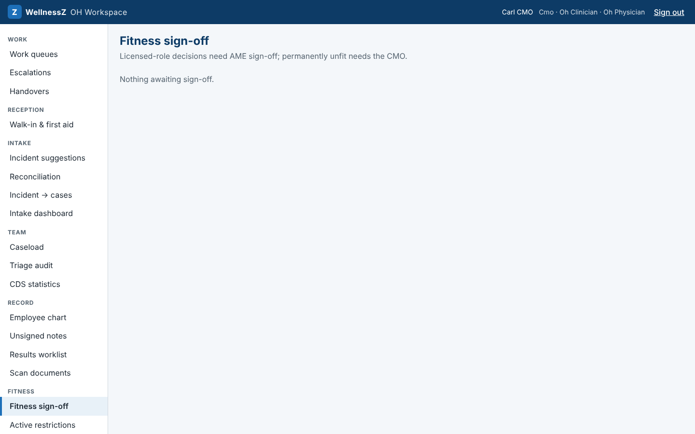

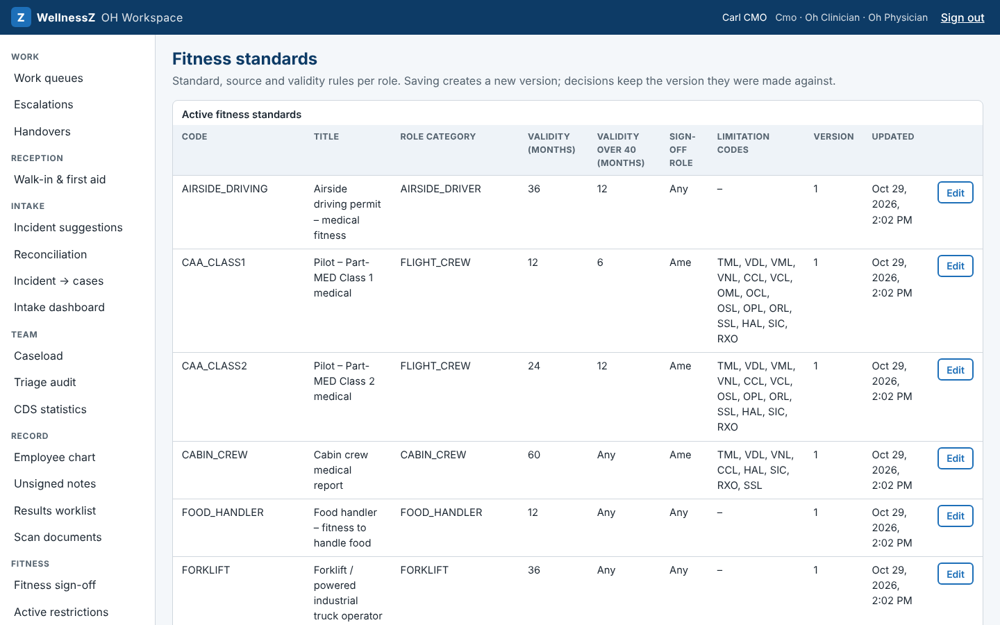

### 16.2 Certificate and communication (E05-BL-003, E05-HLR-06)

The certificate states employee, role, standard, outcome, functional restrictions, validity and issuer – no diagnosis
or clinical information (template wording and clinical-text guard). A clinician signs it and shares it with the
manager and the employee; the employee acknowledges it in the portal; the disclosure log records the manager share.

---

## 17. E05-F02 – Restrictions catalogue and job-demand matching

* `POST /fitness/match` (OH roles) resolves each restriction against the catalogue and compares it with every job-demand
  profile (optionally one unit). A numeric restriction (e.g. lift ≤ 10 kg) conflicts when the job demands more; a
  boolean restriction (e.g. no night duty) conflicts when the job demands it. Results are ranked: compatible first, then
  same department, then fewest conflicts, then job code; each result lists its conflicts (dimension, demand,
  restriction).
* `POST /cases/{id}/duty-proposals` – job, functional duties (≤ 1000 characters, clinical-text guard), hours per day,
  dates; the case's active restrictions are attached; the manager receives a content-free `duty.proposal` e-mail.
* Manager (`/workspace/duty-proposals`, own org scope only – others get 404) accepts or declines with a reason code
  (NO_SUITABLE_WORK, OPERATIONAL, SAFETY, COST, OTHER – required to decline). When **every** proposal of the case is
  declined, all become ESCALATED_TO_HR and an HR task is opened on the case; HR sees them in the same view. Reads are
  audited (`DUTY_PROPOSALS_WORKSPACE_READ`).

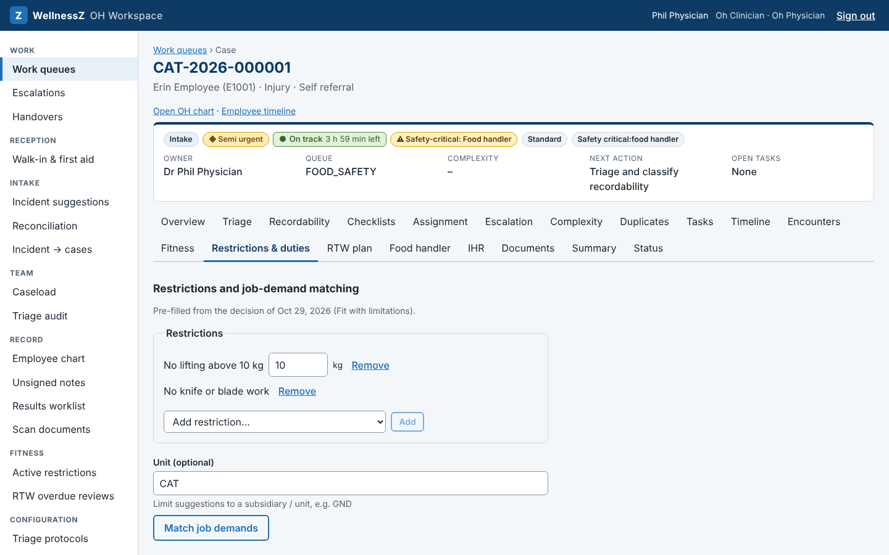

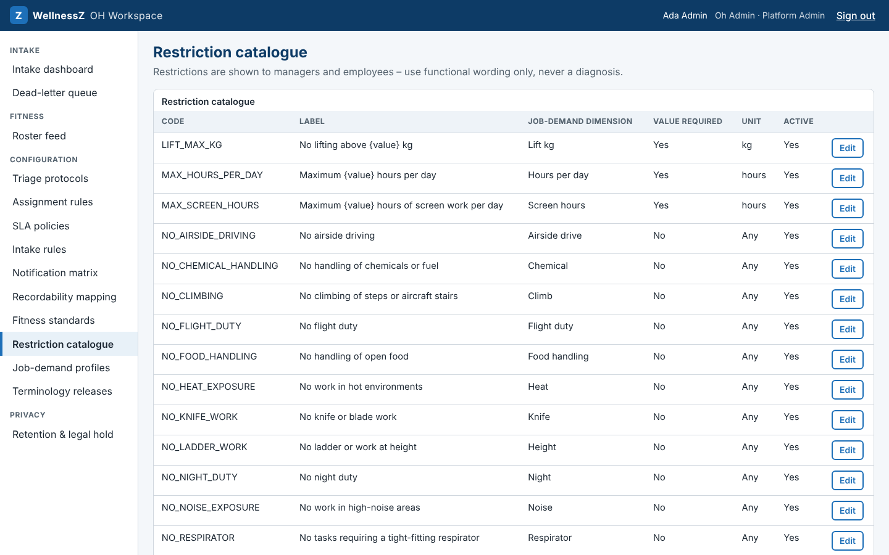

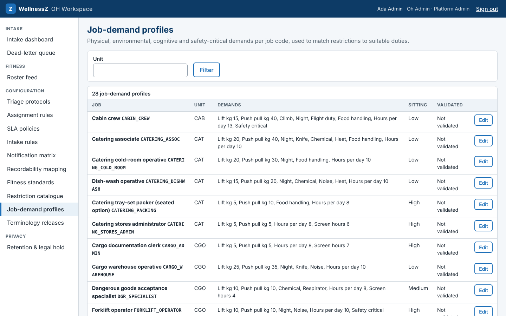

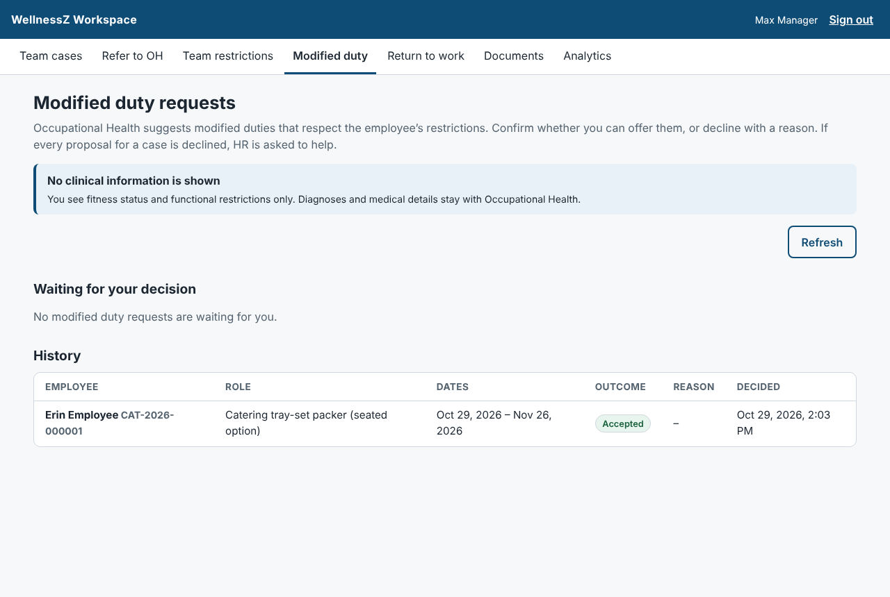

---

## 18. E05-F03 – RTW plan and electronic job offer

### 18.1 RTW plans

* `POST /cases/{id}/rtw-plans` – start date, functional goal, phases (from / to week, hours per day, duties,
  restrictions), review dates. Goal and duties pass the clinical-text guard (e.g. "Recover from depression" →
  `422` on `goal`). Editable while DRAFT; locked once ACTIVE (`409`).
* `POST /rtw-plans/{id}/activate` – generates, signs and shares an RTW_PLAN document with the employee and manager; sends
  `rtw.plan-ack` to both; sets the next review date.
* Employee agreement (`POST /me/rtw-plans/{id}/acknowledge {agree, comment}`) – the employee's comment is never shown to
  the manager. Manager acknowledgement (`POST /rtw-plans/{id}/manager-acknowledge`) within org scope.
* Reviews: `POST /rtw-plans/{id}/reviews/{reviewId}/complete` with outcome ON_TRACK, ADJUST, EXTEND or COMPLETE.
  The daily E05 job sends review reminders and escalates reviews **overdue by more than two days** to the Nursing Head
  (`rtw.review-due`); `GET /rtw/reviews/overdue` lists them with days overdue.

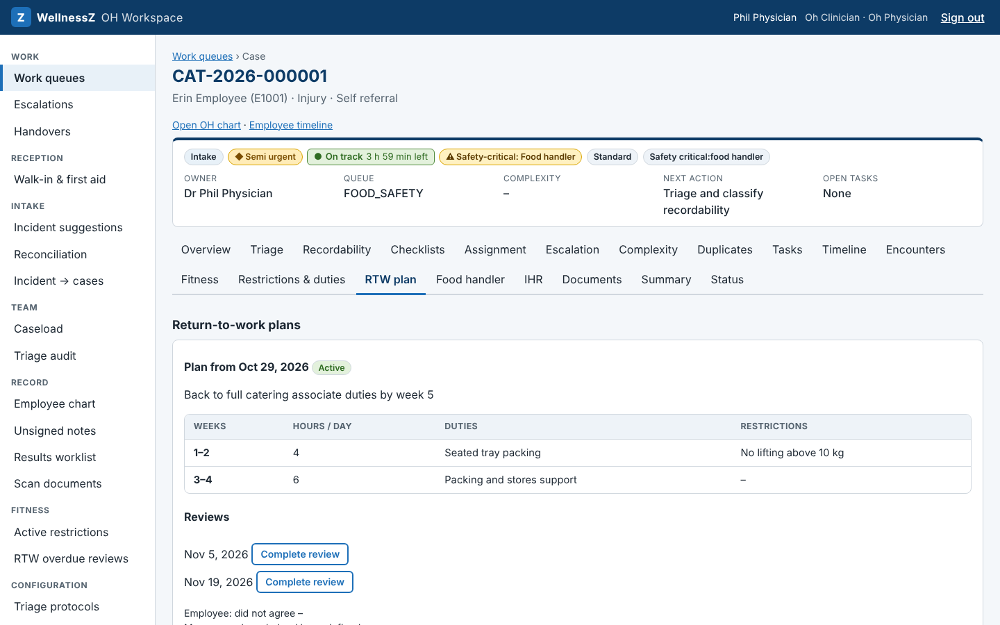

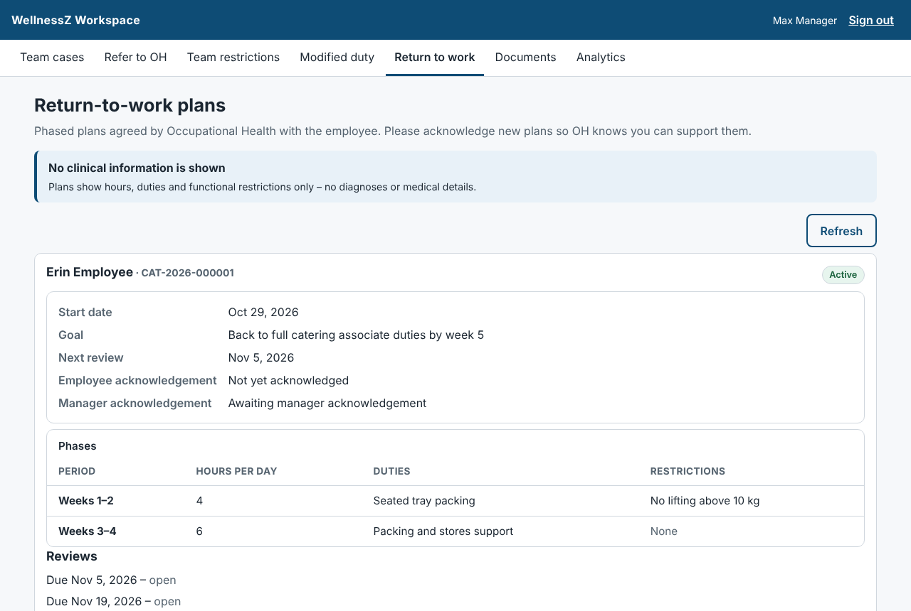

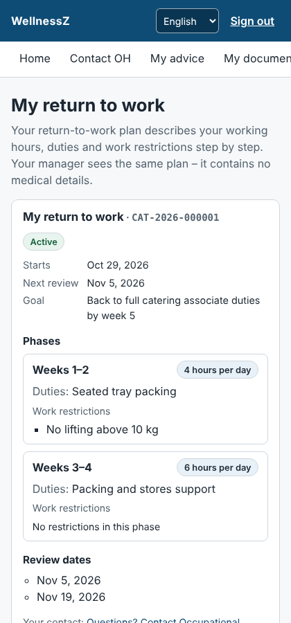

### 18.2 Alternative-duty job offers (E05-BL-008)

* `POST /cases/{id}/job-offers` – **HR only**, employee within HR's org scope (404 otherwise): job, duties
  (clinical-text guard), location, shift, hours per week, pay basis (SAME_PAY, PROTECTED_PAY, ADJUSTED_PAY) and note,
  restrictions respected, dates, contact, respond-by date. A JOB_OFFER letter is generated, **signed by HR and issued to
  the employee portal**; the employee receives `job-offer.issued`.
* Employee accepts or declines once (`409` on a second response). The response publishes
  `fitness.job-offer.responded.v1` to `hr-systems` (the "HRIS note") with only `messageId, employeeId, offerId, accepted,
  respondedAt` – the employee's comment and the duties never leave.
* HR may withdraw; unanswered offers expire after the respond-by date (daily job).

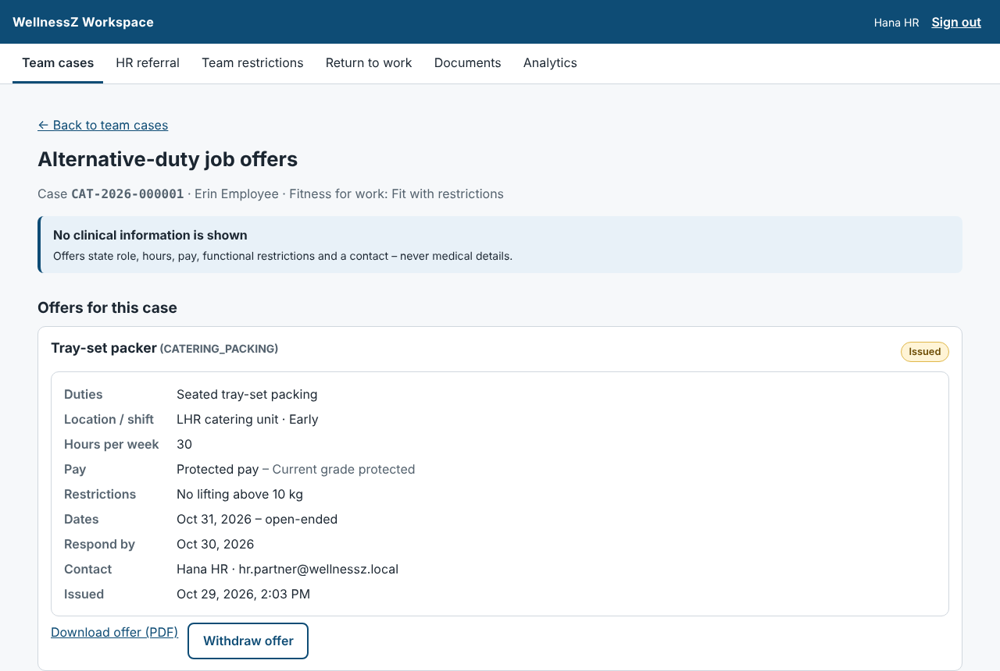

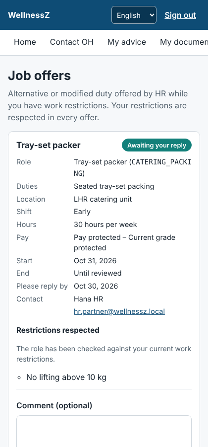

---

## 19. E05-F04 – Crew fitness and roster-status feed

* **Declaration (E05-BL-010)** – the Increment-1 crew declaration (`POST /intake/triggers/fitness-declaration`) now
  returns four next steps ("do not report for flight duty…", "crew scheduling has been told… no medical details are
  shared", …), the AME contact (`wellnessz.fitness.ame-contact`) and `acknowledgementDueBy` (case creation + 24 h,
  `wellnessz.fitness.declaration-ack-hours`). The case opens with fitness UNFIT_PENDING, which produces a PENDING
  roster message.
* **AME assessment (E05-BL-011)** – `POST /cases/{id}/crew-assessment` (AME, CMO only) for CAA_CLASS1, CAA_CLASS2 or
  CABIN_CREW with outcome, limitation codes from the 15-code EASA-style catalogue (`GET /crew/limitation-codes`;
  unknown codes → 400), validity (default from the standard) and examination date. The result is a FINAL decision plus
  a signed CREW_MEDICAL_REPORT or CABIN_CREW_MEDICAL_REPORT in a draft CAA layout.
* **Roster status mapping** – FIT → FIT; FIT_WITH_RESTRICTIONS → LIMITED; TEMPORARILY_UNFIT / PERMANENTLY_UNFIT → UNFIT;
  UNFIT_PENDING / UNDER_REVIEW / NOT_ASSESSED → PENDING.
* **Operational limitations only** – only OML, OCL, OSL, OPL, ORL and TML are disclosed to rostering; correction codes
  such as VDL stay with the AME (test asserts VDL never appears in the payload, the crew status API or the feed).
* **Feed (E05-BL-012)** – every message is logged in `fitness.roster_feed_message` in the same transaction as the
  decision and published through the outbox to `crew-rostering`. The rostering system can also pull
  `GET /integration/roster-feed?since=` and acknowledge `POST /integration/roster-feed/{messageId}/ack`. People (crew
  scheduling) use the `/crew/roster-feed` alias. `GET /crew/roster-feed/reconciliation` (crew scheduling, CMO, OH admin)
  reports sent, acknowledged, p95 acknowledgement latency and messages unacknowledged after 15 minutes; a job every 5
  minutes audits each such message once (`ROSTER_FEED_UNACKNOWLEDGED`) while the outbox keeps retrying.
* **Crew scheduling status** – `GET /status/crew` now adds `rosterStatus`, `validFrom`, `validUntil` and
  `operationalLimitations` through the `CrewStatusEnricher` SPI.
* **CMO dashboard (E05-BL-013)** – `GET /crew/dashboard` (CMO only): unfit and limited crew by base with average
  duration, by fleet, weekly trend; no identifiers; counts 1–4 suppressed (`<5`). Fleet and base come from
  `fitness.crew_profile`, which has **no loader yet** – until it is populated all crew appear under base UNKNOWN.

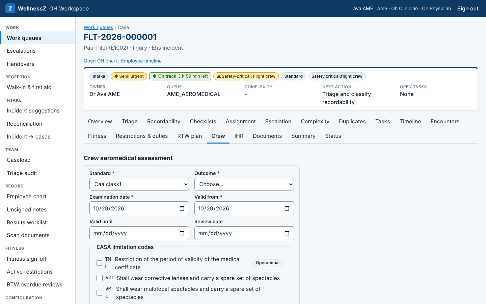

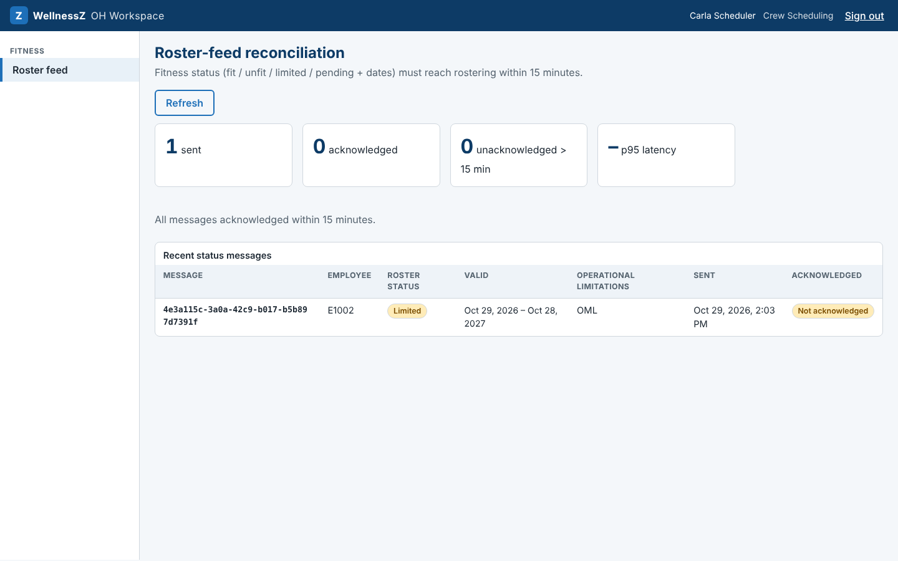

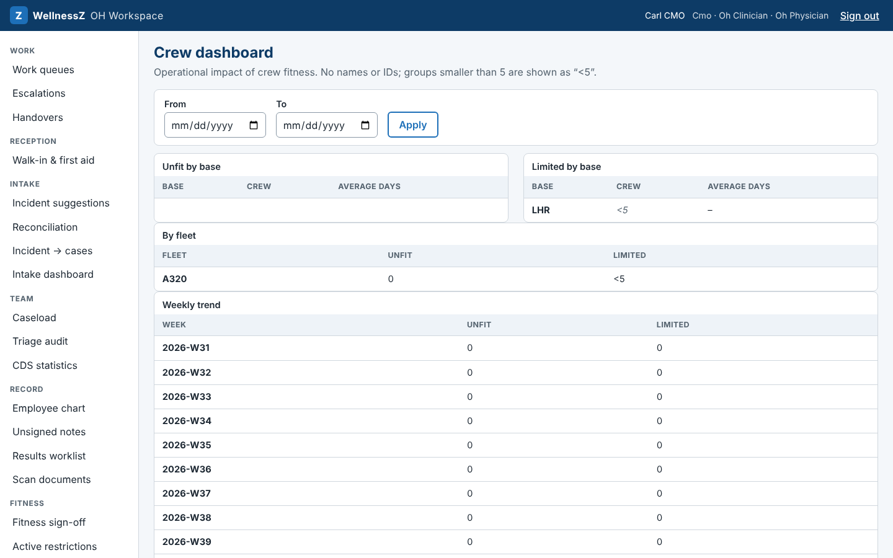

---

## 20. E05-F05 – Food-handler fitness control

* `POST /cases/{id}/food-handler/exclude` (OH roles) – only for employees whose job is a food-handler role
  (`422 not_food_handler`); reason category (GI_ILLNESS, SKIN_INFECTION, TYPHOID_PARATYPHOID, HEPATITIS_A, STEC, OTHER –
  OH only), checklist answers (also recorded as the Increment-1 FOOD_HANDLER checklist), excluded-from and expected-return
  dates. Status EXCLUDED; case fitness TEMPORARILY_UNFIT; `fitness.food-handler.status.changed.v1` to `catering-hygiene`
  with status and dates only. A second exclusion while excluded → 409.
* Return request → RETURN_PENDING_CLEARANCE. **Clearance** by an OH clinician or physician only (case managers 403)
  with the criterion "symptom-free 48 h" (`422 clearance_criteria_not_met` otherwise) → FIT_TO_HANDLE_FOOD, case FIT,
  signed FOOD_HANDLER_CLEARANCE document.
* Hygiene view `GET /fitness/food-handlers?department=` (hygiene manager, OH roles): employee, name, department,
  status, dates; no reason category; every read audited (`HYGIENE_FOOD_HANDLERS_READ`). Managers get 403. There is no
  dedicated screen for the hygiene manager yet.
* Periodic medical linkage: the FOOD_HYGIENE hazard of catering job codes drives a 12-monthly "food-handler health
  review" in the chart's surveillance-due list and the FOOD_HANDLER standard has 12-month validity.

---

## 21. E05-F06 – Restriction expiry and review alerts

* Each catalogue restriction of a decision becomes a `fitness.restriction_instance` (ACTIVE → EXPIRING within 5 days →
  LAPSED after the end date; CLOSED by a clinician).
* The daily E05 job (`wellnessz.fitness.daily-job-cron`, 02:20 UTC, once across replicas) sends **one** content-free
  `restriction.expiring` alert to the case owner, the manager and the employee at T−5 days, marks lapsed restrictions and
  publishes `fitness.restriction.expiring.v1`; re-running the job does not re-alert.
* `GET /restrictions/active?unit&status` lists ACTIVE / EXPIRING / LAPSED for action; one-click **extend** (new date and
  functional reason – clinical text rejected) or **close** (reason).
* Managers and HR: `GET /workspace/team-restrictions` – per employee in scope: fitness status and functional
  restrictions with validity and status; no diagnosis, rationale or codes; audited (`TEAM_RESTRICTIONS_READ`).
* `GET /restrictions/dashboard` (Nursing Head, CMO) – active / expiring / lapsed by unit.

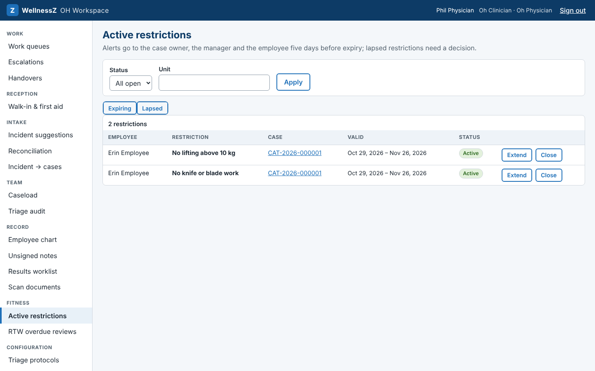

---

## 22. E05-F07 – Ill-health retirement / redeployment and appeals

* `POST /cases/{id}/ihr-assessments` (physicians) – type ILL_HEALTH_RETIREMENT or REDEPLOYMENT, findings (OH only,
  encrypted), recommendation, HR policy reference → AWAITING_CMO.
* `POST /ihr-assessments/{id}/cmo-decision` (CMO) – functional decision text (clinical-text guard) → DECIDED, signed
  IHR_DECISION_LETTER, appeal deadline today + 28 days (`wellnessz.fitness.ihr-appeal-window-days`).
* `POST /ihr-assessments/{id}/appeal` (HR or OH on the employee's behalf, inside the window – `409
  appeal_window_closed` after) – grounds and optional second-opinion provider → APPEALED, decision due in 30 days.
* `POST /ihr-assessments/{id}/appeal-decision` – a CMO **other than** the one who decided (`409
  independent_cmo_required`) → APPEAL_DECIDED.
* HR sees type, status, decision text and dates only – never findings, recommendation or notes; HR outside the org
  scope gets 404.

---

## 23. Screens

The OH Workspace, employee app and manager workspace show only the entries a role may use; the server enforces the
same rules independently. Screenshots were captured by the end-to-end run against real Keycloak logins. Screens already
shown in Sections 7–22 are not repeated.

**DPO privacy area** – break-glass reviews, disclosure log, retention and legal hold.

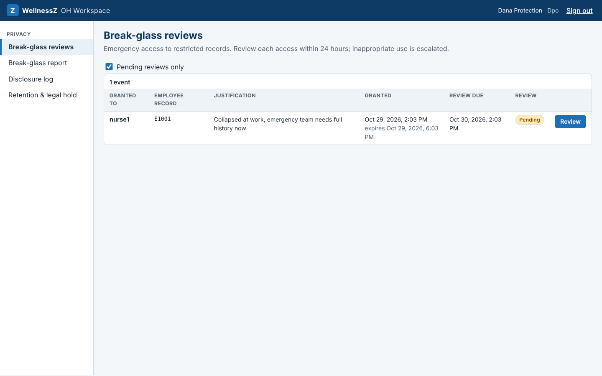

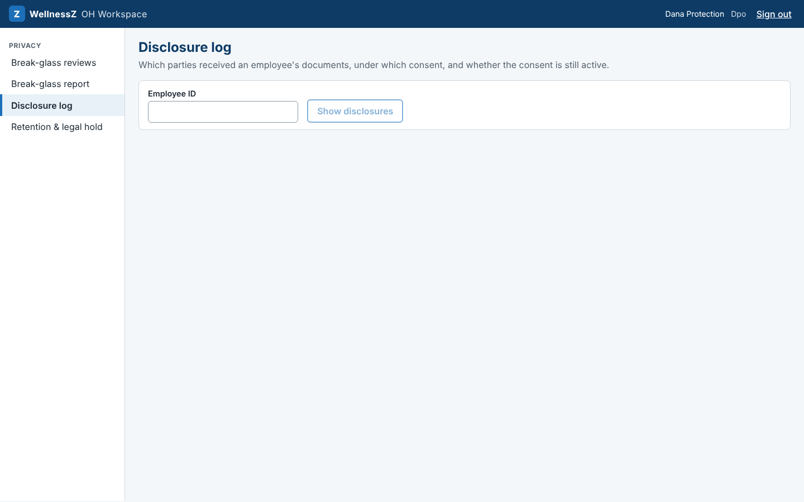

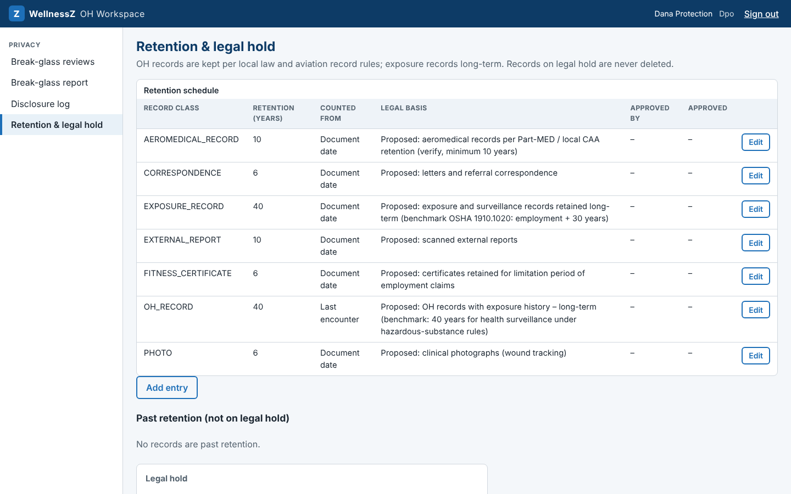

**Employee app** – documents shared to me (acknowledge), privacy (who received my information, consents).

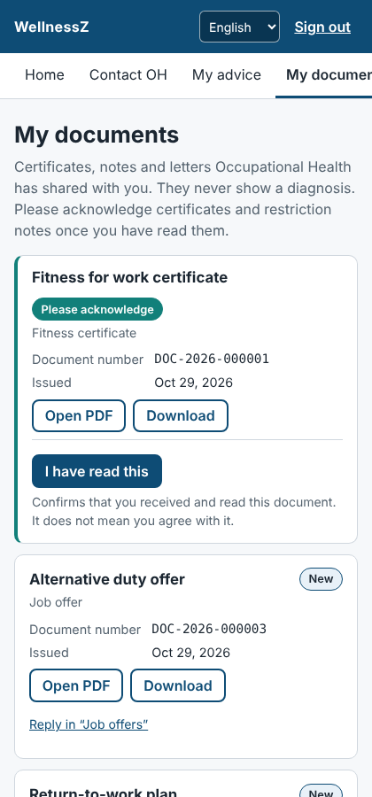

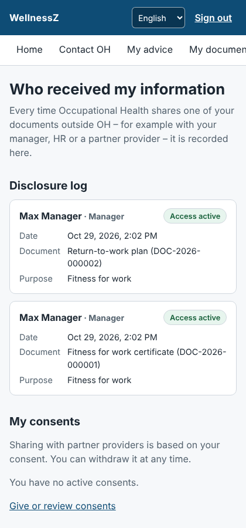

**Manager workspace** – documents shared to the manager.

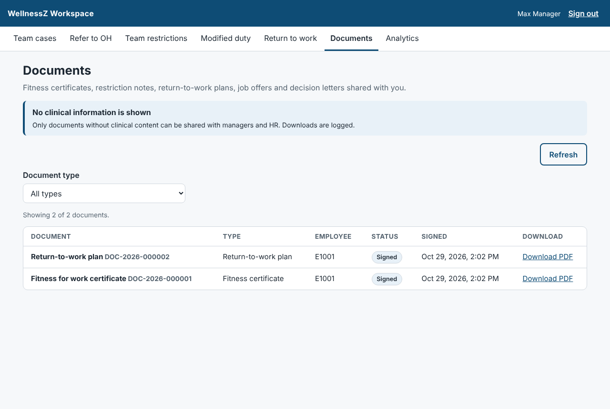

---

## 24. Security and privacy design

### 24.1 Control summary

| Control | Implementation |
|---|---|
| Authentication | Unchanged: browser apps through the BFF (OIDC code flow, HttpOnly session, CSRF); machine clients by client credentials (`INTEGRATION`) |
| Role-based access | `@PreAuthorize` on every new endpoint; `/api/v1/integration/**` restricted by the platform filter to INTEGRATION, PLATFORM_ADMIN and OH_ADMIN – people use `/crew/...` aliases |
| ABAC for employee-level records | `EmployeeRecordAccess.requireClinical / requireStatus` evaluates the policy engine with the employee's HRIS org path and the item's classification; denials are audited and returned as 404 |
| Segregation | Section 13; status-only projections (`/workspace/*`, `/status/*`, `/fitness/food-handlers`) structurally omit clinical fields; manager / HR web apps additionally whitelist fields |
| Encryption | Field-level AES-256-GCM (key-versioned `v1:`) for SOAP, answers, notes, reactions, result values / detail, rationale, findings, sign-off and override notes, break-glass reason and review note, document content, merge fields and extracted text, outbox payloads |
| Integrity | Encounter and addendum SHA-256 signatures over canonical content; document content hash and signature hash; signed items immutable; append-only audit hash chain (base framework) |
| Least privilege | Runtime role has no DELETE on clinical tables (status changes instead), read-only on reference tables (`drug_class`, `cds_rule`, `term_mapping`, `crew_profile`); migrations under a separate owner role |
| Content-free notifications | All new templates (`document.shared`, `certificate.available`, `rtw.plan-ack`, `rtw.review-due`, `restriction.expiring`, `result.abnormal`, `result.overdue`, `duty.proposal`, `job-offer.issued`, `break-glass.alert`, `fitness.signoff-required`) carry only case / document references, dates, levels and links; the gateway content rule still rejects clinical words – result templates were reworded ("a new item … needs your acknowledgement") because the word "result" is blocked |
| Clinical-text guard | Applied to non-clinical document merge fields, duty proposals, RTW goal / duties, job-offer duties, restriction extension reasons and IHR decision text; vocabulary extended in Increment 2 (e.g. prolapse, hernia, sciatica, tendinitis, dermatitis, infection) |
| Outbound allow-list | `crew-rostering`, `hr-systems`, `catering-hygiene` field lists (Section 4.4); default deny |
| Small cells | Crew dashboard suppresses counts 1–4 |
| Scheduled jobs | `JobRunGuard` – daily jobs run once per day across replicas |

### 24.2 Break-glass (E03-BL-021)

* `POST /break-glass {employeeId, reason}` – OH clinician, physician, AME, CMO or Nursing Head; reason ≥ 20 characters
  (400 otherwise); not on one's own record; HR and others 403.
* Grant valid **4 hours**; while valid the restricted-class policy admits the user to that employee's restricted items
  (chart count drops to 0, mental-health encounters and psychological cases open). Audit `BREAK_GLASS`.
* `BreakGlassGranted` → `SecurityAlertListener` sends an urgent, content-free `break-glass.alert` to the DPO mailbox
  (`wellnessz.notification.dpo-email`) with the review due date and a link.
* Review due in **24 hours**; `GET /break-glass?status=PENDING` (DPO) shows an overdue flag; `POST
  /break-glass/{id}/review` APPROPRIATE / INAPPROPRIATE with note – a user cannot review their own use.
* `GET /break-glass/report?month=` (DPO, CMO): totals, appropriate, inappropriate, pending, overdue reviews, uses by user.
* The DPO has **no clinical access** (404 on the case and chart).

### 24.3 Disclosure log and consent withdrawal (E03-BL-022)

* `platform.disclosure_log` records every disclosure outside OH (manager, HR, partner shares). The employee sees it in
  *Privacy – who received my information* (`GET /me/disclosures`: date, recipient type and name, document, purpose,
  ACTIVE / REVOKED); the DPO and OH see it per employee with the discloser.
* Withdrawing a consent (`DELETE /consents/{id}`) now (1) calls every `ConsentWithdrawalListener` – the document service
  revokes all partner shares made under that consent – and (2) marks the related disclosures REVOKED ("Consent
  withdrawn") and audits the number revoked. Partner access is also re-checked against the consent on every read, so
  access stops immediately even for in-flight sessions.

### 24.4 Negative tests (HR / manager / others)

| Test | Proves |
|---|---|
| `f08HrManagersEmployeesAndReceptionNeverOpenClinicalRecords` | HR, manager, reception, employee, DPO: 403 / 404 on 12 record endpoints, no clinical strings in any response; HR denials audited; HR cannot acknowledge results; reception cannot create encounters; case managers cannot write |
| `f06ResultLetterIsAClinicalDocumentNotShareableWithManagers` | Clinical letters cannot be shared with managers; managers get 404 |
| `certificateIsGeneratedSignedAndSharedWithoutClinicalContent` | Diagnosis rejected in certificate; HR 403 on OH document list; manager 404 before share; other manager 404 after share |
| `f01…`, `f02…`, `f03…`, `f06…`, `f07…` (fitness) | Managers, HR and other-scope users never see rationale, findings, employee comments or diagnosis codes; out-of-scope managers / HR get 404 |
| `f04CrewDeclarationAssessmentRosterFeedReconciliationAndDashboard` | Roster payload fields are a subset of the allow-list; no VDL, rationale or declaration reason |
| `f05FoodHandlerExclusionHygieneStatusOnlyAndClearance` | Hygiene payload and view contain no reason category or symptoms |
| E2E-11, E2E-14, E2E-21, E2E-25 | Same rules through the real BFF and Keycloak tokens |

---

## 25. Integration design

| Interface | Direction | Contract | State |
|---|---|---|---|
| Laboratory orders | WellnessZ → LIS gateway (pull) | `GET /integration/lis/orders?status=QUEUED` returns `{orderId, placerOrderNumber, hl7}` with an HL7 v2.5 **ORM^O01** (MSH, PID with employee ID, ORC/OBR per LOINC item); `POST /integration/lis/orders/{id}/ack` marks SENT | Built and tested; partner laboratory not connected |
| Laboratory results | LIS → WellnessZ | HL7 v2.5 **ORU^R01** (other versions rejected) via `POST /integration/hl7v2` (OBX grouped by patient and placer order, processed exactly once per inbound message) or JSON `POST /integration/lis/results` | Built and tested |
| Clinic devices | Device gateway → WellnessZ | `POST /employees/{id}/results/device` (`INTEGRATION`): category, device ID and model, calibration ID and date, performed at, measurements (Section 10.3) | Contract built and tested; no device drivers |
| FHIR R4 | WellnessZ → consumer (on request) | `GET /employees/{id}/fhir` (Bundle: Patient, Condition, AllergyIntolerance, MedicationStatement, Immunization, Observation, DocumentReference, Encounter) | Built; no push / subscription |
| HL7 ODH | WellnessZ → consumer | `GET /employees/{id}/odh` (PastOrPresentJob, UsualWork, exposure Observations) | Built |
| Crew rostering | WellnessZ → rostering | Outbox event `crew.roster-status.changed.v1` to `crew-rostering` (allow-listed) **and** pull `GET /integration/roster-feed?since=` with `POST …/{messageId}/ack`; reconciliation and 15-minute flag | Built; the default external publisher is a logging adapter until the E15 rostering adapter is configured |
| Catering hygiene | WellnessZ → hygiene system | `fitness.status.changed.v1` and `fitness.food-handler.status.changed.v1` to `catering-hygiene` | Built (same publisher note) |
| HRIS | WellnessZ → HRIS | `fitness.status.changed.v1` and `fitness.job-offer.responded.v1` to `hr-systems` | Built (same publisher note) |
| HRIS master | HRIS → WellnessZ | Job code, manager, org path used for ODH current job, scope checks and manager shares | Existing master (Increment 1) |

---

## 26. Sequence diagrams

### 26.1 Fitness decision → certificate → manager and employee

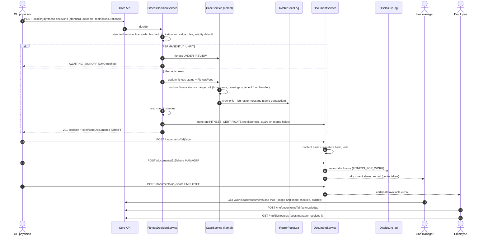

### 26.2 Encounter documentation and signing with CDS

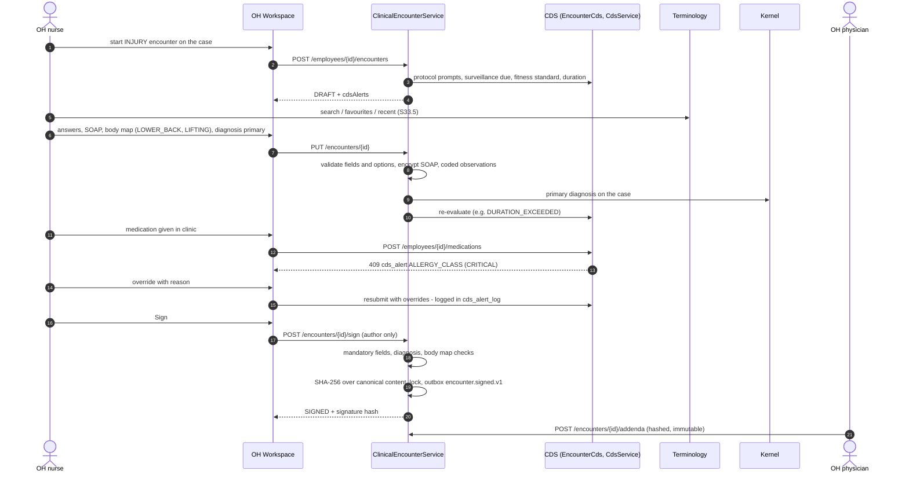

### 26.3 Abnormal device result → worklist → 72-hour CMO escalation

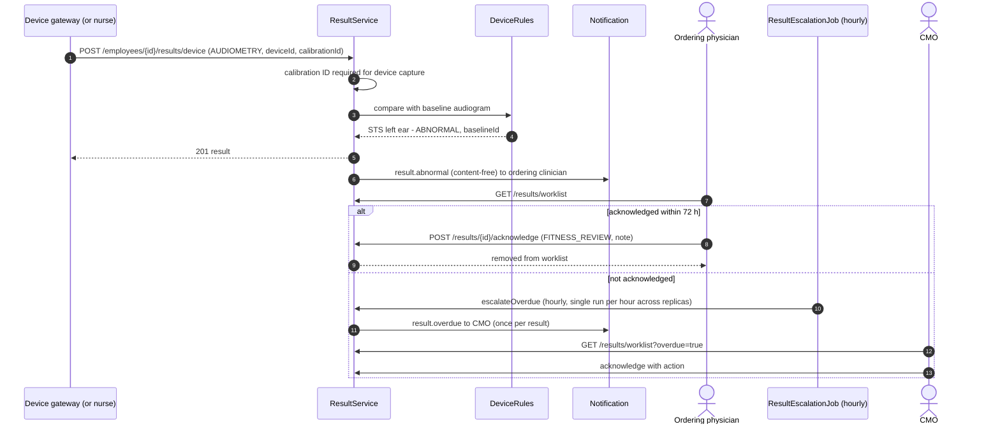

### 26.4 Crew declaration → AME assessment → roster feed and acknowledgement

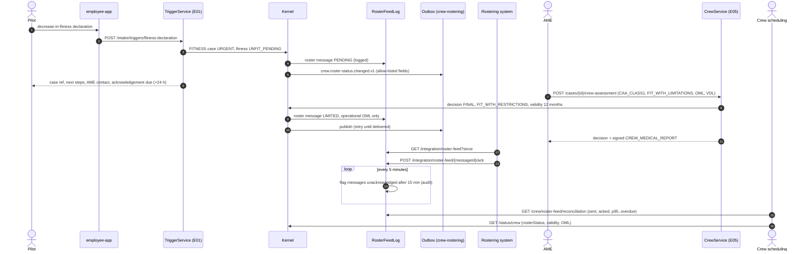

### 26.5 Break-glass → DPO review

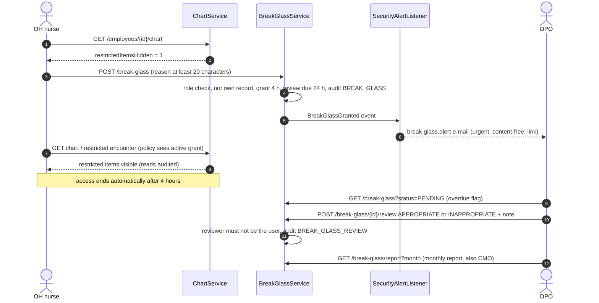

### 26.6 Consent withdrawal → partner share revocation

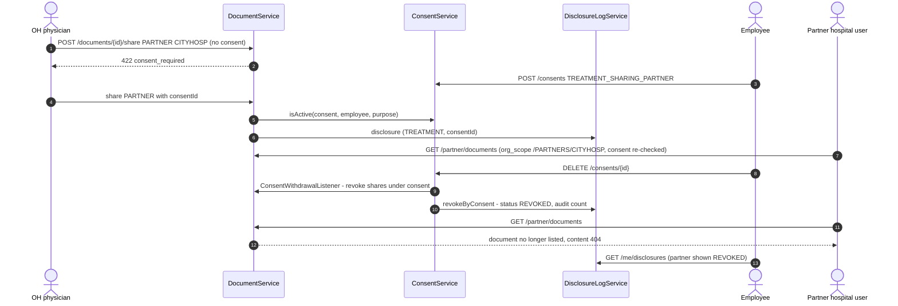

---

## 27. Data model

### 27.1 Schemas and tables

| Schema | Migration | Tables |
|---|---|---|
| `docs` (new) | V6 | `document` (series / version, type, template, classification, encrypted content, merge fields and extracted text, `search_vector` of blind-index tokens, content hash, signer, signature hash, legal hold, acknowledgement), `document_share` (target, recipient, consent, revocation), `document_sequence`, `retention_schedule` |
| `platform` | V6, V7 | `break_glass_grant` (reason and review note encrypted, expiry, review due), `disclosure_log` (recipient, resource, purpose, consent, revocation), `scheduled_job_run` (single-run guard), `terminology_release` (V7); `code_concept` gains the starter subset and a display GIN index |
| `masterdata` | V6 | `fitness_standard` (code + version), `restriction`, `job_demand_profile` (JSON demands) |
| `casemgmt` | V6 | `oh_case.primary_diagnosis_system / _code / _display` |
| `ohrecord` (new) | V7 | `problem`, `allergy`, `medication`, `immunisation`, `job_history`; `encounter`, `encounter_diagnosis`, `encounter_observation` (body map), `encounter_addendum`, `encounter_photo`, `encounter_template` (governance status); `lab_order`, `order_sequence`, `result`; `drug_class`, `cds_rule`, `cds_alert_log`; `term_favourite`, `term_usage`, `term_mapping` |
| `fitness` (new) | V8 | `fitness_decision`, `restriction_instance`, `duty_proposal`, `rtw_plan`, `rtw_review`, `job_offer`, `roster_feed_message`, `crew_profile`, `food_handler_episode`, `ihr_assessment` |

### 27.2 Overview

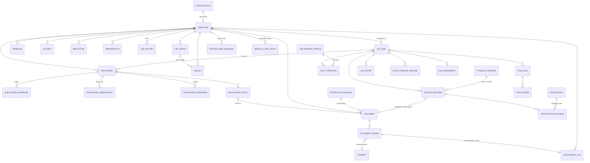

### 27.3 Data protection in the model

* Clinical free text is encrypted by the application at field level; codes, dates and statuses stay in clear for search,
  rules and aggregation.
* Grants (V6–V8): select / insert / update for the runtime role on clinical tables – **no DELETE**; insert-only for
  addenda, photos and CDS alert log; select-only for `drug_class`, `cds_rule`, `term_mapping` and `crew_profile`; insert
  and update on `code_concept` for terminology import.
* Demo data (`db/demo/R__demo_e03_record.sql`, E1004 penicillin allergy, low back pain problem, Hepatitis B, baseline
  audiogram, earlier job) loads only with the `local` / test profiles; encrypted free-text columns are left empty there
  because keys differ per environment.

---

## 28. Key configuration items

| Key | Default | Purpose |
|---|---|---|
| `spring.flyway.schemas` | adds `docs, ohrecord, fitness` | New schemas |
| `wellnessz.documents.font-path` / `WZ_DOCUMENTS_FONT_PATH` | empty (Helvetica) | Unicode TrueType font for non-Latin PDFs |
| `wellnessz.documents.retention-cron` / `WZ_DOCUMENTS_RETENTION_CRON` | `0 30 2 * * *` (UTC) | Daily retention flagging |
| `wellnessz.documents.ocr.tesseract-path` | unset (no OCR) | `/usr/bin/tesseract`, `/usr/local/bin/tesseract` or `/opt/homebrew/bin/tesseract` |
| `wellnessz.documents.ocr.languages` | `eng` | `eng`, `ara`, `fra`, `eng+ara`, `eng+fra`, `eng+ara+fra` |
| `wellnessz.notification.dpo-email` / `WZ_DPO_EMAIL` | `dpo@wellnessz.local` | Break-glass alerts |
| `wellnessz.notification.employee-portal-url` / `WZ_EMPLOYEE_PORTAL_URL` | `https://employee.wellnessz.local` | Links in employee notifications |
| `wellnessz.notification.manager-workspace-url` / `WZ_MANAGER_WORKSPACE_URL` | `https://manager.wellnessz.local` | Links in manager notifications |
| `wellnessz.case.diagnosis-required-on-close` / `WZ_DIAGNOSIS_REQUIRED_ON_CLOSE` | `true` | Coded-diagnosis closure guard |
| `wellnessz.record.unsigned-after` | `PT1H` | Age after which a draft appears in the unsigned list |
| `wellnessz.record.result-overdue-after` | `PT72H` | Worklist overdue and CMO escalation threshold |
| `wellnessz.record.overdue-cron` | `0 15 * * * *` | Escalation job |
| `wellnessz.record.restricted-result-codes` | `5643-2,19659-3` | LOINC codes stored in the restricted class |
| `wellnessz.record.ai.provider` | `none` | Name of the enabled `AiDocumentationProvider` |
| `wellnessz.fitness.ame-contact` | "Aeromedical examiner on duty via the Occupational Health service desk" | Shown after a crew declaration |
| `wellnessz.fitness.declaration-ack-hours` | `24` | Declaration acknowledgement due time |
| `wellnessz.fitness.daily-job-cron` | `0 20 2 * * *` (UTC) | Restriction expiry, RTW reviews, offer expiry |
| `wellnessz.fitness.roster-reconciliation-interval` | `PT5M` | Unacknowledged-message flag job |
| `wellnessz.fitness.ihr-appeal-window-days`, `…ihr-appeal-decision-days` | 28, 30 | IHR appeal timelines |
| `wellnessz.integration.outbound-allowlist.crew-rostering / hr-systems / catering-hygiene` | see Section 4.4 | Extended field lists |
| Master data and content | V6 / V7 | Fitness standards, restriction catalogue, job demands, retention schedule, encounter template status, terminology starter subset, mappings, favourites, drug classes, CDS rules |

---

## 29. Non-functional design notes

* **Performance** – chart summary < 2 s and terminology search < 1 s are asserted in integration tests on PostgreSQL 16;
  indexes on employee / time for every record table, partial indexes for the unsigned list, the result worklist,
  awaiting-sign-off decisions, open RTW reviews and unacknowledged roster messages. No load test at production volume
  yet.
* **Scalability and resilience** – stateless API; daily jobs single-run across replicas (`JobRunGuard`); outbox
  at-least-once with retries; HL7 ORU processed exactly once per inbound message; roster feed acknowledged per message.
* **Accessibility** – result flags and alert severities use a symbol and text as well as colour; body map regions are
  toggle buttons; suppressed cells show `<5`.
* **Browser storage** – all three apps keep PHI in memory only (lint rule bans `localStorage` / `sessionStorage`).

---

## 30. Known limitations and items for business / clinical sign-off

### 30.1 Decisions and sign-offs requested

| # | Item | Owner | Current state |
|---|---|---|---|
| S1 | Approve the eight encounter templates, mandatory fields and protocol prompts (E03-BL-004); align the crew aeromedical template with the local CAA format | CMO | All DRAFT; approval workflow in place |
| S2 | Fitness standards library – sources, validity, over-40 rules, sign-off roles, limitation codes (E05-BL-001) | CMO | 12 standards seeded as version 1 |
| S3 | Job-demand profiles for the top 150 job codes, validated with unit managers (E05-BL-004) | Nursing Head + unit managers | 28 representative profiles; bulk import ready |
| S4 | Restriction catalogue wording and dimensions | Nursing Head | 16 restrictions seeded |
| S5 | Document templates and certificate wording – no diagnosis, DPO-approved (E05-BL-003, E03-BL-015) | DPO + CMO | Draft wording in `DocumentTemplates` |
| S6 | Retention schedule (E03-BL-017) | DPO + CMO (legal) | Proposed values seeded, not approved |
| S7 | Terminology licences (SNOMED CT affiliate / national release, ICD-10 or ICD-11 national licence, LOINC attribution) and the annual update runbook (E03-BL-008) | CIO + CMO | Starter subset only |
| S8 | Drug class, allergy cross-reactivity and interaction tables (E03-BL-013); licensed drug knowledge base | Pharmacist + CMO | 13 curated rules marked "draft, pharmacist review pending" |
| S9 | CAA report layouts for pilot and cabin crew medical reports and limitation-code labels (E05-BL-011) | AME lead + CMO | Draft layout and labels |
| S10 | Local reporting category mappings for codes | CMO | About 70 draft prefixes |
| S11 | AI documentation provider choice, DPIA and pilot plan (E03-BL-018/019) | DPO + CMO + Cyber GRC | Recommendation in Section 15 |
| S12 | RTW coordinator and manager training on job-demand matching and modified-duty offers (E05-BL-019) | Change & Training | Not started |
| S13 | Duration guideline source and licence (E05-BL-020, shared with E02-BL-014) | CMO | 8 illustrative rows |
| S14 | Clinical-text guard vocabulary (Arabic / French terms) | DPO + Nursing Head | English list, extended in Increment 2 |

### 30.2 Known limitations

| Area | Limitation |
|---|---|
| OCR | Image-only PDFs (typical scanner output) are not OCR'd; JPEG / PNG are OCR'd only when Tesseract is installed and configured |
| Search | Whole-word equality search only (no stemming, prefix or fuzzy matching) – a consequence of the blind index |
| Retention | Only the document-date trigger is evaluated; structured record rows are not flagged; no destruction workflow |
| Terminology | No external terminology server; starter subset; 300 ms target not load-tested |
| CDS | Curated starter tables, not a licensed drug knowledge base |
| Devices | JSON device-gateway contract only; no serial / USB / vendor drivers |
| LIS / rostering / HRIS / hygiene | Interfaces built; production connections and transports are E15; the default external publisher is a logging adapter |
| FHIR | Procedure, Consent, Task and ServiceRequest not mapped; no FHIR subscriptions |
| Body map | Local `WZ_BODY_MAP` code system, not yet mapped to SNOMED CT body structures |
| Photos | No thumbnail rendering; listed as links on the encounter and as documents in the timeline |
| Unsigned notes | On-screen reminder list only; no e-mail reminder |
| AI assistant | No provider enabled; no audio capture; pilot not run |
| Crew dashboard | Fleet / base reference table (`fitness.crew_profile`) has no loader – all crew show as base UNKNOWN until loaded |
| Hygiene manager / partner | APIs only – no dedicated screen for the hygiene manager or for partner providers |
| Validity over 40 | Over-40 validity is implemented but inactive because the HRIS feed carries no date of birth |
| KPIs | RTW start-within-5-days, matched-duty rate and documentation time are not yet reported automatically (E17) |
| Usability | Chart usability test (≥ 4/5) and "document an MSK injury in < 6 min" not yet measured |
