# WellnessZ OHCM – Increment 3 Solution Design: E06 Absence & Sickness, E07 Medical Surveillance and E14 Scheduling & Clinic Operations

| | |
|---|---|
| **Document** | Increment 3 – 01 Solution Design (E06 + E07 + E14) |
| **System** | WellnessZ Airline Occupational Health Case Management (OHCM) |
| **Scope** | E06 Absence & Sickness Management · E07 Medical Surveillance, Periodic & Statutory Medicals · E14 Scheduling, Clinic Operations & Resource Management |
| **Audience** | Chief Medical Officer (CMO), Nursing Head, Data Protection Officer (DPO), HR, Crew Licensing, Biomedical Engineering, Cyber GRC, CIO, project sponsor |
| **Baseline** | Repository working tree, Flyway migrations V1–V12, API contract `docs/increment-03/API-Contract-E06-E07-E14.md`, OpenAPI `docs/api/openapi.json` (391 paths) |
| **Status** | Draft for review – trigger rules, programme content, questionnaire wording, CAA examination formats, retention values and notification wording await business sign-off (Section 32) |
| **Companion documents** | 02 – Requirements Traceability Matrix · 03 – Release Notes Increment 3 · Increment 1 and 2 documents 01–03 · Architecture 01–03 |

> **How to read this document.** Every statement about behaviour was checked against the source code and, where
> named, against an automated test. Where the code deviates from the API contract, this document describes **what the
> code does** and says so. Where a capability is only partly delivered, or where content (trigger rules, programmes,
> questionnaires, templates, retention periods) is a draft awaiting clinical, legal or DPO sign-off, this is stated
> explicitly. Requirement identifiers (E06-HLR-xx, E06-F0x, E06-BL-0xx, E07-…, E14-…) refer to the business workbooks
> (v1.0, 27 October 2026). All API paths are relative to `/api/v1`; browser apps call them through the BFF as
> `/bff/api/...`.

---

## 1. Executive summary

Increment 3 adds three modules on top of the Increment 1 intake / triage and the Increment 2 record and fitness
modules:

* **E06 – Absence and sickness management** connects absence data from HRIS, time-and-attendance and crew systems to
  OH case management. Absence episodes arrive by push (`/integration/absence/episodes`) or a daily pull through an
  `AbsenceFeedConnector` SPI, are reconciled against the employee master (employee ID, then badge ID) with a mismatch
  list and a data-quality dashboard, and are evaluated against configurable, versioned **trigger rules** (duration,
  frequency, Monday / Friday pattern, post-incident, safety-critical role, crew sickness) with a test mode. Triggers land
  in an **early-intervention queue** with the absence history attached; accepting an item opens the kernel ABSENCE case
  and tells the line manager and HR that "OH is engaged" – nothing more. Employees upload **sick certificates** from
  their phone (OCR field extraction, duplicate and alteration checks, validation checklist, verification call log, HR
  escalation); HR and managers see validity only. **Long-term absence** gets a milestone pathway (weeks 2, 4, 8, 12 and
  26), a fortnightly contact schedule, case conferences, HR policy stages and a link to the E05 RTW plan. Managers and HR
  request **OH advice** from a question library; OH answers in a functional report (every text screened for diagnoses)
  that the employee reviews and consents to before it is released as a signed `OH_ADVICE_REPORT`. **Analytics** report
  rates, Bradford factor, durations and categories by subsidiary, department or job family with small-group
  suppression and the trigger-to-contact KPI.
* **E07 – Medical surveillance** turns every statutory, licence and risk-based medical into a **versioned programme**
  (eligibility by job code, department, subsidiary, hazard, exposure group, licence and age; test panel; frequency with
  an over-40 variant; standard; responsible role) with population simulation before activation. Thirteen programmes are
  seeded. A nightly **due-list engine** computes enrolments and due dates; schedulers invite and book in bulk (up to
  5,000 per call) through the E14 diary; ignored invitations are re-sent and, after the second, escalated to the line
  manager (status only). **Pre-employment** medicals start from an HRIS offer, give the candidate a portal
  (questionnaire, consent, documents, booking) and return FIT / UNFIT / PENDING to HR only. **Crew aeromedical**
  examinations and imported external certificates form a register with 90 / 60 / 30-day expiry alerts and an UNFIT
  roster status on expiry. The **immunisation registry** has a role matrix, GS1 barcode fast entry, batch campaign entry,
  titres and a downloadable vaccination certificate. **Exposure registers** link industrial-hygiene measurements to
  similar exposure groups and enrol people automatically above the action level; crew cosmic dose is stored per year.
  **Result evaluation** (standard threshold shift, spirometry decline, biomonitoring limits, vision, abnormal flags)
  opens follow-up cases with recheck and regulatory-notification tasks, and a **return-after-illness** rule blocks
  fitness clearance of safety-critical staff until the medical is done. **Compliance dashboards** and anonymised
  **audit packs** (IOSA, CAA, food safety, labour inspectorate) close the loop.
* **E14 – Scheduling and clinic operations** gives six clinic sites a service catalogue (15 appointment types with
  durations, clinician roles, room and device requirements and internal charge codes), weekly diary templates,
  conflict-checked booking with drag-and-drop moves, waitlists, T−48 h / T−2 h reminders, automatic no-show detection,
  employee self-booking and telehealth links. **Campaign days** generate slots by day × station and book whole cohorts
  in one call. **Check-in** by badge, kiosk or app feeds a **queue board without names** and a clinician **call-next**
  that hands off to the chart. The **equipment register** tracks calibration with certificates and **blocks result
  capture on out-of-calibration devices** in E03; vaccine fridges log temperatures manually or from IoT gateways with
  **excursion alerts**. **Capacity planning** compares diary capacity with demand from the E07 due lists and E06 contact
  schedules per site and month, with a what-if model and utilisation reports.

Seven new kernel SPIs let the modules co-operate without depending on each other (Section 4.3): E07 and E06 book
through E14; E14 blocks E03 device capture; E03 tells E07 about every result; E06 tells E07 about long-term absence;
E07 blocks E05 clearance; E06 and E07 report demand to E14.

The **status-only rule** of the workbooks – managers, HR, crew scheduling and licensing, clinic schedulers, reception and
biomedical staff see status, dates and functional advice only, never absence reasons, diagnoses, certificate content,
questionnaire answers, results or exposures – is enforced server-side in every new API, in documents shared outside
OH, in every notification and on every outbound feed (Section 26).

Verification (29 October 2026): 210 Java tests pass (28 new Increment-3 integration tests on PostgreSQL 16 – 10 absence,
9 surveillance, 9 scheduling – plus 49 new module unit tests and the extended ArchUnit rules); SpotBugs + FindSecBugs
report 0 findings; 808 web unit tests across the three apps; and 32 / 32 end-to-end checks against a real Keycloak, BFF,
core API and the three web apps (increments 1 and 2 still pass 18 / 18 and 25 / 25).

---

## 2. Scope and goals

### 2.1 Business goals (from the epic overviews)

| Epic | KPI | How the design supports it |
|---|---|---|
| E06 | Sickness absence rate by unit (trend) | `GET /absence/analytics/units` – absence rate = days lost / (headcount × calendar days) per subsidiary, department or job family; monthly trend in `GET /absence/analytics/kpis` |
| E06 | ≥ 95 % long-term absences (> 4 weeks) with an OH case | Rule `LTA_28D` opens the LTA pathway on a kernel ABSENCE case automatically; KPI `ltaWithCasePct` = share of long-term episodes overlapping the window that are linked to an OH case (E2E: 100 %) |
| E06 | Median days from trigger to first OH contact ≤ 5 | Queue SLA (`absence.queue.sla-days`, default 5; AME review 1 day) with breach flag; the first REACHED contact stamps `firstContactAt`; KPI `medianDaysTriggerToContact` (E2E: 1 day) |
| E06 | % sick certificates verified where required | Validation checklist and verification outcome on every certificate; KPI `certificatesVerifiedPct` |
| E07 | ≥ 95 % surveillance due completed on time | Nightly due-list engine, bulk invitation with booking, re-invitation and manager escalation after two ignored invitations; compliance % by programme and unit |
| E07 | Crew medical certificate lapses = 0 | Certificate register with 90 / 60 / 30-day alerts to the crew member and crew licensing; on expiry the roster status becomes UNFIT (status only); "crew without valid medical" report |
| E07 | Food-handler medical compliance 100 % | `FOOD_HANDLER` programme (12-monthly questionnaire + typhoid), CATERING_ASSOC immunisation matrix (typhoid, hepatitis A), food-safety audit pack |
| E07 | Abnormal results with follow-up case within 48 h ≥ 98 % | `ResultFollowUpListener` is called synchronously by E03 inside the result transaction – the follow-up case exists the moment the result is stored |
| E14 | Clinic utilisation ≥ 80 % | Utilisation by site or clinician (booked minutes / session minutes); capacity vs demand per site and month with what-if |
| E14 | No-show rate ≤ 8 % | T−48 h / T−2 h reminders, app reschedule / cancel, waitlist offers, automatic NO_SHOW with re-invitation for surveillance; no-show rate in the utilisation report |
| E14 | Average wait ≤ 15 min | Check-in timestamps, queue board with wait per ticket and today's average, call-next; average wait in the utilisation report |
| E14 | Equipment calibration compliance 100 % | Calibration register with derived state (VALID / DUE_SOON / OVERDUE), 30-day alert, and a hard block on result capture and on campaign device kits |

### 2.2 In scope

E06 features F01–F06 (14 backlog items), E07 features F01–F08 (20 backlog items) and E14 features F01–F05 (10 backlog
items), at the depth recorded in the traceability matrix, plus the platform additions they need (clinic sites, hazards
and job codes, document templates and module-level document API, retention classes, notification templates, kernel
SPIs, BFF pass-through).

### 2.3 Out of scope (per workbooks and increment plan)

* Payroll calculation of sick pay and HR disciplinary processes (E06 out of scope).
* Occupational-hygiene sampling campaigns (the EHS / IH system remains the master – results are imported only) and
  insurance medicals (E07 out of scope).
* HR rostering of clinicians and facilities management (E14 out of scope).
* Production connectors to the HRIS, time-and-attendance, crew-management and IoT systems (E15). Increment 3 exposes and
  tests the interfaces (push endpoints, pull SPI, outbound allow-listed events); the default pull connector is a no-op.
* Video consultation (E04). Telehealth slots produce a join link and a documentation link only.
* Business validation of programme content, trigger thresholds, CAA examination formats and questionnaire wording
  (sign-off items in Section 32).

---

## 3. Actors and roles

Roles are canonical application roles (`com.wellnessz.common.model.Roles`). **Four roles are new in Increment 3**:
`CLINIC_SCHEDULER`, `BIOMEDICAL`, `CREW_LICENSING` and `CANDIDATE`. `MeController` reports the disclosure level
`STATUS_ONLY` for clinic schedulers and crew licensing and `SELF` for candidates.

| Role | New? | Persona | Disclosure | New rights in Increment 3 |
|---|---|---|---|---|
| `OH_CLINICIAN` | existing | OH nurse | CLINICAL | Early-intervention queue, contacts, LTA pathway, certificates (scan, validate, verify), advice requests (accept), due list and invitations, enrolment completion, immunisation fast and batch entry, titres, follow-ups, return-after-illness, diary and booking, call-next, temperature readings and excursion acknowledgement |
| `CASE_MANAGER` | existing | Case manager | CLINICAL | As OH nurse for absence work (queue, LTA, advice acceptance); booking; no clinician-only actions (report drafting, enrolment completion, immunisation entry, call-next) |
| `OH_PHYSICIAN` | existing | OH physician | CLINICAL | Advice report drafting and signing, programme activation, enrolment exemption, follow-up review, return-after-illness waiver, pre-employment outcome |
| `AME` | existing | Aeromedical examiner | CLINICAL | Crew examination templates and examinations, certificate register, external AME / AeMC import, authority report, cosmic dose |
| `CMO` | existing | Chief Medical Officer | CLINICAL | Absence analytics and KPIs, programme activation and retirement, evaluation rules, identifiable audit packs, capacity, charging usage |
| `NURSING_HEAD` | existing | Nursing Head | CLINICAL | Absence analytics, programme drafting, compliance and identifiable audit packs, campaigns, catalogue and diary templates, capacity, calibration-due list, excursions |
| `OH_ADMIN` | existing | OH administrator | – | Trigger rules (create, version, test mode), feed runs and mismatches, programme drafting, IH exposure groups, appointment types, site resources and templates, equipment register, capacity, charging |
| `HR` | existing | HR business partner | STATUS_ONLY within org scope | Team absence status, certificate validity, LTA status and HR stage, advice requests and released reports, absence analytics (no categories), pre-employment trigger and onboarding status, team surveillance compliance, feed mismatches |
| `MANAGER` | existing | Line manager | STATUS_ONLY within org scope | Team absence status (dates, OH engaged, certificate validity), advice requests and released reports, team surveillance compliance |
| `EMPLOYEE` | existing | Employee / crew member | SELF | My absence (episodes, certificate upload with camera), advice report review (consent / decline with comment), my surveillance (programmes, immunisations, vaccination certificate, crew pregnancy declaration), my appointments (self-book, reschedule, cancel, app check-in) |
| `CANDIDATE` | **new** | Pre-employment candidate (not in the HRIS master) | SELF | Own pre-employment record only: questionnaire, consent, document upload, booking, appointments |
| `CLINIC_SCHEDULER` | **new** | Clinic scheduler | STATUS_ONLY (names + appointment type) | Diary, slots, booking, moves, cancellations, waitlist, campaigns, due list and invitations, immunisation due list, diary templates, capacity |
| `CLINIC_RECEPTION` | existing | Reception / clinic assistant | write-only | Check-in (badge, employee ID, appointment), kiosk, queue board, attendance, certificate scan, validation checklist and call log |
| `BIOMEDICAL` | **new** | Biomedical engineering | none | Equipment register, calibration records with certificates, service status, calibration-due list, temperature readings and cold-chain report |
| `CREW_LICENSING` | **new** | Crew training & licensing | STATUS_ONLY (crew) | Crew certificate validity, expiry status and operational limitation codes; crew without a valid medical |
| `CREW_SCHEDULING` | existing | Crew scheduling | STATUS_ONLY (crew) | Crew certificate status and "without valid medical" report (in addition to the Increment-2 roster feed) |
| `HSE_OFFICER` | existing | HSE / industrial hygiene | – | Exposure groups (SEG), IH measurement import, compliance dashboards, anonymised audit packs |
| `AUDITOR` | existing | Internal / external auditor | – | Compliance dashboards and always-anonymised audit packs |
| `HYGIENE_MANAGER` | existing | Catering hygiene manager | STATUS_ONLY (food handlers) | Immunisation status of food handlers (met / not met only) |
| `INTEGRATION` | existing | Machine client | – | Absence episodes, partner certificates, HRIS offers, IH measurements, cosmic dose, external crew certificates, cold-chain readings |

"OH roles" = `OH_CLINICIAN, CASE_MANAGER, OH_PHYSICIAN, AME, CMO, NURSING_HEAD, PSYCH_CLINICIAN` (`Roles.OH_TEAM`).
"Clinicians" = OH roles minus `CASE_MANAGER`. "Physicians" = `OH_PHYSICIAN, AME, CMO`.

> **Deployment note.** The four new roles must exist in the identity provider **and** be in the role scope mappings of
> the BFF (`wellnessz-bff`) and mobile (`wellnessz-mobile`) clients – both have `fullScopeAllowed=false`, so a missing
> mapping silently removes the role (lesson from Increment 1). The local realm has been updated; see Release Notes,
> Section 5. Candidates authenticate with a candidate identity whose `employee_id` claim is the candidate ID (`C9001`
> in the demo); the candidate ID never appears in the HRIS master.

---

## 4. Component view

### 4.1 Modules and boundaries

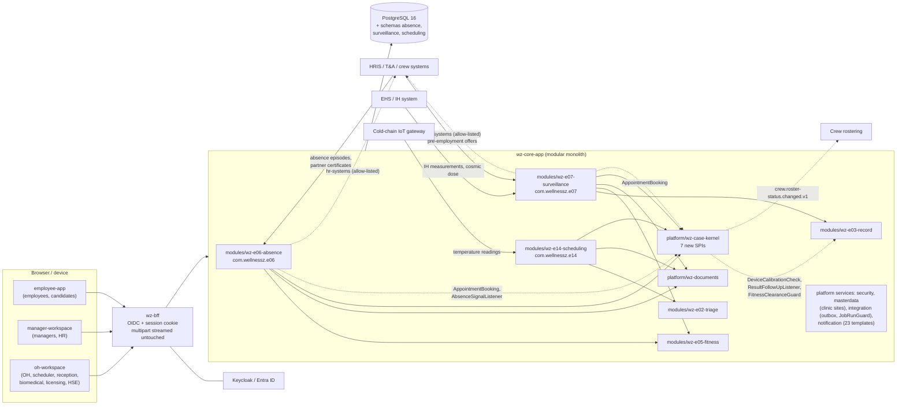

| Component | Responsibility in Increment 3 |
|---|---|
| `modules/wz-e06-absence` (new, depends on E05) | Feed ingestion and reconciliation, episodes and summary statistics, trigger rules and engine, early-intervention and AME queues, certificates, LTA pathway, advice requests and reports, analytics, capacity demand, nightly jobs |
| `modules/wz-e07-surveillance` (new, depends on E03 and E05) | Programme builder and catalogue, eligibility and enrolment engine, due list and invitations, pre-employment, crew certificates, immunisation registry, exposure registers, result evaluation and follow-up, return-after-illness, compliance and audit packs, chart contribution, capacity demand, nightly jobs |
| `modules/wz-e14-scheduling` (new, Maven dependency on E02 for the shared case / platform stack; no E02 classes used) | Appointment types and catalogue, site resources and diary templates, slot engine and booking, waitlist, reminders and no-shows, telehealth links, campaigns, check-in and queue, equipment and cold chain, capacity and utilisation, charging |
| `platform/wz-case-kernel` | Seven new SPIs (Section 4.3); unchanged case model, `CaseService.openIdempotent` and `publishFitness` reused for absence and crew statuses |
| `platform/wz-documents` | Module-level API (`storeUpload`, `generateSigned`, `shareAsSystem`, `systemContent`), three new templates, two new retention classes (Section 5.3) |
| `platform/wz-masterdata` | `masterdata.clinic_site` and `GET/POST /masterdata/clinic-sites`; nine hazards and five job codes added (Section 5.1) |
| `platform/wz-notification` | 23 content-free templates for the new events (Section 5.4) |
| E03 / E05 changes | E03 `ResultService` consults `DeviceCalibrationCheck` before device capture and calls `ResultFollowUpListener` for LIS and device results; E05 `FitnessDecisionService` consults `FitnessClearanceGuard` for FIT / FIT_WITH_LIMITATIONS |
| `apps/wz-bff` | `/workspace/absence`, `/workspace/advice-requests`, `/workspace/surveillance`, `/workspace/pre-employment` keep their `/workspace` prefix; servlet multipart parsing disabled so uploads reach the core API intact (Section 5.5) |

### 4.2 Boundaries enforced by ArchUnit

`apps/wz-core-app/src/test/java/com/wellnessz/app/ArchitectureTest.java` fails the build when a boundary is crossed.
New or extended rules for Increment 3:

| Rule | Effect |
|---|---|
| `platformDoesNotDependOnBusinessModules` (extended) | Common, secrets, security, masterdata, integration, notification and analytics never depend on the kernel, documents or any of E01–E14 |
| `kernelDoesNotDependOnBusinessModules` (extended) | The kernel never depends on E06, E07 or E14 – they plug in through the SPIs |
| `documentServiceIsAPlatformService` (extended) | The document service never depends on E06, E07 or E14 |
| `earlierModulesDoNotDependOnLaterOnes` (extended) | E01 / E02 never depend on E03, E05, E06, E07 or E14 |
| `increment2ModulesDoNotDependOnIncrement3` (new) | E03 / E05 never depend on E06, E07 or E14 – they call increment-3 behaviour only through `DeviceCalibrationCheck`, `ResultFollowUpListener` and `FitnessClearanceGuard` |
| `absenceIsIndependentOfSurveillanceAndScheduling` (new) | E06 never depends on E07 or E14 (signals through `AbsenceSignalListener`, books through `AppointmentBooking`) |
| `surveillanceIsIndependentOfAbsenceAndScheduling` (new) | E07 never depends on E06 or E14 (books invitations and campaign slots through `AppointmentBooking`) |
| `schedulingIsIndependentOfClinicalModules` (new) | E14 never depends on E03, E05, E06 or E07 – scheduling never reads clinical content |
| Increment-1 / 2 rules kept | `recordAndFitnessModulesAreIndependent`, `fitnessDoesNotDependOnRecord`, `intakeDoesNotDependOnTriage`, `intakeDoesNotCallCaseKernelDirectly`, `commonHasNoSpringSecurity`, `noStandardStreams` |

The resulting allowed module graph is: E06 → E05; E07 → E03 + E05; E14 → (E02 stack only); E06, E07 and E14 mutually
independent. `E06Module`, `E07Module` and `E14Module` register with the module registry like the earlier modules.

### 4.3 Service provider interfaces (SPIs)

All seven SPIs live in `platform/wz-case-kernel/src/main/java/com/wellnessz/casekernel/support/` and carry identifiers,
codes, dates and statuses only.

| SPI | Implemented by | Called by | Purpose |
|---|---|---|---|
| `AppointmentBooking` | E14 `AppointmentBookingAdapter` | E07 (invitations, pre-employment, immunisation), E06 (LTA contact appointments) | `bookNext(actor, BookingRequest)` books the first free slot of a service at a site (or the employee's home site) on or after a date, or the first free campaign slot; returns empty instead of failing when there is no capacity – the caller degrades to "invited, not booked". `bookingsFor(sourceType, sourceRef)` lists current bookings |
| `AppointmentStatusListener` | E07 `SurveillanceSpi`, E06 `AbsenceCapacityDemand` | E14 `StatusNotifier` on every status change, inside the scheduling transaction | BOOKED, CHECKED_IN, ATTENDED, NO_SHOW, CANCELLED for appointments whose `sourceType` the listener supports (`SURVEILLANCE_INVITATION`, `PRE_EMPLOYMENT`, `IMMUNISATION`, `CREW_RENEWAL`, `ABSENCE_CONTACT`) |
| `DeviceCalibrationCheck` | E14 `EquipmentCalibrationCheck` | E03 `ResultService` before device capture | Verdict VALID / UNKNOWN / OUT_OF_CALIBRATION / OUT_OF_SERVICE → `422 device_out_of_calibration` or `422 device_out_of_service`; UNKNOWN is accepted unless `wellnessz.record.require-registered-devices=true` (then `422 device_not_registered`) |
| `ResultFollowUpListener` | E07 `FollowUpService` | E03 `ResultService` for LIS and device results, synchronously in the recording transaction | Result ID, employee, category, code system and code, flag, baseline marker – no values |
| `FitnessClearanceGuard` | E07 `RaiService` | E05 `FitnessDecisionService.decide` for FIT and FIT_WITH_LIMITATIONS | Returns a non-clinical blocking reason → `422 clearance_required` |
| `AbsenceSignalListener` | E07 `RaiService` | E06 `LtaService` once, when a long-term absence pathway starts | `longTermAbsence(employeeId, caseId, startDate, days)` – E07 requires a return-after-illness medical for safety-critical jobs |
| `CapacityDemandSource` | E07 `SurveillanceSpi`, E06 `AbsenceCapacityDemand` | E14 `CapacityService` | `demand(from, to)` → counts per site, service and month (source `E07` / `E06`) |

Module-internal SPI: `AbsenceFeedConnector` (E06) for the daily absence pull; the shipped `NoopAbsenceFeedConnector`
returns nothing, site adapters register further beans (Section 27).

### 4.4 Internal and outbound events

All events use the transactional outbox (at-least-once, idempotent consumers, payloads encrypted at rest).

| Event | Producer | Consumers / destination |
|---|---|---|
| `absence.trigger.raised.v1 {queueItemId, employeeId, action}` | E06 | In-process |
| `absence.lta.started.v1 {caseId, employeeId}` | E06 | In-process |
| `absence.advice.released.v1 {requestId, employeeId, documentId}` | E06 | In-process |
| `absence.hr-status.v1 {messageId, employeeId, ohEngaged \| certificateValidity, effectiveFrom}` (not in the contract – added by the implementation) | E06 | `hr-systems` – allow-listed `ohEngaged`, `certificateValidity`; exactly one of the two per message |
| `surveillance.enrolment.due.v1 {enrolmentId, employeeId, programmeCode, nextDueOn}` | E07 | In-process, once per due period |
| `surveillance.followup.created.v1 {followUpId, employeeId, caseId}` | E07 | In-process |
| `preemployment.status.v1 {messageId, offerRef, candidateId, preEmploymentStatus, effectiveFrom}` | E07 | `hr-systems` – allow-listed `offerRef, candidateId, preEmploymentStatus` |
| `crew.certificate.status.v1 {employeeId, certificateType, validUntil, status}` | E07 | In-process |
| `crew.roster-status.changed.v1` (Increment 2, reused) | Kernel via `CaseService.publishFitness` | `crew-rostering` – E06 AME reviews (PENDING) and E07 crew examinations / expiry (FIT, LIMITED, UNFIT) |
| `appointment.status.v1 {appointmentId, employeeId, status}` | E14 | In-process |
| `equipment.calibration.v1 {equipmentId, calibrationState}` | E14 | In-process |
| `coldchain.excursion.v1 {equipmentId, excursionId}` | E14 | In-process |

---

## 5. Platform additions

### 5.1 Master data (V9)

* **Clinic sites** – `masterdata.clinic_site` (code, name, site type, location code, time zone, address, active);
  `GET /masterdata/clinic-sites` for every authenticated user, `POST` upsert for OH_ADMIN, PLATFORM_ADMIN and
  INTEGRATION. Seeded: `HQ-MC` (HQ medical centre), `LHR-AIRSIDE` (airside first-aid post), `LHR-CAT` (catering medical
  room), `LHR-CARGO` (cargo & engineering clinic), `DXB-OUT` (partner outstation, Asia/Dubai) and `MOBILE-1` (mobile
  clinic). An employee's **home site** is the first active site whose location code matches the employee's location
  (fallback `HQ-MC` for E06 demand).
* **Hazards** – `DUST_RESP`, `SOLVENT`, `BBP`, `VIBRATION`, `HEAT`, `NIGHT_WORK`, `HEIGHT`, `DGR`, `VDU` with surveillance
  intervals; existing job codes `ENGINEER`, `RAMP_AGENT` and `OFFICE_ADMIN` re-mapped to the new hazards.
* **Job codes** – `SECURITY_SCREENER`, `CLEANER`, `FORKLIFT_OP`, `CLINICAL_STAFF`, `ENG_HEIGHT` (safety-critical flag and
  safety category where applicable). Demo employees E1006–E1010 cover them.

### 5.2 Configuration entries

Runtime business settings live in `masterdata.config_entry` (seeded by V10–V12, changeable without redeployment); the
full list is in Section 30.

### 5.3 Documents

The modules use a new **module-level API** of the document service; the calling module has already authorised the
actor:

| Method | Use |
|---|---|
| `storeUpload(actor, employeeId, caseId, documentType, title, bytes, classification)` → `Stored(document, extractedText, sha256)` | Sick certificates, candidate documents, vaccination records, external aeromedical reports; PDF / JPEG / PNG ≤ 10 MB (magic bytes), text from the PDF text layer or OCR. `employeeId` may be a candidate ID |
| `generateSigned(actor, templateCode, employeeId, caseId, fields)` | Renders, signs and stores a template in one step |
| `shareAsSystem(actor, documentId, EMPLOYEE \| MANAGER \| HR)` | Same non-clinical rule and disclosure log as the user-facing share |
| `systemContent(actor, documentId)` | Bytes for a module endpoint that authorised the reader (e.g. certificate file for OH / reception) |

| New template | Clinical? | Shareable with | Generators → signers | Record class |
|---|---|---|---|---|
| `OH_ADVICE_REPORT` | no (merge fields screened) | employee, manager, HR | OH roles → clinicians | ABSENCE_RECORD |
| `VACCINATION_CERTIFICATE` | yes | employee only | OH roles → clinicians | OH_RECORD |
| `PRE_EMPLOYMENT_OUTCOME` | no (status only) | HR | OH roles → clinicians | PRE_EMPLOYMENT |

Retention classes added to `docs.retention_schedule` (proposals pending DPO / CMO approval): `ABSENCE_RECORD` 6 years
(document date; limitation period of employment claims) and `PRE_EMPLOYMENT` 1 year (candidates not hired; hired
candidates move to OH_RECORD).

### 5.4 Notification templates

Twenty-three content-free templates were added to `NotificationTemplates` and the template test renders every one of
them through the gateway content rules: `absence.oh-engaged`, `absence.milestone-overdue`, `absence.advice-requested`,
`absence.advice-review`, `absence.advice-released`, `absence.advice-declined`, `absence.certificate-received`,
`absence.certificate-escalation`, `surveillance.invitation`, `surveillance.overdue-manager`, `surveillance.follow-up`,
`crew.medical-expiring`, `crew.medical-expiring-licensing`, `crew.dose-review`, `pre-employment.invitation`,
`pre-employment.status`, `immunisation.due`, `appointment.booked`, `appointment.cancelled`, `appointment.waitlist-offer`,
`appointment.reminder`, `coldchain.excursion`, `equipment.calibration-due`. Placeholders are limited to names, dates,
times, case / document references, unit, urgency, next step, contact, queue, level, site and portal link – never a
reason, result or programme content. Portal links point to the relevant page (`#/absence`, `#/advice`,
`#/surveillance`, `#/appointments` in the employee app; `#/absence`, `#/advice-requests`, `#/compliance`,
`#/pre-employment` in the manager workspace; queue, follow-up and equipment pages in the OH Workspace).

### 5.5 BFF

* `ApiProxyController` passes `/bff/api/workspace/{absence|advice-requests|surveillance|pre-employment}/**` to the core
  `/api/v1/workspace/...` endpoints unchanged; other `/workspace/X` paths remain the Increment-1 aliases of `/api/v1/X`.
* **Multipart fix.** End-to-end testing showed that browser uploads (sick certificates, scans, photos, candidate
  documents) failed with 400: Spring's servlet multipart support in the BFF parsed and consumed the request body and
  forwarded an empty body. `spring.servlet.multipart.enabled=false` in `apps/wz-bff/src/main/resources/application.yml`
  makes the BFF stream the body untouched; size limits stay with the core API (10 MB file, 11 MB request).

---

## 6. E06-F01 – Absence feed and history

**Requirements:** E06-HLR-01; E06-BL-001 (ingestion and reconciliation), E06-BL-002 (timeline).

### 6.1 Design decisions

* **Two ways in, one reconciliation.** Source systems push episodes (`POST /integration/absence/episodes`,
  `INTEGRATION`) or the daily `absence-feed` job pulls them through every `AbsenceFeedConnector` bean
  (`sourceSystem()` HRIS, TNA, CREW or MANUAL; `pull(since)` returns `FeedRow`s). OH_ADMIN can run the pull on demand
  (`POST /absence/feed/runs`). Both paths share `AbsenceFeedService.ingest`. The shipped connector is a no-op; real
  connectors are E15.
* **Reconciliation** – `employeeRef` is matched against the employee ID first, then the badge ID. Unmatched rows are
  stored in `absence.feed_mismatch` (reason `UNKNOWN_EMPLOYEE`, one OPEN row per source reference) for HR data
  stewards; resolving with an employee ID re-ingests the row and evaluates the trigger rules, or the row is ignored with
  a reason.
* **Idempotency** – an episode is unique on `(source_system, source_ref)`; a repeated row updates end date, type,
  certification and (when sent) reason category. When an update closes an open episode, the LTA pathway is told
  (`LtaService.episodeClosed` – RTW review milestone, Section 9).
* **Every ingested or updated episode is evaluated** by the trigger engine straight away (E2E: received 3, matched 2,
  unmatched 1; the 12-day episode raised `DURATION_10D` the same day).
* **Data quality** – each run records received / matched / unmatched / updated / triggered / errors; the dashboard
  (`GET /absence/feed/runs`) shows the match rate per run against the 99 % workbook target.
* **Reason category is OH-only.** `reason_category` (MSK, MENTAL_HEALTH, RESPIRATORY, GASTRO, INJURY, SURGERY, INFECTION,
  OTHER, UNDISCLOSED) is stored for OH and for category-level analytics; it is omitted from every manager, HR and
  employee view.

### 6.2 Views

| Endpoint | Audience | Content |
|---|---|---|
| `GET /absence/employees/{id}/episodes?from&to` | OH roles (full); HR / manager in scope (status) | Episodes with source, dates, days, type, certified, certificate validity, case link, open flag; `reasonCategory` for OH only |
| `GET /absence/employees/{id}/summary` | OH roles, HR in scope | Episodes and days lost in 12 months, **Bradford factor** (S² × D over 52 weeks), longest spell, open episode, patterns (`MONDAY_FRIDAY` ≥ 3 weekend-adjacent starts in 180 days, `POST_HOLIDAY` ≥ 2 absences starting on the first working day after a public holiday from `absence.public-holidays`, `FREQUENT_SHORT` ≥ 3 spells of ≤ 3 days), active LTA case |
| `POST /absence/episodes/{id}/link-case` | OH roles | Export an episode to a case (kernel case link type ABSENCE) |
| `GET /me/absence/episodes` | Employee | Own episodes, no reason category |
| `GET /workspace/absence/team` | Manager, HR | Team members in scope: open episode (start, days), episodes in 12 months, OH engaged (accepted queue item or active LTA pathway), certificate validity |

Only sickness and injury types (`SICKNESS`, `INJURY_WORK`, `INJURY_NON_WORK`) count for triggers, the Bradford factor and
patterns; maternity-related and other authorised absence is displayed but never triggers. Denied reads by managers / HR
outside their scope are audited and return 404.

### 6.3 Data model (schema `absence`)

| Table | Content |
|---|---|
| `feed_run` | Source system, PUSH / PULL, counts, error detail, started by |
| `episode` | Source system and reference (unique), employee, start / end, type (check constraint), reason category (OH only), certified, case, feed run, `lta_signalled` |
| `feed_mismatch` | Source row, reason, OPEN / RESOLVED / IGNORED, resolver, resolved employee, note, resulting episode; partial unique index on open rows |

### 6.4 Screens

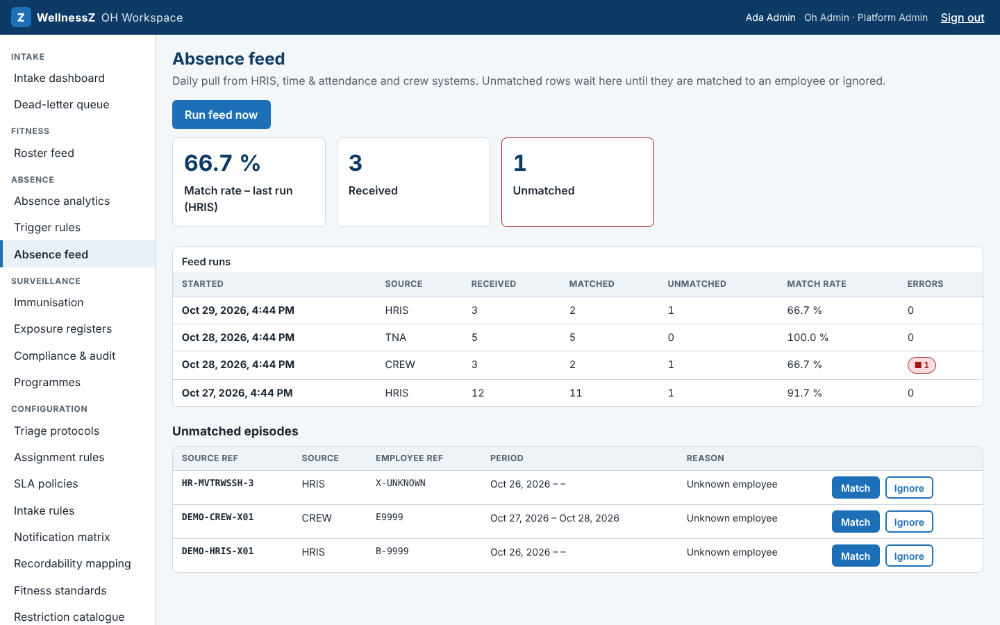

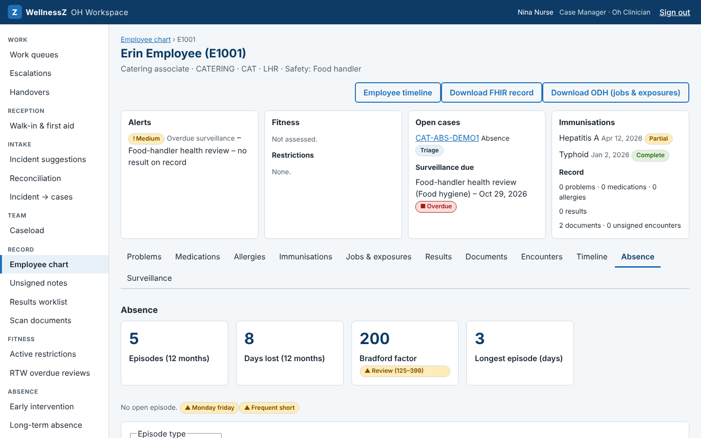

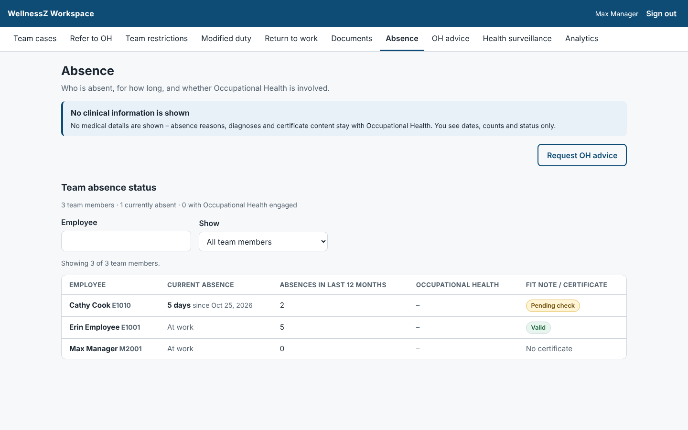

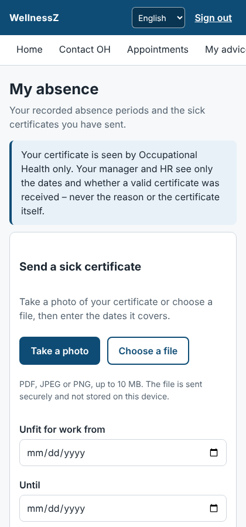

---

## 7. E06-F02 – Trigger rules and early-intervention queue

**Requirements:** E06-HLR-02; E06-BL-003 (rule builder), E06-BL-004 (queue), E06-BL-005 (OH-engaged notification),
E06-BL-014 (crew sickness → AME review).

### 7.1 Rule model and engine

`RuleEngine` is a pure class (unit-tested in `RuleEngineTest`, `AbsencePatternsTest`). Rule types and parameters:

| Type | Parameters | Matches when |
|---|---|---|
| DURATION | `minDays` | A recent episode has lasted **at least** `minDays` calendar days |
| FREQUENCY | `episodes`, `windowDays` | At least `episodes` episodes started within the window and one of them is recent |
| PATTERN | `pattern` (MONDAY_FRIDAY only), `minOccurrences`, `windowDays` | At least `minOccurrences` weekend-adjacent episodes (start Monday / Friday or end Friday / Monday) in the window |
| POST_INCIDENT | `withinDays` | A recent episode started 0–`withinDays` days after a workplace incident case of the employee |
| SAFETY_CRITICAL | `minDays` | As DURATION, only for safety-critical job codes |
| CREW_SICKNESS | `minDays`, `episodes`, `windowDays` | Crew (crew job or CREW source): a long spell, else the frequency condition |

Design decisions taken in the code:

* **`minDays` means "at least".** The workbook phrase "> 10 days" is therefore seeded as `minDays: 11`
  (`DURATION_10D`), "> 3 days" as 4, "> 7 days" as 8 and "> 2 days" as 3.
* **Recent episodes only** – an episode counts when it is open or ended within 30 days, so a historical back-fill does
  not raise stale triggers.
* **Subsidiary override** – a rule with a subsidiary code replaces the group defaults **of the same type and action**
  for that subsidiary; other defaults still apply (`CAT_DURATION_2D` replaces `DURATION_10D` for catering but not
  `LTA_28D`).
* **One match per action** – rules are evaluated in effective order (subsidiary rules first) and at most one match per
  action is kept; the engine raises **at most one open queue item per employee and action** (partial unique index).
* **Parameter validation** – required whole numbers 1–3650, no unknown keys, PATTERN only MONDAY_FRIDAY (`400
  invalid_params`).

Seeded rules (V10, all version 1, editable): `DURATION_10D`, `FREQ_3_IN_90`, `MON_FRI_PATTERN` (3 in 180 days),
`LTA_28D` (≥ 28 days → LONG_TERM), `SAFETY_CRITICAL_3D`, `POST_INCIDENT_7D`, `CREW_SICKNESS` (> 7 days or 3 in 90 →
AME_REVIEW) and `CAT_DURATION_2D` (subsidiary CAT, food handlers).

### 7.2 Rule administration

`GET /absence/rules` (OH roles, OH_ADMIN, HR), `POST` / `PUT` / `DELETE` (OH_ADMIN). Every change writes a snapshot to
`absence.trigger_rule_version` (CREATE / UPDATE / DEACTIVATE) and the audit trail; `DELETE` deactivates. **Test mode**
`POST /absence/rules/test` evaluates an unsaved rule or a saved one (optionally for one subsidiary) against the current
population and returns who would match and why – no queue items or cases are created.

### 7.3 Evaluation and actions

Rules run on every ingested or updated episode and nightly (`absence-triggers`, 03:00 UTC, once across replicas via
`JobRunGuard`) for everyone with an episode open or ended in the last 30 days.

| Action | Effect |
|---|---|
| EARLY_INTERVENTION | Queue item NEW with SLA `absence.queue.sla-days` (5); event `absence.trigger.raised.v1` |
| LONG_TERM | As above **plus** the LTA pathway starts at once (kernel ABSENCE case, milestone plan, `AbsenceSignalListener`, Section 9); no new item while a pathway is active |
| AME_REVIEW | Queue item with SLA `absence.queue.ame-sla-days` (1) – these items form the **AME queue**; a FITNESS case `DECREASE_IN_FITNESS` with initial fitness `UNFIT_PENDING` is opened idempotently and `CaseService.publishFitness` sends a **PENDING** roster status to crew rostering (status only); the outcome flows through the normal E05 fitness decision |

### 7.4 Queue

* `GET /absence/queue?status&action` (OH roles; only employees the caller may see clinically) – rule, detail ("Absence
  of 12 days (threshold 11)"), raised and SLA times, breach flag, case, first contact, assignee and the 12-month
  **absence history** (with reason categories).
* `POST /absence/queue/{id}/accept` – assigns the item, reuses the employee's open ABSENCE case or opens one
  (`earlyIntervention=true`, routine), links the episode, records the case timeline and – when
  `absence.notify-hr-on-engagement` is true (default) – sends `absence.oh-engaged` to the line manager and the HR
  mailbox `absence.hr-email` with name, unit, case reference and OH contact only, and publishes
  `absence.hr-status.v1 {ohEngaged:true}` to `hr-systems`.
* `POST /absence/queue/{id}/contact` – channel (PHONE, VIDEO, IN_PERSON, EMAIL), outcome (REACHED, NO_ANSWER, DECLINED),
  encrypted note. The first REACHED contact stamps `firstContactAt` (KPI) and, when the employee has an active LTA pathway,
  completes its earliest open CONTACT milestone.
* `POST /absence/queue/{id}/close` – reason required.

### 7.5 Data model

| Table | Content |
|---|---|
| `trigger_rule` | Code (unique), name, subsidiary, type, JSON params, action, active, version, updated by / at |
| `trigger_rule_version` | Immutable snapshots per change (insert-only grant) |
| `queue_item` | Employee, rule, action, NEW / ACCEPTED / CONTACTED / CLOSED, raised, SLA due, episode, detail, case, assignee, first contact, closure |
| `contact` | Queue item or case, channel, outcome, encrypted note, next contact due (insert-only) |

### 7.6 Screens

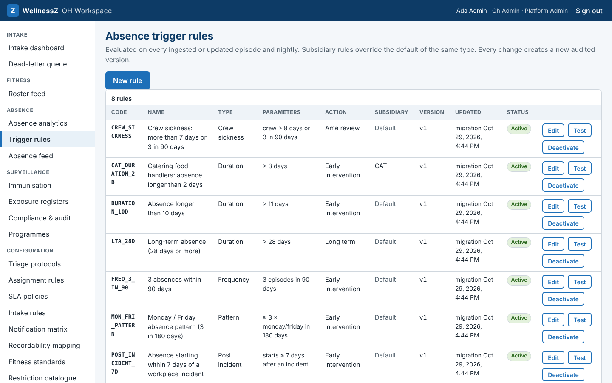

---

## 8. E06-F03 – Medical certificate management

**Requirements:** E06-HLR-03; E06-BL-006 (employee upload), E06-BL-007 (checklist, call log, escalation).

### 8.1 Intake channels

| Channel | Endpoint | Behaviour |
|---|---|---|
| Employee upload / photo | `POST /me/absence/certificates` (multipart `file`, `fromDate`, `toDate`, `episodeId?`) | Stored with `storeUpload(SICK_CERTIFICATE)`, status RECEIVED, `absence.certificate-received` confirmation; the employee sees id, dates, RECEIVED / VALID / INVALID and received time |
| Clinic scan | `POST /absence/certificates` (OH roles, `CLINIC_RECEPTION`) | Same, with the employee ID; reception can file a certificate without reading the record |
| Partner clinic (electronic) | `POST /integration/absence/certificates` (`INTEGRATION`) | Structured certificate (partner organisation, number, issuer and registration, dates, fit note NOT_FIT / MAY_BE_FIT, optional PDF); a verified source is **VALID** on arrival unless it duplicates another certificate (then SUSPICIOUS) |

Dates are validated (`toDate ≥ fromDate`, at most one year, issue date not in the future). The certificate is linked to
the given episode (which must be the employee's) or the overlapping episode.

### 8.2 Automatic checks (`CertificateChecks`, pure)

* **OCR field extraction** from the PDF text layer or OCR text: issuer name, registration number (GMC / registration /
  licence patterns), issue date, from / to dates (ISO, `dd/mm/yyyy`, `dd.mm.yyyy`). Stored encrypted.
* **Duplicates** – same SHA-256, or the same certificate number (with matching or unknown issuer registration), or the
  same employee with identical dates → `duplicateOfId`.
* **Alteration flags** – `DATES_DIFFER_FROM_OCR` (declared dates differ from the extracted ones),
  `ISSUE_AFTER_START_PLUS_7` (issued more than 7 days after the absence started), `PDF_MODIFIED_AFTER_CREATION` (PDF
  ModDate more than a minute after CreationDate, or several `%%EOF` markers – an incremental update),
  `UNREADABLE` (no text could be extracted).

### 8.3 Validation, verification and escalation

* `POST /absence/certificates/{id}/validate` (OH roles, reception) – checklist (issuer identified, registration valid,
  dates consistent, signature present, covers absence) and outcome VALID, INVALID or SUSPICIOUS.
* `POST /absence/certificates/{id}/calls` (OH roles, reception) – verification call log (called party, CONFIRMED /
  NOT_CONFIRMED / NO_ANSWER, encrypted note).
* `POST /absence/certificates/{id}/verify` (**OH roles only**) – VERIFIED_GENUINE or VERIFIED_FRAUDULENT; with
  `escalateToHr` an `absence.certificate-escalation` (status only) goes to the HR mailbox and the certificate is marked
  escalated.
* `GET /absence/certificates/{id}/content` (OH roles, reception; an endpoint added beyond the contract) streams the file
  for the work list. **UI decision:** the OH Workspace shows reception the scan, validation checklist and call log but
  not the "open file" or "verify" actions.

**Validity mapping for HR, managers and the employee:** VALID / VERIFIED_GENUINE → VALID; INVALID /
VERIFIED_FRAUDULENT → INVALID; RECEIVED **and SUSPICIOUS** → PENDING (a suspicion is never disclosed outside OH). Each
validity change is published as `absence.hr-status.v1 {certificateValidity}`. `GET /workspace/absence/certificates`
returns dates, validity and an escalated flag only – no issuer, OCR fields or file (audited `validity-only`). Retention
class ABSENCE_RECORD.

### 8.4 Data model

| Table | Content |
|---|---|
| `certificate` | Employee, episode, source, document, dates, issuer / registration / number / partner, issue date, fit note, encrypted OCR JSON, checklist JSON, status, duplicate of, alteration flags, SHA-256 (indexed), received / validated / verified by and at, encrypted validation note, escalated |
| `certificate_call` | Called party, outcome, encrypted note, caller, time (insert-only) |

### 8.5 Screen

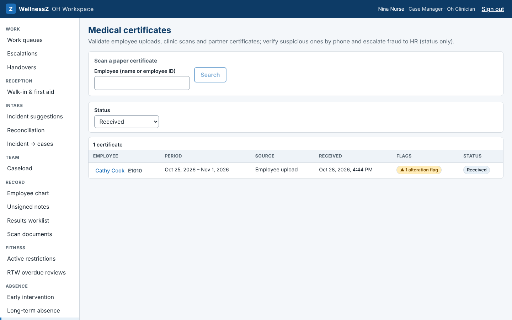

---

## 9. E06-F04 – Long-term absence pathway

**Requirements:** E06-HLR-04; E06-BL-008 (milestones and contacts), E06-BL-009 (advice reports at milestones).

### 9.1 Pathway start

The LONG_TERM action (rule `LTA_28D`) calls `LtaService.start`: reuse the employee's open ABSENCE case or open one;
create `absence.lta_pathway` (one ACTIVE pathway per employee); plan the milestones; publish
`absence.lta.started.v1`; call every `AbsenceSignalListener` **once** (E07 return-after-illness, Section 18.3); and –
after commit, when scheduling is deployed – book an `ABSENCE_REVIEW` appointment for the contact milestone through
`AppointmentBooking` (source type `ABSENCE_CONTACT`).

### 9.2 Milestone plan (`MilestonePlan`, pure)

| Week (from the first day of absence) | Milestone |
|---|---|
| 2 | CONTACT |
| 4 | ADVICE_REPORT |
| 8 | ADVICE_REPORT + CASE_CONFERENCE |
| 12 | HR_REVIEW + ADVICE_REPORT |
| 26 | IHR_CONSIDERATION (ill-health retirement consideration, E05-F07) |
| return date | RTW_REVIEW – created when the episode closes with a return date |

The contact schedule after the first contact is fortnightly (`absence.lta.contact-interval-days`, 14) through
`nextContactDue` on each contact.

### 9.3 Operations

* `GET /absence/lta?status` and `GET /absence/lta/{caseId}` (OH roles) – pathway with weeks absent, HR stage, next
  milestone, overdue count, RTW plan; detail with milestones, contacts, advice reports, conferences and the E05 RTW plan.
* Complete (`…/milestones/{id}/complete`, note) or skip (reason required) a milestone; log a contact; schedule a **case
  conference** (`scheduledFor`, participants from EMPLOYEE, MANAGER, HR, OH, encrypted note).
* A REACHED contact completes the earliest open CONTACT milestone.
* **HR stages** – `POST /workspace/absence/lta/{caseId}/hr-stage` (HR in scope): NONE, INFORMAL_REVIEW,
  FORMAL_REVIEW_1, FORMAL_REVIEW_2, CAPABILITY_HEARING, CLOSED. The HR note is **screened**: clinical wording returns
  `422 clinical_content_not_allowed` (E2E). Setting a stage completes the open HR_REVIEW milestone.
* **RTW linkage** – when the episode closes, an RTW_REVIEW milestone is created on the return date and the latest
  non-cancelled E05 RTW plan of the case is linked. **Completing the RTW_REVIEW milestone closes the pathway.**
* **Overdue** – nightly `absence-lta` (03:10 UTC) marks open milestones past their due date OVERDUE and sends
  `absence.milestone-overdue` once to the case owner (or the case-manager role when unassigned).
* **HR / manager view** – `GET /workspace/absence/lta`: case reference, absence start, weeks absent, HR stage, next
  milestone (week, type, due date) and the number of released advice reports; nothing clinical.

### 9.4 Data model

| Table | Content |
|---|---|
| `lta_pathway` | Case (primary key), employee, episode, absence start, ACTIVE / CLOSED, HR stage with screened note, RTW date, RTW plan, start / close |
| `lta_milestone` | Week, type, due date, PENDING / DONE / OVERDUE / SKIPPED, completion, encrypted note, overdue-notified, appointment |
| `case_conference` | Scheduled time, participants, encrypted note (insert-only) |

### 9.5 Screens

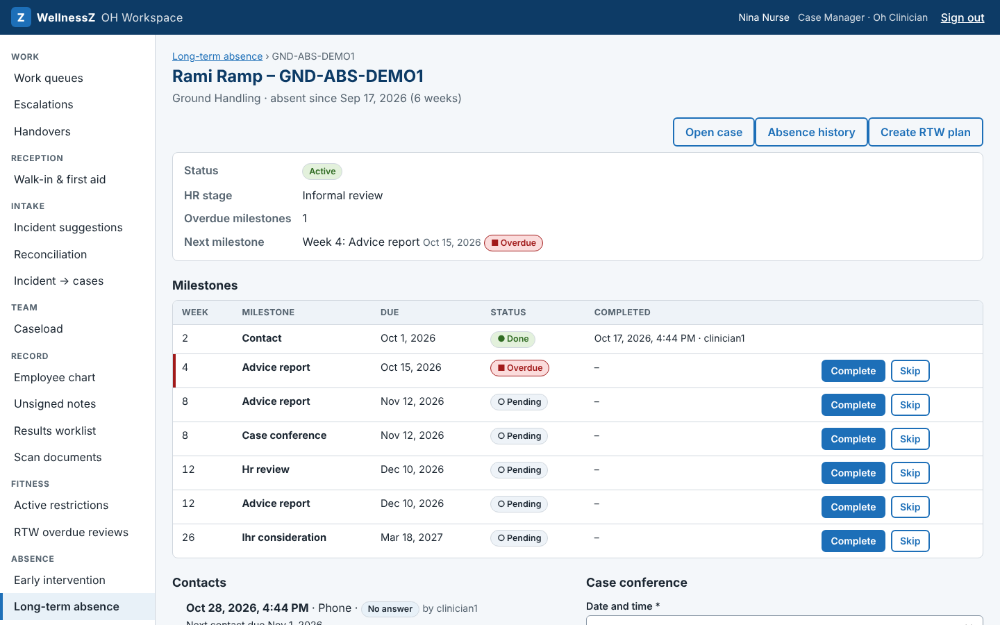

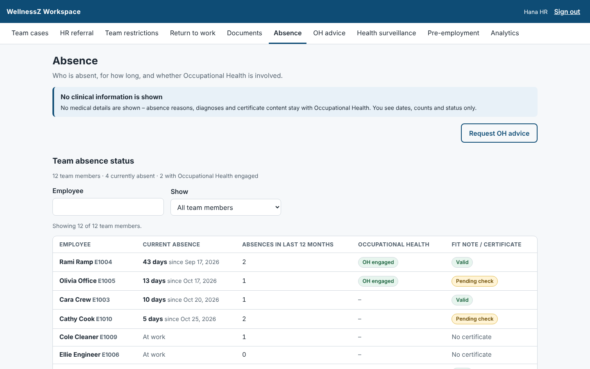

---

## 10. E06-F05 – Management advice request and OH advice report

**Requirements:** E06-HLR-05; E06-BL-010 (request form), E06-BL-011 (employee pre-release view), E06-BL-009 (report).

### 10.1 Request

* Question library (`GET /absence/advice/questions`): FIT_FOR_ROLE, ADJUSTMENTS, EXPECTED_RTW, PHASED_RETURN,
  ABLE_TO_ATTEND_MEETINGS, DISABILITY_PROVISIONS_LIKELY, WORK_CONTRIBUTION, FURTHER_REVIEW.
* `POST /workspace/advice-requests` (manager or HR, employee in scope): at least one question, optional context
  (≤ 2,000 characters, encrypted, visible to OH and the requester) and episode. Reference `ADV-YYYY-NNNNNN`
  (`absence.advice_ref_seq`); SLA = 5 working days (`absence.advice.sla-working-days`); case managers get
  `absence.advice-requested`. The requester may withdraw while it is still open.
* OH accepts (`POST /absence/advice-requests/{id}/accept`) – links or opens an ABSENCE case (source MANAGER_REFERRAL or
  HR_REFERRAL).

### 10.2 Report

* `PUT /absence/advice-requests/{id}/report` (clinicians) – fitness (FIT, FIT_WITH_ADJUSTMENTS, TEMPORARILY_UNFIT,
  UNFIT_LONG_TERM), adjustments, restrictions, prognosis (RTW_WITHIN_2_WEEKS … RTW_UNLIKELY), expected return, review date
  and one answer per **asked** question (`400 unknown_question` otherwise; each answer ≤ 400 characters). **Every text is
  screened**: a diagnosis returns `422 clinical_content_not_allowed` with the offending field (E2E).
* `POST …/report/sign` → AWAITING_EMPLOYEE and `absence.advice-review` to the employee when
  `absence.advice.employee-review-required` (default true); otherwise straight to release.

### 10.3 Employee review and release

* `GET /me/advice-reports` – the report as it would be released.
* `POST /me/advice-reports/{id}/decision`:
  * **CONSENT** (optional comment ≤ 1,000 characters, screened, released with the report) → RELEASED:
    `generateSigned(OH_ADVICE_REPORT)`; `shareAsSystem` to the employee and to the requester – **the line manager for
    manager requests, HR otherwise** – with a disclosure-log entry; `absence.advice-released` to the requester (HR via
    the `absence.hr-email` mailbox); event `absence.advice.released.v1`.
  * **DECLINE** (reason encrypted, OH only) → WITHHELD; `absence.advice-declined` to the requester; OH can draft a new
    version (the previous one becomes SUPERSEDED).
* Requesters see the released report (fitness, adjustments, restrictions, prognosis, expected return, review date,
  answers, employee comment, document) only when RELEASED; WITHHELD shows the status only.

### 10.4 Data model

| Table | Content |
|---|---|
| `advice_request` | Reference, employee, requester and role, question codes, encrypted context, episode, status, SLA, case, acceptance, withdrawal |
| `advice_report` | Version (unique per request), DRAFT / AWAITING_EMPLOYEE / RELEASED / WITHHELD / SUPERSEDED, fitness, screened adjustments / restrictions / answers, prognosis, dates, signer, employee decision and screened comment, encrypted decline reason, document, released time |

### 10.5 Screens

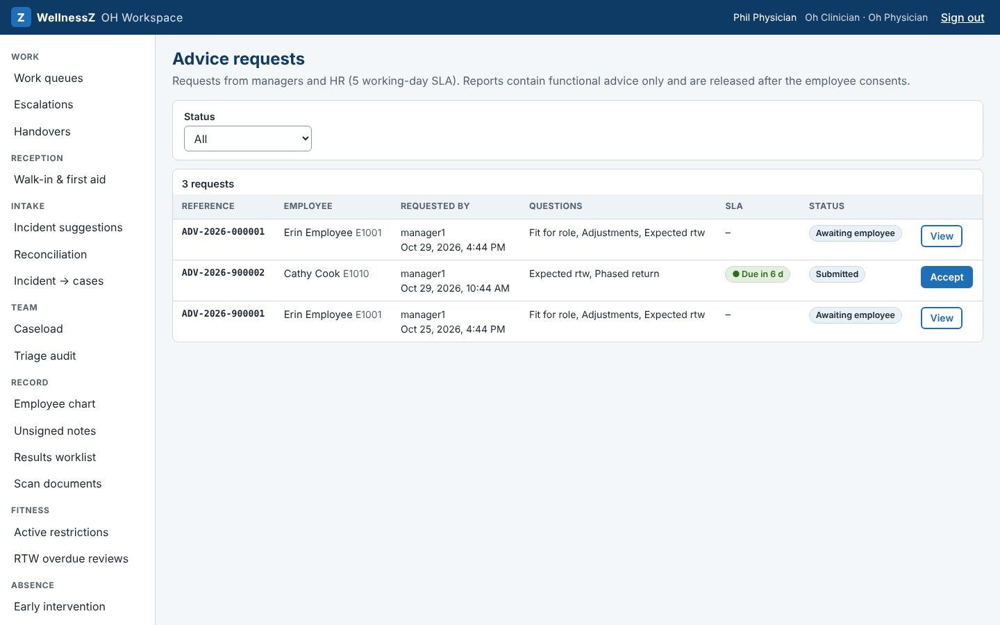

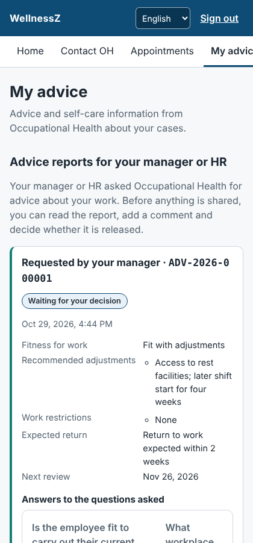

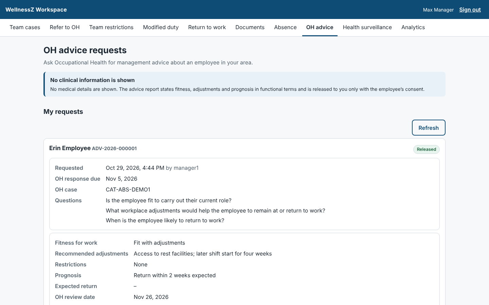

---

## 11. E06-F06 – Absence analytics

**Requirements:** E06-HLR-06; E06-BL-012 (dashboards), E06-BL-013 (trigger-to-contact KPI).

* `GET /absence/analytics/units?groupBy=SUBSIDIARY|DEPARTMENT|JOB_FAMILY&from&to` (CMO, Nursing Head, HR, OH_ADMIN) –
  per unit: headcount, episodes, days lost, absence rate %, frequency rate, average duration, mean Bradford factor and,
  **for OH roles only**, counts by reason category. Drill-down stops at unit level – never a person.
* **Small-group suppression** – `UnitAggregator` publishes a unit whose headcount is below
  `wellnessz.analytics.min-group-size` (default 5, never below 3) as `{key, label, suppressed:true}` without any counts.
  With the small demo population most units are suppressed – by design.
* `GET /absence/analytics/kpis` (CMO, Nursing Head, OH_ADMIN) – absence rate, **LTA with OH case %** (target 95),
  **median days trigger → first contact** (target 5), certificates verified %, open LTA, overdue milestones and a
  monthly trend.
* `GET /absence/analytics/export?month=YYYY-MM` (CMO, Nursing Head, HR) – monthly CSV pack by department, suppression
  applied, no categories, spreadsheet-formula characters neutralised.

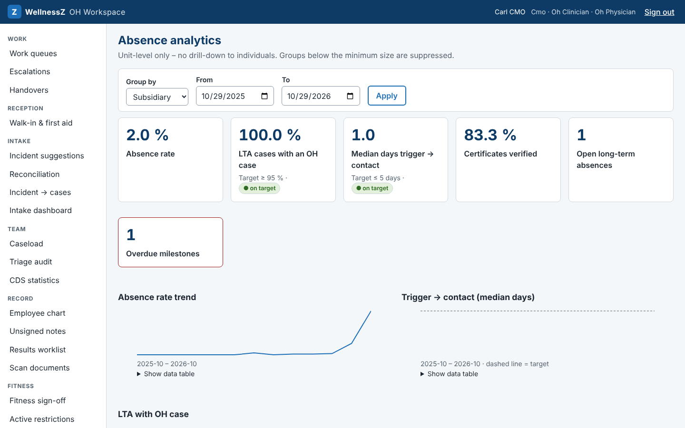

---

## 12. E07-F01 – Programme and protocol builder

**Requirements:** E07-HLR-01; E07-BL-001 (builder), E07-BL-002 (initial programme set), E07-BL-020 (return after
illness – Section 18.3).

### 12.1 Programme model

A programme is identified by `code` and versioned (`surveillance.programme`, unique `(code, version)`), with status
DRAFT → ACTIVE → RETIRED, effective date and approver. It holds:

* **Eligibility** (JSON): job codes, department codes, subsidiary codes, hazard codes, exposure groups, licence types,
  minimum age. A person is eligible when at least one **positive** criterion matches – licence, job code, a hazard of
  the job, or an exposure group (membership of a SEG, or a SEG of the programme's hazard measured at or above its
  action level) – and the department / subsidiary / minimum-age filters, when set, also match. Without positive
  criteria the filters alone define the population; a programme without any criterion enrols nobody.
* **Panel**: `AUDIOMETRY`, `SPIROMETRY`, `VISION`, `ECG`, `QUESTIONNAIRE`, `PHYSICAL_EXAM`, `LAB:{loinc}`,
  `BIOMONITORING:{code}`, `IMMUNISATION:{vaccine}`, each with an optional standard code.
* Frequency in months (1–120) and an optional **over-40 frequency** (applies when the person was 40 or older on the date
  of the last examination), fitness standard, responsible role (notification target), service code (E14 appointment
  type used for booking and capacity) and regulatory basis.

Date of birth and licence types are not in the HRIS master, so E07 keeps them in `surveillance.employee_profile`;
licences are also derived from the job's safety category.

### 12.2 Builder operations

| Endpoint | Roles | Behaviour |
|---|---|---|
| `GET /surveillance/programmes[/{code}]` | OH roles, OH_ADMIN, HSE_OFFICER, AUDITOR | Current version with eligible headcount; detail lists all versions with approver |
| `POST /surveillance/programmes`, `PUT …/{code}` | OH_ADMIN, CMO, Nursing Head | New programme or new DRAFT version – "without code" |
| `POST …/{code}/simulate` | same | **Population impact without writes**: eligible headcount, breakdown by subsidiary and department, how many would be newly enrolled and how many would be overdue immediately (E2E: HEARING_CONSERVATION) |
| `POST …/{code}/activate` | CMO, OH physician | DRAFT → ACTIVE (previous ACTIVE version → RETIRED), approver recorded, enrolments recalculated for that programme |
| `POST …/{code}/retire` | CMO | ACTIVE → RETIRED |

### 12.3 Seeded programmes (E07-BL-002, all ACTIVE version 1, pending CMO validation)

| Code | Eligibility | Panel | Frequency | Responsible / service |
|---|---|---|---|---|
| `PILOT_CLASS1` | licence FLIGHT_CREW | physical exam (CAA_CLASS1), ECG, audiometry, vision | 12 m (6 m over 40) | AME / CREW_AEROMEDICAL |
| `CABIN_CREW` | licence CABIN_CREW | physical exam, vision | 24 m | AME / CREW_AEROMEDICAL |
| `FOOD_HANDLER` | job CATERING_ASSOC | questionnaire, immunisation TYPHOID | 12 m | OH clinician / FOOD_HANDLER_CLEARANCE |
| `HEARING_CONSERVATION` | hazard NOISE | audiometry, questionnaire | 12 m | OH clinician / AUDIOMETRY |
| `RESPIRATORY` | hazards DUST_RESP, SOLVENT | spirometry, questionnaire | 24 m | OH clinician / SPIROMETRY |
| `HAZMAT_DGR` | hazard DGR | questionnaire, physical exam | 24 m | OH clinician / GENERAL_OH |
| `AIRSIDE_DRIVER` | job RAMP_AGENT | vision, questionnaire | 36 m | OH clinician / VISION |
| `FORKLIFT` | job FORKLIFT_OP | vision, questionnaire | 36 m | OH clinician / VISION |
| `WORKING_AT_HEIGHT` | hazard HEIGHT | physical exam, vision | 36 m | OH clinician / GENERAL_OH |
| `NIGHT_WORKER` | hazard NIGHT_WORK | questionnaire | 12 m | OH clinician / NURSE_REVIEW |
| `SECURITY_SCREENER` | job SECURITY_SCREENER | vision | 24 m | OH clinician / VISION |
| `CLINICAL_BBP` | hazard BBP | immunisation HEP_B, LAB 16935-9 (anti-HBs), questionnaire | 60 m | OH clinician / VACCINATION |
| `VDU` | hazard VDU | vision | 24 m | OH clinician / VISION |

Each carries its regulatory basis as reference text (for example Control of Noise at Work Regulations 2005 regulation 9,
COSHH regulation 11, Working Time Regulations regulation 7, Part-MED). The content is a **draft for CMO validation**;
headcounts must still be reconciled with HR (E07-BL-002 acceptance criterion).

### 12.4 Screens

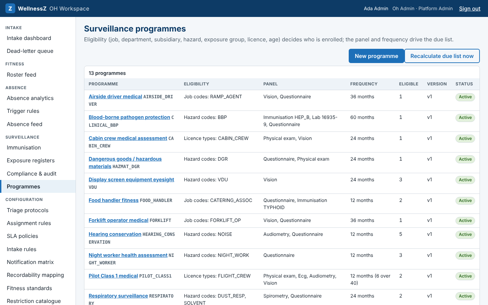

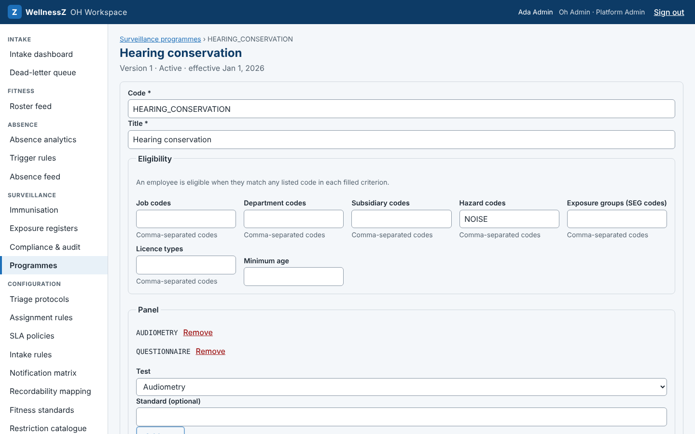

---

## 13. E07-F02 – Due-list engine, invitations and escalation

**Requirements:** E07-HLR-02; E07-BL-003 (nightly due list, bulk invite), E07-BL-004 (campaign mode – delivered with
E14-F02, Section 21), E07-BL-005 (manager escalation).

### 13.1 Enrolment and due dates

* `EnrolmentEngine.recalculate` evaluates the active HRIS population against every ACTIVE programme: new eligible people
  are enrolled with a reason (JOB_CODE, HAZARD, EXPOSURE_GROUP, LICENCE; MANUAL enrolments are kept), people no longer
  eligible are deactivated, next due dates are recomputed. One enrolment per employee and programme.
* **Next due** = last completion + frequency (over-40 variant where applicable); never examined → enrolment date +
  `surveillance.new-enrolment-grace-days` (30) for the baseline.
* **Status** (in priority order): EXEMPT (exemption in force) › SCHEDULED (booked) › OVERDUE › DUE (≤ 30 days) ›
  CURRENT.
* Nightly `surveillance-due` (01:40 UTC, once across replicas): recalculation, `surveillance.enrolment.due.v1` once per
  due period, follow-up of ignored invitations, immunisation reminders and the compliance snapshot. OH_ADMIN can run
  the recalculation now (`POST /surveillance/due/recalculate`).

### 13.2 Due list and invitations

* `GET /surveillance/due?programme&subsidiary&department&status&dueBefore` (OH roles, `CLINIC_SCHEDULER`) – name, unit,
  programme, reason, last completed, next due, status, invitation count, last invited, appointment, escalation. The
  scheduler sees names and programme titles only – no results or outcomes.
* `POST /surveillance/invitations` – bulk, 1–5,000 enrolments per call, optional `book`, site and campaign. Each
  invitation sends the content-free `surveillance.invitation` and, when `book` is set and scheduling is deployed, books
  the first free slot of the programme's service code at the site (or home site) from tomorrow through
  `AppointmentBooking` (source type `SURVEILLANCE_INVITATION`, source reference = invitation ID). No capacity → status
  INVITED instead of BOOKED. Result `{invited, booked, notBooked, invitationIds}`.
* `GET /surveillance/invitations?enrolmentId` – invitation log.
* `POST /surveillance/enrolments/{id}/complete` (clinicians: performed on, outcome FIT / FIT_WITH_LIMITATIONS / UNFIT /
  REFER, encounter, result IDs) recomputes the next due date; `…/exempt` (physicians, encrypted reason, optional end).

### 13.3 No-show and escalation (`NoShowPolicy`, pure)

* E14 calls `AppointmentStatusListener` on every status change. ATTENDED marks the invitation ATTENDED (completion
  remains a clinician action), CANCELLED marks it CANCELLED.
* **NO_SHOW**, or an invitation still INVITED 14 days after sending, counts as **ignored**: while fewer than
  `surveillance.max-invitations` (2) invitations were sent the person is **re-invited and re-booked**; at the limit the
  line manager receives `surveillance.overdue-manager` (name, unit, due date – status only), the enrolment is stamped
  `escalatedAt` and the latest invitation becomes ESCALATED. Escalation happens once per due period.

### 13.4 Employee and manager views

* `GET /me/surveillance` (employee) returns a **wrapper object** (deviation from the contract's array): programmes with
  next due date, status and appointment, plus the crew certificate (crew only) and immunisation status.
* `GET /workspace/surveillance/compliance` (manager, HR in scope) – programme title, CURRENT / DUE / OVERDUE, next due,
  escalated; never results, outcomes or exemption reasons (E2E asserts no `resultIds`).

### 13.5 Data model

| Table | Content |
|---|---|
| `enrolment` | Employee + programme (unique), reason, active, dates, last outcome, next due, encrypted exemption reason / until, invitations, last invited, escalated, due-event marker, optimistic version |
| `completion` | Performed on, outcome, encounter, result IDs, recorder |
| `invitation` | Sequence number, sent, channel, INVITED / BOOKED / ATTENDED / NO_SHOW / CANCELLED / ESCALATED, appointment and site, campaign |
| `employee_profile` | Date of birth, licence types (over-40 frequency, licence eligibility) |

### 13.6 Screens

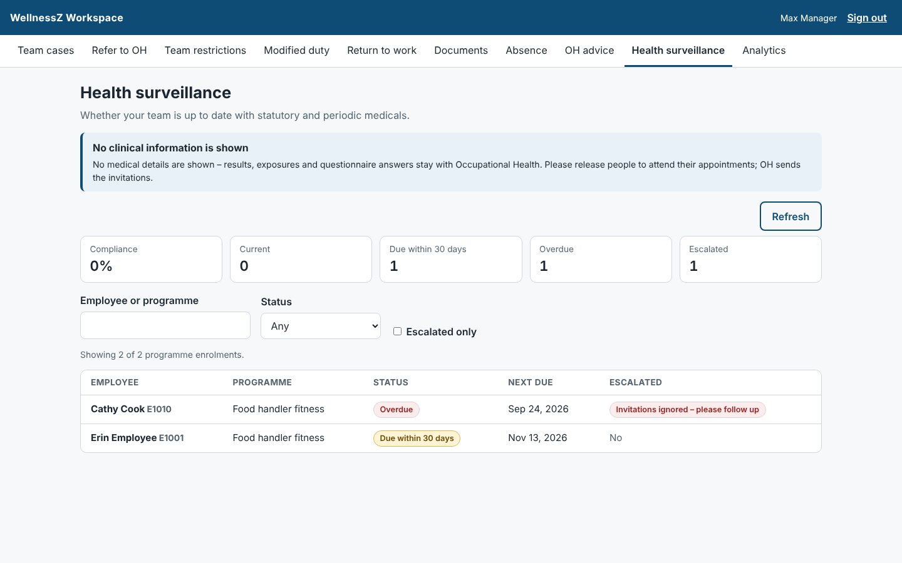

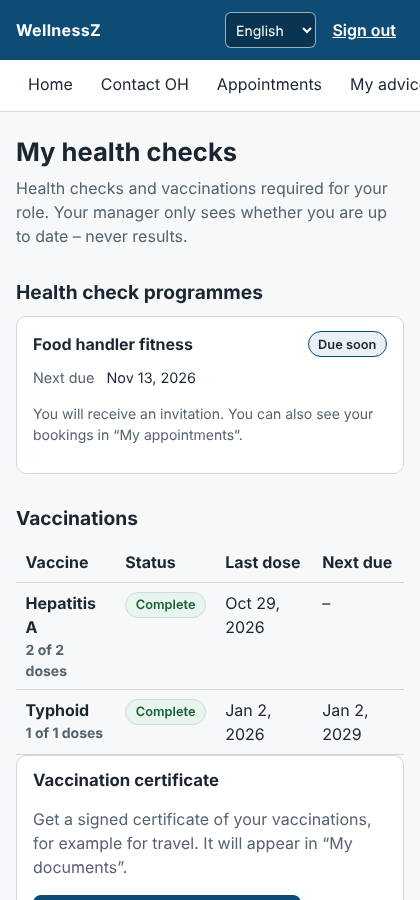

---

## 14. E07-F03 – Pre-employment and pre-placement medicals

**Requirements:** E07-HLR-03; E07-BL-006 (trigger from offer, status feed), E07-BL-007 (candidate portal, retention),
E07-BL-008 (government / visa medicals).

### 14.1 Design decisions

* **Candidates are not employees.** They are not in the HRIS master, so no table in the `surveillance` schema has a
  foreign key to `masterdata.employee`; the candidate ID (e.g. `C9001`) is the subject of documents and the
  `employee_id` claim of the candidate's identity. The `CANDIDATE` role reaches only `/me/pre-employment/**` and
  `/me/appointments`.
* **Trigger** – the HRIS offer event `POST /integration/pre-employment` (or HR / OH manually via
  `POST /surveillance/pre-employment`) with offer reference, candidate ID, name, e-mail, job, unit, location and proposed
  start. Idempotent on `offerRef`. The **panel** is the set of ACTIVE programmes whose eligibility matches the job (age
  and person-level facts unknown). SLA `surveillance.pre-employment-sla-days` (10). `pre-employment.invitation` goes to
  the candidate's e-mail.
* **Candidate portal** – a ten-question health questionnaire (treatment, time off in 12 months, adjustments,
  hearing / vision, skin / chest, shift work, last vaccination record, declaration; YES_NO / TEXT / DATE) stored
  encrypted; consent with purposes `PRE_EMPLOYMENT_ASSESSMENT` (required) and `HR_STATUS_FEED`; up to ten documents
  (`storeUpload(PRE_EMPLOYMENT_DOCUMENT)`); booking of a PRE_EMPLOYMENT appointment through `AppointmentBooking`, allowed
  only after questionnaire **and** consent. The questionnaire is locked once examined.
* **Outcome** – `POST /surveillance/pre-employment/{id}/outcome` (clinicians): FIT, FIT_WITH_ADJUSTMENTS or UNFIT with
  optional functional conditions (**screened** – "Asthma – avoid flour dust" is rejected, "Avoid tasks in the flour room
  during induction" accepted). HR clearance: FIT and FIT_WITH_ADJUSTMENTS → FIT, UNFIT → UNFIT, otherwise PENDING. A
  signed `PRE_EMPLOYMENT_OUTCOME` (status and onboarding adjustments only) is generated; `preemployment.status.v1` goes to
  `hr-systems` with `{messageId, offerRef, candidateId, preEmploymentStatus, effectiveFrom}` and `pre-employment.status`
  to the HR onboarding mailbox – within the 1-day SLA because both happen in the same transaction.
* **Known limitation – document share.** The outcome document is shared to HR through `shareAsSystem` **only when the
  candidate already exists in the employee master**; for a true candidate the HR view lists the clearance status and
  the disclosure is written directly to the disclosure log.
* **Government / visa medicals** – type VISA / GOVERNMENT / RESIDENCY, reference, status PENDING / PASSED / FAILED, expiry.

### 14.2 Views

| Endpoint | Audience | Content |
|---|---|---|
| `GET /surveillance/pre-employment[/{id}]` | OH roles | Full record; detail adds questionnaire answers |
| `GET /workspace/pre-employment` | HR | Offer, candidate name, job title, proposed start, **HR clearance FIT / UNFIT / PENDING**, updated – nothing else (E2E) |
| `GET /me/pre-employment` | Candidate | Own status, questionnaire / consent flags, appointment, documents |

### 14.3 Candidate data retention

`POST /surveillance/pre-employment/{id}/withdraw` (HR, OH) – candidate not hired → WITHDRAWN, `retention_until` = today +
12 months. The nightly `pre-employment-purge` (03:10 UTC) then replaces the name with "Purged candidate" and clears the
e-mail, questionnaire, conditions, document list and government reference, stamping `purged_at` (audited). Documents of
record class `PRE_EMPLOYMENT` (1 year) are flagged by the platform retention job; deletion of document bytes remains a
reviewed DPO decision (as in Increment 2).

### 14.4 Data model

`pre_employment` – offer (unique), candidate, job and unit, panel, status (INVITED, QUESTIONNAIRE_DONE, BOOKED,
EXAMINED, OUTCOME_RECORDED, WITHDRAWN), HR clearance, outcome, encrypted conditions and questionnaire, consent and
purposes, appointment, government medical, documents, outcome document, HR message ID, SLA, retention, withdrawal and
purge stamps, optimistic version.

### 14.5 Screens

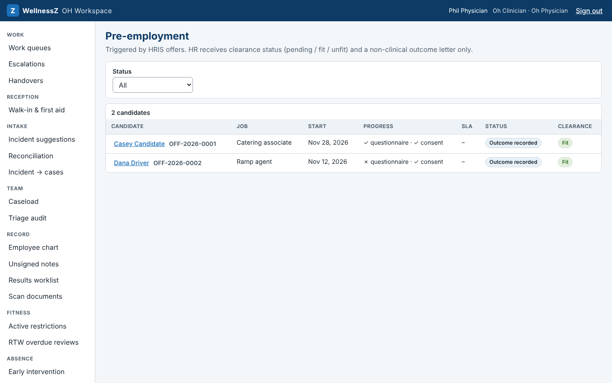

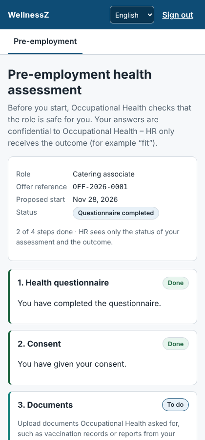

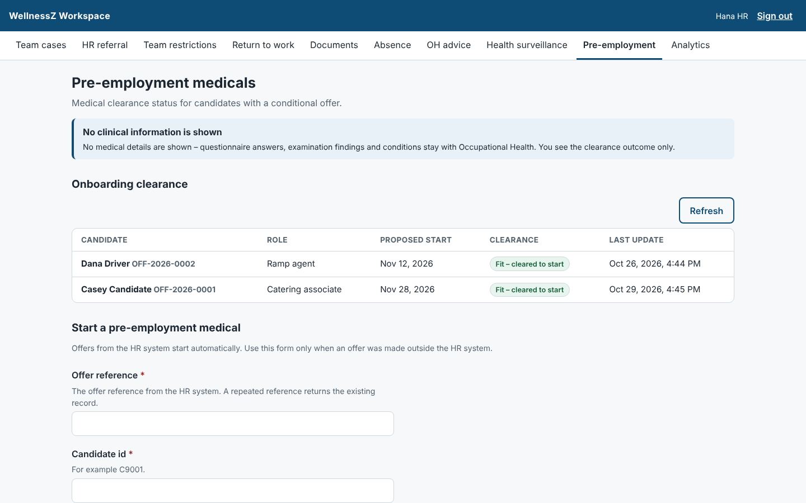

---

## 15. E07-F04 – Crew aeromedical examinations and certificate tracking

**Requirements:** E07-HLR-04; E07-BL-009 (templates and register), E07-BL-010 (expiry alerts, status feed),
E07-BL-011 (external import).

* **Examination template** – `GET /surveillance/crew/exam-template?type=CLASS1|CLASS2|CABIN_CREW` (AME, CMO) returns
  CAA-style sections (history, general examination, vision, hearing & ENT, cardiovascular, laboratory, assessment; cabin
  crew: hearing and cabin duties). **Draft – the CAA formats await confirmation.**
* **Examination** – `POST /surveillance/crew/examinations` (AME): certificate type CLASS1, CLASS2, LAPL or CABIN_CREW,
  examined on, encrypted answers, outcome (FIT, FIT_WITH_LIMITATIONS, UNFIT, REFERRED_TO_AUTHORITY), limitation codes and
  optional validity. Default validity from the programme (Class 1: 12 months, 6 over 40; Class 2: 24 / 12; cabin crew:
  24). The service creates the certificate (issuing authority `surveillance.crew.issuing-authority`), a signed
  `CREW_MEDICAL_REPORT` or `CABIN_CREW_MEDICAL_REPORT`, records the completion on the matching programme and **publishes
  the roster status** through the kernel: FIT → FIT, FIT_WITH_LIMITATIONS → LIMITED, UNFIT → UNFIT, referred → PENDING.
  One standing crew-medical FITNESS case per crew member (`sourceRef surveillance:crew:{id}`) carries the status so the
  Increment-2 roster feed log records and reconciles it.
* **External import** – `POST /surveillance/crew/certificates/import` (AME, INTEGRATION): certificate number, authority,
  AeMC / AME names, dates, limitations, optional PDF (`EXTERNAL_AEROMEDICAL_REPORT`) → validated, `source=EXTERNAL_AME`.
* **Register** – `GET /surveillance/crew/certificates?status&expiringWithinDays` (AME, CMO, CREW_LICENSING,
  CREW_SCHEDULING): status VALID › EXPIRING (≤ 90 days) › EXPIRED › SUSPENDED, alerts sent. **Crew roles see operational
  limitation codes only** (correction codes such as VDL stay with the AME), never answers, outcome or document.
* **Crew without a valid medical** – `GET /surveillance/crew/without-valid-medical`: EXPIRED, NONE or SUSPENDED
  (E2E: E7001 listed).
* **Nightly `crew-certificates`** (01:50 UTC): one alert per band at 90 / 60 / 30 days – the tightest band reached
  first, so a certificate imported 45 days before expiry gets only the 60-day alert – `crew.medical-expiring` to the crew
  member and `crew.medical-expiring-licensing` to `notifications.crew-licensing.email`; on expiry status EXPIRED and roster
  status **UNFIT** so no crew member is rostered beyond expiry.
* **Authority report** – `GET /surveillance/crew/authority-report?from&to` (AME, CMO) as CSV with formula neutralisation.

Table `crew_certificate`: type, number, authority, examined, valid until, limitations, outcome, suspended, source, AeMC /
AME, encrypted answers, document, case, alerts sent, expiry-published and superseded flags.

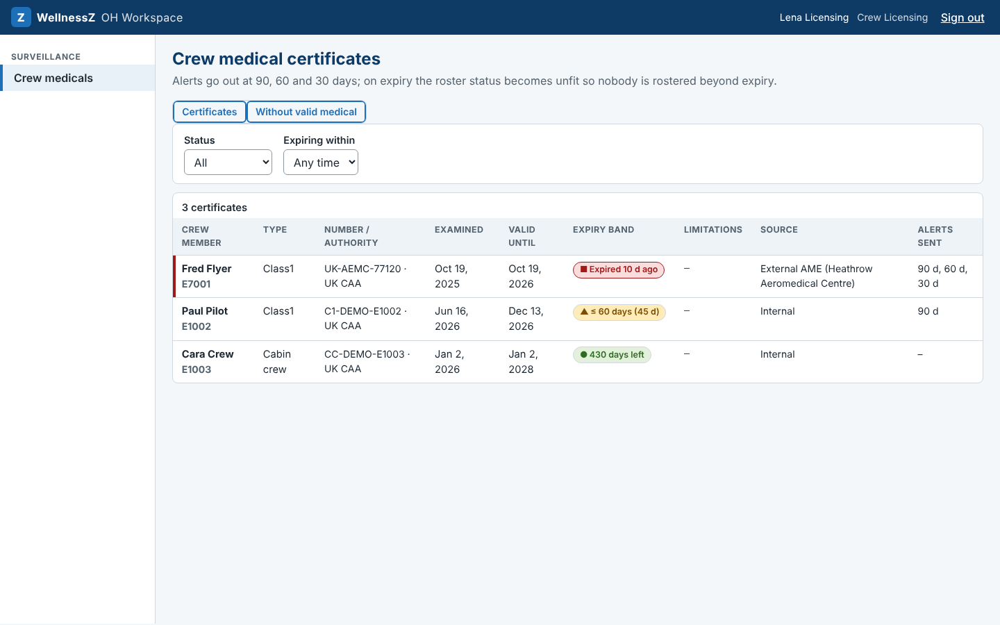

---

## 16. E07-F05 – Immunisation and titre registry

**Requirements:** E07-HLR-05; E07-BL-012 (matrix, due list, certificate), E07-BL-013 (fast entry).

* **Role matrix** (`immunisation_requirement`, OH_ADMIN / Nursing Head maintain): by job code or hazard; vaccine, doses,
  cumulative schedule, booster interval, titre required, mandatory. Seeded: CATERING_ASSOC → typhoid (booster 36 m),
  hepatitis A (2 doses); CLINICAL_STAFF, CLEANER, SECURITY_SCREENER → hepatitis B (3 doses, titre); CLINICAL_STAFF → MMR,
  influenza; PILOT and CABIN_CREW → yellow fever, influenza (recommended, not mandatory).
* **Status** (`ImmunisationRules`, pure): COMPLETE, DUE (course in progress, booster within 30 days, or never started),
  OVERDUE (next dose or booster passed), TITRE_NEEDED (course complete, protective titre required but missing).
* **Due list** – `GET /surveillance/immunisation/due?vaccine&subsidiary&department` (OH roles, scheduler).
* **Fast entry** – `POST /surveillance/immunisation/administrations` (clinicians): employee ID **or badge scan**, vaccine,
  dose, lot number **or GS1 barcode** (`(01)GTIN(17)YYMMDD(10)LOT` or raw scanner form with group separator and optional
  `]d2` / `]C1` prefix; AI 17 expiry, day 00 = month end), site, route, `consentConfirmed=true` (required), campaign.
  The screen keeps vaccine, lot, site and route between people so a campaign entry takes seconds. Every administration is
  **mirrored into the E03 immunisation record**.
* **Batch** – `…/administrations/batch` for a campaign → `{recorded, rejected:[{ref, reason}]}`.
* **Titres** – antigen, value, unit, protective, tested on.
* **Employee** – `GET /me/immunisations`; `POST /me/immunisations/certificate` generates a signed
  `VACCINATION_CERTIFICATE` and shares it with the employee only (downloadable from *My documents*).
* **Hygiene manager** – `GET /surveillance/immunisation/employees/{id}` for food handlers returns whether each requirement
  is met; non-OH readers never learn that a titre is missing.
* **Reminders** – the nightly due job sends `immunisation.due` for mandatory vaccinations due or overdue, at most every
  30 days per person and vaccine (`immunisation_reminder`).

Tables: `immunisation_requirement`, `vaccine_administration` (lot, expiry, body site, route, consent, campaign, E03
record ID), `titre`, `immunisation_reminder`.

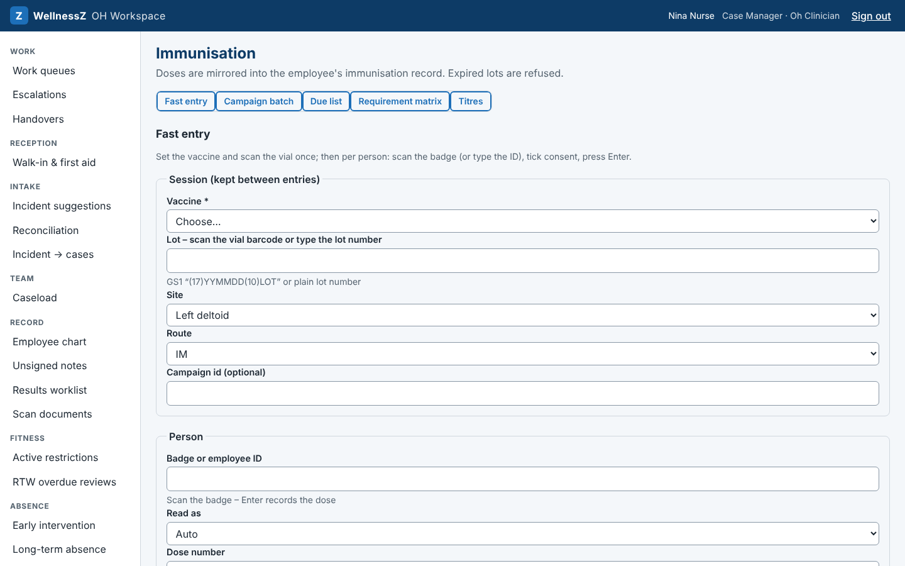

---

## 17. E07-F06 – Exposure registers and industrial-hygiene linkage

**Requirements:** E07-HLR-06; E07-BL-014 (IH import, SEG mapping), E07-BL-015 (cosmic dose, pregnancy declaration).

* **Similar exposure groups** (`exposure_group`, HSE_OFFICER / OH_ADMIN): location, job codes, hazard, unit, action
  level and limit value (limit ≥ action level). Seeded: `LHR-RAMP-NOISE` and `LHR-CARGO-NOISE` (80 / 87 dB(A)),
  `LHR-ENG-SOLVENT` and `LHR-CLEAN-SOLVENT` (50 / 100 ppm).
* **IH import** – `POST /surveillance/ih-measurements/import` (HSE_OFFICER) or `/integration/ih-measurements`
  (INTEGRATION): rows with source reference (idempotent – duplicates counted), SEG, hazard, type (NOISE_DOSIMETRY,
  AIR_SAMPLING, BIOLOGICAL, VIBRATION), value, unit, date. When the latest value of a SEG is **at or above the action
  level**, every active employee in the SEG (job code + location) is enrolled with reason EXPOSURE_GROUP in the active
  programmes of that hazard – NOISE → HEARING_CONSERVATION. Result `{imported, duplicates, segsAboveActionLevel,
  employeesEnrolled}`; audited (E2E: 86.5 dB(A) on the ramp SEG).
* **Cosmic dose** – `POST /surveillance/cosmic-dose/import` (AME, INTEGRATION; also `/integration/cosmic-dose`): one dose
  per crew member and year; above `surveillance.cosmic-dose-alert-msv` (6.0 mSv) an AME `crew.dose-review` alert.
  `GET /surveillance/cosmic-dose?year&aboveThreshold` (AME, CMO).
* **Pregnancy declaration** – `POST /me/pregnancy-declaration` (crew) opens an AME review case; the remaining-pregnancy
  limit of 1 mSv is flagged; visible to AME / CMO only.
* **Personal exposure history (ODH)** – `GET /surveillance/employees/{id}/exposure-history` (OH roles) returns a
  **wrapper object** (deviation from the contract's array): SEG periods with latest values and cosmic dose by year.

Tables: `exposure_group`, `ih_measurement` (source reference unique), `cosmic_dose` (unique per employee and year),
`pregnancy_declaration`.

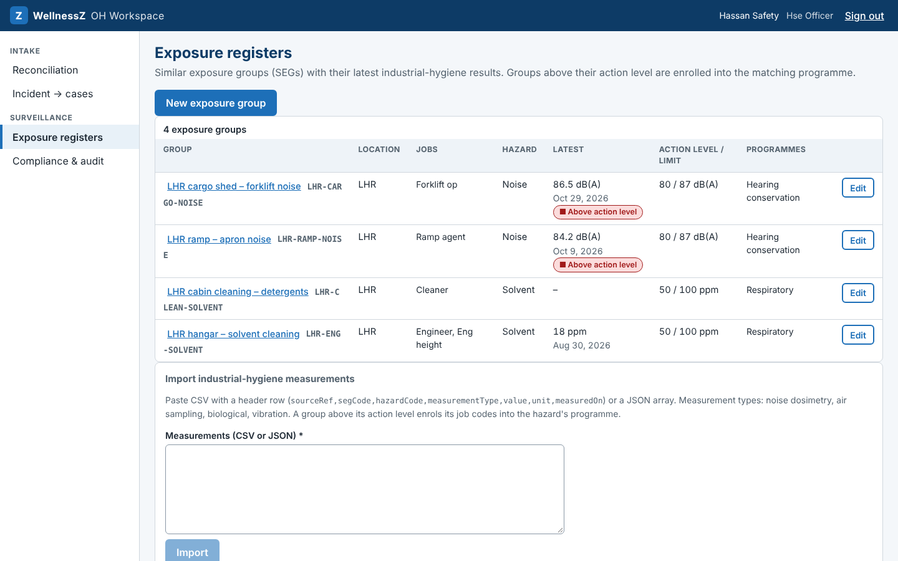

---

## 18. E07-F07 – Result evaluation, automatic follow-up and return after illness

**Requirements:** E07-HLR-07; E07-BL-016 (STS), E07-BL-017 (spirometry, biomonitoring), E07-BL-020 (return after
serious illness).

### 18.1 Evaluation rules (`surveillance.evaluation_rule`, OH roles read, OH_ADMIN / CMO write)

| Rule | Test | Type | Parameters | Follow-up | Regulatory task |
|---|---|---|---|---|---|
| `STS_HEARING` | AUDIOMETRY | STS – E03 audiogram ABNORMAL with a standard-threshold-shift detail in either ear | shift 10 dB | 30 days | yes |
| `SPIRO_DECLINE` | SPIROMETRY | FEV1 drop ≥ 15 % versus the previous spirometry, or FEV1/FVC < 0.70 | 15 %, 0.70 | 30 days | no |
| `BM_BLOOD_LEAD` | BIOMONITORING:5671-3 | Value ≥ limit | 30 µg/dL | 14 days | yes |
| `VISION_ABN` | VISION | Flag ABNORMAL | – | 30 days | no |
| `ECG_ABN` | ECG | Any non-NORMAL flag | – | 14 days | no |
| `ANY_ABNORMAL` | `*` | Any non-NORMAL flag (used when no specific rule exists for the test) | – | 30 days | no |

### 18.2 Follow-up flow

E03 calls `ResultFollowUpListener.resultRecorded` synchronously for every LIS and device result. `FollowUpService`
evaluates the result only if the employee is enrolled in an ACTIVE programme whose panel contains the test (lab results
satisfy both `LAB:{code}` and `BIOMONITORING:{code}`). An abnormal outcome creates, idempotently per result and rule:

1. a `follow_up` record (OPEN);
2. a kernel case `SURVEILLANCE_FOLLOW_UP` (category EXPOSURE, source SURVEILLANCE_TRIGGER, `sourceRef surveillance:{resultId}`);
3. a FOLLOW_UP recheck task due after the rule's follow-up days (STS: 30);
4. a REMINDER task "Assess regulatory notification" when the rule requires it;
5. a case timeline entry, the content-free `surveillance.follow-up` to the programme's responsible role and the event
   `surveillance.followup.created.v1`.

Because this happens inside the recording transaction, the workbook target "follow-up within 48 h" is met immediately.
Physicians review (`POST /surveillance/follow-ups/{id}/review`: CONFIRMED, NOT_CONFIRMED or WORK_RELATED, encrypted
note, regulatory flag).

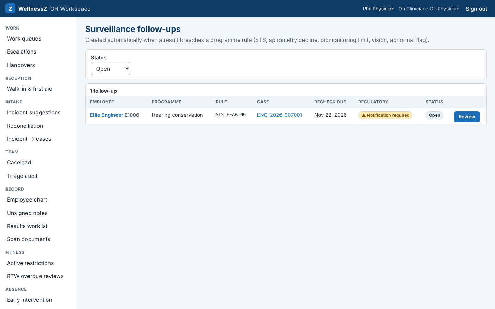

### 18.3 Return-after-illness guard (E07-BL-020)

* **Source E06** – `RaiService` implements `AbsenceSignalListener`. When a long-term absence pathway starts and the
  employee's job code is **safety-critical**, a `return_after_illness` item (reason LONG_TERM_ABSENCE, source E06, case)
  is created as REQUIRED and OH physicians are notified.
* **Manual** – clinicians raise one for SURGERY, CARDIAC_EVENT, OTHER_SERIOUS_ILLNESS or LONG_TERM_ABSENCE
  (`409 rai_exists` if one is already required).
* **Guard** – `RaiService` also implements `FitnessClearanceGuard`. While a REQUIRED item exists, E05 refuses a FIT or
  FIT_WITH_LIMITATIONS decision with `422 clearance_required` and the reason "A return-after-illness medical is required
  before this employee returns to a safety-critical role" (E2E: E1004). Other outcomes (e.g. TEMPORARILY_UNFIT) are not
  blocked.
* **Release** – clinicians complete it (encounter, encrypted note) or physicians waive it with a reason; the chart shows
  an alert while it is required (`SurveillanceChartContributor`).
* Demo data seeds a REQUIRED item for E1004 on demo databases but skips it on `*_test` databases so that the Increment-2
  fitness tests keep working.

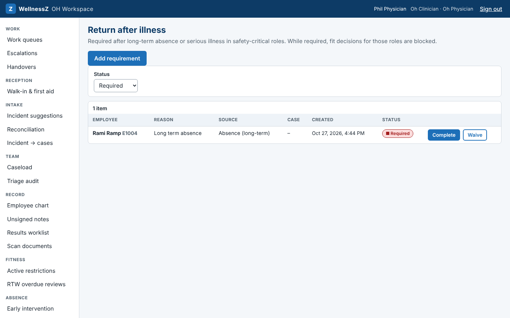

---

## 19. E07-F08 – Compliance dashboards and audit packs

**Requirements:** E07-HLR-08; E07-BL-018 (dashboards), E07-BL-019 (audit packs).

* `GET /surveillance/compliance?groupBy=PROGRAMME|SUBSIDIARY|DEPARTMENT&programme` (Nursing Head, CMO, OH roles,
  HSE_OFFICER, AUDITOR, OH_ADMIN) returns a **wrapper object** with rows `{key, label, enrolled, current, due, overdue,
  compliancePct, suppressed}` and `refreshedAt`. Compliance % = (enrolled − overdue) / enrolled; exempt people count as
  current. Rows come from the nightly `compliance_snapshot` (refreshed by `surveillance-due`) with a live fallback.
* **Own small-cell suppression** – groups with fewer people than the minimum group size are published as
  `suppressed:true` without counts.
* `GET /surveillance/compliance/trend?programme` – compliance % by snapshot date.
* `GET /surveillance/compliance/overdue?programme&department` – drill-down to people, **OH roles and Nursing Head only**.
* **Audit packs** – templates IOSA, CAA, FOOD_SAFETY, LABOUR_INSPECTORATE (`GET /surveillance/audit-packs/templates`).
  `POST /surveillance/audit-packs {template, programmeCode, from, to, anonymise}` renders a PDF (programme definition and
  regulatory basis, compliance figures, examinations and outcomes, invitations, follow-ups by rule, disclosure-control
  statement) and a CSV, stored in `audit_pack`, in seconds (target < 5 minutes). **Packs are anonymised for everyone
  except the CMO and the Nursing Head** (pseudonymous subject IDs, no names, groups below the minimum size suppressed);
  those two may ask for an identifiable pack with `anonymise=false`. `GET …/{id}/content?format=pdf|csv`.

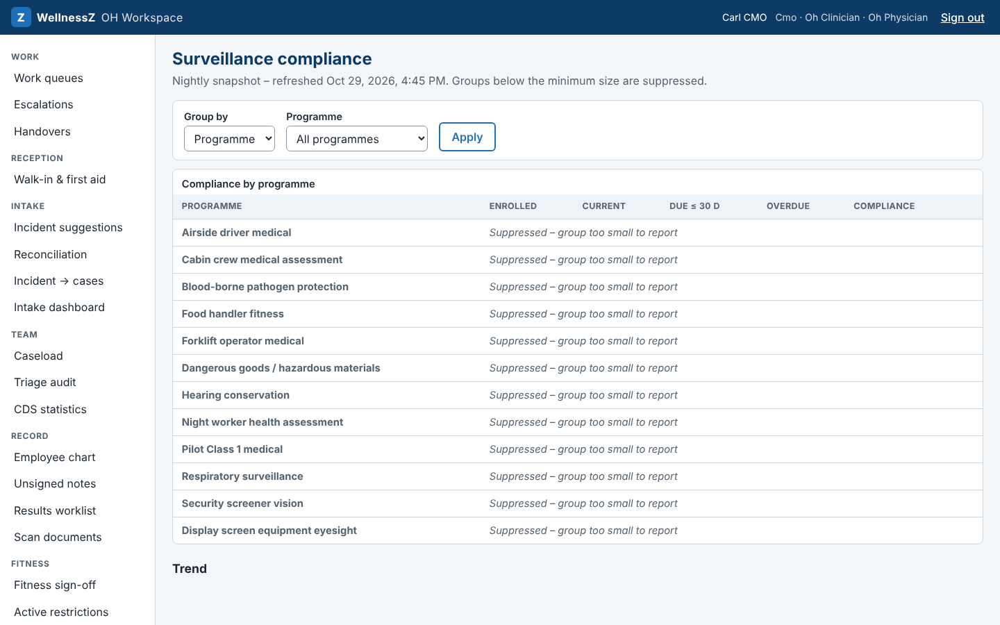

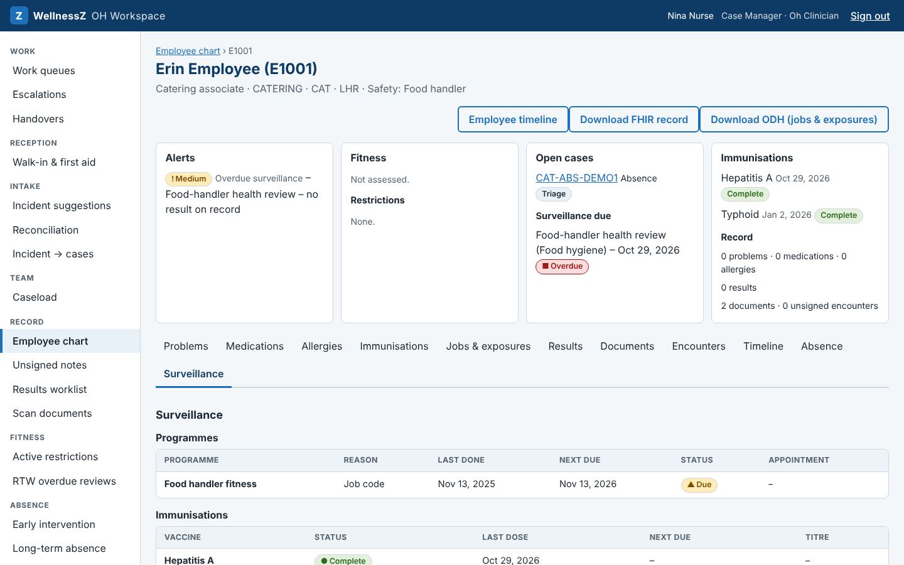

---

## 20. E14-F01 – Appointment scheduling

**Requirements:** E14-HLR-01; E14-BL-001 (types and resources), E14-BL-002 (book / move / cancel with conflicts),
E14-BL-003 (reminders, rescheduling, no-shows), E14-BL-004 (telehealth slots), E14-BL-010 (service catalogue and
internal charging).

### 20.1 Catalogue, resources and diary templates

* **Appointment types** (`scheduling.appointment_type`, OH_ADMIN / Nursing Head upsert): code, name, duration (5–480
  minutes), clinician roles, room type (CONSULT, AUDIO_BOOTH, TREATMENT, VACCINATION, TELEHEALTH), device category
  (AUDIOMETER, SPIROMETER, ECG, VISION_SCREENER, VACCINE_FRIDGE, OTHER), telehealth, self-bookable, charge code and
  internal price. Fifteen seeded types: GENERAL_OH 30, NURSE_REVIEW 20, PHYSICIAN_REVIEW 30, AUDIOMETRY 20 (audio booth +
  audiometer), SPIROMETRY 20, VISION 15, ECG 20, VACCINATION 10 (self-bookable), PRE_EMPLOYMENT 45, CREW_AEROMEDICAL 60
  (AME), FOOD_HANDLER_CLEARANCE 20, RTW_REVIEW 30, ABSENCE_REVIEW 30, SURVEILLANCE_PANEL 40 (audio booth),
  TELEHEALTH_CONSULT 20 (telehealth, self-bookable).
* **Service catalogue** – `GET /scheduling/service-catalogue` (any authenticated user) lists the types with charge codes.
* **Site resources** (`scheduling.resource`): clinicians (by username), rooms (with room type) and devices (referencing
  registered equipment), unique per site, type and code.
* **Weekly diary templates** (`scheduling.diary_template`): weekday 1–7, start / end in **site local time**, clinician,
  room, offered appointment types (empty = all), telehealth flag. `PUT /scheduling/sites/{site}/templates` replaces the
  site's rows (OH_ADMIN, Nursing Head, scheduler); a clinician's sessions must not overlap on a weekday **across sites**
  (`409 resource_conflict`).
* **Internal charging** – `GET /scheduling/charging/usage?month` (OH_ADMIN, CMO): attended appointments by the
  employee's subsidiary and charge code with amount; `…/charging/export` as CSV for finance.

### 20.2 Slot engine and booking (`SlotEngine`, pure)

* Templates are expanded per date in the site's time zone into sessions; **free slots** sit on the session grid in steps
  of the type's duration where the clinician, a room of the required type, a **calibrated** device of the required
  category and the employee are all free (`GET /scheduling/slots`).
* `POST /scheduling/appointments` (OH roles, scheduler) – employee, type, site, start, optional clinician / room /
  device, case, admin note (**screened**), source type and reference. Booking runs under advisory locks on the
  resources; an overlap of clinician, room, device or employee returns **`409 resource_conflict`** naming the resource
  (E2E: double booking refused). A start outside every session returns **`422 no_session`** – unless a clinician is
  named explicitly, which is treated as an **administrative override** (still conflict-checked). Past starts → `422
  in_the_past`. `appointment.booked` goes to the employee.
* `PUT /scheduling/appointments/{id}/move` – drag-and-drop with the appointment's `version`; a concurrent change returns
  `409 stale`. Campaign appointments are managed in the campaign (`campaign_appointment`).
* `POST …/{id}/cancel` (reason) → `appointment.cancelled`, and the freed slot is **offered** to the highest-priority
  waiting entry whose window covers the date (`appointment.waitlist-offer`, entry OFFERED). The waitlist offers – it
  does **not** auto-book; the scheduler books the offer.
* `POST …/{id}/attendance` (OH roles, scheduler, reception) – ATTENDED or NO_SHOW for open appointments.
* Appointment views carry extra display fields beyond the contract (`clinicianName`, `siteName`, `canCheckIn`, …).

### 20.3 Employee self-service

* `GET /me/appointments` (employees and candidates), `GET /me/appointments/slots` (self-bookable types only).
* `POST /me/appointments` – rules in `BookingRules`: type self-bookable (`not_self_bookable`), at least
  `scheduling.self-booking.min-notice-hours` (24) ahead (`insufficient_notice`), at most
  `scheduling.self-booking.max-days-ahead` (60) days ahead (`too_far_ahead`), one open booking per type when
  `scheduling.self-booking.one-open-per-type` (`already_booked`).
* `…/{id}/reschedule` (same timing rules), `…/{id}/cancel`, `…/{id}/check-in` (app check-in on the day, from
  `scheduling.check-in.window-minutes` (60) before the start until the end; `422 check_in_window` otherwise).

### 20.4 Reminders, no-shows and status listeners

* `appointment-reminders` (every 15 minutes): T−48 h reminder between T−48 h and T−2 h, T−2 h reminder between T−2 h and
  T; a window already open at booking time is skipped (the confirmation covers it). Template `appointment.reminder`
  links to the employee app's appointments page.
* `appointment-no-show` (every 15 minutes, offset 5): BOOKED / CHECKED_IN appointments not started
  `scheduling.no-show.grace-minutes` (30) after their end become NO_SHOW.
* Every status change goes through `StatusNotifier`: `appointment.status.v1` plus every `AppointmentStatusListener`
  whose `supports(sourceType)` is true, inside the scheduling transaction (E07 re-invites, E06 counts contacts).

### 20.5 Telehealth

`POST /scheduling/appointments/{id}/telehealth` – only the appointment's clinician or the employee: returns `joinUrl` =
`scheduling.telehealth-base-url` + random room ID (the same link for both) and `documentationLink` to the employee's
chart encounters. Video itself is E04; non-telehealth appointments return `422 not_telehealth`.

### 20.6 Data model (schema `scheduling`)

| Table | Content |
|---|---|
| `appointment_type` | Catalogue with charge code and price |
| `resource` | Clinician / room / device per site |
| `diary_template` | Weekly sessions (only table with DELETE – templates are replaced) |
| `appointment` | Employee, type, site, start / end, status (BOOKED, CHECKED_IN, IN_PROGRESS, ATTENDED, NO_SHOW, CANCELLED), clinician / room / device, campaign, case, source type / reference, screened admin note, telehealth room, ticket, check-in / call / start / completion / cancellation stamps, reminder stamps, optimistic version; indexes per site-time, employee, clinician, campaign, source and open status |
| `waitlist_entry` | Type, site, window, priority, WAITING / OFFERED / BOOKED / CANCELLED, offered appointment |

### 20.7 Screens

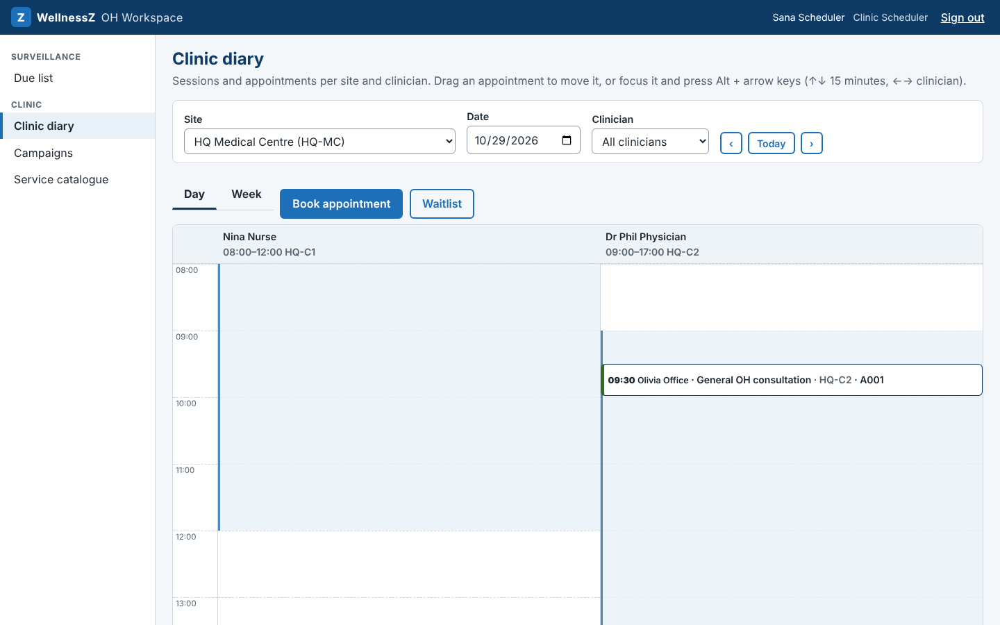

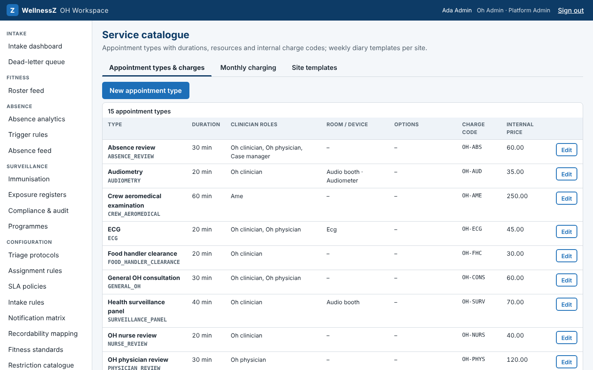

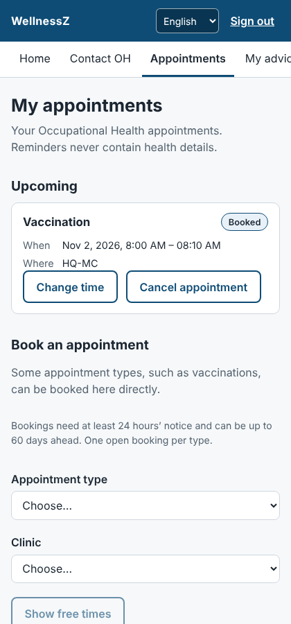

---

## 21. E14-F02 – Campaign and mobile-clinic scheduling

**Requirements:** E14-HLR-02; E14-BL-005; E07-BL-004 (campaign mode for surveillance).

* `POST /scheduling/campaigns` (scheduler, Nursing Head, OH_ADMIN): name, type (SURVEILLANCE, VACCINATION,
  MOBILE_CLINIC), site, appointment type, days, day start / end, slot minutes, stations, **device kit** (equipment IDs,
  asset tags or device IDs), staff and target count. Status PLANNED → OPEN → IN_PROGRESS → CLOSED (forward only).
* **Device kit rule** – every kit device must be IN_SERVICE and in calibration on **every** campaign day
  (`422 device_out_of_calibration` / `device_out_of_service`).
* `POST …/{id}/generate-slots` – days × stations × slots in the site's time zone (`CampaignPlanner`), unique per start
  and station.
* `POST …/{id}/book {employeeIds ≤ 5000}` – each person gets the first free slot that does not clash with their other
  bookings. Result (richer than the contract) `{booked, waitlisted, alreadyBooked, rejected}` – people already booked in
  the campaign are counted, unknown IDs are rejected, overflow goes to the waitlist. The integration test books **500
  people in one call** (`f02CampaignGeneratesSlotsAndBooksFiveHundredInOneCall`).
* `POST …/{id}/attendance` – bulk ATTENDED / NO_SHOW (OH roles, scheduler, reception); listeners fire for each.
* `GET …/{id}` adds performance: slots, booked, attended, no-show, utilisation %, attendance %.
* E07 invitations can target a campaign (`campaignId`): `AppointmentBooking.bookNext` then takes the first free
  campaign slot.

Tables: `campaign` (CSV days, kit and staff, optimistic version), `campaign_slot` (unique campaign / start / station,
partial index on free slots).

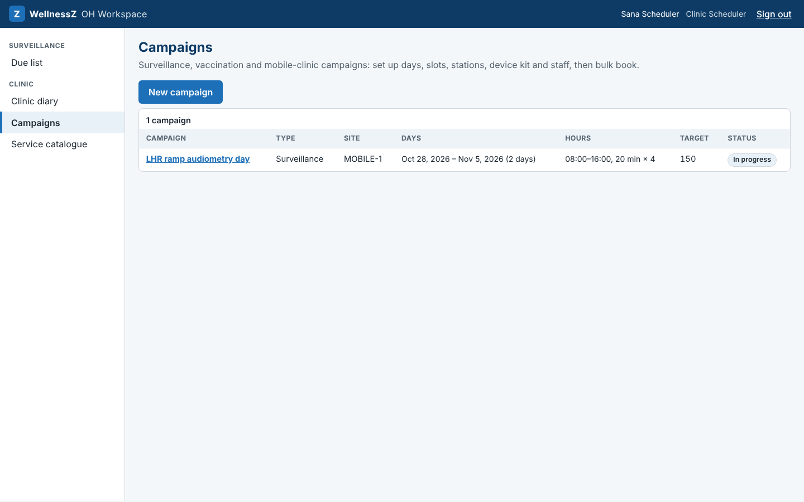

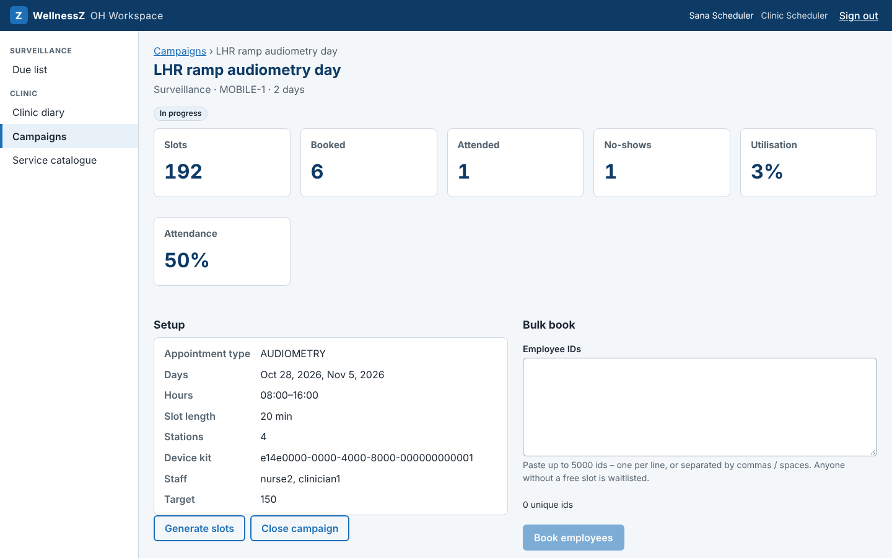

---

## 22. E14-F03 – Check-in and queue management

**Requirements:** E14-HLR-03; E14-BL-006.

* **Reception / kiosk check-in** – `POST /scheduling/check-in` (reception, scheduler, OH roles; the kiosk signs in as
  reception) with site and **badge ID**, employee ID or appointment ID. The service finds today's BOOKED / CHECKED_IN
  appointment at the site nearest to now (`404` otherwise), sets CHECKED_IN and issues a **ticket** ("A001" … "A999",
  then "B000" …, per site and day). Response: appointment, ticket, appointment type name, position and estimated wait
  (appointments ahead × mean duration, shared by the clinicians on duty).
* **App check-in** – Section 20.3.
* **Queue board** – `GET /scheduling/queue?siteCode`: average wait today and entries `{ticket, appointmentTypeName,
  status WAITING / CALLED / IN_PROGRESS, checkedInAt, waitMinutes, roomCode}` – **never names or employee IDs** (E2E
  asserts it).
* **Call-next** – `POST /scheduling/queue/call-next {siteCode, roomCode?}` (clinicians), under a site lock: own patients
  first, then unassigned patients of a type the clinician's role may take, then (cover) anyone of such a type. Returns
  the identity for the **encounter hand-off**: appointment, ticket, employee ID and name, type, case and
  `encounterLink` to the chart encounters. Empty queue → **`404 queue_empty`** (deviation: the contract did not define
  the empty case).
* `POST /scheduling/appointments/{id}/start` → IN_PROGRESS; `…/complete` → ATTENDED (listeners notified).

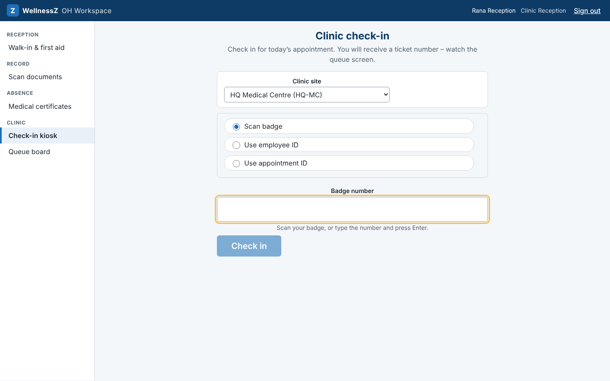

---

## 23. E14-F04 – Equipment and cold-chain register

**Requirements:** E14-HLR-04; E14-BL-007 (register, calibration, block rule), E14-BL-008 (fridge temperatures).

### 23.1 Register and calibration

* `GET /scheduling/equipment?siteCode&category` (BIOMEDICAL, OH_ADMIN, OH roles, scheduler); register / update
  (BIOMEDICAL, OH_ADMIN): asset tag and device ID (both unique), category, model, serial, site, status (IN_SERVICE,
  OUT_OF_SERVICE, RETIRED), calibration interval, fridge thresholds.
* **Derived calibration state** (`EquipmentRules`): OVERDUE when `calibrationDueOn` < today, DUE_SOON within 30 days,
  otherwise VALID.
* `POST /scheduling/equipment/{id}/calibrations` (BIOMEDICAL): performed on, vendor, certificate number, PASS / FAIL,
  next due (default performed + interval, 12 months) and an optional certificate document (PDF / JPEG / PNG ≤ 10 MB).
  **Design decision:** calibration certificates are stored in `scheduling.calibration` (bytes + SHA-256), not in the
  document service, because the document service is employee-scoped. A FAIL sets the device OUT_OF_SERVICE; retired
  equipment cannot be calibrated.
* `POST …/{id}/status` (BIOMEDICAL, reason); `GET /scheduling/equipment/calibration-due?withinDays=30`.
* Daily `equipment-calibration` (02:40 UTC): `equipment.calibration-due` to `notifications.biomedical.email` once per due
  date when it is within `scheduling.calibration.due-alert-days` (30).

### 23.2 Block rule in result capture

`EquipmentCalibrationCheck` implements `DeviceCalibrationCheck`. When E03 records a device result it asks for the
verdict by device ID and examination date: not registered → UNKNOWN (accepted unless
`wellnessz.record.require-registered-devices=true`); OUT_OF_SERVICE / RETIRED → `422 device_out_of_service`; due date
before the examination date → `422 device_out_of_calibration`. The Increment-2 E2E device ID stays accepted as UNKNOWN.
E2E: audiometer `AUD-LHR-02` (overdue) is blocked, then accepted after biomedical records a passing calibration. The
same rule protects campaign device kits and slot generation (only calibrated devices offer slots).

### 23.3 Cold chain

* Readings: manual `POST /scheduling/equipment/{id}/temperatures` (clinicians, BIOMEDICAL) or IoT
  `POST /integration/cold-chain/readings` (INTEGRATION, batch `[{deviceId, temperatureC, recordedAt}]` processed in time
  order → `{accepted, rejected, excursionsOpened, unknownDevices}`). Future timestamps are rejected.
* **Excursion rule** – thresholds per fridge (default 2–8 °C): an out-of-range reading **opens** an excursion (or
  extends the open one, tracking min / max); the next in-range reading **ends** it. Opening sends `coldchain.excursion`
  (level HIGH or LOW, site) to the clinicians of the site (staff site codes) and the Nursing Head, and publishes
  `coldchain.excursion.v1`.
* `GET /scheduling/excursions?status`; `POST …/{id}/acknowledge {action}` (clinicians, Nursing Head) → ACKNOWLEDGED;
  `…/close` **requires a prior acknowledgement** (`422 invalid_status`) – the action taken is always on record.
* `GET /scheduling/cold-chain/report?equipmentId&month` – daily min / max and excursions for inspection.

Tables: `equipment` (optimistic version, due-alerted marker), `calibration` (certificate bytes and hash),
`temperature_reading` (MANUAL / IOT, excursion flag), `excursion` (OPEN / ACKNOWLEDGED / CLOSED, action, acknowledgement,
closure).

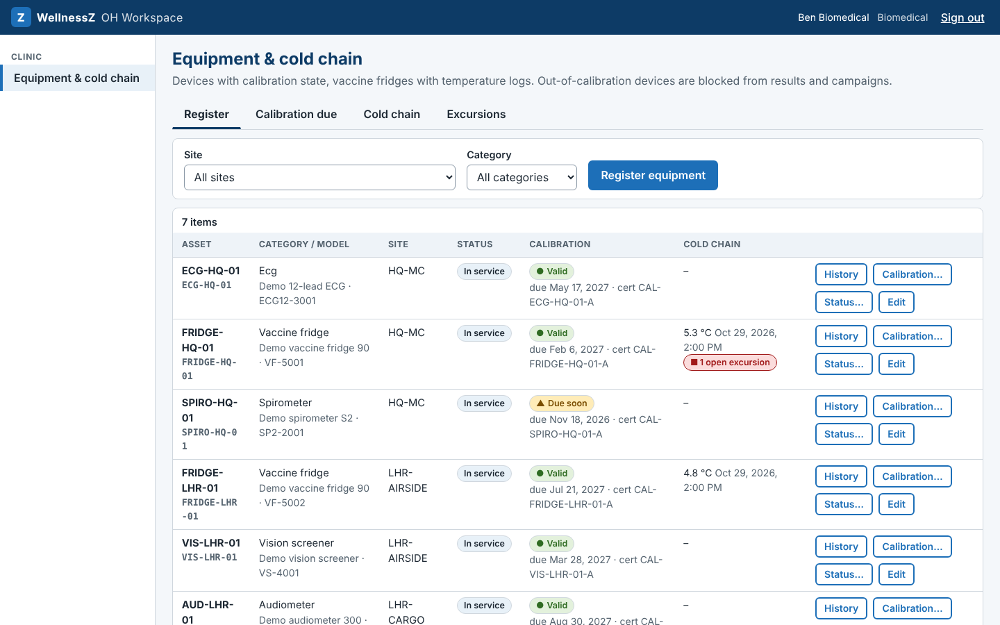

---

## 24. E14-F05 – Capacity planning and utilisation

**Requirements:** E14-HLR-05; E14-BL-009.

* **Capacity** per site and month = Σ session minutes from the diary templates ÷ mean duration of the types each
  session offers (`CapacityMath`).
* **Demand** = Σ `CapacityDemandSource.demand(from, to)` – E07: active, non-exempt enrolments due by the end of the window
  per home site × programme service × month (overdue demand planned in the first month); E06: open LTA contact /
  advice-report milestones and open advice requests per home site × month (service ABSENCE_REVIEW) – plus a **run rate**
  (mean of the previous three complete months of bookings no source accounts for). Counts only.
* `GET /scheduling/capacity?from&to&siteCode` (Nursing Head, CMO, OH_ADMIN, scheduler) – per site and month: capacity,
  booked, forecast demand, demand by source (`E07`, `E06`, `RUN_RATE`), gap and utilisation %.
* `POST /scheduling/capacity/what-if {siteCode, extraClinicianSessionsPerWeek, extraCampaignDays, from, to}` – the same
  rows recalculated (a campaign day counts as four stations over a working day).
* `GET /scheduling/utilisation?from&to&groupBy=SITE|CLINICIAN` – session minutes, booked minutes, utilisation %, no-show
  rate % and average wait.
* The service is deliberately not transactional: each demand source reads in its own transaction.

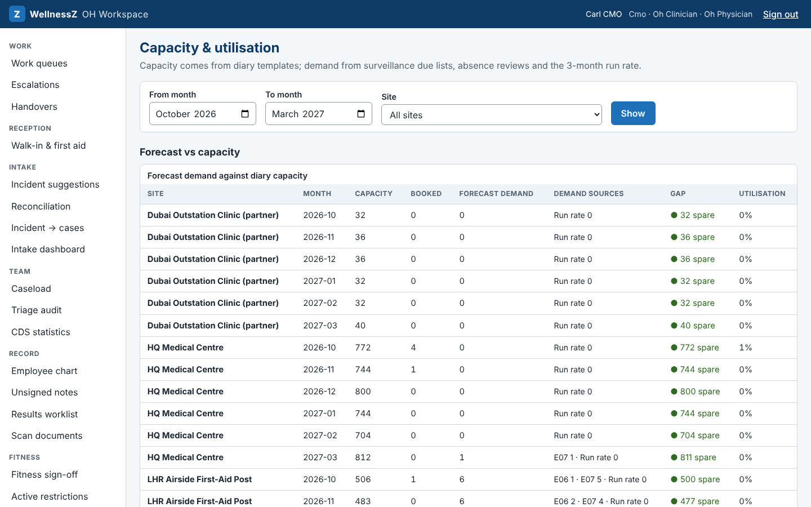

---

## 25. Screens

The OH Workspace, employee app and manager workspace show only the entries a role may use (`web/oh-workspace/src/auth/roles.ts`);
the server enforces the same rules independently. All 37 screenshots were captured by the end-to-end run against real
Keycloak logins and are shown with their features in Sections 6–24.

| App | Routes | Role visibility |
|---|---|---|
| OH Workspace | `#/absence/{queue,lta,certificates,advice,rules,analytics,feed}`; `#/surveillance/{programmes,due,follow-ups,rai,pre-employment,crew,immunisation,exposure,compliance}`; `#/scheduling/{diary,campaigns,queue,reception,equipment,capacity,catalogue}`; chart tabs `…/chart/absence` and `…/chart/surveillance` | Clinic scheduler: diary, campaigns, due list, catalogue. Reception: reception kiosk, queue board, certificates (scan / validate, no file opening or verification). Biomedical: equipment. Crew licensing: crew certificates. HSE officer: exposure, compliance. Auditor: compliance and audit packs. Analytics: CMO, Nursing Head, OH_ADMIN |
| Employee app | `#/appointments`, `#/absence`, `#/advice`, `#/surveillance`, `#/pre-employment` | Candidates see **only** pre-employment (and their appointments); crew see the pregnancy declaration; en / ar / fr strings |
| Manager workspace | `#/absence`, `#/advice-requests`, `#/compliance`, `#/pre-employment` | Managers see the team absence table only; HR additionally LTA status and HR stage, certificate validity and analytics; pre-employment for HR |

---

## 26. Security and privacy design

### 26.1 Control summary

| Control | Implementation |
|---|---|
| Authentication | Unchanged: browser apps through the BFF (OIDC code flow, HttpOnly session, CSRF); machine clients by client credentials (`INTEGRATION`); candidates through a candidate identity with role `CANDIDATE` |
| Role-based access | `@PreAuthorize` on every new endpoint (E14 expressions centralised in `E14Roles`, E07 in `Spel`); `/api/v1/integration/**` remains machine-only |
| ABAC for person-level data | OH reads go through `EmployeeRecordAccess` / `CaseAccess` (clinical policy with the employee's HRIS org path); manager / HR reads go through the status-only scope check (line manager, or org scope covering the employee). Denials are audited and returned as **404** |
| Status-only projections | Dedicated view records for managers, HR, schedulers, licensing, reception and employees that structurally omit clinical fields (Section 26.2) |
| Encryption | Field-level AES-256-GCM (`v1:`) for contact and conference notes, advice context, decline reasons, OCR fields, validation and call notes, milestone notes, exemption reasons, questionnaires, pre-employment conditions, crew examination answers, follow-up review notes and return-after-illness notes; outbox payloads |
| Clinical-text screening | `ClinicalContentException.screen` on every text that leaves OH (Section 26.3) |
| Disclosure log | Every release to a manager or HR (Section 26.4) |
| Small-cell suppression | Absence analytics, surveillance compliance and audit packs (Section 26.5) |
| Least privilege | Runtime role has no DELETE on any absence or surveillance clinical table (corrections are state changes); insert-only for rule versions, contacts, call logs and conferences; DELETE only on `surveillance.immunisation_reminder`, `surveillance.compliance_snapshot` and `scheduling.diary_template` |
| Content-free notifications | 23 new templates (Section 5.4) – names, dates, references and links only |
| Outbound allow-list | `hr-systems` gains `offerRef, candidateId, preEmploymentStatus, ohEngaged, certificateValidity`; `crew-rostering` unchanged (status, validity, operational limitations); default deny |
| Scheduled jobs | Every new job (`absence-feed`, `absence-triggers`, `absence-lta`, `surveillance-due`, `crew-certificates`, `pre-employment-purge`, `appointment-reminders`, `appointment-no-show`, `equipment-calibration`) runs once per run key across replicas through `JobRunGuard` |
| Spreadsheet safety | CSV exports (analytics pack, authority report, audit pack, charging) quote cells and neutralise leading formula characters |
| SAST | SpotBugs + FindSecBugs: 0 findings, no new exclusions |

### 26.2 The status-only rule, per audience

| Audience | Sees | Never sees |
|---|---|---|
| Line manager | Team absence dates, days, OH engaged, certificate validity; released advice reports (functional); LTA status and next milestone; team surveillance status; booking confirmations | Reason category, certificate content or issuer, contact notes, advice context of others, decline reason, results, programme outcomes |
| HR | As manager within org scope, plus HR stage, certificate escalations (status), absence analytics without categories, pre-employment clearance FIT / UNFIT / PENDING | Questionnaire, examination, conditions beyond onboarding adjustments, reason categories, suspicion status (SUSPICIOUS shows PENDING) |
| Clinic scheduler | Names, units, programme titles, due dates and appointment types (due list, diary, campaigns) | Results, outcomes, exemption reasons, absence data (403 on every absence endpoint – test `schedulerAndOtherNonOhRolesCannotReadAbsenceData`), charts (403 / 404) |
| Reception | Check-in, queue board, attendance, certificate scan / validation checklist / call log | The record; certificate verification; the queue board carries no names |
| Biomedical | Equipment, calibration, temperatures | Any person-level data |
| Crew licensing / scheduling | Certificate type, validity, status, operational limitation codes, crew without a valid medical | Examination answers, outcomes, non-operational limitation codes, the medical report |
| Employee / candidate | Own data; their advice report before release; own certificate validity | Other people; OH-only fields (reason category, OCR, validation notes) |

### 26.3 Screening of free text

`ClinicalContentException.screen(field, value)` rejects clinical vocabulary with `422 clinical_content_not_allowed` and
the offending `field` in the problem body. Applied in Increment 3 to: HR stage notes; advice report adjustments,
restrictions and answers; the employee's advice comment; pre-employment conditions; appointment admin notes; and the
merge fields of `OH_ADVICE_REPORT` and `PRE_EMPLOYMENT_OUTCOME`. Free text that stays inside OH (contact notes, advice
context, decline reasons, exemption reasons) is accepted but encrypted.

### 26.4 Disclosure log

* Releasing an advice report shares the signed `OH_ADVICE_REPORT` with the requester through `shareAsSystem`, which
  writes `platform.disclosure_log` (recipient type and name, document, purpose); the employee sees it under *Privacy –
  who received my information*.
* The pre-employment outcome writes a disclosure to HR (through the share for candidates already in the employee master,
  directly otherwise).
* Status notes to `hr-systems` (OH engaged, certificate validity, clearance) carry no clinical data and are audited as
  outbox events rather than disclosures.

### 26.5 Small-cell suppression

| Output | Rule |
|---|---|
| Absence analytics (units, monthly CSV) | Units with headcount below `wellnessz.analytics.min-group-size` (default 5, floor 3) are `suppressed:true` with no counts; drill-down to unit only |
| Surveillance compliance | Groups below the minimum group size are suppressed (`ComplianceMaths`) |
| Audit packs | Anonymised packs suppress groups below the minimum size and replace subjects with pseudonyms |
| Crew dashboard (Increment 2) | Counts 1–4 shown as `<5` |

### 26.6 Candidate data retention

Candidate data lives only in `surveillance.pre_employment` and the document store under the candidate ID. Withdrawal
starts a 12-month retention; the nightly purge removes name, e-mail, questionnaire, conditions, document list and
government reference. Documents carry the `PRE_EMPLOYMENT` record class (1 year, proposed). Hired candidates continue
under their employee ID (OH_RECORD rules).

### 26.7 Negative tests

| Test | Proves |
|---|---|
| `f01FeedReconciliationMismatchResolveAndStatusOnlyHistory` | Managers / HR get episodes without `reasonCategory`; out-of-scope reads 404 |
| `f03CertificatesUploadChecksValidationVerificationAndHrValidityOnly` | HR sees validity only; no issuer, OCR fields or file; SUSPICIOUS shows PENDING |
| `f04LongTermAbsencePathwayMilestonesHrStageAndReturnToWork` | Clinical HR stage note → 422 |
| `f05AdviceRequestReportScreeningConsentReleaseAndDecline` | Diagnosis in the report → 422; nothing released before consent; WITHHELD shows status only |
| `f06AnalyticsSuppressionCategoriesAndExport` | Suppressed rows carry no counts; categories for OH only |
| `schedulerAndOtherNonOhRolesCannotReadAbsenceData` | Scheduler 403 on ten absence endpoints; crew scheduling 403 on the queue |
| `f02DueListInvitationsNoShowEscalationAndTeamStatus` | Team view status only; escalation once |
| `f03PreEmploymentCandidatePortalOutcomeAndHrStatusOnly` | Clinical conditions → 422; HR sees clearance only |
| `f04CrewExaminationCertificatesRosterStatusAndExpiry` | Crew roles see operational limitation codes only |
| `catalogueTemplatesTelehealthAndRoleDenials` | Scheduler 403 / 404 on chart and encounters; biomedical, reception, employees and managers kept out of what is not theirs; telehealth link only for the clinician and the employee |
| E2E | Manager never sees `reasonCategory`; HR sees certificate validity only; queue board without names; HR onboarding FIT / UNFIT / PENDING only; team surveillance without `resultIds` |

---

## 27. Integration design

| Interface | Direction | Contract | State |
|---|---|---|---|
| HRIS / T&A / crew absence feed | Source → WellnessZ | Push `POST /integration/absence/episodes {sourceSystem, episodes[]}` → `{runId, received, matched, unmatched, updated, triggered}`; idempotent on (source system, source reference); daily pull through `AbsenceFeedConnector` beans | Push built and tested; **default pull connector is a no-op** – site connectors are E15 |
| Partner clinic certificates | Partner → WellnessZ | `POST /integration/absence/certificates` (structured certificate + optional PDF base64) | Built and tested |
| HRIS status notes | WellnessZ → HRIS | `absence.hr-status.v1` (OH engaged, certificate validity) and `preemployment.status.v1` (clearance) to `hr-systems`, allow-listed | Built; external publisher is the logging adapter until E15 |
| HR onboarding feed | HRIS → WellnessZ | Offer event `POST /integration/pre-employment` (idempotent on `offerRef`) | Built and tested |
| IH import | EHS / IH system → WellnessZ | `POST /integration/ih-measurements` or HSE upload (rows with source reference, SEG, hazard, type, value, unit, date) | Built and tested |
| Cosmic dose | Dose provider → WellnessZ | `POST /integration/cosmic-dose` or AME upload (employee, year, mSv, source) | Built |
| External crew certificates | AeMC / external AME → WellnessZ | `POST /surveillance/crew/certificates/import` (AME or INTEGRATION) | Built |
| Crew roster feed | WellnessZ → rostering | Increment-2 `crew.roster-status.changed.v1` and pull / acknowledge feed; now also fed by E06 AME reviews (PENDING) and E07 crew examinations / expiry (FIT, LIMITED, UNFIT) | Built |
| Cold-chain IoT | IoT gateway → WellnessZ | `POST /integration/cold-chain/readings [{deviceId, temperatureC, recordedAt}]` → `{accepted, rejected, excursionsOpened, unknownDevices}` | Contract built and tested; no gateway connected |
| Clinic devices | Device gateway → WellnessZ | Increment-2 device result API, now subject to the calibration block | Built |
| Telehealth | WellnessZ → video service | Join link from `scheduling.telehealth-base-url` | Link only (video is E04) |

---

## 28. Sequence diagrams

### 28.1 Absence trigger → early intervention → OH engaged

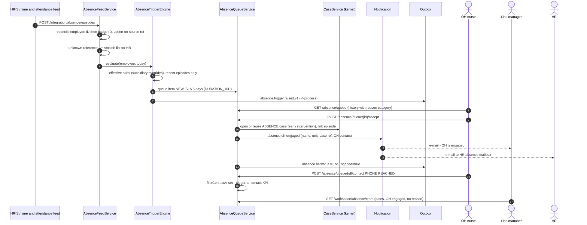

### 28.2 Advice request → report → employee release

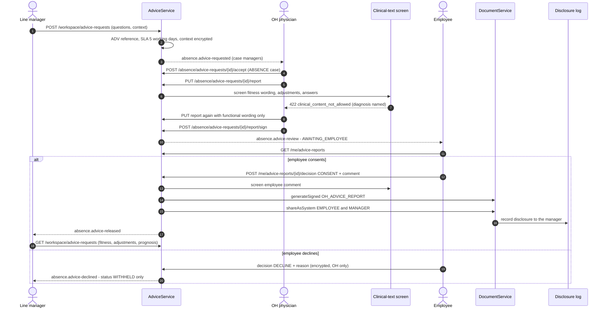

### 28.3 Due list → invitation → booking → no-show escalation

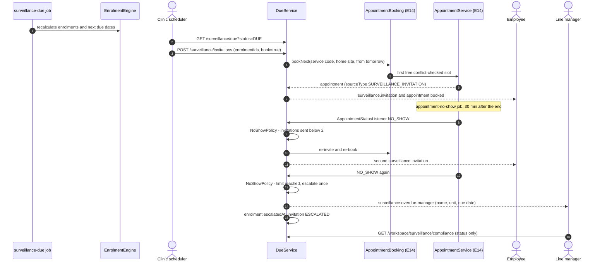

### 28.4 Abnormal device result → follow-up case

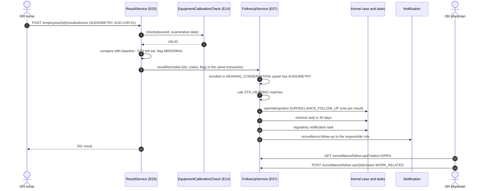

### 28.5 Return-after-illness guard

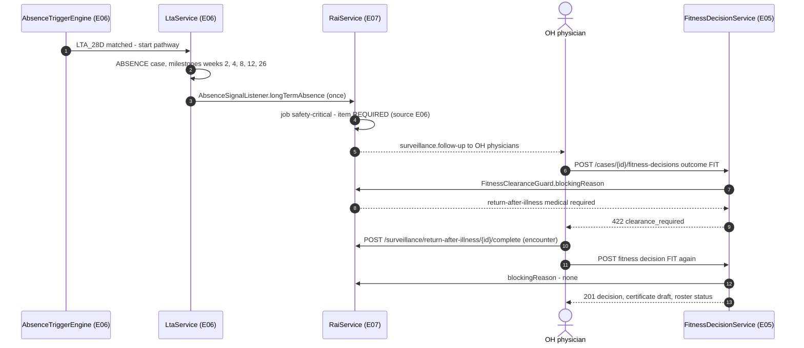

### 28.6 Check-in → queue → call-next

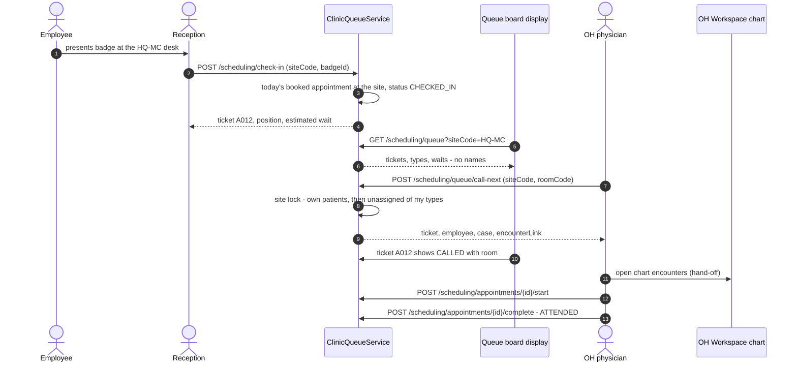

### 28.7 Cold-chain excursion

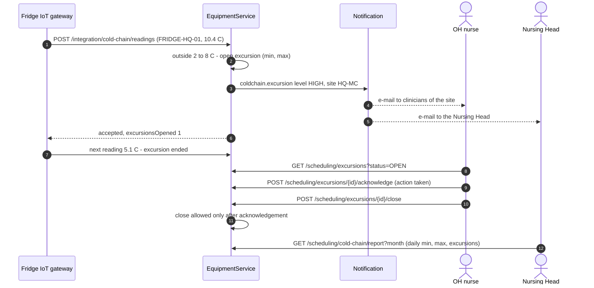

---

## 29. Data model

### 29.1 Schemas and tables

| Schema | Migration | Tables |
|---|---|---|
| `masterdata`, `docs` | V9 | `clinic_site` (new); hazards and job codes added; retention classes `ABSENCE_RECORD`, `PRE_EMPLOYMENT` |
| `absence` (new) | V10 | `feed_run`, `episode`, `feed_mismatch`, `trigger_rule`, `trigger_rule_version`, `queue_item`, `contact`, `certificate`, `certificate_call`, `lta_pathway`, `lta_milestone`, `case_conference`, `advice_request`, `advice_report`; sequence `advice_ref_seq` |
| `surveillance` (new) | V11 | `programme`, `employee_profile`, `enrolment`, `completion`, `invitation`, `pre_employment`, `crew_certificate`, `immunisation_requirement`, `vaccine_administration`, `titre`, `immunisation_reminder`, `exposure_group`, `ih_measurement`, `cosmic_dose`, `pregnancy_declaration`, `evaluation_rule`, `follow_up`, `return_after_illness`, `compliance_snapshot`, `audit_pack` |
| `scheduling` (new) | V12 | `appointment_type`, `resource`, `diary_template`, `campaign`, `appointment`, `campaign_slot`, `waitlist_entry`, `equipment`, `calibration`, `temperature_reading`, `excursion` |

Employee references are `varchar(64)` without foreign keys to the HRIS master, so candidates and not-yet-synchronised
employees can be held; links to kernel cases and documents are by UUID.

### 29.2 Overview

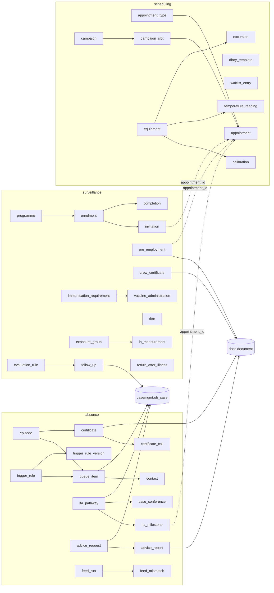

### 29.3 Data protection in the model

* Clinical free text is encrypted by the application (columns typed `text` and marked "encrypted" in the migrations);
  codes, dates and statuses stay in clear for rules and aggregation.
* Manager / HR-facing free text (HR stage notes, advice wording, employee comments, admin notes) is screened **before**
  it is stored.
* Grants (V10–V12): select / insert / update for the runtime role; **no DELETE** on absence and surveillance clinical
  tables; insert-only on audit-like tables; DELETE only where rows are regenerated (reminders, snapshots, diary templates).
* Demo data (`db/demo/R__demo_e06_absence.sql`, `R__demo_e07_surveillance.sql`, `R__demo_e14_scheduling.sql`) is
  idempotent with fixed IDs and dates relative to `current_date`, loads only with the `local` / test profiles, and leaves
  encrypted columns empty because keys differ per environment.

---

## 30. Key configuration items

| Key | Default | Purpose |
|---|---|---|
| `spring.flyway.schemas` | adds `absence, surveillance, scheduling` | New schemas |
| `spring.servlet.multipart.enabled` (BFF) | `false` | Stream uploads to the core API untouched |
| `wellnessz.analytics.min-group-size` / `WZ_ANALYTICS_MIN_GROUP` | `5` (floor 3 in E06) | Small-cell suppression |
| `wellnessz.absence.feed-cron` / `triggers-cron` / `lta-cron` | `0 40 2 * * *`, `0 0 3 * * *`, `0 10 3 * * *` (UTC) | E06 nightly jobs |
| `wellnessz.surveillance.due-job-cron` / `crew-job-cron` / `purge-job-cron` | `0 40 1 * * *`, `0 50 1 * * *`, `0 10 3 * * *` (UTC) | E07 nightly jobs |
| `wellnessz.scheduling.reminder-cron` / `no-show-cron` / `calibration-cron` | `0 */15 * * * *`, `0 5/15 * * * *`, `0 40 2 * * *` (UTC) | E14 jobs |
| `wellnessz.scheduling.telehealth-base-url` | `https://telehealth.wellnessz.local/room/` | Fallback when the config entry is absent |
| `wellnessz.record.require-registered-devices` | `false` | Reject device results from unregistered devices |
| `wellnessz.integration.outbound-allowlist.hr-systems` | adds `offerRef, candidateId, preEmploymentStatus, ohEngaged, certificateValidity` | HR status feed |
| Config entries (`masterdata.config_entry`, V10) | `modules.e06.enabled` true; `absence.notify-hr-on-engagement` true; `absence.advice.employee-review-required` true; `absence.hr-email` `hr-absence@wellnessz.local`; `absence.queue.sla-days` 5; `absence.queue.ame-sla-days` 1; `absence.advice.sla-working-days` 5; `absence.lta.contact-interval-days` 14; `absence.public-holidays` (2026–2027 list) | E06 behaviour |
| Config entries (V11) | `surveillance.max-invitations` 2; `surveillance.cosmic-dose-alert-msv` 6.0; `surveillance.new-enrolment-grace-days` 30; `surveillance.pre-employment-sla-days` 10; `surveillance.crew.issuing-authority` "UK CAA"; `notifications.crew-licensing.email`; `notifications.hr-onboarding.email` | E07 behaviour |
| Config entries (V12) | `notifications.biomedical.email`; `scheduling.self-booking.min-notice-hours` 24; `…max-days-ahead` 60; `…one-open-per-type` true; `scheduling.check-in.window-minutes` 60; `scheduling.no-show.grace-minutes` 30; `scheduling.telehealth-base-url`; `scheduling.calibration.due-alert-days` 30 | E14 behaviour |
| Master data and content | V9–V12 | Clinic sites, hazards, job codes, 8 trigger rules, 13 programmes, 6 evaluation rules, 11 immunisation requirements, 4 SEGs, 15 appointment types |

---

## 31. Non-functional design notes

* **Performance** – bulk invitation and campaign booking accept up to 5,000 people per call; the integration test books
  500 people into a campaign in one call; follow-ups are created synchronously with the result; audit packs are rendered
  in seconds. Indexes cover every work list (open queue items, milestone due dates, certificate status, enrolment due
  dates, open appointments, free campaign slots, open excursions). No production-volume load test yet.
* **Concurrency** – advisory locks on clinician / room / device / employee during booking, site lock for call-next,
  optimistic versions on appointments, campaigns, enrolments, pre-employment records and equipment (`409 stale`).
* **Time zones** – diary templates and campaign days are in the site's local time zone (`masterdata.clinic_site.time_zone`);
  jobs run in UTC.
* **Resilience** – SPIs degrade gracefully: without scheduling, invitations are "invited, not booked"; booking never
  throws for lack of capacity; a failing `AbsenceSignalListener` is logged without breaking the pathway; jobs run once
  per run key across replicas.
* **Accessibility** – status badges carry text as well as colour; suppressed cells are labelled; the queue board uses
  large tickets without names.
* **Browser storage** – all three apps keep PHI in memory only (lint rule bans `localStorage` / `sessionStorage`).

---

## 32. Known limitations and items for business / clinical sign-off

### 32.1 Decisions and sign-offs requested

| # | Item | Owner | Current state |
|---|---|---|---|
| S1 | Trigger rules and thresholds per subsidiary, including the "at least" interpretation of `minDays` (E06-BL-003) | Nursing Head + HR | 8 rules seeded |
| S2 | "OH engaged" notification wording and opt-in (E06-BL-005) | DPO | Draft template; switch `absence.notify-hr-on-engagement` |
| S3 | Advice question library and report wording; whether employee review is mandatory (`absence.advice.employee-review-required`) | CMO + DPO | 8 questions, review on |
| S4 | Thirteen surveillance programmes – eligibility, panels, frequencies, regulatory basis; headcount reconciliation with HR (E07-BL-002) | CMO | Seeded ACTIVE version 1 |
| S5 | Evaluation rules (STS shift, spirometry decline, biomonitoring limits, regulatory-notification flags) | CMO + HSE | 6 rules seeded |
| S6 | Pre-employment questionnaire and consent wording; government medical types | CMO + DPO | 10 questions |
| S7 | CAA examination template formats and issuing authority (E07-BL-009) | AME lead + CMO | Draft sections, pending CAA confirmation |
| S8 | Immunisation matrix (vaccines, schedules, titres, mandatory flags) | CMO + Nursing Head | 11 requirements |
| S9 | Retention classes `ABSENCE_RECORD` (6 y) and `PRE_EMPLOYMENT` (1 y) | DPO + legal | Proposed |
| S10 | Cosmic-dose threshold (6 mSv) and pregnancy workflow | AME lead + DPO | Configured |
| S11 | Appointment types, durations, charge codes and internal prices (E14-BL-010) | Nursing Head + Finance | 15 types seeded |
| S12 | Self-booking and no-show policies | Nursing Head | Configured defaults |

### 32.2 Known limitations

| Area | Limitation |
|---|---|
| Absence feed | `AbsenceFeedConnector` default is a no-op; real HRIS / T&A / crew connectors are E15 (push endpoint is ready) |
| Pre-employment | Outcome document shared to HR only when the candidate is already in the employee master; otherwise status view + disclosure log |
| Pre-employment purge | Clears personal fields of the record; document bytes follow the platform retention review (no automatic deletion) |
| Telehealth | Join and documentation links only; video is E04 |
| Cold chain | IoT contract only (`/integration/cold-chain/readings`); no gateway connected |
| Crew | CAA examination formats pending confirmation; crew fleet / base table still has no loader (Increment 2) |
| Programmes | Content pending CMO validation; headcounts not reconciled with HR |
| Analytics | With the small demo population most groups are suppressed – by design |
| Demo data | Return-after-illness demo item for E1004 is skipped on `*_test` databases |
| Patterns | Only the MONDAY_FRIDAY pattern is available as a trigger rule; POST_HOLIDAY and FREQUENT_SHORT are summary flags |
| Calibration certificates | Stored in the scheduling schema, outside the document service's retention schedule |
| Load | No production-volume load test of bulk invitation, campaign booking or capacity |
