# WellnessZ OHCM – Increment 4 Solution Design: E04 Treatment Coordination & Partner Referrals and E08 Workers' Compensation, Insurance & Claims Coordination

| | |
|---|---|
| **Document** | Increment 4 – 01 Solution Design (E04 + E08) |
| **System** | WellnessZ Airline Occupational Health Case Management (OHCM) |
| **Scope** | E04 Injury & Illness Management, Treatment Coordination & Partner Referrals · E08 Workers' Compensation, Insurance & Claims Coordination · partner portal for external providers and TPA / insurer adjusters |
| **Audience** | Chief Medical Officer (CMO), Nursing Head, Data Protection Officer (DPO), claims / insurance coordination, Finance, Legal, Procurement, HSE, Cyber GRC, CIO, project sponsor |
| **Baseline** | Repository working tree, Flyway migrations V1–V15, API contract `docs/increment-04/API-Contract-E04-E08.md`, OpenAPI `docs/api/openapi.json` (509 paths) |
| **Status** | Draft for review – plan templates, referral data sets, statutory / insurer report forms, provider network content, cost FX rates, retention class `CLAIM_RECORD`, e-prescribing route and notification wording await business, legal and DPO sign-off (Section 27) |
| **Companion documents** | 02 – Requirements Traceability Matrix · 03 – Release Notes Increment 4 · Increment 1–3 documents 01–03 · Architecture 01–03 |

> **How to read this document.** Every statement about behaviour was checked against the source code and, where
> named, against an automated test. Where the code deviates from the API contract, this document describes **what the
> code does** and says so. Where a capability is only partly delivered, or where content (plan templates, data sets,
> report forms, provider network, rates, retention periods) is a draft awaiting clinical, legal, procurement, finance or
> DPO sign-off, this is stated explicitly. Requirement identifiers (E04-HLR-xx, E04-F0x, E04-BL-0xx, E08-…) refer to
> the business workbooks (v1.0, 27 October 2026). All API paths are relative to `/api/v1`; browser apps call them
> through the BFF as `/bff/api/...`.

---

## 1. Executive summary

Increment 4 adds two modules and a fourth web application on top of the Increment 1 intake / triage, the Increment 2
record and fitness and the Increment 3 absence, surveillance and scheduling modules:

* **E04 – Treatment coordination and partner referrals** makes OH the coordinating hub of every injury and illness
  case. Nurses build **treatment plans** from eight injury templates (goals, interventions, follow-ups, responsible
  clinician, expected recovery from the duration guideline); follow-ups become kernel case tasks and, on request, clinic
  bookings; the employee sees the plan in plain language and confirms or declines follow-ups; a nightly job raises
  **variance alerts** when recovery overruns the expectation by more than the configured percentage. **E-referrals**
  go through a wizard with a mandatory data set per service (14 services), an active partner-sharing consent and a
  signed `REFERRAL_LETTER` plus a FHIR R4 `ServiceRequest`; the contracted provider works the referral in the new
  **partner portal** (accept, appointment, seen, report, invoice) and overdue reports are chased and escalated
  automatically. A **provider network directory** (20 providers across hub, outstation and layover cities, versioned
  contracts, rate cards, SLAs, accreditation, languages, network-gap list) carries monthly **vendor scorecards**.
  **Pre-authorisation** requests are shared with the insurer / TPA under consent and decided by claims coordination,
  the payer's adjuster in the portal or the insurer system; invoices are matched against the approved amount and every
  estimate and invoice is posted to the case cost ledger. **Clinic medication** administration checks allergies against
  the E03 record and refuses unknown or expired batches; e-prescribing is a disabled SPI pending the legal decision.
  **Outcomes** (pain, function scale, RTW date, impairment) are captured at milestones and a case with treatment cannot
  close without a closure outcome. **Telehealth** (video / secure chat) needs the employee's consent, issues single-use
  participant tokens and turns a completed consultation into a draft E03 encounter.
* **E08 – Claims coordination** links the financial and medico-legal side of work-related cases to the OH case without
  ever reading the clinical record. A **claim** (workers' compensation, employer's liability, group medical, third
  party) is opened from the case with one call, follows a guarded status workflow, shows as a badge in the case header
  and – when it is lost-time – gets a **nurse case manager automatically** through the E02 assignment service.
  **First reports of injury** are auto-populated from the incident, case and HRIS with statutory **deadline timers**,
  submitted through a replaceable `ClaimsSubmissionGateway` and acknowledged manually or by integration; an hourly job
  reminds and escalates. **Disclosure sets** to insurers / TPAs contain only claim-relevant, signed, non-privileged
  documents, need the employee's active `INSURER_SHARING` consent, can be **redacted** by OH and revoked, and every
  disclosure is logged for the DPO report. **Adjusters** collaborate in the partner portal (RTW status and milestones
  only, shared tasks, screened secure messages, consented documents). A **cost ledger** (six categories, four kinds,
  E04 entries through the kernel) rolls up by subsidiary, department or cost centre with small-group suppression,
  supports budgets, budget vs actual and a monthly **ERP export** with SHA-256 checksum and reconciliation.
  **Legal counsel** places litigation holds (retention suspended for every case document), marks privilege and requests
  medico-legal reports, expert opinions and IMEs (raised as E04 referrals through a kernel SPI).

Four new kernel SPIs let the two modules co-operate without depending on each other (Section 4.3): E04 posts costs to
E08 (`CaseCostRecorder`) and reads the claim context (`ClaimContextProvider`); E08 raises IMEs through E04
(`ExternalReferralGateway`) and hears back through `ReferralStatusListener`.

The **new partner portal** (`web/partner-portal`, port 5176 locally, `partners.<domain>` in Kubernetes) is the first
WellnessZ application for people outside the airline group. Its controls (Section 19) are: **MFA** proven in the
access token before the core API grants `PARTNER_PROVIDER` or `TPA_ADJUSTER`; **organisation isolation** (org code =
last segment of `org_scope`, anything else 404); **consent gating** of every referral, session and document; and the
**disclosure log** on the first read of each referral and on every insurer share.

Verification (29 October 2026): 275 Java tests pass with 0 failures (`wz-core-app` 112 including
`Increment4TreatmentIntegrationTest` 10, `Increment4ClaimsIntegrationTest` 10 and `ArchitectureTest` 17; module unit
tests E04 11, E08 28; security 7 including the MFA gate); SpotBugs + FindSecBugs report 0 findings; 1,076 web unit tests
across the four apps (partner portal 119, new); and 22 / 22 end-to-end checks against a real Keycloak, BFF, core API and
the four web apps (increments 1–3 still pass 18 / 18, 25 / 25 and 32 / 32 – 97 checks in all).

---

## 2. Scope and goals

### 2.1 Business goals (from the epic overviews)

| Epic | KPI | How the design supports it |
|---|---|---|
| E04 | Median referral-to-appointment < 5 working days (urgent < 48 h) | Service catalogue SLAs (`routineAppointmentDays`, `urgentAppointmentHours`) and contract SLAs; partner portal appointment booking; `GET /treatment/kpis` → `medianWorkingDaysReferralToAppointment` (Mon–Fri working days) and `urgentWithin48hPct` (E2E: median 5 working days) |
| E04 | ≥ 90 % referrals with report received within 7 days | `reportDueAt` set on send; daily `referral-chase` job chases the provider and escalates after `treatment.referral.max-chases` (2); overdue filter and chase count on the worklist; KPI `reportWithin7DaysPct` (E2E: 66.7 % – one overdue demo referral) |
| E04 | Missed appointment rate < 10 % | Employee reminders (`treatment.follow-up`, 2 days before), confirm / decline in the employee app, E14 NO_SHOW marks the follow-up MISSED; KPI `missedAppointmentPct` (E2E: 0 %) |
| E04 | Average medical cost per case by unit (trend down) | Estimates and invoices posted to the case ledger; `GET /treatment/costs?groupBy=SUBSIDIARY\|DEPARTMENT\|COST_CENTRE` (suppressed below the minimum group size); KPI `avgMedicalCostPerCase` in the base currency |
| E08 | Lost-time claim cost per case −15 % in 18 months | Cost ledger by category (MEDICAL, REHAB, INDEMNITY, ADMIN, SETTLEMENT, LEGAL), roll-ups with cost per employee, budget vs actual with monthly trend |
| E08 | 100 % lost-time claims with a nurse case manager within 48 h | Assignment happens **synchronously** when a claim is created or flagged lost-time; `GET /claims/nurse-assignment` reports `assignedWithin48h`, `pct` and unassigned claims (E2E: 2 / 2 = 100 %) |
| E08 | FROI within statutory deadline 100 % | Deadline per form (anchor incident or notification; shorter deadline for specified injuries), deadline dashboard with hours left, hourly `claims-report-deadlines` job (reminder 24 h before, LATE + escalation after), KPI `onTimeSubmissionPct` |
| E08 | Litigated claim rate (trend down) | LITIGATED status with history, legal counsel's view of litigated / held claims; counted from the claim list (no dedicated trend endpoint in this increment) |

### 2.2 In scope

E04 features F01–F07 (19 backlog items) and E08 features F01–F06 (12 backlog items), at the depth recorded in the
traceability matrix, plus the platform additions they need (partner organisation master data, `INSURER` share target,
four document templates and four upload types, retention class `CLAIM_RECORD`, consent purpose
`TELEHEALTH_CONSULTATION`, 13 notification templates, MFA role gate, four kernel SPIs, outbound allow-lists, the partner
portal application and its deployment).

### 2.3 Out of scope (per workbooks and increment plan)

* Workers' compensation claim **adjudication** (insurer / TPA system) and payroll of compensation (E04 / E08 out of scope).
* Return-to-work planning (E05 – reused read-only for the adjuster's RTW status view).
* Production connectors to insurer, TPA, authority and ERP systems (E15). Increment 4 builds and tests the interfaces
  (integration endpoints, allow-listed outbound events, replaceable gateways) with default implementations.
* A live FHIR exchange with a partner hospital (E04-BL-006, P3): the `ServiceRequest` / `DocumentReference` endpoints
  are built and tested against a simulated partner.
* A video platform: telehealth uses a provider-agnostic SPI with a default link provider and token redemption endpoint.
* E-prescribing: the legal route is undecided (E04-BL-013 spike); the gateway is a disabled no-op.
* Business validation of templates, data sets, report forms, network content, FX rates and retention (Section 27).

---

## 3. Actors and roles

Roles are canonical application roles (`com.wellnessz.common.model.Roles`). **Five roles are new in Increment 4**:
`CLAIMS_COORDINATOR`, `TPA_ADJUSTER`, `LEGAL_COUNSEL`, `FINANCE` and `PROCUREMENT`. `MeController` reports the
disclosure level `STATUS_ONLY` for all five and for `PARTNER_PROVIDER`. Two of them belong to **external
organisations**: `PARTNER_PROVIDER` (existing role, first used for real here) and `TPA_ADJUSTER`; both carry an
`org_scope` of the form `/PARTNERS/<CODE>` and are granted only with **MFA proof** (Section 5.3).

| Role | New? | Persona | Disclosure | New rights in Increment 4 |
|---|---|---|---|---|
| `OH_CLINICIAN` | existing | OH nurse | CLINICAL | Treatment plans, follow-ups, variance alerts, referral wizard / send / rating, outcomes, medication administration, stock receipt, telehealth sessions, pre-authorisation (with clinical justification), disclosure-set redaction and OH-only documents |
| `CASE_MANAGER` | existing | Nurse case manager | CLINICAL | Read plans, referrals, outcomes; open claims; assigned automatically to lost-time claims; shared tasks and secure messages with the adjuster; claim RTW view |
| `OH_PHYSICIAN` | existing | OH physician | CLINICAL | As clinicians; medico-legal reports (signed, versioned), telehealth completion into a draft encounter |
| `CMO` | existing | Chief Medical Officer | CLINICAL | Treatment KPIs, vendor scorecards and export, network gaps, cost roll-ups, budget vs actual, claims list, legal requests |
| `NURSING_HEAD` | existing | Nursing Head | CLINICAL | Treatment KPIs, scorecards, formulary and stock, medication usage, nurse-assignment KPI, variance escalations |
| `CLAIMS_COORDINATOR` | **new** | Insurance / claims coordinator | STATUS_ONLY | Claims (create, update, status, subrogation), first reports, disclosure sets (non-clinical document types), shared tasks and messages, cost ledger, pre-authorisations (without clinical justification) and their decisions, invoices, reconciliation |
| `TPA_ADJUSTER` | **new** | External TPA / insurer adjuster (partner portal, MFA) | STATUS_ONLY, own payer only | Claims where the organisation is payer, RTW status and milestones, shared tasks, secure messages, consented documents, pre-authorisation decisions |
| `LEGAL_COUNSEL` | **new** | Legal department | STATUS_ONLY | Litigated or held claims only; litigation hold, privilege, legal requests, medico-legal report content (legal access set); may set LITIGATED |
| `FINANCE` | **new** | Finance partner | STATUS_ONLY, units not people | Cost ledger entries, roll-ups, budgets, budget vs actual, ERP export and reconciliation, invoices; **no** claim detail (`403`) |
| `PROCUREMENT` | **new** | Procurement (provider contracts) | STATUS_ONLY | Provider directory, profiles, versioned contracts / rate cards / SLAs, network gaps, scorecards, partner organisation master data |
| `PARTNER_PROVIDER` | existing, now active | External hospital, specialist, physiotherapy, imaging or telehealth partner (partner portal, MFA) | STATUS_ONLY, own organisation only | Referral inbox and actions, report and invoice upload, telehealth sessions (join, chat), shared documents |
| `HR` | existing | HR business partner | STATUS_ONLY within org scope | Claim status of employees in scope (no costs, payer, adjuster or clinical detail) – disclosure-logged |
| `DPO` | existing | Data Protection Officer | – | Claim disclosure report; disclosure-set list and revocation |
| `HSE_OFFICER` | existing | HSE | – | Report forms, first reports and deadline dashboard |
| `EMPLOYEE` | existing | Employee / crew member | SELF | My treatment plan, follow-up confirm / decline, external appointments, telehealth sessions (consent, join, chat), consent to `TELEHEALTH_CONSULTATION` |
| `INTEGRATION` | existing | Machine client | – | FHIR `ServiceRequest` pull, FHIR `DocumentReference` report push, insurer pre-authorisation decisions, first-report acknowledgements, telehealth token redemption |

"OH roles" = `Roles.OH_TEAM`; "Clinicians" = OH roles minus `CASE_MANAGER`; "Physicians" = `OH_PHYSICIAN, AME, CMO` –
unchanged from Increment 3.

Demo users: `claims1` (S8701, /AIRLINE), `adjuster1` (X8702, /PARTNERS/GULFTPA), `legal1` (S8703), `finance1` (S8704),
`procurement1` (S8705), `physio1` (X8706, /PARTNERS/PHYSIOPLUS, new) and the existing `partner1` (P9101,
/PARTNERS/CITYHOSP).

> **Deployment note.** The five new roles must exist in the identity provider **and** be in the role scope mappings of
> the BFF (`wellnessz-bff`) and mobile (`wellnessz-mobile`) clients (`fullScopeAllowed=false` – a missing mapping
> silently drops the role). Partner and adjuster identities additionally need an **enrolled second factor** that the
> IdP reports in `amr` or `acr`; otherwise the core API removes the partner role and the portal shows the MFA / no-access
> page (Section 5.3).

---

## 4. Component view

### 4.1 Modules and boundaries

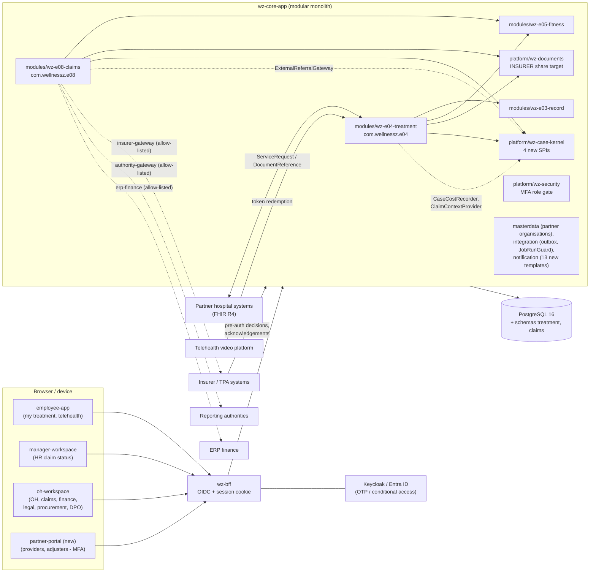

| Component | Responsibility in Increment 4 |
|---|---|
| `modules/wz-e04-treatment` (new, depends on E03 and E05) | Plan templates, treatment plans and follow-ups, variance alerts, service catalogue, e-referrals and partner actions, FHIR mapping, chase job, provider profiles / contracts / scorecards / network gaps, pre-authorisations and invoices, formulary / stock / administration, outcomes and closure guard, telehealth sessions / tokens / chat / completion, treatment chart section, KPIs |
| `modules/wz-e08-claims` (new, depends on E05 only – never on E03) | Claims and workflow, case badge, HR status view, nurse assignment, report forms and first reports, submission gateway and deadline job, disclosure sets / redaction / DPO report, shared tasks and messages, RTW status view, adjuster portal views, cost ledger / roll-ups / budgets / ERP export / reconciliation, litigation hold, privilege and legal requests |
| `platform/wz-case-kernel` | Four new SPIs (Section 4.3); `CaseTransitionGuard`, `ChartContributor`, `AppointmentBooking` / `AppointmentStatusListener` reused |
| `platform/wz-documents` | `INSURER` share target, `shareAsSystem(actor, id, target, organisation, consentId)`, `legalHoldForCase`, templates `TREATMENT_PLAN`, `PREAUTH_REQUEST`, `FIRST_REPORT_OF_INJURY`, `MEDICO_LEGAL_REPORT`, upload types `PROVIDER_REPORT`, `PROVIDER_INVOICE`, `INSURER_ACKNOWLEDGEMENT`, `REDACTED_COPY`, retention class `CLAIM_RECORD` |
| `platform/wz-security` | MFA role gate in `WellnessZJwtConverter`; `/me` disclosure level for the new roles; consent purpose `TELEHEALTH_CONSULTATION` |
| `platform/wz-masterdata` | `masterdata.partner_organisation` and `GET/POST /masterdata/partner-organisations` |
| `platform/wz-notification` | 13 content-free templates, placeholder `reference`, partner-portal links |
| `apps/wz-bff` | `/bff/api/workspace/claims/**` keeps its `/workspace` prefix (HR claim status); redirect URIs and CORS for port 5176 |
| `web/partner-portal` (new) | React 19 + Vite + TypeScript app for providers and adjusters (Section 19) |

### 4.2 Boundaries enforced by ArchUnit

`apps/wz-core-app/src/test/java/com/wellnessz/app/ArchitectureTest.java` now has **17 rules**. New or extended rules
for Increment 4:

| Rule | Effect |
|---|---|
| `earlierIncrementsDoNotDependOnIncrement4` (new) | E03, E05, E06, E07 and E14 never depend on E04 or E08 – increment-4 modules plug in through `ExternalReferralGateway`, `CaseCostRecorder`, `ClaimContextProvider` |
| `treatmentAndClaimsAreIndependent` (new) | E04 never depends on E08, E06, E07 or E14 – costs go out through `CaseCostRecorder`, the claim context comes in through `ClaimContextProvider` |
| `claimsDoesNotDependOnTreatmentOrClinicalRecord` (new) | E08 never depends on E04, **E03**, E06, E07 or E14 – claims never read the clinical record; IMEs go through `ExternalReferralGateway` |
| `earlierModulesDoNotDependOnLaterOnes` (extended) | E01 / E02 never depend on E03–E08 or E14 |
| `platformDoesNotDependOnBusinessModules`, `kernelDoesNotDependOnBusinessModules`, `documentServiceIsAPlatformService` (extended) | Platform, kernel and document service never depend on E04 or E08 |
| Increment 1–3 rules kept | `recordAndFitnessModulesAreIndependent`, `fitnessDoesNotDependOnRecord`, `increment2ModulesDoNotDependOnIncrement3`, `absenceIsIndependentOfSurveillanceAndScheduling`, `surveillanceIsIndependentOfAbsenceAndScheduling`, `schedulingIsIndependentOfClinicalModules`, `intakeDoesNotDependOnTriage`, `intakeDoesNotCallCaseKernelDirectly`, `commonHasNoSpringSecurity`, `noStandardStreams` |

Resulting module graph: E04 → E03 + E05; E08 → E05; E04 and E08 mutually independent and independent of E06, E07 and
E14. `E04Module` and `E08Module` register with the module registry (`modules.e04.enabled`, `modules.e08.enabled`).

### 4.3 Service provider interfaces (SPIs)

All kernel SPIs live in `platform/wz-case-kernel/src/main/java/com/wellnessz/casekernel/support/` and carry
identifiers, codes, amounts, dates and statuses only.

| SPI | Implemented by | Called by | Purpose |
|---|---|---|---|
| `CaseCostRecorder` (new) | E08 `CostService` | E04 `PreauthService` – on submission (ESTIMATE), on approval (ESTIMATE updated to the approved amount) and for every provider invoice (INVOICE) | `record(actor, CostEntry{caseId, employeeId, category, kind, amount, currency, incurredOn, providerCode, description, sourceType, sourceRef})` → ledger id; **idempotent on (sourceType, sourceRef, kind)** (partial unique index); entries for a case without a claim stay case-level and roll up too |
| `ExternalReferralGateway` (new) | E04 `EReferralService` | E08 `LegalService` for IME requests | `requestReferral(actor, ReferralRequest{caseId, employeeId, serviceCode, providerCode, urgency, reason, sourceType, sourceRef})` → `Optional<ReferralRef>` – a **DRAFT** referral that OH completes (data set, consent) and sends; empty for an unknown service |
| `ReferralStatusListener` (new) | E08 `LegalService` (`supports("CLAIM_IME")`) | E04 `ReferralCore.transition`, inside the referral transaction | `referralStatusChanged(referralId, sourceType, sourceRef, status, reportDocumentId)` for every status change of a referral raised through the gateway |
| `ClaimContextProvider` (new) | E08 `ClaimService` | E04 pre-authorisation (payer default), case header badge | `forCase(caseId)` → `ClaimContext(claimId, claimRef, claimType, status, payerCode, lostTime, litigationHold)` – the active (most recent) claim of the case; status and payer only, no reserves or costs |
| `CaseTransitionGuard` (existing) | E04 `OutcomeClosureGuard` | Kernel on every case transition | A case with a treatment plan or a referral cannot move to CLOSED without a CLOSURE outcome → `422 outcome_required` |
| `ChartContributor` (existing) | E04 `TreatmentChartContributor` | E03 chart | Section `treatment` (active plan, open referrals, latest outcomes) and alerts for overdue / escalated referrals |
| `AppointmentStatusListener` (existing) | E04 `TreatmentAppointmentListener` | E14 on appointment status changes | Source types `TREATMENT_FOLLOW_UP` (NO_SHOW → follow-up MISSED, ATTENDED → DONE, CANCELLED → PLANNED) and `TELEHEALTH_SESSION` (NO_SHOW → session NO_SHOW) |
| `AppointmentBooking` (existing) | E14 | E04 follow-ups (`book:true`) and telehealth sessions (`TELEHEALTH_CONSULT`) | First free slot on or after the date; empty when there is no capacity |

All four new SPIs are consumed through `ObjectProvider`, so either module can be deployed without the other: without
E08, E04 records no costs and has no payer default; without E04, an IME request records `referralStatus=NOT_AVAILABLE`
and an OH task (Section 18.4).

Module-internal SPIs (replace with a `@Primary` or additional bean):

| SPI | Module | Default | Purpose |
|---|---|---|---|
| `TelehealthProvider` | E04 | `LinkTelehealthProviderConfig` – link on `treatment.telehealth.base-url` (`@ConditionalOnMissingBean`) | `joinUrl(sessionRef, mode, token)` for the chosen video / chat platform |
| `EPrescribingGateway` | E04 | `EPrescribingConfig` – disabled, route from `treatment.eprescribing.route` (`NONE`) and a decision-memo text | Status for `GET /treatment/eprescribing/status`; no prescription leaves the system |
| `ClaimsSubmissionGateway` | E08 | `DefaultClaimsSubmissionGateway` – reference-only outbox event to `insurer-gateway` / `authority-gateway` and a content-free e-mail | `submit(Submission)` → `Receipt(messageId)`; a real authority / insurer connector replaces it with a `@Primary` bean |

### 4.4 Internal and outbound events

All events use the transactional outbox (at-least-once, idempotent consumers, payloads encrypted at rest).

| Event | Producer | Consumers / destination |
|---|---|---|
| `referral.status.v1 {referralId, caseId, status}` | E04 | In-process |
| `preauth.status.v1 {preauthId, caseId, status}` | E04 | In-process |
| `treatment.variance.v1 {planId, caseId}` | E04 | In-process |
| `claim.status.v1 {claimId, caseId, status}` | E08 | In-process |
| `claim.nurse.assigned.v1 {claimId, username}` | E08 | In-process |
| `claim.report.submitted.v1 {messageId, claimRef, reportRef, formCode, payerCode, employeeId, incidentDate, submittedAt, deadlineAt}` | E08 (default gateway, insurer recipients) | `insurer-gateway` – allow-listed |
| `claim.report.submitted.v1 {messageId, reportRef, formCode, jurisdiction, employerRef, incidentDate, submittedAt, deadlineAt}` | E08 (default gateway, authority recipients) | `authority-gateway` – allow-listed, **no employee identifiers** |
| `claim.cost.export.v1 {messageId, batchId, month, amount, currency, entryCount, checksum}` | E08 | `erp-finance` – allow-listed; the CSV itself is fetched from `GET /claims/costs/exports/{id}/content` |

---

## 5. Platform additions

### 5.1 Partner organisations (V13)

* `masterdata.partner_organisation` (code, name, `org_type`, country, city, contact e-mail, phone, `portal_enabled`,
  active). `org_type` ∈ HOSPITAL, CLINIC, SPECIALIST, PHYSIOTHERAPY, IMAGING, LABORATORY, MENTAL_HEALTH, TELEHEALTH,
  ASSISTANCE, INSURER, TPA, AUTHORITY.
* `GET /masterdata/partner-organisations?types=…` (OH roles, OH_ADMIN, CLAIMS_COORDINATOR, PROCUREMENT, FINANCE,
  LEGAL_COUNSEL, HSE_OFFICER, CLINIC_SCHEDULER); `POST` upsert (PROCUREMENT, OH_ADMIN, PLATFORM_ADMIN, INTEGRATION).
* Seeded (illustrative, E04-BL-019 – procurement replaces it with the contracted network): **20 providers** –
  hub hospitals and clinics (CITYHOSP, HEATHROWMED), specialists (STMARYS_ORTHO, CARDIO_LDN, EYE_LDN, ENT_AUDIO,
  DERM_LDN), physiotherapy (PHYSIOPLUS, REHAB_HUB), imaging (LDN_IMAGING), laboratory (PATHLAB), mental health
  (MINDCARE, OCC_PSYCH), telehealth (TELEDOC), the travel-assistance partner for layover cities (GLOBALASSIST),
  outstation Dubai (DXB_AMERICAN, DXB_PHYSIO) and layover cities New York, Singapore and Hong Kong (JFK_URGENT,
  SIN_MEDICAL, HKG_CLINIC); **payers** GULFTPA (TPA), AVIA_INSURE and GROUPMED (insurers); **authorities** AUTH_OSH
  (GB) and AUTH_LABOUR_AE (UAE).
* Portal users carry `org_scope=/PARTNERS/<CODE>`; the last path segment is the organisation code used for isolation.

### 5.2 Documents

| Addition | Detail |
|---|---|
| Share target **`INSURER`** | Recipient = insurer / TPA organisation code; requires the employee's **active `INSURER_SHARING` consent**; disclosure purpose `CLAIM`. TPA adjusters read the documents through `GET /partner/documents` (now `PARTNER_PROVIDER` or `TPA_ADJUSTER`), only while the share is active and the consent is still active and only for their own organisation |
| `shareAsSystem(actor, documentId, target, organisation, consentId)` | Workflow share to `PARTNER` (consent `TREATMENT_SHARING_PARTNER`) or `INSURER` (consent `INSURER_SHARING`) with the same consent check and disclosure log as the user-facing share |
| `legalHoldForCase(actor, caseId, hold, reason)` | Puts every document of the case (all versions) on or off legal hold – retention suspended; audited `LEGAL_HOLD_SET` / `LEGAL_HOLD_RELEASED` with the document count |
| Upload types | `PROVIDER_REPORT`, `PROVIDER_INVOICE`, `INSURER_ACKNOWLEDGEMENT`, `REDACTED_COPY` |
| Retention class | `CLAIM_RECORD` – 10 years from the document date, **suspended while a litigation hold is active** (proposed, DPO / Legal to approve) |

| New template | Clinical? | Shareable with | Generators → signers | Record class |
|---|---|---|---|---|
| `TREATMENT_PLAN` | yes | employee | OH roles → clinicians | OH_RECORD |
| `PREAUTH_REQUEST` | yes (clinical justification) | insurer / TPA, with consent | OH roles → clinicians (claims coordinators generate through the module; the justification is then a non-clinical placeholder) | CLAIM_RECORD |
| `FIRST_REPORT_OF_INJURY` | yes (minimum injury information required by law) | insurer / authority | CLAIMS_COORDINATOR, OH_CLINICIAN, OH_PHYSICIAN, CMO, CASE_MANAGER | CLAIM_RECORD |
| `MEDICO_LEGAL_REPORT` | yes | legal access set only | OH roles → clinicians | CLAIM_RECORD |

The existing `REFERRAL_LETTER` (partner) is generated and signed on every referral send.

### 5.3 MFA gate for external portal roles

`WellnessZJwtConverter.withoutUnprovenMfaRoles` removes every role listed in `wellnessz.security.mfa-required-roles`
(env `WZ_MFA_REQUIRED_ROLES`, default `PARTNER_PROVIDER,TPA_ADJUSTER`) from the granted authorities unless the access
token proves multi-factor authentication:

* `amr` contains one of `mfa, otp, totp, hwk, swk, sms, webauthn, fido` (`wellnessz.security.mfa-amr-values`, RFC 8176
  plus common IdP values), **or**
* `acr` is one of `2, 3, mfa, c1` (`wellnessz.security.mfa-acr-values`; Keycloak step-up level, Entra ID authentication
  context).

Without that proof the role is simply absent, so every partner endpoint answers `403` and `/me` shows no partner role –
the portal then displays its MFA / no-access page. The gate is **on by default** and **off in the `local` profile**
(`mfa-required-roles` empty) because the demo realm has no OTP enrolment; `WZ_MFA_REQUIRED_ROLES=PARTNER_PROVIDER,TPA_ADJUSTER`
rehearses it locally. Unit test `MfaRoleGateTest` (3 tests): role dropped without proof; granted with `amr` or `acr`;
gate switchable per environment.

### 5.4 Consent and notifications

* Consent purpose **`TELEHEALTH_CONSULTATION`** (per session, recorded from the employee app). Existing purposes
  `TREATMENT_SHARING_PARTNER` (referrals, partner telehealth) and `INSURER_SHARING` (pre-authorisation, insurer first
  reports, disclosure sets) are now enforced by E04 and E08. Consent pickers in the OH Workspace list the employee's
  active consents (`GET /cases/{caseId}/consents`, `GET /claims/{id}/consents`) – no free-text consent IDs.
* **13 content-free notification templates**: `referral.sent`, `referral.chase`, `referral.overdue-team`,
  `referral.appointment`, `treatment.follow-up`, `treatment.variance`, `preauth.status`, `telehealth.invite`,
  `claim.assigned`, `claim.report-due`, `claim.task`, `claim.message`, `legal.request`. New placeholder `reference`
  (referral, pre-authorisation, claim or report reference). Partner-portal links are built from
  `wellnessz.notification.partner-portal-url` (`WZ_PARTNER_PORTAL_URL`, default `https://partners.wellnessz.local`),
  e.g. `…/#/referrals/{id}`.

### 5.5 BFF, partner portal and deployment

* The BFF passes `/bff/api/workspace/claims/**` to `/api/v1/workspace/claims` unchanged (HR claim status).
* `web/partner-portal` runs on port **5176** locally and on **`partners.<domain>`** in Kubernetes (Helm component
  `partnerPortal`, in every template – deployment, service, ingress, HPA, PDB, network policy, service account, GKE
  objects – with values for local, Azure, GCP and hybrid; disabled in the hybrid on-premises profile). The ingress
  routes `/bff`, `/oauth2`, `/login`, `/logout` on the same host to the BFF (same-origin session cookie).
* Keycloak (`wellnessz-bff`) redirect URIs, post-logout redirect URIs and web origins include `http://localhost:5176`;
  local CORS (`WZ_CORS_ORIGINS`) includes it too.
* CI web matrix, container build, deploy-environment image list and Dependabot (npm + Docker) cover the new app.
* Schemas `treatment` (V14) and `claims` (V15): each migration starts with `create schema if not exists …`; the schema
  lists in `application.yml`, Helm, the local init script, the managed-database bootstrap and the CloudNativePG cluster
  include them.

### 5.6 Configuration entries

Runtime business settings live in `masterdata.config_entry` (seeded by V14 and V15); the full list is in Section 25.

---

## 6. E04-F01 – Treatment plan and follow-up scheduler

**Requirements:** E04-HLR-01; E04-BL-001 (plan builder, templates, follow-ups, printable plan), E04-BL-002 (variance
alert), E04-BL-018 (employee portal view).

### 6.1 Design decisions

* **Templates** – eight seeded injury templates (`GET /treatment/plan-templates`): BACK_STRAIN, SHOULDER_STRAIN,
  WRIST_SPRAIN, KNEE_SPRAIN, HAND_LACERATION, CONCUSSION_MILD, WORK_STRESS, NOISE_HEARING, each with goals,
  interventions (`type, description, frequency, weeks`), follow-up day offsets, optional duration-guideline code (E02
  `triage.duration_guideline`) and expected days. Content is a draft for CMO approval.
* **Plan creation in one call** – `POST /cases/{caseId}/treatment-plans` with `templateCode` expands omitted lists
  (`PlanMaths.expandInterventions` dates each intervention over its weeks; `followUpDates` turns the offsets into due
  dates); `?activate=true` makes it ACTIVE at once, otherwise DRAFT. Only one ACTIVE plan per case (`409
  active_plan_exists`). E2E: wrist-sprain plan with follow-ups and expected recovery in one request.
* **Versioning** – `PUT /treatment-plans/{id}` creates a new version in the same series; the previous version becomes
  SUPERSEDED (visible in the plan history) and open follow-ups move to the new version.
* **Expected recovery** – expected days = plan override, else the duration guideline, else the template; recovery is
  measured **from the date of injury / onset when known, else from the plan start**.
* **Follow-ups** – each follow-up of an active plan becomes a kernel case task; `book:true` books through
  `AppointmentBooking` (source type `TREATMENT_FOLLOW_UP`). The E14 callback maps NO_SHOW → MISSED, ATTENDED → DONE,
  CANCELLED → back to PLANNED. Clinicians close follow-ups as DONE / MISSED / CANCELLED.
* **Employee view** – `GET /me/treatment-plans` is a plain-language projection (goals, interventions, follow-ups,
  external referral appointments) with **no OH-only fields**; `POST /me/treatment-plans/{id}/follow-ups/{fid}/response`
  CONFIRM / DECLINE with an optional reason that is **screened** (functional wording only). Employees get
  `treatment.follow-up` reminders `treatment.follow-up.reminder-days` (2) before the due date.
* **Printable plan** – `POST /treatment-plans/{id}/print` renders, signs and shares `TREATMENT_PLAN` with the employee.
* **Demo data** cannot hold encrypted text: a seeded plan without stored goals / interventions shows its template's
  content.

### 6.2 Variance alerts

* `PlanMaths.variance`: `pctOver = (actual − expected) / expected × 100` when the expectation is exceeded, else 0; an
  alert is due when `pctOver` is **strictly above** the threshold (`treatment.variance.threshold-pct` = 20, or the
  plan's `varianceThresholdPct` 1–500).
* Nightly `treatment-variance` job (02:20 UTC) raises **one alert per active plan**, publishes
  `treatment.variance.v1` and sends `treatment.variance` to the responsible clinician. The same job sends follow-up
  reminders and expires pre-authorisations (Section 9).
* `GET /treatment/variance-alerts?status=OPEN`; `POST …/{id}/acknowledge` or `…/escalate` (note optional) – escalation
  notifies the Nursing Head / CMO.

### 6.3 Data model (schema `treatment`)

| Table | Content |
|---|---|
| `plan_template` | Code, injury type, title, goals JSON, interventions JSON, follow-up day CSV, guideline code, expected days |
| `treatment_plan` | Series and version (unique), case, employee, DRAFT / ACTIVE / COMPLETED / CANCELLED / SUPERSEDED, template, **encrypted** goals and interventions (null = template content), start date, expected days, guideline, threshold (1–500), responsible clinician, document, encrypted status note |
| `follow_up` | Plan, case, due date, type (OH_REVIEW, PHONE, PHYSIOTHERAPY, SPECIALIST, TELEHEALTH), status (PLANNED … CANCELLED), appointment, kernel task, employee response and screened reason, encrypted note, reminder marker |
| `variance_alert` | Plan, case, expected / actual days, % over, OPEN / ACKNOWLEDGED / ESCALATED / CLOSED, actor, encrypted note |
| `ref_sequence` | Gap-tolerant numbering per prefix and year (RFL, PA, TH) |

### 6.4 Screens

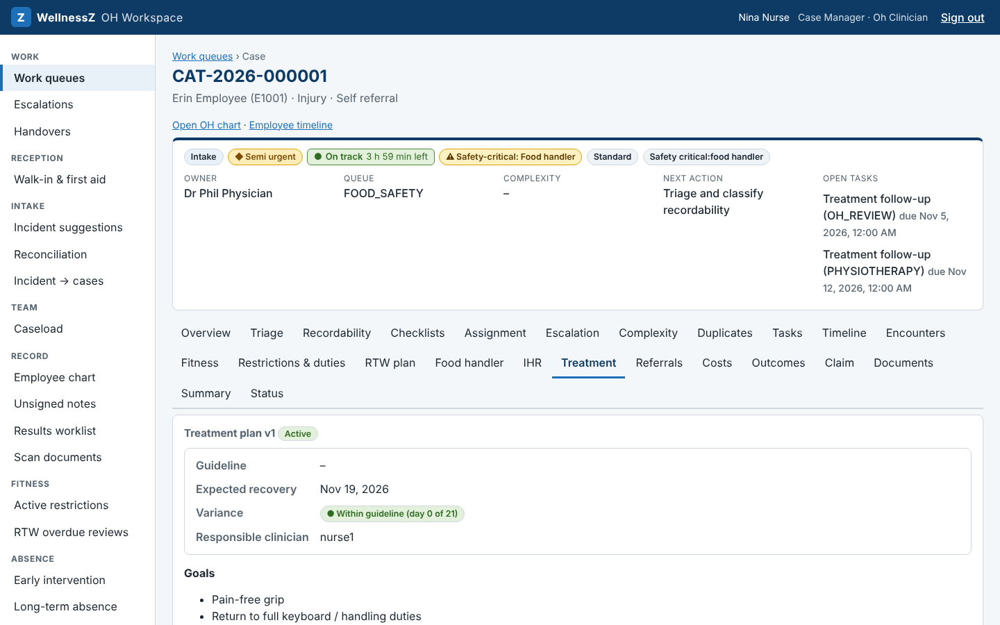

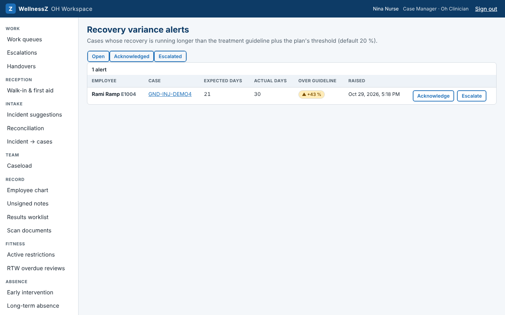

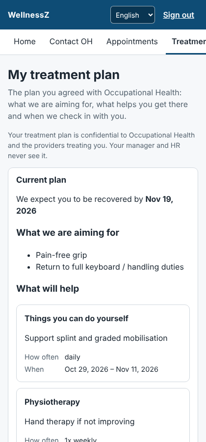

---

## 7. E04-F02 – e-Referral management

**Requirements:** E04-HLR-02; E04-BL-003 (wizard, data set, consent, PDF + structured payload), E04-BL-004 (provider
portal with MFA), E04-BL-005 (automatic chasing), E04-BL-006 (FHIR exchange – enabler), E04-BL-017 (worklist).

### 7.1 Service catalogue and data set

`GET /referrals/services` (OH roles, CLAIMS_COORDINATOR) lists 14 services – ORTHOPAEDICS, PHYSIOTHERAPY, IMAGING_MRI,
IMAGING_XRAY, CARDIOLOGY, OPHTHALMOLOGY, ENT_AUDIOLOGY, DERMATOLOGY, MENTAL_HEALTH_THERAPY, PSYCHIATRY, LAB_TESTS,
TELEHEALTH_SPECIALIST, ASSISTANCE_LAYOVER, IME – each with suitable provider types, required fields (`code, label,
type TEXT|DATE|CODE|LIST, required`), report due days and urgent / routine appointment targets. `DataSetValidator`
rejects unknown fields and type errors; on **send** every required field must be present (`422 data_set_incomplete`
with `field`). E2E: PHYSIOTHERAPY requires `bodyPart, sessions` (`precautions` optional); a missing `sessions` → 422.

### 7.2 Wizard and send

* `POST /cases/{caseId}/referrals` (clinicians) → DRAFT; `PUT /referrals/{id}` while DRAFT. Reason, question and
  data set are **encrypted**; attachments must be documents of the employee.
* `POST /referrals/{id}/send`:
  1. provider and reason / question present (`422 referral_incomplete` with `field`); provider active and of a
     suitable type (`422 provider_not_suitable`);
  2. full data set validated;
  3. active `TREATMENT_SHARING_PARTNER` consent – the one on the referral or the latest active one (`422
     consent_required`);
  4. `REFERRAL_LETTER` generated, signed and shared to the provider with `shareAsSystem(PARTNER)`, together with every
     attachment;
  5. `reportDueAt = now + reportDueDays`, status SENT, FHIR R4 `ServiceRequest` stored (encrypted) as sent;
  6. `referral.sent` to the provider contact with the portal link; audit with provider and channel.
* Channel PORTAL, FHIR or SECURE_EMAIL is recorded; in every case the letter is available in the portal and the
  structured payload at `GET /integration/referrals/{id}/fhir`.
* Status transitions are centralised in `ReferralCore.transition` (history row, case timeline, `referral.status.v1`,
  `ReferralStatusListener`s); an invalid transition returns `422 invalid_transition`.

### 7.3 Worklist and OH actions

* `GET /referrals?status&overdue&mine&serviceCode&providerCode` – only referrals of cases the caller may see
  clinically; badges for status, `overdue`, `chaseCount`, `escalated`, contracted / preferred, rating.
* `GET /referrals/{id}` – adds reason, question, data set, letter, attachments, **history** and FHIR payload; extra
  fields `slaBreached`, `sourceType` / `sourceRef` (deviation: added by the implementation).
* `POST /referrals/remind` (≤ 200 IDs) → `{reminded}`; `POST /referrals/{id}/cancel {reason}`;
  `POST /referrals/{id}/close` (extra endpoint, not in the contract); `POST /referrals/{id}/rating {rating 1..5,
  comment?}` (E04-BL-015, comment encrypted).
* `GET /cases/{caseId}/referrals` – case tab.

### 7.4 Partner actions (portal)

`PartnerReferralService` – detailed in Section 19: own organisation only, statuses SENT … CANCELLED, active consent,
first read disclosure-logged. Accept (from SENT), decline with reason (SENT / ACCEPTED), appointment (SENT / ACCEPTED /
SCHEDULED → SCHEDULED, instructions screened, employee `referral.appointment`), seen (ACCEPTED / SCHEDULED → SEEN),
report upload (`PROVIDER_REPORT` via `storeUpload`, attached to the case → REPORT_RECEIVED, shown on the worklist
without a notification), invoice upload (`PROVIDER_INVOICE` + invoice, Section 9). E2E: accept 200, appointment 200,
seen 200, report 200, invoice 201; the report then attaches to the case and OH rates it.

### 7.5 Chasing and escalation

`ChaseRules.decide` (pure, unit-tested): a referral awaiting its report (SENT, ACCEPTED, SCHEDULED, SEEN) whose
`reportDueAt` has passed is chased at most once per `treatment.referral.chase-interval-days` (2): `referral.chase` to
the provider, `chaseCount + 1`. Once `treatment.referral.max-chases` (2) chases went unanswered the referral is
**escalated once** (`escalated=true`, `referral.overdue-team` to the referring clinician). Daily job `referral-chase`
(06:40 UTC). E2E: demo referral RFL-…-900003 overdue with one chase.

### 7.6 FHIR exchange

* Outbound `ServiceRequest` (`FhirMapper.serviceRequest`): identifier `urn:wellnessz:referral`, status mapping (DRAFT →
  draft; DECLINED / CANCELLED → revoked; REPORT_RECEIVED / CLOSED → completed; else active), intent `order`, category
  SNOMED 3457005 "Patient referral", priority, service code (`urn:wellnessz:referral-service`), subject by employee
  identifier, requester, performer by partner organisation identifier, reason, question as note, data set and
  `DocumentReference/{id}` links as `supportingInfo`, `occurrenceDateTime` once booked.
* Inbound `POST /integration/referrals/fhir/document-reference` (INTEGRATION): `context.related` must point to
  `ServiceRequest/{id}` (or carry the referral reference as identifier); the first base64 attachment is stored as
  `PROVIDER_REPORT` → REPORT_RECEIVED.

### 7.7 KPIs

`GET /treatment/kpis?from&to` (CMO, NURSING_HEAD): `medianWorkingDaysReferralToAppointment`, `urgentWithin48hPct`,
`reportWithin7DaysPct`, `missedAppointmentPct`, `avgMedicalCostPerCase` (base currency only). E2E: median 5 days,
report ≤ 7 days 66.7 %, missed 0 %.

### 7.8 Data model

| Table | Content |
|---|---|
| `service_catalogue` | Code, name, provider types CSV, required fields JSON, report due days, urgent hours, routine days |
| `referral` | Reference `RFL-YYYY-NNNNNN` (unique), case, employee, service, provider, urgency, status (9 values), channel, **encrypted** reason / question / data set / report summary / FHIR / cancel reason / rating comment, consent, attachments JSON, letter and report documents, timestamps for every step, appointment location and screened instructions, report due / received, chase count / last chased / escalated, rating, `source_type` / `source_ref` (gateway), `partner_read_at` |
| `referral_history` | Status, time, actor (one row per transition) |

### 7.9 Screens

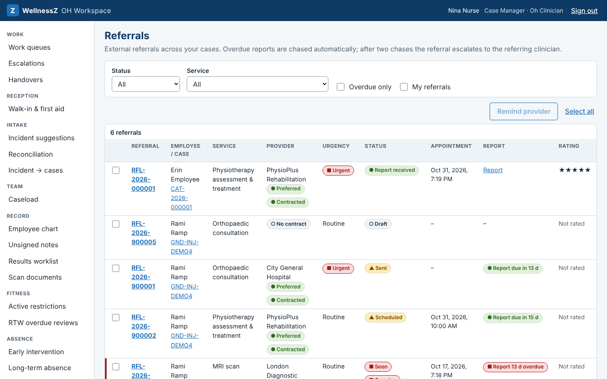

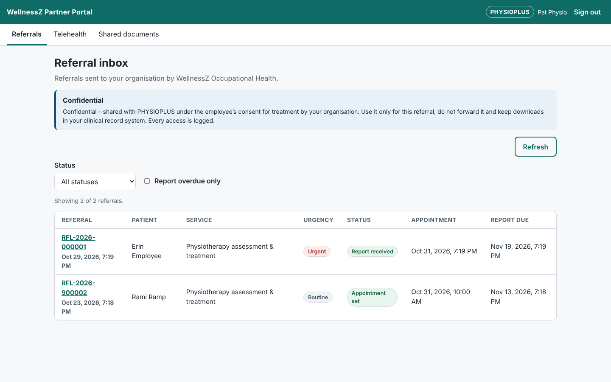

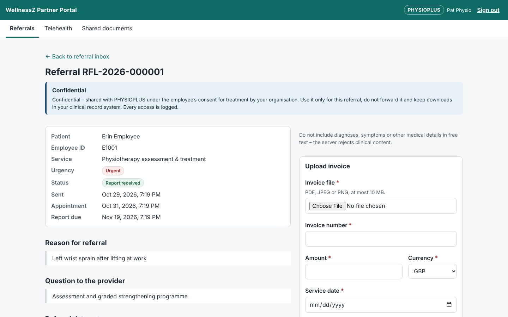

---

## 8. E04-F03 – Provider network directory

**Requirements:** E04-HLR-03; E04-BL-007 (directory, contracts, rates, SLAs), E04-BL-008 (search), E04-BL-009
(scorecard), E04-BL-019 (initial network).

### 8.1 Directory and contracts

* `GET /providers?serviceCode&specialty&city&countryCode&contractStatus&q&preferredOnly` (OH roles, PROCUREMENT,
  CLAIMS_COORDINATOR, CMO) – organisation from master data plus profile (specialties, services, languages,
  accreditation with validity, coverage HUB / OUTSTATION / LAYOVER, coordinates, preferred, portal), current contract,
  rates, SLA and latest scorecard. E2E: search by service returns HEATHROWMED (ACTIVE), PHYSIOPLUS (ACTIVE), REHAB_HUB
  (EXPIRING), DXB_PHYSIO (ACTIVE).
* **Contract status** (`ContractStatus.of`): NONE (no current contract or not started), EXPIRED (ended), EXPIRING (ends
  within `treatment.contract.expiring-days`, 60), else ACTIVE. Referrals count as contracted under ACTIVE or EXPIRING.
* `PUT /providers/{code}` (PROCUREMENT, OH_ADMIN) – profile; the organisation itself is maintained in master data.
* `POST /providers/{code}/contracts` (PROCUREMENT) – new **version** (`current_version` moves), rates per service,
  SLA (appointment days, urgent hours, report days); audited.
* `GET /providers/{code}` adds the contract history.
* **Network gaps** – `GET /providers/network-gaps` (PROCUREMENT, OH_ADMIN, CMO): every service × city of
  `treatment.network.cities` (London HUB, Dubai OUTSTATION, New York, Singapore, Hong Kong LAYOVER) without an ACTIVE
  contract. E2E: 47 gaps with the illustrative network.

Seed (V14): profiles for the 20 providers, 18 contracts with rate cards and SLAs – REHAB_HUB **expiring**, JFK_URGENT
**expired**, OCC_PSYCH and HKG_CLINIC **without** contract.

### 8.2 Scorecards

`ScorecardMaths.compute` (pure): components 0–100 – **timeliness** (median working days to appointment against the
SLA, 100 at or below SLA and −10 per day above; averaged with the share of reports within 7 days), **report quality**
(mean OH rating / 5 × 100), **outcome** (share of cases with an improved pain score), **cost** (100 when the average
invoice is at or below the contracted rate, else rate / average × 100); **overall** = weighted mean of the available
components (30 / 25 / 25 / 20). Monthly job `provider-scorecards` (1st of the month, 03:15 UTC, previous month);
`POST /providers/scorecards/recompute` on demand; `GET /providers/scorecards?month` (CMO, NURSING_HEAD, PROCUREMENT) and
`GET /providers/scorecards/export?month` (CSV review pack, formula characters neutralised). E2E: 4 scorecards.

### 8.3 Data model

| Table | Content |
|---|---|
| `provider_profile` | Organisation code (FK to master data), specialties, services CSV, languages, accreditation JSON, coverage, coordinates, preferred, updated by / at |
| `provider_contract` | Provider, reference, version (unique per provider), start / end (check end ≥ start), rates JSON, SLA days / hours, `current_version` (partial index) |
| `provider_scorecard` | Provider and month (unique), referrals, median days, report ≤ 7 days %, average quality, outcome improved %, average invoice, component scores, overall |

### 8.4 Screens

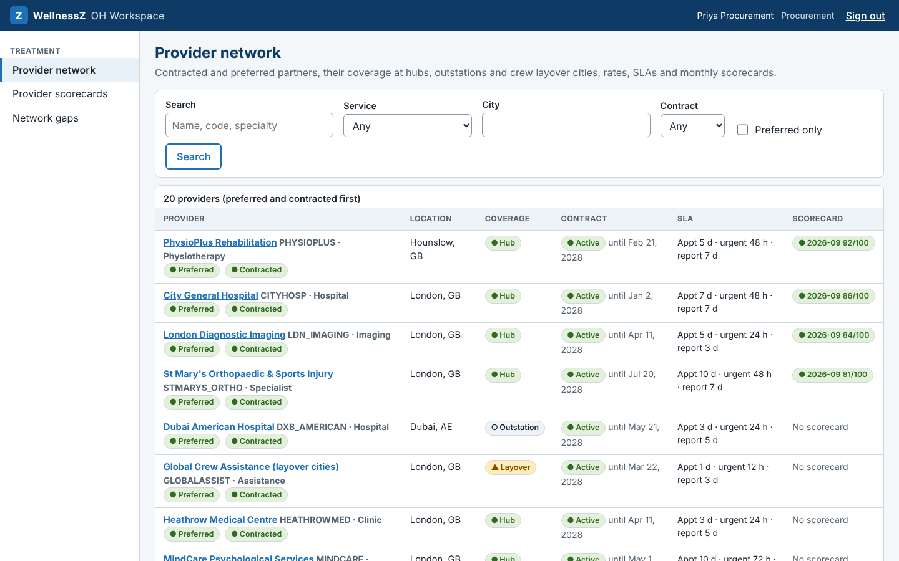

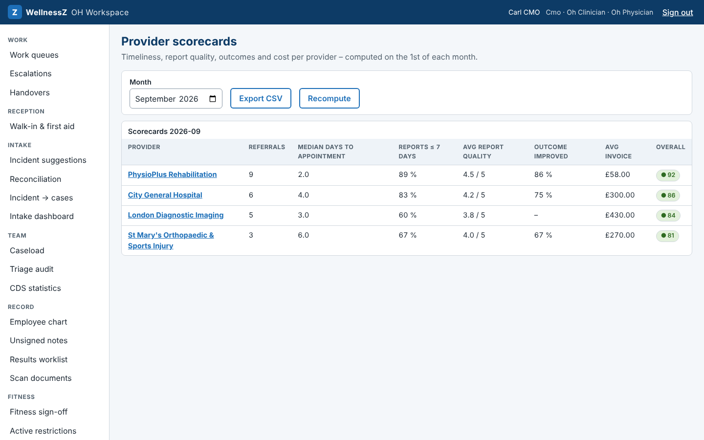

---

## 9. E04-F04 – Pre-authorisation and cost tracking

**Requirements:** E04-HLR-04; E04-BL-010 (pre-authorisation request and tracking), E04-BL-011 (cost roll-up).

### 9.1 Pre-authorisation

* `POST /cases/{caseId}/preauthorisations` (clinicians, CLAIMS_COORDINATOR): payer (defaults from
  `ClaimContextProvider`, else `422 payer_required`; must be an INSURER or TPA organisation, else `422 invalid_payer`), service, provider,
  optional referral, estimate (positive, ISO 4217), consent. **Clinical justification**: required when an OH role
  submits (`400 justification_required`), refused from claims coordinators (`400 justification_oh_only`) – deviation /
  refinement of the contract. Stored encrypted.
* `POST /preauthorisations/{id}/submit`: `PREAUTH_REQUEST` generated, signed and shared `INSURER` (active
  `INSURER_SHARING`, else `422 consent_required`); SLA `treatment.preauth.sla-hours` (48) → SUBMITTED; `CaseCostRecorder`
  ESTIMATE / MEDICAL. When a claims coordinator requested it, the template states that the clinical justification is
  available from OH on request.
* Decisions – same body `{status APPROVED|PARTIALLY_APPROVED|DECLINED, approvalRef?, approvedAmount?, validUntil?,
  note?}` from three channels: `POST /preauthorisations/{id}/decision` (CLAIMS_COORDINATOR), `POST
  /partner/preauthorisations/{id}/decision` (TPA_ADJUSTER of the payer organisation) and `POST
  /integration/preauthorisations/{ref}/decision` (insurer system). A partial approval needs the amount (`400
  approved_amount_required`) in the estimate's currency (`400 currency_mismatch`); approval defaults the amount to the
  estimate and `validUntil` to today + 90 days and **updates the ESTIMATE ledger entry** to the approved amount (same
  source key). The decision note is screened. Requester notified `preauth.status`; `preauth.status.v1`; timeline.
* Expiry: the nightly job sets approvals past `validUntil` without an invoice to EXPIRED.
* `GET /preauthorisations?status` (OH roles, CLAIMS_COORDINATOR); `GET /partner/preauthorisations?status` (adjuster –
  own payer, statuses SUBMITTED … EXPIRED, consent still active, **never the justification** – only via the shared
  document). E2E: PA-2026-000001 shared under consent → SUBMITTED → APPROVED by `adjuster1` with reference GT-…; two
  pending for GULFTPA.

### 9.2 Invoices and cost roll-up

* `POST /cases/{caseId}/invoices` (CLAIMS_COORDINATOR, FINANCE) and the portal upload share one path: duplicate check
  per provider and invoice number (`409 invoice_exists`), `InvoiceMatcher` against the approved pre-authorisation –
  amount within `treatment.invoice.tolerance-pct` (5) above the approved amount → MATCHED, above it or in another
  currency → DISPUTED, nothing approved → RECEIVED (manual review) – and `CaseCostRecorder` INVOICE / MEDICAL.
* `POST /invoices/{id}/status {APPROVED|DISPUTED|PAID, note?}` (note screened).
* `GET /treatment/costs?groupBy=SUBSIDIARY|DEPARTMENT|COST_CENTRE&from&to` (FINANCE, CMO, CLAIMS_COORDINATOR) →
  `{key, label, cases, estimated, invoiced, avgPerCase, suppressed}` – units with fewer cases than
  `wellnessz.analytics.min-group-size` publish no amounts; `/treatment/costs/export` CSV. **Only amounts in the base
  currency** (`treatment.base-currency`, GBP) are summed (deviation: no conversion in E04 – E08 converts, Section 17).

### 9.3 Data model

| Table | Content |
|---|---|
| `preauth` | Reference `PA-YYYY-NNNNNN`, case, employee, payer, service, provider, referral, estimate (> 0) and currency, **encrypted** justification, consent, status (7 values), document, requester, submission / SLA / decision times, decider, approval reference, approved amount, valid until, screened decision note |
| `invoice` | Case, employee, provider, invoice number (unique per provider), amount (> 0), currency, service date, referral, pre-authorisation, document, RECEIVED / MATCHED / DISPUTED / APPROVED / PAID, matched pre-authorisation, variance, screened note |

### 9.4 Screen

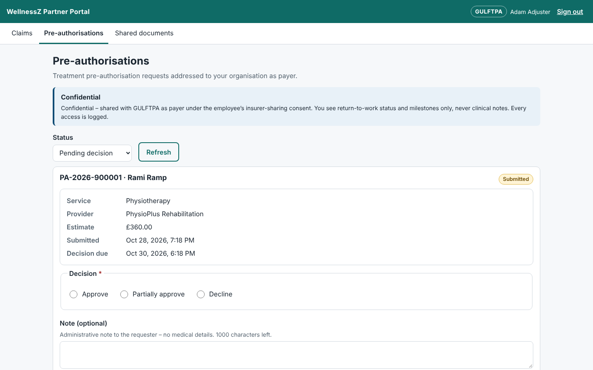

---

## 10. E04-F05 – Clinic medication administration and e-prescribing

**Requirements:** E04-HLR-05; E04-BL-012 (administration record), E04-BL-013 (e-prescribing spike).

* **Formulary** – `GET /treatment/formulary` (OH roles), `PUT /treatment/formulary/{code}` (OH_ADMIN, NURSING_HEAD).
  Ten seeded items with SNOMED codes, routes, stock tracking and reorder level: paracetamol 500 mg, ibuprofen 400 mg,
  cetirizine 10 mg, hydrocortisone cream 1 %, chlorhexidine 0.5 %, adrenaline auto-injector 300 micrograms, salbutamol
  inhaler, oral rehydration salts, tetanus / diphtheria vaccine, lidocaine 1 %.
* **Stock** – `POST /treatment/stock` (NURSING_HEAD, OH_CLINICIAN) receives a batch per item, batch number and site
  (unique); receiving an existing batch with a different expiry → `409 batch_expiry_mismatch`. `GET /treatment/stock`
  flags `belowReorder` and `expired`.
* **Administration** – `POST /cases/{caseId}/medications/administer` (clinicians):
  1. route must be one of the item's routes; site must exist;
  2. `MedicationChecks.batchProblem` → `422 batch_unknown`, `422 batch_expired` or `out_of_stock` (stock-tracked items);
  3. `MedicationChecks.allergyAlerts` against the E03 allergy list – same SNOMED code or the generic name contained in
     the recorded substance – → `422 allergy_alert` with the alert texts unless `overrideAllergyReason` (encrypted) is
     given; drug-class cross-reactivity stays with E03 clinical decision support;
  4. stock decrement; record with dose (encrypted), route, batch, expiry, site, clinician, time;
  5. **mirrored into the E03 medication list** (source ADMINISTERED).
  E2E: expired batch → `422 batch_expired`; paracetamol batch PCM-2401 administered; 3 stock rows.
* `GET /cases/{caseId}/medications/administrations`; `GET /treatment/medication-usage?month` (NURSING_HEAD, CMO) by
  item and site.
* **E-prescribing** – `GET /treatment/eprescribing/status` → `{enabled:false, route, decisionMemo}` from the
  `EPrescribingGateway` default; no prescription is transmitted until the legal route is confirmed (E04-BL-013).

| Table | Content |
|---|---|
| `formulary_item` | Code, name, form, strength, unit, routes CSV, SNOMED code, stock tracked, reorder level, active |
| `stock_batch` | Item, batch number, expiry, quantity (≥ 0), site (unique item / batch / site), receiver |
| `administration` | Case, employee, item and name, **encrypted** dose, route, batch, expiry, site, clinician, time, **encrypted** allergy override reason, E03 medication ID |

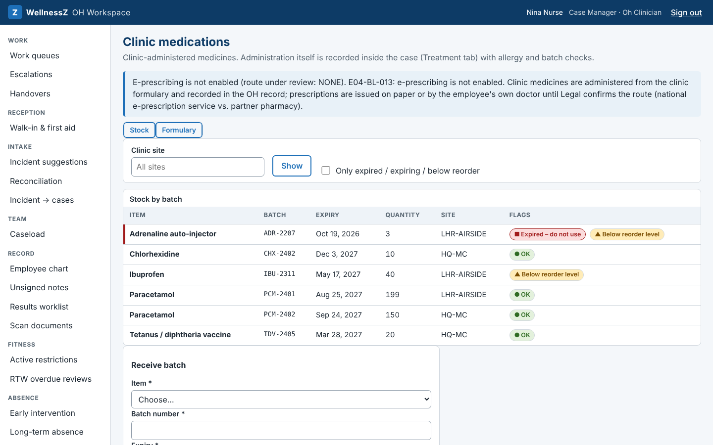

---

## 11. E04-F06 – Outcome and provider performance capture

**Requirements:** E04-HLR-06; E04-BL-014 (milestone outcomes, closure mandatory), E04-BL-015 (report-quality rating –
Section 7.3).

* `POST /cases/{caseId}/outcomes` (clinicians): milestone BASELINE / REVIEW / CLOSURE, **NPRS pain 0–10**, function
  scale NONE / ODI / QUICKDASH / PSFS / LEFS with score 0–100, RTW date, residual impairment 0–100 %, encrypted note.
  One BASELINE per case (`409 baseline_exists`). Check constraints in the database mirror the validation.
* `GET /cases/{caseId}/outcomes` → outcomes plus `improvement {painDelta, functionDelta}` (latest against baseline).
  E2E: pain Δ −4, function Δ −30.
* **Closure guard** – `OutcomeClosureGuard` (`CaseTransitionGuard`): a case with a treatment plan or a referral cannot
  close without a CLOSURE outcome → `422 outcome_required`. This delivers "outcome captured on closure for 100 % of
  treated cases".
* **Chart** – `TreatmentChartContributor` adds the *Treatment* section (active plan, open referrals, latest outcomes)
  and alerts for overdue / escalated referrals; chart tab `#/employees/{id}/chart/treatment`.
* Outcomes feed the outcome component of the vendor scorecards (Section 8.2).

| Table | Content |
|---|---|
| `outcome` | Case, employee, milestone, pain score, function scale and score, RTW date, residual impairment, encrypted note, recorder, time |

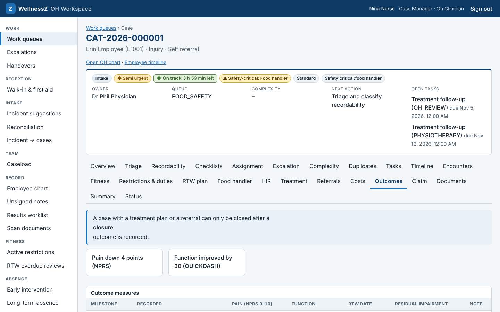

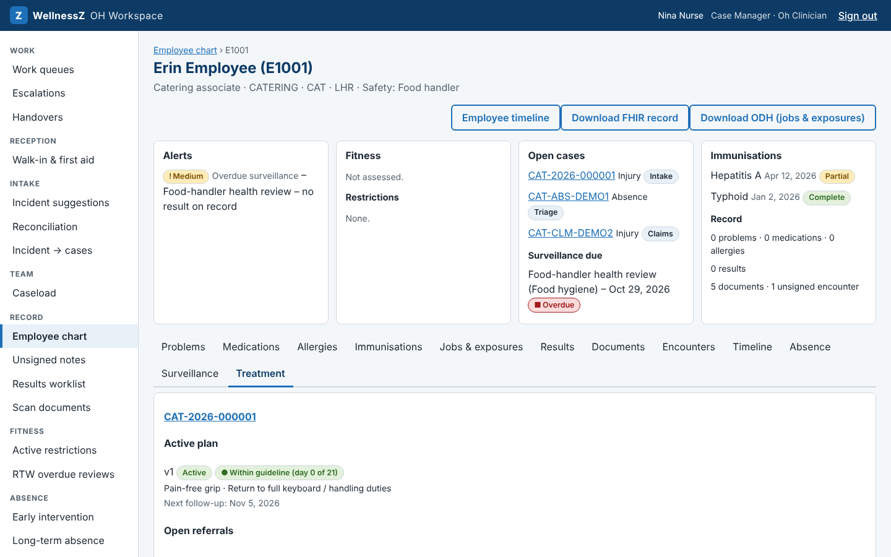

---

## 12. E04-F07 – Telehealth consultation

**Requirements:** E04-HLR-07; E04-BL-016.

### 12.1 Design decisions

* **Scheduling** – `POST /telehealth/sessions` (clinicians): employee, optional case (must be the employee's), start,
  10–90 minutes, VIDEO or CHAT, clinician, optional partner specialist (e.g. TELEDOC), **crew-on-layover mode** with a
  layover city (required in that mode). Reference `TH-YYYY-NNNNNN`; `telehealth.invite` to the employee; when the
  clinician has a diary the session is booked through `AppointmentBooking` (`TELEHEALTH_CONSULT`) – the SPI takes the
  first free slot on or after the scheduled date, which can differ from the scheduled time (deviation).
* **Consent** – the employee records `TELEHEALTH_CONSULTATION` for the session in the app (`POST
  /me/telehealth/{id}/consent`); the consent text states that video and sound are not stored (to be confirmed with the
  chosen video platform). Joining without consent → `422 consent_required`.
* **Join tokens** (`TokenWindow`) – `POST …/join` for the clinician (`/telehealth/sessions/{id}/join`), the partner
  specialist (`/partner/telehealth/sessions/{id}/join`) and the employee (`/me/telehealth/{id}/join`): a random
  256-bit **single-use** token, stored **only as SHA-256**, valid from **15 minutes before the start until the end**
  (`422 outside_join_window` otherwise; `422 session_closed` for completed / cancelled sessions). Response `{joinUrl,
  expiresAt}`; views also carry `joinOpensAt` / `joinClosesAt` (extra fields).
* **Provider-agnostic** – `TelehealthProvider.joinUrl(sessionRef, mode, token)`; default link provider on
  `treatment.telehealth.base-url` (`https://telehealth.wellnessz.local/room/`). The video platform redeems a token once
  via `POST /integration/telehealth/tokens/redeem` (INTEGRATION; extra endpoint) which re-checks the window, consent and
  status.
* **Secure chat** – `GET/POST …/messages` for the three participants, text ≤ 2,000 characters, **encrypted at rest**;
  anyone else gets an audited 404.
* **Completion** – `POST /telehealth/sessions/{id}/complete {note, followUpDate?}` creates a **DRAFT E03 encounter**
  (type ILLNESS) holding the note for signature, optionally adds a follow-up to the case's active plan, records the
  timeline → COMPLETED with `encounterId`. `…/cancel {reason}` (encrypted). E14 NO_SHOW marks the session NO_SHOW.
* E2E: join without consent → 422; after consent a join URL `https://telehealth.wellnessz.local/room/TH-2026-…`; one
  chat message; completion produced a draft encounter.

### 12.2 Data model

| Table | Content |
|---|---|
| `telehealth_session` | Reference, employee, case, scheduled time, duration (10–90), mode, status (5 values), clinician, partner provider, crew layover and city, consent, appointment, encounter, encrypted cancel reason, `partner_read_at` |
| `telehealth_token` | Session, participant, username, **token hash** (unique), valid from / until, used at, revoked |
| `telehealth_message` | Session, sender and role, **encrypted** text, time |

### 12.3 Screens

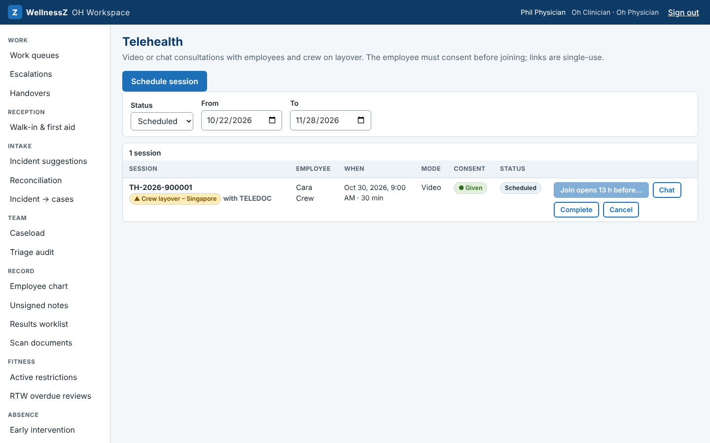

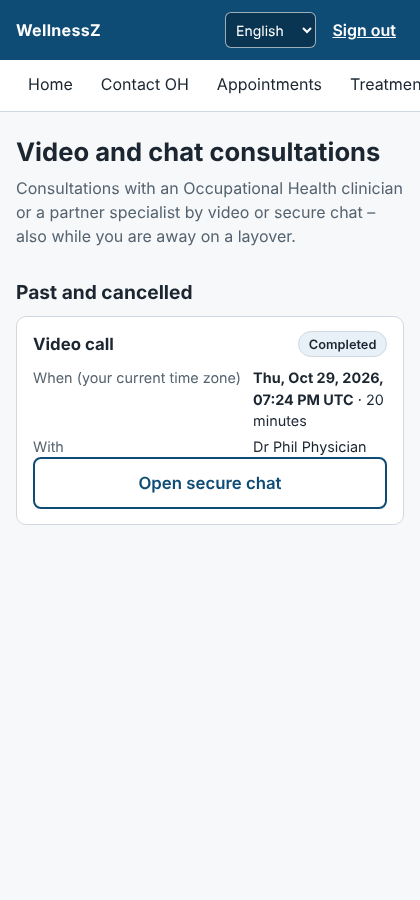

---

## 13. E08-F01 – Claim record and lifecycle

**Requirements:** E08-HLR-01; E08-BL-001 (claim from case), E08-BL-002 (case header badge), E08-BL-012 (subrogation).

### 13.1 Claim and workflow

* `POST /cases/{caseId}/claims` (CLAIMS_COORDINATOR, CASE_MANAGER): type, payer (must be an INSURER or TPA – `422
  unknown_payer`), policy, adjuster name / e-mail / username, lost-time, incident date, notes (**screened** and
  encrypted) → NOTIFIED; **one claim per case and type** (`409 claim_exists`). A lost-time claim triggers nurse
  assignment at once (Section 16). Reference `CLM-YYYY-NNNNNN`. The claims team works on any case without clinical
  access; OH roles go through case ABAC.
* `ClaimWorkflow` (pure, unit-tested):

  | From | Allowed to |
  |---|---|
  | NOTIFIED | OPEN, CLOSED (reason required – withdrawn / declined) |
  | OPEN | UNDER_REVIEW, LITIGATED |
  | UNDER_REVIEW | SETTLED, LITIGATED, CLOSED (reason required) |
  | LITIGATED | SETTLED, CLOSED (reason required) |
  | SETTLED | CLOSED |
  | CLOSED | OPEN (reopen, reason required) |

  Deviation from the contract: LITIGATED → SETTLED / CLOSED and NOTIFIED / UNDER_REVIEW → CLOSED were added; a missing
  reason → `422 reason_required`; an invalid transition → `422 invalid_transition`. `POST /claims/{id}/status` is for
  CLAIMS_COORDINATOR; **legal counsel may only set LITIGATED**. Every change writes `claim_history` and
  `claim.status.v1`.
* `PUT /claims/{id}` (CLAIMS_COORDINATOR): payer, policy, adjuster, lost-time flag, reserves per category, **paid total**
  (insurer-reported). Optimistic version on the claim.
* **Views** – `GET /claims?status&type&lostTime&payerCode&q` for CLAIMS_COORDINATOR, NURSING_HEAD, CMO, **CASE_MANAGER
  and the assigned nurse** (deviation: added), LEGAL_COUNSEL only for litigated or held claims. Money (reserves, paid
  total) only for CLAIMS_COORDINATOR, FINANCE and CMO. `GET /claims/{id}` adds history, reports, disclosure sets and
  legal-request summary; finance gets `403` on claim detail. `paidTotal` is the insurer-reported figure; `ledgerTotal`
  (PAYMENT entries) is shown beside it.
* **Case header badge** – `GET /cases/{caseId}/claim-status` (OH roles, CLAIMS_COORDINATOR) → `{claimId, claimRef,
  claimType, status, lostTime, litigationHold}` (+ `paidTotal` for claims coordinators) or `204`; OH roles need case
  access. E2E: badge NOTIFIED.
* **Subrogation** – `POST /claims/{id}/subrogation {thirdPartyName, thirdPartyType CONTRACTOR|VEHICLE_OWNER|OTHER,
  thirdPartyInsurer?, reference?, description}` (description screened) → flag on the claim and a content-free
  `legal.request` to `claims.legal-email`.
* **Monthly reconciliation** – `GET /claims/reconciliation?month` (CLAIMS_COORDINATOR, FINANCE): claims closed in the
  month with `paidTotal`, `ledgerTotal`, difference and reconciled flag (`CostMath.reconcile`, to the penny).
* **HR** – `GET /workspace/claims` (HR within org scope): `{claimRef, employeeId, displayName, claimType, status,
  lostTime, incidentDate}` only; **every claim shown is disclosure-logged** (recipient HR, purpose `CLAIM_STATUS`).
  E2E: HR sees 5 claims with no costs, payer, adjuster or clinical detail.
* `ClaimContextProvider.forCase` – the case's active (most recent) claim, else the most recent.

### 13.2 Data model (schema `claims`)

| Table | Content |
|---|---|
| `claim` | Reference, case and case reference, employee, type, status, payer, policy, adjuster name / e-mail / username, lost-time and flag time, incident date, **encrypted** notes, notified / opened / settled / closed, nurse and assignment time, reserves JSON, paid total and currency, subrogation JSON, litigation hold (reason, by, at), privilege (basis, by, at), optimistic version; unique (case, type) |
| `claim_history` | Event type, from / to status, reason, actor, time (**insert-only**) |
| `ref_counter` | Numbering per prefix and year (CLM, FROI, LEG) |

### 13.3 Screens

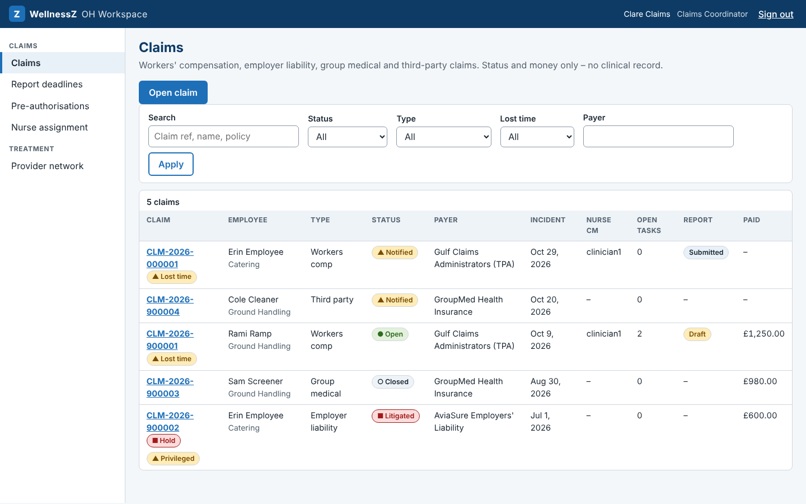

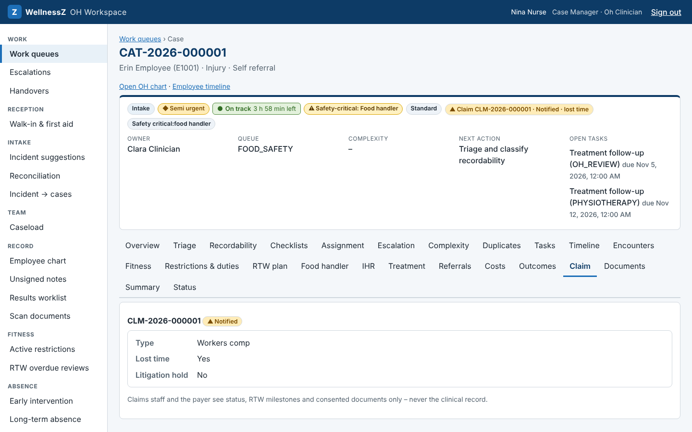

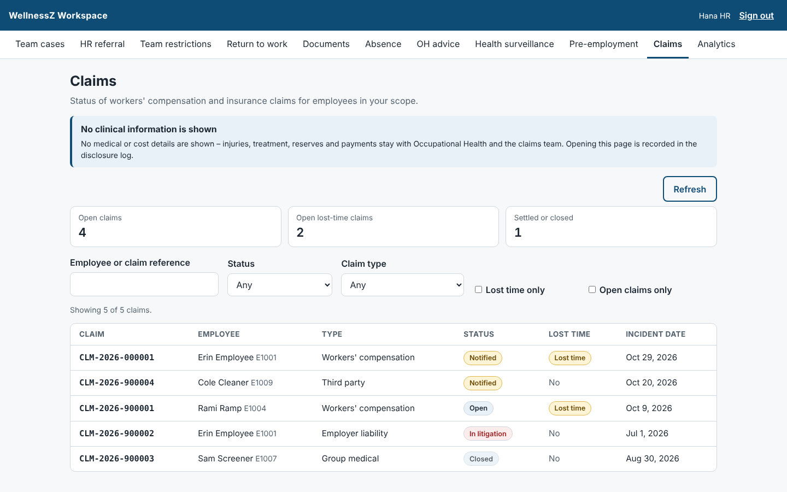

---

## 14. E08-F02 – Statutory and insurer e-reporting

**Requirements:** E08-HLR-02; E08-BL-003 (form inventory and mappings – **pending Legal / HSE sign-off**), E08-BL-004
(generation, timers, submission, acknowledgement).

### 14.1 Report forms

`GET /claims/report-forms` (CLAIMS_COORDINATOR, HSE_OFFICER). Seeded in V15 with `sign_off_status
PENDING_LEGAL_HSE_SIGN_OFF` (config `claims.forms.sign-off` = PENDING):

| Form | Recipient | Deadline | Anchor | Trigger |
|---|---|---|---|---|
| `GB_OSH_F2508` | AUTHORITY `AUTH_OSH` | 15 days (360 h); **10 days (240 h) for a specified injury** | Incident | LOST_TIME_OVER_7_DAYS |
| `AE_LABOUR_INJURY` | AUTHORITY `AUTH_LABOUR_AE` | 48 h | Incident | ANY_CLAIM |
| `INSURER_FNOL` | INSURER – the claim's payer | 72 h | Claim notification | ANY_CLAIM |

Fields per form carry a `source` (CONFIG, HRIS, INCIDENT, CASE, CLAIM, USER).

### 14.2 Lifecycle

* `POST /claims/{id}/reports {formCode, specifiedInjury?}` → `FirstReport` DRAFT with reference `FROI-YYYY-NNNNNN`,
  **one per form and claim** (`409 report_exists`). `ReportDeadlines.dueAt`: anchor incident time for statutory forms
  (fallback notification), notification for FNOL; the shorter deadline for specified injuries / fatalities. Fields are
  **auto-populated** from the EHS incident (facts of the event), the case (body part, nature of injury), HRIS (name,
  number, occupation), configuration (`claims.employer-name`, `claims.employer-ref`) and the user – **never clinical
  notes**. Fields are encrypted.
* `PUT /claims/reports/{reportId}` while DRAFT – unknown fields refused, the description is screened for diagnoses
  beyond the nature of injury; changing `specifiedInjury` recomputes the deadline.
* `POST /claims/reports/{reportId}/submit {channel API|EMAIL|PORTAL, consentId?}`:
  1. every required field filled (`422 report_incomplete` with `field`, deviation);
  2. `FIRST_REPORT_OF_INJURY` generated and signed;
  3. **insurer recipients**: `shareAsSystem(INSURER)` under the named or latest active `INSURER_SHARING` consent
     (`422 consent_required`); **authority recipients**: a legal obligation – no consent, a disclosure-log entry with
     the legal basis `LEGAL_OBLIGATION <form> (<jurisdiction>)`;
  4. `ClaimsSubmissionGateway.submit` → message ID → SUBMITTED.
* Acknowledgement – manual `POST /claims/reports/{reportId}/acknowledgement` (multipart `file?`, `ackRef`,
  `receivedAt`; file stored as `INSURER_ACKNOWLEDGEMENT`) or `POST /integration/claims/reports/{ref}/acknowledgement
  {ackRef, receivedAt, status ACKNOWLEDGED|REJECTED, reason?}`.
* **Deadline dashboard** – `GET /claims/reports?status&dueWithinHours` with `hoursLeft`; `GET /claims/reports/{id}`,
  `GET /claims/{id}/reports` and `GET /claims/reports/kpis` (`onTimeSubmissionPct`) are extra endpoints.
* **Hourly job** `claims-report-deadlines` (minute 5): due within `claims.report-reminder-hours` (24) and not submitted
  → `claim.report-due`; past due → LATE and escalation to `claims.mailbox-email`.
* E2E: FROI-2026-000001 auto-populated with a deadline timer (due 2026-11-01T19:19 – 72 h after notification) and
  submitted under consent → SUBMITTED.

| Table | Content |
|---|---|
| `report_form` | Code, jurisdiction, recipient type / code, title, deadline hours, specified deadline hours, anchor, trigger, fields JSON, sign-off status |
| `first_report` | Reference, claim, form, recipient, DRAFT / SUBMITTED / ACKNOWLEDGED / REJECTED / LATE, due, specified injury, **encrypted** fields, channel, document, message ID, submission, acknowledgement reference / time / document, rejection reason, reminder and escalation markers; partial index on open reports |

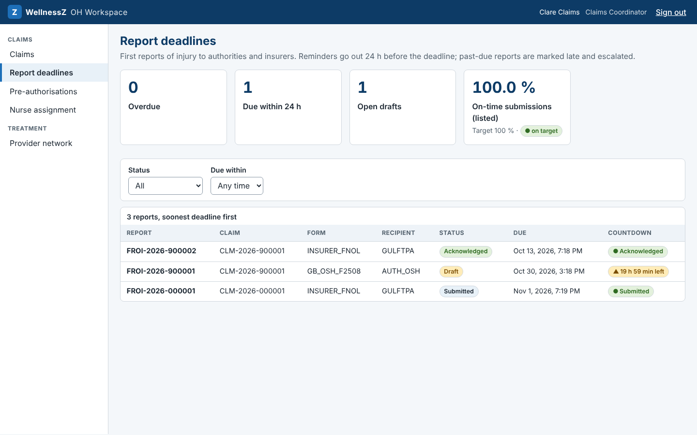

---

## 15. E08-F03 – Consent-gated document exchange

**Requirements:** E08-HLR-03; E08-BL-005 (consent check, disclosure log, redaction, audit report).

### 15.1 Disclosure rules (`DisclosureRules`, pure)

A document may enter an insurer disclosure set only when it belongs to the claim's employee, is **signed**, is not of a
restricted class, is not privileged and is of an allowed type:

| Category | Types |
|---|---|
| Allowed | FITNESS_CERTIFICATE, RESTRICTION_NOTE, RTW_PLAN, PREAUTH_REQUEST, FIRST_REPORT_OF_INJURY, PROVIDER_INVOICE, REDACTED_COPY |
| Allowed **only when an OH role adds them** | PROVIDER_REPORT, EXTERNAL_REPORT |
| Never | MEDICO_LEGAL_REPORT, PHOTO, every restricted-class document, privileged material |

While a claim is privileged, the reports answering its legal requests (medico-legal, IME) are treated as privileged
material. A refused document → `422 document_not_disclosable`. `GET /claims/{id}/documents` (extra) lists the
employee's documents with a `disclosable` flag and the refusal reason (titles and types only); the UI shows
non-disclosable documents **disabled with the reason**. E2E: 3 disclosable of 6.

### 15.2 Sets, redaction, send, revoke

* `POST /claims/{id}/disclosure-sets {recipientCode, purpose, documentIds[]}` (CLAIMS_COORDINATOR, OH roles) → DRAFT.
* `POST /claims/disclosure-sets/{setId}/redactions {documentId, phrases[≤50]}` (OH roles): `Redaction.mask` masks every
  phrase (2–200 characters) **case-insensitively and literally**, longest first in one pass, with `[REDACTED]`; the text
  layer is re-rendered as a new `REDACTED_COPY` that replaces the document in the set – the original is never altered.
  A document without a text layer → `422 no_text_layer`.
* `POST /claims/disclosure-sets/{setId}/send {consentId}`: `InsurerConsent` checks the employee's active
  `INSURER_SHARING` consent (`422 consent_required`), then one `shareAsSystem(INSURER)` per document – the document
  service writes the **disclosure log** – → SENT with sender and time. Empty set → `422 empty_set`.
* `POST /claims/disclosure-sets/{setId}/revoke` (CLAIMS_COORDINATOR, DPO) revokes every share (`409 already_revoked`).
* `GET /claims/{id}/disclosure-sets` (CLAIMS_COORDINATOR, OH roles, DPO).
* **DPO report** – `GET /claims/disclosure-report?from&to`: every claim disclosure (recipient, documents, consent, by,
  at). E2E: 14 disclosures listed with consent.
* The adjuster sees documents of SENT sets addressed to its organisation while share and consent are active (`GET
  /partner/claims/{id}`, `GET /partner/documents`). E2E: set SENT, adjuster sees 3 documents; an invalid consent → 422.

| Table | Content |
|---|---|
| `disclosure_set` | Claim, recipient, purpose, DRAFT / SENT / REVOKED, consent, sent / revoked by and at |
| `disclosure_set_document` | Set, position, document, title, type, `redacted_from_id`, added by and whether by OH, share ID |

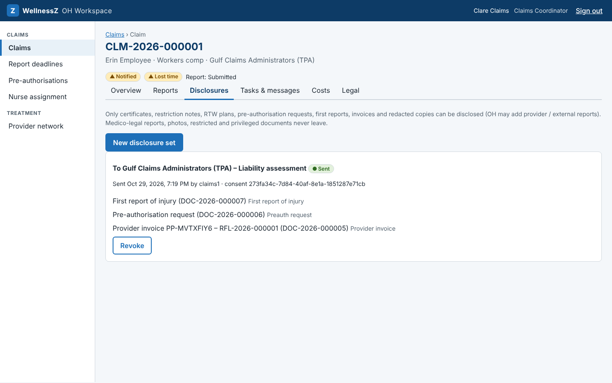

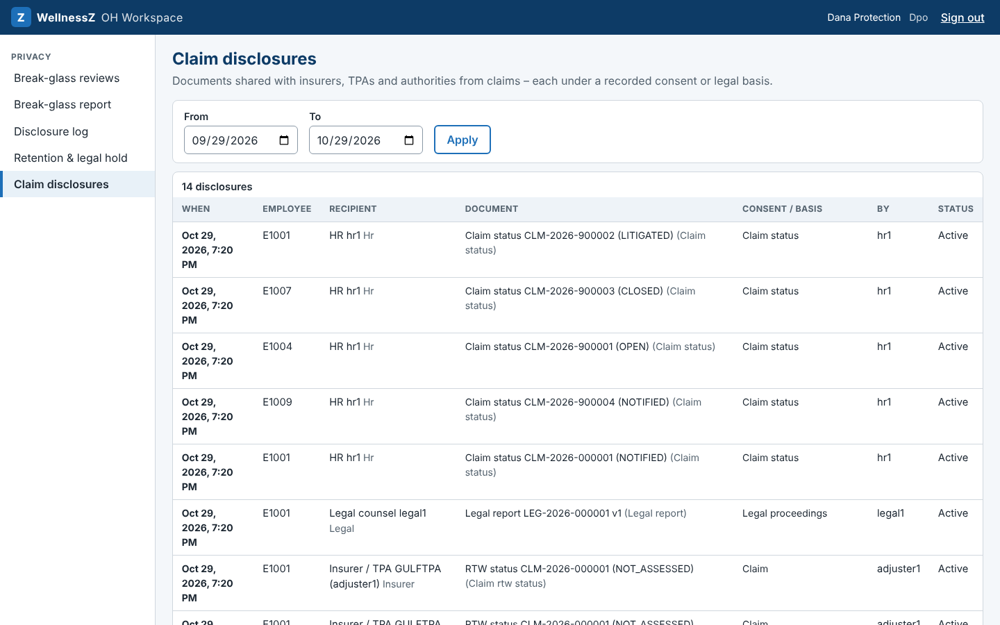

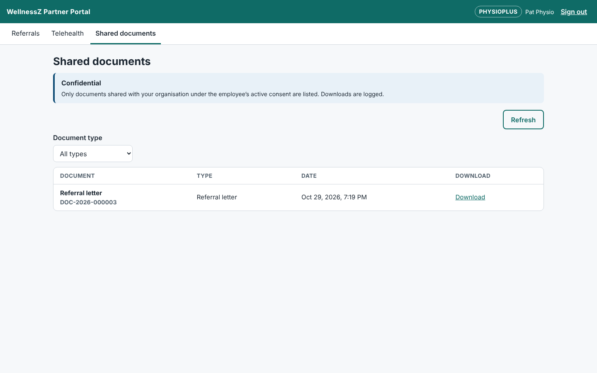

---

## 16. E08-F04 – Nurse case manager and adjuster collaboration

**Requirements:** E08-HLR-04; E08-BL-006 (automatic nurse assignment within 48 h), E08-BL-007 (adjuster portal).

### 16.1 Automatic nurse assignment

* Trigger: claim **created** lost-time or **flagged** lost-time later (`PUT /claims/{id}`) – synchronous, no job.
* `NurseAssignment.choose` (pure): the case's current owner when they hold CASE_MANAGER or OH_CLINICIAN and are
  available; otherwise the **least-loaded available CASE_MANAGER below their caseload cap**, ties broken by username.
  Nobody qualifies → the claim stays unassigned and shows on the KPI.
* Assignment goes through the **E02 assignment service** as a system actor (owner change with history and timeline);
  `claim.assigned` (content-free) and `claim.nurse.assigned.v1`. For a restricted-class case the claim records its
  nurse and OH routes the case manually.
* `GET /claims/nurse-assignment?from&to` (NURSING_HEAD, CLAIMS_COORDINATOR) → `{lostTimeClaims, assignedWithin48h, pct,
  unassigned[]}` with SLA `claims.nurse-sla-hours` (48). E2E: CLM-2026-000001 → `clinician1`; 2 / 2 = 100 %.

### 16.2 Collaboration

* **Shared tasks** – `GET/POST /claims/{id}/tasks {title ≤ 200 (screened), dueDate, assigneeRole CLAIMS|NURSE_CM|ADJUSTER}`,
  `POST /claims/tasks/{taskId}/complete`; `claim.task` to the assignee side (claims mailbox, nurse, adjuster).
* **Secure messages** – `GET/POST /claims/{id}/messages {text ≤ 2000}` – **screened for clinical content** (`422
  clinical_content_not_allowed`), **encrypted**, `claim.message` content-free; read markers per reader give
  `unreadMessages`.
* Participants: CLAIMS_COORDINATOR, CASE_MANAGER / the assigned nurse, the payer's adjuster (and the named adjuster when
  one is recorded). Providers have no claim access (`403`).
* **RTW status** – `GET /claims/{id}/rtw` (CLAIMS_COORDINATOR, TPA_ADJUSTER, CASE_MANAGER): from E05 **status only** –
  `fitnessStatus`, `restrictionUntil`, RTW plan status, planned start, phases (hours per day, functional duties summary)
  and next review; never clinical notes. Adjuster reads are **disclosure-logged once per adjuster and status**.
* **Adjuster portal views** – `GET /partner/claims?status` (claims where the payer is the adjuster's organisation, with
  open tasks and unread messages) and `GET /partner/claims/{id}` (+ RTW, tasks, consented documents).
* E2E: adjuster sees 2 claims, RTW `FIT_WITH_RESTRICTIONS`, a shared task and a message; clinical wording → 422;
  provider → 403.

| Table | Content |
|---|---|
| `claim_task` | Claim, screened title, due date, assignee role, OPEN / DONE, creator, completion |
| `claim_message` | Claim, sender and role, **encrypted** screened body, time (**insert-only**) |
| `message_read` | Claim, reader, last read (primary key claim + reader) |

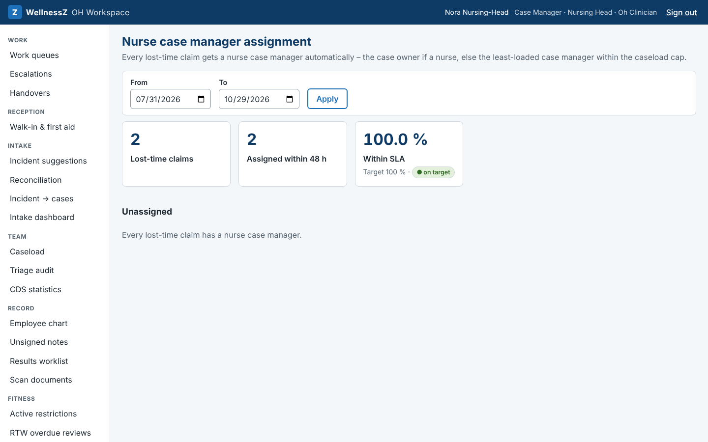

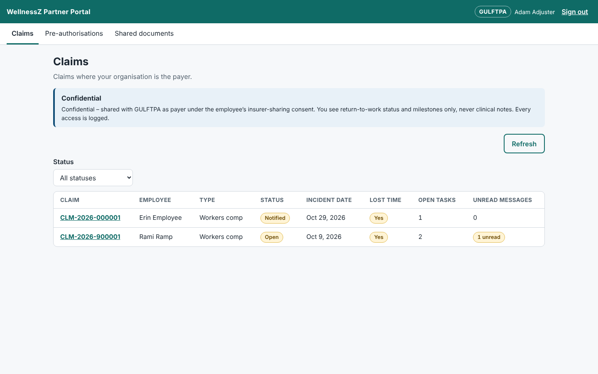

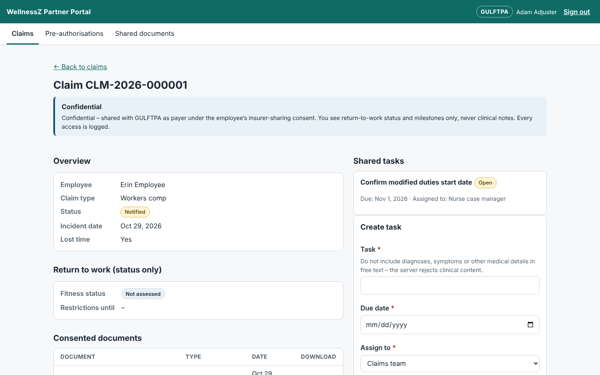

---

## 17. E08-F05 – Cost tracking and finance export

**Requirements:** E08-HLR-05; E08-BL-008 (roll-up, ERP export, reconciliation), E08-BL-009 (budget vs actual).

### 17.1 Ledger

* `POST /claims/{id}/costs {category, kind, amount, currency, incurredOn, description? (screened), invoiceNumber?}`
  (CLAIMS_COORDINATOR, FINANCE); `GET /claims/{id}/costs` – ledger including the E04 entries posted through
  `CaseCostRecorder`; `GET /claims/{id}/costs/summary` (extra). Entries are attributed to a unit when recorded: subsidiary
  and cost centre from the case (else the employee master), department from the employee master (else the case's org
  unit).
* Categories MEDICAL, REHAB, INDEMNITY, ADMIN, SETTLEMENT, LEGAL; kinds ESTIMATE, INVOICE, PAYMENT, RESERVE. **Incurred
  cost = INVOICE + PAYMENT**; ESTIMATE and RESERVE are **exposure** shown on the claim only (deviation / clarification).
* Currency: amounts are converted to `claims.base-currency` (GBP) with `claims.fx-rates`
  (`GBP:1,AED:0.21,USD:0.79,EUR:0.85,SGD:0.58,HKD:0.10`, proposed – finance to confirm); an unknown currency →
  `422 currency_not_supported`.

### 17.2 Roll-ups, budgets, ERP export

* `GET /claims/costs/rollup?groupBy=SUBSIDIARY|DEPARTMENT|COST_CENTRE&from&to` (FINANCE, CMO, CLAIMS_COORDINATOR):
  `CostMath.rollup` per unit – cases, amount per category, total, **cost per employee** (active headcount) – units with
  fewer cases than the minimum group size are `suppressed:true` **without amounts or case count**; no names ever.
  E2E: 4 units, 2 suppressed.
* `PUT /claims/budgets/{year}/{unitCode}` (FINANCE; unit codes validated against the headcount namespace);
  `GET /claims/costs/budget-vs-actual?year&groupBy` (FINANCE, CMO) → budget, actual, variance, variance % and monthly
  trend; **not suppressed** (budgets are unit-level by nature).
* `POST /claims/costs/exports {month}` (FINANCE): `ErpExport.build` groups incurred cost by cost centre, subsidiary and
  category in the base currency (CSV header `month,cost_centre,subsidiary,category,currency,amount,entries`, cells
  neutralised against formula injection) with a **SHA-256 checksum of the exact CSV bytes**; event
  `claim.cost.export.v1` to `erp-finance`. **One export per month** (`409 export_exists`) unless the previous one is
  MISMATCH; future months → `422 month_not_closed`.
* `GET /claims/costs/exports`, `GET /claims/costs/exports/{id}/content` (CSV); `POST …/{id}/reconcile {erpTotal,
  erpReference}` → RECONCILED or MISMATCH (`422 currency_mismatch` on a different currency).
* E2E: export of 10 rows → RECONCILED; finance gets `403` on claim detail.

| Table | Content |
|---|---|
| `cost_entry` | Claim (null = case-level), case, employee, category, kind, amount, currency, incurred on, provider, screened description, invoice number, source type / reference (**unique with kind when a reference is present**), subsidiary, department, cost centre |
| `budget` | Year and unit (primary key), amount, currency |
| `cost_export` | Month, batch ID (unique), rows, total, currency, checksum, GENERATED / RECONCILED / MISMATCH, CSV content (units and amounts only), ERP total / reference, reconciliation |

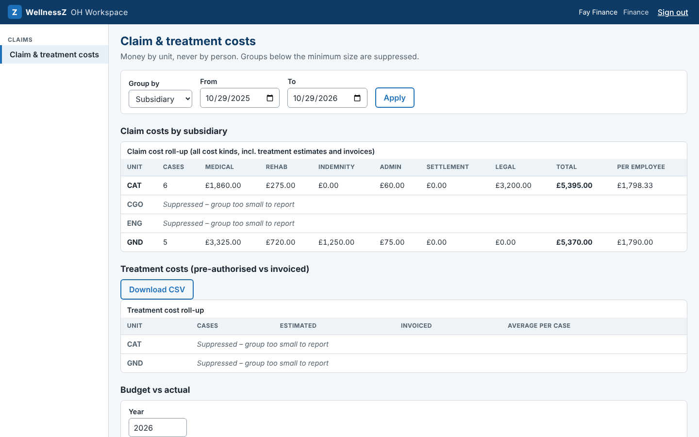

---

## 18. E08-F06 – Medico-legal and litigation support

**Requirements:** E08-HLR-06; E08-BL-010 (legal hold, request, report versions, privilege), E08-BL-011 (IME).

### 18.1 Access set

`ClaimAccess`: legal counsel works on claims that are **LITIGATED or under a litigation hold** only; anything else is
an audited 404. Claims coordinators can raise legal requests but cannot read medico-legal report content (`403`, E2E).

### 18.2 Litigation hold and privilege

* `POST /claims/{id}/legal-hold {reason}` / `DELETE` (LEGAL_COUNSEL) → `litigationHold` with reason, actor and time,
  and `DocumentService.legalHoldForCase` puts **every document of the case** on hold (retention of `CLAIM_RECORD` and
  every other class suspended). E2E: hold=true.
* `POST /claims/{id}/privilege {privileged, basis}` (`400 basis_required`) – privileged material (the claim's
  medico-legal and IME reports) is excluded from disclosure sets (Section 15.1).

### 18.3 Legal requests and medico-legal reports

* `POST /claims/{id}/legal-requests {type MEDICO_LEGAL_REPORT|EXPERT_OPINION|IME, questions ≤ 4000, dueDate,
  providerCode?}` (LEGAL_COUNSEL, CLAIMS_COORDINATOR) → `LEG-YYYY-NNNNNN` OPEN; questions encrypted. Medico-legal
  requests notify OH physicians and the CMO (`legal.request`, content-free).
* `POST /legal-requests/{id}/report {opinion}` (physicians) → `MEDICO_LEGAL_REPORT` generated and **signed as a new
  version each time** (`legal_report` unique per request and version) → REPORT_READY.
* `GET /legal-requests/{id}/reports/{version}/content` (LEGAL_COUNSEL, physicians) – PDF; audited and
  **disclosure-logged for legal counsel** (purpose `LEGAL_PROCEEDINGS`). `GET /legal-requests?status`,
  `GET /legal-requests/{id}` (extra), `POST /legal-requests/{id}/close`.

### 18.4 IME through E04

For type IME, `LegalService` calls `ExternalReferralGateway.requestReferral(serviceCode IME, sourceType CLAIM_IME,
sourceRef = request ID)`: E04 creates a **DRAFT referral** (service IME requires examiner questions and date of injury)
that OH completes with consent and sends; the request stores the referral ID, reference and status. Status changes come
back through `ReferralStatusListener` – SENT, ACCEPTED, SCHEDULED and SEEN set the request IN_PROGRESS; REPORT_RECEIVED
stores the provider's report as the next `legal_report` version (author `provider:<code>`) and sets REPORT_READY;
DECLINED / CANCELLED return the request to OPEN so that another provider can be chosen; DRAFT / CLOSED are bookkeeping
only. A closed request is never reopened by a referral event. **Without E04** the request records
`referralStatus=NOT_AVAILABLE`, an OH task is created and physicians are notified (graceful degradation).
Integration test `imeThroughExternalReferralGatewayNotifiesListeners` covers the gateway and listener.

| Table | Content |
|---|---|
| `legal_request` | Reference, claim, case, type, OPEN / IN_PROGRESS / REPORT_READY / CLOSED, **encrypted** questions, due date, provider, referral ID / reference / status, closure |
| `legal_report` | Request, version (unique per request), document, author, time (**insert-only**) |

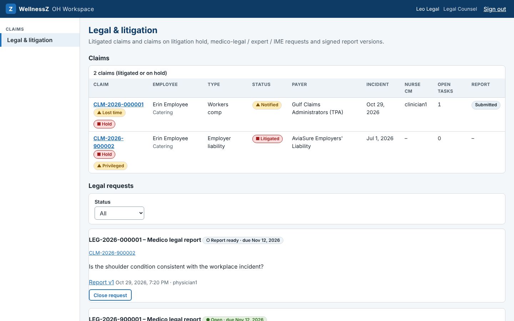

---

## 19. Partner portal design

### 19.1 Application

`web/partner-portal` – React 19 + TypeScript + Vite, hash routing, teal theme, same image layout as the other web apps
(Node build stage → unprivileged nginx on 8080, `/healthz`, strict security headers and CSP, read-only root file
system). All UI text in `src/strings.ts`. 119 unit and screen tests.

| Route | Role | Content |
|---|---|---|
| sign-in | – | MFA explanation, sign-in button, idle / expired notices |
| `#/referrals`, `#/referrals/{id}` | PARTNER_PROVIDER | Inbox (urgent first, overdue / due-soon badges, status filter) and detail (patient, service, reason, question, data set, letter and attachments, history) with accept, decline, appointment, seen, report upload, invoice upload |
| `#/telehealth` | PARTNER_PROVIDER | Own organisation's sessions with join window, consent hint, layover; join opens the URL in a new tab (`noopener,noreferrer`, http / https only); secure chat |
| `#/claims`, `#/claims/{id}` | TPA_ADJUSTER | Claims where the organisation is payer; RTW status and milestones only, shared tasks, secure messages, consented documents |
| `#/preauthorisations` | TPA_ADJUSTER | SUBMITTED requests by default; approve / partially approve / decline with approval reference, valid until and note; request PDF |
| `#/documents` | both | Documents shared with the organisation, type filter, download |

### 19.2 Authentication and MFA

* **BFF only** – OIDC code flow at the BFF, HttpOnly same-origin session cookie; tokens never reach the browser. 15-minute
  idle timeout (wall-clock based, so time asleep counts as idle). Sign-in button "Sign in with multi-factor
  authentication".
* **MFA is enforced twice**: the IdP requires the second factor for partner users (OTP / conditional access) and the
  core API grants `PARTNER_PROVIDER` / `TPA_ADJUSTER` only with `amr` / `acr` proof (Section 5.3).
* **Access decision on `/me`** (`resolveAccess`): a partner role in `GET /bff/api/me` → portal; a partner role only in
  the BFF session (ID token) or no role at all → MFA / no-access page ("Your account needs multi-factor sign-in or has
  no partner access"); any other WellnessZ role → "This portal is for WellnessZ partner organisations". Route guards
  are a UX aid only – the server enforces roles, organisation and consent.

### 19.3 Organisation isolation

* Organisation code = **last segment of `org_scope`** (`/PARTNERS/CITYHOSP` → `CITYHOSP`), shown in the header.
* Referrals: `PartnerReferralService` returns only referrals whose `provider_code` is the caller's organisation, in a
  partner-visible status (SENT, ACCEPTED, DECLINED, SCHEDULED, SEEN, REPORT_RECEIVED, CLOSED, CANCELLED – never DRAFT).
  Anything else is an **audited 404** – existence is never revealed. E2E: PHYSIOPLUS sees 2 referrals; CITYHOSP gets
  404 on PHYSIOPLUS's referral.
* Telehealth: only sessions whose `provider_code` is the organisation. Documents: only `PARTNER` shares to the
  organisation (providers) or `INSURER` shares to the organisation (adjusters).
* Adjusters: claims and pre-authorisations where `payer_code` is the organisation (named adjuster checked for tasks and
  messages when recorded); adjusters of another payer get 404.

### 19.4 Consent gating

| Object | Consent | Effect when inactive |
|---|---|---|
| Referral (list, detail, actions, letter and attachments) | Employee's `TREATMENT_SHARING_PARTNER` | Referral disappears from the inbox; direct access 404; shares no longer readable |
| Partner telehealth session | `TELEHEALTH_CONSULTATION` for joining | `422 consent_required` on join |
| Pre-authorisation, insurer first report, disclosure set documents | `INSURER_SHARING` | Not listed for the adjuster; shares not readable |

Consent withdrawal therefore takes effect on the next request without any clean-up job.

### 19.5 Disclosure logging

* First read of each referral by the provider: `partner_read_at` set and a disclosure-log entry (recipient PARTNER and
  organisation name, resource REFERRAL).
* Every `PARTNER` and `INSURER` share through `shareAsSystem` (letter, attachments, pre-authorisation request, insurer
  first report, disclosure-set documents).
* Adjuster RTW status reads: once per adjuster and status (`CLAIM_RTW_STATUS`, purpose CLAIM).
* The employee sees all of these under *Privacy – who received my information*; the DPO sees claim disclosures in the
  disclosure report.

### 19.6 Confidentiality in the client

API mappers in `src/api/*` whitelist the contract fields (no case IDs, FHIR payloads, clinical notes, reserves, share
hashes or justification); `404` shows "Not found or not shared with your organisation"; `422
clinical_content_not_allowed` highlights the offending field; the problem `detail` is never rendered; uploads limited
to PDF / JPEG / PNG ≤ 10 MB with the CSRF header; free-text fields carry a "no medical details" hint.

---

## 20. Screens

The OH Workspace, employee app, manager workspace and partner portal show only the entries a role may use
(`web/oh-workspace/src/auth/roles.ts`, `web/partner-portal/src/auth/roles.ts`); the server enforces the same rules
independently. All 26 screenshots were captured by the end-to-end run against real Keycloak logins and are shown with
their features in Sections 6–18.

| App | Routes | Role visibility |
|---|---|---|
| OH Workspace | Case tabs `#/cases/{id}/treatment`, `/referrals`, `/costs`, `/outcomes`, `/claim` and the claim badge in the case header; `#/referrals`, `#/treatment/variance`, `#/providers`, `#/providers/{code}`, `#/providers/scorecards`, `#/treatment/medications`, `#/telehealth`; `#/claims`, `#/claims/{id}` (overview, reports, disclosures, tasks and messages, costs, legal), `#/claims/reports`, `#/claims/costs`, `#/claims/nurse-assignment`, `#/legal`, `#/claims/disclosures`; chart tab `…/chart/treatment` | Claims coordinators, finance, legal and procurement **never open clinical screens** (UI tests); procurement: providers; finance: costs; legal: legal; DPO: disclosure report; Nursing Head: nurse assignment; consent pickers instead of free-text consent IDs |
| Employee app | `#/treatment`, `#/telehealth`; consent screen lists `TELEHEALTH_CONSULTATION` | Own plan and sessions only; crew-on-layover friendly |
| Manager workspace | `#/claims` | HR only – claim status of employees in scope |
| Partner portal | Section 19.1 | Providers: referrals, telehealth, documents; adjusters: claims, pre-authorisations, documents |

---

## 21. Security and privacy design

### 21.1 Control summary

| Control | Implementation |
|---|---|
| Authentication | Browser apps through the BFF (OIDC code flow, HttpOnly session, CSRF); machine clients by client credentials (`INTEGRATION`); **MFA proof required in the token for `PARTNER_PROVIDER` and `TPA_ADJUSTER`** |
| Role-based access | `@PreAuthorize` on every new endpoint (E04 expressions in `web/Spel`, E08 patterns in `web/Patterns`); `/api/v1/integration/**` machine-only |
| ABAC for person-level data | OH reads through `CaseAccess` / `EmployeeRecordAccess`; claims are **not** cases – `ClaimAccess` states per endpoint who may see a claim (claims team, Nursing Head, CMO, case managers / assigned nurse, legal only on litigated or held claims, adjusters only for their payer); partner access by organisation code. Denials audited and returned as **404** |
| Module boundary as privacy control | E08 cannot depend on E03 (ArchUnit) – the claims module has no code path to the clinical record |
| Consent | `TREATMENT_SHARING_PARTNER` (referrals, partner sessions), `INSURER_SHARING` (pre-authorisation, insurer first reports, disclosure sets), `TELEHEALTH_CONSULTATION` (join) – checked on every read as well as on the share |
| Encryption | Field-level AES-256-GCM for plan goals / interventions / notes, referral reason / question / data set / FHIR / report summary / rating comment, pre-authorisation justification, medication dose and allergy override, outcome notes, telehealth chat and cancel reasons, claim notes, first-report fields, claim messages, legal questions; outbox payloads |
| Token handling | Telehealth tokens random 256-bit, single-use, stored as SHA-256 only, time-boxed |
| Clinical-text screening | `ClinicalContentException.screen` on every text that leaves OH (Section 21.3) |
| Disclosure log | Every disclosure outside OH (Section 21.4) |
| Small-cell suppression | Treatment cost roll-up and claims cost roll-up below `wellnessz.analytics.min-group-size` |
| Least privilege | Runtime role has **no DELETE** in `treatment` or `claims`; insert-only on `claims.claim_history`, `claims.claim_message`, `claims.legal_report` |
| Retention | `CLAIM_RECORD` 10 years; litigation hold suspends retention of every case document |
| Content-free notifications | 13 new templates – references, names, dates and links only |
| Outbound allow-list | `insurer-gateway`, `authority-gateway` (no employee identifiers), `erp-finance` (units and amounts); default deny |
| Scheduled jobs | `treatment-variance`, `referral-chase`, `provider-scorecards`, `claims-report-deadlines` run once per run key across replicas through `JobRunGuard` |
| Spreadsheet safety | Scorecard, treatment cost and ERP CSVs neutralise leading formula characters |
| SAST | SpotBugs + FindSecBugs: 0 findings |

### 21.2 Who sees what

| Audience | Sees | Never sees |
|---|---|---|
| Partner provider | Own organisation's referrals (patient name, employee ID, phone, reason, question, data set, letter, attachments), own sessions, documents shared to the organisation | Other organisations' referrals, DRAFT referrals, the OH record, claims (`403`), anything without active consent |
| TPA adjuster | Own payer's claims (status, dates, lost time), RTW status and milestones, shared tasks, screened messages, consented documents, pre-authorisations (amounts, service, provider) | Clinical notes, the pre-authorisation justification (except inside the consented document), reserves of other payers, other payers' claims |
| Claims coordinator | Claims, costs, reports, disclosure sets (non-clinical types), tasks, messages, pre-authorisations without justification | The OH record, clinical screens, medico-legal report content (`403`), PROVIDER_REPORT / EXTERNAL_REPORT unless OH added them |
| Finance | Ledger amounts, roll-ups by unit, budgets, ERP exports | Names in roll-ups and exports, claim detail (`403`), suppressed units' figures |
| Legal counsel | Litigated / held claims, legal requests, medico-legal reports (legal access set) | Other claims (404), the OH record |
| Procurement | Providers, contracts, rates, SLAs, scorecards, network gaps | Person-level data |
| HR | Claim reference, type, status, lost time, incident date for employees in scope | Costs, payer, adjuster, clinical detail |
| Employee | Own plan in plain language, own sessions and chat | OH-only plan fields, other people |

### 21.3 Screening of free text

`422 clinical_content_not_allowed` with the offending `field` is returned for: employee follow-up decline reasons;
partner appointment instructions; pre-authorisation decision notes; invoice status notes; claim notes; subrogation
descriptions; first-report descriptions (diagnoses beyond the nature of injury); claim task titles; claim messages;
cost descriptions. Text that stays inside OH (plan notes, referral reason and question, justification, outcome notes,
chat with the clinician) is accepted but encrypted.

### 21.4 Disclosure log

| Disclosure | Recipient type | Purpose |
|---|---|---|
| Referral letter and attachments shared; first read of the referral by the provider | PARTNER | TREATMENT |
| Pre-authorisation request, insurer first report, disclosure-set documents | INSURER | CLAIM |
| Statutory first report | AUTHORITY | `LEGAL_OBLIGATION <form> (<jurisdiction>)` – no consent needed |
| Adjuster RTW status read (once per adjuster and status) | INSURER | CLAIM |
| HR claim status view (every claim shown) | HR | CLAIM_STATUS |
| Medico-legal report read by legal counsel | LEGAL | LEGAL_PROCEEDINGS |

### 21.5 Negative tests

| Test | Proves |
|---|---|
| `f02ReferralSendPartnerPortalFlowAndDenials` | Unknown data-set field → 400; incomplete data set → `422 data_set_incomplete`; no consent → `422 consent_required`; partner of another organisation → 404 on read and actions; nurses / adjusters → 403 on partner endpoints; clinical wording in partner text → 422; FHIR endpoint machine-only |
| `f01TreatmentPlanFollowUpsVarianceAndEmployeeView` | Managers and claims coordinators 403; employee decline reason naming a diagnosis → `422 clinical_content_not_allowed` |
| `f04PreauthAdjusterDecisionInvoicesAndCosts` | `justification_oh_only` / `justification_required`; adjuster sees own payer only and never the justification; partner providers and finance 403 |
| `f05FormularyStockAdministrationAllergyAndBatchChecks` | `allergy_alert`, `batch_expired`, `batch_unknown`; formulary and usage restricted to OH_ADMIN / Nursing Head |
| `f06OutcomesAndClosureGuard` | Case close without CLOSURE outcome → `422 outcome_required`; claims coordinators 403 on outcomes |
| `f07TelehealthConsentJoinTokensChatAndCompletion` | Join without consent → `422 consent_required`; a redeemed token is invalid the second time; `422 outside_join_window`; completion creates a DRAFT encounter |
| `adjusterSeesOwnPayerClaimsOnlyWithRtwMilestonesTasksAndMessages` | Adjuster of another payer → 404 on claim, tasks and RTW; adjuster 403 on the internal claim detail and on completing nurse tasks; finance 403 on messages |
| `disclosureSetsAreConsentGatedRedactableAndRevocable` | No / invalid consent → 422; redaction creates a copy; revoked shares unreadable |
| `privilegedAndNeverDisclosedMaterialIsExcluded` | MEDICO_LEGAL_REPORT, photos, restricted-class and privileged documents → `422 document_not_disclosable`; OH-only types refused for claims coordinators |
| `costLedgerIncludesE04EntriesAndFinanceSeesUnitsWithoutNames` | Roll-ups and exports carry no names; small units suppressed; OH roles 403 on ledger and roll-ups; claims coordinators 403 on budgets and exports |
| `litigationHoldPutsCaseDocumentsOnHoldAndMedicoLegalReportsStayInTheLegalAccessSet` | Claims coordinator 403 on hold, report writing and report content; finance 403 on legal requests |
| `hrSeesClaimStatusOnlyInsideScopeAndEveryDisclosureIsLogged` | HR sees status fields only, inside scope; every shown claim disclosure-logged; claims coordinators 403 on the HR view |
| `MfaRoleGateTest` (3) | Partner / adjuster role dropped without `amr` / `acr` proof |
| E2E | CITYHOSP → 404 on a PHYSIOPLUS referral; adjuster clinical wording → 422; provider → 403 on claims; finance → 403 on claim detail; claims coordinator → 403 on medico-legal content; HR sees status only |

---

## 22. Integration design

| Interface | Direction | Contract | State |
|---|---|---|---|
| FHIR referral (ServiceRequest) | Partner hospital system ← WellnessZ | `GET /integration/referrals/{id}/fhir` – FHIR R4 `ServiceRequest` (Section 7.6) | Built and tested with a simulated partner; no live hospital yet (E04-BL-006) |
| FHIR report (DocumentReference) | Partner hospital system → WellnessZ | `POST /integration/referrals/fhir/document-reference` – `context.related` = `ServiceRequest/{id}`, base64 attachment → `PROVIDER_REPORT`, REPORT_RECEIVED | Built and tested (simulated partner) |
| Secure e-mail / portal fallback | WellnessZ → partner | `referral.sent` content-free e-mail with the portal link; documents only through the portal | Built |
| Insurer pre-authorisation decisions | Insurer system → WellnessZ | `POST /integration/preauthorisations/{ref}/decision` (same body as the portal decision) | Built and tested |
| Insurer / TPA first notification | WellnessZ → insurer gateway | `ClaimsSubmissionGateway` default: `claim.report.submitted.v1` to `insurer-gateway` (allow-listed references) + content-free e-mail pointing to the partner portal; document only via the consented `INSURER` share | Default built; real insurer FNOL API connector = `@Primary` bean (E15) |
| Statutory authority report | WellnessZ → authority gateway | Default: `claim.report.submitted.v1` to `authority-gateway` (no employee identifiers) + content-free e-mail; the document travels through the connector's secure channel | Default built; authority API connectors (E15) and form sign-off (E08-BL-003) pending |
| Acknowledgements | Insurer / authority → WellnessZ | `POST /integration/claims/reports/{ref}/acknowledgement {ackRef, receivedAt, status ACKNOWLEDGED\|REJECTED, reason?}` or manual upload | Built and tested |
| ERP finance export | WellnessZ → ERP | `claim.cost.export.v1` to `erp-finance` (batch, month, total, count, checksum); CSV pulled from `/claims/costs/exports/{id}/content`; reconciliation by `POST …/reconcile` | Built; ERP connector (E15) pending |
| Telehealth provider | WellnessZ → video platform | `TelehealthProvider.joinUrl` (default link on `treatment.telehealth.base-url`) | Default built; platform to be procured |
| Telehealth token redemption | Video platform → WellnessZ | `POST /integration/telehealth/tokens/redeem {token}` – single use, window, consent and status re-checked | Built and tested |
| E-prescribing gateway | WellnessZ → e-prescribing service | `EPrescribingGateway` – disabled no-op, `GET /treatment/eprescribing/status` | Awaiting legal decision memo (E04-BL-013) |
| Partner organisation master data | Procurement / integration → WellnessZ | `POST /masterdata/partner-organisations` (upsert) | Built |

---

## 23. Sequence diagrams

### 23.1 Referral → partner portal → report → rating

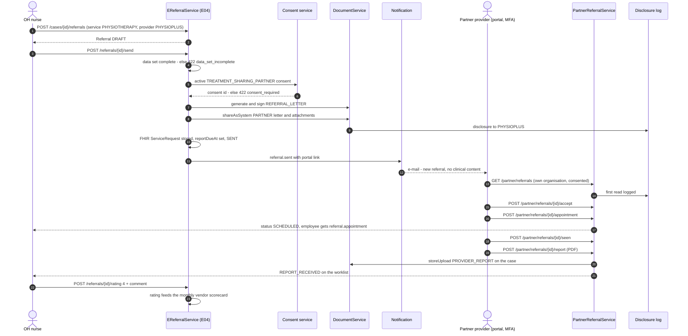

### 23.2 Pre-authorisation → TPA decision → cost ledger

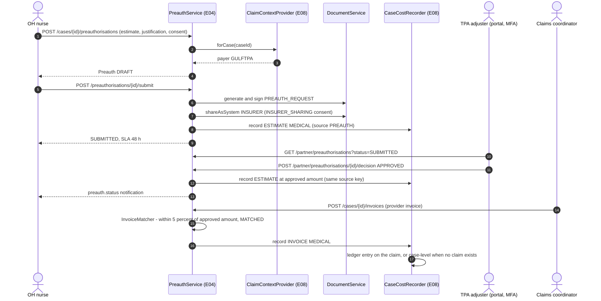

### 23.3 Telehealth consent → join → chat → draft encounter

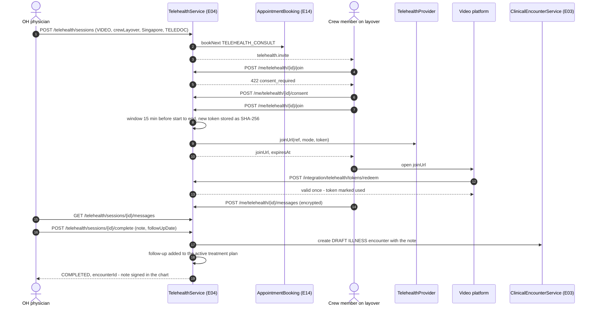

### 23.4 Lost-time claim → nurse assignment

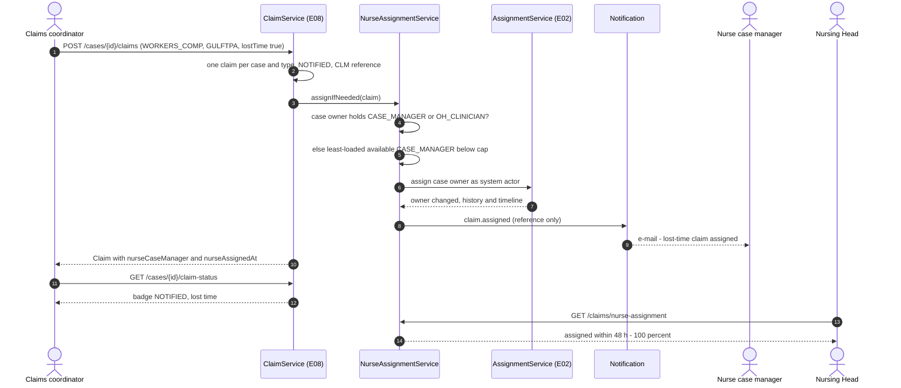

### 23.5 First report of injury with deadline → submission → acknowledgement

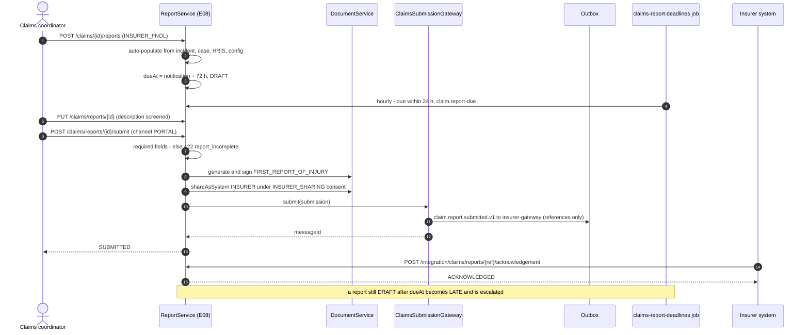

### 23.6 Consent-gated disclosure set with redaction

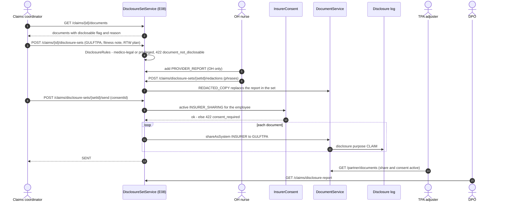

### 23.7 Legal hold and medico-legal report

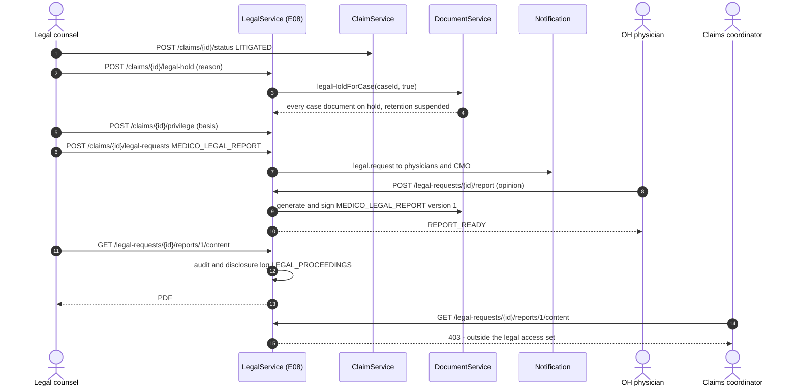

### 23.8 IME via ExternalReferralGateway

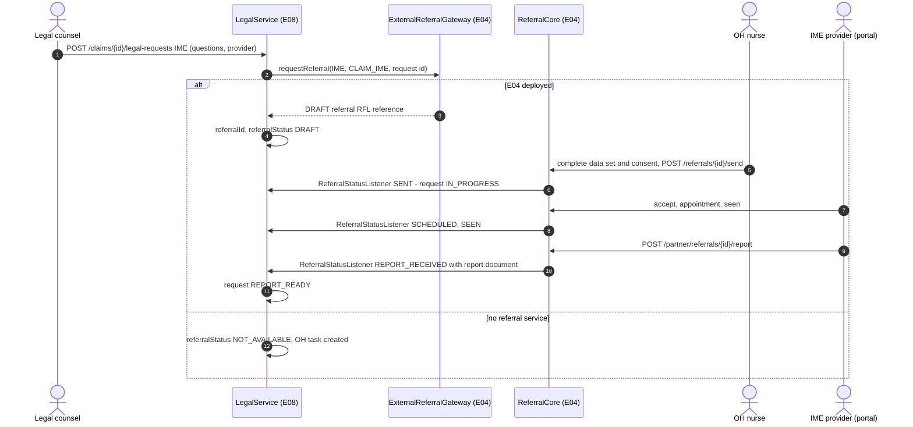

---

## 24. Data model

### 24.1 Schemas and tables

| Schema | Migration | Tables |
|---|---|---|
| `masterdata`, `docs` | V13 | `partner_organisation` (new, 25 rows); retention class `CLAIM_RECORD` |
| `treatment` (new) | V14 | `ref_sequence`, `plan_template`, `treatment_plan`, `follow_up`, `variance_alert`, `service_catalogue`, `referral`, `referral_history`, `provider_profile`, `provider_contract`, `provider_scorecard`, `preauth`, `invoice`, `formulary_item`, `stock_batch`, `administration`, `outcome`, `telehealth_session`, `telehealth_token`, `telehealth_message` (20 tables) |
| `claims` (new) | V15 | `ref_counter`, `claim`, `claim_history`, `report_form`, `first_report`, `disclosure_set`, `disclosure_set_document`, `claim_task`, `claim_message`, `message_read`, `cost_entry`, `budget`, `cost_export`, `legal_request`, `legal_report` (15 tables) |

Employee references are `varchar(64)` without foreign keys to the HRIS master; links to kernel cases, documents,
consents, encounters and appointments are by UUID. Foreign keys exist inside each schema and from `treatment` to
`masterdata.partner_organisation` (profiles and contracts). There is **no foreign key between `treatment` and
`claims`** – they meet only through the kernel SPIs and the shared case / document IDs.

### 24.2 Overview

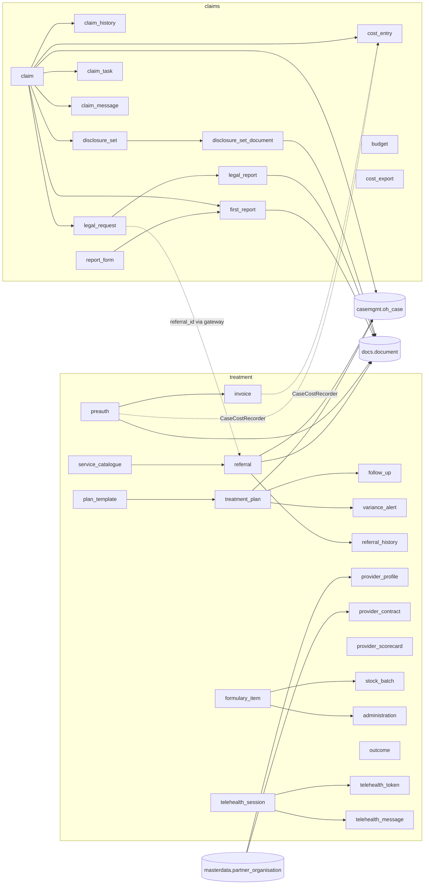

### 24.3 Data protection in the model

* Clinical free text is encrypted by the application (columns typed `text` and marked "encrypted" in the migrations);
  codes, dates, statuses and amounts stay in clear for rules and aggregation.
* Text visible outside OH (follow-up decline reasons, appointment instructions, decision notes, claim notes, task
  titles, messages, cost descriptions, subrogation) is screened **before** it is stored.
* Money is `numeric(12,2)` (treatment) / `numeric(14,2)` (claims) with an ISO 4217 currency; API money is `{amount:
  "1234.50", currency}` (decimal string).
* Grants: select / insert / update for the runtime role on both schemas, **no DELETE**; insert-only on
  `claims.claim_history`, `claims.claim_message`, `claims.legal_report`; read-only access to
  `triage.duration_guideline`.
* Demo data (`apps/wz-core-app/src/main/resources/db/demo/R__demo_e04_treatment.sql`, `R__demo_e08_claims.sql`) is
  idempotent with fixed IDs and dates relative to `current_date`, loads only with the `local` / test profiles and leaves
  encrypted columns empty; `ClaimsDemoSeeder` (local / test profiles) writes the encrypted E08 demo fields and the
  signed first-report document through the application. E04 demo text (referral reason, question, data set, chat)
  stays empty – demo referral 900001 therefore has no letter.

---

## 25. Key configuration items

| Key | Default | Purpose |
|---|---|---|
| `spring.flyway.schemas` | adds `treatment, claims` | New schemas |
| `wellnessz.security.mfa-required-roles` / `WZ_MFA_REQUIRED_ROLES` | `PARTNER_PROVIDER,TPA_ADJUSTER` (empty in `local`) | MFA role gate |
| `wellnessz.security.mfa-amr-values` / `mfa-acr-values` | `mfa, otp, totp, hwk, swk, sms, webauthn, fido` / `2, 3, mfa, c1` | Accepted MFA proof |
| `wellnessz.notification.partner-portal-url` / `WZ_PARTNER_PORTAL_URL` | `https://partners.wellnessz.local` | Links in partner notifications |
| `wellnessz.integration.outbound-allowlist.insurer-gateway` | `messageId, claimRef, reportRef, formCode, payerCode, employeeId, incidentDate, submittedAt, deadlineAt` | Insurer submissions |
| `wellnessz.integration.outbound-allowlist.authority-gateway` | `messageId, reportRef, formCode, jurisdiction, employerRef, incidentDate, submittedAt, deadlineAt` | Authority submissions |
| `wellnessz.integration.outbound-allowlist.erp-finance` | `messageId, batchId, month, costCentre, subsidiaryCode, category, amount, currency, entryCount, checksum` | ERP export announcements |
| `wellnessz.analytics.min-group-size` / `WZ_ANALYTICS_MIN_GROUP` | `5` | Suppression in both cost roll-ups |
| `wellnessz.treatment.variance-job-cron` / `chase-job-cron` / `scorecard-job-cron` | `0 20 2 * * *`, `0 40 6 * * *`, `0 15 3 1 * *` (UTC) | E04 jobs |
| `wellnessz.claims.report-deadlines-cron` | `0 5 * * * *` (UTC) | E08 hourly deadline job |
| `WZ_CORS_ORIGINS` (local) | adds `http://localhost:5176` | Partner portal in local development |
| Config entries (V14) | `modules.e04.enabled` true; `treatment.variance.threshold-pct` 20; `treatment.follow-up.reminder-days` 2; `treatment.referral.max-chases` 2; `treatment.referral.chase-interval-days` 2; `treatment.preauth.sla-hours` 48; `treatment.invoice.tolerance-pct` 5; `treatment.base-currency` GBP; `treatment.contract.expiring-days` 60; `treatment.network.cities` London:HUB, Dubai:OUTSTATION, New York / Singapore / Hong Kong:LAYOVER; `treatment.telehealth.base-url`; `treatment.eprescribing.route` NONE | E04 behaviour |
| Config entries (V15) | `modules.e08.enabled` true; `claims.legal-email`; `claims.mailbox-email`; `claims.nurse-sla-hours` 48; `claims.report-reminder-hours` 24; `claims.base-currency` GBP; `claims.fx-rates` (proposed); `claims.employer-name`; `claims.employer-ref` (proposed); `claims.forms.sign-off` PENDING | E08 behaviour |
| Helm `partnerPortal` | enabled (disabled in hybrid on-premises values); host `partners.<domain>` | Partner portal component |
| Master data and content | V13–V15 | 25 partner organisations, 8 plan templates, 14 referral services, 20 provider profiles, 18 contracts, 10 formulary items, 3 report forms |

---

## 26. Non-functional design notes

* **Performance** – worklists are bounded (referral list 500 rows per query, bulk reminder ≤ 200, disclosure phrases
  ≤ 50); indexes cover referral status / provider / source, follow-up due dates, open variance alerts, pre-authorisation
  payer and status, open first reports, cost entries by claim / case / date and claim payer / status. No
  production-volume load test yet.
* **Concurrency** – optimistic version on claims; one ACTIVE plan per case; unique constraints guard double invoices,
  duplicate claims per type, one report per form and claim, one scorecard per provider and month, unique token hashes;
  idempotent cost entries per source.
* **Idempotency and resilience** – `CaseCostRecorder` is idempotent; SPIs via `ObjectProvider` degrade gracefully (no
  costs without E08, NOT_AVAILABLE IME without E04, "invited, not booked" without scheduling); `ReferralStatusListener`
  and `AppointmentStatusListener` run inside the originating transaction; jobs run once per run key across replicas.
* **Time zones** – jobs run in UTC; working days for KPIs are Monday–Friday in UTC dates; deadlines are instants.
* **Accessibility** – status badges carry text as well as colour; the partner portal focuses and labels the offending
  field on 422; suppressed cells are labelled.
* **Browser storage** – all four apps keep PHI in memory only (lint rule bans `localStorage` / `sessionStorage`).
* **External users** – partner traffic arrives on its own host (`partners.<domain>`) behind the same BFF; MFA, idle
  timeout and organisation isolation make the external surface no wider than the internal one.

---

## 27. Known limitations and items for business / clinical sign-off

### 27.1 Decisions and sign-offs requested

| # | Item | Owner | Current state |
|---|---|---|---|
| S1 | Plan templates (goals, interventions, follow-up days, guideline links) | CMO + Nursing Head | 8 templates seeded |
| S2 | Referral services, required data sets, report due days and appointment targets | CMO + Nursing Head | 14 services seeded |
| S3 | Provider network: organisations, profiles, contracts, rate cards, SLAs, accreditation (E04-BL-019) | Procurement | Illustrative network of 20 providers; replace with the contracted network |
| S4 | Scorecard weights (30 / 25 / 25 / 20) and component definitions (E04-BL-009) | CMO + Procurement | Implemented as specified here |
| S5 | E-prescribing legal basis and route (E04-BL-013) | Product Owner (OH) + Legal | No-op gateway, `treatment.eprescribing.route` NONE |
| S6 | Telehealth video platform and confirmation that video / sound are not stored | CIO + DPO | Link provider and token redemption ready |
| S7 | Statutory and insurer report forms, field mappings and deadlines per jurisdiction (E08-BL-003) | Legal + HSE | 3 forms seeded `PENDING_LEGAL_HSE_SIGN_OFF` |
| S8 | Employer reference with the authorities (`claims.employer-ref`) | HSE | Proposed value |
| S9 | FX rates and base currency for cost roll-ups (`claims.fx-rates`, `treatment.base-currency`) | Finance | Proposed rates |
| S10 | Retention class `CLAIM_RECORD` (10 years, suspended by litigation hold) | DPO + Legal | Proposed |
| S11 | Disclosure rules (allowed, OH-only and never-disclosed types) | DPO + CMO | Implemented as in Section 15.1 |
| S12 | Notification wording of the 13 new templates | DPO | Draft, content-free |
| S13 | MFA enrolment and conditional access for partner and adjuster identities | Cyber GRC + IdP owner | Required before go-live; off in the local demo realm |

### 27.2 Known limitations

| Area | Limitation |
|---|---|
| Insurer / authority / ERP | `ClaimsSubmissionGateway` default = outbox event + content-free e-mail; real connectors are E15 |
| FHIR | Exchange tested with a simulated partner only; no live partner hospital yet (E04-BL-006, P3) |
| Telehealth | Video platform not procured; booking through `AppointmentBooking` takes the first free slot on or after the scheduled date, which may differ from the scheduled time |
| E-prescribing | Disabled until the decision memo |
| Currency | E04 cost figures, KPIs and scorecards sum base-currency amounts only; E08 converts with proposed FX rates |
| Budget vs actual | Not suppressed (unit-level by design) |
| Litigated-claim KPI | No dedicated trend endpoint – derived from the claim list |
| Report forms | Pending Legal / HSE sign-off; only GB, UAE and a generic insurer FNOL are defined |
| Demo data | Encrypted narrative text (referral reason, question, data set, justification, chat) cannot be seeded by SQL; demo referral 900001 has no letter |
| MFA | Not exercised by the local E2E run (local profile switches the gate off); covered by `MfaRoleGateTest` |
| Load | No production-volume load test of worklists, roll-ups or exports |
