# WellnessZ OHCM – Increment 5 Solution Design: E09 Mental Health & Peer Support, E10 Drug & Alcohol Testing, E11 Travel Health & Communicable Disease, E12 Health Promotion & Prevention

**Version 1.0**

*WellnessZ OHCM platform – increments 1–5*

| | |
|---|---|
| **Document** | Increment 5 – 01 Solution Design (E09 + E10 + E11 + E12) |
| **System** | WellnessZ Airline Occupational Health Case Management (OHCM) |
| **Scope** | E09 Mental Health, Psychosocial Risk & Peer Support Programmes · E10 Drug, Alcohol & Psychoactive Substance Testing Programme · E11 Travel Health, Immunisation Campaigns & Communicable Disease / Exposure Management · E12 Health Promotion, Wellbeing & Prevention Campaigns · the restricted-class design that protects mental-health and substance-programme records |
| **Audience** | Chief Medical Officer (CMO), mental-health lead, Nursing Head, Aviation Medical Examiners (AME), Medical Review Officer (MRO), Data Protection Officer (DPO), Safety / SMS, HSE, HR, crew scheduling, health promotion, Legal, Cyber GRC, CIO, project sponsor |
| **Baseline** | Repository working tree (final increment, 5 of 5), Flyway migrations V1–V20, API contract `docs/increment-05/API-Contract-E09-E10-E11-E12.md`, OpenAPI `docs/api/openapi.json` (647 paths) |
| **Status** | Draft for review – screening instruments and cut-offs, the urgent-risk protocol, signposting, testing policies and cut-offs, travel recommendations, post-exposure timers, screening thresholds, retention classes `RESTRICTED_RECORD` / `PUBLIC_HEALTH` and notification wording await Clinical Governance, MRO, Legal and DPO sign-off (Section 20) |
| **Companion documents** | 02 – Requirements Traceability Matrix · 03 – Release Notes Increment 5 · Increment 1–4 documents 01–03 · Architecture 01–03 · `deploy/environments/README.md` |

> **How to read this document.** Every statement about behaviour was checked against the source code (entities,
> controllers, services, Flyway V16–V20) and, where named, against an automated test. Where the code deviates from the
> API contract, this document describes **what the code does** and says so. Where a capability is only partly
> delivered, or where content (instruments, cut-offs, policies, recommendations, timers, thresholds, retention periods)
> is a draft awaiting clinical, MRO, legal or DPO sign-off, this is stated explicitly. Requirement identifiers
> (E09-HLR-xx, E09-F0x, E09-BL-0xx, E10-…, E11-…, E12-…) refer to the business workbooks. All API paths are relative to
> `/api/v1`; browser apps call them through the BFF as `/bff/api/...`.

---

## 1. Executive summary

Increment 5 is the last of the five planned increments. It adds four epic modules on top of intake and triage
(increment 1), the clinical record and fitness (increment 2), absence, surveillance and scheduling (increment 3) and
treatment coordination and claims (increment 4). Its theme is **restricted classes and health promotion**: two of
the new modules hold the most sensitive data in the platform, and the other two turn occupational health data into
prevention without exposing individuals.

* **E09 – Mental health, psychosocial risk and peer support** gives employees a confidential, stigma-free pathway.
  Employees **self-refer** from the app with signposting and an always-visible emergency banner, and can complete a
  **PHQ-9 or GAD-7** screen. A PHQ-9 self-harm item above 0, or a SEVERE band, is **URGENT**: a same-day call-back
  task and a content-free alert go to the named mental-health clinicians, who follow a versioned **urgent-risk
  protocol**. Clinicians refer to the **EAP partner** (`EAP_WELLBEING`), which works the referral in the partner
  portal and returns **attendance and closure only** – free text is refused. The **flight-crew peer-support
  programme** is pseudonymous: crew choose an alias, get a `PS-XXXX-XXXX` contact code and are routed to a trained,
  available volunteer; the contact log holds **no employee identity**, and only aggregated, suppressed figures reach
  the Safety Management System (SMS). **Critical-incident stress management (CISM)** events are opened from serious
  incidents; the affected crew are taken from the **flight roster** (`duty_assignment`) and offers must go out within
  72 h, with 1- and 4-week follow-ups. A **psychosocial risk register** per department (ISO 45003 factors,
  likelihood × severity, RAG) tracks actions, and **safety-critical mental-health fitness** assessments by an AME feed
  the roster as **status only**.
* **E10 – Drug and alcohol testing** runs pre-employment, random, post-incident, for-cause, return-to-duty and
  follow-up testing for six safety-sensitive role groups. **Random selections** are drawn from a role-group pool with
  a 256-bit `SecureRandom` seed, HMAC-SHA256 draws and a hashed pool snapshot, so every selection is **reproducible
  and auditable**. Qualifying incidents create **post-incident tests** with alcohol (8 h) and drug (32 h) windows;
  managers raise **for-cause requests** with an observation checklist and a second observer. Collectors record an
  **electronic chain-of-custody form** (append-only custody events); results are accepted **only from the bound
  `TOXLAB` laboratory client**. The **MRO** verifies results through a pure state machine. A verified positive or
  refusal removes the employee from safety-sensitive duty (**status only** to rostering and HR), opens a restricted
  case, **refers the employee to confidential support through the `SupportProgrammeReferral` SPI** and drafts a
  return-to-duty plan with unannounced follow-up tests. Programme statistics are suppressed below the minimum group
  size.
* **E11 – Travel health, communicable disease and exposures** provides **travel consultations** with
  destination-based recommendations against the E07 immunisation record and a signed **travel health certificate**;
  **communicable-disease cases** with exclusion decisions and **contact tracing from roster and shift data** within
  the 4-hour target (contacts are notified without naming the case, then check in daily); **exposure pathways** with
  protocol timers (needle-stick with a PEP decision due within 2 h, chemical / dangerous goods, cabin fume, heat
  illness, bites and stings); **vaccination campaigns** with fast entry, declines, adverse events and suppressed
  uptake; **health advisories** targeted at crew rostered to the destination, with acknowledgement tracking; and
  **public-health reports** to the local health protection team within the statutory time.
* **E12 – Health promotion and prevention** plans campaigns from **anonymised hotspots** (kernel cases, incidents,
  audiometry and screening results, suppressed), publishes them to the group **campaign app** through an allow-listed
  outbox event, runs **biometric / MSK / hearing / vision / wellbeing screening events** whose abnormal results open
  a follow-up case within 48 h and a result letter, scores **ergonomic assessments** (DSE workstation, manual handling,
  task) with RAG and the job-demand profile, accepts **wearable daily totals only for consented enrolments**, and
  reports participation and outcomes per unit with suppression – never person-level data.

The **restricted-class design** (Section 5) is the key design point of the increment. Mental-health support records
and substance-testing results carry the `RESTRICTED_CLINICAL` classification. Only the **named restricted-class
clinician** opens them: `PSYCH_CLINICIAN` (listed in `mentalhealth.named-clinicians`) for E09, and the `MRO` for E10
results. A general OH nurse receives `404` and sees only a **placeholder count** on the chart. Break-glass (from the
earlier increments) is logged and reviewed. The **employee controls** what a manager sees from a support case.
Managers, HR, rostering and safety managers get **status only**. Peer support is **pseudonymous**. **Small-cell
suppression** applies to every aggregate.

Verification (30 October 2026): **450 Java tests, 0 failures** (including the four increment-5 integration tests
and `ArchitectureTest` with 22 rules); SpotBugs + FindSecBugs **0 findings**; **1,373 web unit tests** across the four
apps (oh-workspace 769, employee-app 285, manager-workspace 188, partner-portal 131), eslint 0 warnings; **24 / 24**
increment-5 end-to-end checks with real Keycloak logins through the BFF, and the regression suites for increments 1–4
still pass (18 / 18, 25 / 25, 32 / 32, 22 / 22) – **121 checks in all**.

---

## 2. Scope and goals

### 2.1 Business goals (from the epic overviews)

| Epic | KPI | How the design supports it |
|---|---|---|
| E09 | Self-referral rate (rising as stigma falls) | Self-referral from the employee app without any manager or HR involvement; source `SELF` on every support case, so the rate can be counted per period |
| E09 | Median time to first counselling appointment ≤ 5 days | EAP referral sets `firstAppointmentDueBy` = 5 working days (`mentalhealth.eap-first-appointment-working-days`); attendance returned by the partner |
| E09 | 100 % of serious incidents with a CISM offer within 72 h | Incident listener creates the CISM event automatically; `offerDueBy` = occurrence + `cism.offer-sla-hours` (72); `slaMet` per event (E2E: offers out within 72 h) |
| E09 | Flight-crew support programme reach (awareness ≥ 90 %) | Peer support in the employee app for every employee; the awareness campaign itself (E09-BL-015) is a change-and-training task that the E12 planner can carry (mental-wellbeing portfolio campaign) |
| E10 | Random testing coverage vs policy target 100 % | Monthly sample `n = ceil(poolSize × rate % / 12)`; `GET /testing/coverage` with `coveragePct` and `behindPlan` per role group |
| E10 | Post-incident test within policy window ≥ 98 % | `alcoholDueAt` (+8 h) and `drugDueAt` (+32 h) from the incident time; hourly `substance-windows` job marks missed windows (E2E: collected inside the alcohol window) |
| E10 | Chain-of-custody errors = 0 | Electronic form, specimen ID validation, append-only custody events (database trigger), signed `CHAIN_OF_CUSTODY_FORM` |
| E10 | Return-to-duty plans completed on time ≥ 95 % | RTD plans with evaluation, follow-up tests on random dates, daily `substance-follow-ups` job |
| E11 | PEP started within protocol window ≥ 98 % | `NEEDLESTICK_BBP` timers (risk assessment ≤ 1 h, PEP decision ≤ 2 h); `exposure-timers` job every 5 minutes alerts 30 min before and when overdue |
| E11 | Contact tracing list within 4 h of a confirmed case 100 % | Trace from `duty_assignment` (same duty, proximity group, facility); `trace_hours` stored and `traceWithinKpi` against `travelhealth.tracing.kpi-hours` (4) (E2E: 1.03 h) |
| E11 | Crew travel vaccination compliance ≥ 95 % | Travel consultations record vaccines in the E07 registry; recommendations compare destination content with the immunisation status; `travel.consultation-due` reminders for crew rostered to a destination |
| E11 | Fume-event cases with documented follow-up 100 % | `CABIN_FUME` pathway (symptom protocol, biomonitoring sample ≤ 6 h, safety report, authority-report task) started automatically from the incident feed |
| E12 | Campaign participation by unit ≥ 40 % | Participation from the campaign app and screenings; report per unit / subsidiary / job code / location with KPI `PARTICIPATION_PCT` target 40 (`promotion.participation.target-pct`) |
| E12 | MSK case rate in targeted units −20 % in 18 months | Insights indicator `MSK_INJURY_CASES`; campaign report outcome "change in MSK cases" for MSK campaigns |
| E12 | Ergonomic actions closed within 60 days ≥ 80 % | `GET /ergonomics/kpi` (closure within `promotion.ergonomics.closure-target-days` = 60); daily `ergonomic-actions` reminders |
| E12 | Abnormal screening result follow-up ≥ 95 % | Abnormal result opens a follow-up case with a task due within 48 h at once; hourly `screening-follow-up` sweep opens any case that is still missing |

### 2.2 In scope

| Epic | High-level requirements | Features | Backlog items |
|---|---|---|---|
| E09 | 6 (E09-HLR-01…06) | 6 (F01 confidential case type, F02 self-referral / screening / EAP, F03 peer support, F04 CISM, F05 psychosocial register, F06 safety-critical fitness) | 15 |
| E10 | 5 (E10-HLR-01…05) | 5 (F01 policy & pools, F02 post-incident & for-cause, F03 collection / custody / laboratory / MRO, F04 positive / refusal pathway, F05 reporting) | 10 |
| E11 | 6 (E11-HLR-01…06) | 6 (F01 travel consultation, F02 communicable disease & tracing, F03 exposure pathways, F04 vaccination campaigns, F05 advisories, F06 public-health reporting) | 13 |
| E12 | 5 (E12-HLR-01…05) | 5 (F01 campaign planner, F02 screening events, F03 ergonomics, F04 campaign app & wearables, F05 analytics) | 8 |
| **Total** | **22** | **22** | **46** |

Plus the platform additions these epics need (Section 6): the `duty_assignment` feed, the `SupportProgrammeReferral`
SPI, four document templates and two upload types, two retention classes, three partner organisations, 18 content-free
notification templates, two outbound allow-lists, BFF workspace resources and roles, and eight new roles with demo
users.

### 2.3 Out of scope (per workbooks and increment plan)

* Delivery of psychotherapy or counselling (external EAP partner) and disciplinary processes (E09).
* Laboratory analysis (accredited partner laboratory) and disciplinary decisions (HR) (E10).
* Passenger medical clearance and aircraft disinsection operations (E11).
* Fatigue Risk Management System operations (Flight Ops SMS) and gym / benefits administration (E12).
* Production connectors to the EAP provider system, the laboratory LIMS, the campaign app, wearable vendor APIs,
  the public-health authority portal and an SMS (text message) gateway. Increment 5 builds and tests the interfaces
  (bound machine clients, allow-listed outbox events, integration endpoints) with default or simulated
  counterparts (Section 13).
* Business validation of instruments, cut-offs, policies, recommendations, timers, thresholds and retention
  (Section 20).

---

## 3. Actors

| Persona | Application | Main use in increment 5 |
|---|---|---|
| Employee / crew member | employee-app | Signposting and self-referral, screens, sharing choice, CISM offers, pseudonymous peer support, travel health and certificates, advisories, check-ins, campaign invitations, vaccination response, wearable consent, testing notices (where and when to report only) |
| Named mental-health clinician (`PSYCH_CLINICIAN`) | oh-workspace | Support caseload, urgent call-backs, EAP referrals, peer referrals, CISM, fitness contribution |
| AME / OH physician | oh-workspace | Safety-critical fitness and relief from duties; return-to-duty evaluation (OH physician acting as MRO only when designated); advisories, destinations, public-health reports |
| OH nurse (`OH_CLINICIAN`) | oh-workspace | Travel consultations, communicable cases, contact tracing, exposures, vaccination fast entry, screening results; sees only a placeholder for restricted cases |
| Peer volunteer / peer coordinator | oh-workspace (`#/peer-support`) | Pseudonymous requests and contact log / volunteer register, quarterly report |
| Safety manager | oh-workspace, manager-workspace | Quarterly SMS report, CISM counts, for-cause requests, testing statistics |
| D&A programme manager, collector, MRO | oh-workspace (`#/testing/...`) | Policies, pools, selections / collection and custody / MRO queue and return to duty |
| Manager, HR, crew scheduling | manager-workspace | Unit psychosocial assessment and shared outcomes, for-cause request, unit ergonomics and campaigns / testing duty status |
| Health promotion lead, ergonomist | oh-workspace | Insights, campaigns, screening events, reports / ergonomic assessments |
| EAP partner | partner-portal | EAP referrals – attendance and closure only |
| Machine clients | `/integration/**` | Rostering (duty assignments), toxicology laboratory (orders, results, custody), campaign app (participation), wearable aggregator (daily totals) |

The full role catalogue, rights and demo users are in Section 15.2.

---

## 4. Component view

### 4.1 Modules and boundaries

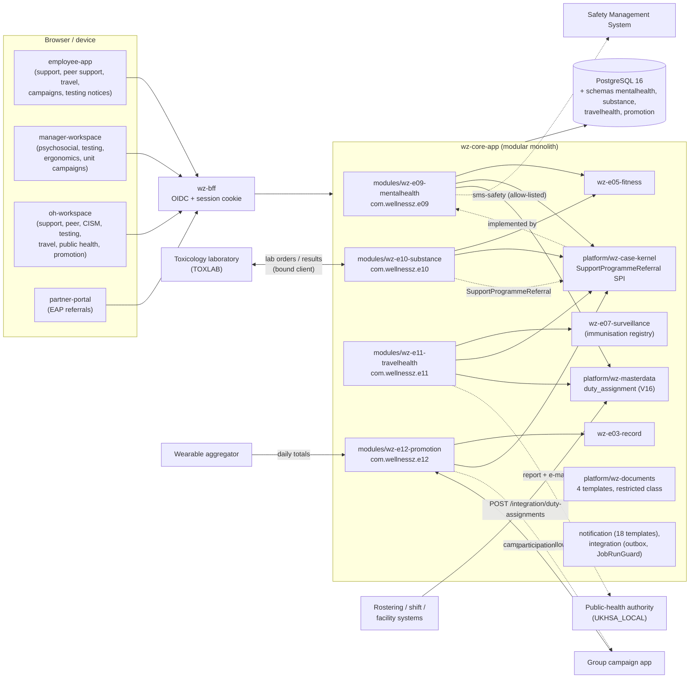

| Component | Responsibility in increment 5 |
|---|---|
| `modules/wz-e09-mentalhealth` (new, depends on E05) | Restricted support cases, notes, contacts and timeline; sharing choice; signposting; PHQ-9 / GAD-7 screening and the urgent-risk protocol; EAP referrals and partner feedback; peer volunteers, pseudonymous contact requests, contact log and trusted-professional referrals; quarterly SMS report; relief from duties; CISM events, affected list, offers and follow-ups; psychosocial register and dashboard; safety-critical fitness assessments; `SupportProgrammeReferral` implementation |
| `modules/wz-e10-substance` (new, depends on E05) | Policies (versioned, approval status), role-group pools and exclusions, reproducible random selections, coverage; post-incident listener and rule table, for-cause requests; requirements, collection, chain of custody, refusal; laboratory interface (bound client); MRO queue, verdicts and split specimens; positive / refusal pathway; return-to-duty plans and follow-up scheduling; duty-status view; statistics and annual report |
| `modules/wz-e11-travelhealth` (new, depends on E07) | Destination content, travel consultations, recommendations and certificate; communicable conditions and cases, exclusion, tracing, contact notification, check-ins and clearance; exposure pathways, timers, serology and chemical register; vaccination campaigns, administrations, declines, adverse events and uptake; advisories and acknowledgements; public-health reports, submission and correspondence |
| `modules/wz-e12-promotion` (new, depends on E03) | Anonymised insights, campaign portfolio, publication to the campaign app, campaign report; screening events, participants, results and follow-up; hearing-conservation education attendance; ergonomic checklists, assessments, photos, actions and KPI; manager workspace views; participation intake, wearable enrolments and daily data |
| `platform/wz-masterdata` | `masterdata.duty_assignment`, `POST /integration/duty-assignments`, `GET /masterdata/duty-assignments`; partner organisations `EAP_WELLBEING`, `TOXLAB`, `UKHSA_LOCAL` |
| `platform/wz-case-kernel` | `SupportProgrammeReferral` SPI; case categories `PSYCHOLOGICAL` and `SUBSTANCE` carry `RESTRICTED_CLINICAL`; `publishFitness` / `applyFitnessDecision` reused for status-only feeds |
| `platform/wz-documents` | Templates `AUTHORITY_FITNESS_REPORT`, `CHAIN_OF_CUSTODY_FORM`, `TRAVEL_HEALTH_CERTIFICATE`, `PUBLIC_HEALTH_REPORT`; `generateSigned(…, DataClassification)` for restricted documents; upload types `ERGONOMIC_PHOTO`, `AUTHORITY_CORRESPONDENCE`; retention classes `RESTRICTED_RECORD`, `PUBLIC_HEALTH` |
| `platform/wz-notification` | 18 content-free templates; `ContentRules` reject clinical words and the words *positive, negative, result(s), drug, alcohol* in any notification text |
| `platform/wz-security` | `/me` reports `RESTRICTED_CLINICAL` for `PSYCH_CLINICIAN` and `MRO`, `STATUS_ONLY` for the new non-clinical roles; ABAC restricted-class, clinician and break-glass policies (Section 5) |
| `apps/wz-bff` | `/bff/api/workspace/{testing,psychosocial,campaigns,ergonomics}/**` keep their prefix; workspace roles add `SAFETY_MANAGER` and `CREW_SCHEDULING` |

### 4.2 Boundaries enforced by ArchUnit

`apps/wz-core-app/src/test/java/com/wellnessz/app/ArchitectureTest.java` now has **22 rules**. New rules for
increment 5:

| Rule | Effect |
|---|---|
| `earlierIncrementsDoNotDependOnIncrement5` | E01–E08 and E14 never depend on E09–E12 – the new modules plug in through `SupportProgrammeReferral` and in-process events |
| `restrictedProgrammesAreIndependent` | E09 and E10 never depend on E03, E04, E06, E07, E08, E11, E12 or E14 – restricted-class programmes keep their own records |
| `restrictedProgrammesDoNotDependOnEachOther` | E10 never depends on E09 – the testing programme refers into support only through the kernel SPI |
| `travelHealthAndPromotionAreIndependent` | E11 and E12 never depend on E04, E06, E08, E09, E10 or E14 – E11 builds on the E07 registry, E12 on the E03 record; bookings go through `AppointmentBooking` |
| `promotionDoesNotDependOnTravelHealth` | E12 never depends on E11 |
| Increment 1–4 rules kept | `platformDoesNotDependOnBusinessModules`, `kernelDoesNotDependOnBusinessModules`, `documentServiceIsAPlatformService`, `recordAndFitnessModulesAreIndependent`, `fitnessDoesNotDependOnRecord`, `earlierModulesDoNotDependOnLaterOnes`, `increment2ModulesDoNotDependOnIncrement3`, `earlierIncrementsDoNotDependOnIncrement4`, `treatmentAndClaimsAreIndependent`, `claimsDoesNotDependOnTreatmentOrClinicalRecord`, `absenceIsIndependentOfSurveillanceAndScheduling`, `surveillanceIsIndependentOfAbsenceAndScheduling`, `schedulingIsIndependentOfClinicalModules`, `intakeDoesNotDependOnTriage`, `intakeDoesNotCallCaseKernelDirectly`, `commonHasNoSpringSecurity`, `noStandardStreams` |

Resulting module graph: E09 → E05; E10 → E05; E11 → E07 (and, through E07's public API, the E05 food-handler
exclusion); E12 → E03. E09, E10, E11 and E12 are mutually independent except for E10 → kernel SPI → E09. A
consequence that matters for privacy: **E12 cannot read E06 absence data or E09 support cases** – mental-wellbeing
insights come from E12 wellbeing screenings only.

### 4.3 Service provider interfaces (SPIs)

| SPI | Implemented by | Called by | Purpose |
|---|---|---|---|
| `SupportProgrammeReferral` (new, `platform/wz-case-kernel/.../support/`) | E09 `SupportProgrammeReferralAdapter` | E10 positive / refusal pathway (`"SUBSTANCE_POSITIVE"` / `"SUBSTANCE_REFUSAL"`, source type `DA_TEST`) | `refer(actor, employeeId, relatedCaseId, reason, sourceType, sourceRef)` → `Optional<UUID>` support case id. The reason is a **code, never clinical detail**. Idempotent per `(sourceType, sourceRef)` (partial unique index `uq_support_case_source`); opens a restricted support case with source `PROGRAMME_REFERRAL` and alerts named clinicians with `support.urgent-callback` (level "programme referral"). E10 calls it through an `ObjectProvider`; without E09 it audits a FAILURE and continues |
| `AppointmentBooking` (existing, E14) | E14 | E11 vaccination acceptance (`VACCINATION`), E12 screening participants (`promotion.screening.service.*`) | First free slot; anyone who cannot be booked stays INVITED |
| `ChartContributor`, `CaseTransitionGuard`, `FitnessClearanceGuard` (existing) | – | Reused as described in the contract | – |
| `CaseService.publishFitness` / `applyFitnessDecision` (existing kernel service) | Kernel | E09 relief and fitness, E10 duty removal, E11 exclusion | Status-only crew-roster and HR feeds |

The interface's Javadoc also lists `CRITICAL_INCIDENT` and `EXPOSURE` as reason codes for future callers; in this
increment **only E10 calls the SPI** (CISM and exposures open support cases inside E09 or not at all).

### 4.4 Listeners, events and scheduled jobs

All modules subscribe in-process to `ehs.incident.received.v1` (payload: E01 `IncidentFacts`), idempotently on the
incident id. Each listener catches its own failures so it never blocks the E01 intake listener.

| Listener | Module | Trigger |
|---|---|---|
| `CismIncidentListener` | E09 | Severity HIGH / CRITICAL or `incidentClass` in `cism.trigger-classes` → CISM event |
| `IncidentTestListener` (`e10.post-incident`) | E10 | Rule table `substance.post_incident_rule` (incident class / severity) for employees in a pool → POST_INCIDENT test; idempotent on the message and on `incident:<id>` |
| Exposure listener | E11 | `exposureType` NEEDLESTICK / BODY_FLUID, CHEMICAL, FUME, HEAT, BITE / STING → exposure pathway |

| Job (all `JobRunGuard`, UTC) | Module | Default schedule | Purpose |
|---|---|---|---|
| `cism-follow-ups` | E09 | daily 08:20 | 1- and 4-week follow-ups → `cism.follow-up` |
| `peer-callback-purge` | E09 | daily 01:40 | Clears peer call-back phone numbers after 30 days |
| `substance-follow-ups` | E10 | daily 06:15 | Notifies follow-up tests whose random date has arrived |
| `substance-windows` | E10 | hourly at :20 | Moves uncollected tests to WINDOW_MISSED after the window (4 h grace for random, follow-up and RTD tests) |
| `exposure-timers` | E11 | every 5 minutes | `exposure.timer-alert` once per task when due within 30 min and once when overdue |
| `public-health-deadlines` | E11 | hourly at :07 | `public-health.report-due` (12 h before) and overdue status |
| `travelhealth-daily` | E11 | daily 06:20 | Check-in reminders (missed ones marked MISSED), advisory re-targeting for newly rostered crew, `travel.consultation-due` reminders (at most every 30 days per employee and country) |
| `ergonomic-actions` | E12 | daily 02:20 | `ergonomic.action-due` to owner and assessor |
| `screening-follow-up` | E12 | hourly at :15 | Opens a follow-up case for any abnormal result that still has none |

Outbound events use the transactional outbox and the allow-list (default deny): `CampaignPublished` to
`campaign-app` (E12) and the quarterly peer-support figures to `sms-safety` (E09) – Section 6.6.

---

## 5. Restricted-class design

### 5.1 Principles

The platform base (increment 1) defines the data classification `RESTRICTED_CLINICAL` above `CLINICAL`. Increment 5
is the first to put real records into it, and it adds the controls around those records.

| # | Rule | Where it is enforced |
|---|---|---|
| R1 | Mental-health support records and substance-programme results are **restricted class** | Kernel case categories `PSYCHOLOGICAL` and `SUBSTANCE` → `RESTRICTED_CLINICAL`; documents generated with `generateSigned(…, DataClassification.RESTRICTED_CLINICAL)` |
| R2 | Only the **named restricted-class clinician** opens them | E09 `SupportAccess` (named `PSYCH_CLINICIAN`); E10 MRO endpoints (`MRO`, or an `OH_PHYSICIAN` listed in `substance.acting-mro-physicians`); ABAC `restrictedClassPolicy` for kernel cases and documents |
| R3 | Everyone else gets **404** (existence not disclosed) and every attempt is **audited** `DENIED` | Service-level checks in E09 / E10; ABAC deny policy |
| R4 | General OH users see a **placeholder count** only | `GET /support/placeholder` (`{restrictedCases}`) and the chart's restricted-items-hidden count |
| R5 | **Break-glass** opens restricted records read-only, logged and reviewed | ABAC `breakGlassPolicy`; E09 `accessBasis: BREAK_GLASS` |
| R6 | The **employee decides** what a manager sees from a support case | `PUT /me/support/sharing` (`NOTHING | FITNESS_ONLY | FITNESS_AND_ADJUSTMENTS`) |
| R7 | Managers, HR, rostering and safety managers get **status only** | Duty / fitness status feeds, `GET /workspace/testing/status`, CISM counts, masked test statuses |
| R8 | Peer support is **pseudonymous** | No employee column in the peer tables; alias + contact code |
| R9 | Every aggregate is **small-cell suppressed** | `wellnessz.analytics.min-group-size` (default 5) in each module |
| R10 | External systems touch **only their own records** | Bound machine clients (`TOXLAB`), partner organisation isolation (`EAP_WELLBEING`), feedback without free text |
| R11 | Every disclosure outside the owning team is **disclosure-logged** | Section 15.5 |

### 5.2 Access decision

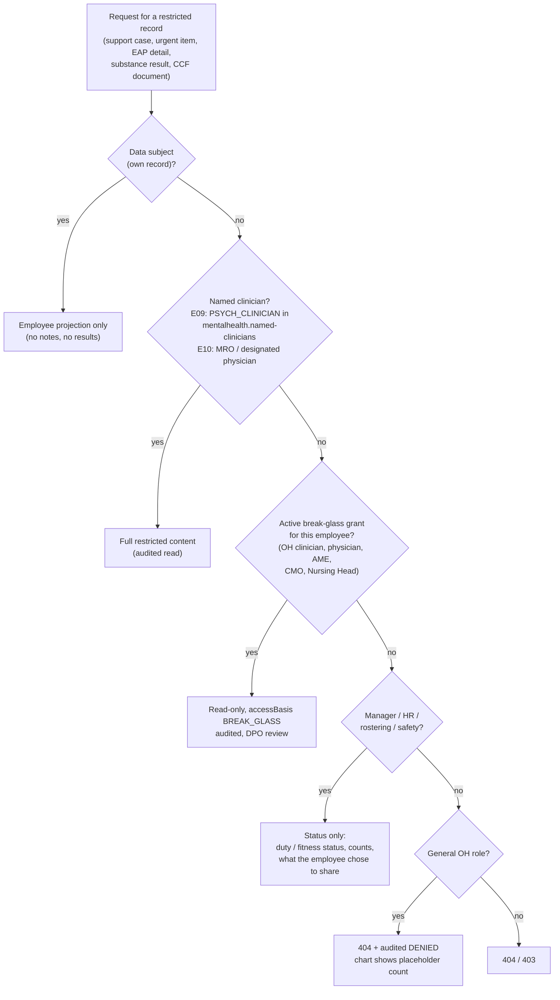

### 5.3 Named clinician

* **E09.** Restricted `/support/**` endpoints are `isAuthenticated()` at the controller and checked in the service
  (`SupportAccess`). Only a `PSYCH_CLINICIAN` whose username is in `mentalhealth.named-clinicians` (V17 seeds the demo
  user `psych1` in every environment – it must be set per client before go-live; an empty value means every
  `PSYCH_CLINICIAN`) reads case content. Documented exceptions: `AME` for relief,
  `AME` / `OH_PHYSICIAN` for fitness assessments, `CMO` for governance, and OH roles for the placeholder. Any other
  caller gets **404** and an audited `DENIED` entry.
* **E10.** Results, the MRO queue and verdicts are open to `MRO`, or to an `OH_PHYSICIAN` whose username is listed in
  `substance.acting-mro-physicians` (empty by default); any other physician gets 403. The D&A programme manager
  organises the programme but **never sees results** (E2E: programme manager → 403 on the MRO queue). Collectors see
  requirements without observations, and future follow-up dates are visible to the MRO only.
* **ABAC.** `DefaultPolicies.restrictedClassPolicy` denies `RESTRICTED_CLINICAL` resources unless the user is a
  `PSYCH_CLINICIAN`, the data subject, a manager / HR (who still receive status only) or holds an active break-glass
  grant. `clinicianPolicy` grants general OH roles `CLINICAL` only for resources that are **not** restricted.
  `/me` reports the disclosure level `RESTRICTED_CLINICAL` for `PSYCH_CLINICIAN` and `MRO`.

> **Known limitation.** The ABAC restricted-class rule recognises `PSYCH_CLINICIAN` but not `MRO`. The MRO opens
> results and the chain-of-custody form through the E10 MRO endpoints, which do not depend on that policy; the MRO
> probably **cannot** open a `RESTRICTED_CLINICAL` document through the generic `/documents` API. This is a follow-up
> item (Section 20.2).

### 5.4 Placeholder for general OH users

A general OH nurse opening the chart of an employee with an open support case sees a notice such as
"**1 restricted case** – confidential support records held by the named mental-health clinicians. Content is not shown
here; access attempts are audited." The count comes from `GET /support/placeholder?employeeId=` (non-closed support
cases; the read itself is audited `SUPPORT_PLACEHOLDER_READ`). The chart service also reports how many restricted
items it has hidden. The notice shows nothing on zero or on a 404, and the link to the caseload appears only for
roles that may open it.

### 5.5 Break-glass

Break-glass (E03-BL-021, delivered earlier) applies unchanged: an OH clinician, physician, AME, CMO or Nursing Head
with an active, justified grant for the employee passes the restricted-class policy. In E09 the case views are then
**read-only** and carry `accessBasis: BREAK_GLASS`; every read is audited and the grant is reviewed by the DPO. The
integration test `restrictedCaseIsVisibleToNamedCliniciansOnlyWithPlaceholderAndBreakGlass` proves the 404 before and
the read-only access after a grant.

### 5.6 Employee-controlled sharing

The employee chooses per support case what the line manager may see: `NOTHING` (default), `FITNESS_ONLY` or
`FITNESS_AND_ADJUSTMENTS` (adjustment text is screened for clinical content). The choice is revocable and every change
is audited. The manager reads `GET /workspace/psychosocial/shared-outcomes` – only employees in scope who chose to
share, with `fitness` (the kernel fitness status name), optional adjustments and `sharedAt`; every row shown is
disclosure-logged. Screening scores, concerns, notes and counselling content are never part of it (E2E: the employee
shares fitness only and the manager sees exactly that).

### 5.7 Status only for managers, HR, rostering and safety

| Audience | Sees | Never sees |
|---|---|---|
| Crew scheduling / rostering | Fitness / roster status from relief, fitness decisions, duty removal and exclusion (`TEMPORARILY_UNFIT`, `UNFIT`, `UNFIT_PENDING`, available) | Reason, programme, test type, condition |
| HR / crew scheduling (E10) | `GET /workspace/testing/status` → `{employeeId, displayName, dutyStatus AVAILABLE|REMOVED|RETURN_PENDING, since}`; `testing.status` notice | Test reason, result, verdict, MRO note |
| Manager / safety manager (for-cause) | Own requests with a masked status (every status after collection reads "With the testing programme") | Observations after submission, results |
| Employee and manager views of tests | Masked status: COLLECTED / IN_LAB / MRO_REVIEW → `COLLECTED`; any verified outcome → `COMPLETED`; CANCELLED / WINDOW_MISSED → `CLOSED` | Verified outcome |
| Safety manager (CISM) | Event counts (affected, offered, accepted, SLA met); a manual `POST` returns the summary only | Names of affected staff |
| Catering hygiene (E11) | Food-handler exclusion status and dates through the E05 exclusion | Condition |

### 5.8 Pseudonymous peer support

* The peer tables (`peer_volunteer`, `peer_training`, `peer_contact_request`, `peer_contact`, `trusted_referral`,
  `sms_report`) have **no employee column**; the integration test checks this against `information_schema`.
* The requester picks an **alias** and gives a call-back phone (encrypted, purged after 30 days); the system issues a
  random contact code `PS-XXXX-XXXX` and routes the request to an available, trained volunteer (training not expired;
  matching base and language where possible). The audit record of a contact request carries no code.
* Volunteers see their own requests (code, alias, call-back phone, language) and log contacts by code, category and
  outcome – no names, no employee id. A referral to the trusted mental-health professional carries the code only
  (`GET /support/peer-referrals`, `POST …/{id}/pick-up` for the named clinician).
* Only aggregated, suppressed quarterly figures leave the programme (Section 7.3).

### 5.9 Small-cell suppression

Every aggregate is suppressed below `wellnessz.analytics.min-group-size` (default **5**). Suppressed cells carry
`suppressed: true` and no numbers; UIs leave them out of totals so values cannot be recovered by subtraction.

| Aggregate | Module | Suppression detail |
|---|---|---|
| Quarterly peer-support report (base × category) | E09 | Cell suppressed below k; the SMS export carries only published cells |
| Psychosocial dashboard – anonymised support-case rate per 100 staff | E09 | Rate suppressed for small units |
| Testing statistics (reason × role group) | E10 | Cells with few tests suppressed (E2E: PRE_EMPLOYMENT and other small cells suppressed) |
| Vaccination uptake by subsidiary / department | E11 | Groups below k returned as `suppressed` |
| Advisory acknowledgement counts | E11 | `acknowledged` and `ratePct` hidden below k; the `pending[]` list stays available to OH so it can chase people |
| Promotion insights | E12 | Small counts suppressed; if only one cell in a series is hidden, the next smallest is hidden too |
| Campaign report and unit participation | E12 | A rate is suppressed when fewer than k were invited, or when 1 … k−1 took part; suppressed rows hide `invited`, `participated` and `pct` |
| Education attendance report | E12 | Aggregated by unit and suppressed |

E10 and E12 each carry a small `Suppression` class that reads `wellnessz.analytics.min-group-size`, rather than
depending on `wz-analytics`.

---

## 6. Platform additions

### 6.1 Duty assignments (V16)

`masterdata.duty_assignment` holds crew roster, shift and facility duties: `source` (`CREW_ROSTER | SHIFT |
FACILITY`), `source_ref` (unique per source), `duty_ref` (flight number, shift or room), `duty_date`, `starts_at` /
`ends_at` (check `ends_at > starts_at`), `employee_id`, optional `duty_role`, `location_code`, `destination_code` and
`proximity_group` (for example an aircraft registration or a catering line). Indexes cover employee, duty, proximity
group and destination, each with the start time.

| Endpoint | Roles | Notes |
|---|---|---|
| `POST /integration/duty-assignments` | `INTEGRATION`, **internal clients only** (no partner organisation) | `{source, duties[{sourceRef, dutyRef, dutyDate, startsAt, endsAt, employeeRef (id or badge), dutyRole?, locationCode?, destinationCode?, proximityGroup?}]}` → `{received, upserted, unmatched[]}` |
| `GET /masterdata/duty-assignments?employeeId=&from=&to=` | OH roles, `SAFETY_MANAGER`, `CREW_SCHEDULING` | Window ≤ 62 days |

Consumers (Java: `DutyAssignmentRepository.findForEmployee / findOnDuties / findInProximityGroups /
findToDestination`):

* **E09 CISM** – affected list = the incident employee + everyone on the same duty or proximity group within
  ± `cism.duty-window-hours` (2 h).
* **E11 contact tracing** – contacts on the same duty, in the same proximity group or in the same facility within
  the tracing window.
* **E11 advisories and travel** – crew rostered to the destination in the validity window; `/me/travel` shows upcoming
  roster destinations with advice.

Demo rosters (`R__demo_reference_duties.sql`): WZ101 LHR→SIN two days ago with E1002 / E1003 / E7001 on G-WZAA, WZ102
back yesterday, WZ205 LHR→DXB in three days, ramp shift RAMP-EARLY at LHR-STAND-5, catering CAT-LINE-2 with E1001 /
E1010 / M2001, and the crew room LHR-CREW-ROOM.

### 6.2 Kernel SPI

`SupportProgrammeReferral` – see Section 4.3.

### 6.3 Documents and retention

| New template | Recipient | Record class | Generators → signers | Used by |
|---|---|---|---|---|
| `AUTHORITY_FITNESS_REPORT` | Authority | `RESTRICTED_RECORD` | AME, OH_PHYSICIAN, CMO, PSYCH_CLINICIAN → AME, OH_PHYSICIAN, CMO | E09 safety-critical fitness when `authorityReportRequired` |
| `CHAIN_OF_CUSTODY_FORM` | Laboratory | `RESTRICTED_RECORD` | COLLECTOR, MRO, OH_PHYSICIAN → same | E10 collection (no result content) |
| `TRAVEL_HEALTH_CERTIFICATE` | Employee | `OH_RECORD` | OH roles → clinicians | E11 travel consultation, shared to the employee |
| `PUBLIC_HEALTH_REPORT` | Authority | `PUBLIC_HEALTH` | OH roles → clinicians | E11 notifiable-disease / exposure report |
| `RESULT_LETTER` (reused) | Employee | `OH_RECORD` | OH roles → clinicians | E12 abnormal screening result |

* `DocumentService.generateSigned(actor, template, employeeId, caseId, fields, DataClassification.RESTRICTED_CLINICAL)`
  stores restricted-class documents; document lists and reads filter them out for anyone who cannot see the restricted
  class.
* New upload types: `ERGONOMIC_PHOTO` (E12, images only) and `AUTHORITY_CORRESPONDENCE` (E11).
* New retention classes (V16, **proposed** – DPO / CMO to approve): `RESTRICTED_RECORD` 10 years from the last
  encounter (mental-health and substance-programme records) and `PUBLIC_HEALTH` 10 years from the document date
  (notifiable-disease, contact-tracing and exposure reports and authority correspondence).

### 6.4 Partner organisations (V16)

| Code | Type | Portal | Use |
|---|---|---|---|
| `EAP_WELLBEING` | MENTAL_HEALTH | yes | EAP / counselling partner – partner-portal EAP referrals (`eap1`) |
| `TOXLAB` | LABORATORY | no | Accredited toxicology laboratory – machine client bound by `org_scope /PARTNERS/TOXLAB`; code configurable as `substance.laboratory-code` |
| `UKHSA_LOCAL` | AUTHORITY | no | Local health protection team – public-health reports |

All three are illustrative and must be replaced with the contracted organisations.

### 6.5 Notifications

**18 content-free templates** (placeholders as before, including `reference`, `site`, `level`):
`support.request-received`, `support.urgent-callback`, `support.partner-referral`, `cism.offer`, `cism.follow-up`,
`testing.selection-notice`, `testing.collection-dispatch`, `testing.review-queue`, `testing.status`,
`travel.consultation-due`, `tracing.contact-notice`, `tracing.check-in`, `exposure.timer-alert`, `advisory.published`,
`public-health.report-due`, `campaign.invitation`, `screening.follow-up`, `ergonomic.action-due`.

* `ContentRules` refuse any notification text that looks clinical **or** contains the words *positive, negative,
  result(s), drug* or *alcohol*. A testing notice therefore says only where and when to report.
* Tracing notices never name the condition or the index case; campaign invitations never name the vaccine or the
  disease ("the vaccination campaign VC-…").
* Reuse instead of new templates: peer volunteers are alerted with `support.urgent-callback` (level "peer contact
  request"); symptomatic check-ins use `exposure.timer-alert` (level "symptomatic contact").

### 6.6 Outbound allow-lists

`wellnessz.integration.outbound-allowlist` (default deny for anything not listed):

| Destination | Fields | Producer |
|---|---|---|
| `campaign-app` | `messageId, campaignId, title, risk, startDate, endDate, targetUnits` | E12 `POST /promotion/campaigns/{id}/publish` (flat `CampaignPublished` event) |
| `sms-safety` | `messageId, quarter, reportRef, category, count, base` | E09 `POST /peer-support/reports/quarterly/send` – one flat event per published (non-suppressed) cell to the **Safety Management System** |

### 6.7 BFF and roles

* `/bff/api/workspace/{testing|psychosocial|campaigns|ergonomics}/**` are passed to `/api/v1/workspace/...` with their
  prefix.
* `BffSecurityConfig.WORKSPACE_ROLES` adds `SAFETY_MANAGER` (for-cause requests) and `CREW_SCHEDULING` (duty status) so
  that users with only these roles can use the manager workspace.
* Eight new roles in `Roles.java`, the realm and the BFF / mobile client scope mappings (Section 15.2).

### 6.8 Error handling

`GlobalExceptionHandler` now answers a malformed JSON body with `400 malformed_request` and a mistyped parameter with
`400 invalid_parameter` (no 500 leaks). Earlier, a malformed enum in a JSON body could yield 500; E09 additionally
validates enum-valued body fields as strings.

### 6.9 Platform-wide engineering delivered alongside increment 5

These changes are not part of E09–E12 but were delivered in the same increment; they are described in the
architecture, deployment and setup documents.

| Area | Delivered |
|---|---|
| Authentication | Entra ID, Keycloak or any OIDC provider (Okta, Ping, Auth0, ADFS 2019+) for core API, BFF and the four web apps; MFA gate for partner / TPA roles accepts `amr`, `acr` or the Entra ID `acrs` claim (`WZ_MFA_REQUIRED_ROLES`) |
| Secrets | `platform/wz-secrets`: `SecretValueResolver` resolves `ENC(...)` values (AES-256-GCM, produced by `EncryptCli`, decrypted with a master key from Key Vault / Secret Manager / Vault) and `file:` references to mounted secret files, the latter only for sensitive property names; field-level encryption of clinical columns with `EncryptedStringConverter` (HKDF-derived keys) |
| Environments | Terraform `environment` = `dev | uat | prod` with per-environment var files and backends (`deploy/terraform/{azure,gcp}/environments/`); Helm overlays `deploy/helm/wellnessz/environments/{azure,gcp,hybrid}/{dev,uat,prod}.yaml`; GitHub Actions `cd.yml` (dev → uat → prod by signed digest) and `deploy-env.yml` (OIDC login, cosign verification, copy by digest, Binary Authorization attestation on GKE, `helm --atomic`, smoke tests, automatic rollback); `deploy/scripts/helm-release.sh`; matrix in `deploy/environments/README.md` |
| Client customisation | Helm `customisation:` values (client id, `featureFlags` → `WZ_FEATURE_<NAME>` on core and BFF, client Flyway migrations in schema `client_<client>` with history table `flyway_schema_history_client` via `ClientMigrationsConfig` or a migration Job step), `core.extraEnv`, client values files through `EXTRA_VALUES_FILES` – see [Client Customisation Guide](../customisation/Client-Customisation-Guide.md) |
| Developer environment | `docs/developer-setup/` – IntelliJ IDEA, VS Code, Eclipse and Dev Container; run configurations, scripts and a pre-commit hook (packaged separately) |

---

## 7. E09 – Mental health, psychosocial risk and peer support

Module `modules/wz-e09-mentalhealth` (`com.wellnessz.e09`, schema `mentalhealth`, Flyway V17, 19 JPA entities over 26
tables, 6 controllers). Packages: `casework/` (`SupportCaseService`, `PathwayService`, `EapService`,
`SupportProgrammeReferralAdapter`), `peer/`, `cism/`, `psychosocial/`, `fitness/` (`ReliefService`,
`MhFitnessService`), `rules/` (pure: `Screening`, `ContactCodes`, `CismRules`, `PsychosocialScoring`, `Suppression`,
`Calendar`), `support/` (`SupportAccess`).

### 7.1 Domain model

| Table | Content |
|---|---|
| `support_case` | Ref `SUP-YYYY-NNNNNN`, restricted kernel case (category `PSYCHOLOGICAL`, type `MENTAL_HEALTH`), employee, status, risk, concern, source (`SELF | CLINICIAN | PEER | CISM | PROGRAMME_REFERRAL`), source type / ref (unique when set), sharing choice and screened adjustments, encrypted contact phone, opened / last-contact times |
| `support_note`, `support_contact`, `support_event` | Encrypted clinical notes, contacts (urgent call-back outcomes), timeline |
| `instrument`, `instrument_item`, `instrument_option`, `instrument_band` | PHQ-9 and GAD-7 (public domain) items, 0–3 options and severity bands – reference data under governance |
| `screen_result` | Instrument, answers, score, band, urgent flag, administered by self or clinician |
| `urgent_item` | Open / resolved urgent call-back with `callBackBy` and the kernel `CALL_BACK` task |
| `protocol` | Versioned urgent-risk protocol script |
| `signposting` | Six seeded entries with title, summary, URL / phone, 24-hour availability |
| `eap_referral` | Ref `EAP-YYYY-NNNNNN`, partner, sessions authorised (1–12), urgency, consent, status, first-appointment due date, attendance, closure reason |
| `peer_volunteer`, `peer_training` | Volunteer register (username, display name, e-mail, base, languages, availability) and training records with expiry |
| `peer_contact_request`, `peer_contact`, `trusted_referral` | Pseudonymous request (alias, contact code, encrypted call-back phone), contact log, referral to the trusted professional – **no employee column** |
| `sms_report` | Quarterly report runs (reference, published and suppressed cells) |
| `relief` | Temporary relief from duties (one ACTIVE per employee, partial unique index) |
| `cism_event`, `cism_affected` | CISM event (category, occurrence, location, duty refs, offer due by) and affected staff with offer, response, session, 1- and 4-week follow-ups and referral |
| `psychosocial_assessment`, `psychosocial_action` | Unit assessment with factor scores, overall score, RAG and review date; actions with owner, due date and status |
| `fitness_assessment` | Standard, medications, encrypted findings, decision, limitations, review date, authority-report document |
| `ref_counter` | Reference numbering |

### 7.2 Support case state machine

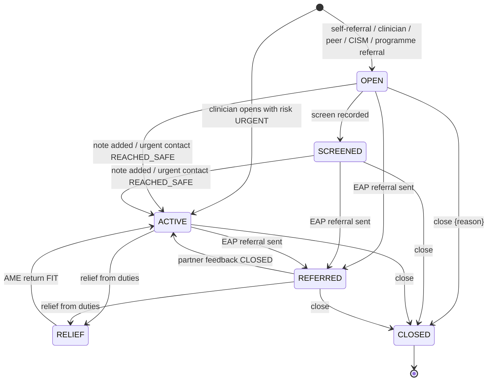

Closing is refused while an urgent item is open (`409 urgent_open`) or a relief from duties is active (`409
relief_active`); notes and EAP referrals are refused on a CLOSED case (`409 case_closed`). Risk (`LOW | MODERATE |
HIGH | URGENT`) is independent of status: the clinician sets it or the latest screen derives it (Section 7.4).

### 7.3 F01 – Confidential case type and F03 – Peer support

**Requirements:** E09-HLR-01, E09-HLR-03; E09-BL-001, -002, -006, -007, -008, -009, -015.

* Every support case sits on a **restricted kernel case**; access as in Section 5.3. Clinicians open cases
  (`POST /support/cases`), add encrypted notes and close with a reason.
* **Sharing** as in Section 5.6.
* **Volunteer register** – the coordinator maintains volunteers and training records; a volunteer is offered to crew
  only while available and with unexpired training (`GET /me/peer-support/peers` returns alias = first name, base,
  languages – no surnames).
* **Contact request** – routed to an available trained volunteer, preferring the same base and language, then the
  fewest open requests; content-free alert to the volunteer.
* **Contact log and referral** – as in Section 5.8.
* **Relief from duties** – `POST /support/relief` (AME, named PSYCH_CLINICIAN) → roster status **UNFIT** with an
  `expectedUntil`, or **UNFIT_PENDING** without; `POST /support/relief/{id}/return {decision FIT|EXTEND, until?}` by the
  AME. Status only reaches rostering (E2E: the AME ends the relief; rostering receives the status only). Relief or a
  fitness assessment for an employee without an open support case opens a `CLINICIAN` support case automatically.
* **Quarterly SMS report** – `GET /peer-support/reports/quarterly?quarter=YYYY-Qn` (SAFETY_MANAGER,
  PEER_SUPPORT_COORDINATOR, CMO) aggregates contacts by base × category with suppression; `POST …/send` publishes one
  allow-listed event per published cell to `sms-safety`. Demo: LHR / STRESS 6 is published, LHR / FATIGUE 2 and
  SIN / TRAUMA 1 are suppressed.

### 7.4 F02 – Self-referral, screening and EAP

**Requirements:** E09-HLR-02; E09-BL-003, -004, -005, -014.

* **Signposting** – `GET /me/support/signposting` returns `{items[…], emergency{text, phone}}` (deviation: an object,
  because "array + emergency" cannot be a plain array). Emergency text and number are configuration
  (`mentalhealth.emergency-text`, `mentalhealth.emergency-phone` = 999).
* **Self-referral** – `{preferredContact PHONE|APP_CHAT|VIDEO, phone?, bestTime?, concern, message? (≤ 2000,
  encrypted)}` → `{caseRef, nextContactBy}` (first contact within `mentalhealth.first-contact-working-days` = 2);
  `support.request-received`.
* **Scoring** (`rules/Screening`, pure) – PHQ-9: 9 items, 0–27; GAD-7: 7 items, 0–21; standard published bands
  (MINIMAL … SEVERE). **Urgent rule (E09-BL-004):** PHQ-9 item 9 above 0 **or** band SEVERE → `urgent=true`, risk
  URGENT; MODERATELY_SEVERE / SEVERE → HIGH. Next steps never use diagnosis wording.
* **Urgent pathway** – an urgent result creates an `urgent_item` with `callBackBy` (`mentalhealth.urgent-callback-hours`
  = 4), a same-day kernel `CALL_BACK` task and `support.urgent-callback` to the named clinicians. The clinician follows
  `GET /support/protocols/urgent-risk` and records `POST /support/cases/{id}/urgent-contact {outcome REACHED_SAFE |
  REACHED_ESCALATED_EMERGENCY | NOT_REACHED_RETRY | NOT_REACHED_WELFARE_CHECK, note}`. E2E: a PHQ-9 with a self-harm
  answer scores 11, band MODERATE, **urgent=true**.
* **Clinician-administered screens** – `POST /support/cases/{id}/screens` with 0–3 per item (9 answers for PHQ9, 7 for
  GAD7).
* **EAP referral** – `POST /support/cases/{id}/eap-referrals {partnerCode, sessionsAuthorised 1..12, urgency
  ROUTINE|PRIORITY, consentId}` (consent `TREATMENT_SHARING_PARTNER` or `EAP_REFERRAL`; the consent picker uses
  `GET /support/cases/{id}/consents?purpose=`) → status SENT, `firstAppointmentDueBy` 5 working days,
  `support.partner-referral`.
* **Partner side** – `GET /partner/eap-referrals?status=` (own organisation only, no employee id; every read
  disclosure-logged) and `POST /partner/eap-referrals/{id}/feedback {status ACCEPTED|IN_PROGRESS|CLOSED,
  attendance[{date, attended}], closureReason? COMPLETED|DISENGAGED|REFERRED_ON}`. **Any extra field → `422
  field_not_allowed`** – there is no place for clinical content.
* **Governance** – `GET /support/governance` (PSYCH_CLINICIAN, CMO): instruments, licence status, protocol version and
  sign-off `mentalhealth.governance.sign-off` = **PENDING** (E09-BL-014).

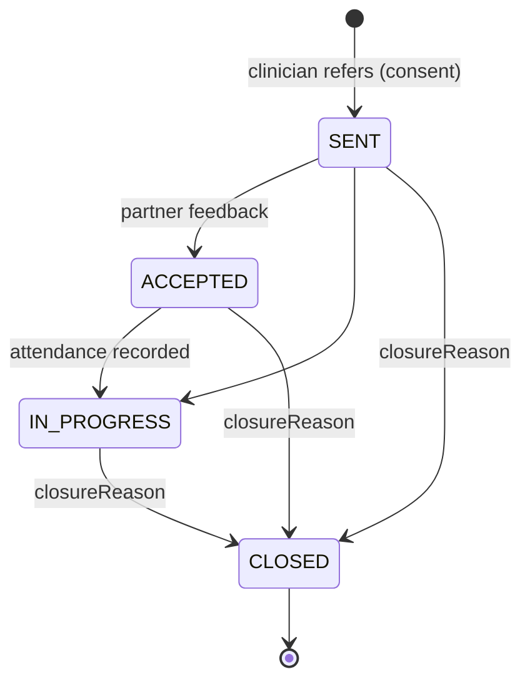

Feedback moves forward only (`409 invalid_transition`; a CLOSED referral → `409 referral_closed`); closing needs a
reason (`422 closure_reason_required`), attendance dates must lie between the referral and today
(`422 invalid_attendance`) and attended sessions cannot exceed the sessions authorised (`422 sessions_exceeded`).

### 7.5 F04 – Critical incident stress management

**Requirements:** E09-HLR-04; E09-BL-010, -011.

* **Trigger** – the incident listener opens a CISM event when severity is HIGH / CRITICAL or `incidentClass` is in
  `cism.trigger-classes` (FATALITY, ASSAULT, FUME_EVENT, AIRCRAFT_ACCIDENT, SERIOUS_INJURY, EMERGENCY_LANDING).
  Manual events: `POST /cism/events` (PSYCH_CLINICIAN, OH_CLINICIAN, SAFETY_MANAGER).
* **Affected list** (`rules/CismRules`) – the incident employee plus everyone on the same duty or proximity group
  within ± 2 h (`duty_assignment`). `offerDueBy` = occurrence + 72 h; `slaMet` per event.
* **Offers and follow-ups** – `POST /cism/events/{id}/offers` sends `cism.offer` to everyone not yet offered; the
  employee accepts or declines in the app (`/me/cism/offers`); `PUT /cism/events/{id}/affected/{employeeId}` records
  session type, attendance, follow-ups and referral to support. The daily job sends 1- and 4-week follow-ups.
* **Views** – clinicians see names; the safety manager sees counts only. E2E: affected crew come from the WZ101 roster,
  offers go out within 72 h, the safety manager sees counts only.

### 7.6 F05 – Psychosocial risk register

**Requirements:** E09-HLR-05; E09-BL-012.

* `POST /psychosocial/assessments` (HSE_OFFICER, CMO, NURSING_HEAD, HR) with factors `WORKLOAD | SHIFT_FATIGUE |
  VIOLENCE_AGGRESSION | ISOLATION | CHANGE | ROLE_CLARITY | SUPPORT | RECOGNITION`, each likelihood 1–5 × severity 1–5.
* **Scoring** (`rules/PsychosocialScoring`, ISO 45003): factor score = likelihood × severity (1–25); **RED ≥ 15,
  AMBER ≥ 8**, otherwise GREEN; the overall score is the highest factor – one red factor makes the unit red.
* Actions with owner, due date and status; controls and action titles are **screened** for clinical content because
  managers read them.
* `GET /psychosocial/dashboard` – per unit: current assessment, overdue review, open / overdue actions and the
  anonymised support-case rate per 100 staff (suppressed). `GET /workspace/psychosocial` – the manager's own unit
  (read-only for managers; the contract gives managers no action update).

### 7.7 F06 – Safety-critical mental-health fitness

**Requirements:** E09-HLR-06; E09-BL-013.

`POST /support/fitness-assessments` (AME, OH_PHYSICIAN; PSYCH_CLINICIAN contributes and reads) records standard,
medications (name, drug class, dose, start date), encrypted findings and a decision `FIT | FIT_WITH_LIMITATIONS |
TEMPORARILY_UNFIT | REFER_TO_AUTHORITY`. The decision goes to the roster as **status only** with a review task; when
`authorityReportRequired` is true a restricted `AUTHORITY_FITNESS_REPORT` is generated and signed.
`GET /support/fitness-assessments?employeeId=` returns the history.

### 7.8 API summary

| Group | Endpoints | Roles |
|---|---|---|
| Cases | `GET/POST /support/cases`, `GET /support/cases/{id}`, `POST …/{id}/notes`, `POST …/{id}/close`, `GET …/{id}/consents` | Named PSYCH_CLINICIAN |
| Placeholder | `GET /support/placeholder?employeeId=` | OH roles |
| Screening and urgent | `POST /support/cases/{id}/screens`, `GET /support/urgent`, `GET /support/protocols/urgent-risk`, `POST /support/cases/{id}/urgent-contact` | Named PSYCH_CLINICIAN |
| EAP | `POST /support/cases/{id}/eap-referrals`, `GET /support/eap-referrals`; `GET /partner/eap-referrals`, `POST /partner/eap-referrals/{id}/feedback` | Named PSYCH_CLINICIAN; PARTNER_PROVIDER (own organisation) |
| Governance | `GET /support/governance` | PSYCH_CLINICIAN, CMO |
| Peer support | `GET/POST /peer-support/volunteers`, `GET/PUT /peer-support/volunteers/{id}`, `GET /peer-support/my-requests`, `GET/POST /peer-support/contacts`, `POST /peer-support/contacts/{id}/refer`, `GET /peer-support/reports/quarterly`, `POST …/send`; `GET /support/peer-referrals`, `POST /support/peer-referrals/{id}/pick-up` | Coordinator; volunteer; SAFETY_MANAGER / coordinator / CMO; named PSYCH_CLINICIAN |
| Relief and fitness | `GET/POST /support/relief`, `POST /support/relief/{id}/return`, `GET/POST /support/fitness-assessments` | AME, named PSYCH_CLINICIAN; AME, OH_PHYSICIAN |
| CISM | `GET/POST /cism/events`, `GET /cism/events/{id}`, `POST …/{id}/offers`, `PUT …/{id}/affected/{employeeId}` | PSYCH_CLINICIAN, OH_CLINICIAN; SAFETY_MANAGER (counts) |
| Psychosocial | `GET/POST /psychosocial/assessments`, `POST/PUT …/{id}/actions[/{actionId}]`, `GET /psychosocial/dashboard`; `GET /workspace/psychosocial`, `GET /workspace/psychosocial/shared-outcomes` | HSE_OFFICER, CMO, NURSING_HEAD, HR; MANAGER (scope) |
| Employee | `GET /me/support/signposting`, `POST /me/support/self-referral`, `GET /me/support/screens/{instrument}`, `POST /me/support/screens`, `GET/PUT /me/support/sharing`, `GET /me/peer-support/peers`, `POST /me/peer-support/contact-request`, `GET /me/cism/offers`, `POST /me/cism/offers/{id}/response` | EMPLOYEE |

Additions beyond the contract: `GET /support/cases/{id}/consents`, `GET /support/relief`, `GET /support/eap-referrals`,
`GET /support/peer-referrals`, `POST /support/peer-referrals/{id}/pick-up`, `GET /peer-support/contacts`. Error codes:
non-named access to restricted `/support/**` → 404; CISM, peer-support, psychosocial and partner endpoints use
`@PreAuthorize` → 403.

### 7.9 Screens

| Screen | Route | Roles |
|---|---|---|
| Support caseload and case | `#/support/cases`, `#/support/cases/{id}` | Named PSYCH_CLINICIAN |
| Urgent call-backs (with the governance panel) | `#/support/urgent` | Named PSYCH_CLINICIAN |
| EAP referrals | `#/support/eap` | Named PSYCH_CLINICIAN |
| Mental-health fitness | `#/support/fitness` | AME (records, relief, return), OH_PHYSICIAN, PSYCH_CLINICIAN (read) |
| Peer support | `#/peer-support` | Coordinator (volunteers, quarterly report), volunteer (my requests, contact log), safety manager / CMO (report) |
| CISM | `#/cism`, `#/cism/{id}` | PSYCH_CLINICIAN, OH_CLINICIAN; SAFETY_MANAGER counts |
| Psychosocial register | `#/psychosocial` | HSE_OFFICER, CMO, NURSING_HEAD |
| Employee – support / peer support | `/support`, `/peer-support` | EMPLOYEE – the **emergency banner renders first**, even while data loads or fails; no diagnosis wording (tested in English, French and Arabic) |
| Manager – psychosocial | `/psychosocial` | MANAGER – unit assessment and shared outcomes |
| Partner – EAP referrals | `/eap-referrals` | PARTNER_PROVIDER – attendance rows and closure reason, **no free-text field** |

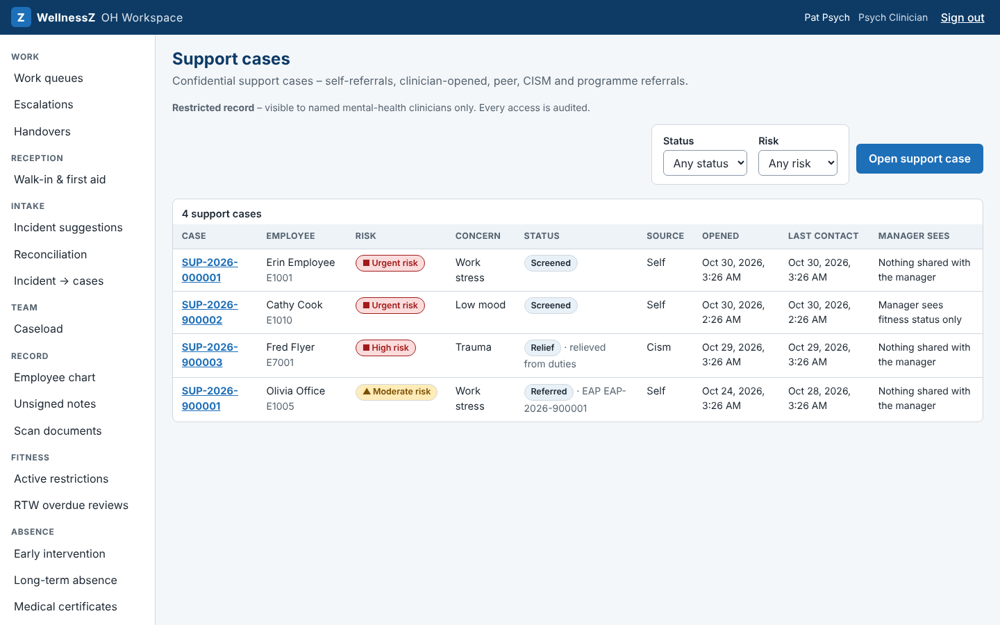

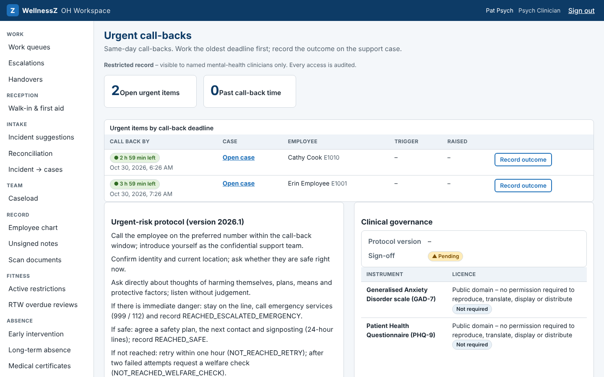

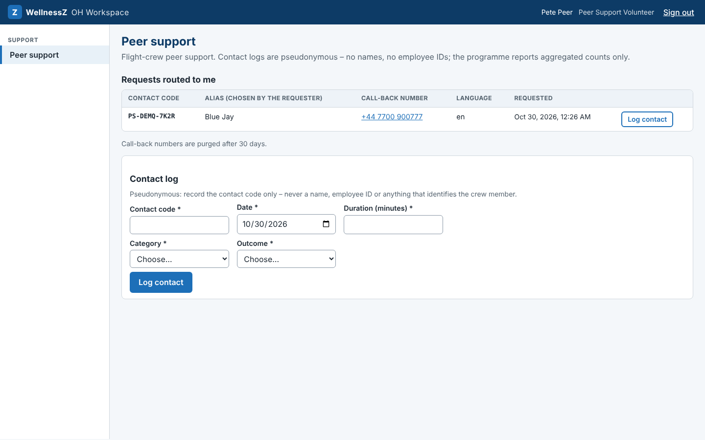

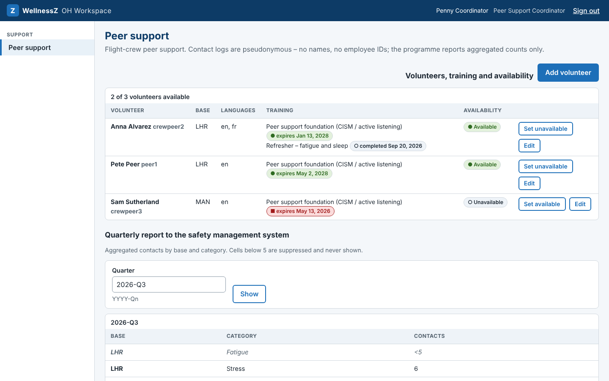

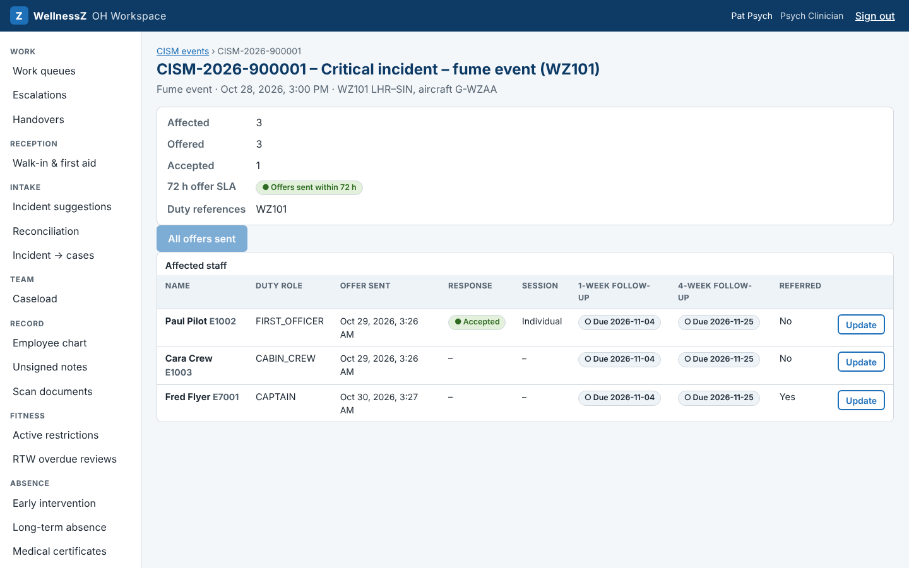

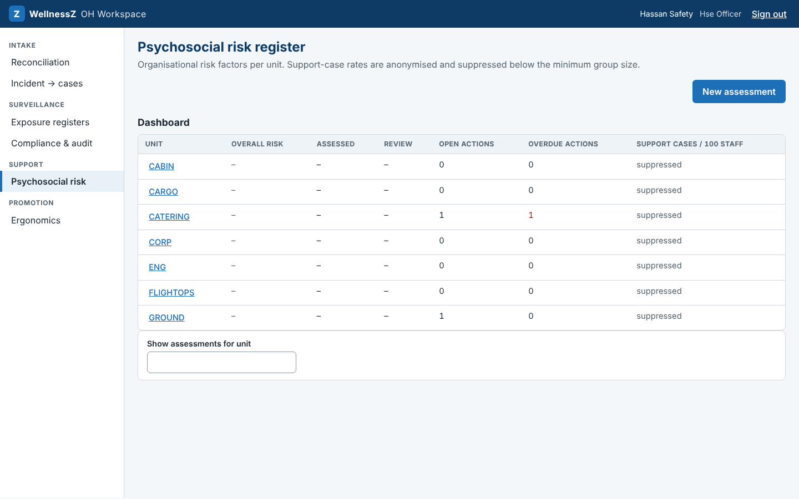

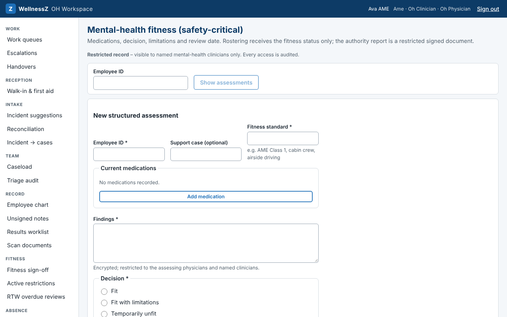

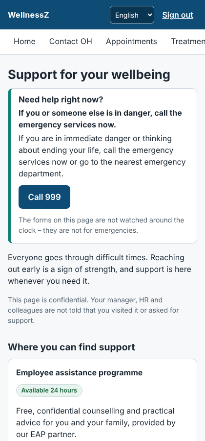

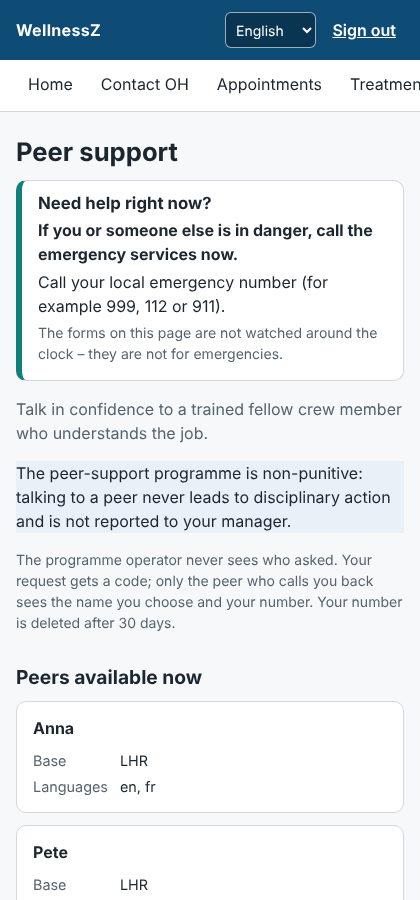

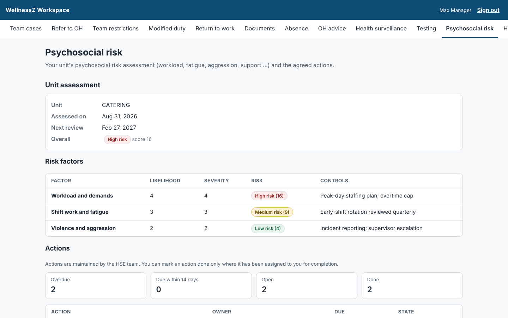

---

## 8. E10 – Drug, alcohol and psychoactive substance testing

Module `modules/wz-e10-substance` (`com.wellnessz.e10`, schema `substance`, Flyway V18, 11 tables – six JPA entities
for policy, selection, test, specimen, duty status and RTD plan; exclusions, custody events, panels and the
post-incident rule table are accessed with JDBC; 3 controllers). Packages: `policy/`, `selection/`
(`SelectionEngine`, `CoverageMath`, `SelectionService`), `trigger/` (`PostIncidentRules`, `TestWindows`,
`TriggerService`, `IncidentTestListener`), `testing/`, `collection/` (`CollectionService`, `LabService`,
`CustodyLog`), `mro/` (`MroStateMachine`, `MroService`), `pathway/` (`PathwayService`, `RtdService`,
`FollowUpScheduler`), `report/` (`StatisticsService`, `Suppression`).

### 8.1 Domain model

| Table | Content |
|---|---|
| `policy` | Per role group (`FLIGHT_CREW | CABIN_CREW | AIRSIDE_DRIVER | ENGINEER | FORKLIFT | SECURITY`): job codes, panels, random drug / alcohol rates, alcohol window (8 h), drug window (32 h), lead time, jurisdiction, consent required, approval status, approved by, optimistic version – six policies seeded **PENDING** Legal / Safety / HR approval (E10-BL-010) |
| `panel` | `DRUGS_5`, `DRUGS_10`, `ALCOHOL_BREATH` |
| `pool_exclusion` | Employee, reason (`LEAVE | LONG_TERM_ABSENCE | NOT_SAFETY_SENSITIVE`), until |
| `selection` | Role group, period, test type, pool size, pool hash, seed commitment, stored seed, selected employees, policy approval status at the time |
| `test` | Ref `DAT-YYYY-NNNNNN`, employee, reason, panels, status, due times, site, dispatch, encrypted observations (for-cause), refusal, verdict, encrypted interview note |
| `specimen` | Specimen ID, type (`URINE | ORAL_FLUID | BREATH`), collection facts, encrypted breath reading and laboratory results, validity |
| `custody_event` | `COLLECTED | SEALED | COURIER_PICKUP | LAB_RECEIVED | SPLIT_ORDERED`, time, signer – **append-only** (no update / delete grant and a trigger `custody_event_append_only` rejecting changes even for the owner) |
| `duty_status` | `AVAILABLE | REMOVED | RETURN_PENDING` since |
| `rtd_plan` | Ref `RTD-YYYY-NNNNNN`, case, evaluator, encrypted treatment provider, follow-up tests and months, status (`DRAFT | ACTIVE | RTD_PENDING | MONITORING | COMPLETED | CANCELLED`) |
| `post_incident_rule` | Seven seeded rules (near miss → ignore; lost-time injury, injury with medical treatment, vehicle / GSE collision, aircraft damage, high-severity property damage, any high-severity incident → test) |

### 8.2 Test state machine

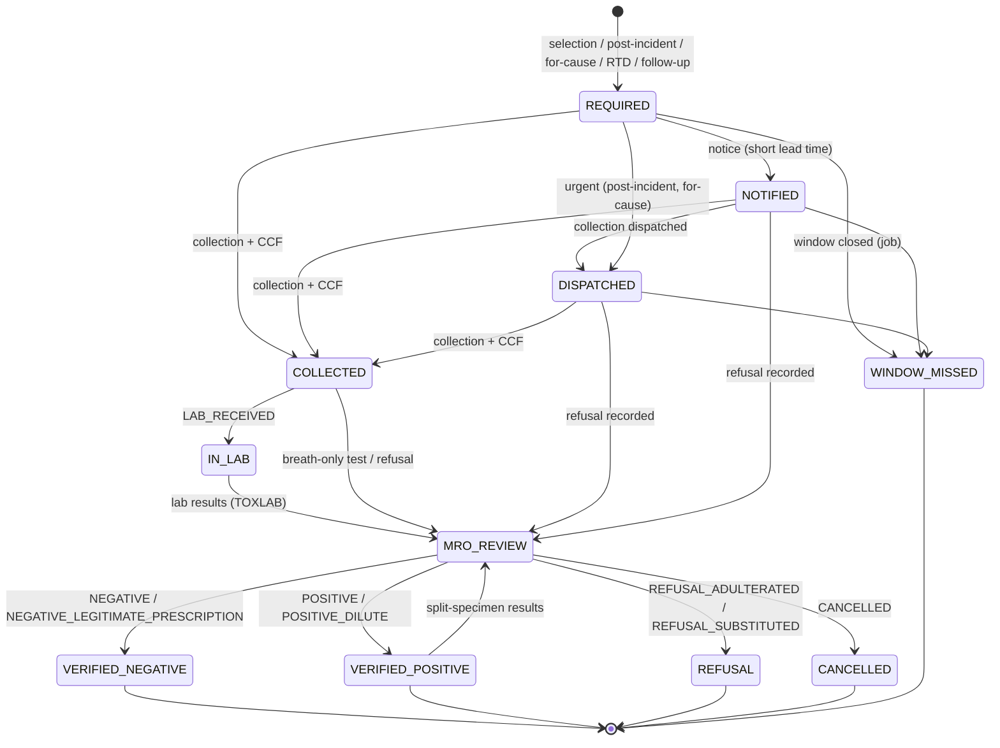

**MRO rules** (`MroStateMachine`, pure, unit tested) – a verdict is possible only in `MRO_REVIEW` (otherwise `409
invalid_state`):

| Verdict | Precondition (otherwise `422` with code) | Result |
|---|---|---|
| NEGATIVE | Results present, none non-negative, specimen not adulterated / substituted / invalid (`results_required`, `non_negative_result`, `invalid_specimen`) | VERIFIED_NEGATIVE |
| NEGATIVE_LEGITIMATE_PRESCRIPTION | A non-negative result and `prescriptionVerified=true` (`no_non_negative_result`, `prescription_not_verified`) | VERIFIED_NEGATIVE |
| POSITIVE | A non-negative result | VERIFIED_POSITIVE |
| POSITIVE_DILUTE | A non-negative result and validity DILUTE (`not_dilute`) | VERIFIED_POSITIVE |
| REFUSAL_ADULTERATED / REFUSAL_SUBSTITUTED | Validity ADULTERATED / SUBSTITUTED or a refusal recorded at collection (`no_refusal_basis`) | REFUSAL |
| CANCELLED | – (for example an invalid specimen or a documented legitimate no-show) | CANCELLED |

A split specimen is requested with a positive verdict or separately (`POST /testing/tests/{id}/split-request`); its
results return the test to `MRO_REVIEW`, and a later CANCELLED verdict reverses the positive (employee AVAILABLE, plan
cancelled).

### 8.3 F01 – Policies, pools and random selection

**Requirements:** E10-HLR-01; E10-BL-001, -002, -010.

* **Policies** – `PUT /testing/policies/{roleGroup}`: setting APPROVED requires `approvedBy`; changing any parameter
  puts the policy back to PENDING; `version` is optimistic. A PENDING policy does **not** block selections – the
  selection records `policyApprovalStatus`.
* **Pools** – from HRIS job codes; exclusions with reason and end date (`422 not_in_pool`).
* **Selection** (`SelectionEngine`) – `n = ceil(poolSize × rate % / 12)`, never more than the pool. A 256-bit seed from
  `SecureRandom` drives a partial Fisher–Yates shuffle of the sorted pool; random integers come from
  HMAC-SHA256(seed, counter) with rejection sampling, so the draw is unbiased. The SHA-256 commitment of the seed and
  the hash of the pool snapshot are stored. One selection per (role group, period, test type) → `409`; periods only
  for the previous, current or a future month.
* **Verify** – `GET /testing/selections/{id}/verify` (programme manager, AUDITOR) recomputes the draw and returns
  `reproducible`, the seed, `poolHashMatches`, `seedCommitmentMatches` and `selectionMatches` (E2E: reproducible from
  the stored seed).
* **Notify** – `POST /testing/selections/{id}/notify` creates tests REQUIRED → NOTIFIED, sends
  `testing.selection-notice` to the employee and `testing.collection-dispatch` to collectors, and returns the
  requirement rows; a second call → `409`.
* **Coverage** – `GET /testing/coverage?year=` → `{roleGroup, poolSize, targetTests, completed, coveragePct,
  behindPlan}`.

### 8.4 F02 – Post-incident and for-cause

**Requirements:** E10-HLR-02; E10-BL-003, -004.

* **Post-incident** – qualifying incidents (rule table) for employees in a pool create a POST_INCIDENT test with
  `alcoholDueAt` = occurrence + 8 h and `drugDueAt` = occurrence + 32 h and urgent dispatch (E2E: collected inside the
  alcohol window).
* **For-cause** – `POST /workspace/testing/for-cause` (MANAGER within scope, otherwise 404; SAFETY_MANAGER for anyone)
  with at least one observation (`ODOUR_OF_ALCOHOL … OTHER`), an encrypted description (≤ 2000) and the **second
  observer**; creates the requirement and dispatch. The manager's list shows status only.
* **Windows job** – uncollected tests become WINDOW_MISSED when the window closes (4 h grace for random, follow-up and
  RTD tests).

### 8.5 F03 – Collection, chain of custody, laboratory and MRO

**Requirements:** E10-HLR-03; E10-BL-005, -006.

* **Collection** – `POST /testing/tests/{id}/collection` (COLLECTOR): specimen ID, type, time, site, temperature in
  range (urine), seal intact, donor identity checked, split specimen, breath screen (g/210 L). Generates and signs a
  **restricted `CHAIN_OF_CUSTODY_FORM`** (no result content). Breath-only tests go straight to MRO_REVIEW; for mixed
  panels the first specimen moves the test to COLLECTED.
* **Custody** – `POST /testing/specimens/{specimenId}/custody {event SEALED|COURIER_PICKUP|LAB_RECEIVED, at, by}`
  (COLLECTOR, or the laboratory client for LAB_RECEIVED only); `GET …/custody` lists the chain.
* **Refusal** – `POST /testing/tests/{id}/refusal {reason NO_SHOW|REFUSED|ADULTERATION_ATTEMPT|
  SUBSTITUTION_SUSPECTED, observations}` → MRO_REVIEW.
* **Laboratory** – `GET /integration/testing/lab-orders` and `POST /integration/testing/lab-results` accept only the
  machine client bound to `substance.laboratory-code` (TOXLAB). Any other organisation and **any unbound client → 404**
  and an audit entry (E2E). Results move the test to MRO_REVIEW and send `testing.review-queue`.
* **MRO** – `GET /testing/mro/queue`, `POST /testing/tests/{id}/mro-decision {verdict, prescriptionVerified?,
  interviewNote? (encrypted), splitSpecimenRequested?}`. The confirmation cut-off for breath alcohol is shown from
  `substance.breath-alcohol-cutoff` (0.02 g/210 L).

### 8.6 F04 – Positive / refusal pathway

**Requirements:** E10-HLR-04; E10-BL-007, -008.

On VERIFIED_POSITIVE or REFUSAL, synchronously with the MRO decision:

1. Open a **restricted `SUBSTANCE` kernel case** (general OH users → 404 on it).
2. Set duty status **REMOVED** and publish it through `publishFitness` – status only to rostering and HR;
   `testing.status` to the crew-scheduling and HR mailboxes, both disclosure-logged. Non-crew roles (ramp and others)
   receive only the HR fitness feed – existing kernel behaviour for non-aeromedical safety categories.
3. Call `SupportProgrammeReferral.refer(…, "SUBSTANCE_POSITIVE" | "SUBSTANCE_REFUSAL", "DA_TEST", ref)` – a
   confidential support case opens in E09 (audit `DA_SUPPORT_REFERRAL`).
4. Draft a **return-to-duty plan**.

**Return to duty** – `POST /testing/rtd-plans` (MRO, OH_PHYSICIAN) schedules the follow-up tests on random,
unannounced dates (re-dated from the actual return to duty; future dates visible to the MRO only).
`POST /testing/rtd-plans/{id}/evaluation {outcome READY|NOT_READY}` – READY requires a VERIFIED_NEGATIVE
RETURN_TO_DUTY test before the duty status becomes AVAILABLE.

### 8.7 F05 – Programme reporting

**Requirements:** E10-HLR-05; E10-BL-009.

`GET /testing/statistics?year=` (DA_PROGRAMME_MANAGER, CMO, SAFETY_MANAGER) by reason × role group `{tests,
verifiedPositive, refusals, positiveRatePct, suppressed}`; `GET /testing/reports/annual?year=&format=pdf|csv` (CMO,
DA_PROGRAMME_MANAGER) – anonymised regulatory template.

### 8.8 API summary

| Group | Endpoints | Roles |
|---|---|---|
| Programme | `GET /testing/policies[/{roleGroup}]`, `PUT /testing/policies/{roleGroup}`, `GET /testing/pools`, `POST /testing/pools/{roleGroup}/exclusions`, `POST/GET /testing/selections`, `GET /testing/selections/{id}/verify`, `POST /testing/selections/{id}/notify`, `GET /testing/coverage` | DA_PROGRAMME_MANAGER (CMO, SAFETY_MANAGER read policies; AUDITOR verify; CMO coverage) |
| Requirements | `GET /testing/requirements` | DA_PROGRAMME_MANAGER, COLLECTOR, MRO |
| Collection | `POST /testing/tests/{id}/collection`, `POST/GET /testing/specimens/{specimenId}/custody`, `POST /testing/tests/{id}/refusal` | COLLECTOR (lab client for LAB_RECEIVED) |
| Laboratory | `GET /integration/testing/lab-orders`, `POST /integration/testing/lab-results` | INTEGRATION bound to TOXLAB |
| MRO | `GET /testing/mro/queue`, `POST /testing/tests/{id}/mro-decision`, `POST /testing/tests/{id}/split-request` | MRO, designated OH_PHYSICIAN |
| Return to duty | `GET/POST /testing/rtd-plans`, `GET /testing/rtd-plans/{id}`, `POST /testing/rtd-plans/{id}/evaluation` | MRO, OH_PHYSICIAN |
| Workspace | `POST/GET /workspace/testing/for-cause`; `GET /workspace/testing/status` | MANAGER (scope), SAFETY_MANAGER; HR, CREW_SCHEDULING (scope) |
| Reporting | `GET /testing/statistics`, `GET /testing/reports/annual` | DA_PROGRAMME_MANAGER, CMO (SAFETY_MANAGER statistics) |
| Employee | `GET /me/testing` | EMPLOYEE – notices `{ref, status (masked), reportBy, siteCode}`, no results |

Additions beyond the contract: `GET /testing/specimens/{specimenId}/custody`, `GET /testing/rtd-plans/{id}`.

### 8.9 Screens

| Screen | Route | Roles |
|---|---|---|
| Policies, pools, selections | `#/testing/policies`, `#/testing/pools`, `#/testing/selections` | DA_PROGRAMME_MANAGER (CMO, SAFETY_MANAGER read policies) |
| Requirements and collection | `#/testing/requirements`, `#/testing/collection` | COLLECTOR (scanner-friendly specimen entry; urine needs temperature and intact seal, breath 0–1 g/210 L) |
| MRO queue | `#/testing/mro` | MRO – never the programme manager or a general physician |
| Return to duty | `#/testing/rtd` | MRO, OH_PHYSICIAN |
| Statistics and annual report | `#/testing/reports` | DA_PROGRAMME_MANAGER, CMO, SAFETY_MANAGER |
| Employee – workplace checks | `/testing` | EMPLOYEE – neutral phase (`REPORT | DONE | MISSED | CANCELLED`) with a countdown to `reportBy`; the raw status is not kept |
| Manager – testing | `/testing` | MANAGER, SAFETY_MANAGER: for-cause form and own requests; HR, CREW_SCHEDULING: duty-status list |

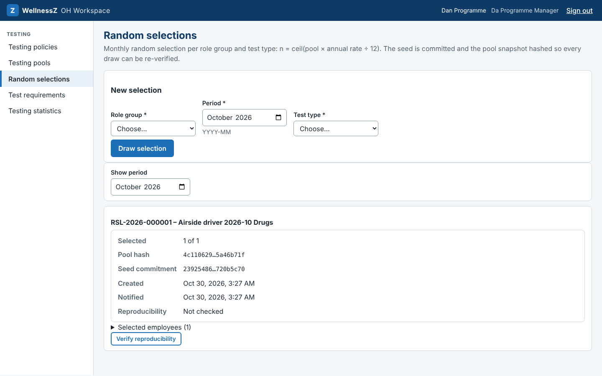

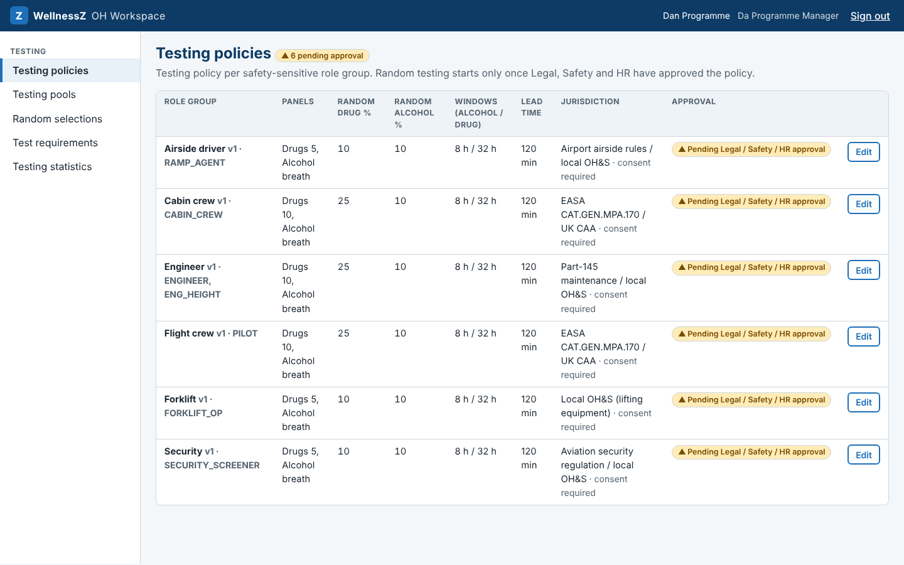

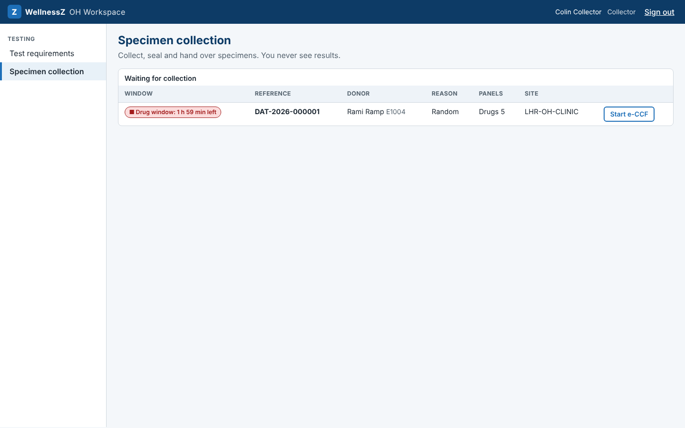

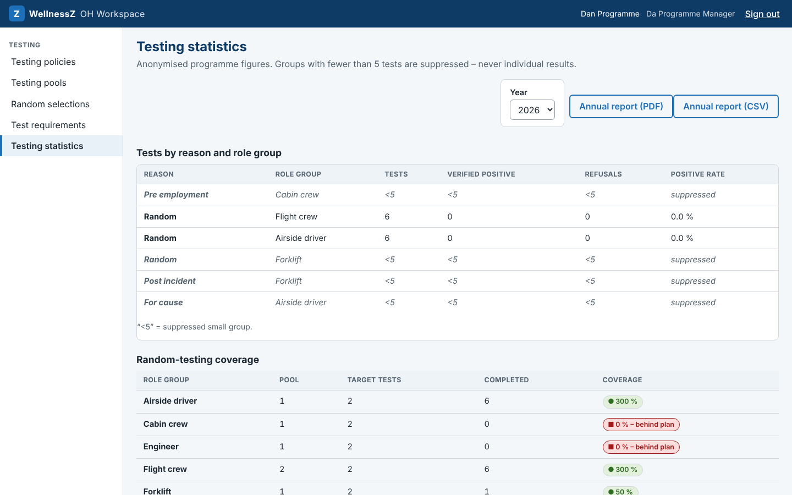

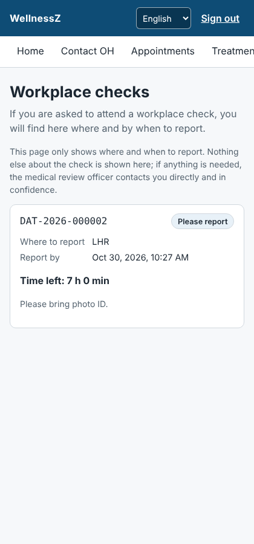

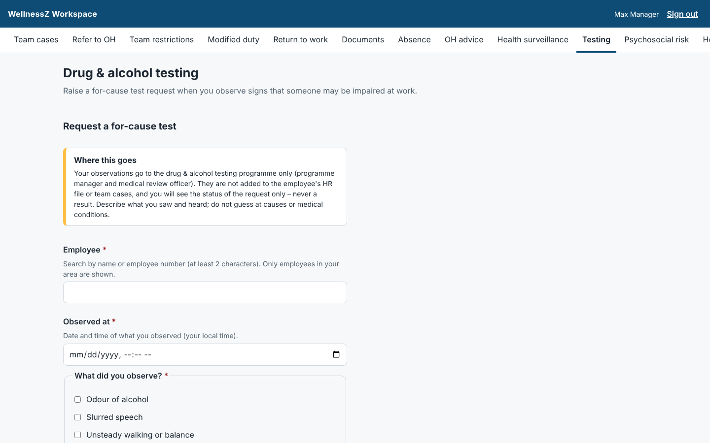

---

## 9. E11 – Travel health, communicable disease and exposures

Module `modules/wz-e11-travelhealth` (`com.wellnessz.e11`, schema `travelhealth`, Flyway V19, 18 JPA entities over 20
tables, 6 controllers). Packages: `travel/` (`TravelService`, `TravelRecommendations`), `communicable/`
(`CommunicableService`, `TracingRules`, `MonitoringSchedule`), `exposure/` (`ExposurePathwayService`,
`ProtocolTimers`, `ExposureIncidentListener`), `campaign/` (`VaccinationCampaignService`, `UptakeMaths`),
`advisory/` (`HealthAdvisoryService`, `AdvisoryTargeting`), `publichealth/` (`PublicHealthReportService`). E11 uses
the E07 `ImmunisationService` / `Booker` / `VaccineAdministrationRepository` and the E05 `FoodHandlerService` through
their public APIs.

### 9.1 Domain model

| Table | Content |
|---|---|
| `destination` | Country code, name, risks, recommended vaccines, prophylaxis, advice, source (`IN_HOUSE | LICENSED`), reviewed on, optional station codes – **15 seeded, in-house** (licensed source decision E11-BL-002 pending) |
| `consultation`, `consultation_reminder` | Trip (destinations, dates, purpose `LAYOVER | POSTING | BUSINESS`), encrypted advice and prophylaxis, certificate document; reminder marker (at most every 30 days per employee and country) |
| `condition` | Nine seeded conditions (NOROVIRUS, SALMONELLA, HEP_A, INFLUENZA, COVID19, MEASLES, TB, CHICKENPOX, MENINGOCOCCAL): notifiable, report within hours, exclusion days, food-handler exclusion, monitoring days, return criteria |
| `cd_case` | Ref `CD-YYYY-NNNNNN`, kernel case, condition, onset, confirmation (`confirmed_at`), status (`SUSPECTED | CONFIRMED | EXCLUDED | ISOLATING | CLEARED`), exclusion decision and dates, return criteria, report due, tracing KPI (`trace_generated_at`, `trace_hours`) |
| `contact`, `check_in` | Contacts (`SAME_DUTY | PROXIMITY_GROUP | FACILITY`, duty ref, overlap minutes, `HIGH | MEDIUM | LOW`, notified, monitoring until); daily check-ins (`PENDING | DONE | MISSED`, symptoms, temperature) |
| `pathway`, `chemical` | Five pathway templates with timer offsets and serology; six chemicals with UN number, SDS link and hazards |
| `exposure`, `exposure_task` | Ref `EXP-YYYY-NNNNNN`, kernel case, pathway, occurrence, encrypted details, chemical, flight; tasks of kind `TIMER | SEROLOGY` with due time and status, encrypted notes |
| `campaign`, `campaign_invitation`, `campaign_decline`, `adverse_event` | Ref `VC-YYYY-NNNNNN`, vaccine, eligibility, dates, sites, target uptake; invitations with response; encrypted decline reasons; adverse events with encrypted actions |
| `advisory`, `advisory_target` | Title, destination and / or base, roles, severity, body, validity; targets (`ROSTERED | BASE_ROLE`, duty ref) with acknowledgement |
| `ph_report`, `ph_correspondence` | Ref `PHR-YYYY-NNNNNN`, either a communicable case or an exposure (exactly one), authority, document, due, status (`PENDING | SUBMITTED`), channel; correspondence in / out with encrypted summary and optional document |

### 9.2 F01 – Travel and posting consultation

**Requirements:** E11-HLR-01; E11-BL-001, -002.

* `GET /travel/destinations[/{cc}]` – OH roles get full content; employees get advice fields only. `PUT` by
  OH_PHYSICIAN, CMO.
* `POST /travel/consultations` (clinicians) – recommendations (`TravelRecommendations`) compare the destinations'
  recommended vaccines with the employee's E07 immunisation status (limited to the E07 vocabulary); the response
  includes `recommendations[]`, `recommendedProphylaxis[]` and `lateConsultation`. Vaccines given are recorded in E07
  (mirrored to E03) with consent confirmed, and a signed `TRAVEL_HEALTH_CERTIFICATE` is shared with the employee
  (`certificateDocumentId`).
* `GET /me/travel` – consultations, certificates and **upcoming roster destinations** (from `duty_assignment`, mapped to
  a country) with advice. Daily reminders `travel.consultation-due` for crew rostered to a destination within
  `travelhealth.consultation.lookahead-days` (30).

### 9.3 F02 – Communicable disease and contact tracing

**Requirements:** E11-HLR-02; E11-BL-003, -004, -005, -013.

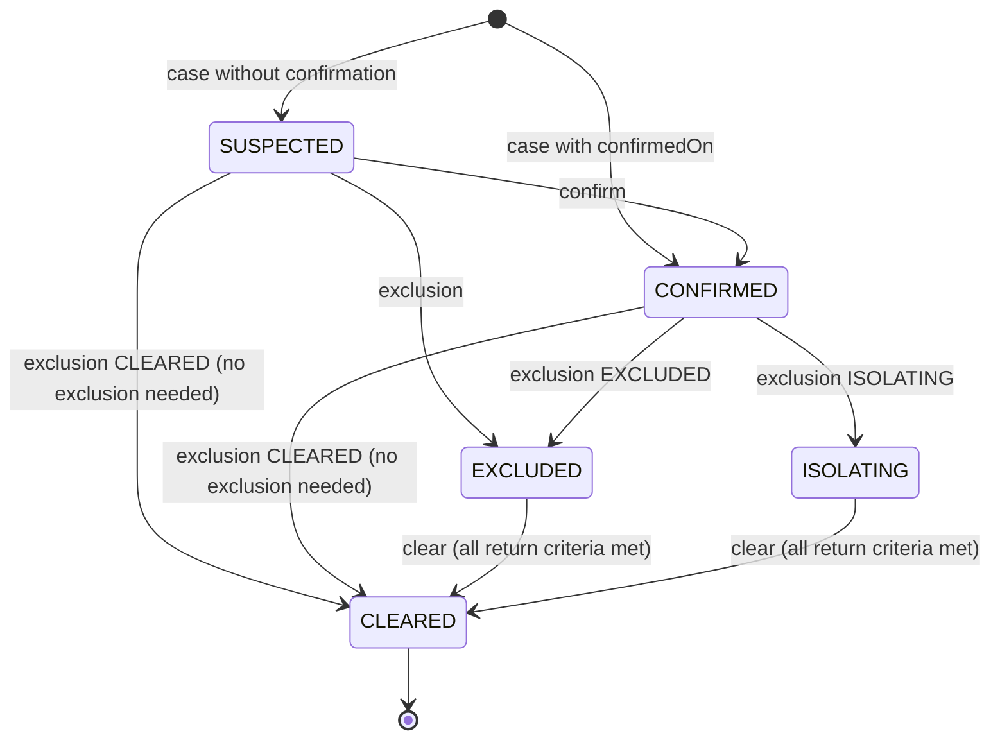

* **Exclusion** – `POST /communicable/cases/{id}/exclusion {decision, from, until?, returnCriteria[]}`. EXCLUDED /
  ISOLATING publish fitness **TEMPORARILY_UNFIT** to rostering / HR (status only); food handlers with a
  food-handler-excludable condition go through the **E05 exclusion**, so catering hygiene sees status and dates only.
  Each status disclosure is written to the disclosure log. Clearing an excluded case through `/exclusion` →
  `422 use_clear`.
* **Clearance** – `POST /communicable/cases/{id}/clear {criteriaMet[]}`; every return criterion must be met, otherwise
  `422 return_criteria_not_met`.
* **Tracing** (`TracingRules`) – `POST /communicable/cases/{id}/trace {windowFrom, windowTo, include[SAME_DUTY |
  PROXIMITY_GROUP | FACILITY]}` reads `duty_assignment` (window ≤ `travelhealth.tracing.max-window-days` = 21).
  **HIGH** = same proximity group for at least 15 minutes (`travelhealth.tracing.high-risk-minutes`); **MEDIUM** = at
  least 15 minutes on the same duty or in the same facility; **LOW** = shorter. The first trace stores
  `trace_generated_at` and `trace_hours` from confirmation; `traceWithinKpi` compares with 4 h. E2E: contacts produced
  in **1.03 h**; the demo norovirus case on catering line CAT-LINE-2 returns E1010 and M2001 as HIGH.
* **Notification and monitoring** – `POST …/contacts/notify {contactIds[]}` sends `tracing.contact-notice` (no
  condition, no index case) and schedules daily check-ins for the condition's monitoring days. A symptomatic check-in
  (`/me/check-ins/{id}`, or a temperature at or above `travelhealth.check-in.fever-threshold-c` = 38.0) alerts the case
  creator with `exposure.timer-alert` (level "symptomatic contact") and adds a call-back task; missed check-ins are
  marked MISSED by the daily job.
* Additions beyond the contract: `GET /communicable/cases`, `GET /communicable/cases/{id}`,
  `POST /communicable/cases/{id}/confirm`.

#### Outbreak playbook and tabletop exercise (E11-BL-013)

The playbook is configuration and procedure only; no additional code is needed. It uses the functions above in this
order:

| Step | GI outbreak in catering | Respiratory outbreak at a crew base | System function |
|---|---|---|---|
| 1. Index case | Food handler reports vomiting / diarrhoea; nurse opens a NOROVIRUS (or SALMONELLA) case | Crew member tests positive; nurse opens an INFLUENZA / COVID19 / MEASLES case | `POST /communicable/cases`, `…/confirm` |
| 2. Exclude | EXCLUDED; E05 food-handler exclusion, catering hygiene sees status and dates | ISOLATING; rostering sees TEMPORARILY_UNFIT | `…/exclusion` |
| 3. Trace (≤ 4 h) | Catering line / shift (`SHIFT`, proximity group CAT-LINE-n), facility | Flight duties and aircraft (`CREW_ROSTER`, proximity group = registration), crew room (`FACILITY`) | `…/trace`, KPI `traceWithinKpi` |
| 4. Notify and monitor | Contacts notified without naming the case; daily check-ins | Same | `…/contacts/notify`, `/me/check-ins` |
| 5. Report | Notifiable → `PUBLIC_HEALTH_REPORT` to `UKHSA_LOCAL` within `reportWithinHours` | Same | `/public-health/reports` |
| 6. Advise | Base-staff advisory for the catering unit (`baseCode` + job codes) | Advisory to crew rostered to the affected destination / base | `/advisories` |
| 7. Vaccinate (where relevant) | HEP_A campaign for eligible staff | Influenza campaign by subsidiary | `/vaccination-campaigns` |
| 8. Clear | Return criteria met (for example symptom-free 48 h) | Return criteria met | `…/clear` |

The **tabletop exercise** walks the two scenarios with the demo data (norovirus case CD-…-900001 on CAT-LINE-2, the
WZ101 / WZ205 crew rosters) and records timings against the 4-hour tracing and statutory reporting targets. Running
and minuting the exercise is a business task for the Nursing Head and the CMO.

### 9.4 F03 – Exposure pathways with protocol timers

**Requirements:** E11-HLR-03; E11-BL-006, -007, -008, -009.

| Pathway | Timers (offset from occurrence) and follow-up |
|---|---|
| `NEEDLESTICK_BBP` | First aid and wound care 15 min, risk assessment 1 h, **PEP decision 2 h**, source testing (with consent) 24 h; serology at 6 weeks, 3 and 6 months (`SEROLOGY_6W`, `SEROLOGY_3M`, `SEROLOGY_6M`) |
| `CHEMICAL_DGR` | SDS review 15 min, decontamination 30 min, clinical monitoring review 4 h, industrial hygiene notified 24 h; SDS link from the chemical register (six seeded: Jet A-1, hydraulic fluid, de-icing fluid, dry ice, lithium battery, quaternary-ammonium disinfectant) |
| `CABIN_FUME` | Symptom protocol 1 h, biomonitoring sample 6 h, safety report linked 24 h, authority-report task 72 h |
| `HEAT_ILLNESS` | Active cooling 15 min, return-to-work criteria 24 h, anonymised prevention feedback to HSE 72 h |
| `BITE_STING` | First aid 15 min, rabies / tetanus / allergy risk assessment 2 h, follow-up review 48 h |

* `POST /exposures` (clinicians) creates the exposure, a kernel case and the tasks; incidents with a matching
  `exposureType` start the pathway automatically (once per incident).
* `POST /exposures/{id}/tasks/{code}/complete {note?}` completes a timer or serology task. Exposure status values are
  OPEN, OVERDUE and CLOSED (COMPLETED accepted as an alias of CLOSED).
* The `exposure-timers` job alerts once per task when due within 30 minutes (`travelhealth.exposure.alert-before-minutes`)
  and once when overdue. Reports on exposures are due 72 h after the exposure (`travelhealth.public-health.exposure-report-hours`).
* E2E: needle-stick pathway with protocol timers – PEP decision due within hours.

### 9.5 F04 – Vaccination campaigns

**Requirements:** E11-HLR-04; E11-BL-010.

* `POST /vaccination-campaigns` (NURSING_HEAD, OH_CLINICIAN) with eligibility (all, job codes or subsidiaries), dates,
  sites and target uptake; `POST …/{id}/invite` (NURSING_HEAD) sends `campaign.invitation` (no vaccine or disease
  named). Bookings are made when the employee **accepts** (`/me/vaccination-campaigns/{id}/response`), through
  `AppointmentBooking` (`VACCINATION`).
* **Fast entry** – `POST …/{id}/administrations` by `employeeId` or `badgeId`, `lotNumber` or a GS1 `lotBarcode`,
  recorded in the E07 registry with the campaign id. Declines (encrypted reason) and adverse events
  (`LOCAL_REACTION | FEVER | SYNCOPE | ANAPHYLAXIS | OTHER`, severity) are recorded.
* `GET …/{id}/uptake?groupBy=SUBSIDIARY|DEPARTMENT` (NURSING_HEAD, CMO) → `{key, eligible, vaccinated, declined,
  uptakePct, suppressed}` (E2E: influenza uptake by subsidiary with small groups suppressed).

### 9.6 F05 – Health advisories

**Requirements:** E11-HLR-05; E11-BL-011.

* `POST /advisories` (OH_PHYSICIAN, CMO, AME) – targets (`AdvisoryTargeting`): **crew rostered to the destination**
  within the validity window (`duty_assignment`, always targeted) plus base staff whose job codes match `roles[]`
  (deviation: `roles[]` are read as job codes). `advisory.published` to each target; the daily job re-targets newly
  rostered crew. The body is general destination advice and is **not** screened for clinical words (the screen would
  otherwise reject disease names).
* `GET /advisories/{id}/acknowledgements` → `{targeted, acknowledged, ratePct, suppressed, pending[]}` – statistics
  suppressed below k, `pending[]` kept for OH follow-up. E2E: the DXB advisory reaches crew rostered to Dubai, with
  acknowledgement tracking and small counts suppressed.

### 9.7 F06 – Public-health reporting

**Requirements:** E11-HLR-06; E11-BL-012.

* `POST /public-health/reports {communicableCaseId? | exposureId?, authorityCode}` (OH_PHYSICIAN, CMO) generates the
  `PUBLIC_HEALTH_REPORT`; `dueAt` from the condition's `reportWithinHours` (or 72 h for exposures).
* `POST …/{id}/submit {channel EMAIL|PORTAL|PHONE, submittedAt, reference?}`; correspondence in / out as text
  (`POST …/correspondence`) or as an uploaded document (`POST …/correspondence/upload`, stored as
  `AUTHORITY_CORRESPONDENCE`).
* `GET /public-health/reports?status=PENDING|OVERDUE|SUBMITTED` with `hoursLeft` and `submittedOnTime`; the hourly job
  sends `public-health.report-due` 12 h before the deadline. E2E: notifiable-disease report submitted within the
  statutory time.

### 9.8 API summary

| Group | Endpoints | Roles |
|---|---|---|
| Travel | `GET /travel/destinations[/{cc}]`, `PUT /travel/destinations/{cc}`, `POST/GET /travel/consultations`, `GET /travel/recommendations`, `GET /me/travel` | OH roles / EMPLOYEE (advice); OH_PHYSICIAN, CMO; clinicians; EMPLOYEE |
| Communicable | `GET /communicable/conditions`, `POST/GET /communicable/cases`, `GET /communicable/cases/{id}`, `POST …/{id}/confirm`, `…/exclusion`, `…/trace`, `GET …/{id}/contacts`, `POST …/{id}/contacts/notify`, `…/clear`; `GET /me/check-ins`, `POST /me/check-ins/{id}` | OH roles (conditions); clinicians; EMPLOYEE |
| Exposures | `GET /exposures/pathways`, `GET /exposures/chemicals`, `POST/GET /exposures`, `GET /exposures/{id}`, `POST /exposures/{id}/tasks/{code}/complete` | OH roles (templates); clinicians |
| Vaccination | `POST/GET /vaccination-campaigns`, `GET …/{id}`, `POST …/{id}/invite`, `POST …/{id}/administrations`, `…/declines`, `POST/GET …/{id}/adverse-events`, `GET …/{id}/uptake`; `GET /me/vaccination-campaigns`, `POST /me/vaccination-campaigns/{id}/response` | NURSING_HEAD, OH_CLINICIAN (create); NURSING_HEAD (invite); clinicians; NURSING_HEAD, CMO (uptake); EMPLOYEE |
| Advisories | `POST /advisories`, `GET /advisories[/{id}]`, `GET /advisories/{id}/acknowledgements`; `GET /me/advisories`, `POST /me/advisories/{id}/acknowledge` | OH_PHYSICIAN, CMO, AME; OH roles; EMPLOYEE |
| Public health | `POST /public-health/reports`, `POST …/{id}/submit`, `POST …/{id}/correspondence`, `POST …/{id}/correspondence/upload`, `GET /public-health/reports[/{id}]` | OH_PHYSICIAN, CMO; OH roles (read) |

Additions beyond the contract: communicable case list, detail and confirm; campaign detail and adverse-event list;
advisory detail; report detail; correspondence upload. New table `consultation_reminder`.

### 9.9 Screens

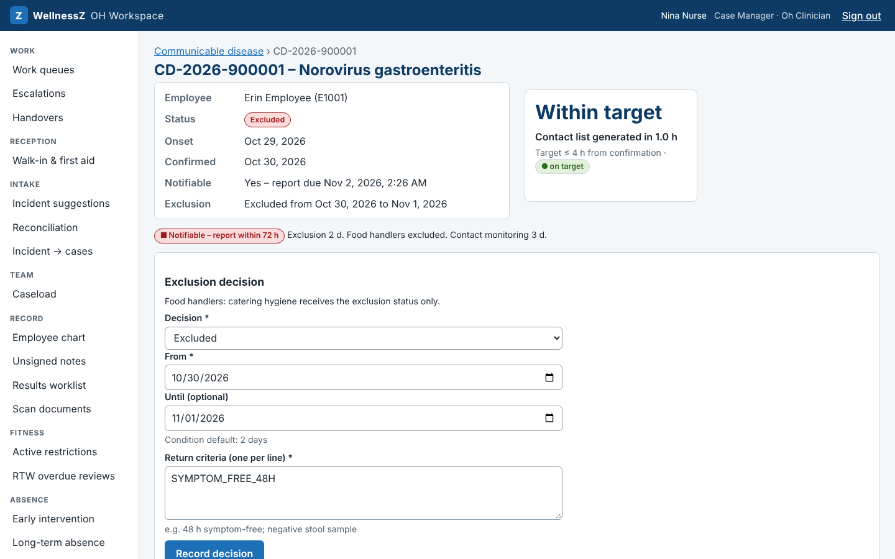

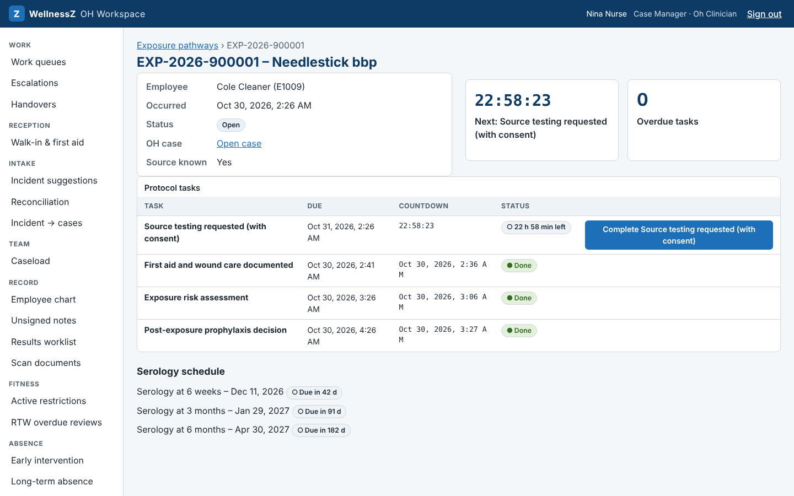

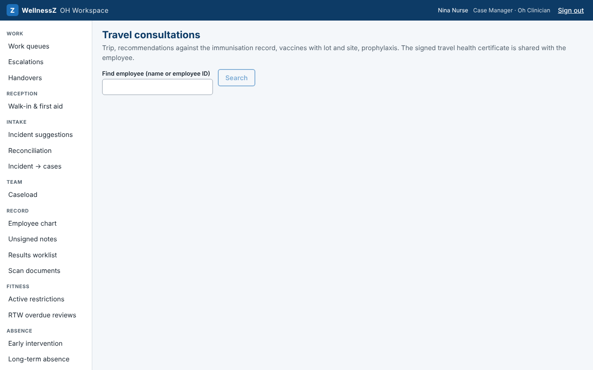

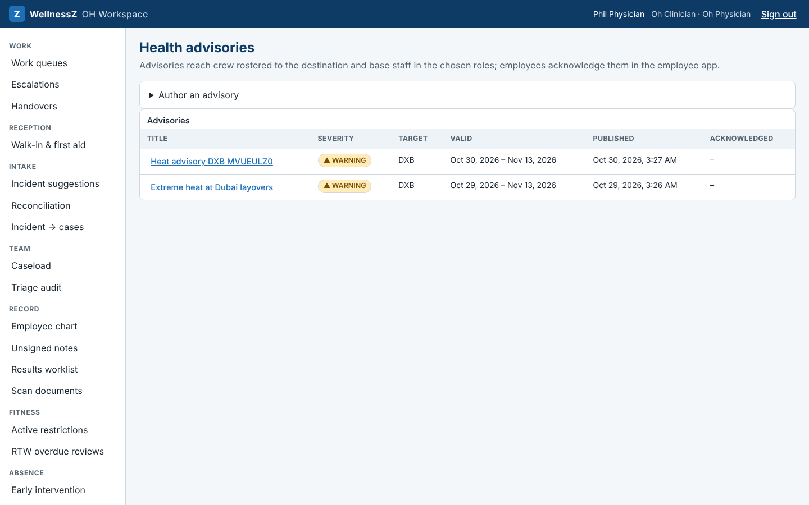

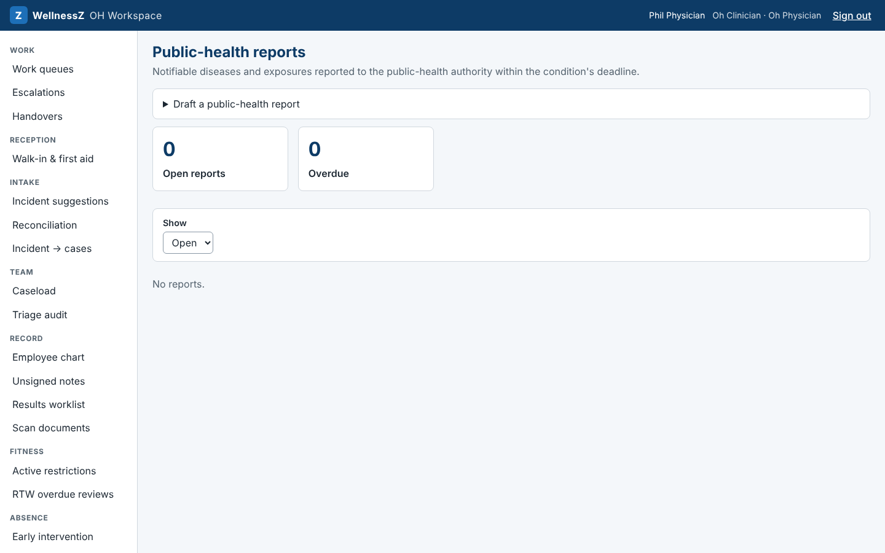

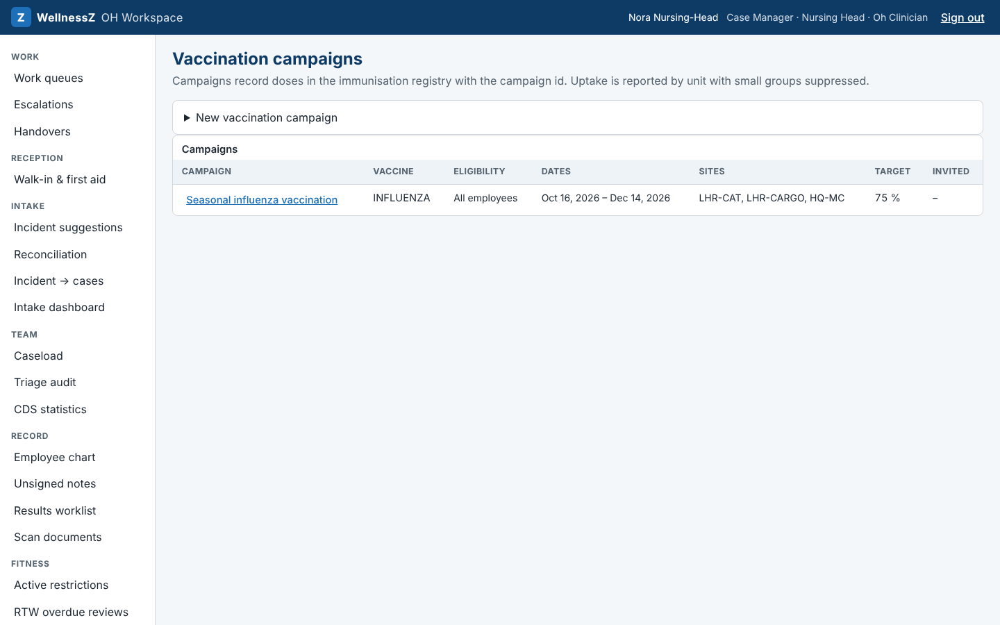

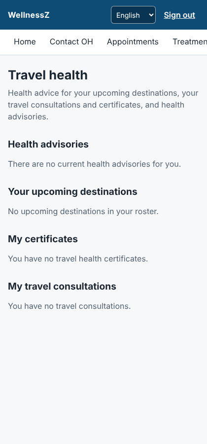

OH Workspace routes: `#/travel/destinations`, `#/travel/consultations`, `#/communicable` (+ `/{id}` tracing),
`#/exposures` (+ `/{id}` timers), `#/vaccination-campaigns`, `#/advisories`, `#/public-health` (nav groups "Public
health"). Employee app: `/travel` (consultations, certificates, advisories with acknowledgement) and `/check-ins`.

---

## 10. E12 – Health promotion, wellbeing and prevention

Module `modules/wz-e12-promotion` (`com.wellnessz.e12`, schema `promotion`, Flyway V20, 13 JPA entities over 13
tables, 4 controllers). Packages: `campaign/` (`PromotionCampaignService` – renamed because E14 already has a
`campaignService` bean – and `PromotionAnalyticsService`), `screening/` (`ScreeningService`, `EducationService`),
`ergonomics/ErgonomicsService`, `wearable/` (`WearableService`, `WearableConsentListener`), `rules/` (pure:
`ScreeningThresholds`, `ErgonomicScoring`, `Suppression`, `InsightRules`, `WearableGate`).

### 10.1 Domain model

| Table | Content |
|---|---|
| `campaign`, `campaign_invitation` | Title, risk (`MSK | HEARING | METABOLIC | FATIGUE | MENTAL_WELLBEING`), objective, target units, insight ref, budget, dates, owners, KPIs, status (`PLANNED | ACTIVE | COMPLETED | CANCELLED`); invitations sent on publication – **five portfolio campaigns seeded PLANNED** (E12-BL-008: MSK ramp / cargo / catering, hearing airside / engineering, fatigue and sleep, metabolic corporate, mental wellbeing) |
| `participation` | Campaign, employee, activity, time, value (unique per campaign, employee, activity and time) – from the campaign app, screenings and wearables |
| `screening_event`, `screening_participant`, `screening_result` | Event (type `BIOMETRIC | MSK | HEARING | VISION | MENTAL_WELLBEING`, site, date, status `PLANNED | COMPLETED | CANCELLED`); participants (`INVITED | BOOKED | SCREENED`); encrypted measures and flags, abnormal flag, follow-up case, letter |
| `education_attendance` | Hearing-conservation education: employee, programme, session date |
| `ergonomic_checklist` | Three checklists (`DSE_WORKSTATION`, `MANUAL_HANDLING`, `TASK`) with weighted items and RAG bands (amber from 30; red from 60, manual handling 55) |
| `ergonomic_assessment`, `ergonomic_photo`, `ergonomic_action` | Assessment (type, unit, job code, optional employee, location, item scores, screened findings, risk score, RAG, job-demand profile); photos (`ERGONOMIC_PHOTO` documents); actions (`OPEN | DONE`) |
| `wearable_enrolment`, `wearable_daily` | Enrolment (campaign, device type, consent, `ACTIVE | WITHDRAWN`, one active per employee and campaign); daily aggregates (`STEPS | SLEEP_MINUTES | ACTIVE_MINUTES`) |

### 10.2 F01 – Campaign planner and F05 – analytics

**Requirements:** E12-HLR-01, E12-HLR-05; E12-BL-001, -006, -008.

* **Insights** – `GET /promotion/insights?risk=&months=1..36` (HEALTH_PROMOTION_LEAD, CMO, NURSING_HEAD): rows
  `{ref, unitCode, risk, indicator, value?, period, suppressed}` from kernel cases (`MSK_INJURY_CASES`,
  `NIGHT_SHIFT_CASES`), intake incidents (`MSK_INCIDENTS`, `NIGHT_SHIFT_INCIDENTS`, `NOISE_EXPOSURE_INCIDENTS`), E03
  audiometry (`AUDIOMETRY_ABNORMAL`, `AUDIOMETRY_STS`) and E12 screenings (`ABNORMAL_BIOMETRIC_SCREENS`,
  `HIGH_MSK_SCORE_SCREENS`, `LOW_WELLBEING_SCREENS`). **Restricted-class cases are excluded**; E06 absence is not
  used (ArchUnit). Suppression with complementary suppression (Section 5.9). An insight `ref` can be used as a
  campaign's `insightRef`; the planner opens with risk, unit and insight pre-filled.
* **Campaigns** – `POST/PUT /promotion/campaigns` (HEALTH_PROMOTION_LEAD; CMO may read); title, objective and owners
  are screened for clinical content. `POST …/{id}/publish` sets ACTIVE, invites active staff in the target units with
  `campaign.invitation` and sends the flat `CampaignPublished` event to the `campaign-app` outbox → `{campaign,
  newlyInvited, messageId}`.
* **Report** – `GET /promotion/campaigns/{id}/report?groupBy=unit|subsidiary|jobCode|location[&format=csv]`
  (HEALTH_PROMOTION_LEAD, CMO) → `{participation[], total, outcomes[{metric, baseline, current, delta, n, suppressed}],
  kpis[{metric, target, actual, met}], minGroupSize}`. Outcomes come from screening measures, wearable data and, for MSK
  campaigns, the change in MSK cases. JSON without `format`, CSV with `format=csv`. Demo: the MSK campaign has 7 invited
  and 5 participants; with the default minimum group size only the TOTAL row (71.4 %) shows.

### 10.3 F02 – Screening events and follow-up

**Requirements:** E12-HLR-02; E12-BL-002, -007.

* Events and participants (HEALTH_PROMOTION_LEAD and clinician roles); adding participants books them through
  `AppointmentBooking` (service from `promotion.screening.service.<TYPE>`); anyone who cannot be booked stays INVITED.
  The health promotion lead sees `participantCount` and `screenedCount` only – the participant list and result entry
  are for clinicians.
* **Results** – `POST …/{id}/results` (clinicians, access checked through `EmployeeRecordAccess`), from the day before
  the event; only registered participants (`422 not_registered`), one result each (`409`). Thresholds
  (`ScreeningThresholds`, configuration): systolic ≥ 140, diastolic ≥ 90, BMI ≥ 30, glucose ≥ 7.0 mmol/l, cholesterol
  ≥ 6.5 mmol/l, waist ≥ 102 cm, MSK score ≥ 7, wellbeing score ≤ 40.
* **Abnormal result** → kernel case (ILLNESS, type `SURVEILLANCE_FOLLOW_UP`) with a FOLLOW_UP task due within
  `promotion.screening.follow-up-hours` (48), a signed `RESULT_LETTER` shared with the employee and
  `screening.follow-up`; the response carries `abnormal`, `followUpCaseId`, `followUpCaseRef`, `letterDocumentId`. A
  letter is generated only for abnormal results. The hourly sweep opens any missing case. E2E: an abnormal blood
  pressure opens a follow-up case within 48 h and a result letter.
* **Hearing education** – `POST/GET /promotion/education-attendance` and `GET …/report?programme=&months=`
  (aggregated by unit, suppressed).

### 10.4 F03 – Ergonomic assessment

**Requirements:** E12-HLR-03; E12-BL-003.

* `POST /ergonomics/assessments` (ERGONOMIST, HSE_OFFICER) – every item scored 0 (no risk) … 3 (high risk);
  `ErgonomicScoring`: risk score = weighted sum as a percentage of the weighted maximum (0–100); RAG by the checklist's
  bands; any heavily weighted item (weight ≥ 2) scored 3 lifts GREEN to AMBER. The **job-demand profile** from master
  data is attached. Findings are screened. E2E: manual-handling assessment **score 54, AMBER**, with actions to closure.
* Photos – `POST …/{id}/photos` (ERGONOMIST, multipart, images only) stored as `ERGONOMIC_PHOTO`.
* Actions – `POST …/{id}/actions` (ERGONOMIST, HSE_OFFICER); `PUT …/{id}/actions/{actionId}` – managers may change
  **only the status, only in their own unit** (another unit → 404, other fields → 403). Daily `ergonomic.action-due`
  reminders; `GET /ergonomics/kpi` reports closure within 60 days against the 80 % target; `GET /ergonomics/checklists`
  renders the forms (both additions beyond the contract).

### 10.5 F04 – Campaign app and wearables

**Requirements:** E12-HLR-04; E12-BL-004, -005.

* **Participation** – `POST /integration/promotion/participation` (INTEGRATION, internal campaign app) →
  `{received, accepted, duplicates, unmatched, rejected}`.
* **Wearables** – `POST /me/wearables/enrolments {campaignId, deviceType, consentId}` requires an active campaign and
  an active `WEARABLE_DATA` consent; `DELETE /me/wearables/enrolments/{id}` withdraws and **purges** the data;
  withdrawing the consent itself also purges (consent withdrawal listener). `POST /integration/wearables/data` accepts
  **daily aggregates only** (`STEPS | SLEEP_MINUTES | ACTIVE_MINUTES`) for active, consented enrolments, no older than
  `promotion.wearables.max-age-days` (31), and rejects others with reason codes. Both integration endpoints refuse
  clients bound to a partner organisation (`403`). The runtime role has DELETE only on `wearable_daily` and
  `participation` (purge). E2E: wearable data accepted only for consented enrolments; data without consent rejected.

### 10.6 API summary

| Group | Endpoints | Roles |
|---|---|---|
| Insights and campaigns | `GET /promotion/insights`, `GET/POST /promotion/campaigns`, `GET/PUT /promotion/campaigns/{id}`, `POST …/{id}/publish`, `GET …/{id}/report` | HEALTH_PROMOTION_LEAD (CMO, NURSING_HEAD insights; CMO reads campaigns and reports) |
| Screening | `GET/POST /promotion/screening-events`, `GET …/{id}`, `POST …/{id}/participants`, `POST …/{id}/results` | HEALTH_PROMOTION_LEAD and clinician roles (OH_CLINICIAN, OH_PHYSICIAN, AME, CMO, NURSING_HEAD); results clinicians only |
| Education | `POST/GET /promotion/education-attendance`, `GET /promotion/education-attendance/report` | Clinicians, HEALTH_PROMOTION_LEAD |
| Ergonomics | `GET /ergonomics/checklists`, `GET/POST /ergonomics/assessments`, `GET …/{id}`, `POST …/{id}/photos`, `POST …/{id}/actions`, `PUT …/{id}/actions/{actionId}`, `GET /ergonomics/kpi` | ERGONOMIST, HSE_OFFICER; MANAGER (status, own unit) |
| Workspace | `GET /workspace/ergonomics`, `GET /workspace/campaigns` | MANAGER (own unit) |
| Employee | `GET /me/campaigns`, `POST /me/wearables/enrolments`, `DELETE /me/wearables/enrolments/{id}` | EMPLOYEE |
| Integration | `POST /integration/promotion/participation`, `POST /integration/wearables/data` | INTEGRATION (internal clients only) |

### 10.7 Screens

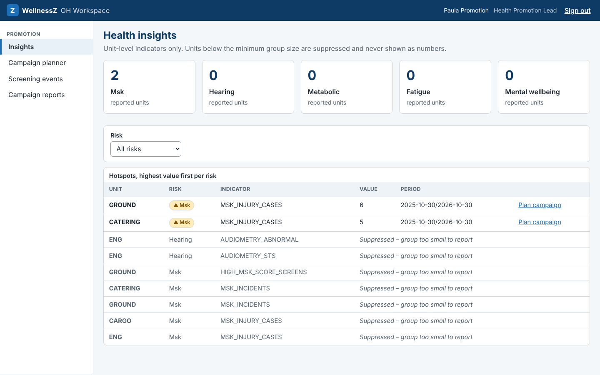

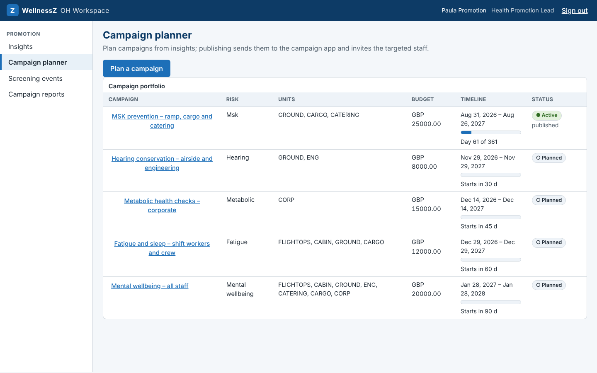

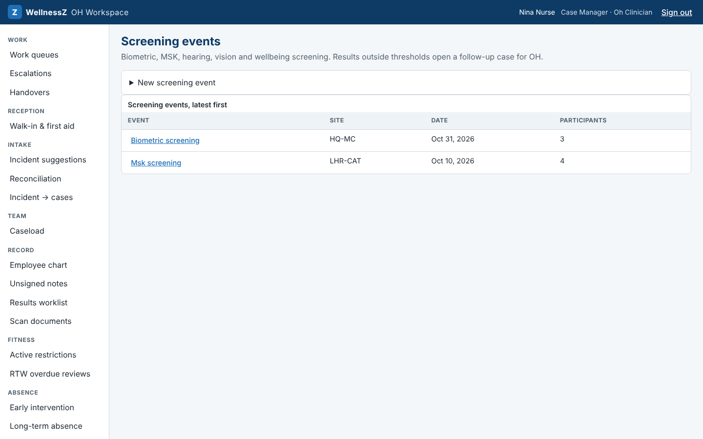

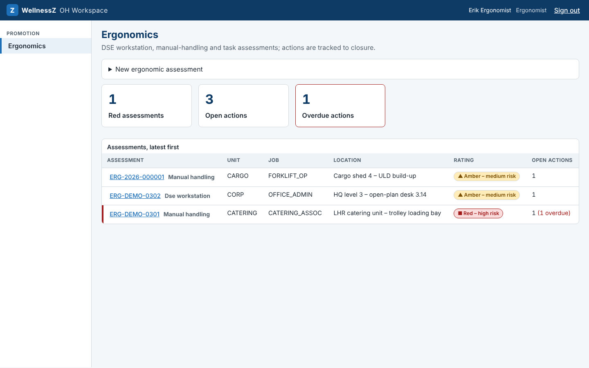

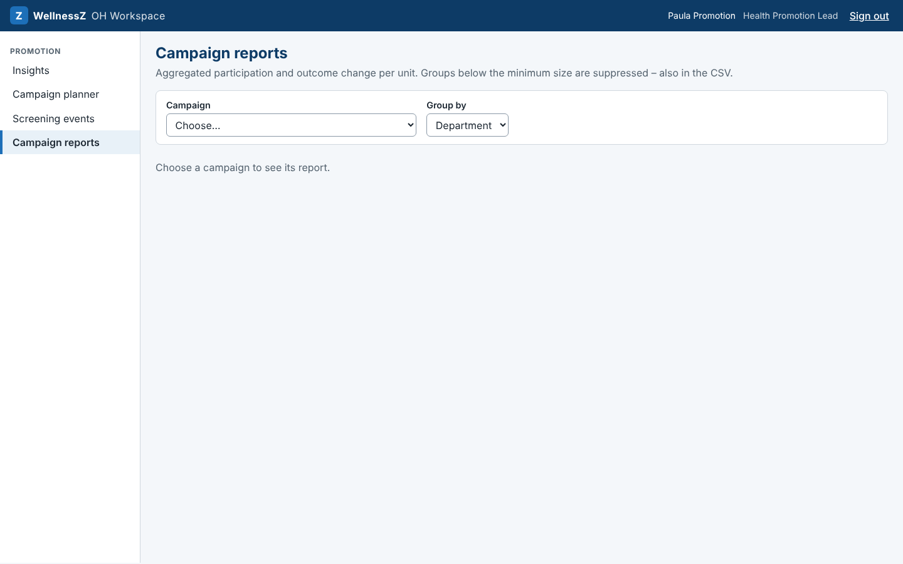

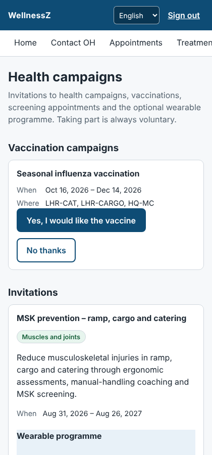

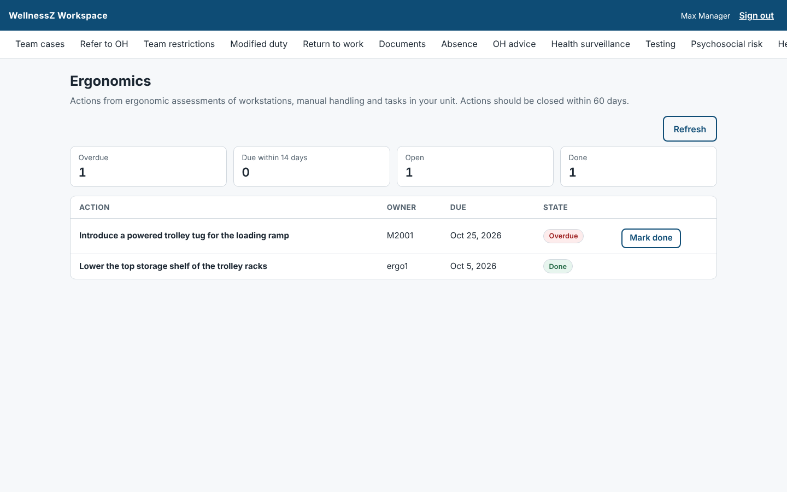

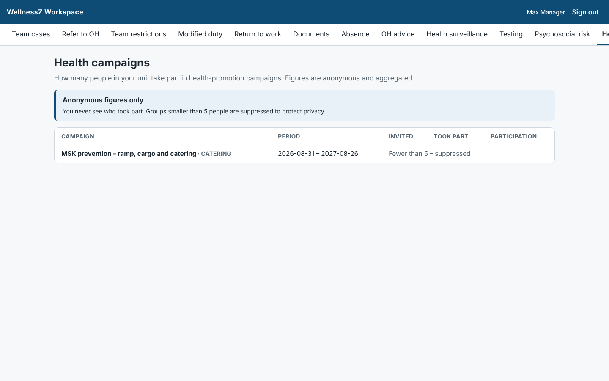

OH Workspace routes: `#/promotion/insights`, `#/promotion/campaigns`, `#/promotion/screening`, `#/ergonomics`,
`#/promotion/reports` (nav group "Promotion"; the health promotion lead lands on insights; the ergonomist sees
`#/ergonomics` only).

---

## 11. Screens overview

The four applications show only the entries a role may use; the server enforces the same rules independently. All 35
screenshots were captured by the end-to-end run against real Keycloak logins and appear with their features in
Sections 5 and 7–10.

| App | Routes added | Role visibility |
|---|---|---|
| OH Workspace | Support: `#/support/cases`, `/urgent`, `/eap`, `/fitness`, `#/peer-support`, `#/cism`, `#/psychosocial`; Testing: `#/testing/policies`, `/pools`, `/selections`, `/requirements`, `/collection`, `/mro`, `/rtd`, `/reports`; Public health: `#/travel/*`, `#/communicable`, `#/exposures`, `#/vaccination-campaigns`, `#/advisories`, `#/public-health`; Promotion: `#/promotion/*`, `#/ergonomics`; chart placeholder notice | General OH roles **never see support content** or the MRO queue (role-gating tests); restricted roles (peer volunteer / coordinator, collector, D&A programme manager, MRO, ergonomist, health promotion lead) cannot open any other clinical screen |
| Employee app | `/support`, `/peer-support`, `/check-ins`, `/travel`, `/campaigns`, `/testing`; "Wellbeing and prevention" tiles on Home | Own data only; strings in English, French and Arabic with full key parity |
| Manager workspace | `/testing`, `/psychosocial`, `/campaigns`, `/ergonomics` | `/testing`: MANAGER and SAFETY_MANAGER (for-cause), HR and CREW_SCHEDULING (duty status); others MANAGER only |
| Partner portal | `/eap-referrals` | Every PARTNER_PROVIDER; organisations that are not EAP partners see an empty list |

---

## 12. Sequence diagrams

### 12.1 Self-referral with an urgent screen

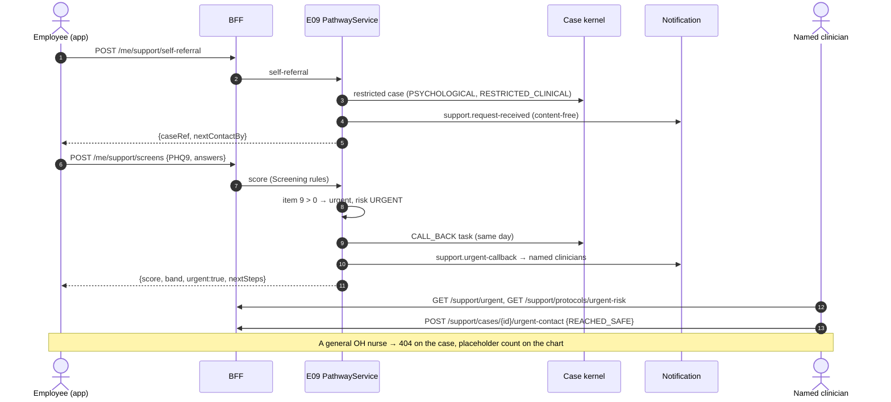

### 12.2 MRO verifies a positive

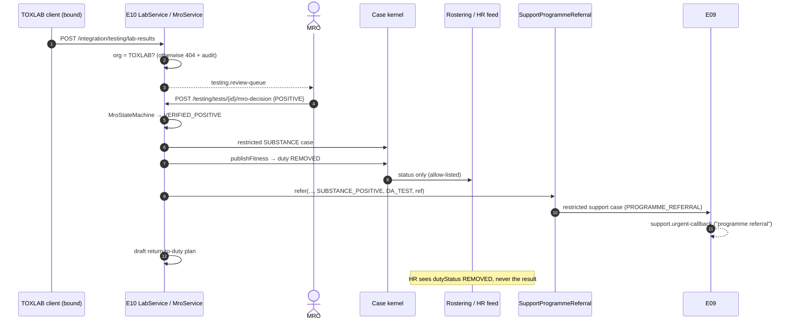

### 12.3 Contact tracing from roster data

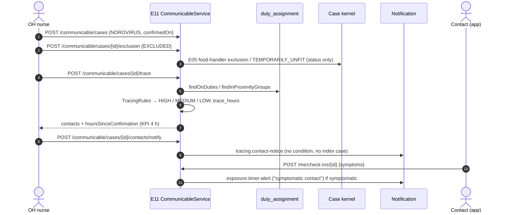

### 12.4 Abnormal screening result

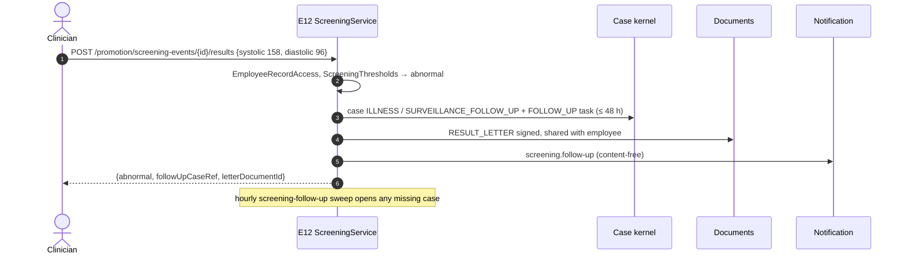

---

## 13. Integration design

| Interface | Direction | Contract | State |
|---|---|---|---|
| Duty assignments (rostering, shift, facility) | Internal systems → WellnessZ | `POST /integration/duty-assignments` (INTEGRATION, no partner organisation) | Built and tested; demo rosters seeded; production roster feed to be connected |
| Incident feed | E01 → E09 / E10 / E11 | In-process `ehs.incident.received.v1` | Built (reuses the increment-1 EHS intake) |
| Toxicology laboratory (TOXLAB) | Lab LIMS ↔ WellnessZ | `GET /integration/testing/lab-orders`, `POST /integration/testing/lab-results`, custody `LAB_RECEIVED`; machine client bound by `org_scope /PARTNERS/TOXLAB` (`substance.laboratory-code`); others → 404 | Bound machine client and API ready; **LIMS connection simulated** |
| EAP partner portal | EAP partner ↔ WellnessZ | Partner portal `/eap-referrals`; `GET /partner/eap-referrals`, `POST …/feedback` (attendance and closure only, `422 field_not_allowed`); content-free `support.partner-referral` e-mail with portal link | Built; **no system-to-system link to the EAP provider's own system** |
| Group campaign app | WellnessZ → app; app → WellnessZ | `campaign-app` outbox event (allow-listed fields); `POST /integration/promotion/participation` (internal client) | Built and tested; **app connection simulated** |
| Wearable aggregator | Aggregator → WellnessZ | `POST /integration/wearables/data` – daily totals, consented enrolments only | Built and tested; **vendor APIs not connected** |
| Public-health authority (UKHSA_LOCAL) | WellnessZ → authority | `PUBLIC_HEALTH_REPORT` document, submission record (EMAIL / PORTAL / PHONE), correspondence in / out | Built; submission by outbox + e-mail default; **no authority portal API** |
| Safety Management System | WellnessZ → SMS | `sms-safety` outbox event per published cell of the quarterly peer-support report | Built; SMS connector to be configured |
| SMS (text message) channel | WellnessZ → phones | Notification channel `SMS` (content-free templates); default implementation logs | **Gateway not connected** – logging channel only |
| E07 immunisation registry | E11 → E07 | Public API (`ImmunisationService`, `Booker`) | Built |
| E14 scheduling | E11 / E12 → E14 | `AppointmentBooking` SPI | Built |

---

## 14. Data model and migrations

### 14.1 Schemas and tables

| Schema | Migration | Tables |
|---|---|---|
| `masterdata`, `docs` | V16 | `duty_assignment` (new); partner organisations `EAP_WELLBEING`, `TOXLAB`, `UKHSA_LOCAL`; retention classes `RESTRICTED_RECORD`, `PUBLIC_HEALTH` |
| `mentalhealth` (new) | V17 | `ref_counter`, `support_case`, `support_note`, `support_contact`, `support_event`, `instrument`, `instrument_item`, `instrument_option`, `instrument_band`, `screen_result`, `urgent_item`, `protocol`, `signposting`, `eap_referral`, `peer_volunteer`, `peer_training`, `peer_contact_request`, `peer_contact`, `trusted_referral`, `sms_report`, `relief`, `cism_event`, `cism_affected`, `psychosocial_assessment`, `psychosocial_action`, `fitness_assessment` (26 tables) |
| `substance` (new) | V18 | `ref_counter`, `panel`, `policy`, `pool_exclusion`, `selection`, `test`, `specimen`, `custody_event`, `duty_status`, `rtd_plan`, `post_incident_rule` (11 tables) |
| `travelhealth` (new) | V19 | `ref_counter`, `destination`, `consultation`, `consultation_reminder`, `condition`, `cd_case`, `contact`, `check_in`, `pathway`, `chemical`, `exposure`, `exposure_task`, `campaign`, `campaign_invitation`, `campaign_decline`, `adverse_event`, `advisory`, `advisory_target`, `ph_report`, `ph_correspondence` (20 tables) |
| `promotion` (new) | V20 | `campaign`, `campaign_invitation`, `participation`, `screening_event`, `screening_participant`, `screening_result`, `education_attendance`, `ergonomic_checklist`, `ergonomic_assessment`, `ergonomic_photo`, `ergonomic_action`, `wearable_enrolment`, `wearable_daily` (13 tables) |

Each module migration starts with `create schema if not exists …`; the schema list in `application.yml`
(`spring.flyway.schemas`), Helm, the local init script, the managed-database bootstrap and the CloudNativePG cluster
include the four new schemas. Employee references are `varchar(64)` without foreign keys to the HRIS master; links to
kernel cases, documents and consents are by UUID. There are **no foreign keys between the four new schemas** – they
meet only through the kernel and the SPI.

Across all five increments the platform now has **20 Flyway versions** (V1–V20), 13 epic modules (E01–E08, E09–E12,
E14), 10 platform modules, the BFF and four web apps.

### 14.2 Overview

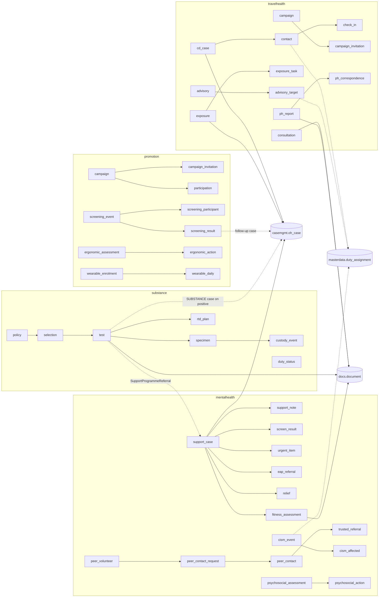

### 14.3 Data protection in the model

* **Encryption** – clinical free text and identifiers that need protection are encrypted by the application
  (AES-256-GCM, `EncryptedStringConverter`): support notes, self-referral messages, contact and call-back phones, urgent
  contact notes, fitness findings; for-cause descriptions, breath readings, laboratory results, MRO interview notes,
  treatment provider; consultation advice and prophylaxis, exposure details, task notes, decline reasons,
  adverse-event actions, correspondence summaries; screening measures and flags. Codes, dates, statuses and counts stay
  in clear for rules and aggregation.
* **No employee identity in peer tables** – verified against `information_schema` by an integration test.
* **Append-only custody** – the runtime role has no UPDATE / DELETE on `substance.custody_event`, and the trigger
  `custody_event_append_only` rejects changes even for the owner.
* **Grants** – select / insert / update for the runtime role; DELETE only where a purge is required
  (`substance.pool_exclusion`, `promotion.wearable_daily`, `promotion.participation`).
* **Purge** – peer call-back phones after 30 days (`peer-callback-purge`); wearable data on withdrawal of the
  enrolment or the consent.
* **Uniqueness and idempotency** – one support case per programme source (`uq_support_case_source`), one active relief
  per employee, one active wearable enrolment per employee and campaign, one selection per role group / period / test
  type, one duty assignment per source reference.
* **Demo data** – `R__demo_e09_mentalhealth.sql`, `R__demo_e10_substance.sql`, `R__demo_e11_travelhealth.sql`,
  `R__demo_e12_promotion.sql` and `R__demo_reference_duties.sql` load only with the `local` / test profiles. SQL cannot
  write encrypted values; the seeders (`MentalHealthDemoSeeder`, `SubstanceDemoSeeder`, `TravelHealthDemoSeeder`,
  `PromotionDemoSeeder`, local / test profiles only) write the encrypted demo fields and generate the demo documents.

---

## 15. Security and privacy design

### 15.1 Control summary

| Control | Implementation |
|---|---|
| Authentication | Browser apps through the BFF (OIDC code flow, HttpOnly session, CSRF); machine clients by client credentials (`INTEGRATION`); external systems bound to their organisation by `org_scope /PARTNERS/<CODE>`; internal clients carry no partner organisation |
| MFA | `WZ_MFA_REQUIRED_ROLES` (default `PARTNER_PROVIDER,TPA_ADJUSTER`) – the EAP partner (`PARTNER_PROVIDER`) needs MFA proof in `amr`, `acr` or the Entra ID `acrs` claim; on in UAT / PROD overlays, off in DEV and the local demo realm. Enrolment must be enforced in the production IdP (Entra ID conditional access or Keycloak OTP / WebAuthn) |
| Role-based access | `@PreAuthorize` on every endpoint (module `web/Patterns` or `web/Spel`); restricted `/support/**` checked in the service so that denials can return 404; `/api/v1/integration/**` machine-only |
| ABAC | `restrictedClassPolicy` (deny), `clinicianPolicy`, `breakGlassPolicy` (Section 5.3); `EmployeeRecordAccess` for E12 result entry; manager scope for for-cause, psychosocial, ergonomics and shared outcomes |
| Restricted class | `RESTRICTED_CLINICAL` on support cases, screening, call-backs, EAP clinical detail, substance results, `AUTHORITY_FITNESS_REPORT`, `CHAIN_OF_CUSTODY_FORM` (Section 5) |
| Module boundary as privacy control | ArchUnit keeps E09 / E10 away from all other business modules, E10 away from E09, and E12 away from E06 / E09 – there is no code path from promotion analytics to support cases or absence |
| Consent | `TREATMENT_SHARING_PARTNER` or `EAP_REFERRAL` (EAP referral), `WEARABLE_DATA` (wearable enrolment and data, withdrawal purges) |
| Encryption | Field level (Section 14.3); outbox payloads encrypted at rest |
| Clinical-text screening | `ClinicalContentException.screen` on text read outside the owning team: sharing adjustments, psychosocial controls and actions, CISM titles, campaign title / objective / owners, ergonomic findings (`422 clinical_content_not_allowed`) |
| Free-text refusal | EAP feedback accepts no unlisted field (`422 field_not_allowed`) |
| Content-free notifications | 18 templates; `ContentRules` reject clinical wording and *positive, negative, result(s), drug, alcohol* |
| Outbound allow-list | `campaign-app`, `sms-safety`; default deny |
| Small-cell suppression | Every aggregate (Section 5.9) |
| Least privilege | No DELETE except the purges; append-only custody |
| Retention | `RESTRICTED_RECORD` 10 years from the last encounter, `PUBLIC_HEALTH` 10 years from the document date (proposed) |
| Scheduled jobs | Nine jobs, each once per run key across replicas (`JobRunGuard`) |
| Error handling | `400 malformed_request` / `400 invalid_parameter`; no stack traces or 500s for client errors |
| SAST | SpotBugs + FindSecBugs (`-Psecurity`): 0 findings |

### 15.2 Roles and demo users

Eight roles are new in increment 5. `/me` reports `RESTRICTED_CLINICAL` for `MRO` (and the existing
`PSYCH_CLINICIAN`) and `STATUS_ONLY` for the other new roles. Demo users live in the Keycloak realm `wellnessz` with the
same password as the other demo users (see `docs/setup/01-Local-MacBook-Pro.md`).

| Role | New? | Demo user (employee ID, org scope) | Disclosure | Rights in increment 5 |
|---|---|---|---|---|
| `PEER_SUPPORT_VOLUNTEER` | **new** | `peer1` (S8801) | STATUS_ONLY | Own pseudonymous requests and contact log; refer to the trusted professional |
| `PEER_SUPPORT_COORDINATOR` | **new** | `peercoord1` (S8802) | STATUS_ONLY | Volunteer register, training, availability; quarterly report |
| `SAFETY_MANAGER` | **new** | `safety1` (S8803) | STATUS_ONLY | Quarterly SMS report and send; CISM counts and manual events; for-cause requests; testing policies (read) and statistics; duty assignments |
| `DA_PROGRAMME_MANAGER` | **new** | `damanager1` (S8804) | STATUS_ONLY | Policies, pools, selections, verify, notify, coverage, requirements, statistics, annual report – **no results** |
| `MRO` | **new** | `mro1` (S8805) | **RESTRICTED_CLINICAL** | MRO queue, verdicts, split specimens, requirements, return-to-duty plans and evaluations |
| `COLLECTOR` | **new** | `collector1` (S8806) | STATUS_ONLY | Requirements (no observations, no future follow-up dates), collection, custody, refusal – **no results** |
| `HEALTH_PROMOTION_LEAD` | **new** | `promo1` (S8807) | STATUS_ONLY | Insights, campaigns, publication, reports, screening events (counts only), education report |
| `ERGONOMIST` | **new** | `ergo1` (S8808) | STATUS_ONLY | Ergonomic assessments, photos, actions, KPI |
| `PARTNER_PROVIDER` | existing | `eap1` (X8809, `/PARTNERS/EAP_WELLBEING`) | STATUS_ONLY, own organisation | EAP referrals – minimal data, attendance and closure feedback |
| `PSYCH_CLINICIAN` | existing | `psych1` | RESTRICTED_CLINICAL | Named clinician: support cases, screening, urgent call-backs, EAP, peer referrals, relief, CISM, fitness contribution |
| `AME` | existing | `ame1` | CLINICAL | Relief and return decision, safety-critical fitness, advisories |
| `OH_PHYSICIAN` | existing | – | CLINICAL | Fitness, return-to-duty plans, destinations, advisories, public-health reports; MRO rights only when listed in `substance.acting-mro-physicians` |
| `CMO` | existing | – | CLINICAL | Governance, peer and psychosocial reports, coverage, statistics, annual report, uptake, insights, campaign reports |
| `NURSING_HEAD` | existing | – | CLINICAL | Psychosocial register, vaccination campaigns and uptake, insights |
| `OH_CLINICIAN` | existing | – | CLINICAL (not restricted) | CISM, travel, communicable, exposures, vaccination, screening results; placeholder only for restricted cases |
| `HSE_OFFICER` | existing | – | STATUS_ONLY | Psychosocial register, ergonomic assessments |
| `HR` | existing | – | STATUS_ONLY within scope | Psychosocial register; testing duty status |
| `CREW_SCHEDULING` | existing | – | STATUS_ONLY within scope | Testing duty status; duty assignments; now admitted to the manager workspace by the BFF |
| `MANAGER` | existing | `manager1` | STATUS_ONLY within scope | Shared outcomes, unit psychosocial assessment, for-cause request, unit ergonomics (status), unit campaigns |
| `AUDITOR` | existing | – | – | Verify random selections |
| `EMPLOYEE` | existing | – | SELF | Section 3 |
| `INTEGRATION` | existing | Machine clients | – | Duty assignments, participation, wearable data (internal clients); lab orders / results (TOXLAB-bound client) |

Users named "–" exist from earlier increments; the increment-1–4 documents list them.

> **Deployment note.** The eight new roles must exist in the identity provider **and** in the role scope mappings of
> the BFF (`wellnessz-bff`) and mobile (`wellnessz-mobile`) clients (`fullScopeAllowed=false` – a missing mapping
> silently drops the role). The local realm file contains them. The EAP partner identity needs an enrolled second
> factor in UAT / PROD. The named-clinician list (`mentalhealth.named-clinicians`) and the acting-MRO list
> (`substance.acting-mro-physicians`) are configuration and must be set per client.

### 15.3 Who sees what

| Audience | Sees | Never sees |
|---|---|---|
| General OH nurse | Placeholder count; travel, communicable, exposure, vaccination and screening data in the normal clinical scope | Support case content, screens, urgent items, EAP detail, substance results (404, audited) |
| Named mental-health clinician | Support cases of all employees, urgent items, EAP referrals, peer referrals (code only) | Peer contact logs with identity (there is none), substance results |
| MRO | Laboratory results, verdict history, chain of custody, RTD plans | Support case content |
| D&A programme manager / collector | Pools, selections, requirements / collection tasks | Results, verdicts, MRO notes (403 on the MRO queue) |
| Peer volunteer | Own requests (alias, code, call-back phone, language) and contact log | Employee identity, other volunteers' requests |
| Safety manager | CISM counts, quarterly aggregated report, testing statistics, own for-cause requests (masked status) | Names of affected staff, contacts, results |
| Manager | What employees chose to share; unit psychosocial assessment and actions; unit ergonomic actions; unit participation (suppressed); own for-cause requests (masked) | Screening, notes, concerns, results, small-unit numbers |
| HR / crew scheduling | Duty / fitness status and since | Reason, programme, results |
| EAP partner | Own organisation's referrals: display name, contact phone, preferred contact, sessions, urgency, status | Employee ID, case content, other organisations' referrals |
| Health promotion lead | Anonymised insights, campaigns, participation and outcome aggregates, screening counts | Participant lists, individual results |
| Employee | Own support, peer code, notices (where and when), consultations, certificates, check-ins, invitations, enrolments | Test status beyond a neutral phase; results in notifications |

### 15.4 Audit

Every person-level read and every denied access is audited through the platform `AuditService`. Examples:
`SUPPORT_PLACEHOLDER_READ` (with the count), support case reads, notes and closes with outcome `DENIED` for non-named
callers; `EAP_REFERRAL_CREATE`, `EAP_FEEDBACK`; break-glass reads; `DA_SUPPORT_REFERRAL` (SPI call) and a FAILURE entry
when no implementation exists; `DA_WINDOW_MISSED`; laboratory calls by other organisations or unbound clients
(`DENIED`, answered 404). The audit record of a peer contact request deliberately carries **no contact code**.

### 15.5 Disclosure log

| Disclosure | Recipient | Trigger |
|---|---|---|
| Shared outcome (fitness, adjustments) | Manager | Every row shown in `/workspace/psychosocial/shared-outcomes` |
| EAP referral data | EAP partner | Every partner read of `/partner/eap-referrals` |
| Duty status after a positive / refusal | Crew scheduling, HR | `testing.status` notices |
| Duty status rows | HR, crew scheduling | `/workspace/testing/status` – once per row |
| Exclusion status (communicable disease) | Rostering / HR, catering hygiene | Each status publication |
| Public-health report | Authority | Submission (statutory obligation) |

### 15.6 Negative tests

| Test | Proves |
|---|---|
| `restrictedCaseIsVisibleToNamedCliniciansOnlyWithPlaceholderAndBreakGlass` | General OH nurse → 404 and placeholder count; non-named PSYCH_CLINICIAN → 404; break-glass grant → read-only access |
| `sharingChoiceDrivesTheManagerViewAndIsDisclosureLogged` | Manager sees only the shared fields; every shown row disclosure-logged |
| `eapReferralWithConsentAndPartnerFeedbackWithoutClinicalContent` | Consent of the wrong purpose → `422 consent_required`; consent picker 404 for a general OH nurse; partner of another organisation sees nothing; extra feedback field → `422 field_not_allowed` |
| `peerSupportIsPseudonymousAndNeverExposesEmployeeIds` | Peer tables have no employee column; volunteer views contain no employee id |
| `quarterlySmsReportIsAggregatedWithSmallCellsSuppressed` | Small cells suppressed and not published to `sms-safety` |
| `reliefFromDutiesAndSafetyCriticalFitnessFeedStatusOnly` | Rostering receives status only |
| `f01PoliciesPoolsSelectionVerifyAndNotify` | Duplicate selection and repeated notify → 409; collectors and HR → 403 on policies, pools and selections |
| `f02ToF04PostIncidentChainOfCustodyLaboratoryMroAndPositivePathway` | Laboratory client of another organisation and an unbound client → 404; programme manager, collector and a non-designated physician → 403 on the MRO queue; HR outside scope does not see the employee; general OH users → 404 on the restricted SUBSTANCE case; HR sees status only |
| `f03DesignatedPhysicianActsAsMro` | Only a physician listed in `substance.acting-mro-physicians` reaches the MRO functions |
| `f05StatisticsAreSuppressedAndTheAnnualReportIsAnonymised` | Small cells suppressed; annual report anonymised |
| `f02CaseExclusionTracingNotificationCheckInsAndClearance` | `use_clear`, `return_criteria_not_met`; contact notice without condition |
| `f04CampaignInviteFastEntryAdverseEventsAndSuppressedUptake` | Uptake groups below k suppressed |
| `insightsAreAnonymisedAndSuppressedAndRoleRestricted` | Restricted cases excluded; small cells suppressed; other roles 403 |
| `managerWorkspaceShowsOwnUnitActionsAndSuppressedParticipation` | Other unit → 404; fields other than status → 403 |
| `participationFromTheInternalCampaignAppOnly` | Partner-bound client → 403 |
| `wearableDataIsConsentGatedMinimisedAndPurgedOnWithdrawal` | No consent / enrolment → rejected; withdrawal purges |
| Web role-gating tests | OH Workspace: 28 (E09 / E10) + 16 (E11 / E12) gating tests – restricted roles cannot open other clinical screens, general OH roles cannot open support cases or the MRO queue |
| E2E | General OH nurse → 404 with placeholder; programme manager → 403 on the MRO queue; unbound laboratory client → 404; EAP free text → 422; HR sees status only |

---

## 16. Key configuration items

| Key | Default | Purpose |
|---|---|---|
| `spring.flyway.schemas` | adds `mentalhealth, substance, travelhealth, promotion` | New schemas |
| `wellnessz.analytics.min-group-size` / `WZ_ANALYTICS_MIN_GROUP` | `5` | Suppression in every increment-5 aggregate |
| `wellnessz.integration.outbound-allowlist.campaign-app` | `messageId, campaignId, title, risk, startDate, endDate, targetUnits` | Campaign publication |
| `wellnessz.integration.outbound-allowlist.sms-safety` | `messageId, quarter, reportRef, category, count, base` | Safety Management System export |
| `wellnessz.security.mfa-required-roles` / `WZ_MFA_REQUIRED_ROLES` | `PARTNER_PROVIDER,TPA_ADJUSTER` (empty in `local` and DEV) | MFA role gate (EAP partner) |
| Job schedules | `wellnessz.mentalhealth.cism-follow-ups-cron`, `…peer-callback-purge-cron`, `wellnessz.substance.follow-ups-cron`, `…windows-cron`, `wellnessz.travelhealth.exposure-timer-cron`, `…public-health-cron`, `…daily-cron`, `wellnessz.promotion.ergonomic-job-cron`, `…follow-up-job-cron` | Section 4.4 (UTC) |
| Config entries (V17) | `modules.e09.enabled` true; `mentalhealth.named-clinicians` psych1 (demo user, seeded in every environment – set per client before go-live); `mentalhealth.urgent-callback-hours` 4; `mentalhealth.first-contact-working-days` 2; `mentalhealth.eap-first-appointment-working-days` 5; `mentalhealth.peer-callback-retention-days` 30; `mentalhealth.emergency-text`; `mentalhealth.emergency-phone` 999; `mentalhealth.governance.sign-off` PENDING; `cism.trigger-classes`; `cism.offer-sla-hours` 72; `cism.duty-window-hours` 2 | E09 behaviour |
| Config entries (V18) | `modules.e10.enabled` true; `substance.laboratory-code` TOXLAB; `substance.collection-site` LHR-OH-CLINIC; `substance.hr-status-email`; `substance.breath-alcohol-cutoff` 0.02; `substance.acting-mro-physicians` (empty) | E10 behaviour |
| Config entries (V19) | `travelhealth.tracing.high-risk-minutes` 15; `travelhealth.tracing.max-window-days` 21; `travelhealth.tracing.kpi-hours` 4; `travelhealth.check-in.fever-threshold-c` 38.0; `travelhealth.exposure.alert-before-minutes` 30; `travelhealth.public-health.alert-before-hours` 12; `travelhealth.public-health.exposure-report-hours` 72; `travelhealth.consultation.lookahead-days` 30 | E11 behaviour |
| Config entries (V20) | `promotion.screening.threshold.*` (systolic ≥140, diastolic ≥90, BMI ≥30, glucose ≥7.0, cholesterol ≥6.5, waist ≥102, MSK ≥7, wellbeing ≤40); `promotion.screening.follow-up-hours` 48; `promotion.screening.service.<TYPE>`; `promotion.ergonomics.reminder-days` 7; `promotion.ergonomics.closure-target-days` 60; `promotion.participation.target-pct` 40; `promotion.wearables.max-age-days` 31 | E12 behaviour |
| Reference content | V17–V20 | 6 signposting entries, PHQ-9 / GAD-7 items and bands, urgent-risk protocol; 6 testing policies (PENDING), 3 panels, 7 post-incident rules; 15 destinations, 9 conditions, 5 pathways, 6 chemicals; 5 portfolio campaigns, 3 ergonomic checklists |

---

## 17. Non-functional design notes

* **Performance** – worklists are bounded and indexed (duty assignments by employee / duty / proximity group /
  destination with start time; check-ins by due date and status). Tracing reads the duty window directly (E2E: 1.03 h
  end to end, including human steps, against a 4 h target). No production-volume load test yet.
* **Timeliness** – the positive / refusal pathway runs synchronously with the MRO decision (contract target < 15 min);
  exposure timers are checked every 5 minutes with a 30-minute pre-alert; urgent screens create the call-back task in
  the same transaction.
* **Concurrency and idempotency** – optimistic version on testing policies; partial unique indexes guard one active
  relief, one active wearable enrolment and one support case per programme source; the SPI and the incident listeners
  are idempotent; selection and notify are protected against repeats (409).
* **Resilience** – `SupportProgrammeReferral` is consumed through an `ObjectProvider` (E10 works without E09 and audits
  the gap); the incident listeners catch their own failures so the E01 intake is never blocked; jobs run once per run
  key across replicas.
* **Reproducibility** – random selections can be recomputed from the stored seed and pool snapshot at any time
  (auditor endpoint).
* **Time zones** – jobs run in UTC; working days for E09 SLAs are Monday–Friday.
* **Accessibility** – status badges carry text as well as colour; live countdowns for exposure timers and testing
  windows have text equivalents; suppressed cells are labelled ("Fewer than N – suppressed"); the emergency banner is
  the first element on the support pages.
* **Internationalisation** – employee-app increment-5 strings in English, French and Arabic with key-parity tests.
* **Browser storage** – all four apps keep personal data in memory only (lint rule bans `localStorage` /
  `sessionStorage`).

---

## 18. Testing evidence

| Layer | Result |
|---|---|
| Java (Maven, all modules) | **450 tests, 0 failures** |
| Increment-5 integration tests | `Increment5MentalHealthIntegrationTest`, `Increment5SubstanceIntegrationTest`, `Increment5TravelHealthIntegrationTest`, `Increment5PromotionIntegrationTest` – all pass, including the negative tests in Section 15.6 |
| Increment-5 module unit tests | E09 `ScreeningTest`, `ContactCodesTest`, `CismRulesTest`, `PsychosocialScoringTest`; E10 `SelectionEngineTest`, `CoverageMathTest`, `PostIncidentWindowsTest`, `MroStateMachineTest`, `FollowUpSchedulerTest`, `SuppressionTest`; E11 `TracingRulesTest`, `ProtocolTimersTest`, `UptakeMathsTest`, `AdvisoryTargetingTest`, `TravelRecommendationsTest`; E12 `ScreeningThresholdsTest`, `ErgonomicScoringTest`, `SuppressionAndInsightsTest`, `WearableGateTest`, `ParticipationMathTest` |
| Architecture | `ArchitectureTest` – 22 rules pass |
| Static analysis | SpotBugs + FindSecBugs (`-Psecurity`): **0 findings** |
| Web unit tests | oh-workspace **769**, employee-app **285**, manager-workspace **188**, partner-portal **131** = **1,373**; eslint 0 warnings; all four builds clean |
| End-to-end (real Keycloak logins through the BFF) | Increment 5: **24 / 24** (`tools/e2e/e2e-increment5.js`); regressions increment 1 18 / 18, increment 2 25 / 25, increment 3 32 / 32, increment 4 22 / 22 – **121 checks, all green** |
| API documentation | `docs/api/openapi.json` – **647 paths** (509 after increment 4) |

**Increment-5 end-to-end checks**

| # | Check | Result |
|---|---|---|
| 1 | Employee self-refers confidentially with signposting; a PHQ-9 with any self-harm answer escalates to a same-day call | PASS – score 11, band MODERATE, urgent=true |
| 2 | Restricted class: the named clinician sees the case and the urgent item; a general OH nurse gets 404 and only a placeholder count | PASS |
| 3 | Urgent call-back documented; the employee shares fitness only and the manager sees exactly that | PASS |
| 4 | EAP partner sees minimal referral data for its own organisation and returns attendance only – free text refused (422 `field_not_allowed`) | PASS |
| 5 | Crew peer support is pseudonymous: alias + code to a trained peer, contact log without employee identity | PASS |
| 6 | CISM: affected crew from the WZ101 roster, offers within 72 h, safety manager sees counts only | PASS |
| 7 | Psychosocial register by department with actions and an anonymised case rate (small groups suppressed) | PASS |
| 8 | AME ends the temporary relief from flight duties – rostering receives the status only | PASS |
| 9 | Auditable random selection reproducible from its stored seed; programme manager cannot see results (MRO queue 403) | PASS |
| 10 | Post-incident test collected inside the alcohol window with an electronic chain-of-custody form | PASS |
| 11 | MRO verifies a positive: removed from safety-sensitive duty, HR sees status only, confidential support referral opens | PASS |
| 12 | Manager raises a documented for-cause request with an observation checklist and a second observer | PASS |
| 13 | Laboratory results accepted only from the toxicology laboratory system – an unbound client gets 404 | PASS |
| 14 | Programme statistics by reason and role group with small cells suppressed | PASS |
| 15 | Contact tracing from roster and shift data within the 4-hour target; contacts notified without naming the case | PASS – 1.03 h |
| 16 | Needle-stick pathway with protocol timers – PEP decision due within hours | PASS |
| 17 | Travel consultation with destination-based recommendations and a signed travel health certificate | PASS |
| 18 | Health advisory reaches crew rostered to the destination, with acknowledgement tracking (small counts suppressed) | PASS |
| 19 | Notifiable-disease report submitted to the health protection team within the statutory time | PASS |
| 20 | Influenza campaign uptake by subsidiary with small groups suppressed | PASS |
| 21 | Campaigns planned from anonymised hotspots; participation and outcome report with suppression – no person-level data | PASS |
| 22 | Biometric screening: abnormal blood pressure opens a follow-up case within 48 h and a result letter | PASS |
| 23 | Ergonomic manual-handling assessment scored with RAG and the job-demand profile, with actions to closure | PASS – score 54, AMBER |
| 24 | Wearable data accepted only for consented enrolments (daily totals); data without consent rejected | PASS |

---

## 19. Requirements coverage summary

All 22 features of E09–E12 are delivered at the depth recorded in the traceability matrix (document 02). Items that
are business tasks rather than software are supported but not completed by the build:

| Item | Nature | Support in the platform |
|---|---|---|
| E09-BL-014 – clinical governance of instruments, protocol and signposting | Clinical governance | `GET /support/governance`; sign-off flag `mentalhealth.governance.sign-off` = PENDING |
| E09-BL-015 – awareness and trust campaign (≥ 90 %) | Change and training | E12 planner (mental-wellbeing portfolio campaign) |
| E10-BL-010 – testing policy per jurisdiction and role group | Legal / Safety / HR decision | Six policies seeded PENDING; approval workflow with `approvedBy` and version |
| E11-BL-002 – destination content source | Procurement / licence | 15 in-house destinations; `source` field supports `LICENSED` |
| E11-BL-013 – outbreak playbook and tabletop exercise | Procedure | Section 9.3 |
| E12-BL-008 – initial campaign portfolio | Product Owner approval | Five PLANNED campaigns with owners and KPIs |

---

## 20. Known limitations and items for business / clinical sign-off

### 20.1 Decisions and sign-offs requested

| # | Item | Owner | Current state |
|---|---|---|---|
| S1 | Screening instruments PHQ-9 / GAD-7, bands, urgent rule, urgent-risk protocol and signposting (E09-BL-014) | CMO + mental-health lead (Clinical Governance) | Seeded; sign-off PENDING |
| S2 | Named-clinician list and the support model (who is "named") | CMO + DPO | V17 seeds `mentalhealth.named-clinicians` = `psych1` (the demo user) in **every** environment – must be set per client before go-live |
| S3 | EAP partner, sessions and first-appointment target | Product Owner (OH) + Procurement | `EAP_WELLBEING` illustrative |
| S4 | Testing policies per jurisdiction and role group – panels, rates, windows, consent, cut-offs (E10-BL-010) | Legal + Safety + HR + MRO | Six policies PENDING; breath cut-off 0.02 g/210 L proposed |
| S5 | Post-incident rule table | Safety + Legal | Seven rules seeded |
| S6 | Acting-MRO physicians | CMO + MRO | Empty |
| S7 | Travel recommendations table and destination content source (E11-BL-002) | CMO + Procurement | 15 in-house destinations |
| S8 | Communicable conditions, exclusion periods, return criteria, report deadlines | CMO + health protection liaison | Nine conditions seeded |
| S9 | Exposure pathway timers, PEP window, serology schedule | CMO + Nursing Head | Five pathways seeded |
| S10 | Screening thresholds and ergonomic RAG bands | CMO + ergonomist | Configuration values seeded |
| S11 | Campaign portfolio, owners and KPIs (E12-BL-008) | Product Owner (OH) | Five PLANNED campaigns |
| S12 | Retention classes `RESTRICTED_RECORD` and `PUBLIC_HEALTH` | DPO + Legal | Proposed, 10 years |
| S13 | Wording of the 18 new notification templates | DPO | Draft, content-free |
| S14 | Minimum group size for suppression | DPO | 5 |
| S15 | MFA enrolment for the EAP partner and all partner / TPA identities | Cyber GRC + IdP owner | Required before go-live; must be enforced in the production IdP (Entra ID conditional access or Keycloak OTP / WebAuthn) |

### 20.2 Known limitations

| Area | Limitation |
|---|---|
| Named-clinician default | V17 sets `mentalhealth.named-clinicians` to the demo user `psych1` in every environment, not only locally. Until it is changed per client, only a user called `psych1` can open support cases; it must be set to the client's named clinicians (or emptied, which admits every `PSYCH_CLINICIAN`) before go-live |
| ABAC and the MRO | The ABAC restricted-class rule recognises `PSYCH_CLINICIAN` only. The MRO opens results and the chain-of-custody form through the E10 MRO endpoints, but probably **not** through the generic `/documents` API for `RESTRICTED_CLINICAL` documents – follow-up item |
| External connectors | Still simulated or default: EAP provider system (portal only), toxicology laboratory LIMS (bound machine client and API ready), campaign app, wearable vendor APIs, public-health authority submission (outbox + e-mail default), SMS (text message) gateway (logging channel) |
| Clinical content | Screening instruments and cut-offs, testing policy cut-offs, the travel recommendations table and PEP timers are configurable reference data that need Clinical Governance / MRO / Legal sign-off before go-live |
| MFA | Not exercised by the local E2E run (gate off in the local realm); enrolment must be enforced in the production IdP |
| Demo data | Encrypted narrative text cannot be seeded by SQL; seeders fill some encrypted fields in the local / test profiles only |
| Feature flags | `WZ_FEATURE_*` flags are plumbing only: they reach core and BFF as environment variables, but no product feature is switched by them yet – client features read them |
| Client extensions | Mounting client extension JARs (custom Java modules) into the core image is **not** implemented; client code customisation means a fork / branch with its own build, or a client module added to the Maven build. SQL migrations and configuration are supported without forking |
| GitHub Environments | Required reviewers and protection rules must be configured in the repository settings; they cannot be set from code |
| Dev container | Decision needed whether to commit `.devcontainer/` at the repository root (the guide ships it under `docs/developer-setup/ide/devcontainer`) |
| Peer support visibility | `/peer-support` is shown to every employee, because there is no crew role to filter on; `/eap-referrals` is shown to every partner provider (non-EAP organisations see an empty list) |
| Manager psychosocial actions | Managers read their unit's psychosocial actions but cannot mark them done (the contract gives no manager update) |
| Advisory body | Not screened for clinical wording, because it is general destination advice |
| E12 data sources | Insights do not use E06 absence data (ArchUnit boundary); mental-wellbeing insights come from E12 wellbeing screenings only |
| Load | No production-volume load test of tracing, selections or reports |
