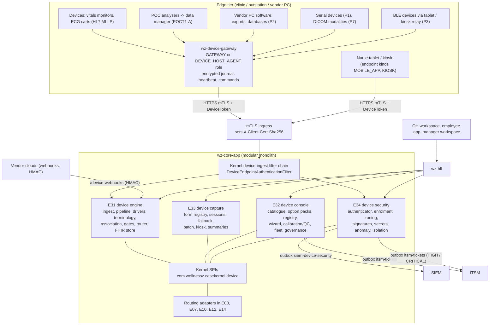
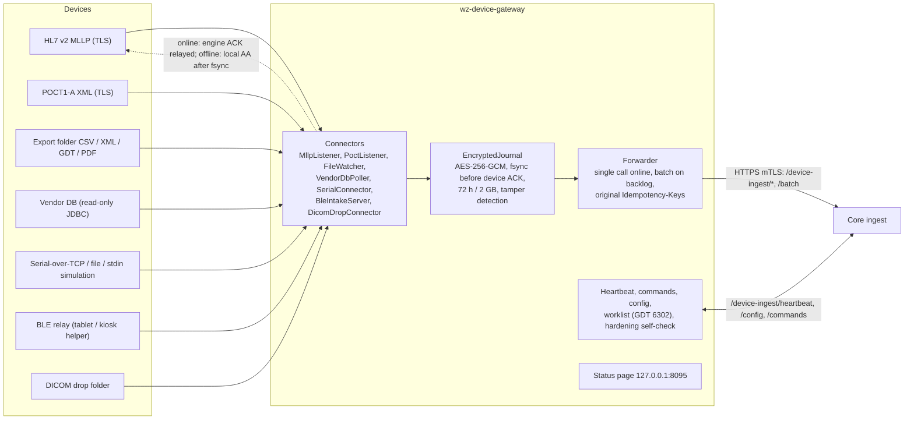
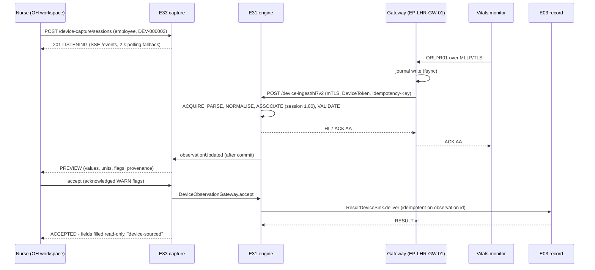
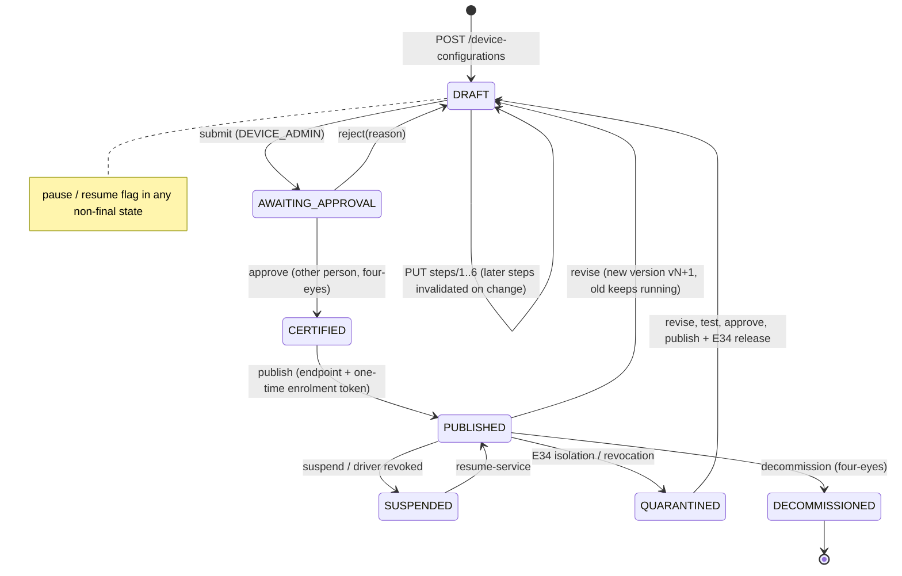
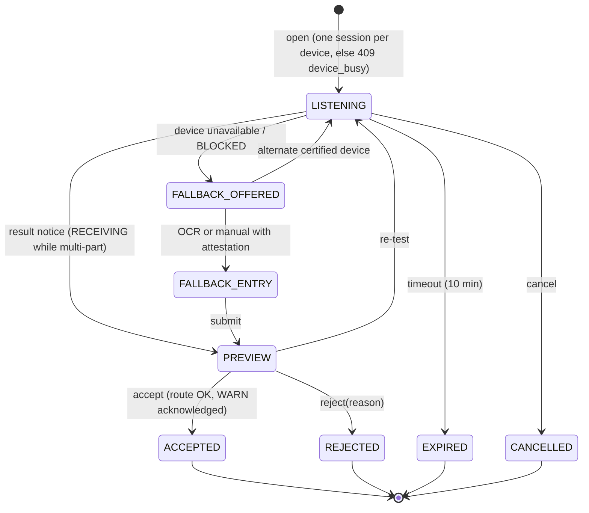
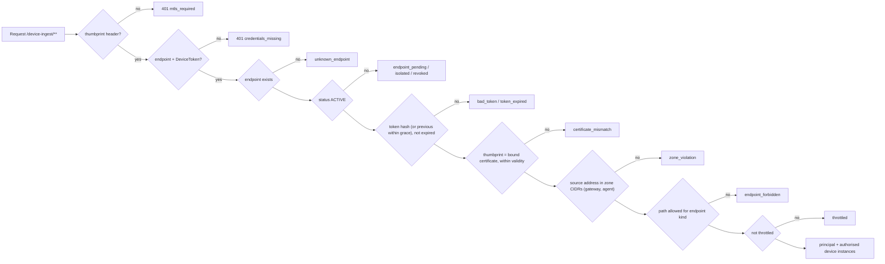
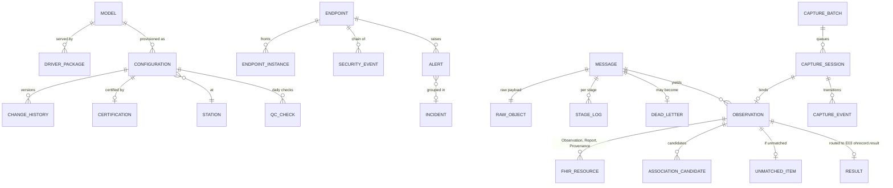

# WellnessZ OHCM – Increment 6 Solution Design: E31 Medical Device Integration Engine, E32 Device Console, E33 Module-Embedded Capture, E34 Endpoint & Integration Security

**Version 1.0**

*WellnessZ OHCM platform – increment 6 (Medical Device Integration Engine)*

| | |
|---|---|
| **Document** | Increment 6 – 01 Solution Design (E31 + E32 + E33 + E34) |
| **System** | WellnessZ Airline Occupational Health Case Management (OHCM) |
| **Scope** | E31 Medical Device Integration Engine – core pipeline, protocol adapters, normalisation and routing to OH forms · E32 Device Catalogue, Administration & Connectivity Provisioning Console · E33 Module-Embedded Device Capture · E34 Endpoint & Integration Security · the edge application `apps/wz-device-gateway` (clinic gateway and Device Host agent) |
| **Not in scope** | E35 Deployment Options, Technology Stack, Environments & Operations of the Integration Engine (Kafka / NATS bindings, Kubernetes topologies, cost model) |
| **Audience** | CIO, Chief Medical Officer (CMO), Nursing Head, device administrators (biomedical / clinical engineering), integration developers and testers, CISO / Security Operations, Cyber GRC, DPO, procurement, project sponsor |
| **Inputs** | Client solution document *Device Integration Engine Solution Document* (enhancement pack v1.0, 31 October 2026) – sections 3–8, 10–12, Appendix A (133-device inventory) and Appendix C; epic workbooks E31–E34 (High-Level Requirements, Feature List, Implementation Backlog) |
| **Baseline** | Repository working tree after increment 6; Flyway migrations V1–V25; API contract [`API-Contract-E31-E34.md`](API-Contract-E31-E34.md) |
| **Status** | Draft for review – clinical reference data (GLI-2012 coefficients, OSHA Appendix F female table, plausibility ranges, the quality-gate rule set), the five device retention classes, the DPIA for device data flows, the reference network design and the IEC 80001-1 responsibility agreement await Clinical Governance, DPO, Network / Security and vendor sign-off (Section 15) |
| **Companion documents** | 02 – Requirements Traceability Matrix · 03 – Release Notes Increment 6 · 04 – Device Administrator Guide · 05 – Integration Tester Guide · device security pack [`device-security/`](device-security/) · Architecture 01–03 · Deployment Architecture |

> **How to read this document.** Every statement about behaviour was checked against the source code (entities,
> controllers, services, Flyway V21–V25, the gateway application) and, where named, against an automated test. Where the
> code deviates from the API contract or from the client's solution document, this document describes **what the code
> does** and says so. Where a capability depends on hardware that was not available (device lab, vendor demonstration
> units, BLE radios, serial ports, DICOM modalities), this is stated: verification in this increment used simulators and
> synthetic golden datasets only, and **no real device was connected**. Requirement identifiers (E31-HLR-xx, E31-F0x,
> E31-BL-0xx, E32-…, E33-…, E34-…) refer to the client's workbooks; the client's numbering E31–E34 is authoritative. All
> API paths are relative to `/api/v1`; browser apps call them through the BFF as `/bff/api/...`; machine paths
> (`/device-ingest/**`, `/device-enrolment/**`, `/device-webhooks/**`) are never proxied by the BFF.

---

## 1. Executive summary

Increment 6 adds a **Device Integration Layer** under the occupational health (OH) modules. Measurements that nurses
today type from printouts and vendor screens – audiograms, spirograms, vision scores, vitals, ECGs, breath-alcohol
readings, point-of-care results, fit factors, exposure logs – now flow from the device, through a vendor-neutral
pipeline, into the exact field of the OH form that needs them, with full provenance and quality gates.

* **E31 – the engine.** One canonical pipeline – *acquire → parse → normalise → associate → validate → route → persist →
  acknowledge* – serves every device. Device variety lives in **declarative, versioned, Ed25519-signed driver
  packages** (JSON, no code per model): parsing grammar, MDC → LOINC / UCUM mappings, unit conversions, reference ranges,
  quality gates and result-to-form bindings. Ingest covers HL7 v2 ORU^R01 (IHE PCD-01) with synchronous ACK, FHIR R4,
  POCT1-A, exported files (CSV, XML, GDT, PDF pairing), BLE GATT health profiles (IEEE 11073 SFLOAT / FLOAT), serial
  frames, signed vendor webhooks, DICOMweb JSON with streamed attachments, OCR / manual fallback and batch
  store-and-forward. Every raw payload is stored **before parsing**, encrypted (AES-GCM) and hashed (SHA-256);
  observations get **deterministic UUIDv5 ids**, so replays of dead letters or whole days never duplicate. Association
  follows worklist → capture session → badge → vendor id, and **nothing below a confidence of 0.95 is ever auto-filed**.
  Fifteen quality gates (calibration lockout from the E14 equipment register, QC lots, ATS/ERS grading, test-retest,
  BP cuff validation, plausibility, consent, attestation, clock skew, verify-before-post …) run before posting. Results
  are routed through small adapters **inside the existing modules** (E03, E07, E10, E12, E14), so their clinical logic
  is reused, not duplicated. 18 driver packages and 94 golden datasets cover all 11 device families and all ten
  connectivity options.
* **E32 – the console.** A governed catalogue seeded idempotently from the client's **133-device inventory** (11 families),
  ten **connectivity option packs P1–P10** (JSON Schema 2020-12 parameter schemas, step guides, English and Arabic help,
  internationally accepted practice rules), an immutable **driver registry** with signature verification and
  second-person certification, and the **eight-step provisioning wizard** – select, option, prerequisites, configure,
  associate & bind, test, certify (four-eyes, signed certification PDF) and publish (one-time enrolment token). Fleet
  health, calibration / QC with automatic lockout, configuration governance (approval queue, sealed export / import with
  diff), vendor security posture (MDS2 / SBOM) with SECURITY_OPS exceptions, request-a-model and masked diagnostics
  complete the administrator's tool set. Device console roles never see person data.
* **E33 – capture in the form.** Every measurement field group offers **"Capture from device"**: a station-aware list of
  certified, in-calibration devices without technical settings, a live preview with quality flags and provenance, accept /
  reject / re-test, and a **fallback chain** (another device → photo / OCR with verification → manual entry with
  attestation) that records the path used. Restricted readings (breath alcohol) are visible to the collector and MRO only.
  Batch mode for screening days (tested with 200 employees), a badge-identified **kiosk** with consent, employee result
  summaries in English, Arabic or French (never a diagnosis), wearable consents and physician sign-off of ECG / ABPM
  interpretations are included.
* **E34 – zero-trust endpoints.** Every gateway, Device Host agent, tablet, kiosk, data manager and vendor cloud has its
  own identity (`EP-<SITE>-<KIND>-<NN>`): a client certificate from the group PKI bound by thumbprint at **zero-touch
  enrolment** plus a 256-bit token stored as a peppered HMAC. A **fail-closed authenticator** checks status, token,
  thumbprint, certificate validity, zone CIDRs, allowed paths and throttling on every call – without a cache, so revocation
  and isolation are immediate. Five zones and nine conduits export as a default-deny firewall template. Fifteen anomaly
  rules feed alerts; an **automatic isolation playbook** acts within 15 minutes and release requires re-certification. A
  PHI-free, hash-chained security event log is forwarded to the SIEM; HIGH / CRITICAL events open ITSM tickets. A
  separate **security test pack** (15 scripts and a report builder, control matrix SC-01…SC-16) lets the Cyber team
  verify the controls.
* **Edge.** `apps/wz-device-gateway` is one Java 21 / Spring Boot 4.1 agent for both the clinic gateway and the Windows /
  Linux Device Host agent role: enrolment and mTLS, MLLP listener with engine ACK relay, POCT1-A, folder watcher, read-only
  vendor database poller, serial abstraction, BLE relay intake, DICOM drop folder, and an **AES-256-GCM append-only
  store-and-forward journal** (written before the device is acknowledged; ≥ 48 h, default 72 h / 2 GB; refuses when
  full; tamper detection) replayed with the original idempotency keys.

**Verification so far:** full backend suite **744 tests, 0 failures, 0 errors** (including the five increment-6
integration test classes and 28 ArchUnit rules), SpotBugs / FindSecBugs **0 findings**, 65 gateway tests, 83 web tests for
the console and security screens. End-to-end and final web totals are added by the delivery lead (document 03,
Section 9). **What is not verified:** no real device, radio, serial port or modality was connected; the solution
document's performance and availability targets were not load-tested; the security test pack and an independent
penetration test still have to be executed in staging (Section 13).

## 2. Scope and design principles

### 2.1 Business goals (from the epic overviews)

| Goal | KPI in the workbooks | How increment 6 supports it |
|---|---|---|
| Device-sourced results without transcription | ≥ 90 % within 12 months | Capture from device in every bound form; KPIs per path at `GET /device-capture/kpis` (usage, minutes saved, re-test, unmatched, path mix) |
| Fast posting | Spot ≤ 5 s p95; exports ≤ 60 s | Inline pipeline processing on acceptance (`device.pipeline.inline=true`), SSE preview stream; not load-tested (Section 12) |
| Zero transcription errors | 0 by audit sampling | Values immutable once captured; re-measure replaces the set; provenance on the E03 result |
| Unmatched results | < 0.5 %, resolved within 1 working day | Unmatched queue with suggestions, SLA 8 h (`device.unmatched.resolution-sla-hours`), metric `unmatchedRate` |
| New model by configuration | ≤ 5 working days when a family adapter exists | Driver packages are JSON; request-a-model KPI (median working days) |
| Connector availability | ≥ 99.5 % in clinic hours | Heartbeats, `STALE` / `SILENT` alerts, store-and-forward; availability not measured in this increment |

### 2.2 In scope

All 48 high-level requirements and 46 features of E31–E34 and their 71 backlog items are traced in document 02. The
software scope is: the four modules, the platform base (V21), the routing adapters in E03 / E07 / E10 / E12 / E14, the
edge application, the OH workspace console, security, engine and capture screens, the employee app device results,
consents and kiosk page, the manager workspace fleet counts, the security test pack and its documents.

### 2.3 Out of scope

* **E35** – Kafka / NATS bindings, Kubernetes topologies, the four deployment options, cost model, HA / DR drills.
* Clinical interpretation beyond published rules (for example automated ECG interpretation) and control of therapeutic
  devices (workbook out-of-scope list).
* Routing sinks for E11 exposure travel and the partner / incident modules E20–E28, which do not exist yet: bindings can
  be authored; routing to an undeployed target dead-letters with `route_target_unavailable`.
* Instrumented drug-screen readers (`E10.DRUG_SCREEN`) – **rejected by decision** in this increment (the E10 sink refuses
  the category).
* A native mobile capture app with its own BLE stack and on-device queue (the solution document extends the E14 mobile
  app; this increment delivers the server side and the tablet web screens – Section 13).

### 2.4 Design principles (solution document Section 3) and how they are realised

| # | Principle | Realisation |
|---|---|---|
| 1 | Generic pipeline, specific drivers | `PipelineProcessor` stages; `DriverRuntime` executes declarative packages (`wellnessz.device-driver/1`) |
| 2 | Every connectivity option is first class | Option packs P1–P10 (`e32/option-packs.json`), adapters per `parse.type`, gateway connectors |
| 3 | Administrators own the technical layer, clinicians own the measurement | Console roles never see person data; nurses see device name, status, preview, accept / reject only (`CaptureServiceUnitTest#stationDisplayNamesCarryNoTechnicalParameters`) |
| 4 | The vendor's regulated application stays the measurement system | P2 reads vendor exports and databases **read-only** (`VendorDbPollerTest#connectionIsReadOnly`); no measurement re-implemented |
| 5 | Quality before speed | 15 gates; BLOCK stops posting; WARN must be acknowledged |
| 6 | Right employee, every time | Association priority with 0.95 auto-file / 0.60 suggest thresholds; restricted categories by worklist / session only |
| 7 | Provenance is part of the result | FHIR `Provenance` + E03 columns `device_observation_id`, `capture_method`, `driver_version`, `verified_by`, `verified_at` |
| 8 | Offline is normal | Gateway journal ≥ 48 h; `/device-ingest/batch` reconciliation in sequence order |
| 9 | Endpoint security is a core feature | E34 identity, zoning, signatures, secrets, anomaly rules, isolation; test pack |
| 10 | One engine, four homes | Same core image; the edge agent as one JAR / container; topologies are E35 |
| 11 | Measured adoption | `CaptureKpis` (usage, minutes saved, re-test, unmatched, path mix) |
| 12 | Multilingual and accessible | EN / AR option help; EN / AR / FR employee summaries; 44 × 44 px capture targets – a WCAG 2.2 AA audit is outstanding |

## 3. Actors

| Actor | Role(s) | Main interactions |
|---|---|---|
| Device administrator | `DEVICE_ADMIN` (`deviceadmin1`, S8901) | Catalogue, wizard steps 1–6 and 8, option packs, fleet, calibration / QC, masked diagnostics, model requests, decommissioning requests |
| Device approver | `DEVICE_APPROVER` (`deviceapprover1`, S8902) | Four-eyes certification (step 7), driver certification, import approval, decommissioning approval – never own submissions |
| Integration tester | `INTEGRATION_TESTER` (`inttester1`, S8903) | Driver validation, conformance, signing requests, golden datasets, simulators, dead-letter replay, model-request scoping |
| Security operations | `SECURITY_OPS` (`secops1`, S8904) | Endpoints, enrolment tokens, isolation / release, security events and chain verification, zones / CIDRs, signing keys, secrets metadata, posture exceptions, test-pack runs, governance records |
| Device / gateway | `DEVICE_ENDPOINT` (machine role granted by the device-ingest filter; never held by a person) | `/device-ingest/**` |
| OH nurse, physician, AME, CMO, Nursing Head | `OH_CLINICIAN`, `OH_PHYSICIAN`, `AME`, `CMO`, `NURSING_HEAD` | Capture sessions, preview, accept / reject, fallback, unmatched queue, ECG sign-off, quick QC, test-form review in the wizard |
| Collector, MRO | `COLLECTOR`, `MRO` | Restricted breath-alcohol capture and reading |
| Biomedical engineer | `BIOMEDICAL` | E14 equipment register and calibration evidence; reads E32 calibration screens |
| Employee | `EMPLOYEE` | Released device summaries, wearable consents, kiosk self-measurement by badge |
| Manager | `MANAGER` | Site device availability counts (manager workspace) |
| Auditor, DPO, platform admin | `AUDITOR`, `DPO`, `PLATFORM_ADMIN` | Certification records, security events (read), DPIA approval, tenant quotas |

## 4. Architecture v3.0 – the Device Integration Layer

### 4.1 Changes to the baseline architecture

The solution document's architecture v3.0 (its Figure 2) inserts a **Device Integration Layer** below the OH modules and
beside the enterprise integration layer (E15 keeps enterprise APIs). In the code base this layer is four modules of the
modular monolith plus one edge application:

| Baseline component | Change in increment 6 |
|---|---|
| E03 OH record | Device results arrive through `ResultDeviceSink` → `ResultService.deviceFromEngine`, reusing calibration check, `DeviceRules` (STS, spirometry, vision, ECG), abnormal worklist, letters and follow-ups; provenance columns (V21); ECG interpretation sign-off through `InterpretationSignOffListener` |
| E05 fitness | Consumes device-sourced E03 results through the chart; fitness actions are triggered from the E33 comparison screen (no sink) |
| E07 surveillance | `ExposureMeasurementSink` imports exposure feeds (noise dosimetry etc.) through the existing `ExposureService`; personal results reach E07 through E03 follow-ups |
| E10 substance | `BreathAlcoholSink` records breath readings against the open test (same collection and chain-of-custody logic); drug-screen readers refused |
| E12 promotion | `ScreeningResultSink` (screening events, kiosk) and `WearableDailySink` (consented daily totals) |
| E14 scheduling / equipment | Remains the **calibration authority** (`DeviceCalibrationCheck`); `EquipmentRegisterAdapter` (`DeviceEquipmentRegister`) for the catalogue migration; `AppointmentWorklistSource` |
| Platform | V21 provenance columns, retention classes, thresholds; kernel device SPIs; separate device-ingest security filter chain; 4 roles + machine role; 13 content-free `device.*` templates; outbound allow-lists `siem-device-security`, `itsm-tickets` |
| New | E31 engine, E32 console, E33 capture, E34 security, `wz-device-gateway` edge agent |

### 4.2 Component view

### 4.3 Modules, packages, schemas

| Module | Package | Schema / migration | REST prefixes | Kernel SPIs implemented |
|---|---|---|---|---|
| `modules/wz-e31-device-engine` | `com.wellnessz.e31` | `deviceint` – V22 (25 tables) | `/device-ingest/**` (except kiosk and certificate renewal), `/device-webhooks/**`, `/device-engine/**` | `DeviceObservationGateway`, `DeviceDiagnostics`, `DeviceEndpointStatusListener` |
| `modules/wz-e32-device-console` | `com.wellnessz.e32` | `devicecat` – V23 (20 tables) | `/device-catalogue/**`, `/device-configurations/**`, `/device-calibration/**`, `/device-fleet/**`, `/device-governance/**`, `/device-model-requests/**`, `/device-diagnostics/**`, `/workspace/device-fleet` | `DeviceCatalogueLookup`, `DeviceEndpointStatusListener` |
| `modules/wz-e33-device-capture` | `com.wellnessz.e33` | `devicecap` – V24 (10 tables) | `/device-capture/**`, `/device-ingest/kiosk/**`, `/me/device-summaries`, `/me/device-consents` | `DeviceCaptureSessions`, `DeviceObservationListener` |
| `modules/wz-e34-device-security` | `com.wellnessz.e34` | `devicesec` – V25 (27 tables) | `/device-enrolment/**`, `/device-security/**`, `/device-ingest/certificate-renewal` | `DeviceEndpointAuthenticator`, `DeviceSecurityEventPublisher`, `DeviceEndpointProvisioning`, `DevicePackageSignatures`, `DeviceSecretStore` |
| Platform base | `com.wellnessz.casekernel.device` (+ `.ingest`) | V21 | security chain for machine paths | `DeviceSpis` safe defaults |
| `apps/wz-device-gateway` | `com.wellnessz.gateway` | local encrypted journal | none (client of `/device-ingest`, `/device-enrolment`) | – |

### 4.4 Boundaries enforced by ArchUnit

`ArchitectureTest` now has **28 rules**. The six increment-6 rules:

| Rule | Meaning |
|---|---|
| `earlierModulesDoNotDependOnDeviceModules` | E01–E14 and `ehsintake` never depend on E31–E34 |
| `deviceModulesDoNotDependOnBusinessModules` | E31–E34 depend only on the platform and the kernel device SPIs |
| `engineIsIndependentOfOtherDeviceModules` | E31 never imports E32 / E33 / E34 |
| `consoleIsIndependentOfOtherDeviceModules` | E32 never imports E31 / E33 / E34 |
| `captureIsIndependentOfOtherDeviceModules` | E33 never imports E31 / E32 / E34 |
| `securityIsIndependentOfOtherDeviceModules` | E34 never imports E31 / E32 / E33 |

The routing adapters live **in the consuming module** (`com.wellnessz.e03.device`, `e07.device`, `e10.device`,
`e12.device`, `e14.device`) and depend on the kernel only.

### 4.5 Kernel SPIs (`com.wellnessz.casekernel.device`)

`DeviceSpis` hands out optional SPIs with safe defaults (empty catalogue → ingest refuses `device_not_published`;
authenticator absent → `DENY_ALL`, 401 `endpoint_security_unavailable`; commands that need an absent module → 503
`module_disabled`).

| SPI | Implemented by | Called by |
|---|---|---|
| `DeviceObservationSink` | E03 `ResultDeviceSink` (`E03.RESULT`), E07 `ExposureMeasurementSink`, E10 `BreathAlcoholSink`, E12 `ScreeningResultSink`, `WearableDailySink` | E31 `Router` |
| `DeviceCatalogueLookup` | E32 `CatalogueLookupAdapter` | E31, E33, E34 |
| `DeviceEndpointAuthenticator` (fail-closed) | E34 `EndpointAuthenticatorService` | kernel ingest filter |
| `DeviceSecurityEventPublisher` | E34 | kernel filter, E31, E32, E33 |
| `DeviceCaptureSessions` | E33 `CaptureSessionsAdapter` | E31 association |
| `DeviceObservationListener` | E33 `ObservationListenerAdapter` | E31 (after commit) |
| `DeviceObservationGateway` | E31 | E33, E32 (test-form evidence) |
| `DeviceDiagnostics` | E31 | E32 |
| `DeviceEndpointProvisioning` | E34 | E32 |
| `DeviceEndpointStatusListener` | E32 `EndpointStatusAdapter`, E31 `EndpointStatusListener` | E34 |
| `DevicePackageSignatures` (Ed25519, optional ECDSA P-256) | E34 | E32 registry, E31 load |
| `DeviceSecretStore` | E34 | E32, E31, gateway via `/device-ingest/secrets/{ref}` |
| `DeviceEquipmentRegister` | E14 `EquipmentRegisterAdapter` | E32 |
| `DeviceWorklistSource` | E03 `OrderWorklistSource`, E14 `AppointmentWorklistSource` | E31 |
| existing `DeviceCalibrationCheck` | E14 `EquipmentCalibrationCheck` | E31 gate `CALIBRATION` |

### 4.6 The pipeline

```mermaid
flowchart LR
  IN["Ingest endpoint<br/>/device-ingest/*"] --> ACQ["1 ACQUIRE<br/>raw payload AES-GCM + SHA-256<br/>unique (endpoint, Idempotency-Key)"]
  ACQ --> PAR["2 PARSE<br/>driver parse grammar"]
  PAR --> NOR["3 NORMALISE<br/>MDC to LOINC/UCUM, units,<br/>predicted values, ranges, clock skew"]
  NOR --> ASS["4 ASSOCIATE<br/>worklist > session > badge > vendor id"]
  ASS -->|"confidence below 0.95 or ambiguous"| UNM["UNMATCHED queue<br/>suggestions >= 0.60"]
  UNM -->|"clinician resolves"| VAL
  ASS --> VAL["5 VALIDATE<br/>15 quality gates"]
  VAL -->|"BLOCK"| BLK["BLOCKED<br/>message in preview"]
  VAL -->|"verify-before-post"| PEN["PENDING_VERIFICATION<br/>E33 accept / reject"]
  PEN -->|"accept"| ROU
  VAL -->|"auto-post"| ROU["6 ROUTE<br/>DeviceObservationSink.deliver<br/>idempotent on UUIDv5 id"]
  ROU --> PER["7 PERSIST<br/>FHIR final, Provenance,<br/>retention DEVICE_RAW_PAYLOAD"]
  PER --> ACK["8 ACKNOWLEDGE<br/>listeners, metrics,<br/>device.observation.routed.v1"]
  PAR -. "deterministic failure" .-> DLQ["Dead letter<br/>replay item / range / pinned version"]
  ROU -. "5 retries 5 s ... 1 h" .-> DLQ
```

Stages are implemented in `PipelineProcessor` (ACQUIRE in `IngestService`). Each attempt runs in one transaction that
commits the stage results together with the next state – at-least-once, idempotent per stage. Workers poll
`deviceint.message` with `for update skip locked`; with `device.pipeline.inline=true` (V22 default) an accepted message is
processed in the request thread and the workers only retry. Deterministic failures (parse, mapping, unit, signature) go
to the dead-letter queue at once; transient ones retry with back-off (5 s, 30 s, 2 min, 10 min, 1 h) up to
`device.dlq.max-attempts` (5).

### 4.7 The edge

### 4.8 Runtime flow – capture from device with a gateway

## 5. E31 – Medical Device Integration Engine

### 5.1 Ingest API (machine traffic)

Every `/device-ingest/**` call carries `X-Device-Endpoint`, `Authorization: DeviceToken <token>` and – set by the mTLS
ingress – `X-Client-Cert-Sha256` (Section 10). `Idempotency-Key` is required and unique per endpoint; a repeat returns
the original receipt with `status: DUPLICATE`. `202` means the raw message is **durably stored**.

| Path | Content | Response | Adapter / parse type |
|---|---|---|---|
| `POST /device-ingest/hl7v2` | one ER7 message (ORU^R01 PCD-01 or data-manager ORU) | synchronous HL7 ACK **AA** (stored) / **AE** (parse or profile error, dead-lettered) / **AR** (rejected) | `Hl7V2Parser` (HAPI structures, generic parser 2.3–2.6), `HL7_SEGMENTS` |
| `POST /device-ingest/fhir` | `Observation` or `Bundle` (PoCD shapes) | 202; errors as `OperationOutcome` | `FhirObservationParser`, `MiniFhirPath` – strict parse + profile rules |
| `POST /device-ingest/poct1a` | POCT1-A `OBS.R01`, `EVS.R01`, `QCN.R01`, `DST.R01` | `ACK.R01` AA / AE | `XPathParser` (`SafeXml`, external entities refused), `Poct1aAck` |
| `POST /device-ingest/files` | CSV, XML, GDT, PDF with `X-File-Sha256` (verified) | 202 | `CsvParser`, `XPathParser`, `GdtParser`; PDF paired with its data file (unpaired after 10 min → `attachment_unpaired`) |
| `POST /device-ingest/ble` | ≤ 100 GATT records (`addressHash`, never a MAC) | 202, one observation per record | `GattStructParser`, `Ieee11073` (SFLOAT / FLOAT) – BLP, HTP, PLX, WSS, BCS |
| `POST /device-ingest/serial` | frames already split at the edge | 202 | `RegexLinesParser` with driver templates |
| `POST /device-ingest/dicomweb` | PS3.18 JSON metadata + `archiveId` of the uploaded instance | 202 | `DicomJsonParser` |
| `POST /device-ingest/attachments` | streamed PDF / waveform / image / DICOM (≤ 50 MB, not multipart) | `201 {archiveId, sha256, sizeBytes}` | raw store |
| `POST /device-ingest/fallback` | offline OCR / manual entries from the tablet | 202 | `FormParser` |
| `POST /device-ingest/batch` | ≤ 100 items / 10 MB, reconciliation in sequence order per instance | per-item results | all |
| `GET /device-ingest/config`, `POST /heartbeat`, `POST /commands/{id}/result`, `GET /worklist`, `GET /secrets/{ref}` | gateway operations | – | `GatewayService` |
| `POST /device-webhooks/{connectorId}` | vendor JSON; `X-Signature` = HMAC-SHA256 over `timestamp + "." + body`, `X-Timestamp` | `202`; 401 `signature_invalid` / `timestamp_out_of_window` | `JsonPointerParser`; nonce table `webhook_nonce`, 300 s window, 600 / min per connector |

### 5.2 Driver packages and the driver SDK

A driver package (`wellnessz.device-driver/1`) is declarative JSON: `packageId`, semantic `version`, `family`,
`models`, `adapter`, `options`, `engineCompatibility`, `capabilities` (worklist push, start from form, historic retrieval),
`protocol` (defaults for the wizard), `parse` (grammar), `mappings` (LOINC mandatory, UCUM mandatory for quantities, MDC
where a term exists, conversions, plausibility), `referenceRanges`, `predicted` (GLI-2012), `qualityGates`, `bindings`
(result-to-form), `testVectors` (≥ 1 normal, ≥ 1 malformed, ≥ 1 edge) and `signature`. Packages contain **no secrets** –
the shared secret scanner refuses literal values for secret-like keys unless they are `devsec:` / `vault:` references.

* **Signing.** Ed25519 (optional `SHA256withECDSA` P-256) over the canonical JSON (UTF-8, keys sorted, no whitespace,
  `signature` removed) – `CanonicalJson` in E31 / E32, `Canonicaliser` in E34; keys managed by E34
  (`/device-security/signing-keys`). The engine refuses to load a package outside its `engineCompatibility` range.
* **SDK services** (`DriverService`, `/device-engine/drivers/*`): `validate` (schema, secret scan, mapping coverage
  report), `conformance` (runs every test vector through the in-memory `DryRun` pipeline and returns the evidence
  SHA-256), `sign` (request by INTEGRATION_TESTER, approval by DEVICE_APPROVER calls `DevicePackageSignatures.sign`).
  There is **no command-line SDK** in this increment; the REST services and the developer guide (Architecture 03,
  Section 19) take its place.
* **Bundled packages.** 18 packages in `modules/wz-e31-device-engine/src/main/resources/e31/drivers/` cover 17 catalogue
  models in all 11 families and all ten options: spirometry (EasyOne Connect GDT, P2), audiometry (Benson DB as CSV, P2),
  vitals (Welch Allyn CSM PCD-01, P4; A&D UA-651BLE BLP, Nonin PLX, Tanita WSS, Withings BCS and HTP – P3), cardiology
  (GE MAC HL7, P4; MUSE XML, P2), vision (manual Snellen, P10), POC (Afinion POCT1-A, P5; LeadCare II OCR, P9), drug &
  alcohol (Lifeloc FC20 serial, P1), respiratory protection (TSI link webhook, P6), exposure (Casella dBadge CSV, P2),
  wearables (FHIR PCHA aggregator, P8), imaging (CXR DICOMweb, P7). They ship as unsigned SDK samples for simulators and
  conformance; production traffic uses the signed package from the E32 registry (the demo seeder registers them signed).

### 5.3 Normalisation and terminology

`Normaliser` maps every parsed field to a canonical component: LOINC + UCUM (+ MDC where known), unit conversion from
the driver or the versioned `unit_conversion` table (kPa, °F, imperial), decimals, reference ranges, **BMI** from weight and
height, **GLI-2012** predicted values, LLN and % predicted for spirometry (`Gli2012`, `predicted_equation`,
`predicted_spline`), the **OSHA Appendix F** age-correction row for audiometry (`OshaAgeCorrection`,
`osha_age_correction`), and **clock-skew correction** (`effectiveDateTime` is skew-corrected UTC; the original offset is
kept in the `clock-skew-ms` extension). Reference data is versioned in `terminology_release`.

> **Clinical sign-off needed (E31-BL-013).** The GLI-2012 implementation uses published coefficients with spline
> approximations that still have to be verified against the reference calculator, and the OSHA Appendix F female table
> must be checked against the regulation. Plausibility ranges in the packages are proposals. Until signed off, the gate
> catalogue shows `signOff.status = PENDING` (`GET /device-engine/gates`, table `gate_signoff`).

### 5.4 Association

`AssociationEngine` evaluates, in priority order, `WORKLIST` (platform order / appointment reference: 1.00 with matching
employee, 0.90 reference only), `SESSION` (active E33 capture session within 900 s: 1.00; a different employee id in the
message → conflict → unmatched), `BADGE` (0.98, never fuzzy) and `VENDOR_ID_MATCH` (exact 0.97, normalised 0.92, fuzzy name
Jaro-Winkler capped at **≤ 0.70** because the HR master holds no date of birth – so fuzzy matches can only ever be
suggestions). Thresholds (V21): **auto-file 0.95**, **suggest 0.60**; two candidates within 0.05 → ambiguous → unmatched.
**Restricted categories** (breath alcohol) accept only worklist, session or manual resolution. Only the association
methods configured for the instance in wizard step 5 may file a result (`CrossModuleContractTest#onlyTheConfiguredAssociationMethodsMayFileAResult`).
Area measurements (exposure feeds) carry no person. The **unmatched queue** (`unmatched_item`) shows suggestions to the
site's OH team; resolution needs a reason code and re-enters VALIDATE; console roles see counts only.

### 5.5 Quality gates

`Gates` / `GateCatalogue` implement 15 gates, run in the order of the binding (fallback: package `qualityGates`):
`CALIBRATION` (every `DeviceCalibrationCheck` bean – E14), `QC_DAILY:<checkType>` (E32 lockout), `QC_LOT`, `ATS_ERS_GRADE`,
`PREDICTED_VALUES`, `AUDIO_TEST_RETEST`, `AUDIO_AMBIENT_NOISE`, `BP_CUFF_VALIDATION`, `FIT_EXERCISES_COMPLETE`,
`PLAUSIBILITY` (ranges, cross-checks, outliers against the last three values), `CLOCK_SKEW`, `CONSENT`, `ATTESTATION`,
`OCR_CONFIDENCE`, `VERIFY_BEFORE_POST`. **BLOCK** stops posting with a plain-language message; **WARN** must be
acknowledged in the accept call; verify-before-post is always on for OCR, manual, ECG interpretation and restricted
categories, and can be off for wearable daily totals and kiosk screening. Gate set and parameters can only be **added or
tightened** per instance (wizard step 4). Covered by `GatesTest` (8 tests).

### 5.6 Routing, store and provenance

`Router` calls the `DeviceObservationSink` whose `target()` matches the binding: `E03.RESULT`, `E07.IH_MEASUREMENT`,
`E10.BREATH_ALCOHOL`, `E12.SCREENING`, `E12.WEARABLE`. Sinks are idempotent on the observation id. The E03 sink builds the
existing `DeviceRequest` and calls `ResultService.deviceFromEngine`, so the increment-2 device rules (STS vs baseline using
the engine's age correction when both audiograms carry it, spirometry, vision, ECG classification for physician review)
and follow-ups run unchanged (`DeviceEngineAdapterTest`, 4 tests).

`FhirWriter` / `FhirStore` persist encrypted FHIR R4 `Observation`, `DiagnosticReport`, `Provenance` and `Device`
resources in `deviceint.fhir_resource` with search columns in `deviceint.observation`. Provenance records device, operator,
verifier, driver (`packageId@version`), endpoint, raw-payload hash, calibration reference, association method /
confidence and configuration version. `RawPayloadStore` stores every body and attachment before parsing (AES-GCM with an
HKDF-derived per-object key, SHA-256, streamed up to 50 MB); `GET /device-engine/archive/{id}/verify` recomputes the hash.

### 5.7 Dead letters, replay and observability

* `dead_letter` (masked detail) with `POST /device-engine/dead-letters/{id}/replay` (optionally pinned `driverVersion`),
  `/discard` (reason), range replay `POST /device-engine/replay {from, to, deviceInstanceId?, stageFrom}` (DEVICE_ADMIN,
  audited). Replays re-run from the stored raw payload; UUIDv5 observation ids and idempotent sinks guarantee **no
  duplicates** (`Increment6EngineIntegrationTest#unmatchedQueueResolutionExposureRoutingDeadLetterReplayWithoutDuplicates`).
* `ConnectorMetrics` publishes Micrometer meters `wz.device.messages`, `wz.device.latency` (p50 / p95),
  `wz.device.unmatched`, `wz.device.dead_letters` with PHI-free labels. The operations API
  (`/device-engine/ops/connectors|metrics|alerts`) reports connector health (`STALE` after 5 min, `SILENT` after 30 min
  without heartbeat), latency, error and unmatched rates and alerts; `EngineJobs` runs workers, housekeeping, alert
  evaluation and retention.
* **Simulators** (`SimulatorService`) feed golden datasets into the pipeline as virtual endpoints `SIM-<adapter>`
  (test traffic, retention `DEVICE_RAW_UNFILED`, never routed to production sinks unless targeting the wizard test form).
  94 synthetic golden datasets (normal, edge, malformed, time-skew, duplicate per package, plus the performance profile
  `perf/mixed-50ps.json`).
* **Multi-tenancy.** Engine rows carry `tenant_code`; endpoints are bound to one tenant (E34); work-table polling is
  partitioned by tenant; quotas at `/device-engine/tenants` (429 when exceeded). The catalogue is not yet tenant-scoped
  (Section 13).

## 6. E32 – Device catalogue, administration and provisioning console

### 6.1 Catalogue and regulatory register

`CatalogueSeedLoader` loads `e32/device-inventory.json` (133 models, MD-001…MD-133) idempotently: upsert by inventory id,
`seed_version` = SHA-256 of the file, administrator edits flagged `locally_modified` are never overwritten. Totals after
seeding (asserted by `InventoryMappingTest` and the console integration test): 133 models in 11 families; options P1 73,
P2 66, P4 40, P6 32, P3 22, P10 13, P9 12, P5 12, P7 7, P8 4. Every seeded model starts `CANDIDATE`; models whose
inventory confidence is not *High* get the prerequisite "confirm the interface specification with the vendor".
Lifecycle `CANDIDATE → CERTIFIED → DEPRECATED → RETIRED` (CERTIFIED needs a certified driver and an acceptable posture or
approved exception). UDI / GUDID / EUDAMED records are **imported** (`POST /device-catalogue/models/{code}/udi` with source and
retrieval date) – there is no outbound lookup. Regulatory status per market is derived from the FDA product codes of the
inventory. Side-by-side comparison at `/device-catalogue/compare`.

### 6.2 Option packs P1–P10

`OptionPacks` serves ten packs (`e32/option-packs.json`): name, how it works, typical devices, **JSON Schema 2020-12**
parameter schema, common schema, prerequisites, step guide, security level, reliability, effort and help in **English and
Arabic**. `ParameterValidator` checks the schema; `OptionRules.semantic` applies the practice rules listed in Section 8.
Defaults come from the driver package `protocol` (`OptionPacksTest#driverProtocolBecomesWizardDefaults`).

### 6.3 Driver registry

`DriverRegistryService`: `POST /device-catalogue/drivers` (INTEGRATION_TESTER) verifies the signature through
`DevicePackageSignatures` (422 `signature_invalid` + event `PACKAGE_SIGNATURE_INVALID`), the schema, the secret scan and that
the models exist → `REGISTERED`; versions are **immutable**. Certification by a DEVICE_APPROVER who is **not** the
registrant; `deprecate`; `revoke` (SECURITY_OPS) suspends every instance on that version. Revoking a signing key in E34
revokes all packages signed with it (`SigningKeyRevocationListener`; `Increment6EndToEndIntegrationTest#signingKeyRevokedInE34RevokesItsPackagesInTheE32Registry`).
Compatibility matrix at `/device-catalogue/drivers/matrix`.

### 6.4 The eight-step provisioning wizard

A configuration `CFG-nnnnnn` provisions one device instance `DEV-nnnnnn` of one model at one station through one option.

| Step | What the administrator does | Validation highlights (`WizardRules`, `ConfigurationService`) |
|---|---|---|
| 1 Select device | model from the catalogue (or request a new model) | not RETIRED; posture not BLOCKED unless exception approved |
| 2 Choose option | one of the model's supported options, with a comparison of prerequisites, reliability, security level and effort | a registered / certified driver for (model, option) must exist (`no_driver_for_option`); changing the option resets steps 3–8 and clears stored secrets |
| 3 Prerequisites | checklist generated per option, family and confidence; **auto-checks** (`POST …/steps/3/auto-check`): endpoint enrolled in E34, E14 calibration valid, vendor posture | every required item DONE / NOT_APPLICABLE |
| 4 Configure | option parameters (defaults from the package, `GET …/steps/4/defaults`), common items, **write-only secrets** | JSON schema + practice rules; secrets stored through `DeviceSecretStore` and replaced by `devsec:` references (responses show `{set:true}`); gates only added or tightened |
| 5 Associate & bind | association methods, station, services, forms, bindings; **test-vector preview** (`POST …/steps/5/preview {datasetId}`) | methods ⊆ driver capabilities (WORKLIST needs worklist push); binding keys are package mapping keys; fields exist in the E33 form registry |
| 6 Test | `SIMULATOR` and `LIVE` runs through `DeviceDiagnostics.runTest` (evidence SHA-256); **nurse review** of the test-form preview by OH_CLINICIAN / NURSING_HEAD (secret-free review view `GET …/review`) | simulator run incl. negative vectors PASSED; for production sites a LIVE run PASSED (connector or fronting endpoint heartbeat within 5 min) unless a simulator-only justification is recorded; nurse review ACCEPTED |
| 7 Certify & approve | submit → approve / reject | **four-eyes**: approver ≠ submitter and ≠ anyone who edited steps 4–6 of this version (409 `four_eyes_violation`); waived live test needs **SECURITY_OPS co-approval**; certification record `DCR-…` + signed PDF |
| 8 Publish & monitor | publish | calls `DeviceEndpointProvisioning.provision` – endpoint id and **one-time enrolment token** (shown once); instance visible to nurses; schedules and monitoring active; **clone** to another station (new draft at step 5) |

Other actions: pause / resume, revise (atomic switch on publish), suspend / resume-service, decommission (four-eyes:
endpoint revoked, secrets destroyed, bindings removed, configuration archived, disposal record), history with diffs,
data-flow summary, certification record and PDF (`PdfRenderer`, stored with SHA-256 and approval hash; the employee-bound
`DocumentService` is deliberately not used).

### 6.5 Calibration, QC and lockout

E14 stays the authority for annual calibration certificates. E32 owns daily / periodic checks and QC lots (`QcRules`,
`CalibrationService`). Seeded schedules (proposed): `AUDIO_DAILY_BIOLOGICAL` 24 h, `SPIRO_SYRINGE_3L` 24 h, `SPIRO_LINEARITY`
7 d, `BP_VALIDATION_INTERVAL` 365 d, `BREATH_ACCURACY_CHECK` 30 d, `POC_QC_LOT` per lot + 30 d, `FIT_DAILY_CHECK` 24 h – all
with lockout. Quick QC entry at the station (`POST /device-calibration/checks`, "two taps"); FAIL or overdue → lockout and
`device.locked-out`; release only with a newer PASS (no override). Device QC (POCT1-A `QCN.R01`) arrives from E31 as
`device.qc.received.v1` and is recorded by `QcEventListener`. Compliance report (JSON / CSV / PDF) and the E14 migration
report (`/device-calibration/migration-report`, `POST /device-calibration/migration`).

### 6.6 Fleet, governance, posture, requests, diagnostics

* **Fleet** (`FleetService`): instances with health from `DeviceDiagnostics.health`, last-seen, versions, endpoint status,
  calibration / QC and alerts; site inventory map; alerts with acknowledge and **ITSM ticket** (outbox `itsm-tickets`);
  firmware versions incompatible with the pinned driver raise `DRIVER_INCOMPATIBLE`; consumables; on-duty roster for
  alert routing; manager counts at `/workspace/device-fleet`.
* **Governance** (`GovernanceService`): approval queue; change history; **sealed export** (secrets as references only,
  SHA-256); import with diff that needs a **second-person approval** and creates drafts at step 6 (test required in the
  target environment); site / family templates and batch provisioning with report.
* **Vendor posture** (`PosturePolicy`): MDS2, SBOM, support status, OS, patch path, remote support, contacts and contract
  terms → `ACCEPTABLE` / `BLOCKED`; unsupported OS, no patch path, direct vendor remote access or missing MDS2 block;
  exceptions with compensating controls (gateway isolation in `DEVICE_VLAN`, outbound-only agent) approved by
  **SECURITY_OPS** only, with expiry.
* **Request-a-model** (`ModelRequestService`): request `DMR-…`, scoping by INTEGRATION_TESTER (adapter, effort, sprint,
  status), notification to the requester, KPI = median scoping turnaround in working days.
* **Diagnostics** (`DiagnosticsService`, `TraceMasker`): masked live trace (names, ids, badge ids, dates of birth, free
  text and values replaced), health, re-send last result (audited) – no access to the clinical record.
* **OH review view** for clinicians: the read-only, secret-free test review of step 6.

## 7. E33 – Module-embedded device capture

### 7.1 Form registry and station list

`FormRegistry` (`e33/form-registry.json`, 16 forms) describes field groups per form: `E03.DEVICE_RESULT.{AUDIOMETRY,
SPIROMETRY, VISION, ECG, VITALS, BODY_COMPOSITION, ABPM_HOLTER, POC, FIT_TEST, ERGONOMICS, IMAGING}`, `E07.IH_MEASUREMENT`,
`E10.BREATH_ALCOHOL`, `E10.DRUG_SCREEN`, `E12.SCREENING_RESULT`, `E12.WEARABLE_DAILY`. The vision form carries the
template field groups `template-DOT`, `template-FAA_EASA`, `template-DSE` and `template-AIRSIDE_DRIVING`. The station
device list (`DeviceListService`) shows only published, in-calibration, not quarantined devices with status `AVAILABLE`,
`BUSY`, `LOCKED_OUT` or `OFFLINE`, a display name and next action – **no technical parameters**.

### 7.2 Capture-session state machine

`CaptureStateMachine` (8 unit tests) and `CaptureTransitions` audit every transition (`DEVICE_CAPTURE_<STATE>`). Opening a
session pushes the context to E31 (`device-capture` event → `CaptureSessionListener` queues `PUSH_WORKLIST` or
`START_ACQUISITION` for the fronting gateway when the driver supports it). The preview arrives by **Server-Sent Events
without values** (state and progress only) with a 2-second polling fallback for the values; it shows units, quality flags,
provenance, raw report links and a comparison block. `VerificationRule` decides who may accept: BLOCK prevents posting,
WARN needs acknowledgement, physicians sign ECG / ABPM interpretations, restricted readings only by the collector in the
own session or the MRO. Accepted values fill the bound fields read-only and are marked "device-sourced · model · time"
(or "photo verified" / "entered manually – attested").

### 7.3 Fallback chain

`FallbackChain`: (1) another certified device of the same category at the station, (2) **photo / OCR** when a P9 package
exists for the category – the photo is stored encrypted (`EncryptedStringConverter`) with its SHA-256, OCR text comes from
the optional platform `OcrProvider` (Tesseract) and fields below 0.90 confidence stay empty, (3) **manual entry with
attestation** of model, serial, calibration id and date. A reason code is mandatory; the path is recorded on the session
and as `capture_method` on the E03 result. Restricted categories: **collector manual entry only, never OCR**.

### 7.4 Family rules, batch, kiosk, summaries

* **Family rules** stay in the modules: audiometry STS and age correction in E03 `DeviceRules`; spirometry ATS/ERS and
  GLI from E31; vision templates; ECG / ABPM sign-off (`POST /device-capture/sessions/{id}/sign-off`, physicians); vitals
  sequences with several observations; breath alcohol against the open E10 test; POC abnormal → E03 abnormal worklist;
  fit test → E03 `FIT_TEST` result.
* **Batch mode** (`BatchService`): up to **300** entries (tested with 200), sessions pre-created so the tablet can work
  offline, one-tap advance, accept-all for clean observations only (no WARN / BLOCK); offline readings reconcile through
  `/device-ingest/batch` in queue order.
* **Kiosk** (`KioskService`, endpoint kind `KIOSK`): badge → first name and language only; consent purpose
  `KIOSK_SELF_MEASUREMENT`; plain-language summary; session ends after **3 minutes** idle. The employee app serves the
  kiosk page at `#/kiosk` (no personal sign-in).
* **Employee summaries** (`PlainLanguage`, `SummaryReleaser`): English, Arabic or French; BP category (ESH 2018) and BMI
  band text, **never a diagnosis**; released when the clinician accepts and the binding allows; notification
  `device.summary-available`.
* **Wearable consents** reuse the E12 enrolment and the platform consent `WEARABLE_DATA`; revocation stops ingestion
  (`WearableConsentRevocationListener`).
* **KPIs** (`CaptureKpis`): usage, minutes saved, re-test rate, unmatched rate, path mix.

## 8. E34 – Endpoint and integration security (design)

### 8.1 Endpoint identity and enrolment

Endpoints `EP-<SITE>-<KIND>-<NN>` (`GW` gateway, `AGT` Device Host agent, `TAB` tablet, `KSK` kiosk, `DM` data manager,
`VC` vendor cloud, `DEV` device) carry kind, site, zone, tenant, status (`PENDING_ENROLMENT`, `ACTIVE`, `ISOLATED`,
`REVOKED`), bound certificate (SHA-256, subject, issuer, validity) and token hash. Tokens are **256-bit**, stored as
HMAC-SHA256 with a pepper that never lives in the database, compared in constant time, rotated with a **15-minute grace**
for the previous token and expire after at most **90 days**.

Zero-touch enrolment (`EnrolmentService`): one-time enrolment token (≤ 72 h, bound to the endpoint kind) → the node presents
its group-PKI certificate through the mTLS ingress → `POST /device-enrolment/enrol` with the PEM and a **proof of
possession** (signature over `"enrol:" + token + ":" + thumbprint`) → E34 validates the chain against the trust anchors
(JDK `CertPathValidator`, PKIX), `clientAuth` extended key usage, the proof and the thumbprint header → endpoint token
(once). Attempts are throttled (10 per 15 minutes per source); every failure is a security event `ENROLMENT_FAILED`.
Certificate renewal: `POST /device-ingest/certificate-renewal`. CRL / OCSP checking is left to the ingress and the group PKI;
revocation of an endpoint is enforced through its status.

### 8.2 Authentication of every device call

`EndpointAuthenticatorService` is **fail-closed** (disabled module or any internal error → refusal) and uses **no cache**,
so isolation and revocation are effective on the next request. The kernel filter publishes exactly one security event per
failure. Person bearer tokens are refused on device paths and device tokens everywhere else.

### 8.3 Zoning, signatures, secrets, events, anomaly rules, isolation, governance

* **Zones and conduits** (`ZoneService`): `DEVICE_VLAN`, `GATEWAY_ZONE`, `CLINIC_LAN`, `VENDOR_CLOUD`, `CORE` (all default
  deny) and nine conduits (device → gateway MLLP / POCT / DICOM / BLE / serial; gateway → core and clinic LAN → core HTTPS
  mTLS; vendor webhooks HMAC; core → vendor cloud OAuth2), exported as CSV / JSON firewall templates. Gateways and agents
  must call from their site's `GATEWAY_ZONE` CIDRs (`/device-security/zone-cidrs`); a `DEVICE` identity in the device VLAN
  may never authenticate.
* **Package signatures** (`PackageSignatureService`): Ed25519 by default, ECDSA P-256 optional; keys with rotation and
  revocation; private keys encrypted with wz-secrets.
* **Secrets** (`SecretStoreService`): write-only, field-encrypted (`devsec:` references) or resolved from a vault agent
  mount (`vault:` references); resolution only by the engine runtime and the gateway bound to the instance, audited with
  its purpose; rotation keeps the reference; destroy on decommissioning. `SecretScanner` is shared by the console, the
  driver validator and the test pack.
* **Security event log** (`SecurityEventService`, `SecurityEventChain`): PHI-free events with allow-listed, sanitised and
  capped attributes, SHA-256 hash chain, append-only (no update / delete grant, trigger rejects changes), verification
  `GET /device-security/events/verify`, forwarded through the outbox `siem-device-security`; HIGH / CRITICAL alerts raise
  ITSM tickets.
* **Anomaly rules** (`AnomalyEngine`, `TrafficMonitor`): 15 seeded rules – `NEW_DEVICE_IDENTITY`, `UNKNOWN_ENDPOINT`,
  `FAILED_AUTH_BURST` (alert at 10, auto-isolate at 30), `MESSAGE_RATE_SPIKE` (5 × p95, capped; sustained → throttle),
  `UNEXPECTED_PROTOCOL`, `UNEXPECTED_PORT`, `ZONE_VIOLATION`, `CERTIFICATE_ANOMALY`, `CERTIFICATE_EXPIRING`, `HARDENING_DRIFT`,
  `WEBHOOK_SIGNATURE_FAILURES`, `OFF_HOURS_TRAFFIC`, `OFF_HOURS_CONFIG_ACCESS`, `PAYLOAD_SCHEMA_ANOMALY`, `CLOCK_SKEW`.
* **Isolation playbook** (`IncidentService`, `DeviceSecurityJobs`): automatic or manual isolation; the sweep runs every
  30 s so isolation completes within the 15-minute SLA; `ISOLATE` command to the gateway (queue quarantine); incident
  `DSI-…` with evidence references (archive ids and hashes, not copies) and timeline; E32 quarantines the instances, E31
  and E33 refuse them. **Release** by SECURITY_OPS only after re-certification in E32 (409 `recertification_required`).
* **Governance records** (`GovernanceService`): threat models, SBOM, vulnerabilities with due dates (critical 7 days, high
  30 days), pen-test findings, IEC 80001-1 responsibility agreement, DPIA (DPO approval), compensating controls, test-pack
  runs, access report and the **go-live readiness gate** (`GET /device-security/go-live-readiness`).

## 9. Connectivity options P1–P10 – implementation and verification

| Option | Solution document | Implemented in this increment | Verified by | Not implemented / limits |
|---|---|---|---|---|
| **P1 Serial / USB** | RS-232, USB-CDC, HID wedge via Device Host agent | Option schema (port, baud, parity, framing, flow control, push / poll, USB VID/PID allow-list, authenticated serial server); gateway `SerialConnector` with `SerialFramer` (LINE, STX/ETX, terminator) over **serial-over-TCP** (terminal server / `ser2net`) and file / stdin simulation; central `RegexLinesParser`; driver `da.lifeloc.fc20-serial` | `ConnectorsTest#serialFramerSupportsLineStxEtxAndTerminatorFraming`, `#serialSimulationFromFileQueuesOneRecordPerFrame`; `ParsersTest#serialRegexFramesAndUnknownFrames`; `OptionPacksTest#serialFramingAndUsbAllowList`; `Increment6EngineIntegrationTest#bleWithSessionBatchStoreAndForwardAndSerialBreathAlcoholIntoE10` | **No native serial / USB library**: no direct COM / tty access, no USB VID/PID enforcement, no HID keyboard wedge; no real device tested |
| **P2 Vendor software DB / file** | Read-only DB or watched export folder | Gateway `FileWatcher` / `PolledFolderConnector` (stability window, content-hash de-duplication across restarts, archive / quarantine, never deletes vendor files) and `VendorDbPoller` (single `SELECT` with one watermark parameter, read-only connection, high-water mark); central CSV / XML / GDT parsers and PDF pairing; option rules enforce read-only SQL and secret references | `FileWatcherTest` (8), `VendorDbPollerTest` (3), `GatewayIntegrationTest#vendorExportFileIsForwardedWithItsHashAsIdempotencyKey`, `ParsersTest#gdtBlocksUnitsDemographicsAndCharset`, `#csvRowsQuotesAndColumnMismatch`, `Increment6EngineIntegrationTest#fileExportsGdtWithPredictedValuesCalibrationLockoutCsvAndXmlWithPdfPairing` | Vendor JDBC drivers are not bundled (loader path); no validation with real Benson, Tremetrics, Spirotrac, EasyOne Connect or FitPro exports – synthetic datasets only |
| **P3 Bluetooth LE / Classic** | GATT profiles via gateway, tablet or kiosk | Central GATT parsing (BLP, HTP, PLX, WSS, BCS; IEEE 11073 SFLOAT / FLOAT); gateway `BleIntakeServer` relay intake (MAC replaced by salted hash, peripheral allow-list, relay key); option rules (pairing LE Secure Connections, **Just Works only with a recorded security-exception reference** (`securityExceptionRef`), bonding owner) | `Ieee11073Test` (4), `ParsersTest#gattProfilesBlpHtpPlxWssBcs`, `ConnectorsTest#bleRawMacAddressIsReplacedByItsSaltedHashBeforeQueuing`, `#bleAllowListAndValidationAreEnforced`, `OptionPacksTest#bluetoothPairingMllpTlsAndPoctQc` | **No BLE radio**: pairing and bonding happen in the OS / tablet / helper, not in the JVM; Bluetooth Classic SPP and GLS / CGMP have no packaged driver; no native tablet capture app |
| **P4 LAN / Wi-Fi HL7 v2 MLLP** | ORU^R01 PCD-01 over MLLP with TLS | Gateway `MllpListener` (TLS, MLLP framing, MSH sending-application allow-list, engine ACK relayed online, local AA after fsync offline, AR for refused senders); central `Hl7V2Parser` and ACK semantics; option rules (TLS required, plaintext only by exception in a segmented VLAN) | `MllpFramingTest` (8), `GatewayIntegrationTest#onlineMllpMessageIsForwardedAndTheEnginesAckRelayed`, `#senderOutsideTheAllowListIsRejectedWithAr`, `ParsersTest#hl7Pcd01SelectorsUnitsIdentityAndDeviceTime`, `#hl7AcknowledgementsAaAeAr`, `Increment6EngineIntegrationTest#hl7Pcd01AckIdempotencyVerificationAndRoutingIntoE03` | Outbound ORM / OML / ADT and worklist over MLLP not implemented; enhanced ACK mode not supported; IHE Gazelle conformance not run |
| **P5 POCT1-A2 data manager** | Data manager forwards HL7 results and QC / lot data | Gateway `PoctListener` (document delimiting by root element, no XML parsing at the edge, local `ACK.R01` offline); central POCT1-A XPath parsing, `ACK.R01`; QC → E32 QC log; QC-lot policy | `ConnectorsTest#poctDocumentsAreDelimitedByTheRootElementAndAcknowledgedLocallyWhenOffline`, `ParsersTest#xpathWithConcatAndStringJoinAndPoct1aRecords`, `CrossModuleContractTest#qcnSummaryCarriesTheFieldsE32Records`, `Increment6EngineIntegrationTest#fhirWearableConsentGateAndPoct1aAcknowledgement` | No real data manager (Info HQ, RALS, cobas infinity POC) validated |
| **P6 Vendor cloud API / webhook** | OAuth2 REST APIs or webhooks, consent-scoped | Signed webhooks (`WebhookController`: HMAC-SHA256 over timestamp + body, 300 s window, nonce table, 600 / min per connector, `WEBHOOK_SIGNATURE_FAILED` event); option rules (https base URL on the egress allow-list `device.cloud.allowed-hosts`, residency check, secrets as references) | `SupportTest#webhookHmacOverTimestampAndBody`, `OptionPacksTest#cloudDicomFhirOcrAndManualRules`, `Increment6EngineIntegrationTest#vendorWebhookHmacDicomwebAttachmentAndOcrFallback` | **OAuth2 client-credentials polling is not implemented** (the egress allow-list is validated by the wizard but no poller uses it); no real vendor cloud connected |
| **P7 DICOM** | C-STORE / MWL / Q-R, ECG waveform, PACS routing | Gateway `DicomDropConnector` (Part 10 instances from a drop folder, minimal header reader or JSON sidecar) → streamed `/attachments` + `/dicomweb`; central `DicomJsonParser`; archive with hash; E03 IMAGING result | `ConnectorsTest#dicomMetadataIsExtractedFromAPart10Header`, `#dicomDropQueuesInstanceAndMetadataAndQuarantinesNonDicom`, `ParsersTest#jsonPointerDicomJsonAndForm`, `Increment6EngineIntegrationTest#vendorWebhookHmacDicomwebAttachmentAndOcrFallback` | **No DICOM C-STORE SCP, MWL or Q/R** (dcm4che not on Maven Central); no PACS routing; ILO reading worklist is a parameter only; no waveform rendering |
| **P8 HL7 FHIR R4** | PoCD Observation / Device / DeviceMetric, SMART scopes | `/device-ingest/fhir` with strict HAPI parsing + profile rules, `OperationOutcome` errors; PCHA aggregator package; auth by mTLS + endpoint token | `ParsersTest#fhirBundleFhirPathAndProfileRules`, `Increment6EngineIntegrationTest#fhirWearableConsentGateAndPoct1aAcknowledgement` | No validation against the published IG package (`hapi-fhir-validation` not available offline); SMART backend-services auth not implemented (option value accepted, endpoint auth is mTLS + token) |
| **P9 Image capture & OCR** | Photo of display, OCR proposals, mandatory verification | `/device-capture/ocr` (encrypted image + SHA-256, optional Tesseract `OcrProvider`, fields below 0.90 left empty), OCR fallback path, `poc.magellan.leadcare2-ocr` package; verification always mandatory | `CaptureKpisAndOcrTest#ocrFieldsFromDisplayText`, `#implausibleOrAmbiguousOcrFieldsAreLeftEmpty`, `FallbackChainTest#ocrNeedsThePhotoAndValues`, `Increment6CaptureIntegrationTest#fallbackChainAlternateDeviceOcrAndManualRecordThePath` | OCR accuracy (≥ 98 % target) not measured; no OCR engine in the default image; barcode / QR reading not implemented |
| **P10 Manual entry with attestation** | Values + attested model / serial / calibration; bulk CSV | Manual fallback with `ATTESTATION` gate; `vision.manual.snellen` package; restricted categories collector-only | `FallbackChainTest#manualNeedsCompleteAttestation`, `#restrictedHasManualOnlyForCollector`, `GatesTest#clockSkewConsentAttestationOcrAndVerifyBeforePost` | Campaign bulk CSV import is a schema parameter only |

## 10. Data model and migrations

### 10.1 Migrations

| Migration | Schema | Content |
|---|---|---|
| `V21__increment6_platform.sql` | ohrecord, docs, masterdata | `ohrecord.result` + `device_observation_id` (unique where not null – idempotency key of the E03 sink), `capture_method` (`DEVICE`, `OCR_VERIFIED`, `MANUAL_ATTESTED`), `driver_version`, `verified_by`, `verified_at`; five **proposed** retention classes; module flags `modules.e31..e34.enabled` and the engine thresholds |
| `V22__e31_device_engine.sql` | `deviceint` (25 tables) | `raw_object`, `message`, `stage_log` (append-only), `dead_letter`, `observation`, `fhir_resource`, `association_candidate`, `unmatched_item`, `terminology_release`, `terminology_map`, `unit_conversion`, `reference_range`, `predicted_equation`, `predicted_spline`, `osha_age_correction`, `golden_dataset`, `simulator_run`, `gate_signoff`, `tenant_quota`, `connector_state`, `gateway_state`, `gateway_command`, `webhook_nonce`, `replay_job`, `driver_sign_request`; seeds terminology, GLI-2012, OSHA table, reference ranges, gate sign-off rows (PENDING), `device.cloud.allowed-hosts` (empty), `device.pipeline.inline` (true) |
| `V23__e32_device_console.sql` | `devicecat` (20 tables) | `seed_state`, `model`, `posture_exception`, `driver_package`, `station`, `configuration`, `change_history`, `approval`, `certification`, `calibration_schedule`, `qc_check`, `lockout_event`, `fleet_alert`, `consumable`, `on_duty`, `model_request`, `governance_export`, `governance_import`, `template`, `batch`; seven calibration schedules (proposed) |
| `V24__e33_device_capture.sql` | `devicecap` (10 tables) | `form_rule`, `capture_batch`, `capture_session`, `capture_observation`, `capture_event`, `capture_annotation`, `ocr_image`, `observation_notice`, `employee_summary`, `device_consent`; 16 form rules |
| `V25__e34_device_security.sql` | `devicesec` (27 tables) | `endpoint`, `endpoint_instance`, `enrolment_token`, `zone`, `conduit`, `zone_cidr`, `site_hours`, `signing_key`, `secret`, `security_event` (append-only, hash chain, trigger), `anomaly_rule`, `alert`, `traffic_minute`, `isolation`, `incident`, `incident_alert`, `incident_evidence`, `incident_timeline`, `compensating_control`, `threat_model`, `sbom_record`, `vulnerability`, `pentest_finding`, `responsibility_agreement`, `dpia`, `test_pack_run`, `test_pack_result`; 5 zones, 9 conduits, 15 anomaly rules, DPIA and agreement rows, token settings |
| `db/demo/R__demo_e32_device_console.sql`, `R__demo_e34_device_security.sql` + seeders `DeviceEngineDemoSeeder`, `E32DemoSeeder`, `DeviceCaptureDemoSeeder`, `E34DemoSeeder` | as above | Demo stations, instances DEV-000001…000008, draft CFG-000009, endpoints, demo zone CIDRs (loopback and RFC 1918), clinic hours, governance samples – **`local` / test profiles only** |

Grants are table-level and least privilege: append-only evidence (`stage_log`, `association_candidate`,
`security_event`, incident evidence and timeline) has no update or delete grant.

### 10.2 Entity overview

Cross-schema links are **ids only** (device instance id, endpoint id, observation id, employee id): no foreign keys cross
module schemas, matching the ArchUnit boundaries.

### 10.3 Data protection in the model

* Raw payloads: AES-GCM per object (HKDF-derived key) + SHA-256; FHIR JSON field-encrypted; OCR photos encrypted.
* Console tables hold no person data; traces are masked on the way out (`TraceMasker`, `Masking`).
* Restricted observations (`BREATH_ALCOHOL`, `DRUG_SCREEN`) carry `restricted=true` and are read only by the collector
  (own session), the MRO or an OH physician acting as MRO.
* Security events carry no employee id; `DEVICE_DATA_ACCESSED` is aggregated per user and hour.
* Retention classes (V21, **proposed – DPO / CMO approval**): `DEVICE_RAW_PAYLOAD` 40 y from last encounter,
  `DEVICE_RAW_UNFILED` 1 y, `DEVICE_CALIBRATION_QC` 40 y, `DEVICE_CONFIGURATION` 10 y after decommissioning,
  `DEVICE_SECURITY_EVENT` 6 y; retention jobs in E31 (`wellnessz.device.retention-cron`) and E34.

## 11. Security and zero trust

### 11.1 Zero-trust posture

| Principle | Realisation |
|---|---|
| Never trust the network | Every device call is authenticated by certificate thumbprint **and** token **and** zone; plaintext refused (`mtls_required`); devices never reach the core directly |
| Least privilege per identity | One identity per gateway / agent / tablet / kiosk / data manager / vendor cloud; authorised device instances per endpoint; allowed paths per endpoint kind; per-endpoint rate budget |
| Assume breach | Anomaly rules, automatic isolation within 15 min, incident evidence, re-certification gate before release; hash-chained, SIEM-forwarded events |
| Verify explicitly, continuously | No authentication cache; certificate validity checked on every call; hardening status in every heartbeat (`HARDENING_DRIFT`); certificate expiry warning 30 days ahead |
| Separate machine and person traffic | Separate filter chain for `/device-ingest/**`; person tokens refused there, device tokens refused elsewhere; the BFF never proxies machine paths |
| Signed, secret-free configuration | Ed25519 driver signatures verified at registration and load; secret scanner; write-only secrets resolved only by bound runtimes |

### 11.2 Who sees what

| Role | Person data | Device data |
|---|---|---|
| `DEVICE_ADMIN`, `DEVICE_APPROVER`, `INTEGRATION_TESTER`, `SECURITY_OPS` | **None** (`/me` discloses `NONE`) | Catalogue, configurations, masked traces, counts, security events without employee ids |
| Clinicians (site team) | Through the existing ABAC of the employee | Previews, observations, unmatched queue with suggestions; restricted readings show "restricted reading" without value |
| `COLLECTOR`, `MRO` | Restricted breath-alcohol readings (collector: own session only) | – |
| `MANAGER` | None | Site device counts |
| `EMPLOYEE` | Own released summaries and consents | – |

### 11.3 Threats and responses (solution document Section 10, STRIDE)

| Threat | Response in the code | Control |
|---|---|---|
| Rogue or spoofed device / gateway | Thumbprint binding, token, zone check; `NEW_DEVICE_IDENTITY`, `UNKNOWN_ENDPOINT` rules | SC-01, SC-09 |
| Compromised legacy vendor PC | Posture gate with SECURITY_OPS exception; outbound-only agent in `GATEWAY_ZONE`; isolation playbook | SC-02, SC-03, SC-07, SC-09 |
| Interception / alteration on the clinic network | TLS listeners, mTLS to the core, raw-payload hash, provenance | SC-01, SC-08 |
| Wrong-employee association | Thresholds, no auto-filing below 0.95, configured methods only, unmatched queue, audit | SC-08 |
| Credential leakage in packages / exports | Secret scanner, signed packages without secrets, sealed exports with references | SC-05, SC-06 |
| Malformed messages exhausting the engine | Strict parsers, size limits, XML external entities refused, quotas, rate limits, MLLP frame limits | SC-12, SC-13 |
| Unauthorised API access to device data | ABAC, restricted categories, tenant isolation, console roles without person data | SC-11, SC-08 |
| BLE hijack / rogue peripheral | LE Secure Connections policy, allow-list, hashed addresses (radio-level controls depend on the tablet / helper) | SC-04 |
| Supply-chain vulnerability | CycloneDX SBOM, dependency check, signed images (CI), vulnerability due dates | SC-06 |
| Loss or tampering of audit evidence | Hash-chained platform audit and security event log, SIEM forwarding, time sync | SC-08, SC-14 |

The control-by-control mapping to IEC 62443, NIST SP 800-53, FDA §524B, IEC 81001-5-1, OWASP and ISO 27001 is in
[`device-security/control-mapping.csv`](device-security/control-mapping.csv) and Architecture 02, Section 16.

## 12. Non-functional requirements – mapping to the solution document targets

| Attribute | Target (solution document §7.3 / E31-HLR-13) | Design | Verified? |
|---|---|---|---|
| Availability – engine | ≥ 99.9 % | Runs inside the core (HA per deployment option) | **Not verified** – topology and HA are E35 |
| Availability – connector | ≥ 99.5 % in clinic hours | Heartbeat every 60 s, `STALE` / `SILENT` alerts, store-and-forward | **Not measured** (no pilot) |
| Edge autonomy | ≥ 48 h | Journal retention 72 h (never below 48 h), 2 GB default, refuses when full | **Partly** – outage, replay, capacity and retention behaviour tested (`EncryptedJournalTest`, `ForwarderTest`, `GatewayIntegrationTest`); no 48-hour wall-clock soak |
| Spot result device-to-form | ≤ 5 s p95 | Inline processing on acceptance, SSE preview | **Functionally** – preview within the test timeouts; **no p95 measurement** under load |
| Vendor-software exports | ≤ 60 s | Folder poll 5 s, stability window 10 s, inline processing | **Not measured** |
| Throughput | 50 msg/s sustained, linear scaling | Work table with `skip locked`, virtual-thread workers, tenant partitioning | **Not verified** – no `DevicePipelinePerformanceTest`; profile `perf/mixed-50ps.json` exists but no load run (E31-BL-024) |
| Large payloads | ≤ 50 MB streamed | `/device-ingest/attachments` streamed to `RawPayloadStore` | **Verified** functionally (attachment ingest in `Increment6EngineIntegrationTest`); not with 50 MB files under load |
| Recoverability | RPO ≤ 15 min, RTO ≤ 2 h | Platform backups (doc 04) | **Not verified** – E35 |
| Security | Per-endpoint identity, mTLS, zoning, hardened images, SBOM, critical CVE ≤ 7 days, test pack pre-release and quarterly | E34 + CI SBOM / SAST / secret scan | **Partly** – identity, mTLS rules, zoning, isolation tested; hardened images, test-pack staging run and quarterly schedule not done |
| Privacy | Minimisation, wearable consent, retention, PHI masking, no PHI in non-production | Masking, hashed BLE addresses, consent gates, retention classes, synthetic data only | **Verified** for masking and consent (`TraceMaskerTest`, `GatesTest`, capture IT); retention classes **pending DPO approval** |
| Usability | Zero technical settings; ≥ 3 min saved per test; WCAG 2.2 AA; multilingual | Station list without parameters, minutes-saved KPI, 44 × 44 px targets, EN / AR / FR summaries | **Partly** – zero technical settings tested; time-and-motion study and WCAG audit outstanding |
| Operability | Connector SLOs, runbooks for top-20 failures, zero-touch enrolment, driver release ≤ 1 week | Ops API, alerts, enrolment, SDK services | **Partly** – zero-touch enrolment tested; troubleshooting tables in documents 04 / 05 are the first runbooks |

## 13. Deviations from the solution document's technology stack

| Topic | Solution document (§8) | Implemented | Reason / consequence |
|---|---|---|---|
| Runtime | Java 21 / Kotlin on **Spring Boot 3** | Java 21 on **Spring Boot 4.1** | One runtime for the modular monolith |
| Routing | **Apache Camel** | Plain Spring components (`PipelineProcessor`, transactional hand-off through the Postgres work table) | Camel adds nothing the stage contract needs |
| Message bus | **Kafka / Redpanda**, **NATS JetStream** at the edge | Postgres work table + outbox `EventBus`; encrypted journal at the edge | Kafka / NATS bindings belong to E35 |
| Canonical store | **HAPI FHIR JPA server**, TimescaleDB, MinIO | FHIR R4 resources as validated JSON in PostgreSQL (`deviceint.fhir_resource`); raw payloads in a DB-backed `RawPayloadStore` | No separate FHIR server in the monolith; `hapi-fhir-validation` not available offline → strict HAPI parsing + hand-written profile rules |
| DICOM | **dcm4che / Orthanc** C-STORE / MWL SCP | DICOMweb-style JSON metadata + instance archived as raw payload; gateway drop folder | dcm4che is not on Maven Central; no C-STORE / MWL / Q-R |
| Windows Device Host agent | **.NET 8** worker, signed MSI | The same Java 21 application in role `DEVICE_HOST_AGENT` (WinSW service) | One code base, one SBOM, one test suite |
| Rule engine | Drools / embedded DSL; JSONata / JOLT | Declarative gate list in packages + Java gate implementations; declarative parse grammars | Small, auditable rule set |
| PKI | step-ca / Vault PKI, Bouncy Castle | Certificates from the group PKI; JDK `CertPathValidator` / `Signature`; thumbprint binding; Ed25519 via JDK | No Bouncy Castle dependency; EST / SCEP and CRL / OCSP stay with the PKI and the ingress |
| Secrets | HashiCorp Vault / KMS | `DeviceSecretStore` on wz-secrets field encryption; `vault:` references from a vault agent mount | Reuse of wz-secrets |
| Terminology | Snowstorm / Ontoserver, RTMMS | Versioned reference tables in `deviceint` | Deterministic, offline |
| Clinical tables | GLI-2012, OSHA App. F | Implemented; **coefficients / female table to be verified** | Clinical sign-off |
| Drug screen | Instrumented readers in scope (E33-F08) | **Rejected** (`E10.DRUG_SCREEN` refused by the sink) | Decision for this increment |
| Mobile capture | E14 mobile app with CoreBluetooth / Android BLE | Tablet web screens + BLE relay through the gateway; tablet / kiosk endpoints post directly | No native mobile app work in this increment |
| Security test pack | Python / PowerShell scripts (`.py`, `.ps1`), contract path `tools/security/device-test-pack/` | Node 18+ and Bash (`.mjs`, `.sh`) in `tools/device-security/` | No third-party packages; runs on the CI image |

The ADRs for these deviations are ADR-28…ADR-35 in Architecture 01, Section 24.

## 14. Testing evidence

### 14.1 Automated tests

| Suite | Count | Content |
|---|---|---|
| Full backend (`./mvnw verify`) | **744 tests, 0 failures, 0 errors** | All modules, platform and core integration tests on PostgreSQL 16 |
| `Increment6EngineIntegrationTest` | 7 | HL7 PCD-01 ACK, idempotency, verification and routing into E03; unknown device, tenant isolation, authorisation; FHIR wearable consent gate and POCT1-A ACK; GDT with predicted values and calibration lockout, CSV and XML with PDF pairing; BLE with session, batch store-and-forward, serial breath alcohol into E10; webhook HMAC, DICOMweb attachment, OCR fallback; unmatched queue, exposure routing, dead letter and replay without duplicates |
| `Increment6ConsoleIntegrationTest` | 9 | Seed 133 / 11 / option totals; full wizard with four-eyes refusal, certification, publish, lookup; paused draft, secrets as references, one-time token; export / import with diff and second person; decommissioning; expired syringe lockout; isolation quarantine; driver registry signatures and certification; posture exception and model requests |
| `Increment6CaptureIntegrationTest` | 12 | Form registry and station list; stream, preview, accept → E03 result with provenance; warnings, blocks, re-test, reject; fallback chain; restricted breath alcohol; ECG sign-off; batch offline reconciliation; screening day of **200 employees** without loss; kiosk with badge and consent; wearable consent grant / revoke; expiry and KPIs; module disabled |
| `Increment6SecurityIntegrationTest` | 11 | Identity, enrolment, fail-closed authentication; expired enrolment token and reissue; zoning and conduit export; failed-auth burst isolates within SLA and release needs re-certification; signatures and key rotation; secrets never returned; event chain, SIEM and ITSM allow-lists; anomaly rules; provisioning SPI; governance and go-live readiness; module disabled fails closed |
| `Increment6EndToEndIntegrationTest` | 3 | E32 publish → E34 enrolment and authentication → E31 ingest → E33 accept → E03 result with provenance, then isolation quarantines; E34 isolation makes E32 quarantine and E31 / E33 refuse; signing-key revocation revokes packages in the E32 registry |
| `ArchitectureTest` | 28 rules | Section 4.4 |
| Module unit tests | E31 60 test methods (incl. `CrossModuleContractTest` and `RegistryPackagesCompatibilityTest` added during integration) · E32 33 · E33 32 · E34 37 | Parsers, IEEE 11073, normaliser, calculations, gates, association, driver packages, conformance of all bundled packages; wizard rules, option packs, QC rules, posture, inventory, masking; state machine, fallback, verification rule, KPIs, OCR, plain language; authenticator, policy, anomaly, traffic, crypto, chain, scanner |
| Kernel and adapters | `DeviceEndpointAuthenticationFilterTest` (6), `DeviceContractTypesTest` (3), `DeviceEngineAdapterTest` (4), `PlatformIntegrationTest#increment6DevicePlatformBase` | Filter chain, defaults, E03 adapter |
| Gateway (`apps/wz-device-gateway`) | 65 | MLLP framing, journal (encryption, restart, tamper, torn write, capacity, retention), folder watcher, enrolment client, back-off, forwarder, connectors, `GatewayIntegrationTest` against a mock engine |
| SAST (SpotBugs + FindSecBugs, `-Psecurity`) | **0 findings** | Justified exclusions: device-ingest chain CSRF / XSS false positives, XPath from signed packages, SHA-1 for UUIDv5 (RFC 9562) |
| Web (vitest) | console and security screens 83; capture, engine, employee and manager screens: **&lt;WEB TESTS&gt;** | `Devices.test.tsx`, `Security.test.tsx`, `Engine.test.tsx`, `Capture.test.tsx`, `CaptureScreens.test.tsx`, `Embedding.test.tsx`, `deviceWizard.test.ts`, `capture.test.ts`, `deviceRoles.test.ts`, employee `Devices.test.tsx`, manager `DeviceFleet.test.tsx` |
| End-to-end (`tools/e2e/e2e-increment6.js`) | **&lt;E2E&gt;** | Planned 21 checks (contract §20) – script and results supplied by the delivery lead |

### 14.2 Integration hardening

Merging the four modules exposed **ten cross-module defects**, all fixed and covered by tests: QC event payload fields,
simulator dataset ids, the LIVE wizard test, endpoint zone at publish, the signing-key revocation consumer, demo package
signing, configured association methods, accept notification after commit, instance-only revocation on shared gateways,
and health of never-seen devices. `Increment6EndToEndIntegrationTest` was added to prevent regressions across the chain.

### 14.3 What the tests do not prove

No real device, vendor software, data manager, BLE radio, serial port, DICOM modality or vendor cloud was connected – the
device lab and vendor demonstration units were not available. Golden datasets are synthetic and based on published
formats; rows of the inventory not marked *High* confidence still need the vendor's interface specification. No load,
soak or availability test was run. The security test pack and an independent penetration test have not yet been executed
in staging.

## 15. Known limitations and items for sign-off

### 15.1 Decisions and sign-offs requested

| Item | Owner | Where |
|---|---|---|
| GLI-2012 coefficients / spline approximations, OSHA Appendix F female table, plausibility ranges, gate rule set (E31-BL-013, E31-BL-017) | Clinical Governance (CMO, Nursing Head) | `GET /device-engine/gates` (`signOff PENDING`), `deviceint.predicted_*`, `osha_age_correction` |
| Five device retention classes | DPO, CMO | `docs.retention_schedule` (V21) |
| DPIA for device data flows (E34-BL-009) | DPO | `POST /device-security/privacy/dpia/approve` |
| Calibration / QC schedules | Biomedical engineering, Nursing Head | `/device-calibration/schedules` |
| Reference network design and first-site validation (E34-BL-002) | Network / Security | Zones, conduits, exported firewall template |
| Production zone CIDRs | SECURITY_OPS | `/device-security/zone-cidrs` – **gateways cannot authenticate before this is done** |
| IEC 80001-1 responsibility agreement (E34-BL-013) | OH, group IT, Security, vendors | `/device-security/responsibility-agreement` |
| Independent penetration test and Cyber Review test-pack run in staging (E34-BL-010, -012) | CISO | Go-live readiness gate |
| 401 vs 403 for endpoint path violations | Engineering lead | E34 returns `endpoint_forbidden` as **401** through the filter; the kernel access-denied handler returns **403** – decide and align |
| Vendor interface specifications for inventory rows not marked *High* | Procurement, vendors | Wizard prerequisite `INTERFACE_SPEC_CONFIRMED` |
| Epic renumbering of the strategy pack (proposed E20–E31) | PMO | Document 03, Section 10 |

### 15.2 Known limitations

* **Hardware-dependent capabilities:** no native serial / USB access (no VID/PID allow-list, no HID wedge); BLE only through
  a relay (no radio in the agent); DICOM through a drop folder, not C-STORE / MWL / Q-R; worklist push only as GDT 6302
  files; `RESEND_LAST` and `START_ACQUISITION` are answered `not_supported_by_connector`.
* **Gateway:** listeners are declared locally – the core's `GatewayConfig` applies heartbeat interval, queue limits, BLE
  allow-list and log level, not listener topology; certificate renewal is supported by the core but not automated in the
  gateway; TPM attestation is recorded as present / absent, not verified; the gateway image is not yet built by the
  container workflow.
* **Engine:** no OAuth2 polling of vendor clouds; no command-line SDK; catalogue not tenant-scoped; no performance test.
* **Capture:** no native tablet app with an on-device queue; respirator fit tests file an E03 result but there is no
  separate respirator clearance register to update; ABPM / Holter and glucose have no packaged driver yet; the console UI
  is English with Arabic option help – a WCAG 2.2 AA audit and the nurse time-and-motion study are outstanding.
* **Security:** CIS golden images, disk encryption, secure boot and EDR are infrastructure deliverables not built in this
  increment (the gateway reports its self-check); CRL / OCSP left to the ingress / PKI; the test pack has no CI stage or
  quarterly schedule yet; SIEM and ITSM receive events through the outbox – their parsers / connectors are not connected.

## 16. Requirements coverage summary

Document 02 traces every item of the four workbooks. Summary:

| Level | Items | Implemented | Implemented – needs sign-off | Partially | Not in scope (E35) |
|---|---|---|---|---|---|
| High-level requirements | 48 | 29 | 4 | 15 | 0 |
| Features | 46 | 30 | 6 | 10 | 0 |
| Backlog items | 71 | 31 | 11 | 29 | 0 |
| **Total** | **165** | **90 (55 %)** | **21 (13 %)** | **54 (33 %)** | **0** |

Partial items fall into four groups: **hardware-dependent adapters** not verifiable without devices (native serial / USB,
BLE radio, DICOM C-STORE / MWL, real vendor exports and data managers, the ≥ 40 certified models target);
**functions not built** in this increment (OAuth2 cloud polling, outbound HL7 worklists, start-from-form, the native
tablet app, tenant-scoped catalogues, respirator clearance register, SDK command line, performance and soak tests, a CI
stage for the security test pack); **infrastructure and governance work** outside the software (CIS golden images, the
reference network design validated in two sites, penetration test, IEC 80001-1 agreement, threat-model documents, DAST in
CI); and **user studies** (time-and-motion study, WCAG audit, training videos). No item belongs to E35; where an
acceptance criterion touches E35 (for example horizontal scaling across nodes), the item is reported as partial with that
reason.
