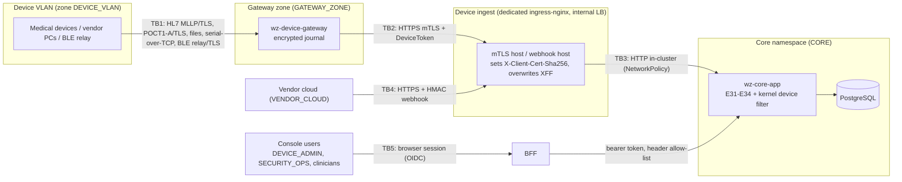

# Increment 6 – Device integration threat model (STRIDE per trust boundary)

| | |
|---|---|
| **Scope** | E31 ingest / engine, E32 console, E33 capture, E34 endpoint security; `wz-device-gateway`; device ingest (mTLS ingress); vendor-cloud webhooks; device and security consoles |
| **Method** | STRIDE per trust boundary (Microsoft SDL), data-flow based. Each threat names the mitigation as built, the control of [`control-mapping.csv`](control-mapping.csv) (SC-01 … SC-16) and the automated test or pack check that proves it. Verification IDs are those of the [traceability matrix](../02-Requirements-Traceability-Matrix.md) §3; `PACK-nn` = `tools/device-security/nn_*` |
| **Companion** | Solution design §8, §11 ([01](../01-Solution-Design-E31-E34.md)); [test plan](test-plan.md); `deploy/device-ingress/README.md`; `deploy/edge/` |
| **Status** | Written 1 November 2026 against the code of increment 6. **Review and approval by the CISO / Security Operations pending** (record it in `/device-security/governance` as a threat-model record). Revisit on every new adapter family, deployment option or trust-boundary change, and at least yearly |

Legend for *Status*: **Mitigated** – built and covered by an automated test; **Mitigated (deploy)** – enforced by
configuration in this repository (Helm / Terraform / workflow), verified by rendering and static checks, runtime proof
by the named pack check in staging; **Partial** – residual risk accepted or follow-up open (see §8);
**Recipe** – depends on the hardened image recipe in `deploy/edge/` that has not been applied to hardware yet.

## 1. Assets

| Asset | Why it matters |
|---|---|
| Device readings (raw payload, canonical observation, FHIR resource) | Special-category health data; wrong values or wrong employee → clinical and fitness-for-duty decisions |
| Endpoint identities (certificate binding, endpoint token, token pepper, trust anchors) | Whoever holds them can inject readings as a trusted gateway |
| Gateway journal and root key | Up to 72 h / 2 GB of readings at rest at the edge |
| Driver packages and signing keys | Code-equivalent configuration that parses every message |
| Connector / webhook secrets | Access to vendor systems and acceptance of vendor webhooks |
| Security event chain, platform audit | Evidence for incidents, regulators and the IEC 80001-1 agreement |
| Availability of capture | Clinics cannot screen employees when ingest is down (store-and-forward bridges outages) |

## 2. Trust boundaries and data flows

| Boundary | From → to | Authentication | Channel |
|---|---|---|---|
| TB1 | device / vendor PC / relay → gateway | device-specific: MLLP sender allow-list (MSH-3), TLS listener certificates, BLE hashed allow-list, file-share ACLs | TLS 1.2+ (plaintext only on loopback or under the documented exception) |
| TB2 | gateway / agent / data manager → device ingest | group-PKI client certificate (mTLS) **and** endpoint token **and** zone CIDR | TLS 1.2 / 1.3, internal LB in the gateway zone |
| TB3 | device ingest → core | thumbprint header set only by the ingress; NetworkPolicy limits who reaches core:8080 | in-cluster HTTP |
| TB4 | vendor cloud → webhook host → core | HMAC-SHA256 over timestamp + raw body, 300 s window, nonce, per-connector rate limit | TLS (no client certificate) |
| TB5 | console users → BFF → core | OIDC session (BFF), bearer token to core, role + ABAC checks, MFA for privileged roles where configured | TLS via the web ingress / WAF |

## 3. TB1 – device ↔ gateway

| ID | STRIDE | Threat | Mitigation (as built) | Control | Verified by | Status |
|---|---|---|---|---|---|---|
| T1.1 | S | Rogue device on the device VLAN sends readings as a known analyser | MLLP sender allow-list (MSH-3) → `AR`; device-instance binding per connector; association never auto-files below 0.95; unmatched queue | SC-02, SC-08 | GW-INT `senderOutsideTheAllowListIsRejectedWithAr`; IT-EN2; UT-ASSOC | Partial – MLLP has no per-device cryptographic identity (HL7 devices rarely support client certificates); VLAN segmentation is the compensating control |
| T1.2 | S | Rogue BLE peripheral / relay | LE Secure Connections policy in the option pack, hashed peripheral allow-list enforced by the gateway, TLS relay intake | SC-04 | UT-OPT `bluetoothPairingMllpTlsAndPoctQc`; GW-CON (BLE MAC hashing and allow-list); PACK-06 | Partial – pairing is enforced by the tablet / helper OS (`deploy/edge/os-policy/bluetooth/main.conf`, Recipe) |
| T1.3 | T | Alteration of messages on the clinic network | TLS listeners (MLLP / POCT1-A / BLE relay); plaintext refused on non-loopback addresses unless `allow-plaintext-listeners` (reported as finding) | SC-01 | GW-INT; PACK-02, PACK-03, PACK-05 `plaintext-mllp` | Mitigated (legacy plaintext devices: exception register) |
| T1.4 | T | Tampering with the journal on the gateway disk | AES-256-GCM per record with associated data, tamper detection → `record_unreadable` dead letter; LUKS volume | SC-10 | GW-JRN `tamperedRecordIsDetectedAndNeverForwarded`; PACK-10 `queue-volume` | Mitigated (journal) / Recipe (LUKS) |
| T1.5 | R | Device or operator denies a reading was sent | Journal sequence, raw-payload SHA-256, `Idempotency-Key = endpoint:sequence`, provenance in the FHIR resource | SC-08 | GW-FWD; IT-EN1; IT-CA2 | Mitigated |
| T1.6 | I | Readings disclosed from the gateway (disk, logs, status page) | Encrypted journal; logs carry ids / sequence numbers only; status page loopback-only and PHI-free; MAC addresses and file paths hashed | SC-10, SC-15 | GW-INT `statusPageIsServedOnLocalhostWithoutPhi`; GW-JRN `recordsAreEncryptedAtRestAndAssignedIdempotencyKeys`; PACK-08 `phi-in-logs` | Mitigated |
| T1.7 | D | Flood / malformed frames exhaust the gateway | MLLP frame limit (`max-message-bytes`), oversized frames close the connection, full queue refuses new messages (device keeps them) instead of evicting | SC-12, SC-13 | GW-CON (MLLP framing 8 tests); GW-JRN `capacityLimitRefusesNewItemsInsteadOfDroppingOldOnes`; PACK-03 | Mitigated |
| T1.8 | E | Malicious USB device (BadUSB, mass storage) or local login escalates on the gateway host | Non-root service, systemd sandbox, `usbcore.authorized_default=0` + udev VID:PID allow-list, no mass storage / new HID, SSH keys only, auditd | SC-03, SC-04 | Gateway finding `RUNS_AS_PRIVILEGED_ACCOUNT`; PACK-05 (`service-account`, `usb-allow-list`, `ssh-passwords`) | Recipe (`deploy/edge/`) |

## 4. TB2 – gateway ↔ device ingest

| ID | STRIDE | Threat | Mitigation (as built) | Control | Verified by | Status |
|---|---|---|---|---|---|---|
| T2.1 | S | Spoofed gateway with a stolen endpoint token | Token alone is useless: mTLS against the group-PKI CA + thumbprint bound to the endpoint (`certificate_mismatch`); token 256-bit, peppered hash, ≤ 90 days, rotation with 15-min grace | SC-01 | UT-AUTH `thumbprintMustMatchTheBoundValidCertificate`, `badAndExpiredTokens`, `previousTokenIsAcceptedOnlyWithinTheGracePeriod`; UT-CRY; IT-SE1; PACK-02 | Mitigated |
| T2.2 | S | Spoofed gateway with a stolen certificate + key | Zone CIDR check per endpoint (`zone_violation`); `NEW_DEVICE_IDENTITY` / `CERTIFICATE_ANOMALY` rules; revocation via endpoint status (next request, no cache); CRL in the ingress CA secret (`ca.crl`) | SC-01, SC-09 | UT-AUTH `zoneAndCidrPolicy`, `statusIsCheckedBeforeTheToken`; UT-POL; IT-SE4; PACK-01 | Mitigated (key in a file today; TPM-resident key is E34-BL-014 – Partial) |
| T2.3 | S | Enrolment with a replayed / expired enrolment token or someone else's certificate | One-time token ≤ 72 h bound to the endpoint kind; PKIX chain against `WZ_DEVICE_TRUST_ANCHORS`, `clientAuth` EKU, proof of possession over `enrol:<token>:<thumbprint>`, thumbprint header must match; 10 attempts / 15 min per source | SC-01 | IT-SE1, IT-SE2; UT-CRY `proofOfPossession`, `untrustedWithoutAnchorsAndInvalidPem`; UT-SCAN `enrolmentThrottleAllowsTenAttemptsPerFifteenMinutes`; PACK-04 | Mitigated |
| T2.4 | T | Man-in-the-middle between site and cloud | TLS 1.2 / 1.3 with the controller's cipher list; gateway validates the ingress certificate (`tls.trust-store`); `CORE_URL_NOT_TLS` hardening finding; Helm refuses a non-`https://` `deviceGateway.coreUrl` | SC-01 | GW-INT; gateway `HardeningCheck`; chart `fail` (rendering); PACK-02 `tls12+` | Mitigated / Mitigated (deploy) |
| T2.5 | R | Gateway disputes having sent a message | Per-call thumbprint + endpoint id in the security event / message store; idempotency keys; hash-chained events | SC-08 | IT-SE7; UT-CHAIN; IT-EN1 | Mitigated |
| T2.6 | I | Token or pepper leaks (logs, DB, CI) | Only HMAC(pepper, token) stored; pepper from the vault (`secrets.device.files`, never in the DB, Terraform placeholder < 16 bytes so core refuses to start until replaced); tokens never logged; gitleaks in CI | SC-05 | UT-CRY `hashIsPepperedDeterministicAndNeverTheToken`; IT-SE6; PACK-08; `ci.yml` gitleaks | Mitigated |
| T2.7 | D | Ingest overload / brute force from the gateway zone | Per-endpoint rate budget (`throttled`), `FAILED_AUTH_BURST` alert at 10 / isolate at 30, `MESSAGE_RATE_SPIKE`; optional edge `limit-rps`; store-and-forward absorbs outages | SC-09, SC-13 | UT-ANOM; UT-AUTH `throttledEndpointsAreRefused`; IT-SE4; GW-FWD; PACK-14 | Mitigated |
| T2.8 | E | Gateway identity used to call non-ingest APIs | Path allow-list per endpoint kind (`endpoint_forbidden`); device tokens refused outside `/device-ingest/**`; separate filter chain | SC-11 | UT-AUTH `pathNotAllowedForTheEndpointType`; UT-FILT; IT-EN2; PACK-04 | Mitigated |

## 5. TB3 – device ingest ↔ core

| ID | STRIDE | Threat | Mitigation (as built) | Control | Verified by | Status |
|---|---|---|---|---|---|---|
| T3.1 | S | Client forges `X-Client-Cert-Sha256` to bypass mTLS | Device ingest removes client-supplied cert headers and sets the thumbprint only from the certificate nginx verified (`$ssl_client_verify = SUCCESS`, Lua SHA-256); public API host denies `/api/v1/device-*` (chart deny Ingress for nginx classes; WAF rules `BlockDevicePathsOnPublicApi` / Cloud Armor 900); BFF forwards only `content-type`, `accept`, `idempotency-key`, `last-event-id` (`ApiProxyController`) | SC-01 | Helm render + Checkov (reviewed exceptions); `deploy/device-ingress/README.md` §4 curl checks; PACK-02 (`wrong thumbprint refused`) | Mitigated (deploy) – runtime proof in the first staging pack run |
| T3.2 | S | Client forges `X-Forwarded-For` / `Forwarded` to satisfy the zone CIDR check | Controller `use-forwarded-headers=false` → `X-Forwarded-For $remote_addr` (checked in the ingress-nginx v1.13.3 template); snippet overwrites XFF and strips `Forwarded`, `X-Real-IP`, `X-Original-Forwarded-For`; LB preserves the source address (`externalTrafficPolicy: Local`) | SC-02 | `deploy/device-ingress/README.md` §4 (`zone_violation` expected); PACK-01 `zone-violation` | Mitigated (deploy) |
| T3.3 | S | Another in-cluster workload calls core:8080 with forged headers | NetworkPolicy: core accepts 8080 only from the BFF, the web / API ingress controller, the device ingress controller (`deviceIngest.controller`) and listed hybrid peers; namespace default deny in UAT / PROD | SC-02 | kubeconform + Checkov on rendered policies (all overlays) | Mitigated (deploy). Residual: any pod in an allowed controller namespace is a peer – keep those namespaces dedicated |
| T3.4 | T | Controller configuration changed to drop the header hygiene | IngressClass `nginx-device` reserved by `ValidatingAdmissionPolicy` (namespace + label, no `server-snippet`); controller scoped to the `wellnessz` namespace; snippets only on this controller | SC-03 | kubeconform of `restrict-device-ingressclass.yaml`; upstream chart render | Mitigated (deploy) |
| T3.5 | I | Readings intercepted inside the cluster (ingress → core is HTTP) | Private cluster network, NetworkPolicies; service mesh mTLS is not used | SC-10 | – | Partial – accepted for in-cluster traffic; revisit with a mesh |
| T3.6 | D | Large uploads / slow clients tie up core | `proxy-body-size 64m`, timeouts 60 s, core `device.ingest.max-payload-bytes`, batch ≤ 100 items / 10 MB, HPA | SC-13 | IT-EN6; Helm render | Mitigated |
| T3.7 | E | Malformed message exploits a parser | Strict parsers, XML external entities refused, size limits, signed driver packages (Ed25519) verified at registration and load | SC-12, SC-06 | UT-PAR `xmlParserRefusesExternalEntities`; IT-SE5; IT-X3; PACK-03, PACK-07 | Mitigated |

## 6. TB4 – vendor cloud ↔ webhook

| ID | STRIDE | Threat | Mitigation (as built) | Control | Verified by | Status |
|---|---|---|---|---|---|---|
| T4.1 | S | Forged webhook from the internet | HMAC-SHA256 over `timestamp + "." + body` with the connector secret, constant-time compare; failures are security events (`WEBHOOK_SIGNATURE_FAILURES`); optional `deviceIngest.webhooks.sourceRanges` (vendor egress ranges) | SC-01, SC-09 | UT-SUP `webhookHmacOverTimestampAndBody`; IT-EN6; IT-SE8 | Mitigated |
| T4.2 | T / R | Replay of a captured webhook | 300 s timestamp window + nonce table (`webhook_nonce`) | SC-01 | IT-EN6 | Mitigated |
| T4.3 | I | Webhook secret leaks (config, export, logs) | Write-only secret store (`devsec:` / `vault:` references), sealed exports with references only, secret scanner on packages / configs | SC-05 | IT-SE6; UT-SCAN; IT-CO4; PACK-08 | Mitigated |
| T4.4 | I | Wearable data received without consent | Consent gate before posting; minimised payload | SC-15 | IT-EN3; IT-CA10 | Mitigated |
| T4.5 | D | Webhook flood | 600 / min per connector in core, edge `limit-rps` on the webhook host (default 10 / s per source), WAF not in path (internal controller) | SC-13 | IT-EN6; Helm render | Mitigated |
| T4.6 | E | Webhook path used to reach other APIs | Webhook host routes only `/api/v1/device-webhooks`; kernel chain permits only the webhook controller there | SC-11 | UT-FILT; Helm render | Mitigated |

## 7. TB5 – console users (device console, security console, clinicians)

| ID | STRIDE | Threat | Mitigation (as built) | Control | Verified by | Status |
|---|---|---|---|---|---|---|
| T5.1 | S | Account takeover of a `DEVICE_ADMIN` / `SECURITY_OPS` | OIDC via the BFF (HttpOnly SameSite=Strict session), IdP MFA policy; `WZ_MFA_REQUIRED_ROLES` covers partner roles today | SC-11 | WEB-DEV; WEB-SEC | Partial – MFA for device / security roles is an IdP conditional-access setting, not enforced by core |
| T5.2 | T | Unauthorised configuration change (driver binding, gate, zone, endpoint) | Four-eyes approvals, versioned configurations with diff, signed driver packages, history | SC-06, SC-08 | IT-CO2, IT-CO4, IT-CO5; UT-E32S | Mitigated |
| T5.3 | R | Administrator denies a change or an isolation release | Hash-chained platform audit and security event log, SIEM outbox; release by SECURITY_OPS only after re-certification | SC-08 | IT-SE7; UT-CHAIN; IT-SE4 | Mitigated |
| T5.4 | I | Console roles see person data | `/me` disclosure `NONE`; masked traces; counts only; restricted categories (collector own session / MRO) | SC-11, SC-15 | UT-MASK; IT-SE1; UT-VR; IT-CA5; WEB-DEV | Mitigated |
| T5.5 | I | Secrets read back through the console | Secrets write-only, never returned | SC-05 | IT-SE6; PACK-08 `secret-not-echoed` | Mitigated |
| T5.6 | D | Console misuse disables capture (mass isolation, decommission) | Isolation and decommission audited, decommission needs four eyes, release gate; anomaly rules on off-hours configuration access | SC-09 | IT-CO5; UT-ANOM `clinicHoursWindows`; IT-X2 | Mitigated |
| T5.7 | E | Clinician or manager escalates to device administration | Separate roles, ABAC, module flags fail closed; DAST baseline on the web hosts (passive, report only) | SC-11 | IT-CA12; IT-SE11; `dast.yml` (report only) | Mitigated / DAST report-only |

## 8. Residual risks and follow-ups

| Item | Risk | Owner | Tracking |
|---|---|---|---|
| T1.1 | HL7 / POCT devices without per-device crypto identity | Integration lead, Network | VLAN segmentation + sender allow-list; vendor roadmap |
| T1.2, T1.8, T2.2 | OS-level BLE / USB policy, CIS image, TPM-resident keys not applied to hardware | Infrastructure, Security | E34-HLR-03, E34-HLR-04, E34-BL-003, E34-BL-014 (`deploy/edge/` recipe) |
| T3.1, T3.2, T3.4 | Ingress behaviour verified statically only | DevSecOps | First run of `device-security-pack.yml` (E34-BL-010) |
| T3.5 | Plain HTTP inside the cluster | Platform | Service-mesh decision (E35) |
| T5.1 | MFA for device / security roles depends on IdP policy | IAM | Conditional-access rule for the console app registration |
| AGIC / GKE / OpenShift native mTLS | Not usable without a core change (PEM or Base64 thumbprint) | Platform (Java, `platform/`) | `deploy/device-ingress/README.md` §5 |
| Ingress controller life-cycle | Community ingress-nginx retired March 2026 | Platform | Pin, mirror by digest, plan the move to a maintained NGINX-based controller |
