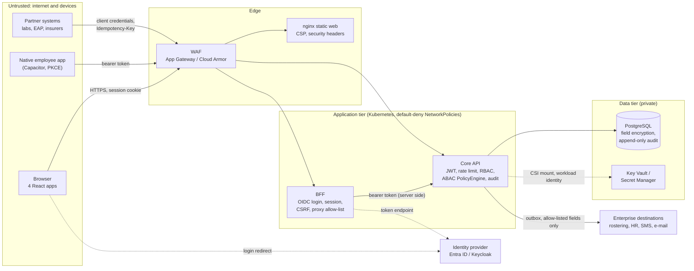
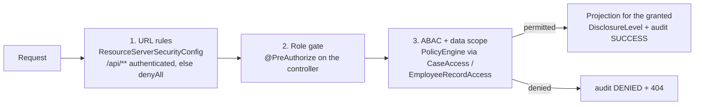
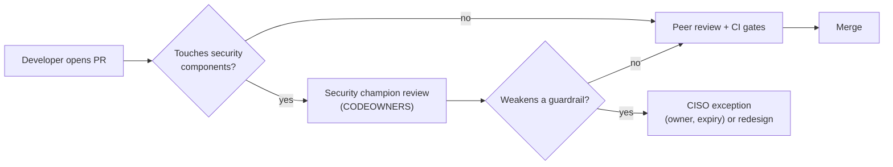

# WellnessZ OHCM – Developer Security Handbook

**Version 1.0**

*WellnessZ OHCM platform – security assessment 2026-10*

| | |
|---|---|
| **Document** | Developer Security Handbook |
| **Version** | 1.0 (2026-10-30) |
| **Audience** | Developers, testers and technical leads who extend WellnessZ – product modules, client modules, web apps, integrations and infrastructure |
| **Baseline** | Java 21 / Spring Boot 4.1.2, React 19, Maven version `0.1.0-SNAPSHOT`, after the October 2026 security assessment and its remediation |
| **Read together with** | [03 – Developer Guide](../architecture/03-Developer-Guide.md) (Sections 1.3, 5, 7, 8, 9, 12, 18.4) · [02 – Security and SOC 2 Control Mapping](../architecture/02-Security-and-SOC2-Control-Mapping.md) · [Security Enhancement Guideline](Security-Enhancement-Guideline.md) · [CI/CD Guide](../cicd/CI-CD-Guide.md) · [Client Customisation Guide](../customisation/Client-Customisation-Guide.md) |

> **The one-sentence version.** Every request is authenticated, every read of occupational health (OH) data goes
> through `PolicyEngine`, restricted classes answer `404` to everybody but their named clinicians, nothing clinical
> ever reaches a log, an error, a notification or a non-OH system, and every secret is `ENC(...)` or `file:`.

---

## Contents

1. [How to use this handbook](#1-how-to-use-this-handbook)
2. [Architecture and trust boundaries](#2-architecture-and-trust-boundaries)
3. [Threat model per layer](#3-threat-model-per-layer)
4. [Secure coding rules with examples from this codebase](#4-secure-coding-rules-with-examples-from-this-codebase)
5. [Secure pull-request checklist](#5-secure-pull-request-checklist)
6. [Running the security tools locally](#6-running-the-security-tools-locally)
7. [Testing every new endpoint](#7-testing-every-new-endpoint)
8. [Security champions](#8-security-champions)
9. [Incident handling for developers](#9-incident-handling-for-developers)
10. [Glossary](#10-glossary)

---

## 1. How to use this handbook

* **Before you design** a new feature: read Section 3 for the layers you touch and add the new flows to the threat
  model (doc 02, Section 7).
* **While you code**: follow Section 4. Every rule points to a class that already does it right – copy the pattern,
  do not invent a new one.
* **Before you open a pull request**: run the tools of Section 6 and tick the checklist of Section 5.
* **For every new endpoint**: write the tests of Section 7.
* **When something looks wrong in production or in a log**: Section 9.

The rules here are not optional style advice. They are the controls that the October 2026 assessment relied on, and the
guardrails GR-01 to GR-20 of the Security Enhancement Guideline (Section 4) must never be weakened without a recorded
CISO exception.

---

## 2. Architecture and trust boundaries



| Boundary | What crosses it | Primary controls |
|---|---|---|
| Internet → edge | All traffic | TLS 1.2+, WAF (DRS 2.1 / Cloud Armor CRS), HSTS |
| Browser → BFF | Session cookie `WZSESSION`, `X-XSRF-TOKEN` | OIDC login, `csrf.spa()`, session-id rotation, max 3 sessions, encrypted session attributes |
| BFF → core API | Bearer token of the signed-in user | Header and path allow-list in `ApiProxyController`; core re-checks everything |
| Device / partner → core API | Bearer token | Trusted issuers, audience, MFA gate for external roles, `ApiRateLimitFilter`, `INTEGRATION` role, partner-organisation binding |
| Core API → database | SQL | Parameterised queries, least-privilege runtime role, `EncryptedStringConverter` |
| Core API → enterprise systems | Outbox events, notifications | `OutboundPayloadGuard`, `NotificationTemplates` + `ContentRules`, `DisclosureLogService` |
| Developer → production | Code, images | Pull-request review, CI gates, signed images by digest, required reviewers |

---

## 3. Threat model per layer

STRIDE letters: **S**poofing, **T**ampering, **R**epudiation, **I**nformation disclosure, **D**enial of service,
**E**levation of privilege.

| Layer | Main threats (STRIDE) | Built-in controls | What you must do when you extend it |
|---|---|---|---|
| **Web apps** (`web/*`) | I – XSS stealing data; I – PHI left in browser storage or logs; T – UI-only role checks bypassed | No tokens in the browser (BFF); CSP `script-src 'self'` without inline script (`security-headers.conf`); ESLint bans `console`, `localStorage`, `sessionStorage`; `src/security/log.ts`; manager workspace `statusOnly.ts` whitelist; `cache: 'no-store'` | Render data as text only; no `dangerouslySetInnerHTML`; map responses through whitelisting parsers; treat `roles.ts` gating as UX only; encode path segments with `seg()` |
| **BFF** (`apps/wz-bff`) | S – session hijack; T – CSRF; E – path traversal to admin endpoints; I – header leakage | `BffSecurityConfig` (OIDC, `csrf.spa()`, `changeSessionId`, `maximumSessions(3)`, strict headers, safe logout redirect); `ApiProxyController` rejects `..` and `//`, forwards only `content-type`, `accept`, `idempotency-key`; `WORKSPACE_ROLES` | Never forward new headers without review; add workspace aliases to `CORE_WORKSPACE_RESOURCES` with `ApiProxyPathTest`; never filter clinical content in the BFF – the core decides |
| **Core API – edge of the application** | S – forged tokens; D – request floods; I – verbose errors | `ResourceServerSecurityConfig` (trusted issuers, audience, default deny, stateless, CORS allow-list); `ApiRateLimitFilter`; `GlobalExceptionHandler` (RFC 9457, no internals); `CorrelationIdFilter` | No `permitAll`; validate every input with Bean Validation; throw `ApiException`; cap list sizes |
| **Core API – domain and ABAC** | E – broken object-level authorisation (BOLA); I – clinical data to managers / HR; I – restricted class to general OH | `@PreAuthorize` role gates; `PolicyEngine` (deny-overrides, default deny); `CaseAccess`, `EmployeeRecordAccess`; `SupportAccess` (named clinician, `404`); status-only projection records; `BreakGlassService` | Every read through `PolicyEngine`; projection per disclosure level; `404` for denied records; audit success and denial |
| **Data** (PostgreSQL) | I – database or backup exfiltration; T – audit rewrite; I – statement logs with PHI | `EncryptedStringConverter` / `FieldEncryptor` (AES-256-GCM, key version prefix); append-only, hash-chained `platform.audit_event`; Flyway least-privilege grants; statement logging off | Encrypt every clinical free-text column; blind index for equality search; grants only to `${app_role}`; never `LIKE` on encrypted data |
| **Integration – inbound** (FHIR, HL7, webhooks, partner APIs) | S – unauthorised systems; T – hostile payloads (XXE, zip bombs); replay and duplicates | `INTEGRATION` role and issuer validation; `IdempotencyService`; `InboundService` stores raw content encrypted; hardened parsers; partner-organisation binding (`CurrentUser.partnerOrganisation()`) | `Idempotency-Key` on every machine `POST`; validate content type and size; bind machine clients to their own organisation; answer `404` for other organisations' records |
| **Integration – outbound and notifications** | I – clinical fields to rostering, HR, SMS or e-mail | `OutboundPayloadGuard` (flat payloads, field allow-list per destination, default deny); `NotificationTemplates` + `ContentRules`; `DisclosureLogService` | Register destinations in `ConnectorRegistry`; add allow-list fields with DPO approval; only approved templates; log every disclosure crossing the OH boundary |
| **Secrets and keys** | I – secret in Git, image or log; E – stolen master key | `ENC(...)` / `file:` resolution (`SecretValueResolver`, `SecretsEnvironmentPostProcessor`); master key from `WZ_MASTER_KEY_FILE` (CSI mount); gitleaks in CI | Never hard-code secrets, even in tests (throw-away keys in the `test` profile only); add new secrets to Helm `secrets.core.files` and the cloud secret store |
| **Platform** (Helm, Kubernetes, Terraform) | E – container escape; T – unsigned image; I – lateral movement | Non-root, read-only root file system, no privilege escalation; default-deny NetworkPolicies; private endpoints; Binary Authorization (GKE); cosign verification at deploy | Keep `securityContext` and NetworkPolicies; open only the ports and destinations you need; run Checkov and Trivy config before merging IaC |
| **CI/CD and supply chain** | T – malicious dependency or action; I – secrets in workflow logs | SHA-pinned actions; `permissions: contents: read`; `persist-credentials: false`; Dependabot with cooldown; dependency review; Trivy gate; SBOM, provenance, cosign | Exact versions only; justify every new dependency; no new repository secrets (use OIDC); never `pull_request_target` with checkout of untrusted code |
| **Mobile** | S – code interception; I – tokens or PHI on the device | PKCE S256, `state` + `nonce`; access token in memory; no `localStorage`; privacy screen; `webContentsDebuggingEnabled: false` | Exact plugin versions; review permissions; no secrets in managed configuration keys (SEC-E11 adds pinning and secure storage) |

---

## 4. Secure coding rules with examples from this codebase

### 4.1 Authorisation: URL rules, `@PreAuthorize`, then `PolicyEngine` with data scope

WellnessZ authorises in **three layers**. All three are needed; none replaces another.



**Layer 1 – URL rules** are central and must not be relaxed
(`platform/wz-security/.../config/ResourceServerSecurityConfig.java`):

```java
.authorizeHttpRequests(auth -> auth
    .requestMatchers(HttpMethod.OPTIONS, "/api/**").permitAll()
    .requestMatchers("/v3/api-docs/**", "/swagger-ui/**", "/swagger-ui.html", "/error").permitAll()
    .requestMatchers("/api/v1/integration/**").hasAnyRole("INTEGRATION", "PLATFORM_ADMIN", "OH_ADMIN")
    .requestMatchers("/api/v1/audit/**").hasAnyRole("AUDITOR", "PLATFORM_ADMIN")
    .requestMatchers("/api/**").authenticated()
    .anyRequest().denyAll())
```

**Layer 2 – role gate** on every controller method, using the shared constants in
`com.wellnessz.common.model.Roles` (`OH_TEAM_SPEL`, `CLINICIANS_SPEL`, `PHYSICIANS_SPEL`) where they fit
(`modules/wz-e05-fitness/.../web/FitnessDecisionController.java`):

```java
@GetMapping("/employees/{employeeId}/fitness")
@PreAuthorize(Roles.OH_TEAM_SPEL)
public List<FitnessDecisionService.DecisionView> employee(
        @PathVariable @Pattern(regexp = "[A-Za-z0-9\\-]{1,64}") String employeeId) {
    return decisions.employeeFitness(users.require(), employeeId);
}

@PostMapping("/fitness-decisions/{id}/signoff")
@PreAuthorize("hasAnyRole('AME','CMO')")
public FitnessDecisionService.DecisionView signoff(@PathVariable UUID id, @Valid @RequestBody SignoffRequest r) {
    return decisions.signoff(users.require(), id, r.approve(), r.note());
}
```

**Layer 3 – ABAC with data scope** in the service, through the kernel helpers rather than ad-hoc checks
(`platform/wz-case-kernel/.../support/CaseAccess.java`):

```java
public OhCase require(CurrentUser user, UUID id, AccessPolicy.Action action, DisclosureLevel minimum, String auditAction) {
    OhCase c = cases.findById(id).orElseThrow(() -> ApiException.notFound("Case"));
    AccessDecision d = policy.decide(user, action, attributes(c));
    if (!d.permitted() || !d.disclosure().atLeast(minimum)) {
        audit.record(auditAction, "CASE", id.toString(), AuditService.Outcome.DENIED, d.reason());
        throw ApiException.notFound("Case");   // 404: never confirm that the record exists
    }
    return c;
}
```

The **data scope** for managers and HR comes from the token's `org_scope` claim and is applied by
`DefaultPolicies.statusOnlyPolicy` – a manager sees status only, and only below their own org path:

```java
String scope = user.orgScope();
if (scope != null && r.orgUnitPath() != null
        && (r.orgUnitPath().equals(scope) || r.orgUnitPath().startsWith(scope.endsWith("/") ? scope : scope + "/"))) {
    return Optional.of(AccessDecision.permit(DisclosureLevel.STATUS_ONLY, "Within org scope"));
}
return Optional.of(AccessDecision.deny("Outside org scope"));
```

Rules:

| Do | Do not |
|---|---|
| Put `@PreAuthorize` on **every** controller method, even when the URL rule already restricts the path | Rely on the UI (`roles.ts`) or the BFF to hide a function |
| Load OH records through `CaseAccess.require/clinical`, `EmployeeRecordAccess.requireClinical/requireStatus` or your own `PolicyEngine.decide` call | Write `if (user.hasRole("MANAGER"))` checks scattered through services |
| Derive `ResourceAttributes` (owner, org path, classification) from the **stored** record | Accept a classification, owner or org path from the request body |
| Return a projection record chosen by `AccessDecision.disclosure()` | Null out or `@JsonIgnore` clinical fields on a shared DTO |
| Answer `404` (with an audited `DENIED`) for a record the caller may not see | Answer `403` for record-level denials – it confirms existence |
| Contribute new rules as `AccessPolicy` beans with a unit test using `new PolicyEngine(List.of(...))` (see `PolicyEngineTest`) | Grant `RESTRICTED_CLINICAL` disclosure to any role other than `PSYCH_CLINICIAN` without OH governance approval |

### 4.2 Restricted classes and the placeholder pattern

Psychological health (E09) and substance testing (E10) are `DataClassification.RESTRICTED_CLINICAL`. Only the named
restricted-class clinician reads the content; everybody else either gets `404` or – for general OH staff – a
**placeholder count** that says something exists without saying what.

Named-clinician check (`modules/wz-e09-mentalhealth/.../support/SupportAccess.java`):

```java
public boolean isNamedClinician(CurrentUser user) {
    if (!user.hasRole(Roles.PSYCH_CLINICIAN)) {
        return false;
    }
    List<String> named = support.listConfig(MhSupport.NAMED_CLINICIANS_KEY, "");
    return named.isEmpty() || named.contains(user.username());
}

public ApiException deny(String auditAction, String resourceId, String reason) {
    audit.record(auditAction, RESOURCE, resourceId, AuditService.Outcome.DENIED, reason);
    return ApiException.notFound("Support case");
}
```

Placeholder endpoint and service (`SupportController.placeholder`, `SupportCaseService.placeholder`) – a count, audited,
nothing else:

```java
@GetMapping("/placeholder")
@PreAuthorize("isAuthenticated()")
public SupportViews.Placeholder placeholder(@RequestParam @Pattern(regexp = Patterns.EMPLOYEE_ID) String employeeId) {
    CurrentUser user = users.require();
    access.requireRoles(user, "SUPPORT_PLACEHOLDER_READ", employeeId, Roles.OH_TEAM);
    return cases.placeholder(user, employeeId);
}

// SupportCaseService
long n = cases.countByEmployeeIdAndStatusNot(employeeId, SupportStatus.CLOSED.name());
audit.record("SUPPORT_PLACEHOLDER_READ", "EMPLOYEE", employeeId, AuditService.Outcome.SUCCESS, "restrictedCases=" + n);
return new SupportViews.Placeholder(n);
```

When you build anything that touches a restricted class, apply rules R1–R15 of the Developer Guide, Section 18.4.
The most frequently missed ones:

* The check is in the **service**, not only in `@PreAuthorize` – a `PSYCH_CLINICIAN` who is not on
  `mentalhealth.named-clinicians` must still get `404`.
* Restricted data never appears in analytics, exports, enterprise events, logs, problem details or audit reasons.
* Restricted documents are created with
  `DocumentService.generateSigned(actor, template, employeeId, caseId, fields, DataClassification.RESTRICTED_CLINICAL)`.
* `mentalhealth.named-clinicians` is seeded with the demo user `psych1` (finding F-17). It must be set to the real
  clinicians in every non-local environment before go-live.

### 4.3 Never log PHI

| Channel | Rule | Tool |
|---|---|---|
| Java logs | Log identifiers, counts, event types and exception **class names**. Never payloads, names, addresses, free text or tokens. Wrap user-controlled values with `LogSanitizer.clean(...)` (CWE-117 log injection). No `System.out` / `System.err` | `com.wellnessz.common.web.LogSanitizer`; ArchUnit rule `noStandardStreams` |
| Problem details | Generic messages; never echo input values, SQL or stack traces | `GlobalExceptionHandler`, `ApiException` |
| Audit reasons | Enum names, counts or disclosure levels only (`"restrictedCases=" + n`, `d.disclosure().name()`) | `AuditService.record` |
| Web apps | Static event code plus HTTP status or error **name** only | `src/security/log.ts`; ESLint `no-console` |

```java
// good – identifiers and class names only
log.warn("Inbound message rejected source={} reason={}", LogSanitizer.clean(source), e.getClass().getSimpleName());

// never – the exception message or payload may contain clinical text or a name
log.warn("Inbound message rejected: {} body={}", e.getMessage(), body);
```

```ts
// web: src/security/log.ts accepts only a code and { status, errorName }
import { log, errorName } from '../security/log';
try { /* … */ } catch (e) { log.error('case.load.failed', { errorName: errorName(e) }); }
```

### 4.4 Free text for non-clinical readers: `ClinicalContentException.screen`

Any free-text field that a manager, HR, a partner or another non-clinical reader will see is screened for medical
wording. The request fails with `422 clinical_content_not_allowed` and the field name, so the UI can highlight it.

```java
// modules/wz-e07-surveillance/.../support/SurveillanceSupport.java
/** Text shown to non-OH readers: length-limited and screened for clinical content (422). */
public static String functional(String field, String value, int max) {
    if (value == null || value.isBlank()) {
        return null;
    }
    String v = value.strip();
    if (v.length() > max) {
        throw ApiException.badRequest("too_long", "Field '" + field + "' exceeds " + max + " characters");
    }
    ClinicalContentException.screen(field, v);
    return v;
}
```

The same helper exists in the E04, E05, E08 and E12 support classes, and `AppointmentService` screens `adminNote` and
`reason` directly. Use it for: manager-visible notes, duty-proposal text, restriction wording, scheduling reasons,
claim messages to adjusters, campaign text. OH-only text is not screened but **is encrypted** (Section 4.10).

### 4.5 Content-free notifications

Notifications are **nudges to sign in**, never carriers of clinical content. Only approved templates in
`NotificationTemplates` may be rendered; parameters must be in `ALLOWED_PLACEHOLDERS`; values are stripped of control
characters and `<`/`>` and truncated to 120 characters; and the rendered text passes `ContentRules`, which rejects
clinical wording and the words *positive*, *negative*, *result(s)*, *drug* and *alcohol*.

```java
// platform/wz-notification/.../NotificationTemplates.java (excerpt)
Map.entry("case.update", "Hi {{firstName}}, there is an update on your Occupational Health case {{caseRef}}. Please sign in: {{portalLink}}"),
Map.entry("testing.status", "The duty status of {{employeeName}} ({{unit}}) has been updated by Occupational Health. {{portalLink}}"),

public String render(String templateKey, Map<String, String> params) {
    // unknown template or a parameter outside ALLOWED_PLACEHOLDERS -> ContentRuleViolation
    // … placeholders replaced with sanitise(value) …
    ContentRules.assertNoClinicalContent(out.toString());
    return out.toString();
}
```

Adding a template: add the entry, use only existing placeholders (a new placeholder needs DPO review), keep the
wording neutral (never name the programme, condition, test or outcome), get OH governance sign-off, and make sure
`NotificationRulesTest` still renders every template.

### 4.6 SQL: JPA or bound parameters only

Use Spring Data / JPQL, or `JdbcTemplate` with `?` bind parameters. Dynamic **identifiers** (columns, sort keys,
group-by dimensions) come only from a fixed allow-list in code.

Bound parameters with constant fragments (`modules/wz-e02-triage/.../queue/QueueService.java`) – this is the pattern
Semgrep flagged and the assessment confirmed as safe (finding F-13): only constant text is concatenated, every value
is a parameter:

```java
w.append(" and c.urgency = ?");
args.add(f.urgency());
// …
Long total = jdbc.queryForObject("select count(*) " + BASE + where, Long.class, args.toArray());
```

Allow-listed dimension (`platform/wz-analytics/.../KpiService.java`) – user input selects one of several literal
queries and never reaches the SQL text:

```java
String sql = switch (groupBy) {
    case "orgUnit" -> "select org_unit_code as grp, status, count(*) as n from analytics.v_case_facts group by 1, 2 order by 1, 2";
    case "category" -> "select category as grp, status, count(*) as n from analytics.v_case_facts group by 1, 2 order by 1, 2";
    // …
    default -> throw new IllegalArgumentException("Unsupported dimension");
};
```

Never: `"... where name = '" + name + "'"`, `ORDER BY ` + request parameter, native queries built from request text,
`LIKE` on encrypted columns.

### 4.7 Input validation and RFC 9457 errors

* Requests are Java records with Bean Validation: `@NotNull`, `@NotBlank`, `@Size(max = …)` on **every** string,
  `@Pattern` on identifiers and codes (`Patterns.EMPLOYEE_ID` = `[A-Za-z0-9_\-]{1,64}` in E09 and E10).
* Path variables are validated too (`@PathVariable UUID id` or `@Pattern`).
* Lists take a `limit` with a hard cap; sort deterministically.
* Errors are `ApiException` (`notFound`, `forbidden`, `badRequest`, `conflict`) or a subclass such as
  `ClinicalContentException`. `GlobalExceptionHandler` turns them into RFC 9457 problem details with
  `type = urn:wellnessz:problem:<code>`, a stable `code` and the `correlationId`; unreadable bodies become
  `400 malformed_request` without internal detail.

```java
public record SignoffRequest(@NotNull Boolean approve, @Size(max = 2000) String note) {
}
```

```json
{ "type": "urn:wellnessz:problem:clinical_content_not_allowed", "title": "Unprocessable Content", "status": 422,
  "detail": "Field 'reason' appears to contain medical information. Use functional, work-related wording only.",
  "code": "clinical_content_not_allowed", "field": "reason", "correlationId": "…" }
```

### 4.8 Outbound allow-list

Data leaves the OH domain only through the outbox, and `OutboundPayloadGuard.check(destination, payload)` enforces
three rules: a destination without an allow-list is refused (default deny), payloads must be **flat** (no nested
objects or arrays), and only allow-listed fields (plus `eventType`, `aggregateType`, `aggregateId`, `occurredAt`) may
appear.

```java
List<String> allowed = outboundAllowlist.get(destination);
if (allowed == null) {
    throw new ApiException(HttpStatus.INTERNAL_SERVER_ERROR, "destination_not_allowed",
            "No outbound allow-list configured for destination");
}
// … nested object/array or non-allow-listed field -> "disclosure_violation"
```

A new destination needs: an entry in `ConnectorRegistry` (with its data contract), an allow-list entry approved by the
DPO, credentials as `ENC(...)` / `file:`, TLS verification on, and an integration test that asserts the payload fields.
Outbound HTTP calls go only to catalogued hosts.

### 4.9 Secrets: `ENC(...)` or `file:`, never in code

```yaml
# apps/wz-core-app/src/main/resources/application.yml – value supplied per environment
spring:
  datasource:
    password: ${WZ_DB_PASSWORD:}
```

| Form | Use | How |
|---|---|---|
| `file:/mnt/secrets/<name>` | Kubernetes (CSI Secrets Store, External Secrets) | Honoured only for sensitive property names (containing password, secret, key, token or credential) – `SecretValueResolver` |
| `ENC(...)` | Values that must sit in a configuration file (for example on-premises) | AES-256-GCM with the master key; produce with `./tools/encrypt-secret.sh` (reads the secret without echo) |
| Environment variable | Local development only | `deploy/local/.env` (git-ignored; `.env.example` holds placeholders) |

Never commit a real secret, not even "temporarily" – gitleaks scans the full history in CI and a leaked secret must be
rotated (Section 9). The only secret-like values allowed in Git are documented local-only placeholders such as
`change-me-local-only` (finding F-15) and throw-away keys in the `test` profile. New secrets are added to the Helm
`secrets.core.files` list and to the cloud secret store through Terraform or External Secrets.

### 4.10 Encryption at rest with `EncryptedStringConverter`

Every free-text or narrative clinical column uses the JPA converter (AES-256-GCM, value prefixed with the key
version, for example `v1:`):

```java
@Convert(converter = EncryptedStringConverter.class)
@Column(columnDefinition = "text")
private String finding;

@Column(name = "finding_bidx", length = 64)
private String findingBlindIndex;   // fieldEncryptor.blindIndex(value) – for equality search only
```

* Need equality search (accession number, reference)? Store `FieldEncryptor.blindIndex(value)` in a separate column.
* Do not encrypt columns used for ABAC scoping or joins (employee id, org path) – ABAC protects them.
* Never implement your own cryptography; use `FieldEncryptor`, `EncryptedStringConverter` or `AesGcmCipher` and
  `SecureRandom`.

### 4.11 Audit and disclosure logging

`AuditService.record(action, resourceType, resourceId, outcome, reason)` writes to the hash-chained trail in its own
transaction, so denials survive a rollback. Audit **every** read, list, create, update, export and denial of OH data.
Action names are stable upper snake case (`<RESOURCE>_<VERB>`); auditors and SIEM detections are built on them.

```java
audit.record("SUPPORT_PLACEHOLDER_READ", "EMPLOYEE", employeeId, AuditService.Outcome.SUCCESS, "restrictedCases=" + n);
audit.recordAs("system", "", "EHS_MAILBOX_POLL", "MAILBOX", null, AuditService.Outcome.FAILURE, e.getClass().getSimpleName()); // jobs
```

When a status or document **crosses the OH boundary** (HR, crew scheduling, insurer, authority, legal), also record a
disclosure with `DisclosureLogService.record(...)` so the employee can see who received what
(`modules/wz-e11-travelhealth/.../communicable/CommunicableService.java`):

```java
disclosures.record(c.getEmployeeId(), "HR", "HR systems (status feed)", "FITNESS_STATUS", c.getCaseId().toString(), title,
        "FITNESS_FOR_WORK", null, actor);
```

### 4.12 Idempotency on integration endpoints

Every machine-to-machine `POST` accepts an `Idempotency-Key` and runs through `IdempotencyService.execute`, which
stores the request hash and returns the original response on a retry
(`platform/wz-integration/.../IntegrationController.java`):

```java
@PostMapping(value = "/inbound/{source}", consumes = "application/json", produces = "application/json")
public ResponseEntity<String> inbound(@PathVariable @Pattern(regexp = "[a-z0-9\\-]{2,50}") String source,
                                      @RequestHeader(value = "Idempotency-Key", required = false) String key,
                                      @RequestBody String body) {
    // … body must parse as JSON, otherwise 400 invalid_json
    return idempotency.execute("inbound:" + source, key, body, () -> {
        InboundMessage msg = inbound.accept(source, "JSON", null, key, body);
        return ResponseEntity.status(HttpStatus.ACCEPTED)
                .body(json.writeValueAsString(Map.of("id", msg.getId().toString(), "status", "ACCEPTED")));
    });
}
```

Event consumers must be idempotent too (deliver the same envelope twice → one effect).

### 4.13 Rate limits

`ApiRateLimitFilter` (finding F-03) runs after token authentication and keeps a token bucket per authenticated
principal: 600 requests per minute with a burst of 120 for people, 6,000 per minute for `INTEGRATION` clients. Above
the limit it answers `429` with `Retry-After` and an RFC 9457 body with `code = rate_limited`.

| Setting | Property | Environment variable | Default |
|---|---|---|---|
| Human users | `wellnessz.security.rate-limit-per-minute` | `WZ_RATE_LIMIT_PER_MINUTE` | 600 |
| Machine clients | `wellnessz.security.integration-rate-limit-per-minute` | `WZ_INTEGRATION_RATE_LIMIT_PER_MINUTE` | 6000 |
| Burst | `wellnessz.security.rate-limit-burst` | `WZ_RATE_LIMIT_BURST` | 120 |

Developer rules: never set a limit to `0` outside local load tests (guardrail GR-16); web clients must handle `429` by
honouring `Retry-After` instead of retrying in a loop; design expensive operations (exports, audit packs, bulk
imports) as asynchronous jobs with their own concurrency limit. Buckets are per pod today – cluster-wide and
cost-based limits are SEC-E07.

### 4.14 Web: BFF, CSRF and proxy rules

* Browser apps **never** hold access or refresh tokens. They call `/bff/api/**` with the `WZSESSION` cookie
  (`HttpOnly`, `Secure`, `SameSite`) and send `X-XSRF-TOKEN` from the `XSRF-TOKEN` cookie on every state-changing call –
  `bffAuthClient.ts` in each app does this; use the app's API client, never raw `fetch` to other origins.
* The BFF uses `csrf.spa()`; do not disable CSRF for a path, and do not add `GET` endpoints that change state.
* `ApiProxyController` rejects `..` and `//`, forwards only an allow-list of request headers (`content-type`,
  `accept`, `idempotency-key`) and response headers. Adding a header is a security review item.
* Role-gated workspace paths: `/bff/api/workspace/**` requires one of `BffSecurityConfig.WORKSPACE_ROLES`; core
  endpoints that live under `/api/v1/workspace/...` are listed in `ApiProxyController.CORE_WORKSPACE_RESOURCES` and
  covered by `ApiProxyPathTest`.
* Logout goes through the BFF (`POST /logout` with the CSRF token); the IdP end-session redirect is validated
  (`SpaOidcLogoutHandler.safeTarget`) – never add redirect parameters taken from the request.

### 4.15 React: XSS and data-handling rules

| Rule | Why | How |
|---|---|---|
| Never use `dangerouslySetInnerHTML` (none exists in the four apps today) | Bypasses React escaping; with clinical text this is an XSS and data-leak vector | Render text nodes; for formatted text, map a small set of known tokens to React elements |
| No inline scripts or styles; no `eval`, `new Function`, `javascript:` URLs | The CSP (`script-src 'self'`, `style-src 'self'`) blocks them and must stay strict | Static assets only; links built with `bffLink()` / `buildQuery()` / `seg()` from `src/api/links.ts` |
| No `localStorage`, `sessionStorage`, `console` | PHI must not persist in the browser or appear in logs | ESLint `no-restricted-globals` and `no-console` (0-warning policy) |
| Whitelist response fields before rendering for managers and HR | Defence in depth for the status-only rule | `STATUS_ONLY_FIELDS` in `web/manager-workspace/src/api/statusOnly.ts` |
| Treat role gating in `roles.ts` as UX only | The core API and BFF enforce access | Never hide a missing server-side check behind a UI guard |
| No identifiers or PHI in URLs or page titles | URLs end up in history, proxies and referrers | Hash routing with opaque ids; `Referrer-Policy: no-referrer` |
| `cache: 'no-store'` for API calls | Shared devices in crew rooms and clinics | The app API clients already set it |

### 4.16 Dependency hygiene

* Exact versions only; Java versions are managed in the root `pom.xml`, npm versions are locked in
  `package-lock.json` and installed with `npm ci --ignore-scripts`.
* A new dependency needs a justification in the pull request: purpose, licence (no GPL/AGPL – dependency review
  blocks them), maintenance activity, known CVEs, transitive footprint.
* Dependabot opens update pull requests with a cooldown (3–14 days; security updates are immediate). Review and merge
  them within the patch SLAs (critical 48 h, high 7 d, medium 30 d, low 90 d).
* GitHub Actions are pinned by commit SHA; Docker base images are literal pinned tags (finding F-11).
* Suppressions only in `.trivyignore`, `config/dependency-check-suppressions.xml` or `config/spotbugs-exclude.xml`, each
  with owner, justification, risk-acceptance reference and expiry.

### 4.17 Identity and token handling – do not touch without review

* Trusted issuers are an exact-match list (`wellnessz.security.issuers`); unknown issuers are rejected before any
  network call. Audience (`wellnessz-api`), expiry and not-before are always validated.
* External roles (`PARTNER_PROVIDER`, `TPA_ADJUSTER`) are removed from tokens without MFA proof
  (`WellnessZJwtConverter.withoutUnprovenMfaRoles`, configured by `mfa-required-roles`, `mfa-amr-values`,
  `mfa-acr-values`).
* A new role follows the checklist of the Developer Guide, Section 5 (constant in `Roles`, realm and client scope
  mappings, Entra ID app role, UI gating, BFF `WORKSPACE_ROLES` if needed, role table in doc 02, access-review scope).

---

## 5. Secure pull-request checklist

Copy into the pull-request description and tick every line that applies. A security champion reviews every pull
request that touches `platform/wz-security`, `platform/wz-secrets`, `apps/wz-bff`, `NotificationTemplates`,
`OutboundPayloadGuard`, restricted-class modules, Helm security settings, Terraform networking or IAM, or CI workflows.

```markdown
### Security checklist
- [ ] Every new endpoint has `@PreAuthorize`; no new `permitAll`; no change to URL rules without security review
- [ ] OH data is read through `PolicyEngine` (`CaseAccess` / `EmployeeRecordAccess`); denied records answer an audited 404
- [ ] Responses are projection records per disclosure level; status-only records contain no clinical fields
- [ ] Restricted-class data (E09/E10) is checked in the service (named clinician), never in analytics, events, logs or errors
- [ ] Free text shown to non-clinical readers is screened with `ClinicalContentException.screen` (or the module helper)
- [ ] Notifications use approved templates and allow-listed placeholders only; `NotificationRulesTest` green
- [ ] Clinical free text is stored with `EncryptedStringConverter`; equality search uses a blind index
- [ ] SQL uses JPA or bind parameters; dynamic identifiers come from a fixed allow-list
- [ ] Requests validated (Bean Validation, size caps, patterns); errors are `ApiException` / RFC 9457; no PHI in messages
- [ ] No PHI, tokens or payloads in logs; user-controlled values wrapped in `LogSanitizer.clean`
- [ ] Audit events for success and denial; disclosure logged when data crosses the OH boundary
- [ ] Machine `POST` endpoints use `IdempotencyService`; consumers idempotent
- [ ] Outbound destinations registered in `ConnectorRegistry` with a DPO-approved allow-list
- [ ] No secrets in code, tests or config – `ENC(...)` / `file:` only; gitleaks clean
- [ ] Web: no `dangerouslySetInnerHTML`, no browser storage, no `console`, response fields whitelisted, API client used
- [ ] BFF: no new forwarded headers or workspace paths without `ApiProxyPathTest` and review
- [ ] New dependencies justified (licence, maintenance, CVEs); exact versions; SBOM updated by the build
- [ ] Tests: role matrix row, positive and negative integration tests (Section 7); ArchUnit rules extended
- [ ] Local tools run: `./mvnw verify`, `./mvnw -Psecurity …`, web lint/test/audit, Semgrep, gitleaks; IaC: Checkov/Trivy config
- [ ] Threat model (doc 02, Section 7) and API contract role table updated for new flows
```

---

## 6. Running the security tools locally

All commands run from the repository root unless stated otherwise. Python tools are best installed in a virtual
environment (`python3 -m venv .venv-sec && . .venv-sec/bin/activate`, kept out of Git).

| Tool | What it finds | Command | Gate |
|---|---|---|---|
| **Maven build** | Test failures, ArchUnit violations; produces the SBOM | `./mvnw verify` | Any failure |
| **SpotBugs + FindSecBugs** | Java security bugs in bytecode (injection, weak crypto, unsafe deserialisation, path traversal) | `./mvnw -Psecurity -DskipTests -Ddependency-check.skip=true verify` | Any finding (exclusions only in `config/spotbugs-exclude.xml`) |
| **OWASP dependency-check** | Known CVEs in Java dependencies | `NVD_API_KEY=… ./mvnw -DskipTests package org.owasp:dependency-check-maven:aggregate` | CVSS ≥ 7 |
| **Semgrep** | Source-level patterns: injection, secrets, insecure configuration in Java, TypeScript/React, Dockerfiles, Kubernetes, Terraform, workflows | `pip install semgrep` then `semgrep scan --config p/java --config p/typescript --config p/react --config p/owasp-top-ten --config p/secrets --config p/dockerfile --config p/kubernetes --config p/terraform --config p/github-actions --exclude node_modules --exclude target --exclude dist --error` | Triage every new result; false positives are documented in the pull request |
| **Checkov** | IaC misconfiguration (Terraform, Dockerfiles, GitHub Actions) | `pip install checkov` then `checkov -d deploy/terraform --framework terraform --compact`, `checkov -d deploy/docker --framework dockerfile --compact`, `checkov -d .github/workflows --framework github_actions --compact` | No new failure without a triage entry (the accepted set is in the assessment triage, finding F-12) |
| **Trivy config** | Helm/Kubernetes/Terraform misconfiguration (the CI gate) | `docker run --rm -v "$PWD:/repo:ro" ghcr.io/aquasecurity/trivy:0.76.1 config --severity CRITICAL,HIGH --ignorefile /repo/.trivyignore --exit-code 1 /repo/deploy` | HIGH/CRITICAL |
| **detect-secrets** | Secret candidates in tracked files | `pip install detect-secrets` then `git ls-files -z \| xargs -0 detect-secrets scan > /tmp/ds.json` and review `results` | Any real secret (placeholders such as `REPLACE-ME` and `change-me-local-only` are expected) |
| **gitleaks** | Secrets in the full git history (the CI gate) | `docker run --rm -v "$PWD:/repo:ro" ghcr.io/gitleaks/gitleaks:v8.30.1 git /repo --config /repo/.gitleaks.toml --redact` | Any finding |
| **npm audit** | Vulnerable npm packages per web app | `cd web/<app> && npm ci --ignore-scripts && npm audit --omit=dev --audit-level=high` | High or critical |
| **OSV-Scanner** | Known vulnerabilities across Maven and npm lockfiles from the OSV database | `osv-scanner scan source -r .` (or `--lockfile web/<app>/package-lock.json`) | Triage all; fix within the patch SLA |
| **Trivy image** | OS and library CVEs in a built image | `docker build -f deploy/docker/Dockerfile.core -t wz-core-app:dev .` then `docker run --rm -v /var/run/docker.sock:/var/run/docker.sock ghcr.io/aquasecurity/trivy:0.76.1 image --severity CRITICAL,HIGH --ignore-unfixed --exit-code 1 wz-core-app:dev` | HIGH/CRITICAL with a fix |
| **Security verification suite** | 60 dynamic checks against the running local stack (headers, token attacks, anonymous access to all operations, CORS, redirects, cookies, CSRF, injection, XXE, path traversal, restricted classes, mass assignment, rate limit, logout) | See below | Any `FAIL` |
| **Access-control matrix** | Every human demo role × every documented `GET` endpoint, object-level checks, unauthenticated sweep | See below | Any unexpected allow, or a deny where access is expected |

**Dynamic tools.** Both scripts drive real Keycloak logins with Playwright and must only ever run against the local
stack (`docs/setup/01-Local-MacBook-Pro.md`) or an ephemeral CI stack – never against an environment you are not
authorised to test, and never against UAT or PROD.

```bash
# once: Playwright in a scratch location (keeps the repository clean)
npm install --prefix /tmp/wz-sec playwright@1 && npx --prefix /tmp/wz-sec playwright install chromium

# local stack with the four apps (Developer Guide 1.2), then:
NODE_PATH=/tmp/wz-sec/node_modules WZ_SEC_OUT=/tmp/wz-sec/results \
  node tools/security/security-verification.js            # writes the JSON result file into WZ_SEC_OUT

NODE_PATH=/tmp/wz-sec/node_modules \
  node tools/security/rbac-matrix.js --policy /path/to/expected-policy.json --out /tmp/wz-sec/rbac
#   optional: WZ_RBAC_USERS=manager1,clinician1  WZ_RBAC_CONCURRENCY=6
```

Base URLs default to the local ports (core 8080, management 8081, BFF 8090, Keycloak 8180, web apps 5173–5176) and
can be overridden with the `WZ_SEC_*` and `WZ_E2E_*` variables listed at the top of each script. The expected policy
for the matrix is extracted statically from the controllers' `@PreAuthorize` expressions, the URL rules and the BFF
workspace gating; committing the extractor under `tools/security/` and running both tools in CI is backlog item
SEC-E12.

---

## 7. Testing every new endpoint

Every new endpoint gets **three things**: a role-matrix row, positive tests and negative tests.

### 7.1 The role-matrix row

1. Add the endpoint to the module's API contract role table (`| Method | Path | Roles | Notes |`, for example
   `docs/increment-05/API-Contract-E09-E10-E11-E12.md`), stating the roles **and** the data scope (own record, org
   scope, partner organisation, named clinician).
2. Make the code say the same thing: the `@PreAuthorize` expression must match the roles column exactly. The access
   matrix derives its expectation from that annotation; an endpoint without `@PreAuthorize` is treated as "any
   authenticated user – data scope in service", which is only acceptable for self-service (`/me/...`) or
   service-scoped endpoints.
3. If the endpoint takes a record id, add an object-level case to `discoverObjects` in `tools/security/rbac-matrix.js`
   (read a real id as a permitted user, then call it as every other user).

### 7.2 Integration tests (MockMvc against PostgreSQL)

Use `IntegrationTestBase` and the `user(username, employeeId, orgScope, roles...)` helper of
`PlatformIntegrationTest` (package `com.wellnessz.app`), which builds a JWT with `preferred_username`, `employee_id`,
`org_scope` and `ROLE_*` authorities.

```java
class SurveillanceAccessIntegrationTest extends IntegrationTestBase {

    @Test
    void unauthenticatedIs401() throws Exception {
        mvc.perform(get("/api/v1/surveillance/results/" + id)).andExpect(status().isUnauthorized());
    }

    @Test
    void wrongRoleIs403() throws Exception {
        mvc.perform(get("/api/v1/surveillance/results/" + id)
                .with(PlatformIntegrationTest.user("emp", "E9", "/AIRLINE/OPS", "EMPLOYEE")))
           .andExpect(status().isForbidden());
    }

    @Test
    void managerInScopeGetsStatusOnly() throws Exception {
        mvc.perform(get("/api/v1/surveillance/results/" + id)
                .with(PlatformIntegrationTest.user("mgr", "M1", "/AIRLINE/OPS", "MANAGER")))
           .andExpect(status().isOk())
           .andExpect(jsonPath("$.finding").doesNotExist());
    }

    @Test
    void managerOutOfScopeGets404AndDenialIsAudited() throws Exception {
        mvc.perform(get("/api/v1/surveillance/results/" + id)
                .with(PlatformIntegrationTest.user("mgr2", "M2", "/AIRLINE/CARGO", "MANAGER")))
           .andExpect(status().isNotFound());
        // assert an audit row with outcome DENIED for this resource id
    }
}
```

### 7.3 Mandatory negative cases

| # | Case | Expected |
|---|---|---|
| N1 | No token / no session | `401` (core), `401` for XHR through the BFF |
| N2 | Authenticated, wrong role | `403` (role gate) |
| N3 | Right role, record outside data scope (org scope, other partner organisation, other employee) | `404`, audited `DENIED` |
| N4 | General OH role on a restricted-class record | `404` (placeholder count only where defined) |
| N5 | Manager / HR on an OH record in scope | `200` with the status-only projection; clinical fields **absent** |
| N6 | Mass assignment: extra fields such as `classification`, `ownerEmployeeId`, `status` in the body | Ignored or `400`; never applied |
| N7 | Invalid input: wrong type, oversize string, bad pattern, malformed JSON | `400` problem details without internal detail |
| N8 | Clinical wording in a field for non-clinical readers | `422 clinical_content_not_allowed` with `field` |
| N9 | BFF state-changing call without `X-XSRF-TOKEN` | `403` |
| N10 | Machine `POST` replayed with the same `Idempotency-Key` | Same response, one effect |
| N11 | Module disabled (`modules.eXX.enabled=false`) | `503 module_disabled` |
| N12 | Data at rest | Clinical text stored with the `v1:` prefix, plaintext absent |

These extend the eight mandatory integration cases of the Developer Guide, Section 9.2. Restricted-class endpoints
also need the cases listed at the end of Developer Guide Section 18.4.

---

## 8. Security champions

| Aspect | Practice |
|---|---|
| Who | One developer per delivery team (core API, each business-module team, web, mobile, platform/DevOps), nominated by the engineering lead, with at least 20 % time for security work |
| Responsibilities | Review security-relevant pull requests (CODEOWNERS for the files listed in Section 5); triage scanner findings and Dependabot security updates within the patch SLAs; run the threat-model session for each new flow; keep this handbook current; be the first contact in a security incident for their team |
| Cadence | Fortnightly champions' sync with Platform Security (new findings, upcoming changes, lessons learned); quarterly review of suppression files and expired exceptions |
| Training | Secure-coding training on joining and annually; one hands-on session per quarter using the verification suite and access matrix against the local stack |
| Authority | A champion can block a merge that weakens a guardrail (Security Enhancement Guideline, Section 4); exceptions go to the CISO |
| Recognition | Champion work is a named objective in the yearly goals |



---

## 9. Incident handling for developers

A security incident is anything that may have exposed, altered or made unavailable personal or health data, or that
suggests an attacker: a secret in Git, PHI in a log, a cross-tenant or out-of-scope read, a failed audit-chain
verification, an unexpected `200` in the access matrix, a suspicious dependency.

| Step | What you do | What you do **not** do |
|---|---|---|
| 1. Report – immediately | Tell your security champion and raise a security incident with the SOC / CISO office through the agreed channel. Give facts: what, where, when, how you noticed, correlation ids | Do not discuss it in public channels, tickets visible to external parties or pull-request comments |
| 2. Preserve evidence | Keep logs, screenshots, the commit and the correlation ids. Note times in UTC | Do not delete logs, rewrite history, or "clean up" data before the incident lead agrees |
| 3. Contain – with the incident lead | Typical actions: rotate the exposed secret (`ENC(...)` / secret store), disable a module flag (`modules.eXX.enabled=false`, fails closed with `503`), revoke a token or session, block a client at the WAF, roll back by digest (`helm-release.sh rollback`) | Do not test fixes in production; do not access production data you are not authorised to see |
| 4. Fix | Normal pull request with tests reproducing the issue; security champion review; expedited promotion under the patch SLA | Do not bypass CI gates or required reviewers |
| 5. Learn | Contribute to the post-incident review within 10 working days: root cause, missing control, new test, threat-model update | – |

Specific cases:

* **Secret committed to Git:** treat it as compromised even if the commit was never pushed or was reverted. Rotate
  first, then clean up. History rewriting is decided by the incident lead.
* **PHI found in a log:** report it; the platform team restricts access to the log store and arranges deletion
  according to the retention policy; the DPO decides on breach notification (GDPR Articles 33 and 34 and local law).
* **Unexpected access in a test** (for example a general clinician reading restricted content): stop, report it and
  do not continue probing other records.

---

## 10. Glossary

| Term | Meaning |
|---|---|
| ABAC | Attribute-based access control – decisions from user, action and resource attributes (`PolicyEngine`, `AccessPolicy`, `ResourceAttributes`) |
| `AccessDecision` | Result of a policy evaluation: permitted or not, the `DisclosureLevel` and a reason for the audit trail |
| BFF | Backend for frontend (`apps/wz-bff`) – holds the user's tokens server side, gives the browser a session cookie |
| BOLA / BFLA | Broken object-level / function-level authorisation (OWASP API1 / API5) |
| Blind index | Keyed hash of a value stored next to its ciphertext so that equality search works without decryption (`FieldEncryptor.blindIndex`) |
| Break-glass | Time-limited, justified, DPO-reviewed emergency access to restricted data (`BreakGlassService`) |
| CSP | Content Security Policy – browser rules for which scripts, styles and connections a page may use |
| CSRF | Cross-site request forgery – prevented in the BFF by the `XSRF-TOKEN` cookie / `X-XSRF-TOKEN` header pair |
| `DataClassification` | `PUBLIC`, `INTERNAL`, `CONFIDENTIAL`, `CLINICAL`, `RESTRICTED_CLINICAL` |
| `DisclosureLevel` | `NONE` < `STATUS_ONLY` < `SELF` < `CLINICAL` < `RESTRICTED_CLINICAL` – how much of a record a principal may see |
| Disclosure log | Record of every status or document given to a recipient outside OH (`DisclosureLogService`), visible to the employee |
| DPO | Data Protection Officer |
| `ENC(...)` | AES-256-GCM-encrypted configuration value, decrypted at startup with the master key |
| Idempotency key | Client-chosen request identifier that makes retries safe (`Idempotency-Key` header, `IdempotencyService`) |
| MFA gate | Removal of external roles from tokens that do not prove multi-factor authentication |
| MRO | Medical Review Officer – reviews substance-testing results (E10) |
| Named clinician | A `PSYCH_CLINICIAN` listed in `mentalhealth.named-clinicians`; the only person who reads E09 content |
| OH | Occupational health |
| PHI | Protected health information – any health data about an identifiable person; in WellnessZ every `CLINICAL` and `RESTRICTED_CLINICAL` value, and more |
| Placeholder | Count-only answer that tells general OH staff that restricted items exist, without content |
| Problem details | RFC 9457 JSON error format (`type`, `title`, `status`, `detail`, plus `code` and `correlationId`) |
| Projection | A response record built for one disclosure level; the status-only projection has no clinical fields |
| Restricted class | `RESTRICTED_CLINICAL` data – psychological health (E09) and substance testing (E10) |
| SBOM | Software bill of materials (CycloneDX), produced by the build and attested to each image |
| Security champion | Developer in a delivery team with a defined security role (Section 8) |
| Small-cell suppression | Hiding aggregate cells below the minimum group size (default 5) to prevent re-identification |
| Status only | The rule that managers, HR and enterprise systems see duty or case status, never clinical content |
| STRIDE | Spoofing, Tampering, Repudiation, Information disclosure, Denial of service, Elevation of privilege |
