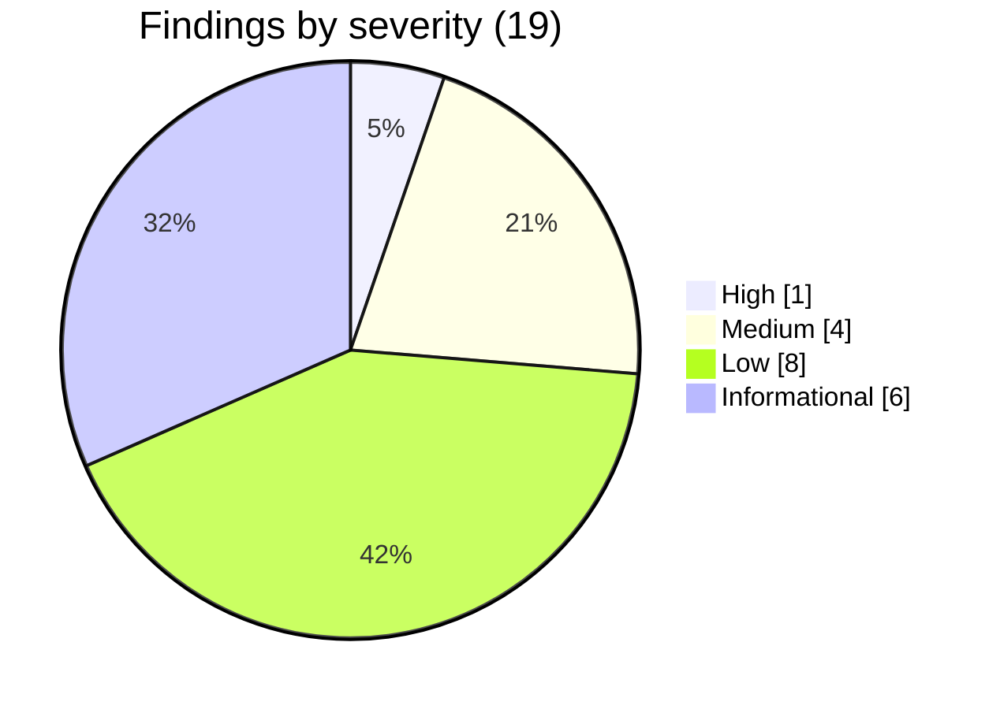
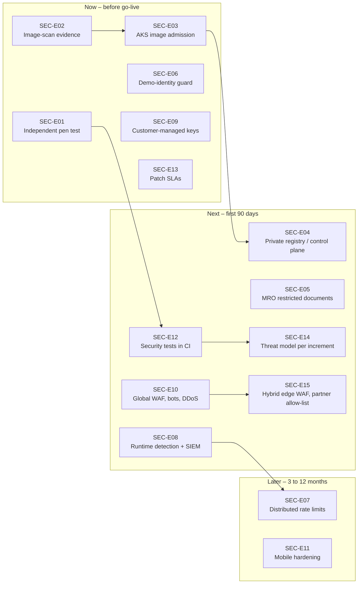
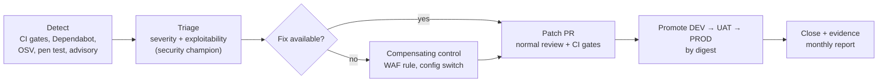

# WellnessZ OHCM – Security Enhancement Guideline

**Version 1.0**

*WellnessZ OHCM platform – security assessment 2026-10*

| | |
|---|---|
| **Document** | Security Enhancement Guideline |
| **Version** | 1.0 (2026-10-30) |
| **System** | WellnessZ Airline Occupational Health Case Management (OHCM) – Java 21 / Spring Boot 4.1 core API and BFF, four React web apps, Helm chart, Terraform for Azure and Google Cloud, hybrid (on-premises core with cloud edge) |
| **Audience** | CIO, CISO and Cyber GRC team, engineering leads, platform and SOC leads, Data Protection Officer |
| **Status** | For decision – the "Now" items are proposed go-live conditions |
| **Companion documents** | [02 – Security and SOC 2 Control Mapping](../architecture/02-Security-and-SOC2-Control-Mapping.md) · [03 – Developer Guide](../architecture/03-Developer-Guide.md) · [Developer Security Handbook](Developer-Security-Handbook.md) · [E15 – Security Hardening and Assurance (epic summary)](epics/E15-Security-Hardening-and-Assurance.md) · [Epic workbook](epics/E15_Security_Hardening_and_Assurance.xlsx) · [CI/CD Guide](../cicd/CI-CD-Guide.md) · [Client Customisation Guide](../customisation/Client-Customisation-Guide.md) |

---

## Contents

1. [Purpose and how to read this document](#1-purpose-and-how-to-read-this-document)
2. [Assessment outcome](#2-assessment-outcome)
3. [Enhancement roadmap SEC-E01 to SEC-E15](#3-enhancement-roadmap-sec-e01-to-sec-e15)
4. [Secure-by-default guardrails that must never be weakened](#4-secure-by-default-guardrails-that-must-never-be-weakened)
5. [Continuous security operations](#5-continuous-security-operations)
6. [Governance of this guideline](#6-governance-of-this-guideline)
7. [Reference: framework abbreviations](#7-reference-framework-abbreviations)

---

## 1. Purpose and how to read this document

The October 2026 pre-release security assessment of WellnessZ is complete. Every finding is either **fixed** or
**formally accepted** with a documented rationale. This guideline turns the assessment into three things that
leadership can act on:

| Section | Question it answers | Primary reader |
|---|---|---|
| 2 | What did we test, what did we find, what did we do about it, and what must still happen before go-live? | CIO, CISO, Cyber GRC |
| 3 | Which hardening work (SEC-E01 … SEC-E15) do we fund, in what order, and how do we know it is done? | CIO, engineering leads |
| 4 | Which security properties of the platform are non-negotiable, whatever a client, project or deadline asks for? | Engineering leads, architects, security champions |
| 5 | How do we keep the platform secure after go-live (patching, access reviews, testing, detection)? | CISO, SOC, platform lead |

The roadmap is also delivered as an epic in the client's requirements format (epic **E15 – Security Hardening and
Assurance**: 17 high-level requirements, 17 features and 46 backlog items, 256 indicative story points), so it can be planned and tracked like any
business epic.

---

## 2. Assessment outcome

### 2.1 Scope and method

| Item | Detail |
|---|---|
| Type | Internal, white-box, pre-release application security assessment: static analysis (SAST), software composition analysis (SCA), secrets scanning, infrastructure-as-code (IaC) review and automated dynamic security verification |
| Build under test | Java 21 / Spring Boot 4.1.2 core API and BFF, React 19 web apps, Helm chart, Terraform (azurerm 4.81.0, google 8.9.0), plus the remediation commits |
| Target of dynamic tests | The **local test stack** only (PostgreSQL 16, Keycloak 26.8.1, core API, BFF, four web apps) with synthetic data |
| Not in scope | Cloud environments, production data, third-party systems, mobile binaries, social engineering |
| What it is **not** | It is **not** an independent penetration test. An independent CREST- or OSCP-certified test of the deployed UAT environment is required before go-live (SEC-E01, recommendation R-01) |

| Technique | Tooling | Coverage |
|---|---|---|
| SAST | Semgrep 1.183.0 (rulesets `p/java`, `p/typescript`, `p/react`, `p/owasp-top-ten`, `p/secrets`, `p/dockerfile`, `p/kubernetes`, `p/terraform`, `p/github-actions`) | 1,725 files; 32 files partially parsed (Helm templates with Go templating, some TSX) |
| SAST (bytecode) | SpotBugs 4.10.5.0 + FindSecBugs 1.14.0 (`./mvnw -Psecurity`) | 25 modules, **0 bug instances** |
| SCA – Java | OSV database, 218 unique Maven coordinates actually shipped in the two runnable jars | 2 advisories (F-01, F-02) – both fixed |
| SCA – web | `npm audit` for employee app, manager workspace, OH workspace, partner portal | **0 vulnerabilities** in all four apps |
| Secrets | detect-secrets on all tracked files; pattern scan of the full git history (96 commits) | 47 candidates, all false positives; **0 real secrets** in history |
| IaC | Checkov (Terraform Azure and GCP, Dockerfiles, GitHub Actions) | 32 failed checks → 16 fixed, 16 accepted with residual risk |
| Dynamic verification | `tools/security/security-verification.js` (Node + Playwright, real Keycloak logins through the BFF) | 61 checks: headers, token validation (`alg=none`, algorithm confusion, forged signature, untrusted issuer, expired, malformed), anonymous access to all 754 documented API operations, actuator exposure, TRACE, CORS, open redirect, cookie flags, CSRF, SQL injection (including time-based), XXE, path traversal, mass assignment, restricted classes, rate limit, logout invalidation |
| Access-control matrix | `tools/security/rbac-matrix.js` | Every human demo role × documented `GET` endpoints, plus object-level checks with real identifiers and unauthenticated calls to every operation through the BFF and directly |
| Regression | Maven (450+ tests incl. 22 ArchUnit rules), 1,373 web tests, 121 end-to-end checks | All green on the remediated build |
| Not possible in the sandbox | Trivy image scanning and Docker Hub base-image checks (download blocked, rate-limited); OWASP ZAP | Trivy runs as a HIGH/CRITICAL gate in `.github/workflows/container.yml` on every image build – the CI reports become release evidence (SEC-E02). ZAP-equivalent checks are in the verification suite; authenticated crawling at scale is part of SEC-E01 |

### 2.2 Headline result

> **No open findings.** 19 findings were raised: 1 High, 4 Medium, 8 Low and 6 Informational.
> **13 are fixed and verified, 4 are accepted with documented residual risk, 2 were false positives.**
> One Medium finding (F-19) was a regression introduced while fixing F-18 and was caught by the verification
> suite before release. The final run on the remediated build passed **61/61** checks (including `RATE-01` and `AC-08`).

| Status | Count | Findings |
|---|---|---|
| Fixed and verified | 13 | F-01 … F-11, F-18, F-19 |
| Accepted (residual risk documented, enhancement planned) | 4 | F-12, F-14, F-16, F-17 |
| False positive | 2 | F-13, F-15 |
| Open | **0** | – |

### 2.3 Findings register and what was done

| ID | Severity | Finding | Source | Status | What was done |
|---|---|---|---|---|---|
| F-01 | High (CVSS 3.1 7.5 as published) | Guava 33.2.1-jre – GHSA-xxph-c9ww-hj94, uncontrolled memory allocation when deserialising `Compact*` collections | OSV (core jar) | Fixed | Managed version raised to 33.7.2-jre in the root `pom.xml`. WellnessZ does not deserialise Java objects from untrusted input, so exploitability was low; fixed anyway and verified in the rebuilt jar |
| F-02 | Medium | OpenTelemetry API 1.62.0 – GHSA-ccrj-gw8r-854m, quadratic CPU when parsing W3C `tracestate` | OSV (core and BFF jars) | Fixed | `opentelemetry.version` 1.67.0; verified in both jars |
| F-03 | Medium | No application-level rate limit (OWASP API4) – hybrid and on-premises deployments without a cloud WAF had no per-user limit | Design review, verification suite | Fixed | New `ApiRateLimitFilter` (`platform/wz-security`): per-principal token bucket, 600 requests/min with burst 120, integration clients 6,000/min, `429` with `Retry-After` and an RFC 9457 body. Unit test `ApiRateLimitFilterTest` (4 tests) and live check `RATE-01` |
| F-04 | Medium | Dependabot updates without cooldown – exposure to freshly published malicious package versions | Semgrep | Fixed | `cooldown` on all 10 ecosystems in `.github/dependabot.yml` (3–14 days by semantic-version level); security updates are not delayed |
| F-05 | Low | AKS subnet without network security group | Checkov CKV2_AZURE_31 | Fixed | NSG with the Azure CNI Overlay rules; inbound from the internet denied by default |
| F-06 | Low | Azure Container Registry not geo-replicated for PROD | Checkov CKV_AZURE_165 | Fixed | Variable `acr_georeplication_locations` (in-country region, set in PROD tfvars when a DR region exists) |
| F-07 | Low | Cloud Armor Log4j signatures only at sensitivity 2 | Checkov CKV_GCP_73 | Fixed | Dedicated `cve-canary` rule with all signatures (priority 1011, deny 403) |
| F-08 | Low | GKE hardening gaps (intranode visibility, client certificates, Secure Boot, metadata server, Google Groups for RBAC) | Checkov CKV_GCP_61/13/68/69/65 | Fixed | `gke.tf` hardened; optional `gke_rbac_security_group` variable |
| F-09 | Low | Workload identity federation provider without an attribute condition restricting repository and subject | Checkov CKV_GCP_125 | Fixed | `attribute_condition` on repository **and** exact subjects (`local.github_wif_subjects`); verified with `terraform console` because Checkov cannot parse the generated condition |
| F-10 | Low | Cloud SQL logging flags | Checkov CKV_GCP_109/108/57 | Fixed | `log_min_error_statement=error`, `log_hostname=on`, `log_min_duration_statement=-1` (statement text with health data is never logged); the last one also applied to Azure |
| F-11 | Low | Dockerfiles: base image via build argument and no `HEALTHCHECK` | Checkov CKV_DOCKER_7/2 | Fixed | Literal pinned base images (visible to Dependabot); `HEALTHCHECK` for plain Docker (Kubernetes probes remain primary) |
| F-12 | Info | 16 IaC checks accepted by design (ACR public network for GitHub-hosted runners with Entra-only auth; Docker Content Trust deprecated – cosign used; ACR quarantine; Key Vault public access already false; App Gateway DRS 2.1 contains the Log4j rule; port 80 redirect only; PostgreSQL VNet integration; GKE Dataplane V2 network policy; Cloud SQL `ENCRYPTED_ONLY` + IAM; PostgreSQL 16 supported; `log_duration` / `log_statement` deliberately off; `workflow_dispatch` inputs validated and approval-gated) | Checkov | Accepted | Full triage with residual risk per check; follow-ups are SEC-E03, SEC-E04, SEC-E13 |
| F-13 | Info | Semgrep `spring-sqli` in `QueueService` (2 locations) | Semgrep | False positive | All values are bound as parameters (`?`); only constant SQL fragments are concatenated |
| F-14 | Info | Key Vault key expiry; Cloud SQL SSL value | Semgrep | Accepted | Key `rotation_policy` with `expire_after = P1Y`; `ENCRYPTED_ONLY` enforces TLS |
| F-15 | Info | 47 secret candidates | detect-secrets | False positive | Placeholders (`REPLACE-ME`), hashes in tests, configuration keywords and the documented local-only demo client secret `change-me-local-only`; git history clean |
| F-16 | Info | The MRO cannot open `RESTRICTED_CLINICAL` documents through the generic `/documents` API, only through the E10 MRO endpoints | Known limitation | Accepted – enhancement | Fails closed (denies) – no data exposure. Enhancement **SEC-E05** |
| F-17 | Info | `mentalhealth.named-clinicians` is seeded with the demo user `psych1` in every environment (migration `V17`) | Known limitation | Accepted – go-live configuration item | Fails closed (real clinicians receive `404` until configured). Go-live checklist item; **SEC-E06** adds a startup guard that refuses demo identities outside the `local` profile |
| F-18 | Low | Organisation structure and internal reference data (org units, job codes, hazards, fitness standards, restriction catalogue) readable by external partner, TPA and candidate accounts – no personal data | Role-based access matrix (observation) | Fixed | URL rule in `ResourceServerSecurityConfig` (`INTERNAL_REFERENCE_DATA`, internal principals only); integration test `PlatformIntegrationTest.internalReferenceDataIsNotServedToExternalAccounts`; live check `AC-08` |
| F-19 | Medium (CVSS 5.3) – never released | Regression while fixing F-18: the anonymous principal counted as "internal", so the five reference endpoints answered anonymous calls | Verification check `AUTH-08` on the remediated build, before release | Fixed | `AnonymousAuthenticationToken` excluded; anonymous case added to the integration test; `AUTH-08` 754/754 operations refuse anonymous calls on the final build. Shows why **SEC-E12** (run the suite in CI) matters |

### 2.4 Conditions for go-live

The assessment supports go-live **subject to** the following conditions. They are the "Now" items of the roadmap.

| # | Condition | Roadmap item | Evidence expected |
|---|---|---|---|
| G1 | Independent penetration test of UAT completed; no Critical or High finding open; retest letter on file | SEC-E01 | Report and retest letter in the release record |
| G2 | Trivy reports and SBOM attestations of the exact release digests attached to the release record | SEC-E02 | `container.yml` artefacts linked from the release summary |
| G3 | Signed-image admission enforced on the PROD cluster of the chosen cloud (already true on GKE) | SEC-E03 | Policy in `Deny` / enforced mode; rejected-unsigned-image test |
| G4 | `mentalhealth.named-clinicians` set to the real named clinicians; no demo identity or local-only secret in UAT / PROD | SEC-E06 (plus the go-live checklist) | Startup guard active; configuration screen export |
| G5 | Customer-managed key decision taken for Azure PostgreSQL **before** the PROD server is created | SEC-E09 | Architecture decision record; `postgres_cmk_enabled` in `prod.tfvars` |
| G6 | Patch SLAs and the vulnerability-management process in force | SEC-E13, Section 5.1 | Signed-off process; first monthly report |

---

## 3. Enhancement roadmap SEC-E01 to SEC-E15

These items are **not vulnerabilities**. They raise the platform from "secure for release" to the posture expected of
Tier-0 airline systems that process special-category health data.

### 3.1 Roadmap at a glance

| Horizon | Meaning | Items |
|---|---|---|
| **Now** | Before PROD go-live | SEC-E01, SEC-E02, SEC-E03, SEC-E06, SEC-E09, SEC-E13 |
| **Next** | Within the first 90 days of operation | SEC-E04, SEC-E05, SEC-E08, SEC-E10, SEC-E12, SEC-E14, SEC-E15 |
| **Later** | 3–12 months after go-live | SEC-E07, SEC-E11 |

| ID | Title | Horizon | Effort (indicative) | Owner | Epic feature |
|---|---|---|---|---|---|
| SEC-E01 | Independent penetration test and retest | Now | M – 18 SP internal + external engagement | CISO office (Platform Security) | E15-F01 |
| SEC-E02 | Container-scan and SBOM evidence in the release record | Now | S – 8 SP | Platform / DevOps | E15-F02 |
| SEC-E03 | Signed-image admission on AKS (parity with GKE Binary Authorization) | Now | M – 13 SP | Platform / DevOps | E15-F03 |
| SEC-E04 | Private registry, private runners and private control plane in PROD | Next | L – 21 SP | Platform / DevOps + Network | E15-F04 |
| SEC-E05 | Programme-aware access to restricted documents (MRO) | Next | M – 13 SP | Core API team (E10) + OH governance | E15-F05 |
| SEC-E06 | Startup guard against demo identities and local-only secrets | Now | S – 8 SP | Core API team | E15-F06 |
| SEC-E07 | Cluster-wide and cost-based rate limiting | Later | M – 16 SP | Core API team + Platform | E15-F07 |
| SEC-E08 | Runtime protection and SIEM detections | Next | L – 26 SP | SOC + Platform | E15-F08 |
| SEC-E09 | Customer-managed keys everywhere in PROD, envelope encryption | Now (decision) / Next (build) | M – 18 SP | Platform Security + DBA | E15-F09 |
| SEC-E10 | Global WAF with bot protection and DDoS protection | Next | M – 13 SP | Platform / Network | E15-F10 |
| SEC-E11 | Mobile app hardening and MASVS assessment | Later | L – 26 SP | Mobile team | E15-F11 |
| SEC-E12 | Security verification and access-control matrix as a CI gate | Next | M – 21 SP | Platform / DevOps + QA | E15-F12 |
| SEC-E13 | Patch SLAs, dependency cadence and PostgreSQL upgrade plan | Now (SLA) / Later (upgrade) | M – 19 SP | Platform Security + Engineering leads | E15-F13 |
| SEC-E14 | Threat-model refresh per increment and abuse-case tests | Next | M – 11 SP | Security champions + Architecture | E15-F14 |
| SEC-E15 | Hybrid edge WAF, rate limiting and partner IP allow-listing | Next | M – 13 SP | Platform / Network | E15-F15 |

Effort scale: **S** ≤ 1 sprint for one team, **M** 1–2 sprints, **L** more than 2 sprints or several teams. Story
points (SP) are indicative and are re-estimated by the delivery teams. Guardrail regression tests (E15-F16) and
security operations (E15-F17) are in the epic as well; they support Sections 4 and 5.

### 3.2 Now – before go-live

#### SEC-E01 – Independent penetration test and retest

| | |
|---|---|
| **Rationale** | The assessment was internal and ran against the local stack. The deployed environment – WAF, ingress, cloud identity, the real identity provider, network paths and the hybrid edge – has not been tested by an independent party. Auditors (SOC 2 CC4.1) and airline customers expect independent testing before a system holding special-category health data goes live. |
| **Risk addressed** | STRIDE: all six categories, focus on Spoofing, Information disclosure and Elevation of privilege · OWASP Top 10 2021 A01 Broken Access Control, A07 Identification and Authentication Failures · OWASP API Top 10 2023 API1 BOLA, API3 BOPLA, API5 BFLA · SOC 2 CC4.1, CC7.1 · HITRUST CSF 07 Vulnerability Management, 17 Risk Management |
| **Effort / owner** | M – external engagement (about 3–4 weeks elapsed including retest) plus 18 SP internal preparation and remediation · CISO office (Platform Security) |
| **Acceptance criteria** | 1. Tester holds CREST or OSCP (or equivalent) certification; rules of engagement signed. 2. Scope covers the four web apps, BFF, core API (all 754 documented operations), partner portal with MFA, integration endpoints, mobile build, and a configuration review of the UAT cloud. 3. Authenticated testing with every role, including restricted-class roles (`PSYCH_CLINICIAN`, `MRO`) and external roles. 4. No Critical or High finding open at PROD go-live; Medium findings have an owner and a date within the patch SLA. 5. Retest letter attached to the release record. 6. Repeated annually and before each major release (Section 5.3). |

#### SEC-E02 – Container-scan and SBOM evidence in the release record

| | |
|---|---|
| **Rationale** | `container.yml` already gates every image on HIGH/CRITICAL Trivy findings, signs it with cosign and attests a CycloneDX SBOM and SLSA provenance. The evidence, however, lives only in workflow logs, and SBOM attestations are produced but not verified at deployment. Auditors need durable, release-specific evidence (recommendation R-02). |
| **Risk addressed** | STRIDE: Tampering (supply chain) · OWASP A06 Vulnerable and Outdated Components, A08 Software and Data Integrity Failures · SOC 2 CC7.1, CC8.1 · HITRUST CSF 07 Vulnerability Management, 06 Configuration Management |
| **Effort / owner** | S – 8 SP · Platform / DevOps |
| **Acceptance criteria** | 1. `container.yml` stores the Trivy JSON and SARIF report per image digest as a workflow artefact. 2. `deploy-env.yml` verifies the SBOM attestation (`cosign verify-attestation --type cyclonedx`) for all six digests in addition to the signature, and fails closed. 3. The job summary of every UAT and PROD deployment links the scan reports and SBOM digests of the exact deployed digests. 4. Reports are copied to the release evidence store and retained for at least 13 months (one SOC 2 period plus margin). |

#### SEC-E03 – Signed-image admission on AKS

| | |
|---|---|
| **Rationale** | GKE enforces Binary Authorization (dry-run in DEV, enforced in UAT and PROD). On AKS and on-premises Kubernetes, signatures are verified by the deployment job only; anyone with cluster rights could still run an unsigned image (residual risk RR11, Checkov CKV_AZURE_164 accepted). |
| **Risk addressed** | STRIDE: Tampering, Elevation of privilege · OWASP A08 Software and Data Integrity Failures · SOC 2 CC6.8, CC8.1 · HITRUST CSF 06 Configuration Management, 07 Vulnerability Management |
| **Effort / owner** | M – 13 SP · Platform / DevOps |
| **Acceptance criteria** | 1. Admission policy verifies the cosign keyless signature with identity `…/.github/workflows/container.yml@refs/heads/main` – AKS Image Integrity (Ratify + Azure Policy) where available in the tenant's region, otherwise Kyverno `verifyImages`; Sigstore policy-controller or Kyverno for the hybrid on-premises cluster. 2. Audit mode in DEV, deny mode in UAT and PROD. 3. Test evidence: an unsigned image and an image signed by another identity are both rejected in UAT. 4. Exempted system namespaces are listed and justified. 5. Doc 02 residual risk RR11 closed. |

#### SEC-E06 – Startup guard against demo identities and local-only secrets

| | |
|---|---|
| **Rationale** | Finding F-17: the restricted-class configuration `mentalhealth.named-clinicians` is seeded with the demo user `psych1` in every environment. The demo BFF client secret `change-me-local-only` exists in local files. Both fail closed today, but a misconfigured UAT or PROD should refuse to start instead of relying on people noticing. |
| **Risk addressed** | STRIDE: Spoofing, Elevation of privilege, Information disclosure · OWASP A05 Security Misconfiguration, A07 Identification and Authentication Failures · SOC 2 CC6.1, CC8.1 · HITRUST CSF 06 Configuration Management, 10 Password Management |
| **Effort / owner** | S – 8 SP · Core API team |
| **Acceptance criteria** | 1. Outside the `local` and `test` profiles, the core API and BFF fail fast at startup when a configured secret equals a known local-only value or when a restricted-class configuration lists a demo identity. 2. The error message names the property, never the value. 3. The E18 configuration service rejects demo identities for these keys outside `local`. 4. Unit tests for each rule; UAT and PROD values pass. 5. Go-live checklist updated. |

#### SEC-E09 – Customer-managed keys everywhere in PROD

| | |
|---|---|
| **Rationale** | Google Cloud SQL already uses CMEK. On Azure, `postgres_cmk_enabled` is `false` in every environment although the Key Vault is Premium with RSA-HSM keys. On Azure Database for PostgreSQL Flexible Server the key type is chosen when the server is created, so this decision must be taken **before** the PROD server exists. Residual risk RR1 (single master key for field encryption) is addressed by envelope encryption through the cloud KMS. |
| **Risk addressed** | STRIDE: Information disclosure · OWASP A02 Cryptographic Failures · SOC 2 CC6.1, C1.1 · HITRUST CSF 19 Data Protection and Privacy, 06 Configuration Management |
| **Effort / owner** | M – 18 SP · Platform Security + DBA |
| **Acceptance criteria** | 1. Architecture decision record signed by CISO and DPO. 2. `postgres_cmk_enabled = true` with geo-backup key and identity in `prod.tfvars` (and UAT for parity). 3. Key rotation and key-loss runbook tested in UAT (including restore from backup). 4. Envelope encryption design for the field-encryption master key (KMS-wrapped data keys, re-encryption job) approved and scheduled. 5. Optional: Cloud SQL Java connector with IAM authentication and client certificates evaluated (Checkov CKV_GCP_6 accepted today). |

#### SEC-E13 – Patch SLAs, dependency cadence and PostgreSQL upgrade plan

| | |
|---|---|
| **Rationale** | F-01 and F-02 show that the dependency tree moves underneath a stable application. Doc 02 Section 10 set 7 days (critical) and 30 days (high); for a Tier-0 airline platform this guideline tightens the SLAs (Section 5.1). PostgreSQL 16 is supported until November 2028 (Checkov CKV_GCP_79 accepted), but a major upgrade on two clouds needs a plan. |
| **Risk addressed** | STRIDE: Tampering, Denial of service, Elevation of privilege (through known vulnerabilities) · OWASP A06 Vulnerable and Outdated Components · SOC 2 CC7.1, CC8.1 · HITRUST CSF 07 Vulnerability Management |
| **Effort / owner** | M – 19 SP (process 6 SP now; upgrade 13 SP later) · Platform Security + Engineering leads |
| **Acceptance criteria** | 1. Patch SLAs of Section 5.1 approved and published; doc 02 Section 10 updated. 2. Monthly vulnerability report (open items by severity and age, SLA breaches, exceptions) and a daily re-scan of the deployed digests against new advisories. 3. Exceptions carry owner, justification, compensating control and expiry, in the three suppression files only. 4. PostgreSQL 17 (or 18) upgrade plan with a tested Flyway, extension and pgaudit run in DEV and UAT, approved before the end of 2027. |

### 3.3 Next – first 90 days

#### SEC-E04 – Private registry, private runners and private control plane in PROD

| | |
|---|---|
| **Rationale** | ACR keeps public network access enabled so GitHub-hosted runners can push and promote images (accepted Checkov CKV_AZURE_139); Key Vault may be opened temporarily for a runner IP. The GKE PROD control plane has a public endpoint restricted to authorised networks (`gke_private_endpoint = false`). AKS UAT and PROD are already private clusters. Google Groups for GKE RBAC is opt-in and not yet configured. |
| **Risk addressed** | STRIDE: Spoofing, Elevation of privilege · OWASP A05 Security Misconfiguration · SOC 2 CC6.1, CC6.6 · HITRUST CSF 08 Network Protection, 11 Access Control |
| **Effort / owner** | L – 21 SP · Platform / DevOps + Network |
| **Acceptance criteria** | 1. Self-hosted, ephemeral GitHub runners inside each cloud network (or Connect Gateway on GKE). 2. `acr_public_network_access = false` in UAT and PROD; `key_vault_allowed_ips` empty. 3. `gke_private_endpoint = true` in PROD. 4. `gke_rbac_security_group` set to the client's `gke-security-groups@<domain>` group. 5. Promotion and deployment pipelines green end to end on the private path. |

#### SEC-E05 – Programme-aware access to restricted documents (MRO)

| | |
|---|---|
| **Rationale** | Finding F-16. The generic `/documents` API decides access to `RESTRICTED_CLINICAL` documents through `PolicyEngine` with the single restricted class, which `DefaultPolicies.restrictedClassPolicy` opens to `PSYCH_CLINICIAN` only. The MRO therefore uses the E10 endpoints. Because the class does not record which programme (E09 or E10) a document belongs to, the generic API cannot tell an E10 chain-of-custody form from an E09 document. |
| **Risk addressed** | STRIDE: Elevation of privilege, Information disclosure (design must not over-grant) · OWASP A01 Broken Access Control · OWASP API1 BOLA, API5 BFLA · SOC 2 CC6.1, CC6.3, C1.1 · HITRUST CSF 11 Access Control, 19 Data Protection and Privacy |
| **Effort / owner** | M – 13 SP · Core API team (E10) with OH governance and the DPO |
| **Acceptance criteria** | 1. Decision (spike) on a programme attribute for restricted resources, agreed by OH governance and the DPO. 2. ABAC policy lets `MRO` (and `OH_PHYSICIAN` users listed in `substance.acting-mro-physicians`) open E10 restricted documents such as `CHAIN_OF_CUSTODY_FORM` through the generic API. 3. Programme separation: MRO cannot open E09 documents; whether psychological-health clinicians keep access to E10 documents is decided explicitly. 4. Negative integration tests: general OH roles, managers, HR and unbound machine clients get `404`; every denial audited. |

#### SEC-E08 – Runtime protection and SIEM detections

| | |
|---|---|
| **Rationale** | The application already audits authentication failures and RBAC denials (`SecurityEventAuditor`), break-glass use (`BREAK_GLASS`), exports, configuration changes and replays into a hash-chained audit trail. These signals are only useful when a SOC watches them. Container runtime threats (shell in a pod, crypto-mining, unexpected egress) are not yet detected. |
| **Risk addressed** | STRIDE: Repudiation, Elevation of privilege, Information disclosure, Denial of service · OWASP A09 Security Logging and Monitoring Failures · SOC 2 CC7.2, CC7.3, CC7.4 · HITRUST CSF 12 Audit Logging and Monitoring, 15 Incident Management |
| **Effort / owner** | L – 26 SP · SOC + Platform |
| **Acceptance criteria** | 1. Microsoft Defender for Containers (Azure) or GKE Security Posture with threat detection (Google Cloud) enabled in UAT and PROD; Falco (or equivalent) on hybrid clusters. 2. Audit trail and application logs streamed to the SIEM. 3. The detections of Section 5.4 implemented, tested with synthetic events and linked to runbooks. 4. The rate-limit filter emits a PHI-free counter or log event per `429`. 5. Mean time to triage of high-severity alerts measured. |

#### SEC-E10 – Global WAF with bot protection and DDoS protection

| | |
|---|---|
| **Rationale** | `enable_front_door` is `false` in every Azure environment; the App Gateway WAF (DRS 2.1) is the public entry point. Volumetric DDoS protection beyond the platform default and bot management (credential stuffing against the login flow, scraping of the partner portal) are not configured. |
| **Risk addressed** | STRIDE: Denial of service, Spoofing (automated attacks) · OWASP API4 Unrestricted Resource Consumption, API6 Unrestricted Access to Sensitive Business Flows, A07 · SOC 2 A1.1, CC6.6 · HITRUST CSF 08 Network Protection, 16 Business Continuity and Disaster Recovery |
| **Effort / owner** | M – 13 SP · Platform / Network |
| **Acceptance criteria** | 1. Data-residency assessment for TLS termination at a global edge, approved by the DPO. 2. If approved: Front Door Premium with WAF and bot manager rule set, origin locked to `AzureFrontDoor.Backend` (already supported by the NSG). If not: App Gateway WAF only, with rate-limit custom rules. 3. Azure DDoS Network (or IP) Protection on the public IP in PROD; Cloud Armor Adaptive Protection on Google Cloud. 4. Load test proves the rate rules do not block legitimate shift-change peaks. |

#### SEC-E12 – Security verification and access-control matrix as a CI gate

| | |
|---|---|
| **Rationale** | `security-verification.js` (61 checks) and `rbac-matrix.js` (role × endpoint and object-level checks) proved their value in the assessment but run only by hand. The expected policy for the matrix is extracted statically from the `@PreAuthorize` annotations by `tools/security/rbac-extract-policy.py` (now versioned with the other tools). Without automation, a future endpoint can silently miss its role gate. |
| **Risk addressed** | STRIDE: Elevation of privilege, Information disclosure · OWASP A01, API1, API5 · SOC 2 CC7.1, CC8.1 · HITRUST CSF 07 Vulnerability Management, 06 Configuration Management |
| **Effort / owner** | M – 21 SP · Platform / DevOps + QA |
| **Acceptance criteria** | 1. Policy extractor `tools/security/rbac-extract-policy.py` covered by unit tests and its baseline reviewed. 2. A CI workflow starts an ephemeral stack (Docker Compose, generated secrets only), runs both tools nightly and on release branches, and fails on any `FAIL` or unexpected allow. 3. Results are uploaded as artefacts and summarised in the job summary. 4. A new endpoint without a matching expected-policy entry fails the gate. 5. Never pointed at UAT or PROD. |

#### SEC-E14 – Threat-model refresh per increment and abuse-case tests

| | |
|---|---|
| **Rationale** | Doc 02 Section 7 holds a STRIDE model that grew with each increment. Restricted classes (E09, E10), external partner access and client customisation make abuse cases (insider curiosity, colleague look-ups, partner over-reach, inference from aggregates) the most likely real-world threats. |
| **Risk addressed** | STRIDE: all · OWASP A04 Insecure Design · SOC 2 CC3.2, CC3.4, CC8.1 · HITRUST CSF 17 Risk Management |
| **Effort / owner** | M – 11 SP · Security champions + Architecture |
| **Acceptance criteria** | 1. Threat-model review is an entry criterion of each increment's design sign-off (Definition of Done item 9 of the Developer Guide). 2. Abuse-case catalogue for restricted classes with an automated test per case. 3. Differencing-attack review of aggregates (residual risk RR10). 4. Findings tracked in the backlog with owners. |

#### SEC-E15 – Hybrid edge WAF, rate limiting and partner IP allow-listing

| | |
|---|---|
| **Rationale** | In hybrid deployments the core API and PostgreSQL stay on-premises and the BFF and web apps run in a cloud edge cluster (`deploy/hybrid/values-hybrid-cloud-edge.yaml`). The mobile and machine API is published on-premises or through an API gateway, where no cloud WAF exists; the edge NetworkPolicy allows HTTPS egress to `0.0.0.0/0` to reach the identity provider. Partners connect from known networks and could be restricted further. |
| **Risk addressed** | STRIDE: Spoofing, Denial of service · OWASP API4, A05, A07 · SOC 2 CC6.6, A1.1 · HITRUST CSF 08 Network Protection, 14 Third Party Assurance |
| **Effort / owner** | M – 13 SP · Platform / Network |
| **Acceptance criteria** | 1. WAF with the OWASP Core Rule Set and per-client rate rules in front of the on-premises API (gateway or ingress). 2. Optional per-partner-organisation IP allow-list for the partner portal and integration clients, configured in the overlay. 3. Edge egress narrowed to the identity provider and the on-premises API (egress gateway or firewall FQDN rules). 4. Documented in the hybrid setup guide. |

### 3.4 Later – 3 to 12 months

#### SEC-E07 – Cluster-wide and cost-based rate limiting

| | |
|---|---|
| **Rationale** | `ApiRateLimitFilter` keeps buckets per pod, so the effective limit grows with the number of replicas and the horizontal autoscaler. All requests cost one token, although exports, audit packs and report generation are far more expensive than a status read. |
| **Risk addressed** | STRIDE: Denial of service · OWASP API4 Unrestricted Resource Consumption, API6 · SOC 2 A1.1, CC7.2 · HITRUST CSF 08 Network Protection, 12 Audit Logging and Monitoring |
| **Effort / owner** | M – 16 SP · Core API team + Platform |
| **Acceptance criteria** | 1. Shared limit store (for example Redis) or edge-enforced per-principal limit, with fail-open behaviour defined and reviewed. 2. Endpoint cost classes (export, report, bulk) with lower limits. 3. Limits configurable per environment and client overlay. 4. Load test shows the limit is independent of replica count. |

#### SEC-E11 – Mobile app hardening and MASVS assessment

| | |
|---|---|
| **Rationale** | The employee app runs as a native app through Capacitor. Residual risk RR7 (secure storage and mobile application management not integrated) remains open; certificate pinning and jailbreak/root detection are not implemented. |
| **Risk addressed** | STRIDE: Spoofing, Tampering, Information disclosure · OWASP Mobile Top 10 2024 M5 Insecure Communication, M7 Insufficient Binary Protections, M9 Insecure Data Storage · OWASP MASVS v2 (MAS testing profile L2 plus R) · SOC 2 CC6.1, CC6.7 · HITRUST CSF 04 Mobile Device Security, 02 Endpoint Protection |
| **Effort / owner** | L – 26 SP · Mobile team |
| **Acceptance criteria** | 1. Refresh token in Keychain / Keystore; app-protection policies through the client's MDM. 2. Certificate (public-key) pinning with a backup pin and a rotation runbook. 3. Jailbreak/root and debugger detection with a policy decision (warn or block). 4. Independent MASVS assessment with no High finding open before store release. |

### 3.5 Traceability

| Roadmap item | Findings | Doc 02 residual risks | Assessment recommendation |
|---|---|---|---|
| SEC-E01 | – | RR11 (no DAST) | R-01 |
| SEC-E02 | F-12 (ACR quarantine) | RR11 | R-02 |
| SEC-E03 | F-12 (Docker Content Trust) | RR11 | – |
| SEC-E04 | F-08 (Google Groups option), F-12 (ACR public network, Key Vault) | RR12 | – |
| SEC-E05 | F-16 | – | – |
| SEC-E06 | F-15, F-17 | – | – |
| SEC-E07 | F-03 | – | – |
| SEC-E08 | – | RR4 | – |
| SEC-E09 | F-12 (Cloud SQL client certificates), F-14 | RR1 | – |
| SEC-E10 | F-12 (port 80, WAF) | – | – |
| SEC-E11 | – | RR7 | – |
| SEC-E12 | – | RR11 | – |
| SEC-E13 | F-01, F-02, F-04, F-11, F-12 (PostgreSQL 16) | – | – |
| SEC-E14 | – | RR10 | – |
| SEC-E15 | F-03 | – | – |

---

## 4. Secure-by-default guardrails that must never be weakened

These properties are the reason the platform passed the assessment. They hold **regardless of client, project,
deadline or configuration request**. A change that weakens one of them is not a configuration change; it is a
security exception that only the CISO can approve, with the DPO for any privacy guardrail, and it is recorded with an
expiry date. Engineering leads and security champions reject pull requests that weaken a guardrail without such an
approval.

| # | Guardrail | Where it is enforced | How to verify |
|---|---|---|---|
| GR-01 | **Default deny on every API.** `/api/**` is `authenticated()`, everything else `denyAll()`; no new `permitAll` rules | `ResourceServerSecurityConfig.apiSecurityFilterChain`, `BffSecurityConfig.bffSecurityFilterChain` | Verification suite (anonymous access to all operations); `rbac-matrix.js` unauthenticated sweep |
| GR-02 | **Trusted issuers only, full token validation.** Exact-match issuer allow-list (no discovery call for unknown issuers), signature, audience, expiry and not-before | `ResourceServerSecurityConfig.issuerAuthenticationManagerResolver`, `tokenValidator` | Checks `AUTH-01` … `AUTH-08` |
| GR-03 | **Every read of OH data goes through `PolicyEngine`**, with deny-overrides and default deny; denial of a specific record is an audited `404` | `PolicyEngine`, `DefaultPolicies`, `CaseAccess`, `EmployeeRecordAccess` | `PolicyEngineTest`; mandatory integration cases (Developer Guide 9.2) |
| GR-04 | **Status only for managers, HR and enterprise systems** – separate projection records without clinical fields; manager workspace whitelists fields again | Projection records per disclosure level; `web/manager-workspace/src/api/statusOnly.ts` | Integration tests assert clinical fields are absent |
| GR-05 | **Restricted classes stay restricted.** `RESTRICTED_CLINICAL` is opened only by the named restricted-class clinician (or break-glass); everybody else gets `404` or a placeholder count | `DefaultPolicies.restrictedClassPolicy`, `SupportAccess`, Developer Guide 18.4 rules R1–R15 | Negative integration tests; verification checks `AC-03` … `AC-05` |
| GR-06 | **MFA gate for external roles.** `PARTNER_PROVIDER` and `TPA_ADJUSTER` are removed from a token that does not prove MFA | `WellnessZJwtConverter.withoutUnprovenMfaRoles`, `wellnessz.security.mfa-required-roles` | `MfaRoleGateTest` |
| GR-07 | **No tokens in the browser.** Web apps use the BFF session; CSRF protection on every state-changing request; session cookie `HttpOnly`, `Secure`; session attributes encrypted | `BffSecurityConfig` (`csrf.spa()`, session fixation, max 3 sessions), `EncryptedSessionConfig` | Checks `SES-*`, `CSRF-*` |
| GR-08 | **Strict security headers and CSP without inline script** | `security-headers.conf` in each web app; header writers in both security configurations | Checks `HDR-*` (core, BFF and each web app) |
| GR-09 | **No PHI in logs, errors, audit reasons, notifications or events to non-OH destinations** | `LogSanitizer`, `GlobalExceptionHandler` (RFC 9457 without internals), ESLint `no-console`, `src/security/log.ts` | Code review; ArchUnit `noStandardStreams`; `NotificationRulesTest` |
| GR-10 | **Content-free notifications from approved templates only** | `NotificationTemplates` (`ALLOWED_PLACEHOLDERS`), `ContentRules` | `NotificationRulesTest` |
| GR-11 | **Outbound allow-list, default deny per destination** | `OutboundPayloadGuard`, `ConnectorRegistry` | Outbox integration tests |
| GR-12 | **Clinical free text encrypted at rest** (AES-256-GCM, versioned keys) | `EncryptedStringConverter`, `FieldEncryptor` | Integration tests assert the `v1:` prefix |
| GR-13 | **Secrets never in Git, images or logs** – `ENC(...)` or `file:` only; gitleaks on full history | `SecretValueResolver`, `SecretsEnvironmentPostProcessor`, `.gitleaks.toml` | CI `gitleaks` job |
| GR-14 | **Hash-chained, append-only audit trail**; database grants forbid update and delete | `AuditService`, Flyway grants, `GET /api/v1/audit/verify` | Audit chain verification (daily) |
| GR-15 | **Small-cell suppression on every aggregate**, `wellnessz.analytics.min-group-size` default 5, floor 3 in code | `SmallCellSuppression`, `KpiService` | Integration tests; never lower the default |
| GR-16 | **Per-principal rate limit is on** (`WZ_RATE_LIMIT_PER_MINUTE` > 0 in every non-local environment) | `ApiRateLimitFilter`, `WellnessZSecurityProperties` | Check `RATE-01`; `ApiRateLimitFilterTest` |
| GR-17 | **Signed, digest-pinned, scanned images only**; promotion by digest; required reviewers for UAT and PROD | `container.yml`, `cd.yml`, `deploy-env.yml`, GitHub Environments, Binary Authorization | CI/CD Guide Section 4 and 5 |
| GR-18 | **Least-privilege workloads** – non-root, read-only root file system, no privilege escalation, default-deny NetworkPolicies | Helm `values.yaml` (`runAsNonRoot`, `readOnlyRootFilesystem`, `allowPrivilegeEscalation: false`), `networkpolicy.yaml` | Helm lint and template in CI; Trivy config scan |
| GR-19 | **No client-specific code in product modules**; customisation through configuration, flags or SPIs | Client Customisation Guide; ArchUnit rules for client packages | ArchUnit |
| GR-20 | **Statement logging stays off in PostgreSQL** (`log_statement`, `log_min_duration_statement = -1`) because statements carry health data and passwords | `deploy/terraform/gcp/sql.tf`, `deploy/terraform/azure/postgres.tf` | Checkov triage (accepted by design) |

---

## 5. Continuous security operations

### 5.1 Vulnerability management and patch SLAs

The SLA clock starts when the vulnerability is **known to WellnessZ** (scanner alert, advisory, Dependabot pull
request, penetration-test report or supplier notice) **and a fix or mitigation is available**. Severity is the CVSS
base score adjusted by WellnessZ exploitability (internet exposure, reachability of the vulnerable code, data
classification); the adjustment is recorded and can raise or lower the severity by at most one level.

| Severity | CVSS (base, adjusted) | Remediation SLA (to PROD) | Interim action |
|---|---|---|---|
| **Critical** | 9.0 – 10.0 | **48 hours** | Immediate WAF virtual patch or feature switch-off where possible; CISO informed |
| **High** | 7.0 – 8.9 | **7 days** | Compensating control documented within 48 hours |
| **Medium** | 4.0 – 6.9 | **30 days** | Normal release train |
| **Low** | 0.1 – 3.9 | **90 days** | Normal release train or accepted with justification |

These SLAs supersede the values in doc 02 Section 10 (critical 7 days, high 30 days). Exceptions go into exactly one
of `.trivyignore`, `config/dependency-check-suppressions.xml` or `config/spotbugs-exclude.xml`, each with an owner,
justification, risk-acceptance reference and expiry date no later than the next quarterly review. CODEOWNERS routes
these files to the security team.

| Source | Cadence | Gate |
|---|---|---|
| Dependabot (10 ecosystems, cooldown 3–14 days; security updates immediate) | Weekly, Helm monthly | Pull request with full CI |
| OWASP dependency-check, `npm audit`, dependency review | Every pull request | CVSS ≥ 7 / high |
| Trivy image scan | Every image build | HIGH/CRITICAL with fix |
| CodeQL `security-extended`, SpotBugs + FindSecBugs | Every pull request, CodeQL weekly | Any finding |
| Base-image refresh | Monthly, or on a critical base-image advisory | Rebuild and redeploy |
| Re-scan of deployed digests against new advisories | Daily (SEC-E13) | Alert into the vulnerability queue |

### 5.2 Access reviews

| Review | Frequency | Scope | Owner | Evidence |
|---|---|---|---|---|
| Application roles and IdP group memberships | **Quarterly** | All WellnessZ roles (`com.wellnessz.common.model.Roles`) and Entra ID / Keycloak group assignments | OH service owner + IAM | Signed review export, removals ticketed |
| Privileged and restricted roles | **Monthly** | `PLATFORM_ADMIN`, `OH_ADMIN`, `AUDITOR`, `DPO`, `PSYCH_CLINICIAN`, `MRO`, `CMO`; the `mentalhealth.named-clinicians` and `substance.acting-mro-physicians` lists | OH service owner + DPO | Review record |
| External users and machine clients | **Quarterly** | `PARTNER_PROVIDER`, `TPA_ADJUSTER`, `INTEGRATION` clients and their partner-organisation binding | Vendor management + IAM | Review record; leaver removal ≤ 24 h |
| Cloud and cluster access | **Quarterly** | Azure / Google Cloud IAM, Kubernetes RBAC, GitHub repository and Environment reviewers | Platform lead | IAM export |
| Break-glass grants | **Within 5 working days of each use** | Every `BREAK_GLASS` audit event | DPO | `BREAK_GLASS_REVIEW` audit event |

### 5.3 Security testing calendar

| Activity | Frequency | Owner |
|---|---|---|
| Independent penetration test (web, API, BFF, partner portal, mobile, cloud configuration) including authorisation testing across disclosure levels | **Annual**, before each major release, and after significant architecture change; retest within 30 days of the report | CISO office |
| Security verification suite and access-control matrix | Nightly in CI (after SEC-E12); before every release until then | Platform / DevOps + QA |
| Threat-model review | Every increment (SEC-E14) | Security champions |
| Backup restore and DR exercise including key-loss scenario | Semi-annual (restore), annual (DR) | DBA + Platform |
| Tabletop incident exercise (data breach involving restricted-class data) | Annual | CISO office + DPO + SOC |

### 5.4 SIEM detections

The audit trail (`platform.audit_event`, hash-chained), application logs (JSON, PHI-free), ingress / WAF logs, IdP sign-in
logs and cloud audit logs are streamed to the SIEM. Minimum detection set:

| ID | Detection | Signal | Suggested threshold | Response |
|---|---|---|---|---|
| D-01 | Break-glass used | Audit action `BREAK_GLASS` | Every event | Notify DPO; review within 5 working days |
| D-02 | Mass export | Audit actions ending in `_EXPORT`, `_DOWNLOAD`, `SURVEILLANCE_AUDIT_PACK` | > 5 per user per hour, or outside working hours | SOC triage; contact line manager |
| D-03 | Enumeration / record probing | Audit outcome `DENIED` (ABAC `404`s and RBAC `AUTHORIZATION` denials) | > 20 per user in 10 minutes | Suspend session; investigate |
| D-04 | Authentication attacks | Audit action `AUTHENTICATION` outcome `FAILURE`; IdP failed sign-ins | Spike against baseline; password spraying pattern | Block source; IdP lockout review |
| D-05 | Rate-limit storm | HTTP `429` responses (`http.server.requests` metric, ingress logs; SEC-E08 adds a dedicated counter) | > 100 per principal in 5 minutes | Identify client; throttle at edge |
| D-06 | Configuration tampering | Audit action `CONFIG_CHANGE`, especially restricted-class lists, `min-group-size`, module flags | Every change outside a change window | Verify against change record |
| D-07 | Replay of events | `EVENT_REPLAY`, `EHS_DLQ_REPLAY` | Every event | Verify against operator ticket |
| D-08 | Audit-chain integrity | `GET /api/v1/audit/verify` reports `intact = false` | Any | Major incident |
| D-09 | Unsigned image / admission denial | Binary Authorization or admission-policy deny events | Any in UAT / PROD | Investigate supply chain |
| D-10 | Secret access anomalies | Key Vault / Secret Manager access by unexpected identity | Any | Rotate; investigate |
| D-11 | Container runtime alert | Defender for Containers, GKE threat detection, Falco | High severity | Isolate pod; incident process |
| D-12 | External user without MFA | MFA-gated role stripped (no MFA proof) for a partner user | Repeated for one user | Contact partner administrator |

### 5.5 Security metrics reported monthly to the CISO

| Metric | Target |
|---|---|
| Open vulnerabilities by severity and age; SLA breaches | 0 Critical / High beyond SLA |
| Expired suppression entries | 0 |
| Images running in PROD that are not signed or are older than 35 days | 0 |
| Access reviews completed on time | 100 % |
| Break-glass events reviewed within 5 working days | 100 % |
| High-severity SIEM alerts triaged within 1 hour | ≥ 95 % |
| Pull requests touching security components reviewed by a security champion | 100 % |

---

## 6. Governance of this guideline

| Role | Responsibility |
|---|---|
| CIO | Funds the roadmap; accepts the go-live conditions of Section 2.4 |
| CISO / Cyber GRC | Owns this guideline, the patch SLAs and the exception register; approves guardrail exceptions |
| Data Protection Officer | Co-approves exceptions to privacy guardrails (GR-04, GR-05, GR-09 … GR-12, GR-15); reviews break-glass use |
| Engineering leads | Plan and deliver the E15 backlog; enforce the guardrails in review |
| Security champions | Triage findings, review security-relevant pull requests, run threat-model sessions (see the Developer Security Handbook) |
| SOC | Operates the detections of Section 5.4 |

This guideline is reviewed **quarterly** with the access reviews and after every penetration test. Changes are made
by pull request to `docs/security/` and approved by the CISO.

---

## 7. Reference: framework abbreviations

| Abbreviation | Meaning |
|---|---|
| STRIDE | Spoofing, Tampering, Repudiation, Information disclosure, Denial of service, Elevation of privilege |
| OWASP A01 … A10 | OWASP Top 10 (2021) web application risks |
| OWASP API1 … API10 | OWASP API Security Top 10 (2023) |
| OWASP M1 … M10 / MASVS | OWASP Mobile Top 10 (2024) / Mobile Application Security Verification Standard |
| SOC 2 TSC | AICPA Trust Services Criteria: CC (common criteria / security), A (availability), C (confidentiality), PI (processing integrity), P (privacy) |
| HITRUST CSF domains | 01 Information Protection Program · 02 Endpoint Protection · 03 Portable Media Security · 04 Mobile Device Security · 05 Wireless Security · 06 Configuration Management · 07 Vulnerability Management · 08 Network Protection · 09 Transmission Protection · 10 Password Management · 11 Access Control · 12 Audit Logging and Monitoring · 13 Education, Training and Awareness · 14 Third Party Assurance · 15 Incident Management · 16 Business Continuity and Disaster Recovery · 17 Risk Management · 18 Physical and Environmental Security · 19 Data Protection and Privacy |
| CVSS | Common Vulnerability Scoring System (version 3.1 used in this assessment) |
| SBOM | Software bill of materials (CycloneDX) |
| CMK / CMEK | Customer-managed (encryption) key |
| MRO | Medical Review Officer (substance-testing programme, E10) |
