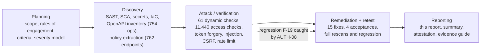
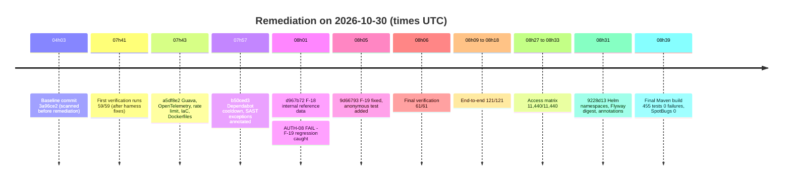

# WellnessZ OHCM – Security Assessment Report

**Version 1.0**

*WellnessZ OHCM platform – security assessment 2026-10*

| | |
|---|---|
| **Document** | Security Assessment Report (comprehensive test report for Cyber GRC) |
| **Document ID** | WZ-SEC-ASR-2026-10 |
| **Version** | 1.0 – 2026-10-30 |
| **Classification** | Confidential – security sensitive. Do not distribute outside the listed recipients without the CISO's approval |
| **System** | WellnessZ Airline Occupational Health Case Management (OHCM): Java 21 / Spring Boot 4.1.2 core API and BFF, four React 19 web apps (employee app, manager workspace, OH workspace, partner portal), Helm chart, Terraform for Azure (azurerm 4.81.0) and Google Cloud (google 8.9.0), hybrid deployment option |
| **Assessment type** | Internal, white-box, pre-release application security assessment. **Not an independent penetration test** |
| **Assessment date** | 2026-10-30 (all scans and dynamic tests executed on this date) |
| **Assessor** | Engineering security lead, WellnessZ delivery team |
| **Companion documents** | [02 – Security Assessment Summary](02-Security-Assessment-Summary.md) · [03 – Security Assessment Attestation](03-Security-Assessment-Attestation.md) · [04 – Security Test Evidence Guide](04-Security-Test-Evidence-Guide.md) · [Security Enhancement Guideline](../Security-Enhancement-Guideline.md) · [Security and SOC 2 Control Mapping](../../architecture/02-Security-and-SOC2-Control-Mapping.md) · [Developer Security Handbook](../Developer-Security-Handbook.md) |

---

## Contents

1. [Document control and distribution](#1-document-control-and-distribution)
2. [Executive summary](#2-executive-summary)
3. [Scope](#3-scope)
4. [Rules of engagement](#4-rules-of-engagement)
5. [Methodology](#5-methodology)
6. [Tools and versions](#6-tools-and-versions)
7. [Test criteria per category](#7-test-criteria-per-category)
8. [Severity model](#8-severity-model)
9. [Detailed results per technique](#9-detailed-results-per-technique)
10. [Findings F-01 to F-21](#10-findings-f-01-to-f-21)
11. [Accepted items and residual risk](#11-accepted-items-and-residual-risk)
12. [Assessment criteria against the five SOC 2 Trust Services Criteria](#12-assessment-criteria-against-the-five-soc-2-trust-services-criteria)
13. [OWASP coverage and open-findings statement](#13-owasp-coverage-and-open-findings-statement)
14. [Limitations](#14-limitations)
15. [Recommendations SEC-E01 to SEC-E15](#15-recommendations-sec-e01-to-sec-e15)
16. [Appendix A – The 61 security verification checks](#appendix-a--the-61-security-verification-checks)
17. [Appendix B – Commands to reproduce](#appendix-b--commands-to-reproduce)
18. [Appendix C – Evidence file manifest](#appendix-c--evidence-file-manifest)
19. [Appendix D – Glossary](#appendix-d--glossary)

---

## 1. Document control and distribution

### 1.1 Version history

| Version | Date | Author | Change |
|---|---|---|---|
| 0.1 | 2026-10-30 | Engineering security lead | Draft from raw evidence (scans before remediation) |
| 0.9 | 2026-10-30 | Engineering security lead | Remediation results, retests, F-18 to F-21 added |
| 1.0 | 2026-10-30 | Engineering security lead | Issued for Cyber GRC review and sign-off |

### 1.2 Distribution

| Recipient (role) | Purpose | Copy |
|---|---|---|
| Client Chief Information Security Officer (CISO) | Acceptance of residual risk, sign-off of the attestation | Full report and evidence pack |
| Cyber GRC lead | Control assurance, SOC 2 / HITRUST mapping, audit file | Full report and evidence pack |
| Chief Information Officer (CIO) | Go-live decision | Summary (doc 02) and attestation (doc 03) |
| Data Protection Officer (DPO) | Privacy criteria (P1–P8), special-category health data | Full report |
| Security Operations Centre (SOC) lead | Re-running the tests, detection backlog (SEC-E08) | Full report and evidence guide (doc 04) |
| Engineering and platform leads | Remediation ownership, enhancement backlog | Full report |
| Independent penetration-test provider (when appointed) | Scoping input for SEC-E01 | Sections 3, 13, 14 and Appendix A, under NDA |

### 1.3 Handling

The report names internal endpoints, test identities of the **local demo stack** and scanner exceptions. It contains no
production credentials, no production data and no personal data. Demo passwords are not reproduced.

---

## 2. Executive summary

WellnessZ processes special-category health data (occupational health, fitness-for-duty, mental-health support,
drug and alcohol testing) for an airline. Before go-live the delivery team carried out an internal, white-box security
assessment of the complete code base and of a running **local test stack**. Seven techniques were combined: static
analysis of source and bytecode, software composition analysis, secrets scanning, infrastructure-as-code review,
61 automated dynamic security checks, a role-based access-control matrix of **11,440** checks with real identity-provider
logins, and full functional regression.

**Result at the end of the assessment.** Twenty-one findings were raised (1 High, 4 Medium, 9 Low, 7 Informational).
Fifteen were fixed and retested, four were formally accepted with a documented residual risk and an owner, and two were
false positives. **No finding of any severity is open at the end of the assessment.** The final runs on the remediated
build show:

| Measure | Before remediation | After remediation (final) |
|---|---|---|
| Semgrep SAST findings | 15 | **0** (1,731 files) |
| SpotBugs + FindSecBugs bug instances | 0 | **0** (25 modules) |
| Vulnerable shipped Java libraries (OSV) | 2 of 218 | **0 of 219** |
| npm audit vulnerabilities (4 web apps, 966 dependencies) | 0 | **0** |
| Real secrets in files or git history | 0 (47 false-positive candidates) | **0** |
| Checkov failed checks – Terraform / Dockerfile / GitHub Actions | 26 / 4 / 2 | **0 / 0 / 0** (15 + 2 reviewed exceptions) |
| Checkov failed checks – rendered Kubernetes manifests (9 cloud × environment combinations) | – | **0** in all nine |
| Security verification suite | 59/59 (first full run, before F-03/F-18 checks existed) | **61/61 PASS** |
| Role-based access-control matrix | – | **11,440 / 11,440 PASS** |
| Functional regression | Maven 454 tests, 0 failures | Maven 455 tests, 0 failures (final run); web 1,373 / 1,373; end-to-end 121 / 121 |

One finding deserves special mention. **F-19** was a regression introduced *during* remediation: while restricting
internal reference data to internal users (F-18), the anonymous principal was briefly treated as "internal". The
verification gate (check `AUTH-08`, which calls all 754 documented API operations without credentials) caught it on the
remediated build **before the change was released**. It was fixed, an integration test was added, and the final run
shows 754 of 754 operations refusing anonymous calls. This is the clearest argument for running the verification suite
in CI (SEC-E12).

**What this does and does not mean.** The result is valid for the tested build (final commit `9228d13`) and scope on
2026-10-30. It is not a guarantee that no vulnerabilities exist. Cloud environments, mobile binaries and container
images were not tested in this assessment (Section 14). An **independent CREST- or OSCP-certified penetration test of
the deployed UAT environment is required before production go-live** (SEC-E01), together with the other go-live
conditions in Section 15.2.

---

## 3. Scope

### 3.1 Build under test

| Item | Value |
|---|---|
| Repository | WellnessZ (single repository: Java modules, web apps, Helm, Terraform, CI workflows, documentation) |
| Branch | Security-assessment remediation branch (identified by the commit hashes below) |
| Baseline commit (before remediation) | `3a96ce2` – increment 5 complete |
| Remediation commits | `a5df8e2`, `55098fe`, `b50ced3`, `d967b72`, `9d66793`, `9228d13` |
| Final commit (assessed build) | `9228d13c194cc91bb0b35984c34b79e5088d8ac7` |
| Runtime code of the dynamic tests | Application source is identical at `9d66793` and `9228d13`; `9228d13` changes only Terraform/Helm/workflow annotations, documentation and test tooling. The dynamic tests (verification suite 08:06 UTC, end-to-end 08:09–08:18 UTC, access matrix 08:27–08:33 UTC) therefore ran against the runtime code of the final build |
| Platform | Java 21, Spring Boot 4.1.2, React 19, Node 22, PostgreSQL 16, Keycloak 26.8.1 (local identity provider in place of Microsoft Entra ID) |

### 3.2 In scope

| Area | Items |
|---|---|
| Source code | All Java modules (25 analysed by SpotBugs; core API `wz-core-app`, BFF `wz-bff`, platform and domain modules E01–E18), four React web apps, test code, scripts |
| Dependencies | Every Maven library actually shipped inside the two runnable jars (`BOOT-INF/lib`); every npm dependency of the four web apps |
| Secrets | All git-tracked files; full git history (96 commits at scan time) |
| Infrastructure as code | Terraform for Azure and Google Cloud; Dockerfiles; GitHub Actions workflows; Helm chart rendered for Azure, GCP and hybrid × DEV, UAT and PROD |
| Running application (dynamic) | Local test stack: PostgreSQL 16, Keycloak 26.8.1, core API, BFF, the four web apps served locally; synthetic demo data only; 39 demo identities covering 37 roles |
| API surface | All 754 operations in the OpenAPI document (252 parameter-free `GET` endpoints exercised per role; 762 endpoints in the statically extracted policy) |

### 3.3 Out of scope

| Area | Reason | Covered by |
|---|---|---|
| Azure, Google Cloud and on-premises environments (DEV/UAT/PROD) | Not provisioned for this assessment; no cloud credentials used | IaC review here; SEC-E01 independent pen test of UAT |
| Production data, real employees, real clinicians | Rules of engagement – synthetic data only | – |
| Microsoft Entra ID tenant, Conditional Access, MFA policies | Client-operated identity provider; local stack uses Keycloak with MFA disabled | IdP configuration review at go-live; SEC-E01 |
| Mobile app binaries (iOS / Android) | Not built in the assessment environment | SEC-E11 (MASVS L2) |
| Container images (OS packages) | Trivy binary download blocked, Docker Hub rate-limited in the sandbox | CI `container.yml` Trivy HIGH/CRITICAL gate; SEC-E02 |
| Third-party systems (HRIS, rostering, laboratories, insurers, EAP partners, telehealth) | Not owned by the platform; no test agreements | Contract and DPA controls; SEC-E01 for the integration endpoints |
| Social engineering, physical security, denial-of-service load testing | Not authorised | – |

---

## 4. Rules of engagement

| Rule | Detail |
|---|---|
| Authorisation | Performed by the WellnessZ delivery team on its own code base and its own local test stack as part of the pre-release Definition of Done. No third-party asset was targeted |
| Target | **Local test stack only** (`localhost` ports for core API, management port, BFF, identity provider and four web apps) |
| Data | **No production data.** Synthetic demo data seeded by the platform's migrations and test fixtures |
| Identities | Demo identities of the local Keycloak realm only. No real user accounts |
| Destructive tests | Allowed against the local stack (e.g. `DROP TABLE` payload, oversized bodies, rate-limit exhaustion). Database reset between end-to-end increments |
| Network | No scanning of any external host. Outbound access only to package registries and the OSV vulnerability API (`api.osv.dev`) |
| Code changes | Fixes were made on the assessment branch, re-tested, and committed; nothing was pushed to production |
| Stop conditions | Any indication of real personal data or of reaching a non-local system – none occurred |

---

## 5. Methodology

### 5.1 Techniques

| # | Technique | What it answers | Primary tools |
|---|---|---|---|
| T1 | White-box SAST (source) | Insecure code patterns in Java, TypeScript/React, Dockerfiles, Kubernetes, Terraform, workflows | Semgrep 1.183.0, nine rulesets |
| T2 | White-box SAST (bytecode) | Security bugs in compiled Java (injection, crypto misuse, XXE, deserialisation, SSRF) | SpotBugs 4.10.5.0 + FindSecBugs 1.14.0 |
| T3 | Software composition analysis (SCA) | Known vulnerabilities in shipped third-party components | OSV database (Maven), `npm audit` |
| T4 | Secrets scanning | Credentials or keys in files and history | detect-secrets 1.5.0; history pattern scan |
| T5 | Infrastructure-as-code review | Cloud, container, cluster and pipeline misconfiguration | Checkov 3.4.0; manual triage of every failed check |
| T6 | Automated dynamic security verification (DAST-style) | Behaviour of the running system against attack payloads | `tools/security/security-verification.js` (Node + Playwright, real logins) – 61 checks |
| T7 | Role-based access-control matrix | Whether every role gets exactly the access the code's policy intends – function, object and workspace level | `tools/security/rbac-extract-policy.py`, `rbac-matrix.js`, `rbac-build-workbook.py` – 11,440 checks |
| T8 | Functional regression | Fixes did not break behaviour; security unit and integration tests pass | Maven (unit, PostgreSQL integration, ArchUnit), Vitest, ESLint, end-to-end scripts |

### 5.2 Mapping to recognised standards

| Standard | How it is used |
|---|---|
| **NIST SP 800-115** (Technical Guide to Information Security Testing and Assessment) | Phase model: Planning → Discovery → Attack (here: verification and exploitation attempts against the local stack) → Reporting. See 5.3 |
| **OWASP Web Security Testing Guide (WSTG) v4.2** | Test case catalogue for configuration (WSTG-CONF), identity and authentication (WSTG-ATHN), authorisation (WSTG-ATHZ), session (WSTG-SESS), input validation (WSTG-INPV), error handling (WSTG-ERRH), client side (WSTG-CLNT), API (WSTG-APIT) |
| **OWASP ASVS 4.0.3, Level 2** | Verification requirements cited per check (Appendix A) and coverage per chapter (5.4) |
| **OWASP Top 10 2021** | Risk taxonomy for web application findings (Section 13) |
| **OWASP API Security Top 10 2023** | Risk taxonomy for the REST API (Section 13) |
| **CVSS 3.1** | Base score of findings (Section 8) |
| **AICPA SOC 2 Trust Services Criteria (2017, revised points of focus 2022)** | Assurance criteria (Section 12) |
| **HITRUST CSF** | Cross-reference for the client's GRC team (Section 12.7) |

### 5.3 NIST SP 800-115 phases as executed

| Phase | Activities | Output |
|---|---|---|
| Planning | Scope and out-of-scope (Section 3), rules of engagement (Section 4), test criteria (Section 7), severity model (Section 8), tool selection | This plan, recorded in the findings register |
| Discovery | Source and bytecode SAST, SCA of shipped jars and npm trees, secrets, IaC; API inventory from OpenAPI; static extraction of the intended access policy from `@PreAuthorize`, URL rules, programmatic guards and BFF gating | Raw scan files (`evidence/*`), `expected-policy.json` |
| Attack / verification | Token forgery and validation attacks, anonymous access to every operation, injection payloads (including time-based SQL), CSRF, CORS, open redirect, XXE, path traversal, mass assignment, restricted-class access, rate-limit exhaustion, logout; role × endpoint and object-level access with real logins | `security-verification.json`, `rbac-results.json`, access-matrix workbook |
| Remediation and retest | Fixes committed; every scan and dynamic test re-run on the remediated build | Final scan files, 61/61, 11,440/11,440 |
| Reporting | Findings register, this report, summary, attestation, evidence guide | Documents 01–04 |

### 5.4 ASVS 4.0.3 Level 2 coverage by chapter

| ASVS chapter | Coverage in this assessment | Evidence |
|---|---|---|
| V1 Architecture, design, threat modelling | Reviewed: architecture and STRIDE model in the control mapping; design review raised F-03 | Doc 02 §7, F-03 |
| V2 Authentication | **Partial** – credential handling is delegated to the identity provider (Entra ID in production). Token validation tested in depth; password policy, MFA and account recovery are IdP controls not tested here | AUTH-01…07; limitation L-05 |
| V3 Session management | Tested | SES-01…05, CSRF-01/02 |
| V4 Access control | Tested in depth | AUTH-08, AC-01…08, 11,440 matrix checks |
| V5 Validation, sanitisation, encoding | Tested | INJ-01…09, AC-07, Semgrep, FindSecBugs |
| V6 Stored cryptography | Static review only (SAST rules for weak algorithms, hard-coded keys); field encryption design reviewed | Semgrep, FindSecBugs – 0 findings |
| V7 Error handling and logging | Partial – error bodies tested for internal detail; logging configuration reviewed in IaC; SIEM not tested | INJ-05/06, F-10 |
| V8 Data protection | Tested for caching and headers; restricted classes tested | HDR-C05/B05, AC-03…05 |
| V9 Communications | **Configuration only** – local stack runs plain HTTP; TLS settings verified in Terraform/Helm/nginx; `Secure` cookie flag verified as configuration | SES-03, HDR-W-*, Checkov |
| V10 Malicious code | Secrets and supply chain (Dependabot cooldown, pinned images, digests) | F-04, F-11, F-20, detect-secrets |
| V11 Business logic | Partial – rate limit and restricted-class flows; business-flow abuse cases are SEC-E14 | RATE-01, end-to-end |
| V12 Files and resources | Path traversal and oversized bodies tested; upload malware scanning not tested | INJ-07, INJ-08 |
| V13 API and web service | Tested – full OpenAPI inventory, content types, XXE, mass assignment | AUTH-08, INJ-09, AC-07 |
| V14 Configuration | Tested – headers, banners, actuator, TRACE, CORS, IaC | HDR-*, EXP-*, Checkov |

---

## 6. Tools and versions

| Tool | Version | Use | Configuration |
|---|---|---|---|
| Semgrep | 1.183.0 | Source SAST | Rulesets `p/java`, `p/typescript`, `p/react`, `p/owasp-top-ten`, `p/secrets`, `p/dockerfile`, `p/kubernetes`, `p/terraform`, `p/github-actions` |
| SpotBugs | 4.10.5.0 | Bytecode analysis | Maven profile `-Psecurity` |
| FindSecBugs | 1.14.0 | Security plug-in for SpotBugs | All security detectors |
| OSV database | API `api.osv.dev` (querybatch), queried 2026-10-30 | Java SCA | Coordinates extracted from `BOOT-INF/lib` of `wz-core-app` and `wz-bff` |
| npm audit | npm 10 / 11 | Web SCA | Per app, full dependency tree |
| detect-secrets | 1.5.0 | Secrets in files | All git-tracked files |
| History pattern scan | Assessment script | Secrets in git history | Cloud keys, private keys, GitHub/Slack/Google/Stripe tokens, Azure storage connection strings |
| Checkov | 3.4.0 | IaC review | Frameworks `terraform`, `dockerfile`, `github_actions`, `helm`, `kubernetes` (rendered manifests) |
| Helm | Chart in `deploy/helm/wellnessz` | Rendering manifests for review | `helm template -n wellnessz` with each cloud/environment overlay |
| Playwright (Chromium) | Pre-installed with Node 22 | Real browser logins for dynamic tests | – |
| Security verification suite | `tools/security/security-verification.js` at commit `9228d13` | 61 dynamic checks | Rate limit active |
| Access-control matrix | `tools/security/rbac-*.{py,js}` at commit `9228d13` | 11,440 checks | Rate limit set to 0 for the matrix run only (see L-08) |
| Maven / JUnit / ArchUnit | Maven wrapper, JUnit 5 | Regression, 22 architecture rules | `./mvnw -Psecurity clean verify` |
| Vitest / ESLint | As locked in each app | Web regression | Zero-warning lint policy |
| Java / Node / PostgreSQL / Keycloak | 21 / 22 / 16 / 26.8.1 | Runtime of the local stack | `local` Spring profile |

**Not run (see Section 14):** Trivy, Gitleaks binary, OSV-Scanner binary, OWASP ZAP, OWASP Dependency-Check (requires an
NVD API key). Equivalent coverage was obtained as described in Section 14.

---

## 7. Test criteria per category

A test **passes** only when every stated criterion is met. Any other outcome is a finding (or, for a harness defect, a
corrected test that is re-run and recorded).

| Category | Pass criteria |
|---|---|
| SAST (Semgrep, SpotBugs/FindSecBugs) | Zero untriaged findings. Every exception is a confirmed false positive or an accepted risk, annotated inline (`nosemgrep` with reason) and listed in the register |
| SCA | Zero known vulnerabilities (any severity) in shipped libraries and npm trees, or a documented non-exploitability decision with an upgrade date |
| Secrets | Zero real secrets in tracked files and in history; every candidate triaged |
| IaC | Zero failed checks; every skip carries an inline reason reviewed by the assessor and listed in the IaC triage |
| Security headers | CSP with `default-src 'none'` (APIs) or `'self'` (web apps, no `unsafe-eval`), `frame-ancestors 'none'` / `X-Frame-Options: DENY`, `nosniff`, restrictive `Referrer-Policy`, `no-store` on API responses, HSTS on web apps, no server/framework banner |
| Authentication / token validation | `401` for missing, unsigned (`alg=none`), HMAC-confused, forged-signature, untrusted-issuer, expired and malformed tokens |
| Anonymous access | Every documented operation returns `401` or `403` without credentials – through the BFF and directly on the core API |
| Exposure | Actuator endpoints not served on the public port; sensitive actuator endpoints (`env`, `heapdump`, `threaddump`, `configprops`, `beans`, `loggers`, `shutdown`) not exposed on the management port; `TRACE` not echoed; no CORS grant to an arbitrary origin; no open redirect |
| Session | Session cookie `HttpOnly`, `SameSite`, `Secure` outside the local profile; no access/refresh token readable by JavaScript; session invalid after logout |
| CSRF | State-changing BFF call refused without, or with a forged, XSRF token |
| Injection and input | SQL payloads treated as data (no error, no data leakage, no time delay for `pg_sleep`); malformed input → `4xx` without stack trace or internal detail; path traversal and XXE rejected; oversized body refused without `5xx` |
| Access control | Expected policy (extracted statically from code) matches observed behaviour for every user × endpoint; object-level denial does not confirm existence where the design says `404`; restricted classes (mental health, MRO) hidden from non-authorised clinicians and managers; external accounts cannot reach internal data |
| Mass assignment | Unexpected fields (`owner`, `classification`) ignored or rejected |
| Rate limiting | Per-principal limit answers `429` with `Retry-After` once the burst allowance is exhausted |
| Regression | All Maven, web and end-to-end tests pass; lint with zero warnings |

---

## 8. Severity model

### 8.1 Base score

Each exploitable finding receives a **CVSS 3.1 base score**. For third-party advisories the published score is used
(marked "as published"). For configuration and hardening findings the assessor assigns an **indicative** vector; where no
realistic exploitation path exists (resilience, logging or hygiene gaps), CVSS is marked "n/a" and the rating is based
on business impact alone.

| CVSS 3.1 band | Base score |
|---|---|
| Critical | 9.0 – 10.0 |
| High | 7.0 – 8.9 |
| Medium | 4.0 – 6.9 |
| Low | 0.1 – 3.9 |
| Informational | No direct security impact, false positive, or accepted design decision |

### 8.2 Business-impact adjustment for special-category health data

The final rating is the CVSS band adjusted by **at most one band** using the following rules, recorded per finding:

| Rule | Adjustment |
|---|---|
| B1 – the weakness could disclose or alter health data, restricted-class data (mental health, drug and alcohol testing) or fitness-for-duty status | Raise one band |
| B2 – the weakness affects the safety-relevant fitness-status flow to crew scheduling (availability or integrity) | Raise one band |
| B3 – only non-personal data is affected **and** the attacker must already be an authenticated, MFA-protected external account | Lower one band |
| B4 – a compensating control fully prevents exploitation in the shipped configuration | Lower one band, or Informational |

Applied adjustments: **F-18** (CVSS 4.3) lowered to Low under B3 – non-personal reference data, authenticated partner
accounts only. **F-19** (CVSS 5.3) kept at Medium – anonymous access outweighs the non-personal nature of the data. No
finding met B1 or B2.

### 8.3 Remediation targets

| Rating | Target (proposed patch SLA, SEC-E13) | Go-live rule |
|---|---|---|
| Critical | 48 hours | Must be fixed and retested |
| High | 7 days | Must be fixed and retested |
| Medium | 30 days | Fixed, or accepted by the CISO with residual risk |
| Low | 90 days | Fixed, or accepted by the system owner |
| Informational | Next planned release | Recorded |

---

## 9. Detailed results per technique

### 9.1 T1 – Source SAST (Semgrep)

| Measure | Before | After |
|---|---|---|
| Files scanned | 1,725 | 1,731 |
| Files partially parsed | 32 (Helm templates with Go templating, some TSX) | 32 (same; noted as a limitation) |
| Findings | **15** | **0** |

Before-remediation breakdown (from `evidence/semgrep-before.json`):

| Rule | Count | Disposition |
|---|---|---|
| `dependabot-missing-cooldown` (MEDIUM) | 10 | Fixed – F-04 |
| `spring-sqli` (`QueueService`) | 2 | False positive – F-13; annotated `nosemgrep` with reason |
| `azure-key-no-expiration-date`, `keyvault-ensure-key-expires` | 2 | Accepted – F-14 (rotation policy `expire_after = P1Y`); annotated |
| `gcp-sql-database-ssl-insecure-value-postgres-mysql` | 1 | Accepted – F-14 (`ENCRYPTED_ONLY`); annotated |

Final: 0 findings; 5 triaged exceptions are annotated inline with `nosemgrep` and a reason (in `QueueService.java`,
`deploy/terraform/azure/keyvault.tf`, `deploy/terraform/gcp/sql.tf`).

### 9.2 T2 – Bytecode SAST (SpotBugs + FindSecBugs)

| Measure | Before | After |
|---|---|---|
| Modules analysed | 25 | 25 |
| Bug instances (all categories incl. security) | 0 | **0** |

The `spotbugs:check` goal is bound into the build, so any new bug instance fails `./mvnw -Psecurity verify`.

### 9.3 T3 – Software composition analysis

**Java (OSV, shipped libraries only).** Coordinates were taken from the libraries physically packaged in the two runnable
jars, not from the declared dependency tree, to avoid both false positives (test-scope libraries) and false negatives
(transitive libraries).

| Measure | Before | After |
|---|---|---|
| Unique Maven coordinates checked | 218 | 219 |
| Vulnerable coordinates | **2** | **0** |
| Advisories | GHSA-xxph-c9ww-hj94 (Guava 33.2.1-jre, HIGH) → F-01; GHSA-ccrj-gw8r-854m (OpenTelemetry API 1.62.0, MODERATE) → F-02 | none |

`log4j-core` is not shipped (logging uses Logback; `log4j-api` is present only as a bridge), which is relevant to the
Log4Shell WAF finding F-07.

**Web (npm audit).**

| App | Dependencies | Vulnerabilities (info/low/moderate/high/critical) |
|---|---|---|
| employee-app | 288 | 0 / 0 / 0 / 0 / 0 |
| manager-workspace | 201 | 0 / 0 / 0 / 0 / 0 |
| oh-workspace | 250 | 0 / 0 / 0 / 0 / 0 |
| partner-portal | 227 | 0 / 0 / 0 / 0 / 0 |
| **Total** | **966** | **0** |

### 9.4 T4 – Secrets

| Measure | Result |
|---|---|
| detect-secrets candidates in tracked files | 47 – all triaged as false positives (F-15): placeholders such as `REPLACE-ME`, hashes in test fixtures, configuration keywords, and the documented local-only demo client secret `change-me-local-only` |
| History pattern scan (96 commits) | **0** matches |

The demo client secret is only valid in the local Keycloak realm. SEC-E06 adds a startup guard that refuses local-only
secrets and demo identities outside the `local` profile.

### 9.5 T5 – Infrastructure as code (Checkov 3.4.0)

| Framework | Before (passed / failed) | After (passed / failed / reviewed skips) |
|---|---|---|
| Terraform (Azure + GCP) | 175 / **26** | 190 / **0** / 15 |
| Dockerfiles | 132 / **4** | 116 / **0** / 0 |
| GitHub Actions workflows | 126 / **2** | 126 / **0** / 2 |
| **Total** | **32 failed** | **0 failed**, 17 reviewed skips |

The Dockerfile pass count is lower after remediation because Checkov now resolves literal `FROM` images and evaluates
fewer stage-dependent checks; no coverage was lost.

Triage of the 32 failed checks: **16 fixed** (F-05 to F-11), **16 accepted by design** with residual risk (F-12; 14
Terraform and 2 GitHub Actions). One fixed check (CKV_GCP_125, F-09) is recorded as a reviewed skip because Checkov
cannot evaluate the generated `attribute_condition`; the fix was verified with `terraform console`.

**Kubernetes (Helm chart).** The chart was rendered with `helm template -n wellnessz` for every cloud and environment
overlay and each rendered manifest was scanned:

| Overlay | DEV passed / failed / skips | UAT passed / failed / skips | PROD passed / failed / skips |
|---|---|---|---|
| Azure | 540 / **0** / 22 | 627 / **0** / 24 | 627 / **0** / 24 |
| Google Cloud | 540 / **0** / 22 | 627 / **0** / 24 | 627 / **0** / 24 |
| Hybrid | 181 / **0** / 5 | 181 / **0** / 5 | 181 / **0** / 5 |

Reviewed skips are recorded in the chart as `checkov.io/skip` annotations with reasons (for example: no CPU limits by
design to avoid throttling of the JVM; digest-pinned images with `IfNotPresent`; nginx UID 101). Checkov's own `helm`
framework renders without a namespace and therefore reports CKV_K8S_21 (default namespace) 22 times; with the explicit
namespaces added under F-21, the authoritative rendered-manifest scans above show no failure.

### 9.6 T6 – Automated dynamic security verification (61 checks)

| Run | Time (UTC) | Build | Result |
|---|---|---|---|
| First runs | 2026-10-30 07:41 | `a5df8e2` working tree | 59 / 59 after harness corrections. The first attempt had 3 FAIL results caused by the test harness, not the product: the wrong cookie was selected because all `localhost` ports share one cookie jar, a configuration variable name was wrong, and the logout path was wrong. Each was corrected and re-run |
| Regression run on remediated build | 2026-10-30, after `d967b72` | F-18 fix | `AUTH-08` **FAIL** – anonymous calls answered by five reference-data endpoints → **F-19**. This intermediate run was not kept as a separate result file; it is recorded in the findings register and in the message of fix commit `9d66793` |
| **Final run** | **2026-10-30 08:06** | runtime code of `9d66793` / `9228d13` | **61 / 61 PASS** (adds `RATE-01` and `AC-08`) |

Results by area (final run):

| Area | Checks | PASS | Key observed evidence |
|---|---|---|---|
| Security headers and banners (core API, BFF, 4 web apps) | 16 | 16 | APIs: `default-src 'none'; frame-ancestors 'none'`, `nosniff`, `DENY`, `no-store`; no `Server` / `X-Powered-By`; web apps: CSP `'self'` without `unsafe-eval`, HSTS, Permissions-Policy |
| Token validation | 7 | 7 | `401` for none, `alg=none`, HMAC algorithm confusion, forged RS256 signature, untrusted issuer, expired, malformed |
| Anonymous access to every operation (`AUTH-08`) | 1 | 1 | **754 / 754** operations returned `401`/`403` |
| Exposure (actuator, TRACE, CORS, redirect) | 12 | 12 | Actuator `404` on public port; `env`, `heapdump`, `threaddump`, `configprops`, `beans`, `loggers`, `shutdown` `404` on management port; `TRACE` `405`; no `Access-Control-Allow-Origin` for a foreign origin; no redirect to an untrusted site |
| Session and CSRF | 7 | 7 | `WZSESSION` `HttpOnly`, `SameSite=Lax`, `Secure` by configuration outside local; no JWT in storage or readable cookies; `403` without / with forged XSRF token; `401` after logout |
| Injection and input handling | 9 | 9 | Four SQL payloads incl. `pg_sleep(5)` answered in 37–53 ms as data; malformed JSON `400` with a generic RFC 9457 body; path traversal `400`; oversized body `400`; XML entity payload `400` |
| Access control and restricted classes | 8 | 8 | Employee → OH queue `403`; employee → admin `403`; manager and general OH nurse → mental-health cases `404`; nurse → MRO queue `403`; partner → internal queues `403`; partner → reference data `403`; mass assignment `400` |
| Rate limiting (`RATE-01`) | 1 | 1 | Burst of 220 requests: 175 × `200`, 45 × `429` |
| **Total** | **61** | **61** | |

### 9.7 T7 – Role-based access-control matrix (11,440 checks)

The intended policy was extracted statically from the code (`@PreAuthorize` with resolved constants, URL rules in
`ResourceServerSecurityConfig`, programmatic role guards and the BFF workspace gate) – 762 endpoints. Each of the 39
demo users (37 roles) signed in through the BFF with a real Keycloak login, and the observed status was compared with the
expected decision.

| Measure | Count | PASS | FAIL |
|---|---|---|---|
| Role matrix (user × parameter-free `GET` endpoint; 39 × 252) | 9,828 | 9,828 | 0 |
| Object-level checks (17 real objects × users, incl. disclosure level) | 663 | 663 | 0 |
| Unauthenticated checks (every one of 754 operations through the BFF **and** directly on the core) | 754 | 754 | 0 |
| Workspace gating (39 users × BFF gate + 4 apps) | 195 | 195 | 0 |
| **All checks** | **11,440** | **11,440** | **0** |

Observed distribution in the role matrix: 7,716 expected denials answered `403`; 1,703 expected permissions answered
`200`; 368 permitted calls answered `404` (authorised, but out of the user's data scope or no matching resource);
38 permitted calls rejected by request validation (`400`/`422`) before returning data. Three permitted-by-annotation
calls (`GET /testing/mro/queue` for `physician1`, `ame1`, `cmo1`) answered `403`; they were reviewed and confirmed as
correct: an OH physician acts as MRO only when listed in `substance.acting-mro-physicians` (empty by default) – a
secondary service rule from the E10 solution design.

Object-level results: 92 permitted with the correct disclosure level (for example `STATUS_ONLY` for a manager);
571 denied – 324 with `404` (existence not confirmed) and 247 with `403`.

The first matrix run (07:37 build) revealed that external partner, TPA and candidate accounts could read organisation
structure and internal reference data → **F-18**.

### 9.8 T8 – Functional regression

| Suite | Before | Final |
|---|---|---|
| Maven (unit, PostgreSQL integration, 22 ArchUnit rules) | 454 tests, 0 failures | **455 tests, 0 failures, 0 errors, 0 skipped** – `BUILD SUCCESS` 2026-10-30 08:39 UTC on commit `9228d13` (adds the anonymous case for F-19) |
| SpotBugs gate in the same build | 0 bug instances | 0 bug instances in 25 modules |
| Web unit tests (Vitest) | employee-app 285, manager-workspace 188, oh-workspace 769, partner-portal 131 = **1,373**, 0 failures | unchanged |
| ESLint | 0 warnings in all four apps | unchanged |
| End-to-end (increments 1–5, real logins, rate limiter active) | – | 18 + 25 + 32 + 22 + 24 = **121 / 121** |

---

## 10. Findings F-01 to F-21

### 10.1 Summary

| ID | Rating | CVSS 3.1 | Title | Source | Status |
|---|---|---|---|---|---|
| F-01 | High | 7.5 (as published) | Guava 33.2.1-jre deserialisation memory allocation | OSV | Fixed – retested |
| F-02 | Medium | 5.9 (assessor) | OpenTelemetry API 1.62.0 quadratic `tracestate` parsing | OSV | Fixed – retested |
| F-03 | Medium | 4.3 (assessor) | No application-level rate limit | Design review | Fixed – retested |
| F-04 | Medium | 5.0 (assessor) | Dependabot without cooldown | Semgrep | Fixed – retested |
| F-05 | Low | 3.1 (indicative) | AKS subnet without NSG | Checkov | Fixed – retested |
| F-06 | Low | n/a (resilience) | ACR not geo-replicated for PROD | Checkov | Fixed – retested |
| F-07 | Low | n/a (defence in depth) | Cloud Armor Log4j signatures at sensitivity 2 | Checkov | Fixed – retested |
| F-08 | Low | 2.6 (indicative) | GKE hardening gaps | Checkov | Fixed – retested |
| F-09 | Low | 3.3 (indicative) | Workload identity federation without subject condition | Checkov | Fixed – verified with `terraform console` |
| F-10 | Low | n/a (detective control) | Cloud SQL logging flags | Checkov | Fixed – retested |
| F-11 | Low | n/a (supply-chain hygiene) | Dockerfile base image not visibly pinned; no HEALTHCHECK | Checkov | Fixed – retested |
| F-12 | Informational | n/a | 16 IaC checks accepted by design | Checkov | Accepted |
| F-13 | Informational | n/a | Semgrep `spring-sqli` in `QueueService` | Semgrep | False positive |
| F-14 | Informational | n/a | Key Vault key expiry; Cloud SQL SSL value | Semgrep | Accepted |
| F-15 | Informational | n/a | 47 secret candidates | detect-secrets | False positive |
| F-16 | Informational | n/a | MRO cannot open restricted documents via generic API (fails closed) | Known limitation | Accepted – enhancement SEC-E05 |
| F-17 | Informational | n/a | Demo clinician `psych1` seeded in every environment (fails closed) | Known limitation | Accepted – go-live configuration item |
| F-18 | Low | 4.3 → Low (B3) | Internal reference data readable by external accounts | Access matrix | Fixed – retested |
| F-19 | Medium | 5.3 | Regression: reference data answered anonymous calls (never released) | Verification `AUTH-08` | Fixed – retested |
| F-20 | Low | 3.1 (indicative) | Flyway Job image referenced by tag, not digest | Checkov (rendered) | Fixed – retested (+ go-live configuration item) |
| F-21 | Informational | n/a | Helm templates relied on implicit namespace | Checkov (Helm) | Fixed – retested |

| Rating | Raised | Fixed | Accepted | False positive | **Open** |
|---|---|---|---|---|---|
| Critical | 0 | 0 | 0 | 0 | **0** |
| High | 1 | 1 | 0 | 0 | **0** |
| Medium | 4 | 4 | 0 | 0 | **0** |
| Low | 9 | 9 | 0 | 0 | **0** |
| Informational | 7 | 2 | 3 | 2 | **0** |
| **Total** | **21** | **15** | **4** | **2** | **0** |

### 10.2 Finding details

#### F-01 – Guava 33.2.1-jre: uncontrolled memory allocation on deserialisation (High)

| | |
|---|---|
| Description | GHSA-xxph-c9ww-hj94: deserialising crafted `CompactHashMap` / `CompactHashSet` / `MapMakerInternalMap` data triggers uncontrolled memory allocation |
| Evidence | `evidence/osv-java-before.json` – `com.google.guava:guava` 33.2.1-jre in `wz-core-app`, severity HIGH, fixed in 33.7.2 |
| CVSS 3.1 | 7.5 – `AV:N/AC:L/PR:N/UI:N/S:U/C:N/I:N/A:H` (as published) |
| Root cause | Transitive version not managed in the root POM |
| Remediation | Managed version `33.7.2-jre` in the root `pom.xml`. WellnessZ does not deserialise Java objects from untrusted input, so exploitability was low; fixed regardless |
| Retest | `evidence/osv-java-after.json`: 219 coordinates, 0 vulnerable; rebuilt jar contains 33.7.2-jre. **Closed** |

#### F-02 – OpenTelemetry API 1.62.0: quadratic CPU in W3C `tracestate` parsing (Medium)

| | |
|---|---|
| Description | GHSA-ccrj-gw8r-854m: a crafted `tracestate` header causes quadratic CPU consumption |
| Evidence | `evidence/osv-java-before.json` – `io.opentelemetry:opentelemetry-api` 1.62.0 in both jars, severity MODERATE, fixed in 1.67.0 |
| CVSS 3.1 | 5.9 – `AV:N/AC:H/PR:N/UI:N/S:U/C:N/I:N/A:H` (assessor; header reaches the service only through the ingress/WAF) |
| Root cause | Library version property behind the current release |
| Remediation | `opentelemetry.version` 1.67.0 |
| Retest | `evidence/osv-java-after.json`: 0 vulnerable; verified in both jars. **Closed** |

#### F-03 – No application-level rate limit (Medium; OWASP API4)

| | |
|---|---|
| Description | Hybrid and on-premises deployments without a cloud WAF had no per-user request limit, allowing a single authenticated account to exhaust API capacity or enumerate data quickly |
| Evidence | Design review; first verification runs had no rate-limit check |
| CVSS 3.1 | 4.3 – `AV:N/AC:L/PR:L/UI:N/S:U/C:N/I:N/A:L` (assessor). Kept at Medium because fitness-status availability is safety-relevant (B2 considered, not applied: no integrity impact) |
| Root cause | Rate limiting was assumed to live only at the cloud edge |
| Remediation | `ApiRateLimitFilter` (`platform/wz-security`): per-principal token bucket, 600 requests/min with burst 120 (`WZ_RATE_LIMIT_PER_MINUTE`, `WZ_RATE_LIMIT_BURST`), integration clients 6,000/min, `429` with `Retry-After` and an RFC 9457 problem body. Unit test `ApiRateLimitFilterTest` (4 tests) |
| Retest | `RATE-01` PASS – 220 requests: 175 × `200`, 45 × `429`. End-to-end 121/121 with the limiter active. **Closed.** Residual: the bucket is per node – cluster-wide limits are SEC-E07 |

#### F-04 – Dependabot updates without cooldown (Medium)

| | |
|---|---|
| Description | Dependabot could propose a package version minutes after publication, increasing exposure to malicious releases of compromised packages |
| Evidence | `evidence/semgrep-before.json` – `dependabot-missing-cooldown` × 10 |
| CVSS 3.1 | 5.0 – `AV:N/AC:H/PR:N/UI:R/S:U/C:L/I:L/A:L` (assessor; requires a compromised upstream package and a merged update) |
| Root cause | Default Dependabot configuration |
| Remediation | `cooldown` on all 10 ecosystems in `.github/dependabot.yml` (3–14 days by semantic-version level); security updates are not delayed |
| Retest | `evidence/semgrep-final.json` – 0 findings. **Closed** |

#### F-05 – AKS subnet without network security group (Low)

| | |
|---|---|
| Description | The AKS node subnet had no subnet-level NSG |
| Evidence | Checkov CKV2_AZURE_31 in `evidence/checkov-terraform-before.json` |
| CVSS 3.1 | 3.1 – `AV:A/AC:H/PR:N/UI:N/S:U/C:L/I:N/A:N` (indicative; AKS NIC-level NSG and NetworkPolicies already applied) |
| Root cause | Network design relied on NIC-level NSG only |
| Remediation | `azurerm_network_security_group.aks` with the Azure CNI Overlay rules; inbound from the internet denied by default; AKS depends on the association |
| Retest | `evidence/checkov-terraform-final.json` – 0 failed. **Closed** |

#### F-06 – Azure Container Registry not geo-replicated for PROD (Low)

| | |
|---|---|
| Description | A regional registry outage would block scaling and recovery deployments |
| Evidence | Checkov CKV_AZURE_165 |
| CVSS 3.1 | n/a – resilience gap, not an exploitable weakness |
| Root cause | Single-region default |
| Remediation | Variable `acr_georeplication_locations` drives zone-redundant geo-replicas (in-country region); set in PROD tfvars when a DR region exists |
| Retest | 0 failed in final Terraform scan. **Closed.** Residual: replicas are configured when the DR region is decided |

#### F-07 – Cloud Armor Log4j signatures at sensitivity 2 only (Low)

| | |
|---|---|
| Description | The `cve-canary` rule ran at sensitivity 2 and skipped level-3 Log4Shell signatures (broader and base64 bypass detection) |
| Evidence | Checkov CKV_GCP_73 |
| CVSS 3.1 | n/a – defence in depth; `log4j-core` is not shipped (Section 9.3) |
| Remediation | Dedicated rule (priority 1011) `evaluatePreconfiguredWaf('cve-canary')` with all signatures, `deny(403)`; log-only preview in DEV |
| Retest | 0 failed in final Terraform scan. **Closed** |

#### F-08 – GKE hardening gaps (Low)

| | |
|---|---|
| Description | Intranode visibility, explicit disabling of client certificates, Secure Boot and the GKE metadata server on the Standard-mode default pool, and the Google Groups for RBAC option were not set |
| Evidence | Checkov CKV_GCP_61, CKV_GCP_13, CKV_GCP_68, CKV_GCP_69, CKV_GCP_65 |
| CVSS 3.1 | 2.6 – `AV:A/AC:H/PR:L/UI:N/S:U/C:L/I:N/A:N` (indicative; Autopilot, used in all three environments, enforces most of these) |
| Remediation | `gke.tf` hardened; `master_auth` in `ignore_changes` to avoid cluster replacement; optional `gke_rbac_security_group` |
| Retest | 0 failed. **Closed.** Residual: Google Groups for RBAC is opt-in until the client creates the group |

#### F-09 – Workload identity federation without subject restriction (Low)

| | |
|---|---|
| Description | The GitHub OIDC provider condition restricted the repository but not the exact subject (environment/branch) |
| Evidence | Checkov CKV_GCP_125 |
| CVSS 3.1 | 3.3 – `AV:N/AC:H/PR:H/UI:N/S:U/C:L/I:L/A:N` (indicative; requires write access to the repository) |
| Remediation | `attribute_condition` on repository **and** exact subjects built in `local.github_wif_subjects` |
| Retest | Verified with `terraform console` for DEV and PROD; recorded as a reviewed Checkov skip because the scanner cannot evaluate `join(...)`. **Closed.** Residual: assumes GitHub's default OIDC subject format |

#### F-10 – Cloud SQL logging flags (Low)

| | |
|---|---|
| Description | `log_min_error_statement`, `log_hostname` and `log_min_duration_statement` not set to the recommended values |
| Evidence | Checkov CKV_GCP_109, CKV_GCP_108, CKV_GCP_57 |
| CVSS 3.1 | n/a – detective-control gap |
| Remediation | `log_min_error_statement=error`, `log_hostname=on`, `log_min_duration_statement=-1` (statement text with health data is never logged); the last also applied to Azure for consistency |
| Retest | 0 failed. **Closed** |

#### F-11 – Dockerfiles: base image via build argument, no HEALTHCHECK (Low)

| | |
|---|---|
| Description | `FROM ${BUILD_IMAGE}` hid the base image from scanners and Dependabot; no Docker `HEALTHCHECK` |
| Evidence | Checkov CKV_DOCKER_7, CKV_DOCKER_2 (4 failures) |
| CVSS 3.1 | n/a – supply-chain hygiene |
| Remediation | Literal pinned base images (`maven:3.9.16-eclipse-temurin-21-noble`, `eclipse-temurin:21.0.12_8-jre-noble`); `HEALTHCHECK` against the liveness endpoint (Kubernetes probes remain primary) |
| Retest | `evidence/checkov-docker-final.json` – 0 failed. **Closed** |

#### F-12 – 16 IaC checks accepted by design (Informational)

| | |
|---|---|
| Description | ACR public network (GitHub-hosted runners, Entra-only authentication); Docker Content Trust (deprecated – cosign used); ACR quarantine; ACR zone redundancy expression; Key Vault public access (evaluates to false); App Gateway DRS 2.1 (contains Log4j rule 944240); port-80 listener and NSG rule (redirect only); PostgreSQL VNet integration (private); GKE Dataplane V2 network policy; Cloud SQL `ENCRYPTED_ONLY` + IAM; PostgreSQL 16 supported; `log_statement` / `log_duration` deliberately off (would log passwords or health data); `workflow_dispatch` inputs validated and approval-gated (×2) |
| Evidence | `evidence/iac-triage.md` rows 1, 2, 4–9, 11, 20–22, 24, 25, 31, 32 |
| Status | **Accepted** – see Section 11 |

#### F-13 – Semgrep `spring-sqli` in `QueueService` (Informational – false positive)

All values are bound as parameters (`?`); only constant SQL fragments are concatenated. Confirmed dynamically by
`INJ-01`…`INJ-04` against the same queue search. Annotated `nosemgrep` with reason.

#### F-14 – Key Vault key expiry; Cloud SQL SSL value (Informational – accepted)

Key `rotation_policy` with `expire_after = P1Y` provides expiry; `ssl_mode = ENCRYPTED_ONLY` rejects unencrypted
connections. Annotated inline. See Section 11.

#### F-15 – 47 secret candidates (Informational – false positive)

Placeholders, test hashes, configuration keywords and the documented local-only demo client secret. Git history scan: 0.

#### F-16 – MRO restricted documents via generic API (Informational – accepted)

The MRO cannot open `RESTRICTED_CLINICAL` documents (e.g. chain-of-custody forms) through the generic `/documents` API,
only through the E10 MRO endpoints. The behaviour **fails closed** (denies); there is no data exposure. See Section 11.

#### F-17 – Demo clinician seeded in every environment (Informational – accepted, go-live configuration item)

`mentalhealth.named-clinicians` is seeded with the demo user `psych1` by migration. It **fails closed**: real clinicians
receive `404` until configured. See Section 11 and go-live condition G4.

#### F-18 – Internal reference data readable by external accounts (Low)

| | |
|---|---|
| Description | Organisation units, job codes, hazards, fitness standards and the restriction catalogue were readable by partner-provider, TPA-adjuster and candidate accounts. No personal data |
| Evidence | Access matrix, first run (07:37 build) |
| CVSS 3.1 | 4.3 – `AV:N/AC:L/PR:L/UI:N/S:U/C:L/I:N/A:N`; rated **Low** under rule B3 |
| Root cause | Reference-data endpoints required authentication but no internal role |
| Remediation | URL rule `INTERNAL_REFERENCE_DATA` in `ResourceServerSecurityConfig`: `GET` only for principals holding at least one internal role; integration test `PlatformIntegrationTest.internalReferenceDataIsNotServedToExternalAccounts` |
| Retest | `AC-08` PASS (`403`); access matrix 11,440/11,440 with the oracle updated for the rule. **Closed** |

#### F-19 – Regression: reference data answered anonymous calls (Medium – never released)

| | |
|---|---|
| Description | The first F-18 fix treated the anonymous principal (`ROLE_ANONYMOUS`) as internal, so the five reference endpoints answered unauthenticated calls |
| Evidence | Verification check `AUTH-08` FAIL on the remediated build (commit `d967b72`), before release |
| CVSS 3.1 | 5.3 – `AV:N/AC:L/PR:N/UI:N/S:U/C:L/I:N/A:N` (anonymous read of non-personal reference data) |
| Root cause | The "internal principal" predicate did not exclude `AnonymousAuthenticationToken`; the new integration test covered external accounts but not the anonymous case |
| Remediation | Commit `9d66793`: `AnonymousAuthenticationToken` excluded; anonymous case added to the integration test |
| Retest | `AUTH-08` 754/754 `401`/`403`; access-matrix unauthenticated checks 754/754 through BFF and core. **Closed** |
| Lesson | The verification gate prevented a release-blocking regression. Running it in CI is recommended (SEC-E12) |

#### F-20 – Flyway migration Job image referenced by tag (Low)

| | |
|---|---|
| Description | The one third-party image in the chart (Flyway migration Job) was referenced by tag, not digest |
| Evidence | Checkov CKV_K8S_43 on rendered manifests |
| CVSS 3.1 | 3.1 – `AV:N/AC:H/PR:H/UI:R/S:U/C:L/I:L/A:N` (indicative; requires a compromised upstream tag) |
| Remediation | `migrations.job.image.digest` value (takes precedence over tag); GCP UAT/PROD mirrored-image placeholders in `@sha256` form |
| Retest | Rendered manifests: 0 failed in all nine overlays. **Closed.** Go-live configuration item: Azure/hybrid overlays set the digest when the image is mirrored |

#### F-21 – Helm templates relied on the implicit namespace (Informational)

Every namespaced template now sets `namespace: {{ $.Release.Namespace }}`; reviewed scanner exceptions are recorded as
annotations with reasons. Retest: rendered manifests 0 failed. **Closed.**

### 10.3 Remediation timeline

---

## 11. Accepted items and residual risk

| ID | Accepted item | Residual risk | Compensating controls | Risk owner | Follow-up | Review date |
|---|---|---|---|---|---|---|
| F-12 (a) | ACR public network access (GitHub-hosted runners) | Registry endpoint reachable from the internet; authentication still required | Entra-only auth via OIDC, admin user and anonymous pull disabled, AKS pulls through private endpoint, optional IP allow-list | Platform / DevOps lead | SEC-E04 (private runners, public access off) | First 90 days |
| F-12 (b) | Docker Content Trust and ACR quarantine not used | Signatures not enforced at admission on AKS | cosign keyless signatures with SBOM and SLSA provenance; Trivy gate; digest-pinned deploys | Platform / DevOps lead | SEC-E03 (Ratify / Azure Policy image integrity) – go-live condition G3 | Before go-live |
| F-12 (c) | App Gateway DRS 2.1; port-80 listener and NSG rule; Key Vault public access expression; PostgreSQL VNet integration; GKE Dataplane V2; ACR zone-redundancy expression | Scanner false positives; port 80 redirect only; DEV registry single-zone | Verified in code and tfvars | Platform / Network lead | None | Annual IaC review |
| F-12 (d) | Cloud SQL `ENCRYPTED_ONLY` instead of client certificates | No client-certificate binding | Private IP only, IAM database auth, NetworkPolicy, pgaudit | Platform Security + DBA | Optional Cloud SQL connector | Annual |
| F-12 (e) | PostgreSQL 16 (not latest major) | Upgrade needed before community EOL (Nov 2028) | Supported version, patched minor releases | Platform / DBA | SEC-E13 upgrade plan | 2027 |
| F-12 (f) | `log_statement` / `log_duration` off | Less statement-level logging | pgaudit DDL/role logging (passwords redacted); Query Insights / pg_stat_statements | Platform Security | None | Annual |
| F-12 (g) | `workflow_dispatch` inputs (×2) | A dispatcher can choose which already-built release to deploy (intended) | Strict regex validation, `env:`-only use of inputs, GitHub Environment reviewers for UAT/PROD | DevOps lead | None | Annual |
| F-14 | Key expiry and SSL value | None material | Rotation policy P1Y; `ENCRYPTED_ONLY` | Platform Security | None | Annual |
| F-16 | MRO restricted documents only via E10 endpoints | Functional inconvenience; **no exposure** (fails closed) | ABAC default deny; MRO endpoints | Core API team (E10) + OH governance | SEC-E05 | First 90 days |
| F-17 | Demo clinician `psych1` seeded | Mis-configuration risk if not changed; **no exposure** (fails closed; a demo identity does not exist in the production IdP) | Go-live checklist; configuration export per environment | Core API team + go-live manager | SEC-E06 startup guard; go-live condition G4 | Before go-live |
| F-20 (go-live item) | Azure / hybrid Flyway image digest set at mirroring | Tag reference if the overlay is not updated | Private mirror; Trivy | Platform / DevOps lead | Go-live checklist | Before go-live |

The full per-check triage with residual risk is in `evidence/iac-triage.md`.

---

## 12. Assessment criteria against the five SOC 2 Trust Services Criteria

The "five components of the trust framework" are interpreted as the five AICPA SOC 2 Trust Services Criteria (TSC):
**Security** (common criteria CC1–CC9), **Availability** (A1), **Processing Integrity** (PI1), **Confidentiality** (C1)
and **Privacy** (P1–P8). This assessment provides technical evidence for the **system-implemented** parts of these
criteria in the tested build. It is **not** a SOC 2 examination: organisational controls (policies, HR, vendor management,
operating effectiveness over a period) are outside its scope and are marked "Org". The control-by-control mapping is in
[02 – Security and SOC 2 Control Mapping](../../architecture/02-Security-and-SOC2-Control-Mapping.md).

### 12.1 Security (common criteria)

| Criterion | Assessment criteria used | Tests and evidence | Result | Residual risk |
|---|---|---|---|---|
| CC6.1 Logical access security | Only valid tokens from trusted issuers accepted; every operation requires authentication; session protections; MFA for external roles (production) | AUTH-01…08 (754/754 anonymous refused), SES-01…05, CSRF-01/02; 754 unauthenticated matrix checks; F-19 | **Met** for tested build | MFA not exercised locally (L-05); SEC-E01 |
| CC6.2 Registration and authorisation | No local accounts; roles from IdP claims | Code review; 39 demo users mapped to 37 roles in the matrix | **Met** (system part) | IdP provisioning and joiner-mover-leaver: Org |
| CC6.3 Role-based access, least privilege, segregation of duties | Observed access equals the policy extracted from code for every role, endpoint, object and workspace | 11,440/11,440 matrix checks; AC-01…08; F-18 | **Met** | Quarterly access reviews: Org |
| CC6.6 Protection against external threats | Headers, no banners, actuator not exposed, no CORS/redirect abuse, WAF and network IaC hardened | HDR-*, EXP-*, Checkov Terraform/K8s 0 failed; F-05, F-07 | **Met** for code and IaC | Live WAF/TLS not tested (no cloud) – SEC-E01, SEC-E10 |
| CC6.7 Restriction of transmission | TLS configuration, `Secure` cookie, outbound allow-list | SES-03; Checkov; code review of outbound guard | **Met** (configuration) | TLS not exercised on local HTTP stack (L-06) |
| CC6.8 Malicious software prevention | Pinned images, digests, supply-chain cooldown, image signing in CI | F-04, F-11, F-20; Semgrep; workflow review | **Met with conditions** | Trivy/admission not run here – SEC-E02, SEC-E03 (G2, G3) |
| CC7.1 Vulnerability and configuration monitoring | SAST, SCA, secrets, IaC at zero untriaged findings | Semgrep 0, SpotBugs 0, OSV 0/219, npm 0/966, secrets 0, Checkov 0 | **Met** | New advisories after the test date – SEC-E13 patch SLAs |
| CC7.2 Anomaly monitoring | Security events audited; rate limiting; logging flags | RATE-01; F-10; code review of `SecurityEventAuditor` | **Partially assessed** | SIEM rules not in scope – SEC-E08 |
| CC8.1 Change management | Every change tested, reviewed and traceable; security gate catches regressions | Git commits `a5df8e2`…`9228d13`; Maven 455/0; web 1,373/0; E2E 121/121; F-19 caught pre-release | **Met** | Verification suite not yet a CI gate – SEC-E12 |
| CC3.2 / CC9.2 Risk and vendor risk | Threat model reviewed; partner isolation | AC-06, AC-08, object-level checks for partner accounts | **Met** (system part) | Vendor assessments: Org |

### 12.2 Availability (A1)

| Criterion | Assessment criteria used | Tests and evidence | Result | Residual risk |
|---|---|---|---|---|
| A1.1 Capacity and resource protection | Per-user rate limit; oversized bodies refused; no algorithmic-complexity CVEs in shipped libraries; resource requests/HPA in rendered manifests | RATE-01 (175 × 200, 45 × 429), INJ-08, F-02, F-03; Checkov K8s | **Met** | Per-node bucket – SEC-E07; no load or DDoS test (L-09) – SEC-E10 |
| A1.2 Environmental protection, backup, recovery infrastructure | Zone redundancy, geo-replication option, PITR in IaC | Checkov Terraform; F-06 | **Met** (IaC) | Not deployed – verified only as code |
| A1.3 Recovery testing | – | Not in scope | **Not assessed** | Restore and DR tests: Org |

### 12.3 Processing integrity (PI1)

| Criterion | Assessment criteria used | Tests and evidence | Result | Residual risk |
|---|---|---|---|---|
| PI1.2 Input completeness and accuracy | Malicious and malformed input rejected or treated as data; no type confusion; no XXE; mass assignment prevented | INJ-01…06, INJ-09, AC-07; Semgrep/FindSecBugs injection rules | **Met** | – |
| PI1.3 Processing | State machine, segregation and status-only flows behave as specified | Maven integration tests; E2E 121/121 (e.g. crew scheduling sees fitness status only; wearable data without consent rejected) | **Met** | Business-flow abuse cases – SEC-E14 |
| PI1.4 / PI1.5 Output and storage | Outbox, disclosure log and reconciliation behave as specified | E2E increments 2–5; integration tests | **Met** (functional) | – |

### 12.4 Confidentiality (C1)

| Criterion | Assessment criteria used | Tests and evidence | Result | Residual risk |
|---|---|---|---|---|
| C1.1 Identify and protect confidential information | Restricted classes hidden from non-authorised staff (existence not confirmed); disclosure levels enforced; no caching; no referrer leakage; internal data not exposed to external accounts; no path traversal | AC-03/04/05/08, INJ-07, HDR-C04/C05/B04/B05; 663 object-level checks (324 × `404`); F-18, F-19 | **Met** | F-16 (fails closed); F-17 configuration (G4) |
| C1.2 Disposal | – | Not tested (retention jobs are functional features; see control mapping) | **Not assessed** | Partial retention coverage noted in control mapping |

### 12.5 Privacy (P1–P8)

| Criterion | Assessment criteria used | Tests and evidence | Result | Residual risk |
|---|---|---|---|---|
| P1 Notice | Notice version recorded with every consent | Code review (`notice_version`); consent flows in E2E increments 3–4 | **Met** (system part) | Notice content: DPO |
| P2 Choice and consent | Sharing and wearable processing only with active consent | E2E increment 5 (wearable data without consent rejected: accepted=1 rejected=1); increment 4 insurer disclosure with consent | **Met** | – |
| P3 Collection | Status-only views for managers, HR, crew scheduling | Object-level checks (`STATUS_ONLY`); E2E (HR sees claim status only) | **Met** | DPIA: Org |
| P4 Use, retention, disposal | Use limited by role and purpose | 11,440 matrix checks; restricted classes | **Partially assessed** | Retention/disposal partial (control mapping §4.4) |
| P5 Access by data subject | Employee sees own data only | Matrix (employee role); AC-01/02 | **Met** (self-view) | Full DSAR export: process |
| P6 Disclosure and notification | Disclosures logged and visible; external partners isolated | AC-06, AC-08; E2E (DPO disclosure report lists every insurer disclosure with consent – 14 disclosures) | **Met** | Breach notification: Org |
| P7 Quality | Input validation | INJ-05/06, AC-07 | **Met** (system part) | Data-quality ownership: Org |
| P8 Monitoring and enforcement | Break-glass reviewed by DPO; audit trail | E2E (DPO reviews the break-glass use; DPO has no clinical access) | **Met** (system part) | Complaint process: Org |

### 12.6 Summary by criterion

| Trust Services Criterion | Result for the tested build | Main residual risk / condition |
|---|---|---|
| Security | Met (system-implemented controls) | Independent pen test (G1), image scanning and admission (G2, G3), SIEM (SEC-E08) |
| Availability | Met for capacity protection; recovery not assessed | Distributed rate limiting, DDoS, DR tests |
| Processing integrity | Met | Abuse-case tests (SEC-E14) |
| Confidentiality | Met | Go-live configuration of named clinicians (G4) |
| Privacy | Met for system-implemented points; organisational points out of scope | Retention/disposal completeness; DPO processes |

### 12.7 HITRUST CSF cross-reference

| HITRUST CSF control category | Relevant evidence in this assessment | TSC link | Result |
|---|---|---|---|
| 0 Information Security Management Program | Assessment programme, findings register, enhancement roadmap | CC1, CC3 | Evidence provided (programme itself: Org) |
| 1 Access Control (01.a–01.y) | AUTH-01…08, SES-*, CSRF-*, AC-01…08, 11,440 matrix checks, MFA design for external roles | CC6.1–6.3 | Met for tested build |
| 2 Human Resources Security | – | CC1.4 | Not in scope |
| 3 Risk Management | Severity model, residual-risk acceptance with owners | CC3 | Evidence provided |
| 4 Security Policy | Developer Security Handbook, Security Enhancement Guideline | CC5.3 | Documented (approval: Org) |
| 5 Organization of Information Security | Distribution, roles in sign-off | CC1.3 | Org |
| 6 Compliance (06.d data protection, 06.h technical compliance checking) | This report; SOC 2 mapping; reproducible tests | CC4.1, P-series | Evidence provided |
| 7 Asset Management | SBOM-ready inventory (219 Java coordinates, 966 npm dependencies), API inventory (754 operations) | CC6.1 | Evidence provided |
| 8 Physical and Environmental Security | – | CC6.4 | Cloud provider carve-out |
| 9 Communications and Operations Management (09.m network controls, 09.aa audit logging) | Checkov Terraform/K8s, NetworkPolicies, headers, logging flags (F-05, F-10) | CC6.6, CC7.2 | Met (IaC); SIEM: SEC-E08 |
| 10 Information Systems Acquisition, Development and Maintenance (10.b input validation, 10.m technical vulnerabilities) | SAST, SCA, injection checks, patch of F-01/F-02, supply chain F-04/F-11/F-20 | CC7.1, CC8.1, PI1.2 | Met |
| 11 Information Security Incident Management | Rate-limit `429` and audit events as detection inputs | CC7.3–7.4 | Org (IR plan); SEC-E08 |
| 12 Business Continuity Management | Zone redundancy, geo-replication option (F-06) | A1.2–1.3 | IaC only; DR test: Org |
| 13 Privacy Practices | Consent gating, status-only views, restricted classes, disclosure log | P1–P8, C1 | Met for system-implemented points |

---

## 13. OWASP coverage and open-findings statement

*This section is designed to be printed as a single page.*

**OWASP Top 10 2021**

| ID | Risk | How tested (tool / check ids) | Result | Findings (status) |
|---|---|---|---|---|
| A01 | Broken Access Control | AUTH-08 (754 ops), AC-01…08, CSRF-01/02, EXP-06, INJ-07; access matrix 11,440 | Pass | F-18 fixed; F-19 fixed; F-16 accepted (fails closed) |
| A02 | Cryptographic Failures | AUTH-02…06 (token signatures), SES-03, HSTS (HDR-W-*); Semgrep/FindSecBugs crypto rules; Checkov encryption | Pass (TLS by configuration only) | F-14 accepted |
| A03 | Injection | INJ-01…04 (incl. time-based), INJ-09; Semgrep; FindSecBugs | Pass | F-13 false positive |
| A04 | Insecure Design | Design review, RATE-01, INJ-08, HDR-C05/B05 | Pass | F-03 fixed |
| A05 | Security Misconfiguration | HDR-* (16), EXP-* (12); Checkov Terraform, Docker, GHA, K8s | Pass | F-05…F-11, F-20, F-21 fixed; F-12 accepted |
| A06 | Vulnerable and Outdated Components | OSV (219 shipped Java libraries), npm audit (966) | Pass | F-01, F-02 fixed |
| A07 | Identification and Authentication Failures | AUTH-01…07, SES-01/02/04/05 | Pass (MFA not exercised locally) | – |
| A08 | Software and Data Integrity Failures | AC-07 (mass assignment); Semgrep GHA rules; pinning and digests | Pass | F-04, F-09, F-11, F-20 fixed |
| A09 | Security Logging and Monitoring Failures | INJ-05/06 (no internal detail), Checkov logging, code review | Partially tested – no finding | F-10 fixed; SIEM → SEC-E08 |
| A10 | Server-Side Request Forgery | Static only: Semgrep `p/owasp-top-ten`, FindSecBugs SSRF detector; outbound allow-list review | Pass (static) | – |

**OWASP API Security Top 10 2023**

| ID | Risk | How tested (tool / check ids) | Result | Findings (status) |
|---|---|---|---|---|
| API1 | Broken Object Level Authorization | 663 object-level checks; AC-03/04/05 | Pass | – |
| API2 | Broken Authentication | AUTH-01…08; SES-04/05 | Pass | F-19 fixed |
| API3 | Broken Object Property Level Authorization | AC-07, AC-08; disclosure levels in object checks | Pass | F-18 fixed |
| API4 | Unrestricted Resource Consumption | RATE-01, INJ-08; OSV (F-02) | Pass | F-02, F-03 fixed |
| API5 | Broken Function Level Authorization | 9,828 role × endpoint, 195 gating; AC-01/02/06 | Pass | – |
| API6 | Unrestricted Access to Sensitive Business Flows | RATE-01; E2E flows (break-glass review, consent gating) | Partially tested – no finding | Abuse cases → SEC-E14 |
| API7 | Server Side Request Forgery | Static (as A10) | Pass (static) | – |
| API8 | Security Misconfiguration | HDR-*, EXP-*, CORS (EXP-04/05), INJ-05; Checkov | Pass | F-05…F-12, F-20, F-21 |
| API9 | Improper Inventory Management | 754 OpenAPI operations enumerated and all tested; actuator not exposed (EXP-01/02) | Pass | – |
| API10 | Unsafe Consumption of APIs | Static review (strict FHIR/HL7 parsers, outbound guard); E2E inbound wearable consent check | Partially tested – no finding | Third-party endpoints → SEC-E01 |

**Statement of open findings at the end of the assessment (2026-10-30)**

| Severity | Open |
|---|---|
| Critical | **0** |
| High | **0** |
| Medium | **0** |
| Low | **0** |
| Informational | **0** |

Of the 21 findings raised, 15 are fixed and retested, 2 were false positives, and 4 are **accepted** with documented
residual risk and a named owner (F-12, F-14, F-16, F-17). Accepted items are not open findings. This statement is valid
only for the tested build (commit `9228d13`) and the scope and date described in this report. It is not a guarantee that
no vulnerabilities exist. An independent penetration test of the deployed UAT environment (SEC-E01) is required before
production go-live.

---

## 14. Limitations

| # | Limitation | Why | Effect on conclusions | Mitigation |
|---|---|---|---|---|
| L-01 | **Not an independent penetration test** | Internal assessment by the delivery team | Independence and attacker creativity limited to the tested catalogue | SEC-E01 – CREST/OSCP test of UAT, retest before PROD (G1) |
| L-02 | **No cloud environment tested** | DEV/UAT/PROD not provisioned for the assessment | WAF, TLS termination, private endpoints, cloud IAM verified as code only | SEC-E01; Terraform plans reviewed at deployment |
| L-03 | **Trivy not run** (container OS packages) | Binary download blocked by sandbox policy; Docker Hub rate-limited | OS-package CVEs in base images not assessed here | CI `container.yml` Trivy HIGH/CRITICAL gate on every image; attach reports (SEC-E02, G2) |
| L-04 | **OWASP ZAP and OWASP Dependency-Check not run**; Gitleaks and OSV-Scanner binaries not run | ZAP unavailable; Dependency-Check needs an NVD API key; binaries blocked | No automated crawling/fuzzing at scale | ZAP-equivalent checks in the verification suite; OSV API and detect-secrets used instead; Dependency-Check and Gitleaks run in CI |
| L-05 | **MFA off in the local profile** | `WZ_MFA_REQUIRED_ROLES` empty locally; Keycloak instead of Entra ID | MFA enforcement for partner/TPA roles not exercised dynamically | Unit test `MfaRoleGateTest`; IdP review and SEC-E01 |
| L-06 | **Local stack uses plain HTTP** | Local development profile | TLS and `Secure` cookie verified as configuration only | SEC-E01 (TLS scan of UAT) |
| L-07 | **Mobile apps not tested** | Binaries not built in the environment | Mobile client risks not covered | SEC-E11 (MASVS L2) |
| L-08 | Access matrix ran with the rate limit set to 0 | 11,440 calls would otherwise be throttled by design | None on access decisions; rate limit verified separately (RATE-01) and in E2E | – |
| L-09 | **No social engineering, physical or denial-of-service load testing** | Not authorised | – | Organisational controls; SEC-E10 |
| L-10 | Semgrep partially parsed 32 files | Go-templated Helm files and some TSX | Some patterns may be missed in those files | Rendered-manifest Checkov scans; ESLint on TSX |
| L-11 | Access matrix covers parameter-free `GET` endpoints per role (252) plus 17 real objects | State-changing calls with a session were limited to targeted checks to avoid data corruption | Write-path authorisation covered by annotations, integration tests and targeted checks, not exhaustively by the matrix | SEC-E12, SEC-E14 |
| L-12 | Point-in-time result | New advisories appear daily | Results valid for the tested build and date only | Patch SLAs (SEC-E13); re-assessment on material change |

---

## 15. Recommendations SEC-E01 to SEC-E15

### 15.1 Enhancement roadmap

These items are not open vulnerabilities. They raise the posture to what is expected of Tier-0 airline systems that
process special-category health data. Details are in the
[Security Enhancement Guideline](../Security-Enhancement-Guideline.md) and epic E15.

| ID | Recommendation | Horizon | Owner |
|---|---|---|---|
| **SEC-E01** | **Independent CREST- or OSCP-certified penetration test of the deployed UAT environment** (authenticated DAST at scale, API fuzzing, TLS, WAF, cloud configuration, integration endpoints; mobile apps when available; social engineering excluded); retest before PROD | **Now – go-live condition** | CISO office (Platform Security) |
| SEC-E02 | Container-scan (Trivy) and SBOM attestation evidence attached to every release record | Now | Platform / DevOps |
| SEC-E03 | Signed-image admission on AKS (Ratify / Azure Policy image integrity or Kyverno `verifyImages` with cosign), parity with GKE Binary Authorization | Now | Platform / DevOps |
| SEC-E04 | Private registry, self-hosted runners in the VNet, private GKE control plane in PROD | Next | Platform / Network |
| SEC-E05 | MRO access to restricted documents through the generic documents API (ABAC rule) with tests | Next | Core API team + OH governance |
| SEC-E06 | Startup guard that refuses demo identities and local-only secrets outside the local profile | Now | Core API team |
| SEC-E07 | Distributed (cluster-wide) and cost-based rate limiting | Later | Core API + Platform |
| SEC-E08 | Runtime protection and SIEM detections (break-glass, mass export, enumeration via repeated 403/404, 429 storms) | Next | SOC + Platform |
| SEC-E09 | Customer-managed keys for PostgreSQL on Azure and CMEK everywhere in PROD; HSM-backed master key | Now (decision) | Platform Security + DBA |
| SEC-E10 | Global WAF in-country with bot protection; DDoS Network Protection | Next | Platform / Network |
| SEC-E11 | Mobile app hardening and MASVS L2 assessment | Later | Mobile team |
| SEC-E12 | Security verification suite and access matrix as a CI gate against an ephemeral stack | Next | Platform / DevOps + QA |
| SEC-E13 | Patch SLAs (critical 48 h, high 7 d, medium 30 d), dependency cadence, PostgreSQL 17 upgrade plan | Now (SLA) | Platform Security + engineering leads |
| SEC-E14 | Threat-model refresh per increment (STRIDE) and abuse-case tests for restricted classes and business flows | Next | Security champions + Architecture |
| SEC-E15 | WAF and rate limiting on the hybrid edge and partner-portal gateway; partner IP allow-listing | Next | Platform / Network |

### 15.2 Go-live conditions

| # | Condition | Item |
|---|---|---|
| G1 | Independent penetration test of UAT completed; no Critical or High finding open; retest letter on file | SEC-E01 |
| G2 | Trivy reports and SBOM attestations of the exact release digests in the release record | SEC-E02 |
| G3 | Signed-image admission enforced on the PROD cluster (already true on GKE) | SEC-E03 |
| G4 | `mentalhealth.named-clinicians` and `substance.acting-mro-physicians` set to real staff; no demo identity or local-only secret in UAT/PROD; Flyway image digest set in Azure/hybrid overlays | SEC-E06, F-17, F-20 |
| G5 | Customer-managed key decision for Azure PostgreSQL before the PROD server is created | SEC-E09 |
| G6 | Patch SLAs and vulnerability-management process in force | SEC-E13 |

---

## Appendix A – The 61 security verification checks

Final run 2026-10-30 08:06 UTC, file `evidence/security-verification-final.json`. "Observed evidence" is quoted from
the result file (long values shortened with "…").

| # | Check id | Area | Check | OWASP / ASVS | TSC | Result | Observed evidence |
|---|---|---|---|---|---|---|---|
| 1 | `HDR-C01` | Security headers | core API: Content-Security-Policy denies framing and default sources | A05; ASVS 14.4.3 | CC6.6 | PASS | default-src 'none'; frame-ancestors 'none' |
| 2 | `HDR-C02` | Security headers | core API: X-Content-Type-Options nosniff | A05; ASVS 14.4.4 | CC6.6 | PASS | nosniff |
| 3 | `HDR-C03` | Security headers | core API: X-Frame-Options DENY | A05; ASVS 14.4.7 | CC6.6 | PASS | DENY |
| 4 | `HDR-C04` | Security headers | core API: Referrer-Policy restricts referrer | A05; ASVS 14.4.5 | C1.1 | PASS | no-referrer |
| 5 | `HDR-C05` | Security headers | core API: responses are not cacheable | A04; ASVS 8.2.1 | C1.1 | PASS | no-cache, no-store, max-age=0, must-revalidate |
| 6 | `HDR-C06` | Information disclosure | core API: no server/framework banner | A05; ASVS 14.3.3 | CC6.6 | PASS | server="" x-powered-by="" |
| 7 | `HDR-B01` | Security headers | BFF: Content-Security-Policy denies framing and default sources | A05; ASVS 14.4.3 | CC6.6 | PASS | default-src 'none'; frame-ancestors 'none' |
| 8 | `HDR-B02` | Security headers | BFF: X-Content-Type-Options nosniff | A05; ASVS 14.4.4 | CC6.6 | PASS | nosniff |
| 9 | `HDR-B03` | Security headers | BFF: X-Frame-Options DENY | A05; ASVS 14.4.7 | CC6.6 | PASS | DENY |
| 10 | `HDR-B04` | Security headers | BFF: Referrer-Policy restricts referrer | A05; ASVS 14.4.5 | C1.1 | PASS | same-origin |
| 11 | `HDR-B05` | Security headers | BFF: responses are not cacheable | A04; ASVS 8.2.1 | C1.1 | PASS | no-cache, no-store, max-age=0, must-revalidate |
| 12 | `HDR-B06` | Information disclosure | BFF: no server/framework banner | A05; ASVS 14.3.3 | CC6.6 | PASS | server="" x-powered-by="" |
| 13 | `HDR-W-employee` | Security headers | employee-app: production nginx sets CSP, HSTS, nosniff, Referrer- and Permissions-Policy; no unsafe-eval | A05; ASVS 14.4 | CC6.6 | PASS | default-src 'self'; script-src 'self'; style-src 'self'; img-src 'self' data:; font-src… |
| 14 | `HDR-W-manager` | Security headers | manager-workspace: production nginx sets CSP, HSTS, nosniff, Referrer- and Permissions-Policy; no unsafe-eval | A05; ASVS 14.4 | CC6.6 | PASS | default-src 'self'; script-src 'self'; style-src 'self'; img-src 'self' data:; font-src… |
| 15 | `HDR-W-oh` | Security headers | oh-workspace: production nginx sets CSP, HSTS, nosniff, Referrer- and Permissions-Policy; no unsafe-eval | A05; ASVS 14.4 | CC6.6 | PASS | default-src 'self'; script-src 'self'; style-src 'self'; img-src 'self' data:; font-src… |
| 16 | `HDR-W-partner` | Security headers | partner-portal: production nginx sets CSP, HSTS, nosniff, Referrer- and Permissions-Policy; no unsafe-eval | A05; ASVS 14.4 | CC6.6 | PASS | default-src 'self'; script-src 'self'; style-src 'self'; img-src 'self' data:; font-src… |
| 17 | `AUTH-01` | Authentication | core API rejects no token | A07, A02; API2; ASVS 3.5.3 | CC6.1 | PASS | HTTP 401 |
| 18 | `AUTH-02` | Authentication | core API rejects unsigned token (alg none) | A07, A02; API2; ASVS 3.5.3 | CC6.1 | PASS | HTTP 401 |
| 19 | `AUTH-03` | Authentication | core API rejects HMAC-signed token with a guessed key (algorithm confusion) | A07, A02; API2; ASVS 3.5.3 | CC6.1 | PASS | HTTP 401 |
| 20 | `AUTH-04` | Authentication | core API rejects RS256 header with a forged signature | A07, A02; API2; ASVS 3.5.3 | CC6.1 | PASS | HTTP 401 |
| 21 | `AUTH-05` | Authentication | core API rejects token from an untrusted issuer | A07, A02; API2; ASVS 3.5.3 | CC6.1 | PASS | HTTP 401 |
| 22 | `AUTH-06` | Authentication | core API rejects expired token | A07, A02; API2; ASVS 3.5.3 | CC6.1 | PASS | HTTP 401 |
| 23 | `AUTH-07` | Authentication | core API rejects malformed bearer value | A07, A02; API2; ASVS 3.5.3 | CC6.1 | PASS | HTTP 401 |
| 24 | `AUTH-08` | Authentication | all 754 documented API operations refuse anonymous calls | A01, A07; API2, API5; ASVS 4.1.1 | CC6.1 | PASS | 754/754 returned 401/403 |
| 25 | `EXP-01` | Exposure | actuator endpoints are not served on the public API port | A05; ASVS 14.3.2 | CC6.6 | PASS | HTTP 404 |
| 26 | `EXP-02-env` | Exposure | management port does not expose /actuator/env | A05; ASVS 14.3.2 | CC6.6 | PASS | HTTP 404 |
| 27 | `EXP-02-heapdump` | Exposure | management port does not expose /actuator/heapdump | A05; ASVS 14.3.2 | CC6.6 | PASS | HTTP 404 |
| 28 | `EXP-02-threaddump` | Exposure | management port does not expose /actuator/threaddump | A05; ASVS 14.3.2 | CC6.6 | PASS | HTTP 404 |
| 29 | `EXP-02-configprops` | Exposure | management port does not expose /actuator/configprops | A05; ASVS 14.3.2 | CC6.6 | PASS | HTTP 404 |
| 30 | `EXP-02-beans` | Exposure | management port does not expose /actuator/beans | A05; ASVS 14.3.2 | CC6.6 | PASS | HTTP 404 |
| 31 | `EXP-02-loggers` | Exposure | management port does not expose /actuator/loggers | A05; ASVS 14.3.2 | CC6.6 | PASS | HTTP 404 |
| 32 | `EXP-02-shutdown` | Exposure | management port does not expose /actuator/shutdown | A05; ASVS 14.3.2 | CC6.6 | PASS | HTTP 404 |
| 33 | `EXP-03` | Exposure | HTTP TRACE is not echoed | A05; ASVS 14.5.1 | CC6.6 | PASS | HTTP 405 |
| 34 | `EXP-04` | CORS | core API does not grant CORS to an arbitrary origin | A05; API8; ASVS 14.5.3 | CC6.6 | PASS | ACAO="" |
| 35 | `EXP-05` | CORS | BFF does not grant CORS to an arbitrary origin | A05; API8; ASVS 14.5.3 | CC6.6 | PASS | ACAO="" |
| 36 | `EXP-06` | Redirects | BFF login does not redirect to an untrusted site | A01; ASVS 5.1.5 | CC6.6 | PASS | HTTP 401 location= |
| 37 | `SES-01` | Session | session cookie is HttpOnly | A07; ASVS 3.4.2 | CC6.1 | PASS | WZSESSION httpOnly=true |
| 38 | `SES-02` | Session | session cookie has SameSite protection | A01; ASVS 3.4.3 | CC6.1 | PASS | sameSite=Lax |
| 39 | `SES-03` | Session | session cookie is Secure outside the local profile (configuration) | A02; ASVS 3.4.1 | CC6.7 | PASS | secure: ${WZ_COOKIE_SECURE:true} |
| 40 | `SES-04` | Session | no access or refresh token is exposed to browser JavaScript | A07; ASVS 3.5.2 | CC6.1 | PASS | storage and readable cookies scanned for JWTs |
| 41 | `CSRF-01` | CSRF | state-changing BFF call without the XSRF token is refused | A01; ASVS 4.2.2 | CC6.1 | PASS | HTTP 403 |
| 42 | `CSRF-02` | CSRF | forged XSRF token is refused | A01; ASVS 4.2.2 | CC6.1 | PASS | HTTP 403 |
| 43 | `INJ-01` | Injection | SQL injection payload 1 in queue search is treated as data | A03; API8; ASVS 5.3.4 | PI1.2 | PASS | HTTP 200 in 53 ms |
| 44 | `INJ-02` | Injection | SQL injection payload 2 in queue search is treated as data | A03; API8; ASVS 5.3.4 | PI1.2 | PASS | HTTP 200 in 41 ms |
| 45 | `INJ-03` | Injection | SQL injection payload 3 in queue search is treated as data | A03; API8; ASVS 5.3.4 | PI1.2 | PASS | HTTP 200 in 37 ms |
| 46 | `INJ-04` | Injection | SQL injection payload 4 in queue search is treated as data | A03; API8; ASVS 5.3.4 | PI1.2 | PASS | HTTP 200 in 46 ms |
| 47 | `INJ-05` | Input validation | malformed JSON returns 400 without internal detail | A04, A05; ASVS 7.4.1 | PI1.2 | PASS | HTTP 400 {"detail":"The request body could not be read","instance":"/api/v1/queues/view… |
| 48 | `INJ-06` | Input validation | mistyped path parameter returns 400/404 without internal detail | A04, A05; ASVS 7.4.1 | PI1.2 | PASS | HTTP 400 |
| 49 | `INJ-07` | Path traversal | path traversal in a document id is rejected | A01, A03; ASVS 12.3.1 | C1.1 | PASS | HTTP 400 |
| 50 | `INJ-08` | Resource consumption | oversized request body is refused without a server error | A04; API4; ASVS 13.1.3 | A1.1 | PASS | HTTP 400 |
| 51 | `INJ-09` | XXE | XML entity payload is not processed by the JSON API | A05; ASVS 5.5.2 | PI1.2 | PASS | HTTP 400 |
| 52 | `AC-01` | Access control | an employee cannot read the OH case queue | A01; API1, API5; ASVS 4.1.3 | CC6.3 | PASS | HTTP 403 |
| 53 | `AC-02` | Access control | an employee cannot reach administration functions | A01; API5; ASVS 4.1.3 | CC6.3 | PASS | HTTP 403 |
| 54 | `AC-03` | Restricted class | a line manager cannot list mental-health support cases | A01; API1; ASVS 4.2.1 | C1.1, P6 | PASS | HTTP 404 |
| 55 | `AC-04` | Restricted class | a general OH nurse cannot list mental-health support cases | A01; API1; ASVS 4.2.1 | C1.1, P6 | PASS | HTTP 404 |
| 56 | `AC-05` | Restricted class | a general OH nurse cannot open the MRO result queue | A01; API1; ASVS 4.2.1 | C1.1 | PASS | HTTP 403 |
| 57 | `AC-06` | Access control | a partner organisation user cannot read internal case queues | A01; API1, API5; ASVS 4.1.3 | CC6.3 | PASS | HTTP 403 |
| 58 | `AC-08` | Information disclosure | external partner accounts cannot read the organisation structure or internal reference data | A01; API3; ASVS 4.1.3 | C1.1 | PASS | HTTP 403 |
| 59 | `AC-07` | Mass assignment | unexpected fields (owner, classification) are ignored or rejected | A01, A08; API3; ASVS 5.1.2 | PI1.2 | PASS | HTTP 400 |
| 60 | `RATE-01` | Resource consumption | per-user API rate limit answers 429 once the burst allowance is exhausted | A04; API4; ASVS 11.1.4 | A1.1, CC6.6 | PASS | {"200":175,"429":45} |
| 61 | `SES-05` | Session | session is invalidated on logout | A07; ASVS 3.3.1 | CC6.1 | PASS | HTTP 401 |

## Appendix B – Commands to reproduce

All commands run from the repository root on a workstation with the local stack described in
`docs/setup/01-Local-MacBook-Pro.md`. Step-by-step instructions for the SOC team and auditors, including expected
results, are in [04 – Security Test Evidence Guide](04-Security-Test-Evidence-Guide.md).

| Technique | Command (summary) |
|---|---|
| T1 Semgrep | `semgrep scan --config p/java --config p/typescript --config p/react --config p/owasp-top-ten --config p/secrets --config p/dockerfile --config p/kubernetes --config p/terraform --config p/github-actions --json -o semgrep-final.json .` |
| T2 SpotBugs + FindSecBugs, T8 Maven | `./mvnw -B -Psecurity clean verify` (needs the PostgreSQL test database variables `WZ_TEST_DB_*`) |
| T3 Java SCA | Extract `BOOT-INF/lib/*.jar` coordinates from `apps/wz-core-app/target/wz-core-app.jar` and `apps/wz-bff/target/wz-bff.jar`; query `https://api.osv.dev/v1/querybatch` with ecosystem `Maven` (or `osv-scanner scan --sbom` on the CycloneDX SBOM in CI) |
| T3 Web SCA | `npm audit --json` in each of `web/employee-app`, `web/manager-workspace`, `web/oh-workspace`, `web/partner-portal` |
| T4 Secrets | `git ls-files -z \| xargs -0 detect-secrets scan > detect-secrets.json`; history: `git log -p --all` piped through the cloud-key / private-key / token patterns (or `gitleaks detect` in CI) |
| T5 Checkov | `checkov -d deploy/terraform --framework terraform -o json`; `checkov -d deploy/docker --framework dockerfile -o json`; `checkov -d .github/workflows --framework github_actions -o json` |
| T5 Rendered manifests | `helm template wellnessz deploy/helm/wellnessz -n wellnessz -f deploy/helm/wellnessz/values-<cloud>.yaml -f deploy/helm/wellnessz/environments/<cloud>/<env>.yaml > helm-<cloud>-<env>.yaml`; `checkov -f helm-<cloud>-<env>.yaml --framework kubernetes -o json` |
| T6 Verification suite | `node tools/security/security-verification.js` (rate limit **on**; URLs via `WZ_SEC_*` / `WZ_E2E_*` variables) |
| T7 Access matrix | `python3 tools/security/rbac-extract-policy.py . target/rbac && node tools/security/rbac-matrix.js --policy target/rbac/expected-policy.json --out target/rbac && python3 tools/security/rbac-build-workbook.py target/rbac` (core started with `WZ_RATE_LIMIT_PER_MINUTE=0`) |
| T8 Web | `npm run lint` and `npx vitest run --reporter=json` in each app |
| T8 End-to-end | `node tools/e2e/e2e-increment<N>.js` for N = 1…5, database reset between increments 2, 3, 4 and 5 |

## Appendix C – Evidence file manifest

Evidence is packaged with this report under `evidence/`. Hashes are SHA-256 (first 16 hexadecimal characters shown;
the full hash list `evidence/SHA256SUMS` is generated at packaging).

| Packaged file | Content | Technique / finding | SHA-256 (first 16 hex) |
|---|---|---|---|
| `evidence/findings-register.md` | Findings register and final scan state | All | `4467db5e8bd575ce` |
| `evidence/iac-triage.md` | Triage of 32 failed Checkov checks with decision and residual risk | T5, F-05…F-12 | `eb73c3b3ccdeb923` |
| `evidence/semgrep-before.json` | Semgrep before remediation (15 findings) | T1 | `565e7dcf9e4c1b99` |
| `evidence/semgrep-final.json` | Semgrep final (0 findings, 1,731 files) | T1 | `0c8fe86c88b6566c` |
| `evidence/spotbugs-build-before.log` | SpotBugs/FindSecBugs build log before remediation | T2 | `77f6acf29b5e3840` |
| `evidence/mvn-verify-before.log` | Maven verify before remediation (454 tests, 0 failures) | T2, T8 | `7b5d6411fd080427` |
| `evidence/mvn-final-verify.log` | Maven `-Psecurity clean verify` on the final build (tests + SpotBugs gate) | T2, T8 | computed at packaging |
| `evidence/java-runtime-libs.json` | Maven coordinates extracted from the two runnable jars | T3 | `8d36a7a597c9a7cd` |
| `evidence/osv-java-before.json` | OSV result before (218 checked, 2 vulnerable) | T3, F-01, F-02 | `b1c8d4cd9761572d` |
| `evidence/osv-java-after.json` | OSV result after (219 checked, 0 vulnerable) | T3 | `5ca8d039145f2b49` |
| `evidence/npm-audit-employee-app.json` | npm audit (288 dependencies, 0) | T3 | `20d3d8e85c7b2c73` |
| `evidence/npm-audit-manager-workspace.json` | npm audit (201 dependencies, 0) | T3 | `95d4dd45188e90da` |
| `evidence/npm-audit-oh-workspace.json` | npm audit (250 dependencies, 0) | T3 | `b3a2806c1fcb695f` |
| `evidence/npm-audit-partner-portal.json` | npm audit (227 dependencies, 0) | T3 | `d6a7d706004c4ec2` |
| `evidence/detect-secrets.json` | detect-secrets baseline (47 candidates, all false positives) | T4, F-15 | `2aa7f7176b2733c3` |
| `evidence/history-secrets.txt` | Git history pattern scan (empty = 0 matches) | T4 | `e3b0c44298fc1c14` |
| `evidence/checkov-terraform-before.json` | Checkov Terraform before (26 failed) | T5 | `f6564117d08d4c0d` |
| `evidence/checkov-terraform-final.json` | Checkov Terraform final (0 failed, 15 reviewed skips) | T5 | `8bbe53b29e879bcd` |
| `evidence/checkov-docker-before.json` | Checkov Dockerfiles before (4 failed) | T5, F-11 | `783fa3d9653307e8` |
| `evidence/checkov-docker-final.json` | Checkov Dockerfiles final (0 failed) | T5 | `f4d768cfa4c5005c` |
| `evidence/checkov-gha-before.json` | Checkov GitHub Actions before (2 failed) | T5 | `24a78a50bfa7ccc5` |
| `evidence/checkov-gha-final.json` | Checkov GitHub Actions final (0 failed, 2 reviewed skips) | T5 | `49dc8d6af8c3758b` |
| `evidence/checkov-helm-framework.json` | Checkov helm framework (renders without namespace; 22 × CKV_K8S_21, see §9.5) | T5, F-21 | `89311abd1fc235f7` |
| `evidence/checkov-k8s-rendered-azure-dev.json` | Checkov on rendered manifests Azure DEV (0 failed) | T5, F-20, F-21 | `9798a4cf2b856c20` |
| `evidence/checkov-k8s-rendered-azure-uat.json` | Checkov on rendered manifests Azure UAT (0 failed) | T5, F-20, F-21 | `97b796ec497ed853` |
| `evidence/checkov-k8s-rendered-azure-prod.json` | Checkov on rendered manifests Azure PROD (0 failed) | T5, F-20, F-21 | `97b796ec497ed853` |
| `evidence/checkov-k8s-rendered-gcp-dev.json` | Checkov on rendered manifests GCP DEV (0 failed) | T5, F-20, F-21 | `9ffc7bf08022e1d1` |
| `evidence/checkov-k8s-rendered-gcp-uat.json` | Checkov on rendered manifests GCP UAT (0 failed) | T5, F-20, F-21 | `c6347bfa300758d4` |
| `evidence/checkov-k8s-rendered-gcp-prod.json` | Checkov on rendered manifests GCP PROD (0 failed) | T5, F-20, F-21 | `c6347bfa300758d4` |
| `evidence/checkov-k8s-rendered-hybrid-dev.json` | Checkov on rendered manifests Hybrid DEV (0 failed) | T5, F-20, F-21 | `24fb8707b080a8eb` |
| `evidence/checkov-k8s-rendered-hybrid-uat.json` | Checkov on rendered manifests Hybrid UAT (0 failed) | T5, F-20, F-21 | `30218df53338bb9f` |
| `evidence/checkov-k8s-rendered-hybrid-prod.json` | Checkov on rendered manifests Hybrid PROD (0 failed) | T5, F-20, F-21 | `30218df53338bb9f` |
| `evidence/helm-rendered/helm-azure-dev.yaml` | Rendered manifests (azure, dev) | T5 | `793fb0745e6fb185` |
| `evidence/helm-rendered/helm-azure-uat.yaml` | Rendered manifests (azure, uat) | T5 | `2ec5005a4f4a9408` |
| `evidence/helm-rendered/helm-azure-prod.yaml` | Rendered manifests (azure, prod) | T5 | `d964807d58d3fa75` |
| `evidence/helm-rendered/helm-gcp-dev.yaml` | Rendered manifests (gcp, dev) | T5 | `2de0cc38bf85f0c1` |
| `evidence/helm-rendered/helm-gcp-uat.yaml` | Rendered manifests (gcp, uat) | T5 | `9e3be50f3b2a12ec` |
| `evidence/helm-rendered/helm-gcp-prod.yaml` | Rendered manifests (gcp, prod) | T5 | `13c4832bff9946b9` |
| `evidence/helm-rendered/helm-hybrid-dev.yaml` | Rendered manifests (hybrid, dev) | T5 | `7bf45ef47ebfef60` |
| `evidence/helm-rendered/helm-hybrid-uat.yaml` | Rendered manifests (hybrid, uat) | T5 | `e43e57c8af2331fc` |
| `evidence/helm-rendered/helm-hybrid-prod.yaml` | Rendered manifests (hybrid, prod) | T5 | `7134e40b866994b2` |
| `evidence/security-verification-first.json` | Verification suite, first full run 07:41 (59/59) | T6 | `ae1f9aa1eac424ec` |
| `evidence/security-verification-final.json` | Verification suite, final run 08:06 (61/61) | T6, Appendix A | `74301d034568a710` |
| `evidence/security-verification-final.log` | Console log of the final run | T6 | `940498da969e992b` |
| `evidence/rbac-first-run/rbac-results.json` | Access matrix first run (07:37 build) – source of F-18 | T7, F-18 | `3f625b2ac84b4c57` |
| `evidence/rbac/expected-policy.json` | Expected policy extracted from code (762 endpoints) | T7 | `6aa0ce3a36b2409a` |
| `evidence/rbac/rbac-results.json` | Access matrix final raw results | T7 | `15c7752c0a018b2f` |
| `evidence/rbac/reviewed.json` | Assessor review notes (3 MRO secondary-rule cases) | T7 | `a15a8ed314f69634` |
| `evidence/rbac/run.log` | Access matrix console log | T7 | `4f52fbcc34a3524d` |
| `evidence/rbac/WellnessZ-Role-Based-Access-Matrix.xlsx` | Access matrix workbook (11,440/11,440 PASS) | T7 | `2ec9cb56f8c2facd` |
| `evidence/vitest-employee-app.json` | Vitest results employee-app | T8 | `cc4f355633eaff68` |
| `evidence/lint-employee-app.txt` | ESLint output employee-app (empty = 0 warnings) | T8 | `e3b0c44298fc1c14` |
| `evidence/vitest-manager-workspace.json` | Vitest results manager-workspace | T8 | `532814f93f81494a` |
| `evidence/lint-manager-workspace.txt` | ESLint output manager-workspace (empty = 0 warnings) | T8 | `e3b0c44298fc1c14` |
| `evidence/vitest-oh-workspace.json` | Vitest results oh-workspace | T8 | `b4ae66857f84ce77` |
| `evidence/lint-oh-workspace.txt` | ESLint output oh-workspace (empty = 0 warnings) | T8 | `e3b0c44298fc1c14` |
| `evidence/vitest-partner-portal.json` | Vitest results partner-portal | T8 | `32b0cca79511d683` |
| `evidence/lint-partner-portal.txt` | ESLint output partner-portal (empty = 0 warnings) | T8 | `e3b0c44298fc1c14` |
| `evidence/e2e/e2e-increment1.txt` | End-to-end increment 1 (18 PASS) | T8 | `2c4f28e99ed968b7` |
| `evidence/e2e/e2e-increment2.txt` | End-to-end increment 2 (25 PASS) | T8 | `2bece1dc0702f24b` |
| `evidence/e2e/e2e-increment3.txt` | End-to-end increment 3 (32 PASS) | T8 | `a75a400825d6ee3d` |
| `evidence/e2e/e2e-increment4.txt` | End-to-end increment 4 (22 PASS) | T8 | `585d6bc955156f1a` |
| `evidence/e2e/e2e-increment5.txt` | End-to-end increment 5 (24 PASS) | T8 | `94101b2470017706` |
| `evidence/e2e/screenshots/` | End-to-end screenshots (163 files) | T8 | computed at packaging |

## Appendix D – Glossary

| Term | Meaning |
|---|---|
| ABAC | Attribute-based access control |
| AME | Aeromedical examiner |
| ASVS | OWASP Application Security Verification Standard |
| BFF | Backend for frontend – holds the session and tokens server-side for the web apps |
| CVSS | Common Vulnerability Scoring System |
| DAST | Dynamic application security testing |
| IaC | Infrastructure as code |
| MRO | Medical review officer (drug and alcohol testing) |
| OSV | Open Source Vulnerabilities database |
| SAST / SCA | Static application security testing / software composition analysis |
| TPA | Third-party administrator (insurer adjuster) |
| TSC | Trust Services Criteria (AICPA SOC 2) |
| WSTG | OWASP Web Security Testing Guide |

*End of document.*
