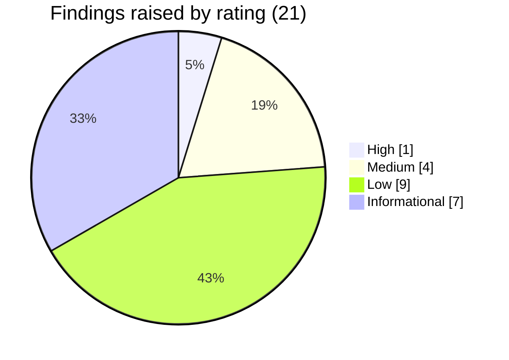

# WellnessZ OHCM – Security Assessment Summary

**Version 1.0**

*WellnessZ OHCM platform – security assessment 2026-10*

| | |
|---|---|
| **Document** | Security Assessment Summary for executives and Cyber GRC |
| **Document ID** | WZ-SEC-ASS-2026-10 |
| **Version** | 1.0 – 2026-10-30 |
| **Classification** | Confidential – security sensitive |
| **Audience** | CIO, CISO, Cyber GRC lead, Data Protection Officer |
| **Full report** | [01 – Security Assessment Report](01-Security-Assessment-Report.md) (methodology, every finding, evidence) |

---

## 1. What was assessed

| Item | Detail |
|---|---|
| System | WellnessZ Airline Occupational Health Case Management – core API and BFF (Java 21 / Spring Boot 4.1.2), four React web apps, Helm chart, Terraform for Azure and Google Cloud, hybrid option |
| Build | Assessment branch, final commit `9228d13` (baseline `3a96ce2` before remediation) |
| Date | 2026-10-30 |
| Type | Internal, white-box, pre-release security assessment by the engineering security lead. **Not an independent penetration test** |
| Target of live tests | Local test stack only (PostgreSQL 16, Keycloak 26.8.1, core API, BFF, four web apps), synthetic data, 39 demo identities in 37 roles |
| Not in scope | Cloud environments, production data, Entra ID tenant, mobile apps, container images (OS packages), third-party systems, social engineering, load/DoS |

## 2. How it was assessed

Eight techniques, mapped to NIST SP 800-115 (plan → discover → attack → report), OWASP WSTG, OWASP ASVS 4.0.3 Level 2,
OWASP Top 10 2021 and OWASP API Security Top 10 2023. Findings were rated with CVSS 3.1 plus a business-impact
adjustment for special-category health data.

| Technique | Tool | Coverage |
|---|---|---|
| Source code analysis | Semgrep 1.183.0 (9 rulesets) | 1,731 files |
| Compiled code analysis | SpotBugs 4.10.5.0 + FindSecBugs 1.14.0 | 25 Java modules |
| Third-party components | OSV database; npm audit | 219 shipped Java libraries; 966 web dependencies |
| Secrets | detect-secrets; history scan | All tracked files; 96 commits |
| Infrastructure as code | Checkov 3.4.0 | Terraform, Dockerfiles, CI workflows, Helm rendered for 3 clouds × 3 environments |
| Live security checks | WellnessZ verification suite | 61 checks incl. token forgery, all 754 API operations anonymously, injection, CSRF, rate limit |
| Access-control matrix | WellnessZ access-matrix tooling | 11,440 checks with real logins: every role × endpoint, objects, anonymous, workspaces |
| Functional regression | Maven, Vitest, ESLint, end-to-end | 455 + 1,373 + 121 tests |

## 3. Results dashboard

| Measure | Before | Final |
|---|---|---|
| Source code findings (Semgrep) | 15 | **0** |
| Compiled code findings (SpotBugs + FindSecBugs) | 0 | **0** |
| Vulnerable shipped Java libraries | 2 | **0** of 219 |
| Vulnerable web dependencies | 0 | **0** of 966 |
| Real secrets in code or history | 0 | **0** |
| Failed infrastructure checks (Terraform / Docker / CI) | 26 / 4 / 2 | **0 / 0 / 0** |
| Failed checks on rendered Kubernetes manifests (9 combinations) | – | **0** |
| Live security checks | 59 / 59 (first run) | **61 / 61** |
| Access-control checks | – | **11,440 / 11,440** |
| Java tests | 454 / 0 failures | **455 / 0 failures** |
| Web tests / end-to-end checks | 1,373 / – | **1,373 / 121**, all passing |

## 4. Findings by severity and status

| Rating | Raised | Fixed and retested | Accepted with residual risk | False positive | **Open at close** |
|---|---|---|---|---|---|
| Critical | 0 | 0 | 0 | 0 | **0** |
| High | 1 | 1 | 0 | 0 | **0** |
| Medium | 4 | 4 | 0 | 0 | **0** |
| Low | 9 | 9 | 0 | 0 | **0** |
| Informational | 7 | 2 | 3 | 2 | **0** |
| **Total** | **21** | **15** | **4** | **2** | **0** |

Notable findings:

| ID | Rating | What | Outcome |
|---|---|---|---|
| F-01 | High | Outdated Guava library with a published memory-exhaustion advisory | Upgraded; rescan clean |
| F-03 | Medium | No per-user API rate limit for deployments without a cloud WAF | New rate limiter (600/min, burst 120); verified `429` |
| F-04 | Medium | Dependency bot could adopt brand-new (possibly malicious) package versions immediately | 3–14 day cooldown; security fixes not delayed |
| F-18 | Low | Partner and insurer accounts could read internal reference data (no personal data) | Restricted to internal staff; verified |
| F-19 | Medium | **Regression introduced during the F-18 fix**: anonymous callers could read that reference data | **Caught by the verification gate before release**, fixed, test added; 754/754 operations refuse anonymous calls |

Accepted items (not open): F-12 (16 infrastructure checks accepted by design), F-14 (key-expiry and TLS-mode scanner
rules already satisfied by other settings), F-16 (MRO restricted-document access fails closed – enhancement SEC-E05),
F-17 (demo clinician seeded – fails closed; must be configured before go-live).

## 5. Trust Services Criteria results

| SOC 2 criterion | What was checked | Result for the tested build | Residual risk / condition |
|---|---|---|---|
| **Security** (CC6, CC7, CC8) | Authentication, token validation, access control for every role, configuration, vulnerabilities, change control | **Met** for system-implemented controls | Independent pen test; image scanning and signed-image admission; SIEM detections |
| **Availability** (A1) | Rate limiting, request-size limits, resilient infrastructure code | **Met** for capacity protection; recovery not assessed | Cluster-wide rate limits; DDoS protection; DR tests (organisational) |
| **Processing integrity** (PI1) | Injection and malformed input, mass assignment, business flows end to end | **Met** | Abuse-case tests per increment |
| **Confidentiality** (C1) | Restricted classes (mental health, drug and alcohol testing), disclosure levels, caching, external isolation | **Met** | Named-clinician configuration at go-live |
| **Privacy** (P1–P8) | Consent gating, status-only views, disclosure log, DPO oversight | **Met** for system-implemented points | Retention/disposal completeness; DPO processes (organisational) |

A HITRUST CSF cross-reference (categories 0–13) is in Section 12.7 of the full report. This assessment supplies
technical evidence for these criteria; it is not a SOC 2 examination or a HITRUST certification.

## 6. OWASP result

| Framework | Categories | Tested | Result |
|---|---|---|---|
| OWASP Top 10 2021 | A01–A10 | All ten (A09 partially; A10 statically) | No open finding in any category |
| OWASP API Security Top 10 2023 | API1–API10 | All ten (API6 and API10 partially; API7 statically) | No open finding in any category |

**Statement of open findings at assessment close (2026-10-30): Critical 0, High 0, Medium 0, Low 0.** Accepted items
are listed above and are not open findings. The statement is valid for the tested build (`9228d13`) and scope only; it
is not a guarantee that no vulnerabilities exist.

## 7. Residual risks

| Risk | Why it remains | Mitigation |
|---|---|---|
| Cloud environments, WAF and TLS not tested live | No cloud environment in scope | Independent pen test of UAT (SEC-E01) |
| Container OS packages not scanned in this assessment | Scanner blocked in the assessment environment | CI Trivy gate; attach reports to the release (SEC-E02) |
| Unsigned images not yet blocked at admission on AKS | Feature not yet configured (GKE already enforces) | SEC-E03 |
| MFA for partner/insurer roles not exercised | Local profile has MFA off | IdP review and pen test |
| Rate limit is per application node | In-memory token bucket | Cluster-wide limits (SEC-E07), edge WAF (SEC-E10, SEC-E15) |
| Mobile apps not tested | Not built | MASVS L2 assessment (SEC-E11) |
| New vulnerabilities after 2026-10-30 | Point-in-time result | Patch SLAs (SEC-E13); verification suite in CI (SEC-E12) |

## 8. Go-live conditions

| # | Condition |
|---|---|
| G1 | **Independent CREST- or OSCP-certified penetration test of UAT** completed; no Critical or High finding open; retest letter on file (SEC-E01) |
| G2 | Trivy reports and SBOM attestations for the exact release image digests in the release record (SEC-E02) |
| G3 | Signed-image admission enforced on the PROD cluster (SEC-E03) |
| G4 | Real named clinicians and acting MRO physicians configured; no demo identity or local-only secret in UAT/PROD; Flyway image digest set for Azure/hybrid (SEC-E06, F-17, F-20) |
| G5 | Customer-managed key decision for Azure PostgreSQL before the PROD server is created (SEC-E09) |
| G6 | Patch SLAs and vulnerability-management process in force (SEC-E13) |

## 9. Recommendation

The tested build has **no open security findings of any severity** at the end of the assessment, and the controls that
protect special-category health data – authentication, role- and object-level access control, restricted classes,
consent gating and partner isolation – behaved as designed in 61 live checks and 11,440 access checks.

The assessor therefore recommends that the CISO and Cyber GRC lead:

1. **Accept** the four accepted items (F-12, F-14, F-16, F-17) with the owners and residual risks in Section 11 of the
   full report.
2. **Sign** the [Security Assessment Attestation](03-Security-Assessment-Attestation.md).
3. **Approve progression to an independent penetration test of UAT** and, subject to conditions G1–G6, to production
   go-live.
4. **Fund** the "Next" enhancements, in particular running the verification suite and access matrix as a CI gate
   (SEC-E12) – the F-19 regression shows its value.

*End of document.*
