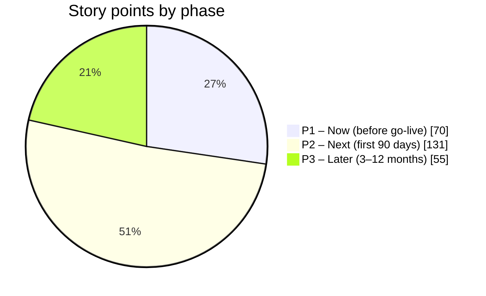

# E15 – Security Hardening and Assurance

**Version 1.0**

*WellnessZ OHCM platform – security assessment 2026-10*

| | |
|---|---|
| **Document** | Epic summary E15 – Security Hardening and Assurance |
| **Version** | 1.0 (2026-10-30) – draft for CISO and Cyber GRC review |
| **Workbook** | [E15_Security_Hardening_and_Assurance.xlsx](E15_Security_Hardening_and_Assurance.xlsx) (sheets *Epic Overview*, *High-Level Requirements*, *Feature List*, *Implementation Backlog*, *Legends* – same layout as the client's epic workbooks, with review and decision columns) |
| **Source** | [Security Enhancement Guideline](../Security-Enhancement-Guideline.md), Sections 3–5 (SEC-E01 … SEC-E15, guardrails, security operations) |

---

## 1. Epic overview

| | |
|---|---|
| **Goal** | Raise the WellnessZ platform from 'secure for release' to the security posture expected of a Tier-0 airline system that processes special-category health data: independent assurance before go-live, a verifiable software supply chain, private and encrypted infrastructure, programme-aware protection of restricted classes, automated security regression testing, detection and response in the SIEM, and a disciplined vulnerability-management cadence. The epic implements enhancements SEC-E01 to SEC-E15 of the Security Enhancement Guideline (security assessment 2026-10) plus guardrail regression tests and security operations. |
| **Business value** | Removes the remaining conditions for PROD go-live (independent penetration test, release evidence, signed-image admission, demo-identity guard, customer-managed keys, patch SLAs); protects the airline from regulatory, contractual and reputational damage from a health-data breach; produces the evidence the SOC 2 Type 2 audit and airline customers' security due diligence require; reduces the cost of each later release by catching access-control regressions automatically. |
| **In scope** | • Independent penetration test of UAT and annual retesting (SEC-E01) • Image-scan and SBOM evidence; signed-image admission on AKS and hybrid clusters (SEC-E02, SEC-E03) • Private registry, runners and control planes in PROD (SEC-E04) • Programme-aware restricted-document access for the MRO (SEC-E05) • Startup guard against demo identities and local-only secrets (SEC-E06) • Cluster-wide and cost-based rate limiting (SEC-E07); global WAF, bot and DDoS protection (SEC-E10); hybrid edge WAF and partner IP allow-listing (SEC-E15) • Runtime protection and SIEM detections (SEC-E08) • Customer-managed keys and envelope encryption (SEC-E09) • Mobile app hardening and MASVS assessment (SEC-E11) • Security verification and access-control matrix as CI gates (SEC-E12) • Patch SLAs, re-scanning and PostgreSQL upgrade plan (SEC-E13); threat-model refresh and abuse-case tests (SEC-E14) • Guardrail regression tests and the security operations cadence |
| **Out of scope** | • Operating the SOC itself and the SIEM platform (client service) • Identity-provider hardening (Entra ID / Keycloak tenant configuration), endpoint and MDM policies • SOC 2 audit fieldwork (performed by the independent auditor) • New business functionality |
| **Primary stakeholders / roles** | CIO; CISO / Cyber GRC; Data Protection Officer; Platform Security; Platform / DevOps; Network team; Core API team; Web team; Mobile team; QA; SOC; Security champions; OH governance (CMO, Nursing Head, MRO) for restricted-class decisions |
| **Success KPIs** | • Go-live conditions G1–G6 of the Security Enhancement Guideline met before PROD go-live • 0 Critical / High vulnerabilities open beyond SLA (48 h / 7 d); monthly report on time • 100 % of UAT / PROD images signed, scanned and admitted by policy • 0 unexpected allows in the nightly access-control matrix • 100 % of access reviews on time; 100 % of break-glass events reviewed within 5 working days • ≥ 95 % of high-severity SIEM alerts triaged within 1 hour |
| **Dependencies** | E09 Mental health (restricted class); E10 Substance testing (MRO); E13 Portal / app (mobile); E18 Configuration (demo-identity rule); client IAM, network and SOC teams; cloud subscriptions / projects |
| **Standards & references** | • SOC2: AICPA Trust Services Criteria (CC, A, C) • HITRUST: HITRUST CSF assessment domains 01–19 • OWASP-T10 / OWASP-API / OWASP-ASVS / OWASP-MASVS • ISO27001: ISO/IEC 27001:2022 Annex A • NIST-SSDF: NIST SP 800-218 Secure Software Development Framework; SLSA build provenance • LOCAL-PDP: local personal-data-protection law + GDPR Art. 9 / 32 as benchmark • WellnessZ: Security Enhancement Guideline, Developer Security Handbook, doc 02 Security and SOC 2 Control Mapping |
| **Recommended start phase** | P1 – Now (before PROD go-live) for SEC-E01, E02, E03, E06, E09 (decision), E13 (SLAs); P2 – Next (first 90 days); P3 – Later (3–12 months) |

> **Numbering note.** Earlier increment documents refer to the client's Integration epic as "E15". Confirm the
> epic number with the PMO before importing this epic into the master backlog; only the prefix of the IDs changes.

## 2. Summary metrics

| Metric | Value |
|---|---|
| High-level requirements | 17 (11 Must, 6 Should) |
| Features | 17 |
| Backlog items | 46 (Enabler 17, Spike 3, Story 11, Task 15) |
| Story points (indicative) | 256 – P1 Now 70, P2 Next 131, P3 Later 55 |

## 3. High-level requirements

| HLR ID | Requirement | Rationale | Priority | Standards / sources |
|---|---|---|---|---|
| E15-HLR-01 | The platform shall undergo an independent penetration test by a CREST- or OSCP-certified tester of the deployed UAT environment (web apps, BFF, core API, partner portal, integration endpoints, mobile build, cloud configuration) before PROD go-live, annually thereafter and before each major release, with no Critical or High finding open at go-live. | The 2026-10 assessment was internal and ran against the local stack only (SEC-E01, R-01). Independent testing of the deployed system is expected by auditors and airline customers. | Must | SOC2 CC4.1, CC7.1; HITRUST 07, 17; ISO27001 A.8.8, A.8.29; OWASP-ASVS |
| E15-HLR-02 | Every image deployed to UAT or PROD shall have its vulnerability-scan report and SBOM attestation verified at deployment and retained as release evidence for at least 13 months. | Trivy gates the build, but evidence lives only in workflow logs and SBOM attestations are not verified at deploy (SEC-E02, R-02). | Must | SOC2 CC7.1, CC8.1; HITRUST 06, 07; NIST-SSDF; SLSA |
| E15-HLR-03 | Kubernetes clusters in UAT and PROD on every supported platform (AKS, GKE, hybrid) shall admit only images signed by the WellnessZ release pipeline. | GKE enforces Binary Authorization; AKS and on-premises clusters verify signatures only in the deploy job (SEC-E03, residual risk RR11). | Must | SOC2 CC6.8, CC8.1; HITRUST 06; SLSA; CIS-K8S |
| E15-HLR-04 | Build, registry and cluster-management paths for PROD shall be private: no public network access to the container registry or key vault, private Kubernetes control planes and group-based cluster RBAC. | ACR public access and temporary Key Vault IP rules exist for GitHub-hosted runners; the GKE PROD control plane has a public endpoint (SEC-E04, accepted Checkov items). | Should | SOC2 CC6.1, CC6.6; HITRUST 08, 11; ISO27001 A.8.20, A.8.22 |
| E15-HLR-05 | Access to restricted-class documents through the generic documents API shall be decided per programme, so that the MRO can open substance-programme documents while separation between psychological-health and substance-testing records is preserved. | Finding F-16: the MRO is denied (fail closed) on the generic API because the restricted class carries no programme attribute (SEC-E05). | Should | SOC2 CC6.1, CC6.3, C1.1; HITRUST 11, 19; LOCAL-PDP; ICAO-9654; EU-1042 |
| E15-HLR-06 | Outside the local development profile, the core API and the BFF shall refuse to start when a demo identity or a known local-only secret is configured, and the configuration service shall reject demo identities for restricted-class settings. | Finding F-17: 'mentalhealth.named-clinicians' is seeded with the demo user psych1 in every environment; local-only secrets exist in local files (SEC-E06). | Must | SOC2 CC6.1, CC8.1; HITRUST 06, 10; OWASP-T10 A05, A07 |
| E15-HLR-07 | Request-rate limits shall apply per principal across all replicas and shall weight expensive operations (exports, reports, audit packs, bulk operations) higher than ordinary reads. | ApiRateLimitFilter (finding F-03) keeps buckets per pod, so the effective limit grows with replicas; all requests cost the same (SEC-E07). | Should | SOC2 A1.1, CC7.2; HITRUST 08, 12; OWASP-API API4, API6 |
| E15-HLR-08 | Runtime threats in containers and security-relevant application events (break-glass, mass export, enumeration, authentication attacks, rate-limit storms, configuration changes, audit-chain failures) shall be detected in the SIEM, with documented response runbooks. | The application audits these events, but no SOC detection is defined and container runtime threats are not detected (SEC-E08). | Must | SOC2 CC7.2, CC7.3, CC7.4; HITRUST 12, 15; ISO27001 A.8.15, A.8.16; OWASP-T10 A09 |
| E15-HLR-09 | All PROD data stores holding personal or health data shall be encrypted with customer-managed, HSM-backed keys, and the field-encryption master key shall be protected by envelope encryption in the cloud key-management service. | Cloud SQL uses CMEK, Azure PostgreSQL does not (postgres_cmk_enabled = false); the key type is fixed at server creation. Residual risk RR1: single master key (SEC-E09). | Must | SOC2 CC6.1, C1.1; HITRUST 19; ISO27001 A.8.24; LOCAL-PDP |
| E15-HLR-10 | Internet-facing entry points shall be protected against volumetric DDoS and automated (bot) attacks within the client's data-residency constraints. | Front Door is disabled in every environment; no DDoS Network Protection or bot management is configured (SEC-E10). | Should | SOC2 A1.1, CC6.6; HITRUST 08, 16; OWASP-API API4, API6 |
| E15-HLR-11 | The native employee app shall meet OWASP MASVS (MAS testing profile L2 plus resilience) before store release, including secure token storage, certificate pinning and compromised-device detection. | Residual risk RR7 (secure storage and MAM not integrated); no pinning or root / jailbreak detection (SEC-E11). | Should | SOC2 CC6.1, CC6.7; HITRUST 04, 02; OWASP-MASVS |
| E15-HLR-12 | Automated security verification and the role-based access-control matrix shall run in CI against an ephemeral stack and block releases on any failed check or unexpected access, including endpoints without an expected policy. | Both tools proved their value in the assessment but run manually; a new endpoint can silently miss its role gate (SEC-E12). | Must | SOC2 CC7.1, CC8.1; HITRUST 06, 07; ISO27001 A.8.29; OWASP-ASVS; OWASP-API API1, API5 |
| E15-HLR-13 | Vulnerabilities shall be remediated in PROD within 48 hours (critical), 7 days (high), 30 days (medium) and 90 days (low), deployed images shall be re-scanned daily, and platform components (including PostgreSQL) shall stay on supported major versions. | Findings F-01 / F-02 show the dependency tree moves under a stable application; doc 02 SLAs (7 d / 30 d) are too slow for a Tier-0 platform (SEC-E13). | Must | SOC2 CC7.1, CC8.1; HITRUST 07; ISO27001 A.8.8; OWASP-T10 A06 |
| E15-HLR-14 | Each delivery increment shall refresh the STRIDE threat model and add automated abuse-case tests for new flows; restricted classes shall be covered by a maintained abuse-case catalogue. | Insider curiosity, colleague look-ups, partner over-reach and inference from aggregates are the most likely real-world threats (SEC-E14, residual risk RR10). | Must | SOC2 CC3.2, CC3.4, CC8.1; HITRUST 17; ISO27001 A.5.8, A.8.25; OWASP-T10 A04 |
| E15-HLR-15 | Hybrid deployments shall provide WAF protection and per-client rate limiting at the on-premises API edge, an optional per-partner IP allow-list, and edge egress restricted to required destinations. | The on-premises API has no cloud WAF; the hybrid edge NetworkPolicy allows HTTPS egress to any address (SEC-E15). | Should | SOC2 CC6.6, A1.1; HITRUST 08, 14; OWASP-API API4 |
| E15-HLR-16 | The secure-by-default guardrails GR-01 to GR-20 shall be protected by automated regression tests or lint rules wherever technically possible; any weakening shall require a recorded CISO exception with owner and expiry. | Guardrails are enforced today by code and review; several (no dangerouslySetInnerHTML, rate limit on, minimum group size) have no automated guard. | Must | SOC2 CC5.2, CC8.1; HITRUST 06; ISO27001 A.8.9, A.8.28 |
| E15-HLR-17 | Security operations shall run on a defined cadence: quarterly access reviews (monthly for privileged and restricted roles), annual independent penetration testing, a security-champions programme and an annual incident tabletop exercise. | Controls must operate effectively over the SOC 2 review period, not only exist at go-live. | Must | SOC2 CC1.4, CC4.1, CC6.2, CC6.3, CC7.4; HITRUST 11, 13, 15; ISO27001 A.5.18, A.6.3, A.5.24 |

## 4. Features

| Feature ID | Feature | Roles | MoSCoW | HLR | Acceptance criteria (summary) | Items / SP |
|---|---|---|---|---|---|---|
| E15-F01 | **Independent penetration test and retest** – CREST/OSCP-certified test of UAT: authenticated testing with every role, all 754 documented API operations, partner portal with MFA, integration endpoints, mobile build and cloud configuration review; remediation and retest. | CISO office; Platform Security; external tester; all delivery teams | Must | E15-HLR-01 | Report received; no Critical/High open at go-live; Mediums owned and dated within SLA; retest letter in the release record. | 2 / 18 |
| E15-F02 | **Release evidence: image scans and SBOM attestations** – Trivy JSON/SARIF report per image digest stored as artefact; SBOM attestation verified with cosign in deploy-env.yml; deployment summary links the evidence; copy to evidence store. | Platform / DevOps; Cyber GRC | Must | E15-HLR-02 | Deploy fails closed without a valid SBOM attestation; every UAT/PROD deployment summary links scan reports of the exact digests; retention ≥ 13 months. | 2 / 8 |
| E15-F03 | **Signed-image admission on AKS and hybrid clusters** – Admission policy verifying the cosign keyless signature (identity container.yml@refs/heads/main): AKS Image Integrity (Ratify + Azure Policy) where available, otherwise Kyverno verifyImages; Sigstore policy-controller or Kyverno on hybrid clusters. | Platform / DevOps | Must | E15-HLR-03 | Audit in DEV, deny in UAT/PROD; unsigned and foreign-signed images rejected in UAT; exemptions listed; RR11 closed. | 2 / 13 |
| E15-F04 | **Private build, registry and control-plane paths** – Self-hosted ephemeral runners in the cloud networks; ACR public access off and no Key Vault IP rules in UAT/PROD; GKE private endpoint in PROD; Google Groups for GKE RBAC. | Platform / DevOps; Network; IAM | Should | E15-HLR-04 | acr_public_network_access = false; key_vault_allowed_ips empty; gke_private_endpoint = true (PROD); gke_rbac_security_group set; pipelines green end to end. | 3 / 21 |
| E15-F05 | **Programme-aware restricted-document access (MRO)** – Programme attribute for restricted resources; ABAC policy letting the MRO (and listed acting-MRO physicians) open E10 documents such as CHAIN_OF_CUSTODY_FORM through the generic documents API; explicit programme separation. | MRO; acting-MRO physician; DPO; OH governance | Should | E15-HLR-05 | MRO opens E10 restricted documents via /documents; MRO gets 404 on E09 documents; general OH, managers, HR and unbound clients get 404; every denial audited. | 2 / 13 |
| E15-F06 | **Startup guard against demo identities and local-only secrets** – Fail-fast check in core API and BFF outside local/test profiles for known local-only secret values and demo identities in restricted-class configuration; configuration service rejects demo identities. | Core API team; Platform / DevOps | Must | E15-HLR-06 | Startup fails with a message naming the property (never the value); unit tests per rule; UAT/PROD values pass; go-live checklist updated. | 2 / 8 |
| E15-F07 | **Cluster-wide and cost-based rate limiting** – Shared limit store or edge-enforced per-principal limits independent of replica count; cost classes for exports, reports, audit packs and bulk operations; per-environment and per-client configuration. | Core API team; Platform / DevOps | Should | E15-HLR-07 | Load test shows the limit is independent of replica count; expensive endpoints limited separately; fail-open behaviour reviewed and documented. | 3 / 16 |
| E15-F08 | **Runtime protection and SIEM detections** – Defender for Containers / GKE Security Posture with threat detection / Falco on hybrid; audit trail and logs streamed to SIEM; detections D-01…D-12; PHI-free 429 counter; runbooks. | SOC; Platform / DevOps; Platform Security | Must | E15-HLR-08 | Detections implemented and tested with synthetic events; runbooks linked; high-severity alerts triaged within 1 hour (≥ 95 %). | 4 / 26 |
| E15-F09 | **Customer-managed keys and envelope encryption** – ADR on CMK; Azure PostgreSQL CMK with geo-backup key in UAT/PROD; envelope encryption of the field-encryption master key through the cloud KMS with a re-encryption job; key-loss and rotation runbook. | Platform Security; DBA; DPO | Must | E15-HLR-09 | ADR signed by CISO and DPO before the PROD server is created; postgres_cmk_enabled = true; restore with rotated key proven in UAT; RR1 closed. | 4 / 18 |
| E15-F10 | **Global WAF, bot and DDoS protection** – Data-residency assessment; Front Door Premium WAF with bot manager rule set (if approved) or App Gateway rate rules; DDoS Network/IP Protection; Cloud Armor Adaptive Protection. | Platform / Network; DPO | Should | E15-HLR-10 | Residency decision recorded; protections enabled in PROD; load test proves shift-change peaks are not blocked. | 3 / 13 |
| E15-F11 | **Mobile app hardening and MASVS assessment** – Refresh token in Keychain/Keystore; app-protection policies through MDM; certificate pinning with backup pin; root/jailbreak and debugger detection; independent MASVS assessment. | Mobile team; Endpoint team; Platform Security | Should | E15-HLR-11 | MASVS assessment with no High open before store release; pin-rotation runbook; RR7 closed. | 3 / 26 |
| E15-F12 | **Security verification and access matrix in CI** – Policy extractor committed under tools/security with tests; CI workflow with ephemeral Docker Compose stack runs security-verification.js and rbac-matrix.js nightly and on release branches; object-level cases for every module. | Platform / DevOps; QA; Security champions | Must | E15-HLR-12 | Gate fails on any FAIL, unexpected allow or endpoint without expected policy; artefacts and job summary published; never pointed at UAT/PROD. | 3 / 21 |
| E15-F13 | **Patch SLAs, re-scanning and platform upgrades** – Patch SLA policy (48 h / 7 d / 30 d / 90 d); monthly vulnerability report; daily re-scan of deployed digests; CI check for expired suppressions; PostgreSQL 17/18 upgrade plan and rehearsal. | Platform Security; Engineering leads; DBA | Must | E15-HLR-13 | Policy approved and doc 02 updated; monthly report delivered; expired suppressions fail CI; upgrade rehearsed in DEV/UAT before end of 2027. | 3 / 19 |
| E15-F14 | **Threat modelling and abuse-case tests** – STRIDE refresh as an entry criterion of each increment's design sign-off; abuse-case catalogue for restricted classes and aggregates (including differencing) with automated tests. | Security champions; Architecture; QA; DPO | Must | E15-HLR-14 | Threat model updated for every increment; each abuse case has a passing automated test; findings tracked in the backlog. | 2 / 11 |
| E15-F15 | **Hybrid edge protection and partner allow-listing** – WAF with OWASP CRS and per-client rate rules in front of the on-premises API; optional per-partner-organisation IP allow-list in the overlay; edge egress narrowed to the IdP and on-premises API. | Platform / Network; Partner management | Should | E15-HLR-15 | WAF active on the on-premises API edge; allow-list configurable per partner; edge NetworkPolicy no longer allows 0.0.0.0/0; hybrid setup guide updated. | 3 / 13 |
| E15-F16 | **Guardrail regression tests** – Automated guards for guardrails without one today: ESLint rule banning dangerouslySetInnerHTML in all four web apps; configuration tests that keep the rate limit on and the minimum group size ≥ 5 in every non-local values file. | Web team; Core API team; Security champions | Must | E15-HLR-16 | Lint fails on dangerouslySetInnerHTML; CI fails when a non-local overlay disables the rate limit or lowers the minimum group size; guardrail table cross-references the tests. | 2 / 5 |
| E15-F17 | **Security operations cadence** – Quarterly access reviews (monthly privileged/restricted) with evidence; security-champions programme; annual penetration test and incident tabletop in the security calendar. | CISO office; OH service owner; IAM; DPO; Engineering leads | Must | E15-HLR-17 | First quarterly review completed with evidence; one champion per team nominated; calendar approved; first tabletop held within 6 months of go-live. | 3 / 7 |

## 5. Implementation backlog

Phase: P1 = Now (before PROD go-live), P2 = Next (first 90 days), P3 = Later (3–12 months). Priority P1 (critical) to P3.
All items start as *Not started*; sprints are assigned by the delivery teams.

### E15-F01 – Independent penetration test and retest

| Backlog ID | Type | Title / user story | Acceptance criteria | SP | Phase | Priority | Owner / team | Dependencies |
|---|---|---|---|---|---|---|---|---|
| E15-BL-001 | Task | Agree penetration-test scope, rules of engagement and test window; provision UAT test accounts for every role (including PSYCH_CLINICIAN, MRO, PARTNER_PROVIDER with MFA, INTEGRATION client) | Signed rules of engagement; tester certification verified; accounts and synthetic data ready; out-of-scope systems listed | 5 | P1 | P1 | Security & Privacy (Platform Security) | SEC-E01 |
| E15-BL-002 | Story | As the CISO I want every Critical and High penetration-test finding fixed and retested so that PROD can go live with independent assurance | All Critical/High fixed and retested; Mediums owned within SLA; retest letter attached to the release record; doc 02 updated | 13 | P1 | P1 | All delivery teams | SEC-E01 |

### E15-F02 – Release evidence: image scans and SBOM attestations

| Backlog ID | Type | Title / user story | Acceptance criteria | SP | Phase | Priority | Owner / team | Dependencies |
|---|---|---|---|---|---|---|---|---|
| E15-BL-003 | Enabler | Store the Trivy JSON and SARIF report per image digest in container.yml and verify the CycloneDX SBOM attestation with cosign verify-attestation in deploy-env.yml for all six images | Artefacts named by digest; deploy fails closed when an attestation is missing or invalid; tested with a deliberately unattested image in DEV | 5 | P1 | P1 | Platform / DevOps | SEC-E02 |
| E15-BL-004 | Task | Link scan reports and SBOM digests of the deployed digests from every UAT/PROD deployment summary and copy them to the release evidence store | Evidence present for the first UAT release; retention ≥ 13 months confirmed by Cyber GRC | 3 | P1 | P2 | Platform / DevOps; Cyber GRC | SEC-E02 |

### E15-F03 – Signed-image admission on AKS and hybrid clusters

| Backlog ID | Type | Title / user story | Acceptance criteria | SP | Phase | Priority | Owner / team | Dependencies |
|---|---|---|---|---|---|---|---|---|
| E15-BL-005 | Spike | Select the admission technology for AKS (AKS Image Integrity with Ratify + Azure Policy vs Kyverno verifyImages) and for hybrid clusters (Sigstore policy-controller vs Kyverno) | Decision record with regional availability, operating cost, failure mode (fail closed) and keyless-identity support | 3 | P1 | P1 | Platform / DevOps | SEC-E03 |
| E15-BL-006 | Enabler | Enforce signed-image admission on AKS and hybrid clusters: audit mode in DEV, deny mode in UAT and PROD, identity …/container.yml@refs/heads/main | Unsigned and foreign-signed images rejected in UAT (evidence); system namespaces exempted and justified; Helm deploy and rollback unaffected; RR11 closed | 10 | P1 | P1 | Platform / DevOps | SEC-E02; SEC-E03 |

### E15-F04 – Private build, registry and control-plane paths

| Backlog ID | Type | Title / user story | Acceptance criteria | SP | Phase | Priority | Owner / team | Dependencies |
|---|---|---|---|---|---|---|---|---|
| E15-BL-007 | Enabler | Run ephemeral self-hosted GitHub runners inside the Azure VNet and Google Cloud VPC (or Connect Gateway) for promotion and deployment jobs | Runners scale to zero; no stored cloud credentials (OIDC); runner images patched monthly; jobs pinned to the private runners for UAT/PROD | 8 | P2 | P2 | Platform / DevOps | SEC-E04 |
| E15-BL-008 | Enabler | Close public management paths in UAT/PROD: acr_public_network_access = false, key_vault_allowed_ips empty, gke_private_endpoint = true (PROD) | terraform plan reviewed in DEV first; promotion and deployment green on the private path; Checkov CKV_AZURE_139 passes for UAT/PROD | 8 | P2 | P2 | Platform / DevOps; Network | SEC-E04 |
| E15-BL-009 | Task | Create the client's gke-security-groups@<domain> group, set gke_rbac_security_group and validate the pipelines end to end | Group-based RBAC bindings in place; access review covers the groups; end-to-end deployment evidence | 5 | P2 | P3 | Platform / DevOps; IAM | SEC-E04 |

### E15-F05 – Programme-aware restricted-document access (MRO)

| Backlog ID | Type | Title / user story | Acceptance criteria | SP | Phase | Priority | Owner / team | Dependencies |
|---|---|---|---|---|---|---|---|---|
| E15-BL-010 | Spike | Design a programme attribute for RESTRICTED_CLINICAL resources (E09 vs E10) and agree the access rules with OH governance and the DPO | Decision record: who may open which programme's documents; impact on ResourceAttributes, DocumentService and existing policies | 3 | P2 | P1 | Core API team; DPO; OH governance | E09; E10 |
| E15-BL-011 | Story | As an MRO I want to open substance-programme documents (e.g. CHAIN_OF_CUSTODY_FORM) through the generic documents API so that I can complete reviews without workarounds, while I still cannot open psychological-health documents | MRO and listed acting-MRO physicians open E10 documents; MRO gets 404 on E09 documents; general OH, manager, HR and unbound machine clients get 404; denials audited; access-matrix object cases added | 10 | P2 | P1 | Core API team (E10) | E10; E15-F05 spike |

### E15-F06 – Startup guard against demo identities and local-only secrets

| Backlog ID | Type | Title / user story | Acceptance criteria | SP | Phase | Priority | Owner / team | Dependencies |
|---|---|---|---|---|---|---|---|---|
| E15-BL-012 | Story | As the CISO I want the core API and the BFF to refuse to start outside the local profile when a demo identity or local-only secret is configured so that a demo setting can never reach UAT or PROD | Rules: known local-only secret values (e.g. change-me-local-only), demo users in mentalhealth.named-clinicians; message names the property only; unit tests per rule; UAT/PROD overlays pass | 6 | P1 | P1 | Core API team | SEC-E06 |
| E15-BL-013 | Story | As an OH administrator I want the configuration service to reject demo identities for restricted-class settings outside local, and the go-live checklist to require the real named clinicians | Config change with a demo user returns 400 outside local; checklist item added; F-17 closed | 2 | P1 | P1 | Core API team; Product Owner (OH) | E18; E09 |

### E15-F07 – Cluster-wide and cost-based rate limiting

| Backlog ID | Type | Title / user story | Acceptance criteria | SP | Phase | Priority | Owner / team | Dependencies |
|---|---|---|---|---|---|---|---|---|
| E15-BL-014 | Spike | Choose the mechanism for cluster-wide per-principal limits (shared store such as Redis vs edge-enforced limits) including fail-open behaviour | Decision record with latency, availability and cost impact; behaviour when the store is unavailable reviewed by Platform Security | 3 | P3 | P3 | Core API team; Platform / DevOps | SEC-E07 |
| E15-BL-015 | Enabler | Implement cluster-wide per-principal rate limiting independent of replica count | Load test with 1 and N replicas shows the same effective limit; 429 + Retry-After unchanged; configuration per environment and client overlay | 8 | P3 | P3 | Core API team | SEC-E07 spike |
| E15-BL-016 | Story | As the platform owner I want exports, reports, audit packs and bulk operations to consume more of the rate budget so that a single user cannot exhaust expensive resources | Cost classes defined and documented; expensive endpoints limited separately; tests per class | 5 | P3 | P3 | Core API team | SEC-E07 |

### E15-F08 – Runtime protection and SIEM detections

| Backlog ID | Type | Title / user story | Acceptance criteria | SP | Phase | Priority | Owner / team | Dependencies |
|---|---|---|---|---|---|---|---|---|
| E15-BL-017 | Enabler | Enable container runtime threat detection: Defender for Containers (Azure), GKE Security Posture and threat detection (Google Cloud), Falco or equivalent on hybrid clusters | Enabled in UAT/PROD; alerts routed to the SIEM; noise tuned in UAT | 5 | P2 | P1 | Platform / DevOps; SOC | SEC-E08 |
| E15-BL-018 | Enabler | Stream the audit trail (platform.audit_event), application logs, ingress/WAF logs and cloud audit logs to the SIEM | Ingestion verified end to end; no PHI in the streamed fields (sample review by the DPO); retention per policy | 8 | P2 | P1 | Platform / DevOps; SOC | SEC-E08 |
| E15-BL-019 | Story | As a SOC analyst I want detections D-01…D-12 (break-glass, mass export, enumeration, authentication attacks, rate-limit storms, configuration tampering, replay, audit-chain failure, admission denial, secret access, runtime alert, external user without MFA) with runbooks | Each detection tested with a synthetic event; runbook linked; thresholds reviewed after 30 days; ≥ 95 % high alerts triaged within 1 hour | 10 | P2 | P1 | SOC; Platform Security | SEC-E08 |
| E15-BL-020 | Story | As a SOC analyst I want a PHI-free counter and log event for every 429 answered by ApiRateLimitFilter so that rate-limit storms are visible | Metric with principal type (human / integration) but no request content; unit test; dashboard panel | 3 | P2 | P2 | Core API team | SEC-E08 |

### E15-F09 – Customer-managed keys and envelope encryption

| Backlog ID | Type | Title / user story | Acceptance criteria | SP | Phase | Priority | Owner / team | Dependencies |
|---|---|---|---|---|---|---|---|---|
| E15-BL-021 | Task | Architecture decision record on customer-managed keys for Azure PostgreSQL and other PROD data stores (incl. evaluation of the Cloud SQL Java connector with IAM authentication and client certificates) | ADR signed by CISO and DPO before the PROD PostgreSQL server is created | 2 | P1 | P1 | Platform Security; DBA; DPO | SEC-E09 |
| E15-BL-022 | Enabler | Enable postgres_cmk_enabled with geo-backup key and identity in UAT and PROD (Key Vault Premium, RSA-HSM) | Server created with CMK; geo-backup key in the paired region; Key Vault access logged; Checkov and terraform validate green | 5 | P1 | P1 | Platform / DevOps; DBA | SEC-E09 ADR |
| E15-BL-023 | Enabler | Envelope encryption for the field-encryption master key (KMS-wrapped data keys) and a re-encryption job for key rotation | Master key never stored unwrapped at rest; rotation re-encrypts rows by key version; integration test proves old and new versions readable; RR1 closed | 8 | P2 | P2 | Core API team; Platform Security | SEC-E09 |
| E15-BL-024 | Task | Key rotation and key-loss runbook, rehearsed in UAT including restore from backup | Runbook approved; rehearsal evidence; recovery time recorded | 3 | P1 | P2 | DBA; Platform Security | SEC-E09 |

### E15-F10 – Global WAF, bot and DDoS protection

| Backlog ID | Type | Title / user story | Acceptance criteria | SP | Phase | Priority | Owner / team | Dependencies |
|---|---|---|---|---|---|---|---|---|
| E15-BL-025 | Task | Data-residency assessment for TLS termination at a global edge (Front Door) for the client's jurisdictions | DPO decision recorded; fallback design if not approved | 2 | P2 | P2 | DPO; Platform / Network | SEC-E10 |
| E15-BL-026 | Enabler | Enable edge protection in PROD: Front Door Premium WAF with bot manager rule set (or App Gateway rate rules), Azure DDoS Network/IP Protection, Cloud Armor Adaptive Protection | Origin locked to AzureFrontDoor.Backend where used; DDoS protection attached to public IPs; WAF logs in the SIEM | 8 | P2 | P2 | Platform / Network | SEC-E10; SEC-E08 |
| E15-BL-027 | Task | Load test the edge rules with realistic shift-change peaks and partner batch traffic | No false blocking at 2× expected peak; tuning documented | 3 | P2 | P3 | QA; Platform / Network | SEC-E10 |

### E15-F11 – Mobile app hardening and MASVS assessment

| Backlog ID | Type | Title / user story | Acceptance criteria | SP | Phase | Priority | Owner / team | Dependencies |
|---|---|---|---|---|---|---|---|---|
| E15-BL-028 | Story | As an employee using the app I want my session stored securely and protected by my organisation's app policies so that a lost phone does not expose health data | Refresh token in Keychain/Keystore; MAM / app-protection policies applied; remote wipe of app data tested; RR7 closed | 8 | P3 | P2 | Mobile team; Endpoint team | E13 |
| E15-BL-029 | Story | As the CISO I want certificate pinning and compromised-device detection in the employee app so that intercepted or tampered devices cannot read health data | Public-key pinning with backup pin and rotation runbook; root/jailbreak and debugger detection with an agreed block/warn policy; tests on real devices | 10 | P3 | P2 | Mobile team | E13 |
| E15-BL-030 | Task | Independent MASVS assessment (MAS testing profile L2 + R) of the store build and remediation | No High finding open before store release; report in the release record | 8 | P3 | P2 | Mobile team; Platform Security | SEC-E01 |

### E15-F12 – Security verification and access matrix in CI

| Backlog ID | Type | Title / user story | Acceptance criteria | SP | Phase | Priority | Owner / team | Dependencies |
|---|---|---|---|---|---|---|---|---|
| E15-BL-031 | Enabler | Commit the static policy extractor (expected access policy from @PreAuthorize, URL rules and BFF workspace gating) under tools/security with tests | Extractor reproduces the assessment baseline (762 endpoint entries from 89 controllers); unit tests for SpEL constant resolution | 5 | P2 | P1 | Platform / DevOps; QA | SEC-E12 |
| E15-BL-032 | Enabler | CI workflow: start an ephemeral stack (Docker Compose, generated secrets), run security-verification.js and rbac-matrix.js nightly and on release branches, publish results | Gate fails on any FAIL, unexpected allow or endpoint without expected policy; SHA-pinned actions; permissions contents: read; never targets UAT/PROD | 13 | P2 | P1 | Platform / DevOps | SEC-E12; SEC-E01 |
| E15-BL-033 | Task | Add object-level access cases for every business module (cases, documents, restricted records, partner referrals) to the access matrix | Every module with record-level data has at least one cross-user and one cross-scope case; results reviewed by the security champions | 3 | P2 | P2 | QA; Security champions | SEC-E12 |

### E15-F13 – Patch SLAs, re-scanning and platform upgrades

| Backlog ID | Type | Title / user story | Acceptance criteria | SP | Phase | Priority | Owner / team | Dependencies |
|---|---|---|---|---|---|---|---|---|
| E15-BL-034 | Task | Approve and publish the patch SLA policy (critical 48 h, high 7 d, medium 30 d, low 90 d) and update doc 02 Section 10 | Policy signed by the CISO; exceptions process documented; engineering leads briefed | 2 | P1 | P1 | Platform Security | SEC-E13 |
| E15-BL-035 | Enabler | Monthly vulnerability report, daily re-scan of deployed digests against new advisories, and a CI check that fails on expired suppression entries | Report delivered for the first month after go-live; re-scan alerts into the vulnerability queue; expired entries in the three suppression files fail CI | 4 | P1 | P1 | Platform / DevOps; Platform Security | SEC-E13; SEC-E02 |
| E15-BL-036 | Task | PostgreSQL 17 (or 18) upgrade plan and rehearsal on both clouds and the hybrid CloudNativePG cluster (Flyway, extensions, pgaudit) | Plan approved; rehearsal in DEV and UAT with rollback; scheduled before end of 2027 | 13 | P3 | P3 | DBA; Platform / DevOps | SEC-E13 |

### E15-F14 – Threat modelling and abuse-case tests

| Backlog ID | Type | Title / user story | Acceptance criteria | SP | Phase | Priority | Owner / team | Dependencies |
|---|---|---|---|---|---|---|---|---|
| E15-BL-037 | Task | Make the STRIDE threat-model refresh an entry criterion of each increment's design sign-off, with a template based on doc 02 Section 7 | Template published; first increment after go-live signed off with an updated model | 3 | P2 | P2 | Security champions; Architecture | SEC-E14 |
| E15-BL-038 | Story | As the DPO I want an abuse-case catalogue for restricted classes and aggregates (colleague look-ups, insider curiosity, partner over-reach, differencing across time windows) with automated tests | Catalogue reviewed by DPO and OH governance; one automated test per abuse case; RR10 mitigation decided | 8 | P2 | P1 | QA; Security champions; DPO | SEC-E14; E09; E10 |

### E15-F15 – Hybrid edge protection and partner allow-listing

| Backlog ID | Type | Title / user story | Acceptance criteria | SP | Phase | Priority | Owner / team | Dependencies |
|---|---|---|---|---|---|---|---|---|
| E15-BL-039 | Enabler | WAF with the OWASP Core Rule Set and per-client rate rules in front of the on-premises core API (API gateway or ingress) | Rules active in hybrid UAT; verification suite passes through the WAF; false positives tuned | 5 | P2 | P2 | Platform / Network | SEC-E15 |
| E15-BL-040 | Story | As a partner manager I want an optional IP allow-list per partner organisation for the partner portal and integration clients so that stolen partner credentials cannot be used from elsewhere | Allow-list configurable in the client overlay; default off; tested with allowed and blocked addresses; documented | 5 | P2 | P2 | Platform / Network; Partner management | SEC-E15; E04 |
| E15-BL-041 | Enabler | Narrow hybrid edge egress from 0.0.0.0/0 to the identity provider and the on-premises API (egress gateway or firewall FQDN rules) | Edge NetworkPolicy and firewall updated; login and API calls work; other egress blocked (tested) | 3 | P2 | P2 | Platform / Network | SEC-E15 |

### E15-F16 – Guardrail regression tests

| Backlog ID | Type | Title / user story | Acceptance criteria | SP | Phase | Priority | Owner / team | Dependencies |
|---|---|---|---|---|---|---|---|---|
| E15-BL-042 | Enabler | ESLint rule in all four web apps that fails on dangerouslySetInnerHTML (no-restricted-syntax on the JSX attribute) | Rule in each eslint.config.js; a test file with the attribute fails lint; 0-warning policy kept | 2 | P1 | P2 | Web team | GR-08 |
| E15-BL-043 | Enabler | Configuration guard tests: every non-local Helm overlay keeps the rate limit above 0 and wellnessz.analytics.min-group-size ≥ 5 | CI fails when an overlay disables the rate limit or lowers the minimum group size; guardrail table references the test | 3 | P1 | P2 | Platform / DevOps; Core API team | GR-15; GR-16 |

### E15-F17 – Security operations cadence

| Backlog ID | Type | Title / user story | Acceptance criteria | SP | Phase | Priority | Owner / team | Dependencies |
|---|---|---|---|---|---|---|---|---|
| E15-BL-044 | Task | Run the first quarterly access review (monthly for PLATFORM_ADMIN, OH_ADMIN, AUDITOR, DPO, PSYCH_CLINICIAN, MRO, CMO and the named-clinician lists) and store the evidence | Review completed and signed; removals ticketed and done; evidence filed for SOC 2 | 3 | P2 | P1 | OH service owner; IAM; DPO | SEC-E06 |
| E15-BL-045 | Task | Launch the security-champions programme: one champion per team, CODEOWNERS for security components, fortnightly sync, training plan | Champions nominated; CODEOWNERS updated; first sync held; training booked | 2 | P1 | P2 | Engineering leads; Platform Security | None |
| E15-BL-046 | Task | Security calendar: annual penetration test, semi-annual restore test, annual DR exercise and annual incident tabletop (restricted-class data breach) | Calendar approved by CISO; first tabletop held within 6 months of go-live with lessons learned | 2 | P2 | P2 | CISO office; DPO; SOC | SEC-E01 |

## 6. Notes and assumptions

* How to review: yellow cells are for the CISO / Cyber GRC team. Use the 'Decision' and 'Review comment' columns on each sheet; the dropdowns offer Accept / Modify / Reject / Defer.
* Story points are indicative relative-size estimates (Fibonacci-like scale) produced during the security assessment; they must be re-estimated by the delivery teams and exclude the external penetration-test engagement.
* Phases in this epic: P1 = Now (before PROD go-live), P2 = Next (first 90 days of operation), P3 = Later (3–12 months). Priority on backlog items is P1 (critical) / P2 / P3.
* Every item traces to an enhancement SEC-E01…SEC-E15 (or the guardrail / operations sections) of docs/security/Security-Enhancement-Guideline.md; findings F-01…F-17 of the assessment are all closed or accepted.
