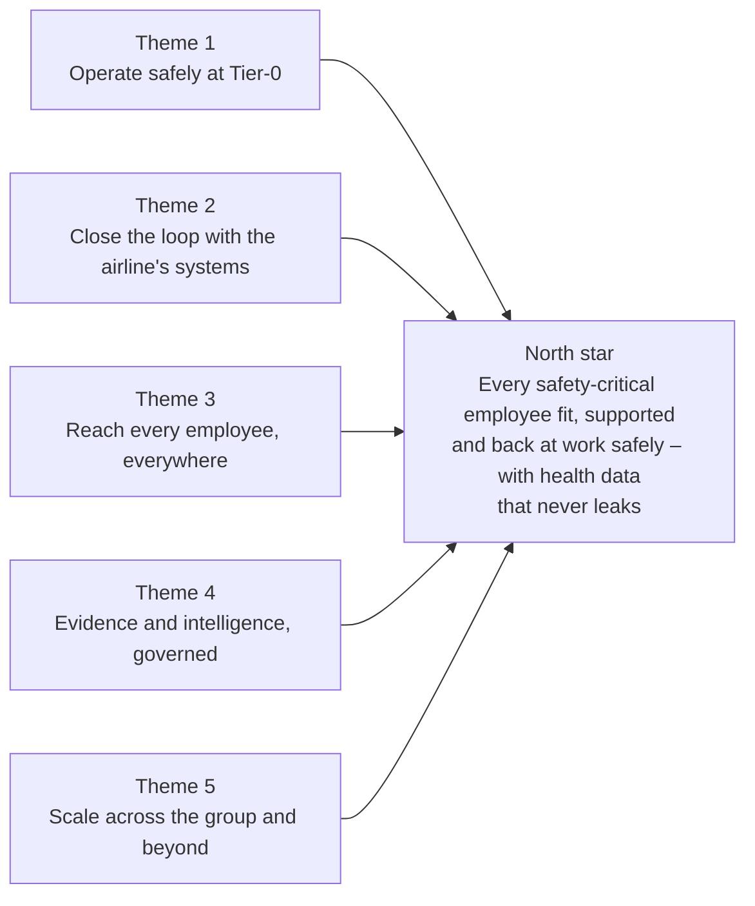
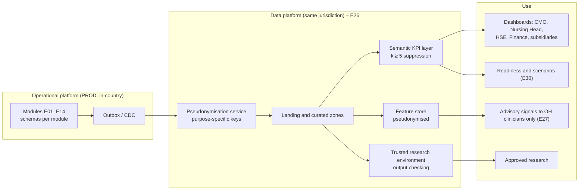
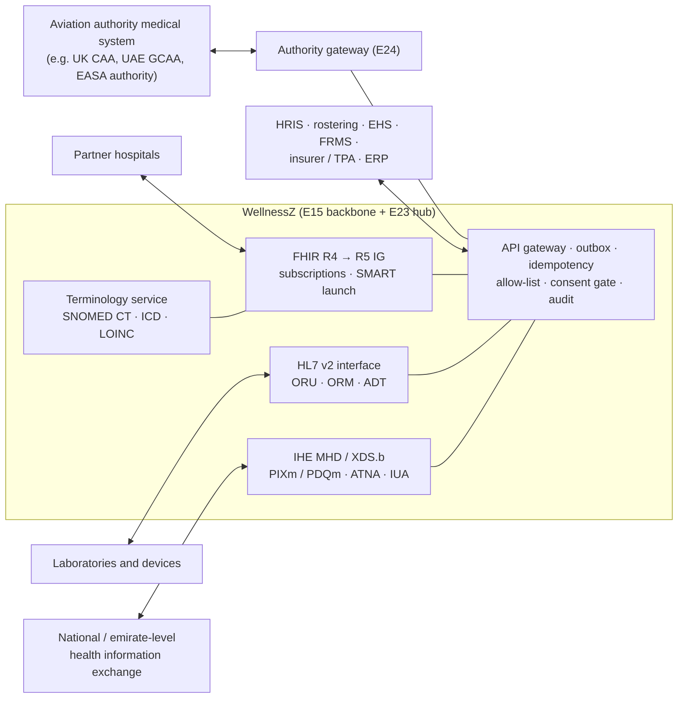
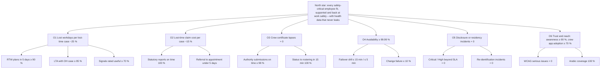
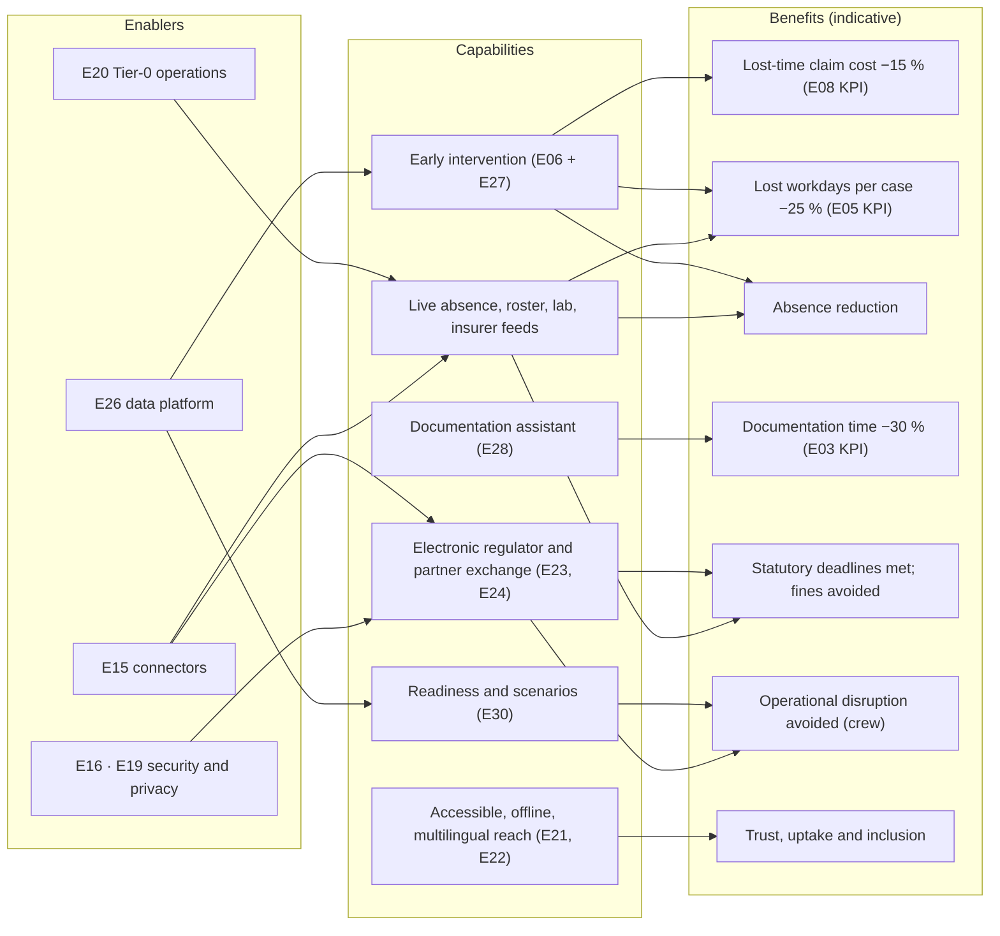
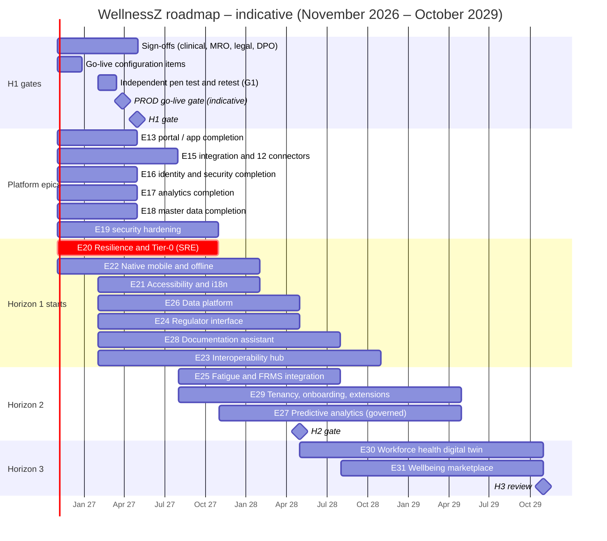
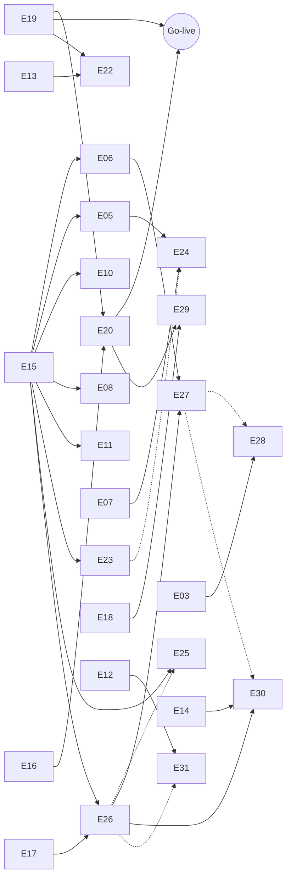

# WellnessZ – Platform Enhancement Strategy

**Version 1.0**

*WellnessZ OHCM platform – strategy beyond increment 5*

| | |
|---|---|
| **Document** | Platform Enhancement Strategy |
| **Version** | 1.0 (30 October 2026) – draft for steering-committee review |
| **Audience** | Group Executive Committee (C-suite), CIO, CMO and Nursing Head, Cyber GRC and the DPO, product and engineering leads |
| **Scope** | The WellnessZ occupational health case-management (OHCM) platform for the airline group after increments 1–5: go-live readiness, scale, intelligence, experience and ecosystem over 36 months (November 2026 – October 2029) |
| **Companion artefacts** | [Epic catalogue E20–E31](epics/README.md) · [Epic-Catalogue-and-Roadmap.xlsx](epics/Epic-Catalogue-and-Roadmap.xlsx) · one workbook per new epic in [`epics/`](epics/) · [Security Enhancement Guideline](../security/Security-Enhancement-Guideline.md) · [Technology Architecture](../architecture/01-Technology-Architecture-and-Technology-Selection.md) |
| **Status of figures** | Effort is indicative (story points and team-sprints, not prices). Benefits and KPI targets are indicative, mostly taken from the client's epic KPIs, and must be baselined by their owners in the first 90 days of operation. Hosting costs are in the separate Tier-0 cost and deployment decision pack. |

**How to read this document**

| Reader | Start with | Then |
|---|---|---|
| C-suite | 1 Executive summary, 15 Decisions requested | 4 Roadmap, 13 Investment profile, 11 Benefits map |
| CIO | 2 Where we are, 4 Roadmap, 5 Robustness engineering | 9 Operating model, 12 Risks, 14 Sequencing |
| CMO / Nursing Head | 2.2 Business-epic scorecard, 4.2 H1 sign-offs, 6 Data and AI | 7 Interoperability, 10 KPIs |
| Cyber GRC and DPO | 3 Principles, 6.4 AI guardrails, 12 Risks | 5 Robustness, 8 Multi-tenant options |
| Product and engineering | 4 Roadmap, [epic workbooks](epics/README.md) | 5, 7, 8, 9, 14 |

---

## Contents

1. [Executive summary](#1-executive-summary)
2. [Where we are – capability scorecard](#2-where-we-are--capability-scorecard)
3. [Strategic themes and guiding principles](#3-strategic-themes-and-guiding-principles)
4. [Three-horizon roadmap](#4-three-horizon-roadmap)
5. [Robustness engineering](#5-robustness-engineering)
6. [Data and AI strategy](#6-data-and-ai-strategy)
7. [Interoperability strategy](#7-interoperability-strategy)
8. [Commercial and multi-subsidiary scaling](#8-commercial-and-multi-subsidiary-scaling)
9. [Operating model](#9-operating-model)
10. [KPIs and OKRs per horizon](#10-kpis-and-okrs-per-horizon)
11. [Benefits map](#11-benefits-map)
12. [Strategy risk register](#12-strategy-risk-register)
13. [Investment profile](#13-investment-profile)
14. [Dependencies and sequencing](#14-dependencies-and-sequencing)
15. [Decisions requested](#15-decisions-requested)
- [Appendix A – Evidence sources](#appendix-a--evidence-sources)
- [Appendix B – Open architecture decisions carried forward](#appendix-b--open-architecture-decisions-carried-forward)
- [Appendix C – Glossary](#appendix-c--glossary)

---

## 1. Executive summary

**Where we are.** In five increments the programme delivered every business epic in the client's catalogue – 13 modules
(E01–E12 and E14) on a platform of ten shared services, four web front ends, a Backend-for-Frontend and deployment assets
for Azure, Google Cloud and a hybrid set-up. The evidence is strong: 450 Java tests, 1,373 web unit tests, 121 live
end-to-end checks with real sign-ins, no static-analysis findings, 647 documented API paths, and 376 traced requirement
items of which **275 are implemented, 16 implemented with configuration awaiting sign-off, 84 partial and 1 deferred**. An
internal security assessment closed or formally accepted all 21 findings.

**What is not yet true.** The platform is *functionally* complete but *not yet operable at Tier-0 in production*. It runs in
one region; the infrastructure code has been validated but never applied to a real subscription; external connectors
(HRIS, rostering, toxicology laboratory, insurers, authorities, EAP, campaign app, wearables, SMS) are simulated or
default to an outbox plus a content-free e-mail; clinical, MRO and legal reference content awaits sign-off; OH records are
flagged for retention but never deleted; there is no independent penetration test, no production-volume load test, no
analytics warehouse, no accessibility audit and no offline mobile capability. The client's platform epics E13 and E15–E18
are partly covered by the base framework and need completing to production grade.

**What we propose.** A three-horizon strategy over 36 months:

| Horizon | Months | Theme | Headline outcome |
|---|---|---|---|
| **H1** | 0–6 | Go-live readiness and close the gaps | PROD live at 99.99 % in two in-country Azure regions; go-live conditions G1–G6 met; 12 production connectors; all clinical, MRO and legal sign-offs; platform epics E13 / E15–E18 at production grade; E19 security "Now" and "Next" items done |
| **H2** | 6–18 | Scale, intelligence and experience | Governed data platform reporting every client KPI; accessible, Arabic and offline-capable apps; aviation-authority interface; FRMS link; interoperability hub; governed documentation assistant in use; first subsidiaries onboarded by automation |
| **H3** | 18–36 | Ecosystem and industry leadership | Advisory early-intervention signals under a clinical safety case; workforce health digital twin; wellbeing marketplace; signed extension model; WellnessZ as a reference OH platform for safety-critical workforces |

We propose **twelve new epics, E20–E31** (141 backlog items, 871 indicative story points), renumber the drafted security
epic to **E19**, and complete the five platform epics in H1. Roadmap demand is about **150 indicative team-sprints** over
three years with six product teams in H1, five in H2 and four in H3, plus a reserve for run work. **H1 is the constrained
horizon** (utilisation 86–105 % of available capacity) because connectors, security and the Tier-0 build all land before
go-live.

**The principles that do not bend:** fitness-for-duty and safety come first; health data is special-category and stays
status-only outside OH; every byte stays in one jurisdiction; production is Tier-0; privacy by design; open standards and
no lock-in; and no AI makes a decision about a person.

**Decisions requested today** (Section 15): approve the strategy and H1 scope; adopt the epic numbering; fund H1 and a
temporary integration uplift; name the sign-off owners with a month-6 deadline; appoint a clinical safety officer and
charter the AI governance board; approve the operating model and horizon gates; and set the tenancy direction.

---

## 2. Where we are – capability scorecard

### 2.1 Delivery facts

| Dimension | Figure | Source |
|---|---|---|
| Business modules | 13 (E01–E12, E14) | Architecture §1, release notes 5 §12 |
| Platform modules | 10 (common, secrets, security, master data, integration, notification, analytics, case kernel, documents, EHS intake) | Architecture §1 |
| Front ends | OH workspace, employee / crew app (web, PWA, Capacitor shell), manager workspace, partner portal; BFF | Architecture §1 |
| Database | PostgreSQL 16, 18 Flyway-managed schemas, migrations V1–V20 | Architecture §1 |
| Roles | 38 canonical roles; 22 ArchUnit architecture rules | Architecture §1 |
| Verification | 450 Java tests, 1,373 web unit tests, 121 end-to-end checks, 0 SpotBugs / FindSecBugs findings | Release notes 5 §9 |
| Traced requirements | 376 items: 275 implemented, 16 sign-off pending, 84 partial, 1 deferred | RTMs of increments 1–5 |
| Security | 21 findings (1 high, 4 medium, 9 low, 7 informational) – all closed or accepted; go-live conditions G1–G6 open | Security Enhancement Guideline §2 |
| Environments | Local; Azure, Google Cloud and hybrid × DEV / UAT / PROD; signed-digest promotion | Release notes 5 §8 |

### 2.2 Business-epic scorecard

Ratings: **G** – ready, **A** – conditional (closable by sign-off, configuration or a connector already designed for), **R** –
blocks go-live of that capability.

| Epic | Delivered | Items: impl. / sign-off / partial | Function | Go-live readiness | Main open points | Closed by |
|---|---|---|---|---|---|---|
| E01 Case intake | Inc. 1 | 26 / – / 16 | G | A | Staff directory and HRIS sync not loaded; SMS / push are logging adapters; no offline walk-in | E15, E18, E22 |
| E02 Triage | Inc. 1 | 26 / – / 6 | G | A | 13 protocols DRAFT (CREW_FATIGUE and BODY_FLUID lack a red-flag question); SLAs in elapsed minutes | CMO sign-off, E18 calendar, E25 |
| E03 OH record | Inc. 2 | 21 / – / 17 | G | A | Terminology starter subset; OCR off; device drivers; assistant extension point without provider | E23, E28, sign-offs S1–S14 |
| E04 Treatment & referrals | Inc. 4 | 24 / – / 9 | G | A | FHIR tested with simulated partner; telehealth video not procured; e-prescribing no-op | E15, E23, D15, D19 |
| E05 Fitness & RTW | Inc. 2 | 28 / – / 6 (+1 deferred) | G | **R** for crew | Rostering transport not built (O15); fitness standards and job demands await validation | E15, sign-offs S2–S4 |
| E06 Absence | Inc. 3 | 20 / – / 6 | G | **R** | Absence feed connector is a no-op – OH and HR data diverge (R18) | E15 |
| E07 Surveillance | Inc. 3 | 31 / – / 5 | G | A | Programmes await CMO validation; CAA formats pending; bulk invitation not load-tested | Sign-offs, E20, E24 |
| E08 Claims | Inc. 4 | 19 / – / 5 | G | A | Insurer / authority / ERP via outbox + e-mail; report forms await Legal / HSE sign-off | E15, sign-offs |
| E09 Mental health | Inc. 5 | 21 / 5 / 1 | G | A | Screening bands and urgent protocol sign-off; **named-clinician seed `psych1` must be replaced (go-live item)** | Sign-offs, O38 |
| E10 Substance testing | Inc. 5 | 14 / 3 / 3 | G | **R** | Toxicology LIMS simulated; policy matrix PENDING; MRO cannot open restricted documents via `/documents` | E15, SEC-E05, sign-offs |
| E11 Travel & communicable disease | Inc. 5 | 17 / 6 / 2 | G | A | Destination content not licensed; protocol timers await sign-off; authority submission by e-mail | Sign-offs, E15 |
| E12 Health promotion | Inc. 5 | 10 / 2 / 6 | G | A | Campaign app and wearable aggregator simulated; no ROI; absence not an insight source | E15, E26 |
| E14 Scheduling & clinic ops | Inc. 3 | 18 / – / 2 | G | A | Cold-chain IoT gateway and telehealth video not connected; capacity not load-tested | D15, D16, E20 |

### 2.3 Platform-layer scorecard

| Layer | Client epic | Today | Rating | Gap to production grade | Closed by |
|---|---|---|---|---|---|
| Experience – portal and app | E13 | Four web apps; employee app as web, PWA and Capacitor shell; Arabic RTL on employee portal screens only | A | Secure storage and MAM SDK (R6); no offline, NFC or push; workspaces English only; no WCAG audit | E13 completion, E21, E22 |
| Integration and API gateway | E15 | Outbox with at-least-once delivery, idempotency, FHIR R4 / HL7 v2 inbound, outbound allow-list, bound partner clients | **R** for go-live | No production broker adapter (D3); 12 connectors simulated or e-mail | E15 completion (H1), E23 |
| Identity, access, consent, audit | E16 | Multi-issuer OIDC, ABAC with disclosure levels, consent register, hash-chained audit, MFA gate, restricted classes, break-glass | G / A | MFA enrolment in PROD IdP; envelope encryption and re-encryption job (D5); audit anchoring (O2) | E16 completion, E19 |
| Data protection and retention | E16 | AES-256-GCM field encryption, retention schedule with legal hold, three automatic purges | **R** | OH records only flagged, never deleted (R3 / G5, High); retention classes unapproved | E16 completion, DPO decisions |
| Analytics | E17 | De-identified view, KPI API, k = 5 suppression everywhere | A | No warehouse feed or reporting role; several client KPIs not computed | E17 completion, E26 |
| Master data and configuration | E18 | Versioned rules, protocols, templates, configuration API | A | No business calendar (O10); staff roster by SQL (O9); no maker-checker; flags are plumbing only | E18 completion, E29 |
| Security assurance | E19 | Internal assessment closed; supply-chain signing and SBOM; Binary Authorization on GKE | A | Independent pen test; AKS admission; demo-identity guard; CMK; patch SLAs (G1–G6) | E19 |
| Infrastructure and resilience | – | Hardened Helm chart, Terraform per environment, zone-redundant HA in UAT / PROD | **R** | Single region; IaC never applied; no production-volume load test; no DR drill | E20 |
| Observability and operations | – | OpenTelemetry, Prometheus metrics, JSON logs, correlation IDs; alert proposals | A | No SLOs, on-call, runbooks or synthetic probes | E20 |
| Clinical content governance | – | Versioned content with DRAFT / APPROVED status | A | Most reference content DRAFT / PENDING (O11, O14, O19, O31) | H1 sign-offs |
| Customisation and tenancy | – | Values, client SQL migrations in own schema, `org_scope` per subsidiary | A | Extension JARs not implemented; flags switch nothing yet (O34, D22) | E29 |

### 2.4 Honesty box – what the product does **not** do today

The following are sometimes assumed but are **not implemented**: mounting client extension JARs into the core image;
product features switched by `WZ_FEATURE_*` flags; automatic deletion of OH records; live connections to any external
partner system except through the simulated or e-mail defaults; region failover; a data warehouse or any predictive
model; any enabled documentation-assistant provider; offline capture, NFC or push on mobile; Arabic in the three
workspaces; a WCAG audit; a qualified electronic signature; a live FHIR partner hospital.

---

## 3. Strategic themes and guiding principles

| # | Principle | What it means in practice | Where it bites |
|---|---|---|---|
| P1 | **Safety-critical aviation workforce first** | Fitness-for-duty status reaches rostering within 15 minutes, always; manual fallback rehearsed; crew certificate lapses are a zero-tolerance KPI | E05, E20, E24, E25 |
| P2 | **Special-category health data** | Status-only outside OH (projection, allow-list, notification rules); restricted classes for mental health and substance testing; k ≥ 5 suppression on every aggregate | All epics; E26, E27, E30, E31 |
| P3 | **Single-jurisdiction residency** | Every replica, backup, log, analytics store and AI workload in one country; allowed-locations policy; global edge services off | E20, E26, E27, E28, E29 |
| P4 | **Tier-0, 99.99 %** | Two in-country regions, automated failover, SLOs with error budgets, quarterly drills – about 52 minutes of downtime a year | E20 |
| P5 | **Privacy by design and by default** | DPIA before any new processing; consent as the gate for every external flow; pseudonymisation before analytics; purge jobs live | E16, E26, E27, E28, E31 |
| P6 | **Open standards** | FHIR, HL7 v2, IHE, SNOMED CT / ICD / LOINC, OIDC, OpenTelemetry, WCAG 2.2 | E15, E21, E23 |
| P7 | **No lock-in** | Portable Kubernetes and PostgreSQL; broker behind an interface; providers behind SPIs; data exportable in standard formats | E20, E23, E28, E29 |
| P8 | **Humans decide** | No automated decision about a person; AI output advisory, reviewed and signed by a clinician; clinical safety case before live use | E27, E28 |
| P9 | **Evidence over assertion** | Every claim backed by a test, a drill report, an audit or a signed sign-off; nothing marketed that does not exist | All |

---

## 4. Three-horizon roadmap

```mermaid
flowchart LR
    subgraph H1["H1 · months 0–6 · Go-live readiness"]
        direction TB
        a1["Tier-0 two-region Azure (E20)"]
        a2["Pen test and G1–G6 (E19)"]
        a3["12 production connectors (E15)"]
        a4["Clinical, MRO, legal sign-offs"]
        a5["E13 · E16 · E17 · E18 to production grade"]
        a6["Starts: E21 · E22 · E26 · spikes E23 · E24 · E28"]
    end
    subgraph H2["H2 · months 6–18 · Scale, intelligence, experience"]
        direction TB
        b1["Data platform and all KPIs (E26)"]
        b2["Accessible, Arabic, offline apps (E21, E22)"]
        b3["Regulator interface (E24) · FRMS link (E25)"]
        b4["Interoperability hub (E23)"]
        b5["Documentation assistant pilot (E28)"]
        b6["Tenancy and onboarding factory (E29)"]
    end
    subgraph H3["H3 · months 18–36 · Ecosystem"]
        direction TB
        c1["Advisory early-intervention signals (E27)"]
        c2["Workforce health digital twin (E30)"]
        c3["Wellbeing marketplace (E31)"]
        c4["Signed extensions, white-label (E29)"]
        c5["National exchange connectors (E23)"]
    end
    H1 -->|"H1 gate: PROD live, G1–G6 met"| H2 -->|"H2 gate: KPIs baselined, safety case approved"| H3
```

### 4.1 Epic catalogue at a glance

| Epic | Name | One-line goal | Horizon | Team |
|---|---|---|---|---|
| E13 | Portal / app – completion | Store / MDM-ready app, status-only screens, channel preferences | H1 | T3 |
| E15 | Integration – completion | Broker adapter and 12 production connectors | H1 | T4 |
| E16 | Identity and security – completion | MFA enrolment, envelope encryption, audit anchoring, OH-record purge jobs | H1 | T5 |
| E17 | Analytics – completion | Reporting role and outstanding KPIs on the KPI API | H1 | T6 |
| E18 | Master data and configuration – completion | Business calendar, staff roster feed, maker-checker, flag governance | H1 | T5 |
| **E19** | Security Hardening & Assurance (renumbered from the drafted "E15") | Go-live conditions G1–G6 and SEC-E01…E15 | H1–H2 | T5 |
| **E20** | [Resilience & Tier-0 Operations (SRE)](epics/E20_Resilience_and_Tier0_Operations.xlsx) | Run PROD as a Tier-0 service at 99.99 % inside one jurisdiction, with failover, SLOs and drills proven | H1–H2 | T5 |
| **E21** | [Accessibility & Internationalisation](epics/E21_Accessibility_and_Internationalisation.xlsx) | WCAG 2.2 AA everywhere and full Arabic (RTL) plus the workforce's main languages | H1–H2 | T3 |
| **E22** | [Native Mobile, Offline & Field Capability](epics/E22_Native_Mobile_and_Offline.xlsx) | Store- and MDM-ready crew and field app with offline capture, NFC, push and a status wallet | H1–H2 | T3 |
| **E23** | [Interoperability Hub](epics/E23_Interoperability_Hub.xlsx) | Standards-based exchange with hospitals, labs and national records – no more e-mail for clinical data | H1–H3 | T4 |
| **E24** | [Aviation Medical Certification & Regulator Interface](epics/E24_Aviation_Medical_Certification_and_Regulator_Interface.xlsx) | End-to-end AME certification with qualified signatures and electronic submission to the authority | H1–H2 | T1 |
| **E25** | [Fatigue Risk & Shift-Work Health](epics/E25_Fatigue_Risk_and_Shift_Work_Health.xlsx) | Connect OH with the FRMS and rostering; health handled clinically, insight shared only in aggregate | H2 | T2 |
| **E26** | [Data Platform & De-identified Datasets](epics/E26_Data_Platform_and_Deidentified_Datasets.xlsx) | In-country governed analytics platform reporting every client KPI | H1–H2 | T6 |
| **E27** | [Predictive Health & Absence Analytics](epics/E27_Predictive_Health_and_Absence_Analytics.xlsx) | Advisory early-intervention signals for OH clinicians – never automated decisions | H2–H3 | T6 |
| **E28** | [Clinical Documentation Assistant](epics/E28_Clinical_Documentation_Assistant.xlsx) | Switch on the existing assistant extension point with an in-country, governed provider | H1–H2 | T1 |
| **E29** | [Multi-Subsidiary Tenancy, Onboarding & Extensions](epics/E29_Multi_Tenant_Subsidiary_Onboarding_and_Extensions.xlsx) | Onboard a subsidiary or client in weeks; signed extensions instead of forks | H2–H3 | T5 |
| **E30** | [Workforce Health Digital Twin](epics/E30_Workforce_Health_Digital_Twin_and_Capacity_Planning.xlsx) | Aggregate, de-identified readiness model per base and fleet for scenarios and capacity | H3 | T6 |
| **E31** | [Wellbeing Marketplace & Benefits Integration](epics/E31_Wellbeing_Marketplace_and_Benefits_Integration.xlsx) | Curated wellbeing services in the app; no OH data to vendors | H3 | T2 |

The candidate list was refined against the evidence: fatigue is framed as **integration with** the airline's FRMS
(operating the FRMS is out of scope in the client's E12 workbook); the marketplace is integration-led because benefits
administration is also out of scope; the data platform (E26) is separated from predictive analytics (E27) because the
former is needed in H1 to report KPIs the business case depends on, while the latter needs governance first.

### 4.2 Horizon 1 (months 0–6) – go-live readiness and close the gaps

**Go-live gates** (all must be met before PROD carries real health data):

| Gate | Condition | Evidence | Owner |
|---|---|---|---|
| G1 | Independent penetration test of UAT; no Critical / High open; retest letter | Report and letter in release record (SEC-E01) | CISO office |
| G2 | Scan reports and SBOM attestations of the release digests in the release record | `container.yml` artefacts (SEC-E02) | Platform |
| G3 | Signed-image admission enforced on the PROD cluster | Policy in deny mode; rejection test (SEC-E03) | Platform |
| G4 | Real named mental-health clinicians configured; no demo identity in UAT / PROD | Startup guard; configuration export (SEC-E06, O38) | Platform operations, CMO |
| G5 | Customer-managed key decision before the PROD database is created | ADR; `prod.tfvars` (SEC-E09, D5) | Platform security |
| G6 | Patch SLAs and vulnerability management in force | Signed process; first monthly report (SEC-E13) | CISO |
| G7 | Tier-0: two in-country regions; failover drill RTO ≤ 15 min, RPO ≤ 5 min; restore test passed | Drill report (E20) | Head of SRE |
| G8 | Production-volume load test passed at 1.5 × forecast peak | Load-test report (E20) | Head of SRE |
| G9 | Clinical, MRO and legal sign-offs for content in use at go-live | Sign-off register closed | CMO, MRO, Legal, DPO |
| G10 | Retention classes approved; purge jobs enabled for OH records | DPO decision; job evidence | DPO |
| G11 | MFA enrolment verified for all external users; GitHub Environment protection configured | Decoded-token checks; settings export (O23, O32, O33) | IAM, release manager |

**Real connectors** – the integration backbone exists; each connector is a bean behind an existing SPI or outbox
destination, so the work is mapping, transport, security and testing with the partner:

| # | Connector | Today | Target in H1 | Priority |
|---|---|---|---|---|
| 1 | HRIS (employee master, job codes, offers, end dates) | Push endpoint; demo data | Scheduled sync and events; date of birth for over-40 validity | P1 |
| 2 | Rostering / duty feed and fitness status transport | Status feed to outbox; logging publisher | Live transport with 15-minute acknowledgement (O15) | P1 |
| 3 | EHS incident system | Webhook, mailbox, Excel | Plus queue / SFTP transport; 99.9 % delivery load-tested | P1 |
| 4 | Toxicology laboratory LIMS | Bound machine client and API ready, simulated | Live laboratory onboarded as `INTEGRATION` client bound to `/PARTNERS/TOXLAB` | P1 |
| 5 | Insurer / TPA (FNOL, pre-authorisation) | Outbox + content-free e-mail | API connector or integration platform (D18) | P1 |
| 6 | Authority e-reporting (injury reports) | Outbox + e-mail; forms await sign-off | Connector per jurisdiction after form sign-off | P1 |
| 7 | Public-health authority (notifiable disease) | Outbox + e-mail, tracked by channel | API or secure submission with receipt | P1 |
| 8 | ERP finance export | Announced on `erp-finance` | SFTP or API transport with reconciliation | P2 |
| 9 | EAP provider system | Partner portal is the channel | Stay portal-first until the provider offers an API (D21) | P2 |
| 10 | Group health-campaign app | `campaign-app` outbox; participation endpoint | Live publication and participation flow | P2 |
| 11 | Wearable vendor aggregator | Internal aggregator endpoint; DPIA pending | One aggregator after DPIA approval | P3 |
| 12 | SMS gateway and Safety Management System (`sms-safety`) | Logging adapter; outbox ready | SMS provider with content-free templates; SMS import of aggregates | P2 |

**Sign-offs** (business activities – no code change expected):

| Owner | Items | Source |
|---|---|---|
| CMO / Nursing Head | 13 triage protocols and advice texts; 8 encounter templates; 12 fitness standards; restriction catalogue; job-demand profiles; 13 surveillance programmes and evaluation rules; absence trigger rules; plan templates and referral data sets | O11, O14, O19, RTM 2–4 |
| CMO / mental-health lead | PHQ-9 / GAD-7 bands and urgent rule; urgent-risk protocol; signposting; named clinicians | O31, O38, E09-BL-003/-004/-014 |
| MRO, Legal, Safety, HR | Testing policy matrix per jurisdiction and role group | E10-BL-010 |
| Clinical Governance | Destination content and travel recommendations; exposure protocol timers including PEP ≤ 2 h | E11-BL-001/-006 |
| Legal / HSE | Report forms (GB F2508, UAE labour injury notice, insurer FNOL); recordability mapping | O24, E01-BL-022 |
| DPO | Retention classes; wearable DPIA; disclosure rules; notification wording; clinical-text guard vocabulary in Arabic and French | O12, O22, O27, O36, S14 |
| AME lead / authority | CAA examination formats and limitation-code labels | O19, S9 |
| Health promotion lead | Campaign portfolio, owners and KPIs | E12-BL-008 |

**Platform epics to production grade** – E13 store-ready app and status-only screens; E15 broker adapter and the
connectors above; E16 MFA enrolment evidence, envelope encryption with re-encryption job, audit hash anchoring and SIEM
export, purge jobs; E17 reporting role and outstanding KPIs; E18 business calendar, staff roster feed, maker-checker for
configuration and flag governance. **E19** delivers its "Now" items before go-live and its "Next" items within 90 days.

**H1 exit criteria:** gates G1–G11 met; PROD live; all P1 connectors live; sign-off register closed for content in use;
first monthly SLO report; KPI baselines started.

### 4.3 Horizon 2 (months 6–18) – scale, intelligence and experience

| Epic | Outcome by month 18 |
|---|---|
| E26 | Every client epic KPI reported from one semantic layer with signed definitions; pseudonymisation service; data quality and lineage; research environment ready |
| E21 / E22 | WCAG 2.2 AA audit clean; Arabic in all four apps and in PDFs; offline capture at airside posts; NFC; push with channel preferences; crew status wallet |
| E24 | Authority formats live; qualified signatures; electronic submission to the first authority with receipt reconciliation |
| E25 | Consented FRMS referrals; duty-pattern restriction codes in the roster feed; aggregated fatigue indicators to the FRMS safety action group |
| E23 | Published FHIR implementation guide incl. Procedure, Consent, Task; subscriptions; live hospital and HL7 v2 laboratory; licensed terminology service |
| E28 | DPIA, safety case and 5-clinician pilot complete; staged roll-out under governance |
| E29 | Tenancy decision record; provisioning factory; isolation test suite; governed feature flags |
| E20 / E19 | Chaos programme, canary releases, zero-downtime migrations; E19 "Later" items (rate limiting, mobile hardening) |
| E27 | Governance board chartered; safety case and DPIA for the first use case; silent pilot running |

**H2 exit criteria:** KPI baselines and first-year trends published; one subsidiary onboarded through the factory in four
weeks or less; documentation-time reduction measured in the pilot; E27 silent-pilot report available for the governance
decision.

### 4.4 Horizon 3 (months 18–36) – ecosystem and industry leadership

| Epic | Outcome by month 36 |
|---|---|
| E27 | Advisory early-intervention signals live in pilot units, then scaled, with monitoring of drift and fairness |
| E30 | Executive readiness dashboard; clinic demand forecast within ± 10 %; scenario engine used in the outbreak exercise |
| E31 | Marketplace with at least three vendors under DPA; spend and outcome reporting |
| E29 | Signed extension model; white-label branding; instance-per-tenant reference for another jurisdiction |
| E23 | National or emirate-level exchange connector (consented), identity cross-referencing |

**H3 ambition:** WellnessZ is a reference platform for occupational health in safety-critical workforces – measured by
the client's own benchmarks (HIMSS Digital Health Indicator, the 24-capability *State of Occupational Health Software
2026* benchmark named in the client's legends) rather than by our claims.

---

## 5. Robustness engineering

| Area | Today (evidence) | Target | Epic | How we prove it |
|---|---|---|---|---|
| SRE and SLOs | Metrics, traces and logs; alert proposals only | SLOs and error budgets for six journeys; burn-rate alerts as code; on-call and runbooks | E20 | Monthly SLO report; alert fault-injection tests |
| Chaos and resilience testing | None | Monthly chaos experiments in UAT: pod, node, zone, database failover, broker, IdP | E20 | Experiment reports; findings closed |
| Performance and capacity | Not load-tested at production volume (release notes 3–5); audit lock ceiling R9 | 1.5 × forecast peak for campaign, tracing, worklists, exports, audit writes; capacity model | E20 | Load-test report per major release |
| Disaster recovery | Zone-redundant HA; geo-backup; region failover not automated | RTO ≤ 15 min, RPO ≤ 5 min for region loss; PITR ≤ 2 h; ransomware recovery ≤ 24 h | E20 | Quarterly drill and isolated restore |
| Observability | OpenTelemetry, Micrometer, JSON logs, correlation IDs | Golden signals per journey; synthetic probes from both regions; SIEM detections | E20, E19 | Dashboards; probe history |
| Zero-downtime migrations | Flyway V1–V20, `helm --atomic`, rollback | Expand / contract with CI lint; canary with SLO analysis | E20 | Two consecutive zero-downtime releases |
| Multi-region | Single region (R8) | Two regions in one country; allowed-locations policy | E20 | Policy compliance report; drill |
| Supply chain | Keyless signing, SLSA provenance, SBOM, Binary Authorization on GKE | Admission on AKS / hybrid; private registry and runners; evidence per release | E19 | G2, G3; release record |
| Data quality | Validation per module; no cross-module checks | Quality rules on critical fields; data contracts; lineage | E26 | ≥ 98 % rule pass rate |
| Accessibility | No audit recorded | WCAG 2.2 AA in all apps; checks in CI | E21 | Independent audit; CI gate |
| Internationalisation | Arabic RTL and en / ar / fr strings on employee portal screens only | Arabic in all apps and PDFs; top workforce languages; station time zones | E21 | Screen coverage report; usability parity |
| Offline mobile | Offline retry in memory only; telephone triage not offline | Encrypted queue with idempotent sync for first-aid and triage | E22 | Field test at three airside posts |

**Proposed service-level objectives** (to be approved with the product owners; measured monthly):

| Journey | SLI | SLO | Why |
|---|---|---|---|
| Fitness status to rostering | Status changes acknowledged within 15 min | 99.9 % of changes | Safety-critical rostering (E05 KPI) |
| Sign-in and BFF session | Successful sign-ins / attempts (excluding user error) | 99.95 % | Gate to everything |
| Triage work queue | Queue reads under 1 s | 99.9 % | Urgent cases within 1 h (E02 KPI) |
| Urgent mental-health call-back | Urgent items visible to named clinician within 1 min | 99.99 % | Patient safety (E09) |
| Contact tracing | Tracing list produced within 4 h of a confirmed case | 100 % of events | E11 KPI |
| Partner referral | Referral delivered to partner within 5 min | 99.5 % | E04 KPI |

---

## 6. Data and AI strategy

### 6.1 Target data architecture

### 6.2 De-identification tiers

| Tier | Content | Audience | Controls |
|---|---|---|---|
| 0 – Operational | Identified records in the modules | Authorised OH roles by ABAC | Existing platform controls |
| 1 – Operational KPIs | Aggregates with small-cell suppression | Managers, HR, subsidiaries (status-level) | k ≥ 5 (floor 3) and complementary suppression – as today |
| 2 – Management analytics | Pseudonymised, generalised data | Data & analytics team; OH leadership | Purpose-specific pseudonyms; no direct identifiers; access reviews |
| 3 – Research datasets | De-identified extracts | Approved researchers in the trusted research environment | Re-identification risk assessment (ISO/IEC 20889); DPO and ethics approval; output checking |
| 4 – Published statistics | Aggregates leaving the group | Regulators, industry bodies | Suppression; optional noise addition; DPO release approval |

### 6.3 AI use cases

| Use case | Epic | Output | Who sees it | Risk view | Horizon |
|---|---|---|---|---|---|
| Documentation assistant (dictation / consented ambient capture → draft note, summary, handover, referral letter) through the existing `AiDocumentationProvider` extension point | E28 | Draft text for clinician review and signature | Treating clinician | Clinical documentation aid; transparency and DPIA; restricted classes excluded by default | H1 spike, H2 pilot |
| Long-term absence risk (absence spell → > 4 weeks) | E27 | Advisory signal with explanation in the early-intervention queue | OH clinicians only | Health and employment context – treat as high-risk under AI regulation benchmarks | H2 silent pilot, H3 live |
| Return-to-work delay vs duration guidelines | E27 | Advisory flag on stalled cases | OH case managers | As above | H3 |
| Surveillance non-attendance | E27 | Reminder prioritisation | Scheduling and OH | Lower risk – operational | H3 |
| MSK hotspot and clinic-demand forecasts | E27, E30 | Suppressed aggregates | Prevention and planning roles | Population level, no individual output | H3 |

### 6.4 Guardrails – responsible by design

| Guardrail | Commitment |
|---|---|
| Human in the loop | No automated decision about any individual – fitness, employment, discipline or benefits. Every signal is advisory, reviewed by a clinician before contact; every draft is edited and signed by a clinician before filing. |
| Clinical safety | A clinical risk management process modelled on DCB0129 (manufacture) and DCB0160 (deployment): hazard log, safety case, named clinical safety officer, approval before live use and after every material change. |
| Model governance | AI governance board (CMO, clinical safety officer, DPO, CISO, legal, employee representative); model cards; validation in a silent pilot; change control; drift and calibration monitoring; decommissioning procedure (ISO/IEC 42001 and 23894 as frameworks). |
| Bias and fairness | Performance tested across subsidiaries, roles, gender, age bands and nationality groups where lawful; a gap above the agreed threshold blocks release; findings published to the board. |
| Regulation | Classification of each use case against the EU AI Act (used as benchmark) and the applicable local AI and data-protection law; DPIA for every use case; transparency to employees through the privacy notice and FAQ; representative consultation where required. |
| Data protection | No personal health data to any external model or service without a data-processing agreement, in-country processing, no retention and no training on WellnessZ data. Pseudonymised data for training; restricted classes (E09, E10) excluded unless separately approved. |
| In-country hosting | Training and inference run in the same jurisdiction as the data, inside the platform's network boundary. |
| Transparency in the record | Every assistant-assisted note is flagged and audited (consent, provider, version, edits); the DPO receives a monthly report. |
| Red lines | No emotion or productivity scoring of employees; no individual predictions to managers, HR, rostering or vendors; no use in disciplinary processes. |

---

## 7. Interoperability strategy

| Standard | Today | Target | Epic / horizon |
|---|---|---|---|
| HL7 FHIR R4 | Inbound endpoints; `ServiceRequest` / `DocumentReference` with a simulated partner; ODH export | Published implementation guide incl. Procedure, Consent, Task; conformance tests in CI; live hospital | E23 · H2 |
| FHIR R4B / R5 | – | R5 mapping layer; topic-based subscriptions | E23 · H2 |
| SMART App Launch | – | Approved third-party clinical apps launched in context | E23 · H3 |
| HL7 v2.5.1 | Inbound endpoint; laboratory pull queue | Managed interface with ACK / NACK, replay, monitoring; live laboratory | E23 · H2 |
| IHE MHD / XDS.b, PIXm / PDQm, ATNA, IUA | – | Document and identity exchange with a regional exchange; ATNA audit forwarding | E23 · H2–H3 |
| Terminology | Starter subset; registry | Licensed national editions; terminology server; update runbook (D10) | E23 · H1–H2 |
| Aviation authority medical interfaces | Crew certificates in E07; formats pending; simple signature | Authority templates; advanced / qualified signature; API submission where offered, otherwise assisted submission with receipt reconciliation | E24 · H2 |
| National health records | – | Consent-gated query / contribute with one exchange where legally permitted | E23 · H3 |

Interfaces offered by aviation authorities differ: some provide an API or structured upload, others only a web portal.
E24 starts with a spike in H1 to confirm, in writing, the current formats and interface options of each authority the
group reports to; we do not assume an API exists.

---

## 8. Commercial and multi-subsidiary scaling

### 8.1 Tenancy options

| Option | Isolation | Residency | Operating cost | When to use |
|---|---|---|---|---|
| A – Logical tenant in a shared instance (`org_scope` + tenant configuration) | ABAC, organisation scope, per-tenant configuration; shared database | Same jurisdiction only | Lowest | Group subsidiaries in the same country (default) |
| B – Schema-per-tenant in a shared cluster | Separate schemas and roles; shared runtime | Same jurisdiction only | Medium | Subsidiaries or clients requiring stronger data separation |
| C – Instance-per-tenant | Separate deployment, database and keys | Any jurisdiction (one per instance) | Highest | External clients or subsidiaries in another country |

The recommendation (decision S8) is **A for the group's subsidiaries now**, **C for any client or subsidiary in another
jurisdiction**, and B only if a client contract requires it – decided formally by the E29 decision record in H2.

### 8.2 Client customisation maturity

| Level | Capability | Status |
|---|---|---|
| 0 | Fork per client | Avoid |
| 1 | Configuration through Helm values and the configuration API; client SQL migrations in their own schema and history table | **Delivered** (increment 5) |
| 2 | SPI overrides in a client Maven module (`@Order(HIGHEST_PRECEDENCE)` for list-consumed SPIs), proven by an integration test | **Delivered as a pattern** – requires a client build |
| 3 | Governed feature flags read by product features; tenant content packs | **Plumbing only** – flags reach core and BFF but switch nothing (O34) → E29, E20 |
| 4 | Signed extensions loaded at start without rebuilding the product, against a published compatibility contract | **Not implemented** – needs a launcher change and signing (D22) → E29 in H2–H3 |
| 5 | Extension catalogue and white-label branding per tenant | → E29, E31 in H3 |

---

## 9. Operating model

### 9.1 Product teams

| Team | Owns | Composition (indicative) |
|---|---|---|
| T1 Clinical Care | E01–E05, E08, E24, E28 | Product owner (OH), clinical safety officer liaison, 5–6 engineers, QA |
| T2 Workforce Health & Prevention | E06, E07, E09–E12, E14, E25, E31 | Product owner (prevention), 5–6 engineers, QA |
| T3 Experience & Mobile | E13, E21, E22 | Product owner (experience), UX and accessibility lead, web and mobile engineers |
| T4 Integration & Interoperability | E15, E23 | Integration architect, 4–5 engineers, interface analyst |
| T5 Platform & SRE | E16, E18, E19, E20, E29 | Platform lead, SREs, security champion, DBA |
| T6 Data & Analytics | E17, E26, E27, E30 | Data product owner, data engineers, data scientist, privacy engineer |

Funding steps from six teams in H1 to five in H2 and four in H3 (Section 13). Clinical and safety specialists are
shared across teams.

### 9.2 Cadence

| Rhythm | Content |
|---|---|
| Two-week sprints | All teams on one calendar; a shared sprint review per month with clinical stakeholders |
| Release train | Fortnightly promotion DEV → UAT → PROD of one signed digest after H1 (today's pipeline); canary and automatic rollback from H2 |
| Quarterly planning | Re-plan the next quarter against capacity, SLO error budgets and risk register |
| Horizon gates | H1 gate (month 6), H2 gate (month 18), H3 review (month 36) by the steering committee |
| Error-budget policy | When a journey's error budget is exhausted, feature releases for that journey pause until reliability work restores it |

### 9.3 Governance forums and roles

| Forum / role | Responsibility | Members |
|---|---|---|
| Steering committee | Strategy, funding, horizon gates, decisions | CIO (chair), CMO, CFO delegate, COO delegate, CISO, DPO |
| Design authority | Architecture decisions (ADRs), standards, technical debt | Chief architect, team leads, security architect |
| Clinical safety and governance board | Clinical content sign-off, hazard logs, safety cases | CMO (chair), Nursing Head, **clinical safety officer**, MRO, mental-health lead, AME lead |
| AI governance board | AI use cases, classification, model approval and monitoring | CMO, clinical safety officer, DPO, CISO, legal, employee representative |
| Data protection | DPIAs, retention, disclosure rules, research access | **DPO** with legal |
| Change advisory board | PROD promotion approvals (GitHub Environment reviewers) | Release manager, platform lead, security group |
| Security champions network | Threat model per epic, abuse-case tests, secure-coding guidance | One champion per team; led by Platform Security |
| Clinical safety officer (new) | Owns clinical risk management for all epics touching clinical decisions, especially E02, E05, E24, E25, E27, E28 | Registered clinician with health-IT safety training |

---

## 10. KPIs and OKRs per horizon

Targets marked with an epic come from the client's epic KPIs; others are proposals. All are indicative until baselined.
The full tree with owners is in the *KPI tree* sheet of the catalogue workbook.

| Horizon | Objective | Key results (indicative) |
|---|---|---|
| H1 | Go live safely at Tier-0 | G1–G11 met; region failover drill RTO ≤ 15 min and RPO ≤ 5 min; 0 Critical / High open at go-live; 100 % of P1 connectors live; sign-off register closed for content in use |
| H1 | Start measuring | KPI baselines for O1–O3 started; first monthly SLO report; retention purge jobs running |
| H2 | Prove the value | Every client epic KPI reported with signed definitions; lost workdays per lost-time case trending to −25 %; documentation time −30 % in the assistant pilot |
| H2 | Reach everyone | WCAG 2.2 AA audit clean; 100 % Arabic coverage; offline capture live at airside posts; crew app adoption ≥ 50 % |
| H2 | Close the regulatory loop | ≥ 98 % authority submissions on time; 0 crew certificate lapses; ≥ 95 % of partner clinical exchanges electronic |
| H3 | Intervene earlier, responsibly | Advisory signals live with ≥ 70 % rated useful; long-term absence conversion −10 % in pilot units vs comparison units; 0 unresolved bias findings |
| H3 | Scale the platform | New subsidiary onboarded in ≤ 4 weeks; 0 cross-tenant access; marketplace participation ≥ 40 % |

---

## 11. Benefits map

| Benefit | Measure | Epics | Owner | Confidence |
|---|---|---|---|---|
| Lower lost-time claim cost | Cost per lost-time claim | E04, E08, E15, E27 | Claims lead, Finance | Medium – depends on insurer connectors and nurse case management |
| Faster, safer return to work | Lost workdays per lost-time case; RTW plans in 5 days | E05, E06, E15, E27 | Nursing Head | Medium |
| Reduced sickness absence | Absence rate by unit | E06, E12, E25, E27 | HR, Nursing Head | Low–medium – many external drivers |
| Clinician time returned | Documentation minutes per encounter | E03, E28 | CMO | Medium – pilot will tell |
| Regulatory compliance | Statutory and authority submissions on time; certificate lapses | E07, E08, E11, E24 | HSE, AME lead | High once connectors are live |
| Operational resilience | Crew unavailability for medical-admin reasons; availability | E05, E20, E24, E30 | COO, CIO | Medium |
| Trust and inclusion | Awareness, adoption, accessibility conformance | E09, E13, E21, E22 | Nursing Head, Head of Experience | Medium |

The Tier-0 cost and deployment decision pack contains an illustrative monetised business case using the same benefit
categories with a 70 % realisation factor. It is not repeated here; it must be validated with Group Finance and baselined
by the benefit owners.

---

## 12. Strategy risk register

| ID | Risk | L | I | Mitigation | Owner |
|---|---|---|---|---|---|
| SR1 | Sign-offs slip, so clinical content cannot be used at go-live | H | H | Named owner and deadline per item (decision S4); weekly sign-off board in H1; go-live by module if needed | CMO |
| SR2 | Partner readiness delays connectors (laboratory, insurers, authorities) | H | H | Start partner onboarding in month 1; integration uplift (S5); keep simulated defaults and manual channels with deadline timers | Integration lead |
| SR3 | H1 capacity is over-committed (utilisation up to 105 %) | M | H | Temporary integration capacity; strict H1 scope; defer E21 / E22 non-critical items to H2 | CIO |
| SR4 | First apply of infrastructure code surfaces defects (G13) | M | M | DEV first; treat as acceptance test; sandbox dry-run of the promotion pipeline | Head of SRE |
| SR5 | Recovery-region capacity or access (e.g. UAE Central) not available | M | H | Early access request; capacity reservation; confirmation in writing (decision pack conditions) | Head of SRE |
| SR6 | AI use erodes employee trust or breaches regulation | M | H | Governance board before build; DPIA, safety case, transparency, red lines; silent pilot first | CMO, DPO |
| SR7 | Model bias against groups of the multinational workforce | M | H | Fairness testing across groups; release block on threshold; independent review | Clinical safety officer |
| SR8 | Data platform becomes a re-identification route | L | H | Pseudonymisation before landing; tiered release; output checking; access reviews | DPO |
| SR9 | Aviation authorities do not offer APIs | H | M | Assisted submission with receipt reconciliation; spike in H1 | AME lead |
| SR10 | Extension model weakens security or upgrades | M | M | Signed extensions only; compatibility contract; threat model; isolation tests | Chief architect |
| SR11 | Key-person dependency on the original delivery team | M | M | Pairing, developer guide and security handbook, rotation across teams | Engineering leads |
| SR12 | Licence costs (terminology, instruments, destination content, signatures) not budgeted | M | M | Licence register; procurement in H1; alternatives where possible | Product owners |
| SR13 | Benefits not realised or not measurable | M | H | KPI baselines in the first 90 days; E26 early; benefit owners named | Steering committee |
| SR14 | Scope creep from subsidiaries before the onboarding factory exists | M | M | Configuration-first policy; change requests through the design authority | Product leadership |

---

## 13. Investment profile

Indicative effort only – **team-sprints**, not prices. One team-sprint is one product team for two weeks. New-epic
estimates are first-cut story points (velocity 30 per team-sprint) with an uncertainty allowance of ×1.5 (H1 epics),
×2.0 (H2) and ×2.5 (H3). Platform-epic completion is estimated directly in team-sprints. The *Capacity plan* sheet holds
the formulas.

| Block | Team-sprints | Notes |
|---|---|---|
| Platform epics to production grade – E13 (4), E15 (22), E16 (7), E17 (4), E18 (5) | 42 | H1; E15 spills into Q3 |
| E19 Security Hardening & Assurance | 9 | 256 SP from the drafted epic; H1–H2 |
| New epics E20–E31 | 60 | 871 SP – see table below |
| Evolution of delivered modules E01–E14 | 40 | 4 team-sprints per quarter from Q3 |
| **Total roadmap demand** | **≈ 151** | H1 ≈ 49 · H2 ≈ 59 · H3 ≈ 43 |

| Epic | SP | Team-sprints | Epic | SP | Team-sprints |
|---|---|---|---|---|---|
| E20 Resilience & Tier-0 | 107 | 6 | E26 Data platform | 85 | 5 |
| E21 Accessibility & i18n | 79 | 4 | E27 Predictive analytics | 68 | 5 |
| E22 Mobile & offline | 75 | 4 | E28 Documentation assistant | 61 | 5 |
| E23 Interoperability hub | 100 | 7 | E29 Tenancy & extensions | 81 | 6 |
| E24 Regulator interface | 63 | 5 | E30 Digital twin | 59 | 5 |
| E25 Fatigue / FRMS | 47 | 4 | E31 Marketplace | 46 | 4 |

**Capacity versus demand** (available capacity = funded teams × 6.5 sprints per quarter × 65 %, keeping 35 % for run
work, defects, security patching and sign-off support):

| Quarter | Q1 | Q2 | Q3 | Q4 | Q5 | Q6 | Q7 | Q8 | Q9 | Q10 | Q11 | Q12 |
|---|---|---|---|---|---|---|---|---|---|---|---|---|
| Funded teams | 6 | 6 | 5 | 5 | 5 | 5 | 4 | 4 | 4 | 4 | 4 | 4 |
| Demand (team-sprints) | 21.9 | 26.7 | 20.7 | 15.3 | 12.3 | 10.5 | 9.3 | 8.3 | 7.3 | 7.3 | 5.6 | 5.6 |
| Available | 25.4 | 25.4 | 21.1 | 21.1 | 21.1 | 21.1 | 16.9 | 16.9 | 16.9 | 16.9 | 16.9 | 16.9 |
| Utilisation | 86 % | **105 %** | 98 % | 73 % | 58 % | 50 % | 55 % | 49 % | 43 % | 43 % | 33 % | 33 % |

Headroom in H2–H3 is deliberately unallocated: first-cut backlogs grow when teams refine them, and the headroom absorbs
option epics (E32+), client demand and estimate overruns. Excluded:
hosting and licence costs, external penetration testing, and the business time needed for sign-offs.

---

## 14. Dependencies and sequencing

Solid arrows are hard dependencies (block start or go-live); dotted arrows are soft. The **critical path** runs through
the E16 / E19 key and admission decisions into the E20 two-region build, the penetration test and the go-live gate; the
second path is E15 connectors (partner readiness) into E05 / E06 / E10 go-live. In H2 the critical chain is E26 → E27 →
E30: the data platform must be live and trusted before any model is trained.

---

## 15. Decisions requested

| ID | Decision | Recommendation | Needed by |
|---|---|---|---|
| S1 | Approve the three-horizon strategy and the H1 scope with gates G1–G11 | Approve | Now |
| S2 | Epic numbering: renumber the drafted security epic "E15 Security Hardening and Assurance" to **E19**; adopt E20–E31 into the master catalogue as *Planned*, subject to workbook review | Approve; PMO updates the master backlog | Now |
| S3 | Fund H1: six product teams for six months (≈ 49 team-sprints of roadmap work) and confirm the hosting decision of the Tier-0 decision pack (two in-country Azure regions) | Approve | Now |
| S4 | Name an accountable owner and a month-6 deadline for every open sign-off (Section 4.2) | Approve; CMO chairs a weekly sign-off board in H1 | Month 1 |
| S5 | Temporary integration capacity uplift in Q1–Q3 (partner or contractor team under T4) to land the 12 connectors | Approve | Month 1 |
| S6 | Appoint a clinical safety officer and charter the AI governance board before any E27 or E28 build work; authorise the E28 evaluation spike and DPIA (D13) | Approve | Month 2 |
| S7 | Approve the operating model: six product teams, fortnightly release train, quarterly planning, horizon gates, security champions | Approve | Month 1 |
| S8 | Tenancy direction: logical tenants for group subsidiaries in the same jurisdiction; instance-per-tenant for any other jurisdiction; external commercialisation considered only after the H2 gate | Approve direction; E29 decision record in H2 | Month 6 |
| S9 | Authorise H1 procurement spikes: terminology licences (D10), signature trust service provider (D12), telehealth video (D15), authority interface confirmation (E24) | Approve | Month 2 |
| S10 | Funding beyond H1: five teams in H2 and four in H3, released at each horizon gate against the KPI evidence | Approve in principle | H1 gate |

---

## Appendix A – Evidence sources

| Source | Used for |
|---|---|
| [README](../../README.md), [docs README](../README.md) | Programme scope and structure |
| [Technology Architecture and Technology Selection](../architecture/01-Technology-Architecture-and-Technology-Selection.md) – §1, §11, §12, §16 risks and open items, §17 decisions and ADR log, §18 roadmap | Facts, gaps, risks R1–R37, G1–G14, open items O1–O38, decisions D1–D24 |
| [Technology Standards Comparison by Layer](../architecture/04-Technology-Standards-Comparison-by-Layer.md) | "Recommended – not shipped" items (DNSSEC / CAA, admission control on AKS and hybrid, managed broker, envelope encryption, in-cluster scanning) |
| Release notes [1](../increment-01/03-Release-Notes-Increment-1.md), [2](../increment-02/03-Release-Notes-Increment-2.md), [3](../increment-03/03-Release-Notes-Increment-3.md), [4](../increment-04/03-Release-Notes-Increment-4.md), [5](../increment-05/03-Release-Notes-Increment-5.md) | Known limitations, pending sign-offs, next steps |
| Requirements traceability matrices of increments 1–5, in particular [increment 5](../increment-05/02-Requirements-Traceability-Matrix.md) (12 partial, 16 sign-off items, follow-up register) | Business-epic scorecard |
| [Security Enhancement Guideline](../security/Security-Enhancement-Guideline.md) (SEC-E01…E15, go-live conditions G1–G6) and the drafted [security epic](../security/epics/E15-Security-Hardening-and-Assurance.md) | E19 scope and H1 gates |
| Tier-0 cost and deployment decision pack (Azure two-region in-country recommendation, 16-week plan, RTO / RPO targets, illustrative benefits) | E20 targets, H1 timeline, benefit categories |
| Client epic workbooks E01–E14 (KPIs, dependencies on E13 / E15–E18, out-of-scope items) | KPI tree, dependencies, epic framing (FRMS and benefits administration out of scope) |

## Appendix B – Open architecture decisions carried forward

| Decision | Topic | Where it is resolved |
|---|---|---|
| D1, D9 | Primary hosting; RPO / RTO | Tier-0 decision pack; E20 (H1) |
| D3 | Enterprise broker | E15 completion (H1) |
| D5 | Envelope encryption and key management | E16 completion, E19 SEC-E09 (H1) |
| D6 | Retention schedule | DPO, gate G10 (H1) |
| D8 | Policy-engine externalisation | Design authority review in H2 (E29 tenancy may change the answer) |
| D10 | Terminology service and licences | E23 (H1–H2) |
| D12 | Electronic signature level | E24 (H1 spike, H2 build) |
| D13 | Documentation assistant provider | E28 (H1 spike and DPIA) |
| D14 | OCR | E28 spike (H2) |
| D15, D16 | Telehealth video; cold-chain IoT gateway | H1 procurement; E15 |
| D18, D21 | Insurer / authority / ERP transport; restricted-class connectors | E15 completion (H1) |
| D19 | E-prescribing route | Legal / CMO memo; E04 evolution |
| D20 | MRO access to restricted documents | E19 SEC-E05 (H1–H2) |
| D22 | Client customisation model (extension JARs) | E29 (H2–H3) |
| D24 | GitOps for hybrid fleets | E20 / E29 if a hybrid tenant is onboarded |

## Appendix C – Glossary

| Term | Meaning |
|---|---|
| AME | Aeromedical examiner |
| CDC | Change-data capture |
| DPIA | Data protection impact assessment |
| FRMS | Fatigue Risk Management System (operated by Flight Operations) |
| G1–G11 | Go-live gates (G1–G6 from the Security Enhancement Guideline; G7–G11 added by this strategy) |
| H1 / H2 / H3 | Strategy horizons: months 0–6, 6–18, 18–36 |
| MAM / MDM | Mobile application management / mobile device management |
| MRO | Medical review officer (substance testing) |
| RPO / RTO | Recovery point objective / recovery time objective |
| SLO / SLI | Service-level objective / indicator |
| Team-sprint | One product team for one two-week sprint – the unit of indicative effort in this document |
| Tier-0 | The client's highest service tier: 99.99 % availability with automated recovery |
