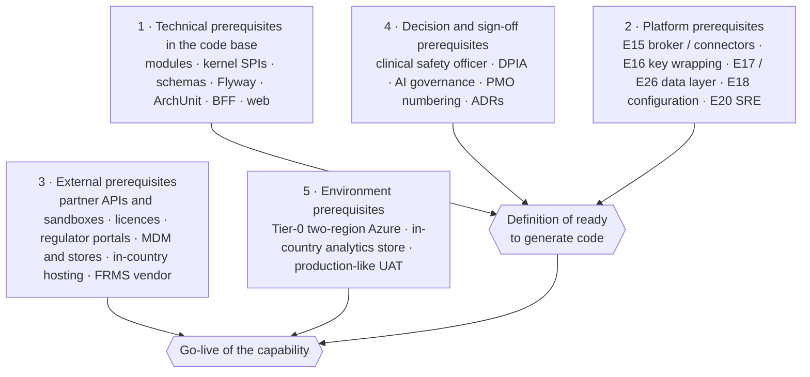
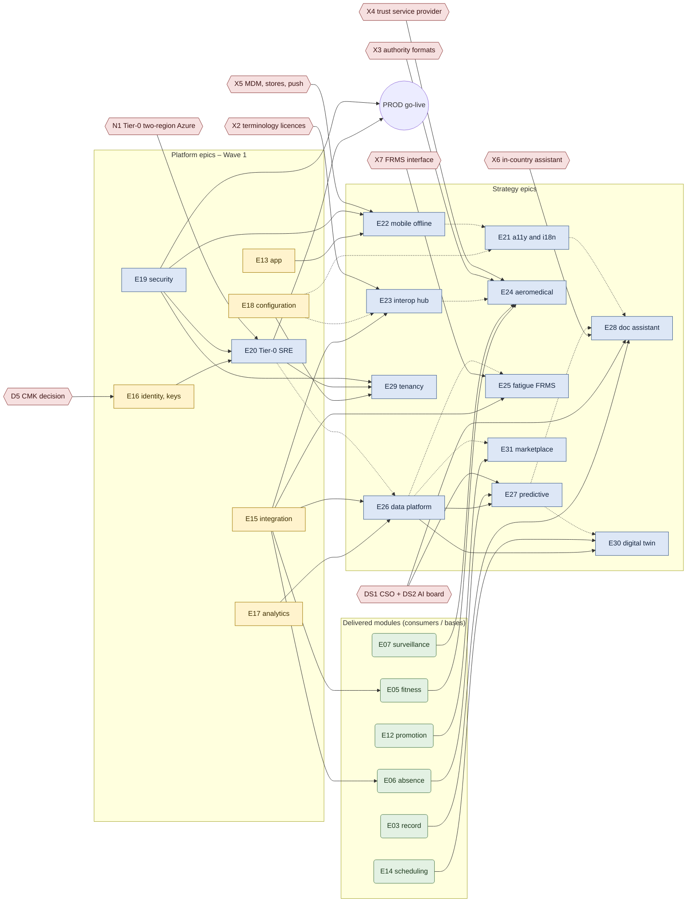
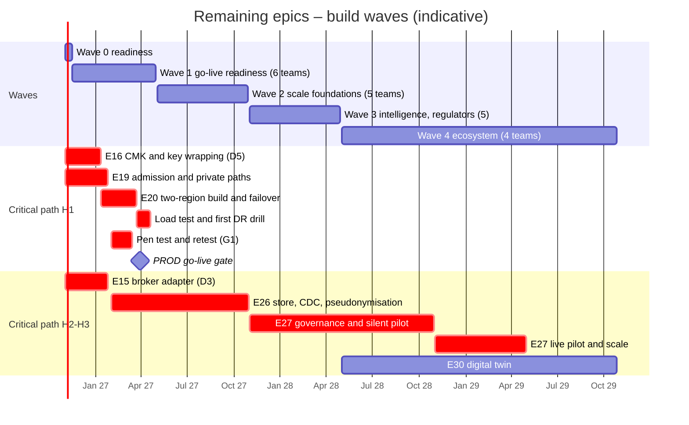

# WellnessZ – Remaining Epics Build Plan

**Version 1.0**

*WellnessZ OHCM platform – how to generate the code base for the epics that are still open*

| | |
|---|---|
| **Document** | Remaining Epics Build Plan (developer-facing) |
| **Version** | 1.0 (30 October 2026) – draft for the design authority and the six product teams |
| **Audience** | Developers, technical leads, product owners, the release manager, the DBA and the security champions |
| **Answers** | (a) how many epics are left; (b) what each remaining epic depends on before its code can be generated; (c) the build order, team allocation, entry / exit criteria, definition of ready and a module scaffold blueprint per new epic |
| **Sources of truth** | [Epic-Catalogue-and-Roadmap.xlsx](epics/Epic-Catalogue-and-Roadmap.xlsx) (Catalogue, Dependencies, Horizon roadmap, Capacity plan) · [Platform Enhancement Strategy](Platform-Enhancement-Strategy.md) · epic workbooks `epics/E20…E31*.xlsx` · security epic [E15_Security_Hardening_and_Assurance.xlsx](../security/epics/E15_Security_Hardening_and_Assurance.xlsx) (to be renumbered E19) · [Developer Guide](../architecture/03-Developer-Guide.md) · [CI/CD Guide](../cicd/CI-CD-Guide.md) section 10.5 · [Client Customisation Guide](../customisation/Client-Customisation-Guide.md) · the code in `modules/`, `platform/` and `apps/` |
| **Companion workbook** | [Remaining-Epics-Dependency-Matrix.xlsx](epics/Remaining-Epics-Dependency-Matrix.xlsx) – sheets *Remaining epics*, *Dependency matrix*, *Build order (waves)*, *Module scaffold blueprint*, *Definition of ready* |
| **Status of figures** | Effort is **indicative**: story points (SP) are first cuts from the epic workbooks; team-sprints apply velocity 30 SP per team per sprint and an uncertainty allowance of ×1.5 / ×2.0 / ×2.5 for H1 / H2 / H3 epics (Capacity plan sheet). Platform-epic completion is estimated in team-sprints only. Dates are planning dates, not commitments. |

**Conventions used in this document**

* *Verified* names (classes, interfaces, files, configuration keys) exist in the repository today and were checked with
  `grep` / `find` on 30 October 2026. Anything that does not exist yet is marked **(proposed)**.
* *Hard* and *soft* dependencies follow the Dependencies sheet of the catalogue: hard blocks start or go-live, soft
  reduces value or adds rework. *W* marks a dependency named in an epic workbook (overview or backlog column) that the
  catalogue does not type; it is an entry criterion for the backlog items that name it.
* Sprints are two weeks; Sprint 0 starts on **Monday 2 November 2026** (the roadmap start). A quarter is 6.5 sprints.

---

## Contents

1. [Summary](#1-summary)
2. [How many epics are left](#2-how-many-epics-are-left)
3. [Dependencies to generate the code base](#3-dependencies-to-generate-the-code-base)
4. [Build order](#4-build-order)
5. [Definition of ready to generate code](#5-definition-of-ready-to-generate-code)
6. [Module scaffold blueprint](#6-module-scaffold-blueprint)
7. [Quality gates](#7-quality-gates)
8. [What to do first on Monday](#8-what-to-do-first-on-monday)
9. [Risks and assumptions of this plan](#9-risks-and-assumptions-of-this-plan)
10. [Appendix A – verified code references](#appendix-a--verified-code-references)

---

## 1. Summary

| Question | Answer |
|---|---|
| Epics in the catalogue | **31** (E01–E31) |
| Done | **13** – E01–E12 and E14 (functionally delivered in increments 1–5; sign-offs and connectors outstanding) |
| Work remaining | **18 epics** – **5 partial** platform epics (E13, E15, E16, E17, E18) and **13 planned** epics (E19 security, E20–E31) |
| Not started | **13** (E19–E31) |
| Indicative remaining effort | **111 team-sprints** of epic work (42 platform completion + 9 E19 + 60 for E20–E31); **1,127 SP** for E19–E31 (256 + 871). With 40 team-sprints of evolution of delivered modules the roadmap demand is ≈ 151 team-sprints over 36 months |
| New code footprint | 10 new Maven modules (E22–E31, one each – E26 and E29 included), **no new module** for E19, E20 and E21 (platform, infrastructure and web work), 10 new database schemas, first new migration **V21**, 6 proposed SPIs, 12 proposed ArchUnit rules (22 → 34) |
| Build order | **Wave 0** (Sprint 0, readiness) → **Wave 1** go-live readiness (sprints 1–12, six teams) → **Wave 2** scale foundations (sprints 13–25, five teams) → **Wave 3** intelligence and regulators (sprints 26–38, five teams) → **Wave 4** ecosystem (sprints 39–77, four teams) |
| Critical path (H1) | E16 key decision (D5) and E19 admission → **E20 two-region Tier-0 build** → first DR drill and load test → independent penetration test (G1) → PROD go-live gate (indicative 29 March 2027) |
| Critical path (H2–H3) | E15 broker (D3) → **E26 data platform** (CDC, pseudonymisation) → **E27** silent pilot → E27 live → **E30** |
| Governance path | Clinical safety officer and AI governance board (decision S6) → E28 DPIA and safety case → E28 pilot; same board gates E27 |

---

## 2. How many epics are left

### 2.1 Counts

| Status | Epics | Count |
|---|---|---|
| Done | E01, E02, E03, E04, E05, E06, E07, E08, E09, E10, E11, E12, E14 | 13 |
| Partial (platform, completed to production grade in H1) | E13, E15, E16, E17, E18 | 5 |
| Planned – security (drafted as "E15" in `docs/security/epics/`, renumbered **E19** – decision S2) | E19 | 1 |
| Planned – strategy epics | E20, E21, E22, E23, E24, E25, E26, E27, E28, E29, E30, E31 | 12 |
| **Total** | | **31** |
| **Work remaining** (partial + planned) | | **18** |
| **Not started** (planned) | | **13** |

"Done" epics are not counted as remaining, but three of them are rated **R** for go-live of a capability in the
strategy scorecard (E05 for crew, E06, E10) because their connectors depend on E15. Their code changes appear in this
plan as *consumer adapters* of E15 and as *evolution* (EVO) changes that the new epics need (for example a new SPI
implementation in E03 or E06).

### 2.2 Remaining epics

| Epic | Name | Status | Team | Horizon | Quarters | Indicative SP | Team-sprints | Where the code lands | Exit criterion (roadmap) |
|---|---|---|---|---|---|---|---|---|---|
| E13 | Employee & Manager Portal / App – completion | Partial | T3 | H1 | Q1–Q2 | – | 4 | `web/employee-app` (Capacitor, secure storage, MAM), `web/manager-workspace` status-only screens | Store / MDM-ready app |
| E15 | Integration & API Gateway – completion | Partial | T4 | H1 | Q1–Q3 | – | 22 | `platform/wz-integration` (`EventPublisher` broker adapter, connectors), consumer adapters in E05, E06, E08, E10, E11, E12 | 12 production connectors live |
| E16 | Identity, Access, Consent & Audit – completion | Partial | T5 | H1 | Q1–Q2 | – | 7 | `platform/wz-secrets` (envelope encryption), `platform/wz-security` (audit anchoring, SIEM export), `platform/wz-documents` (`RetentionService` purge) | Envelope encryption, anchoring, purge jobs |
| E17 | Analytics & Reporting – completion | Partial | T6 | H1 | Q1–Q2 | – | 4 | `platform/wz-analytics` (`KpiService`), read-only reporting role (Flyway grants) | Outstanding KPIs on the KPI API |
| E18 | Master Data & No-Code Configuration – completion | Partial | T5 | H1 | Q1–Q2 | – | 5 | `platform/wz-masterdata` (calendar, staff roster feed, maker-checker on `ConfigService`, flag register) | Calendar, roster feed, maker-checker |
| E19 | Security Hardening & Assurance | Planned | T5 + champions | H1–H2 | Q1–Q4 | 256 | 9 | Platform, CI, Terraform, Helm – no new module | G1–G6 met; Later items closed |
| E20 | Resilience & Tier-0 Operations (SRE) | Planned | T5 | H1–H2 | Q1–Q4 | 107 | 6 | `deploy/terraform`, `deploy/helm`, `.github/workflows`, load tests – no new module | Failover drill RTO ≤ 15 min proven |
| E21 | Accessibility & Internationalisation | Planned | T3 | H1–H2 | Q2–Q5 | 79 | 4 | Four web apps, `PdfRenderer`, `ClinicalTextDetector`, master data – no new module | WCAG 2.2 AA audit clean; Arabic everywhere |
| E22 | Native Mobile, Offline & Field Capability | Planned | T3 | H1–H2 | Q1–Q5 | 75 | 4 | `modules/wz-e22-field` + `web/employee-app` | Offline capture live at airside posts |
| E23 | Interoperability Hub | Planned | T4 | H1–H3 | Q2–Q8 | 100 | 7 | `modules/wz-e23-interop` + `platform/wz-integration` (fhir, hl7, terminology) | First live FHIR hospital + v2 laboratory |
| E24 | Aviation Medical Certification & Regulator Interface | Planned | T1 | H1–H2 | Q2–Q6 | 63 | 5 | `modules/wz-e24-aeromedical` | Electronic submission to the first authority |
| E25 | Fatigue Risk & Shift-Work Health | Planned | T2 | H2 | Q4–Q7 | 47 | 4 | `modules/wz-e25-fatigue` | FRMS referral and roster restriction codes live |
| E26 | Data Platform & De-identified Datasets | Planned | T6 | H1–H2 | Q2–Q6 | 85 | 5 | `modules/wz-e26-dataplatform` + `platform/wz-analytics` + pipeline infrastructure | All client KPIs from one semantic layer |
| E27 | Predictive Health & Absence Analytics | Planned | T6 | H2–H3 | Q5–Q10 | 68 | 5 | `modules/wz-e27-predictive` + in-country training / scoring in the data platform | Silent pilot passes safety case → live pilot |
| E28 | Clinical Documentation Assistant | Planned | T1 | H1–H2 | Q2–Q7 | 61 | 5 | `modules/wz-e28-docassist` (implements the E03 `AiDocumentationProvider`) | 5-clinician pilot → staged roll-out |
| E29 | Multi-Subsidiary Tenancy, Onboarding & Extensions | Planned | T5 | H2–H3 | Q4–Q10 | 81 | 6 | `modules/wz-e29-tenancy` + launcher change in `apps/wz-core-app` + flag register in `wz-masterdata` | Subsidiary onboarded in ≤ 4 weeks |
| E30 | Workforce Health Digital Twin & Capacity Planning | Planned | T6 | H3 | Q7–Q12 | 59 | 5 | `modules/wz-e30-readiness` | Readiness dashboard and scenarios |
| E31 | Wellbeing Marketplace & Benefits Integration | Planned | T2 | H3 | Q8–Q12 | 46 | 4 | `modules/wz-e31-marketplace` | Three vendors live with DPA |
| | **Total** | | | | | **1,127** | **111** | | |

Quarters: Q1 = Nov 2026–Jan 2027 … Q12 = Aug–Oct 2029. Teams: T1 Clinical Care, T2 Workforce Health & Prevention,
T3 Experience & Mobile, T4 Integration & Interoperability, T5 Platform & SRE, T6 Data & Analytics.

---

## 3. Dependencies to generate the code base

Five layers of prerequisites decide when a remaining epic can be generated and when it can go live:



Layers 1 and 4 (and the hard platform predecessors) gate **code generation**. Many external and environment items gate
**go-live** only: the code can be generated against the simulated default that exists today (outbox + content-free
e-mail, logging adapters, simulated partners) and switched to the real partner later – the same pattern increments 3–5
used for `AbsenceFeedConnector`, `ClaimsSubmissionGateway` and the LIMS client.

### 3.1 Technical prerequisites inside the code base

**Cross-cutting – applies to every new module (do these once, in Wave 0 / Wave 1):**

| # | Prerequisite | Today (verified) | Change |
|---|---|---|---|
| TP-01 | Module catalogue | `ModuleRegistry.CATALOGUE` lists **E01–E18 only**; a `CaseModule` bean switches an entry to `IMPLEMENTED` | Add catalogue entries E19–E31 (`PLANNED`, group `platform` / `strategy`) so that `GET /api/v1/modules` and `modules.eNN.enabled` work for the new codes; planned modules default to **disabled** |
| TP-02 | Schema list | `spring.flyway.schemas` in `apps/wz-core-app/src/main/resources/application.yml` and `migrations.job.core.schemas` in `deploy/helm/wellnessz/values.yaml` list 18 schemas ending with `promotion` | Each new schema in the **five places** of CI/CD Guide 10.1 step 3: `application.yml`, Helm values, `deploy/local/postgres/01-init-wellnessz.sh`, `deploy/sql/bootstrap-managed-postgres.sql`, `deploy/hybrid/cnpg/03-cluster.yaml` |
| TP-03 | Flyway ordering | V1–V20 applied; **no `outOfOrder`** setting anywhere in `apps/` or `deploy/` → strict ordering | Next free number is **V21**. Keep one reservation register (Section 6.1); a lower number must never merge after a higher one has been applied in DEV |
| TP-04 | ArchUnit | `ArchitectureTest` has **22 rules**; new packages must be added to `platformDoesNotDependOnBusinessModules`, `kernelDoesNotDependOnBusinessModules`, `documentServiceIsAPlatformService` and `earlierModulesDoNotDependOnLaterOnes` | One rule per new module (Section 6.3) plus `deliveredModulesDoNotDependOnStrategyModules` and `restrictedClassesStayOutOfStrategyModules` **(proposed)** |
| TP-05 | BFF allow-list | `ApiProxyController.CORE_WORKSPACE_RESOURCES` (13 workspace paths after increment 5); everything else under `/api/v1/**` is proxied as is | Add a path only when a module exposes `/api/v1/workspace/...` for manager / HR roles; extend `ApiProxyPathTest` |
| TP-06 | Consent purposes | `ConsentPurpose` has 8 values incl. `AI_DOCUMENTATION`, `RESEARCH_DEIDENTIFIED`, `WEARABLE_DATA` | Add `FRMS_REFERRAL` (E25), `MARKETPLACE_HANDOFF` (E31), `HIE_EXCHANGE` (E23) **(proposed)** – each needs DPO wording |
| TP-07 | Case sources | `CaseSource` has 12 values (no FRMS) | Add `FRMS_REFERRAL` (E25) **(proposed)**; check the matching check constraint in the case schema in the same migration |
| TP-08 | Connector catalogue | `ConnectorRegistry` lists 10 connector descriptors | Add descriptors for broker destinations and new partners (authority gateway, FRMS, HIE, push provider, benefits / vendors) and their DPO-approved field lists (`OutboundPayloadGuard`) |
| TP-09 | Idempotent machine and mobile writes | `IdempotencyService` exists in `wz-integration` but **no business module uses it**; `EncounterController` (E01) has plain `@PostMapping` | E22 offline sync needs `Idempotency-Key` on E01 encounter creation and E02 telephone triage (EVO change to E01 / E02) |
| TP-10 | Feature flags | `WZ_FEATURE_*` is plumbing only; no product feature reads a flag (Customisation Guide 5.2) | One flag register in `wz-masterdata` (E18) extended by E20 (owner, expiry, audit) and E29 (tenant scope) – build it once (Section 6.5) |
| TP-11 | Roles | 38 canonical roles in `com.wellnessz.common.model.Roles` | New roles in `Roles`, realm JSON, scope mappings of `wellnessz-bff` / `wellnessz-mobile`, Entra app roles; external roles in `wellnessz.security.mfa-required-roles` and `MfaRoleGateTest` |
| TP-12 | E2E and documents | `tools/e2e/e2e-increment1.js` … `e2e-increment5.js`; 121 checks | Continue the increment numbering: Wave 1 = increment 6, Wave 2 = increment 7, Wave 3 = increment 8, Wave 4 = increments 9–11 (`docs/increment-06/` …, `docs/images/screens/increment-06/` …) |

**Per epic – what each remaining epic builds on in the code base:**

| Epic | Builds on (existing modules – Maven dependency) | Existing SPIs / services consumed (verified) | SPIs implemented or added | Schema · first Flyway (indicative) | ArchUnit | BFF | Web |
|---|---|---|---|---|---|---|---|
| E13 | E01 (self-referral), kernel `CaseService.selfReferral` | `managedConfig.ts` / `runtimeConfig.ts` (MDM keys), `statusOnly.ts` whitelist | – | none | – | – | employee-app (Capacitor plug-ins), manager-workspace (crew scheduling, hygiene manager status-only screens) |
| E15 | platform only | `EventPublisher` (outbox delivery SPI), `OutboxRelay`, `ConnectorRegistry`, `InboundService`, `IdempotencyService`, `JobRunGuard`; module SPIs `AbsenceFeedConnector` (E06), `ClaimsSubmissionGateway` (E08), `CrewStatusEnricher` (E02), `NotificationChannel` (SMS) | Broker adapter implementing `EventPublisher`; real beans behind the module SPIs | connector state if needed · V24 | none new | – | – |
| E16 | platform only | `MasterKey`, `FieldEncryptor` (`wellnessz.crypto.active-key-version`), `AuditService`, `RetentionService` | KMS-wrapped data keys **(proposed `KeyWrappingProvider`)**, re-encryption job, audit anchor, purge jobs | `platform` / `docs` tables · V22 | none new | – | – |
| E17 | platform only | `KpiService`, `SmallCellSuppression` | – | read-only reporting role grants · V25 | none new | – | manager-workspace `kpi.ts` for new KPIs |
| E18 | platform only | `ConfigService`, `StaffMemberRepository`, `ClinicSiteRepository` | business / site calendar, roster feed, maker-checker, flag register | `masterdata` · V21 | none new | – | oh-workspace `screens/admin/` |
| E19 | platform only | `ApiRateLimitFilter`, `DocumentService.generateSigned(…, DataClassification.RESTRICTED_CLINICAL)`, `tools/security/security-verification.js`, `rbac-matrix.js` | startup guard against demo identities, programme attribute for restricted documents | `docs` · V23 | guardrail tests (`noStandardStreams` style) | – | ESLint rule against `dangerouslySetInnerHTML` in all four apps |
| E20 | platform only | `JobRunGuard`, OpenTelemetry / Micrometer, Helm chart, Terraform `deploy/terraform/azure` | SLO rules as code, synthetic probes, Flyway lint **(proposed `deploy/observability/`, `tools/perf/`)** | none (expand / contract guideline applies to everyone) | – | – | – |
| E21 | E13 screens; E03 / E09 content | `PdfRenderer` (`wellnessz.documents.font-path`), `ClinicalTextDetector`, employee-app `src/i18n/` | locale layer in three workspaces; Arabic shaping in PDFs | `masterdata` (languages, translation register, preferred language) · V26 | – | – | all four apps |
| E22 | E01, E02 (EVO: idempotent create), E07, E11 (wallet data) | `NotificationChannel` + `Channel.PUSH`, `IdempotencyService`, `Employee.badgeId`, `NotificationTemplates` / `ContentRules` | push channel bean; **(proposed kernel SPI `StatusWalletContributor`)** implemented by E07 and E11 | `field` · V37 | `fieldModuleUsesSpisOnly` | – | employee-app (offline queue, NFC, push, wallet), oh-workspace (sync conflicts) |
| E23 | E03, E04 (resource owners), E15 | `FhirController`, `FhirConfig`, `Hl7v2Service`, `TerminologyService`, `CodeSystem`, `InboundService`, `AuditService` | **(proposed `FhirResourceContributor` in `com.wellnessz.integration.fhir`)** implemented by E03 / E04 | `interop` · V38 | `interopHubDoesNotReadClinicalModules` | – | oh-workspace (interfaces, subscriptions, replay), partner-portal (onboarding kit) |
| E24 | E05 (`wz-e05-fitness`), E07 (`wz-e07-surveillance`) | `FitnessClearanceGuard`, `ChartContributor`, `DocumentService`, `CrewCertificateRepository` data via E07, outbox `crew-rostering` | module SPI **(proposed `AuthoritySubmissionGateway`)** – default assisted submission; **(proposed `SignatureProvider` in `wz-documents`)** | `aeromedical` · V36 | `aeromedicalBuildsOnFitnessAndSurveillanceOnly` | – | oh-workspace (AME screens), manager-workspace (crew licensing status) |
| E25 | kernel; E05 via restriction codes in master data (no Maven dependency) | `CaseService` / `OpenCaseCommand`, `AppointmentBooking`, `DutyAssignmentRepository`, `ConsentService`, `InboundService`, `IdempotencyService` | – | `fatigue` · V40 | `fatigueModuleIsIndependent` | `/workspace/fatigue` (aggregate FRMS view) | employee-app (sleep self-screen, FRMS consent), oh-workspace (queue), manager-workspace (aggregates) |
| E26 | E17 | `Pseudonymizer` (`WZ_PSEUDONYM_KEY`), `KpiService`, `SmallCellSuppression`, `ConsentPurpose.RESEARCH_DEIDENTIFIED`, outbox / CDC | purpose-specific pseudonymisation (extends `Pseudonymizer`), KPI definitions as code | `dataplatform` · V27 | `dataPlatformReadsNoModuleClasses` | `/workspace/insights` | manager-workspace (dashboards), oh-workspace (research requests) |
| E27 | E26 (data), E06 (queue – EVO) | `Pseudonymizer`, `AuditService`, `PolicyEngine` | **(proposed kernel SPI `EarlyInterventionSignalSource`)** implemented by E27, consumed by E06 | `predictive` · V55 | `predictiveIsAdvisoryOnly` | – | oh-workspace (signals in early-intervention queue, feedback) |
| E28 | E03 (`wz-e03-record`) | `AiDocumentationProvider` (module SPI, activated by `wellnessz.record.ai.provider`), `AiAssistantService`, `ConsentPurpose.AI_DOCUMENTATION`, `OcrProvider` / `TesseractOcrProvider` (D14) | provider adapter implementing `AiDocumentationProvider` | `docassist` · V35 | `docAssistBuildsOnRecordOnly` | – | oh-workspace (capture, side-by-side review) |
| E29 | platform (`wz-masterdata`, `wz-security` org scope) | `ConfigService`, `OrgUnitRepository`, `PartnerOrganisation`, `CurrentUser` org scope, `customisation.featureFlags` Helm plumbing | extension launcher in `apps/wz-core-app` (D22), flag register reads | `tenancy` · V39 | `tenancyIsNotUsedByProductModules` | `/workspace/tenancy` (subsidiary onboarding tracker) | all four apps (branding tokens) |
| E30 | E26 (`wz-e26-dataplatform`), E14 (via SPI) | `CapacityDemandSource` (kernel, consumed by E14 `CapacityService`), `SmallCellSuppression`, `DutyAssignmentRepository` | implements `CapacityDemandSource` | `readiness` · V70 | `readinessIsAggregateOnly` | `/workspace/readiness` | manager-workspace (executive readiness), oh-workspace (clinic demand) |
| E31 | E12 (`wz-e12-promotion`) | `ConsentService`, `PartnerOrganisation`, `CurrentUser.partnerOrganisation()` (bound clients, rule R12), `IdempotencyService`, `SmallCellSuppression` | – | `marketplace` · V71 | `marketplaceSharesNoClinicalData` | `/workspace/marketplace` (spend and outcome, suppressed) | employee-app (catalogue), partner-portal (vendors), oh-workspace (recommend) |

### 3.2 Platform prerequisites

| Platform prerequisite | Delivered by | What the consumer needs | Consumers (H = hard, S = soft, W = workbook) | Gate for |
|---|---|---|---|---|
| **E15 broker adapter (D3)** – production `EventPublisher` for Azure Service Bus or Kafka | E15 (Q1–Q3) | Durable transport for outbox destinations, replay, dead letters | E20 W (failover replays outbox), E23 H, E25 H, E26 H (CDC / broker feed) | Code: E26 pipeline, E23 subscriptions; go-live: all |
| **E15 connectors** (12, P1–P3) | E15 + consumer adapters in E05, E06, E08, E10, E11, E12 | Real partner transports behind existing SPIs | E05, E06, E08, E10, E11 (H, go-live), E12 S, E22 W (HRIS cache, push), E24 W (authority gateway transport), E31 W (benefits, vendors) | Go-live of delivered modules |
| **E16 key wrapping / CMK (D5, SEC-E09)** | E16 + E19 SEC-E09 | KMS-wrapped data keys, re-encryption job, CMK on PostgreSQL **before** the PROD server and replica exist | E20 H, E26 W (purpose keys), E27 W, E29 W (per-tenant keys for instance-per-tenant) | E20 code and PROD build |
| **E16 consent, ABAC and audit** (MFA enrolment, anchoring, SIEM export, purge jobs) | E16 | Consent purposes, audit anchoring, purge of OH records (G10) | E21 W (guard vocabulary), E22 W, E23 W, E24 W (signature), E25 W, E28 W, E31 W | Go-live (G10, G11) |
| **E17 / E26 data layer** | E17 completion (H1) → E26 | De-identified view, KPI API, reporting role (O7), then CDC store, pseudonymisation, semantic layer, feature store | E26 H on E17; E25 S, E27 H, E28 W (evaluation set), E30 H, E31 S on E26 | Code: E27, E30 |
| **E18 configuration** (calendar O10, roster feed O9, maker-checker, flag register O34) | E18 | Business calendar for SLAs and deadlines, governed flags, languages, terminology registry, content packs | E20 W (flags), E21 S, E23 S, E24 W (deadline timers, AME designations), E29 H | Code: E29; value: E21, E23 |
| **E19 security controls** (admission, private control plane, MASVS, pen-test scope, extension signing) | E19 | Signed-image admission (SEC-E03), private paths (SEC-E04), mobile hardening (SEC-E11), threat model per epic | E20 H, E22 H, E29 H; E26 W (TRE), E28 W (provider assessment), E31 W (vendor due diligence) | Code: E22 release builds, E29 extension loader; go-live: all |
| **E20 SRE** (two-region, SLOs, load tests, flags governance, upgrade orchestration) | E20 | Region pair for every in-country store; capacity model; canary; instances and upgrades | Go-live H; E26 S (analytics store in the region pair); E27 W (monitoring); E29 H | Go-live; E29 code |
| **E13 app shell** | E13 completion | Store-ready Capacitor shell, secure storage, MAM | E22 H, E21 W, E25 W, E31 W | Code: E22 |
| **E21 i18n** | E21 | Locale layer, Arabic shaping, translation register | E28 S (Arabic transcripts), E25 W (instrument translations), E29 W (branding), E31 W | Value |
| **E23 hub** | E23 | FHIR profiles and document exchange | E24 S (authorities with APIs) | Value |

### 3.3 External prerequisites

Lead times are the main schedule risk (strategy risk SR2, SR9, SR12). Start them in Wave 0 / Wave 1 even when the code
comes later.

| ID | External prerequisite | Needed by | Blocks | Fallback that lets code be generated now | Owner |
|---|---|---|---|---|---|
| X1 | Partner APIs, sandboxes, test data and certificates: HRIS, rostering, EHS transport, toxicology LIMS, insurer / TPA, authority e-reporting, ERP, EAP, campaign app, wearable aggregator, public-health authority, SMS gateway | E15 (all 12), E22 (HRIS cache), E23 (partner hospital, v2 laboratory), E25 (rostering), E31 (benefits) | Go-live | Existing simulated defaults and outbox + content-free e-mail | Integration lead, partner managers |
| X2 | Terminology licences and national editions (SNOMED CT, ICD, LOINC – D10) | E23 (BL-009, BL-010) | Code of the terminology server integration; go-live | Starter subset in `TerminologyService` | Product owner, procurement |
| X3 | Aviation-authority medical interface confirmation in writing (API, structured upload or portal only) | E24 (BL-001) | Code of the API client; go-live | Assisted-submission package and receipt reconciliation (works for portal-only authorities) | AME lead |
| X4 | Trust service provider for advanced / qualified signatures with in-country processing (D12) | E24 (BL-004, BL-005); later other externally effective documents | Code of the signature adapter | Current SHA-256 simple signature in `DocumentService.sign` | Platform security, procurement |
| X5 | MDM / MAM vendor and tenancy, store developer accounts with health-data declarations, push provider accounts under the client | E13, E22 (BL-001–003, BL-008) | Release builds; push go-live | In-memory token fallback in debug builds only; logging channel | Client IT, T3 |
| X6 | In-country assistant hosting (locally hosted) or contracted provider with DPA, in-country processing, no retention, no training on WellnessZ data (D13) | E28 (BL-001, BL-003) | Code of the provider adapter beyond a stub; pilot | No provider enabled (`wellnessz.record.ai.provider: none`) | CMO, DPO, CISO |
| X7 | FRMS interface, consent model and minimal dataset agreed with the FRMS manager / vendor | E25 (BL-002, BL-004) | Code of the inbound endpoint contract | Manual referral through the existing self-referral path | FRMS manager, T2 |
| X8 | National / emirate-level health information exchange eligibility and profile set | E23 (BL-005, BL-011) | Code of the HIE connector (H3) | – (H3 item only) | Integration architect, Legal |
| X9 | Benefits-system API and vendor DPAs, security due diligence | E31 (BL-001, BL-003, BL-008) | Code of eligibility and hand-off | Eligibility by subsidiary / role from HRIS master only | HR benefits, Procurement, DPO |
| X10 | Licensed instruments and validated translations (sleep screening, PHQ-9 / GAD-7 Arabic, destination content) | E21 (BL-010), E25 (BL-007) | Content go-live | Instrument stored as configuration, status DRAFT | Clinical governance |
| X11 | Independent assessors: penetration test and retest (G1), WCAG 2.2 AA audit, MASVS assessment | E19 (BL-001/-002, BL-030), E21 (BL-001), E22 | Go-live evidence | – | CISO, Head of Experience |

### 3.4 Decision and sign-off prerequisites

| ID | Decision / sign-off | Needed by | Gates | Reference |
|---|---|---|---|---|
| DS1 | **Clinical safety officer** appointed (registered clinician with health-IT safety training) | E24, E25, E27, E28 (and E02, E05 evolution) | Code of any clinical-decision feature: hazard log entry before the story is ready | Strategy 9.3, decision S6 |
| DS2 | **AI governance board** chartered (CMO, CSO, DPO, CISO, legal, employee representative) | E27 (BL-001), E28 (shared) | Any model or assistant code beyond spikes | S6, E27-F01 |
| DS3 | **DPIA** per new processing: E22 offline dataset, E25 FRMS referral, E26 de-identification standard and TRE, E27 per use case, E28 assistant, E30 readiness model, E31 hand-off; DPIA screening for every other epic | as listed | Code that processes the new data category | Developer Guide DoD #9, CI/CD 10.5 step 1 |
| DS4 | **PMO numbering** – E15 security epic renumbered E19, E20–E31 adopted as *Planned* | All | Module names, ticket prefixes, `ModuleRegistry` codes, Flyway file names | Decision S2 |
| DS5 | Architecture decisions: D3 broker, D5 CMK / envelope encryption, D10 terminology, D12 signature level, D13 assistant provider, D14 OCR, D22 extension model, S8 tenancy direction, D4 mobile distribution | E15, E16 / E19 / E20, E23, E24, E28, E28, E29, E29, E22 | The design of the adapter that implements the SPI | Strategy Appendix B |
| DS6 | Clinical / content sign-offs (CMO, MRO, Legal, DPO): CREW_FATIGUE red flags, authority templates and limitation codes, translated instruments, de-identification standard, retention classes (G10) | E25, E24, E21, E26, E16 | Content go-live (code can ship with DRAFT content) | Strategy 4.2, G9, G10 |
| DS7 | Employee-representative consultation and privacy-notice update | E25 (BL-011), E27 (BL-011), E28 | Live use | Strategy 6.4 |
| DS8 | Error-budget policy signed (release freeze rules) | E20 (BL-005) | Canary and release gating in Wave 2 | E20-F02 |

### 3.5 Environment prerequisites

| ID | Environment | Needed by | Gate |
|---|---|---|---|
| N1 | **Tier-0 two-region in-country Azure** landing zone (GL-04, 16-week plan in the decision pack): primary + warm standby, allowed-locations policy, CMK, replicated registry, immutable backup vault | E20 (builds it), PROD go-live (G7), every epic that stores data in PROD | Go-live; recovery-region access request (UAE Central or equivalent) is the long lead item (SR5) |
| N2 | In-country analytics store and landing / curated zones in the same region pair | E26 (BL-001), E27, E30, E25 (indicators), E31 (ROI) | Code of the E26 pipeline needs at least a DEV store |
| N3 | Production-like UAT with synthetic data at volume (50K staff, 30K crew rosters, 5 years of cases) | E20 (BL-006, BL-007), E19 pen test, E29 isolation suite | Go-live evidence (G8) |
| N4 | Device lab / test matrix and MDM test tenant | E13, E22 (BL-012), E21 (assistive technology) | Release builds |
| N5 | Trusted research environment (isolated workspace) | E26 (BL-011), E27 training | E27 model code |

### 3.6 Dependency matrix

**Epic × epic.** Rows are the remaining epics; columns are predecessors. H = hard, S = soft (catalogue Dependencies
sheet), W = named in the epic workbook. The last column names the delivered modules the epic builds on.

| Epic ↓ / needs → | E13 | E15 | E16 | E17 | E18 | E19 | E20 | E21 | E22 | E23 | E26 | E27 | Delivered modules it builds on |
|---|---|---|---|---|---|---|---|---|---|---|---|---|---|
| E13 | | | | | | | | | | | | | E01 (self-referral) |
| E15 | | | | | | | | | | | | | E05, E06, E08, E10, E11, E12 (consumer adapters) |
| E16 | | | | | | W | | | | | | | – |
| E17 | | | | | | | | | | | | | – |
| E18 | | | | | | | | | | | | | – |
| E19 | | | | | | | | | | | | | E09, E10 (restricted documents) |
| E20 | | W | H | | W | H | | | | | | | E05 (manual fallback) |
| E21 | W | W | W | | S | | | | S | | | | E03, E09 (clinical translations) |
| E22 | H | W | W | | | H | | | | | | | E01, E02, E07, E11 |
| E23 | | H | W | | S | | | | | | | | E03, E04 |
| E24 | | W | W | | W | | | | | S | | | E05 (H), E07 (H), E03 |
| E25 | W | H | W | | | | | W | | | S | | E02, E05, E09, E12 |
| E26 | | H | W | H | W | W | S | | | | | | E06, E12 |
| E27 | | | W | | | W | W | | | | H | | E06 (H), E05, E12 |
| E28 | | | W | | | W | | S | | | W | S | E03 (H) |
| E29 | | | W | | H | H | H | W | | | | | – |
| E30 | | W | | | | | | | | | H | S | E14 (H), E07, E11, E24 (W) |
| E31 | W | W | W | | | W | | W | | | S | | E12 (H), E04 |

**Epic × external, decision and environment prerequisite.** ● needed before code generation (definition of ready);
◐ code can be generated against the simulated default, needed before go-live; ○ soft / value.

| Epic | X1 Partner APIs | X2 Terminology | X3 Authority | X4 Trust service | X5 MDM / stores / push | X6 In-country assistant | X7 FRMS | X8 HIE | X9 Benefits / vendors | X10 Instruments | X11 Independent assessor | DS1 CSO | DS2 AI board | DS3 DPIA | DS4 PMO | DS5 ADR | DS6 Sign-off | N1 Tier-0 | N2 Analytics store | N3 Prod-like UAT | N4 Device lab |
|---|---|---|---|---|---|---|---|---|---|---|---|---|---|---|---|---|---|---|---|---|---|
| E13 | | | | | ● | | | | | | | | | | | ● D4 | | ◐ | | | ● |
| E15 | ◐ | | | | | | | | | | | | | ● | | ● D3 | ◐ | ◐ | | ◐ | |
| E16 | | | | | | | | | | | | | | | | ● D5 | ◐ G10 | ● | | | |
| E17 | | | | | | | | | | | | | | | | | ● KPI defs | ◐ | | | |
| E18 | ◐ roster | | | | | | | | | | | | | | | | | ◐ | | | |
| E19 | | | | | | | | | | | ◐ | | | | ● | ● D5 | | ● | | ● | |
| E20 | | | | | | | | | | | | | | | ● | ● D1 / D9 | ● DS8 | ● | | ● | |
| E21 | | | | | | | | | | ◐ | ◐ WCAG | | | | ● | | ◐ | ◐ | | | ● |
| E22 | ◐ HRIS | | | | ● | | | | | | ◐ MASVS | ○ | | ● | ● | ● D4 | ● dataset | ◐ | | | ● |
| E23 | ◐ | ● | | | | | | ◐ H3 | | | | | | ● | ● | ● D10 | | ◐ | | | |
| E24 | | | ● spike | ● | | | | | | | | ● | | ● | ● | ● D12 | ◐ templates | ◐ | | | |
| E25 | ◐ | | | | | | ● | | | ◐ | | ● | | ● | ● | | ● CREW_FATIGUE | ◐ | ○ | | |
| E26 | | | | | | | | | | | | | | ● | ● | ● D5 keys | ● de-id std | ◐ | ● | | |
| E27 | | | | | | | | | | | | ● | ● | ● | ● | | ● safety case | ◐ | ● | | |
| E28 | | | | | | ● | | | | | | ● | ● | ● | ● | ● D13 | ● safety case | ◐ | | | |
| E29 | | | | | | | | | | | ◐ pen test | | | ● | ● | ● D22, S8 | | ● | | ● | |
| E30 | ◐ roster / network | | | | | | | | | | | | ○ | ● | ● | | | ◐ | ● | | |
| E31 | | | | | | | | | ● | | | | | ● | ● | | ● content review | ◐ | ○ | | |

### 3.7 Dependency graph

Solid arrows are hard dependencies, dotted arrows soft or workbook dependencies. Hexagons are external, decision and
environment prerequisites; rounded boxes are delivered modules.



---

## 4. Build order

### 4.1 Sequencing rules

1. **Hard before soft.** An epic starts code generation only when its hard predecessors have reached the exit state
   named in the matrix; soft predecessors are scheduled before it where capacity allows, otherwise rework is accepted.
2. **Platform before consumers.** E15, E16, E18 and E19 land the seams (broker, keys, flags, admission) that E20–E31
   build on; nothing in a new module re-implements them.
3. **Governance before AI code.** No E27 or E28 code beyond spikes and stubs until the clinical safety officer, the AI
   governance board and the DPIA exist (S6).
4. **Long-lead externals start in Wave 0 / 1 as spikes** (E23-BL-005 / -009, E24-BL-001 / -004, E28-BL-001 / -002,
   E25-BL-002 in Wave 2), so that the code in Waves 2–3 is not blocked.
5. **One schema-creating migration per epic, in landing order** (strict Flyway ordering, Section 6.1).
6. **Generate against the default, switch at go-live.** Every external connection is an SPI with a default that keeps
   today's behaviour (Developer Guide 18.8).

### 4.2 Waves

| Wave | Sprints (2 weeks) | Dates (indicative) | Increment | Funded teams | Epics in build | Goal | Demand / available team-sprints |
|---|---|---|---|---|---|---|---|
| **0 – Readiness** | Sprint 0 | 2 – 13 Nov 2026 | 6 (start) | 6 | Scaffolding for all; spikes | Numbering, catalogue entries, Flyway register, ArchUnit skeleton, DoR for Wave 1, external requests sent | part of Wave 1 |
| **1 – Go-live readiness (H1)** | 1–12 | 16 Nov 2026 – 30 Apr 2027 | 6 | 6 | E13, E15, E16, E17, E18 (complete); E19 Now / Next; E20 H1; E22 H1; E21 H1; E26 H1; spikes E23, E24, E28 | Gates G1–G11, PROD live, P1 connectors live, KPI baselines started | 48.6 / 50.8 (Q2 alone 105 %) |
| **2 – Scale foundations (H2a)** | 13–25 | 3 May – 29 Oct 2027 | 7 | 5 | E15 tail; E19 Later; E20 H2; E21, E22 H2; E23; E24 build; E26 H2; E28 build; E25 and E29 start (Q4) | Offline field app, first FHIR / v2 interfaces, authority templates and signatures, data pipeline E01–E14, assistant in pilot build | 36.0 / 42.2 |
| **3 – Intelligence and regulators (H2b)** | 26–38 | 1 Nov 2027 – 28 Apr 2028 | 8 | 5 | E21, E22 finish; E24, E26 finish; E23, E25, E28, E29 continue; E27 starts | First authority submission, semantic KPI layer, assistant pilot, tenancy factory, E27 silent pilot; **H2 gate** | 22.8 / 42.2 |
| **4 – Ecosystem (H3)** | 39–77 | 1 May 2028 – 26 Oct 2029 | 9, 10, 11 | 4 | E23, E25, E28 finish (Q7–Q8); E27, E29 finish (Q10); E30, E31 | Live advisory signals, signed extensions, digital twin, marketplace; **H3 review** | 43.4 / 101.4 |

Demand and available capacity come from the Capacity plan sheet (available = funded teams × 6.5 sprints × 65 %,
35 % reserved for run, defects and sign-off support; demand includes 4 team-sprints per quarter of evolution from Q3).



### 4.3 Critical paths

| Path | Chain | Why it is critical | Float |
|---|---|---|---|
| **CP1 – Tier-0 go-live** | D5 decision → E16 CMK / envelope encryption (SEC-E09, E19-BL-021/-022) → E19 admission (SEC-E03) → E20-BL-001/-002/-003 two-region stack and scripted failover → E20-BL-006/-007 load test, E20-BL-010 first DR drill → GL-03 pen test and retest → go-live gate (29 Mar 2027) | CMK cannot be added to an existing PostgreSQL server; the recovery stack needs admission and keys first; the drill and the pen test are go-live conditions (G1, G7, G8) | None – any slip moves go-live |
| **CP2 – connectors** | D3 broker decision → E15 broker adapter → P1 connectors (HRIS, rostering, EHS, LIMS, insurer, authority, public-health) → E05 / E06 / E10 go-live | Three delivered modules are rated **R** until their connector is live; partner readiness is external (SR2) | Low; mitigated by decision S5 (integration uplift) |
| **CP3 – data to intelligence** | E17 completion → E26-BL-001/-002/-004 store, CDC, pseudonymisation → E26 semantic layer and feature store (BL-009, E27-BL-004) → E27 governance, safety case, silent pilot → E27 live → E30 | No model without a governed, pseudonymised platform; E30 needs both aggregates and forecasts | ≈ 1 quarter in H3 |
| **CP4 – regulator** | E24-BL-001 authority formats + E24-BL-004 trust service provider (D12) → signature adapter → authority gateway → first submission (Q6) | External answers decide whether an API client is built at all (SR9) | ≈ 1 quarter |
| **CP5 – governance** | S6 → CSO + AI board → E28 DPIA and safety case → contract (X6) → provider adapter → 5-clinician pilot | Shared board also gates E27 | ≈ 1 quarter |

### 4.4 Parallel work per team

The Capacity plan gives the funded team **counts** (6 → 5 → 4) but not which teams combine; the allocation below is a
**proposal for the H1 and H2 gates**. Per-team available capacity is ≈ 4.2 team-sprints per quarter (6.5 × 65 %).

**Per-team demand per quarter (team-sprints, from the Capacity plan spreads; EVO split evenly between T1 and T2):**

| Team | Q1 | Q2 | Q3 | Q4 | Q5 | Q6 | Q7 | Q8 | Q9–Q10 | Q11–Q12 |
|---|---|---|---|---|---|---|---|---|---|---|
| T1 Clinical Care | 0 | 1.8 | 3.8 | 3.8 | 3.8 | 3.8 | 2.8 | 2.0 | 2.0 | 2.0 |
| T2 Workforce Health | 0 | 0 | 2.0 | 3.0 | 3.0 | 3.0 | 3.0 | 2.8 | 2.8 | 2.8 |
| T3 Experience & Mobile | 2.8 | 3.8 | 1.8 | 1.8 | 1.8 | 0 | 0 | 0 | 0 | 0 |
| T4 Integration | **7.3** | **8.3** | **8.3** | 1.0 | 1.0 | 1.0 | 1.0 | 1.0 | 0 | 0 |
| T5 Platform & SRE | **9.7** | **9.7** | 3.7 | **4.6** | 0.9 | 0.9 | 0.9 | 0.9 | 0.9 | 0 |
| T6 Data & Analytics | 2.0 | 3.0 | 1.0 | 1.0 | 1.8 | 1.8 | 1.6 | 1.6 | 1.6 | 0.8 |

Honest reading: total H1 utilisation is 86 % / 105 %, but the load sits on **T4 and T5** (about twice one team's
capacity) while T1 and T2 carry sign-off support and little roadmap work. The plan therefore **lends T1 and T2
engineers to the platform work that touches their own modules** (consumer adapters behind existing SPIs, pairing with
T4) and relies on decision S5 (integration uplift Q1–Q3) and security champions for E19.

| Wave | Team | Builds in parallel | Hands off / receives |
|---|---|---|---|
| **1** (6 teams) | T1 Clinical Care | Sign-off support E01–E05, E08; E15 consumer adapters for E05 rostering transport and E08 `ClaimsSubmissionGateway` (with T4); spikes E24-BL-001, E24-BL-004; E28-BL-001 / -002 with the CSO | Receives E15 broker; gives authority answers to Wave 2 |
| | T2 Workforce Health | E15 consumer adapters: E06 `AbsenceFeedConnector`, E10 LIMS bound client, E11 public-health submission (with T4); E25-BL-001 CREW_FATIGUE review; E21-BL-010 translation register content | Receives E15 broker and partner sandboxes |
| | T3 Experience & Mobile | E13 completion; E22-BL-001/-002/-003/-012 (secure storage, MAM, distribution, device matrix); E21-BL-001/-002/-004/-006/-007 | Gives store-ready shell to E22 Wave 2 |
| | T4 Integration (+ S5 uplift) | E15 broker adapter (D3) and the 12 connectors; E23-BL-005 HIE spike, E23-BL-009 terminology licences | Gives broker to E26, E23, E25 |
| | T5 Platform & SRE (+ champions) | E16, E18, E19 Now / Next, E20-BL-001…008, -010, -014, -015; **Wave 0 scaffolding** (TP-01…TP-04, TP-10) | Critical path CP1 |
| | T6 Data & Analytics | E17 completion; E26-BL-001/-002/-004/-005/-006/-013 | Gives store and pseudonymisation to Wave 2 |
| **2** (5 teams) | T1 Clinical Care | E24 build (BL-002/-003/-005/-006/-007/-008/-009); E28 build (BL-003…-009); EVO share | Receives E18 calendar, X3 / X4 / X6 answers |
| | **T2 + T3 → "Workforce Health & Experience"** (proposal) | E22 H2 (offline sync, NFC, push, wallet); E21 H2 (locale layer, translation workflow, time zones); E25 start (BL-002/-003/-004) in Q4; EVO share | Offline sync needs TP-09 in E01 / E02 |
| | T4 Integration | E15 tail (Q3); E23 (IG, Procedure / Consent / Task, conformance, subscriptions, v2, terminology server, MHD) | Gives transports to E24 gateway and E25 FRMS |
| | T5 Platform & SRE | E19 Later; E20 H2 (chaos, Flyway lint, canary, flags); E29 start Q4 (BL-001 tenancy analysis, BL-008 isolation suite, BL-009 flags) | Flag register shared with E18 |
| | T6 Data & Analytics | E26 H2 (BL-003, -007…-012) | Gives feature store to E27 |
| **3** (5 teams) | T1 Clinical Care | E24 finish (first submission, BL-010/-011); E28 pilot (BL-010) and staged roll-out; EVO | – |
| | T2 + T3 | E21 / E22 finish (Q5); E25 (BL-005…-010); EVO | Indicators via E26 |
| | T4 Integration | E23 (live hospital, v2 laboratory, partner kit BL-012); transports for E24 / E25 | – |
| | T5 Platform & SRE | E29 provisioning (BL-002…-005), flags read by features | – |
| | T6 Data & Analytics | E26 finish; E27-BL-001…-005, -010, -011 (governance, feature store, silent pilot) | H2 gate evidence |
| **4** (4 teams, proposal) | A – Clinical & Workforce Health (T1 + T2 + experience engineers) | E25 finish (Q7), E28 finish (Q7), E31 (Q8–Q12), EVO | – |
| | B – Integration & Interoperability (T4) | E23 H3 (PIXm / PDQm, national exchange) to Q8; E31 eligibility and vendor imports; E30 roster / network feeds | From Q9 may merge into C if demand stays at 0 |
| | C – Platform & SRE (T5) | E29 signed extensions, branding, upgrade orchestration, instance-per-tenant (to Q10); E20 run and drills | – |
| | D – Data & Analytics (T6) | E27 live pilot and monitoring (to Q10); E30 (Q7–Q12) | – |

### 4.5 Entry and exit criteria per wave

| Wave | Entry criteria | Exit criteria |
|---|---|---|
| **0** | Strategy S1, S2, S3, S7 approved or on the steering agenda; six team leads named | E19–E31 codes in `ModuleRegistry` (disabled); Flyway reservation register live with V21 onwards; ArchUnit skeleton rules merged; `docs/increment-06/` folder and `e2e-increment6.js` skeleton; external requests X1–X6 sent; DoR met for every Wave 1 story in Sprint 1 |
| **1** | Wave 0 exit; D3 and D5 decided by end of Sprint 2; Tier-0 decision pack approved | G1–G11 met; PROD live; P1 connectors live; E13, E16, E17, E18 at production grade; E19 Now done, Next ≥ 50 %; E20 first drill passed; E26 store + CDC E01–E08 + pseudonymisation in DEV / UAT; spikes E23-BL-005, E24-BL-001 / -004, E28-BL-001 / -002 decided; first monthly SLO report; `e2e-increment6.js` green |
| **2** | H1 gate passed; funding for five teams (S10); CSO appointed and AI board chartered (S6); X2, X3, X4 answered | E15 complete (12 connectors); E19 G1–G6 and Later items closed; E20 chaos programme and two zero-downtime releases; E22 offline capture in field test; E23 IG published + v2 laboratory in UAT; E24 templates and signature adapter in UAT; E26 pipeline E01–E14 with quality rules; E28 adapter in UAT with DPIA approved; E25 and E29 decision records; `e2e-increment7.js` green |
| **3** | Wave 2 exit; E27 DPIA and safety case approved; X6 contract signed | E21 WCAG audit clean; E22 live at airside posts; E24 first electronic submission with receipt; E26 every client KPI from the semantic layer; E28 5-clinician pilot report; E29 one subsidiary onboarded through the factory in ≤ 4 weeks; E27 silent-pilot report to the board; **H2 gate** (Strategy 4.3); `e2e-increment8.js` green |
| **4** | H2 gate passed; funding for four teams; E27 board decision on live use | E23 live hospital + national exchange where permitted; E27 advisory signals live in pilot units with drift and fairness monitoring; E29 signed extension model and instance-per-tenant reference; E30 readiness dashboard and scenarios used in the outbreak exercise; E31 three vendors live under DPA; **H3 review**; `e2e-increment9/10/11.js` green |

---

## 5. Definition of ready to generate code

### 5.1 Common definition of ready (every story of every remaining epic)

| # | Criterion | Evidence |
|---|---|---|
| DoR-01 | Epic number confirmed by the PMO (E19 renumbering, E20–E31 adopted) and the workbook *Decision* column reviewed for the HLR and feature | Workbook, ticket prefix `E2x-BL-nnn` |
| DoR-02 | Story ≤ 13 SP, acceptance criteria testable, traced to HLR and feature | Ticket |
| DoR-03 | Hard predecessors at the exit state named in the matrix (Section 3.6); soft ones assessed | Matrix row |
| DoR-04 | Data classification per table / column; restricted-class answer (E09 / E10 data **excluded** unless OH governance approves); disclosure levels and status-only projection defined | Design note |
| DoR-05 | DPIA screening done; retention class named; threat-model delta written by the security champion | Doc 02 entry |
| DoR-06 | External dependency either available in a sandbox or the simulated default agreed (◐ items) | Matrix row |
| DoR-07 | Module, package, schema and Flyway number reserved in the register (Section 6.1) | PR title `V<n>` reservation |
| DoR-08 | ArchUnit rule drafted (which packages the new code may and may not use) | Rule text in the design note |
| DoR-09 | Kernel / module SPI identified – existing (verified) or proposed with its default behaviour | Design note |
| DoR-10 | Roles, BFF path family and web app identified; new roles listed for the realm | Design note |
| DoR-11 | E2E check named in the increment script; screenshot names planned | Test plan |
| DoR-12 | For clinical-decision features: hazard-log entry by the clinical safety officer; for AI features: AI board approval of the use case | Hazard log, board minutes |

### 5.2 Epic-specific readiness items

| Epic | Ready to generate code when … |
|---|---|
| E13 | D4 mobile distribution decided; secure-storage plug-in and MAM SDK selected at exact versions; status-only field lists for crew scheduling and hygiene manager approved by the DPO |
| E15 | D3 broker decided; per connector: partner sandbox or recorded contract, mapping spec, DPO-approved outbound fields, bound machine client (`CurrentUser.partnerOrganisation()`) |
| E16 | D5 ADR approved (E19-BL-021); key hierarchy and rotation runbook drafted; DPO retention classes for purge (purge code may ship disabled until G10) |
| E17 | KPI definitions signed by owners (RTW within 5 days, matched duty, documentation time, litigated-claim trend); reporting-role scope approved |
| E18 | Calendar data source and site list agreed; maker-checker roles agreed; **flag-register design agreed jointly with E20 and E29** |
| E19 | Pen-test window and rules of engagement; admission technology chosen (E19-BL-005); restricted-document programme attribute agreed with OH (E19-BL-010) |
| E20 | Tier-0 decision pack approved (S3); recovery-region access confirmed in writing (SR5); E16 CMK and E19 admission ready for PROD; synthetic dataset specification for 50K staff |
| E21 | WCAG auditor contracted; language list from HRIS data; Arabic font licence for PDFs; translation workflow chosen; validated instrument translations licensed |
| E22 | E13 store-ready; MDM / MAM tenancy and push accounts (X5); offline minimal dataset and maximum offline age approved by CMO and DPO; TP-09 (idempotent E01 / E02 creates) scheduled; MASVS scope agreed with E19 |
| E23 | Terminology licences procured (X2); partner hospital and v2 laboratory sandboxes; IG publishing approach; `FhirResourceContributor` contract reviewed by T1 for E03 / E04 |
| E24 | Authority formats and interface options confirmed in writing (E24-BL-001); trust service provider selected (D12); CSO hazard log for certification states; AME lead owns the template sign-off |
| E25 | FRMS interface, consent model and minimal dataset agreed (E25-BL-002); employee representatives consulted on the non-punitive principle; CREW_FATIGUE red flags signed; sleep instrument licensed |
| E26 | E17 complete; E15 CDC / broker in DEV; analytics store in the region pair (N2); de-identification standard approved by the DPO (E26-BL-005); purpose-key design agreed with E16 |
| E27 | CSO appointed and AI board chartered; DPIA, safety case and regulatory classification for the use case; E26 feature store and pseudonymisation live; silent-pilot protocol and fairness threshold agreed |
| E28 | D13 spike decided; DPIA and safety case approved; DPA with in-country processing, no retention and no training; restricted classes excluded by default |
| E29 | S8 tenancy direction and E29 decision record; D22 extension design with signing (E29-BL-005); threat model and pen-test scope updated (E19); E20 upgrade orchestration available for instances |
| E30 | E26 aggregates live; E27 forecasts available or a baseline forecast accepted; E14 capacity model stable; DPIA for the readiness model |
| E31 | Vendor due-diligence checklist and DPA template (E31-BL-001); benefits-system API or HRIS-only eligibility agreed; consent wording for the hand-off; OH content-review process |

---

## 6. Module scaffold blueprint

### 6.1 Numbering conventions (consistent with increments 1–5)

| Item | Convention | Example |
|---|---|---|
| Maven module | `modules/wz-eNN-<name>` | `modules/wz-e24-aeromedical` |
| Package | `com.wellnessz.eNN` (since increment 3) | `com.wellnessz.e24` |
| Registration | `ENNModule implements CaseModule`, code `ENN`, flag `modules.eNN.enabled` (seed `false` in the first migration) | `E24Module` |
| Schema | one schema per module, lower case, no prefix | `aeromedical` |
| Flyway | `V<n>__eNN_<purpose>.sql` in `apps/wz-core-app/src/main/resources/db/migration`; **next free is V21**; strict order (no `outOfOrder`) – a reserved number that misses its merge window is renumbered to the next free one | `V36__e24_aeromedical.sql` |
| Wave blocks (indicative) | Wave 1: V21–V34 · Wave 2: V35–V54 · Wave 3: V55–V69 · Wave 4: V70 onwards; within a wave, numbers are taken in merge order | – |
| Demo data | `apps/wz-core-app/src/main/resources/db/demo/R__demo_eNN_<name>.sql` | `R__demo_e24_aeromedical.sql` |
| Integration test | `IncrementNxxxIntegrationTest` in `apps/wz-core-app/src/test/java/com/wellnessz/app/` | `Increment7AeromedicalIntegrationTest` |
| E2E | `tools/e2e/e2e-incrementN.js`, screenshots `docs/images/screens/increment-NN/` | `e2e-increment7.js` |
| Docs | `docs/increment-NN/` (solution design, RTM, release notes, API contract) | `docs/increment-07/` |

### 6.2 Blueprint per epic

| Epic | Module | Package | Schema | First Flyway (indicative) | SPIs to implement | SPIs / services to consume | BFF resources | Web app | Roles (new = proposed) | E2E script | Docs to update |
|---|---|---|---|---|---|---|---|---|---|---|---|
| **E19** | none – `platform/wz-security`, `platform/wz-documents`, CI, Terraform, Helm | existing | `docs` (column) | V23 `__e19_restricted_document_programme.sql` | startup guard (proposed `DemoIdentityGuard`) | `ApiRateLimitFilter`, `DocumentService`, `AuditService` | none | all four (ESLint rule) | – | `tools/security/security-verification.js` + `e2e-increment6.js` | rename `docs/security/epics/E15-*` to E19 (PMO); doc 02; Security Enhancement Guideline; CI/CD Guide (new workflow) |
| **E20** | none – `deploy/terraform/azure`, `deploy/helm/wellnessz`, `.github/workflows`, `deploy/observability/` and `tools/perf/` (proposed folders) | – | – | none (owns the expand / contract lint) | – | `JobRunGuard`, OpenTelemetry metrics | none | none | – | drill report + `e2e-increment6.js` smoke against both regions | Deployment Architecture, CI/CD Guide 8 and 9, runbooks |
| **E21** | none – four web apps, `platform/wz-documents` (`PdfRenderer`), `platform/wz-common` (`ClinicalTextDetector`), `platform/wz-masterdata` | existing | `masterdata` (tables) | V26 `__e21_languages_translation_register.sql` | – | `PdfRenderer`, `ClinicalTextDetector`, `ConfigService` | none | all four (locale layer) | – | `e2e-increment6.js` (employee Arabic) and `e2e-increment7.js` (workspaces, axe checks) | Developer Guide 10, app READMEs, accessibility statements |
| **E22** | `modules/wz-e22-field` | `com.wellnessz.e22` | `field` | V37 `__e22_field.sql` | `NotificationChannel` (`Channel.PUSH`); proposed kernel SPI `StatusWalletContributor` (implemented by E07, E11) | `IdempotencyService`, `NotificationTemplates`, `ContentRules`, `Employee.badgeId`, `AuditService` | none (`/api/v1/field/**` proxied) | employee-app (offline queue, NFC, push, wallet), oh-workspace (sync conflicts) | – (uses `FIRST_AIDER`, `CLINIC_RECEPTION`) | `e2e-increment7.js` (offline emulation) | Developer Guide 10.1 (MDM keys), setup guide (push, MDM) |
| **E23** | `modules/wz-e23-interop` (+ `platform/wz-integration` fhir, hl7, terminology) | `com.wellnessz.e23` | `interop` | V38 `__e23_interop.sql` | proposed `FhirResourceContributor` (implemented by E03, E04) | `FhirController`, `Hl7v2Service`, `TerminologyService`, `InboundService`, `IdempotencyService`, `ConsentService`, `ConnectorRegistry` | none | oh-workspace (interfaces, replay), partner-portal (onboarding kit) | `INTERFACE_ANALYST` (new, internal) | `e2e-increment7.js` | FHIR IG (new `docs/interop/`), API contract, doc 01 integration section |
| **E24** | `modules/wz-e24-aeromedical` | `com.wellnessz.e24` | `aeromedical` | V36 `__e24_aeromedical.sql` | `FitnessClearanceGuard` (certification guard), `ChartContributor`; module SPI proposed `AuthoritySubmissionGateway` (default: assisted submission + outbox); proposed `SignatureProvider` in `wz-documents` | `DocumentService`, `AuditService`, outbox `crew-rostering`, `JobRunGuard` (deadline timers), E18 calendar | none | oh-workspace (AME), manager-workspace (crew licensing status) | – (uses `AME`, `CREW_LICENSING`) | `e2e-increment7.js` | API contract, solution design, Customisation Guide 7.2 (new seam) |
| **E25** | `modules/wz-e25-fatigue` | `com.wellnessz.e25` | `fatigue` | V40 `__e25_fatigue.sql` | – | `CaseService` (`CaseSource.FRMS_REFERRAL`, proposed), `AppointmentBooking`, `DutyAssignmentRepository`, `ConsentService` (`FRMS_REFERRAL`, proposed), `InboundService`, `IdempotencyService`, `SmallCellSuppression` | `/workspace/fatigue` | employee-app, oh-workspace, manager-workspace | `FRMS_MANAGER` (new, aggregate only) | `e2e-increment7.js` (start) / `e2e-increment8.js` | API contract, consent wording, triage protocol notes |
| **E26** | `modules/wz-e26-dataplatform` (+ `platform/wz-analytics`, pipeline in `deploy/`) | `com.wellnessz.e26` | `dataplatform` | V27 `__e26_dataplatform.sql` | – | `Pseudonymizer` (purpose keys), `KpiService`, `SmallCellSuppression`, `ConsentService` | `/workspace/insights` | manager-workspace (dashboards), oh-workspace (research requests) | `DATA_STEWARD`, `RESEARCHER` (new) | `e2e-increment6.js` (KPIs) / `e2e-increment7.js` | Data catalogue, de-identification standard, doc 02 |
| **E27** | `modules/wz-e27-predictive` | `com.wellnessz.e27` | `predictive` | V55 `__e27_predictive.sql` | proposed kernel SPI `EarlyInterventionSignalSource` (consumed by E06 – EVO change) | `Pseudonymizer`, `PolicyEngine`, `AuditService` | none | oh-workspace (early-intervention queue) | – | `e2e-increment8.js` (silent: no UI) / `e2e-increment9.js` | Model cards, safety case, privacy notice |
| **E28** | `modules/wz-e28-docassist` | `com.wellnessz.e28` | `docassist` | V35 `__e28_docassist.sql` | `AiDocumentationProvider` (E03 module SPI; activated by `wellnessz.record.ai.provider`) | `AiAssistantService`, `ConsentService` (`AI_DOCUMENTATION`), `AuditService`, `OcrProvider` (D14) | none | oh-workspace (capture, side-by-side review) | – | `e2e-increment7.js` (stub provider) | DPIA, safety case, DPO monthly report, API contract |
| **E29** | `modules/wz-e29-tenancy` (+ launcher in `apps/wz-core-app`, flag register in `wz-masterdata`) | `com.wellnessz.e29` | `tenancy` | V39 `__e29_tenancy.sql` | extension loader (D22) | `ConfigService`, `OrgUnitRepository`, `PartnerOrganisation`, `customisation.featureFlags` | `/workspace/tenancy` | all four (branding tokens), oh-workspace (onboarding tracker) | `TENANT_ADMIN` (new) | `e2e-increment8.js` | Client Customisation Guide 5, 7, 9 (extensions replace forks), CI/CD 10.6 |
| **E30** | `modules/wz-e30-readiness` | `com.wellnessz.e30` | `readiness` | V70 `__e30_readiness.sql` | `CapacityDemandSource` (consumed by E14 `CapacityService`) | E26 semantic layer, `SmallCellSuppression`, `DutyAssignmentRepository` | `/workspace/readiness` | manager-workspace (executive), oh-workspace (clinic demand) | `WORKFORCE_PLANNER` (new, aggregate only) | `e2e-increment9.js` | Scenario assumptions register, DPIA |
| **E31** | `modules/wz-e31-marketplace` | `com.wellnessz.e31` | `marketplace` | V71 `__e31_marketplace.sql` | – | `ConsentService` (`MARKETPLACE_HANDOFF`, proposed), `PartnerOrganisation` + bound clients (R12), `IdempotencyService`, `SmallCellSuppression` | `/workspace/marketplace` | employee-app (catalogue), partner-portal (vendors), oh-workspace (recommend) | – (vendors use `PARTNER_PROVIDER` with MFA) | `e2e-increment9.js` | Vendor onboarding runbook, DPA register |

The five partial platform epics need **no new module**: their code goes into the existing `platform/wz-*` modules and
the delivered business modules (first migrations V21 E18, V22 E16, V24 E15 if connector state is needed, V25 E17).

### 6.3 ArchUnit rules to add (proposed text)

```java
// delivered modules never depend on the strategy modules (they call them through SPIs or events)
@ArchTest
static final ArchRule deliveredModulesDoNotDependOnStrategyModules = noClasses()
        .that().resideInAnyPackage("com.wellnessz.e01..", "com.wellnessz.e02..", "com.wellnessz.e03..", "com.wellnessz.e04..",
                "com.wellnessz.e05..", "com.wellnessz.e06..", "com.wellnessz.e07..", "com.wellnessz.e08..", "com.wellnessz.e09..",
                "com.wellnessz.e10..", "com.wellnessz.e11..", "com.wellnessz.e12..", "com.wellnessz.e14..")
        .should().dependOnClassesThat().resideInAnyPackage("com.wellnessz.e22..", "com.wellnessz.e23..", "com.wellnessz.e24..",
                "com.wellnessz.e25..", "com.wellnessz.e26..", "com.wellnessz.e27..", "com.wellnessz.e28..", "com.wellnessz.e29..",
                "com.wellnessz.e30..", "com.wellnessz.e31..")
        .because("strategy modules plug in through kernel / module SPIs (StatusWalletContributor, EarlyInterventionSignalSource, ...)");

// restricted classes stay out of analytics, AI, field and marketplace modules (Developer Guide 18.4, R14)
@ArchTest
static final ArchRule restrictedClassesStayOutOfStrategyModules = noClasses()
        .that().resideInAnyPackage("com.wellnessz.e22..", "com.wellnessz.e23..", "com.wellnessz.e25..", "com.wellnessz.e26..",
                "com.wellnessz.e27..", "com.wellnessz.e28..", "com.wellnessz.e30..", "com.wellnessz.e31..")
        .should().dependOnClassesThat().resideInAnyPackage("com.wellnessz.e09..", "com.wellnessz.e10..");
```

Per module: `aeromedicalBuildsOnFitnessAndSurveillanceOnly` (E24 → E05, E07 only), `docAssistBuildsOnRecordOnly`
(E28 → E03 only), `predictiveIsAdvisoryOnly` (E27 → no business module; signals via SPI), `dataPlatformReadsNoModuleClasses`
(E26 → platform only), `readinessIsAggregateOnly` (E30 → E26 only), `marketplaceSharesNoClinicalData` (E31 → E12 only),
`fieldModuleUsesSpisOnly` (E22 → no business module), `interopHubDoesNotReadClinicalModules` (E23 → platform only),
`fatigueModuleIsIndependent` (E25 → platform and kernel only), `tenancyIsNotUsedByProductModules` (no business module
depends on E29). Add every new package to the four existing package-list rules. Expected count after Wave 4: 22 + 12 = **34 rules**.

### 6.4 Step by step – scaffolding a new epic module (E24 as the example)

| # | Step | What to do | Proof |
|---|---|---|---|
| 1 | Ticket and design | `E24-BL-00x`, classification, disclosure levels, DPIA screening, threat-model delta, hazard log (CSO) | DoR met |
| 2 | Branch | `feature/E24-BL-002-authority-templates` from `main` | ruleset |
| 3 | Maven module | `modules/wz-e24-aeromedical/pom.xml` from the Developer Guide 2.2 template; dependencies `wz-case-kernel`, `wz-security`, `wz-integration`, `wz-masterdata`, `wz-documents`, `wz-e05-fitness`, `wz-e07-surveillance`; `<module>` and `<dependencyManagement>` in the root `pom.xml`; dependency in `apps/wz-core-app/pom.xml`; `/modules/wz-e24-aeromedical/` in `.github/CODEOWNERS` | `./mvnw verify` |
| 4 | Registration | `com.wellnessz.e24.E24Module implements CaseModule` (code `E24`); catalogue entry already added in Wave 0; `ModuleRegistry.requireEnabled("E24")` on every use case and job; listeners check `isEnabled` and skip | `GET /api/v1/modules` shows `IMPLEMENTED` |
| 5 | Migration | Take the next free number (indicative `V36__e24_aeromedical.sql`): `create schema aeromedical`, tables, encrypted columns as `text`, explicit grants to `${app_role}`, seed `modules.e24.enabled = false`; add `aeromedical` to the five schema places (TP-02) | integration tests on a fresh database |
| 6 | Security | `@PreAuthorize` per endpoint; `AccessPolicy` beans; status-only projection for crew licensing and rostering; `EncryptedStringConverter` on free text; audit actions `AME_EXAM_*`; content-free notification templates checked by `NotificationRulesTest` | unit + negative integration tests |
| 7 | SPIs | Implement `FitnessClearanceGuard` (certification guard) and `ChartContributor`; define `AuthoritySubmissionGateway` with a default bean (assisted submission package + outbox), consumers inject `ObjectProvider`; signature through the proposed `SignatureProvider` with today's simple signature as default | `ArchitectureTest` |
| 8 | ArchUnit | Add `com.wellnessz.e24..` to the four package-list rules and `aeromedicalBuildsOnFitnessAndSurveillanceOnly` | `ArchitectureTest` |
| 9 | Tests | `Increment7AeromedicalIntegrationTest` on `IntegrationTestBase` with the eight mandatory cases (Developer Guide 9.2); rule unit tests | `./mvnw verify` |
| 10 | Roles and realm | Reuse `AME`, `CREW_LICENSING`; update realm JSON and scope mappings only if roles change | E2E login |
| 11 | BFF | Only if a `/api/v1/workspace/...` path is added: `CORE_WORKSPACE_RESOURCES` + `ApiProxyPathTest` | `./mvnw verify` |
| 12 | Web | oh-workspace screens in `src/screens/`, role routing in `src/auth/roles.ts`; manager-workspace whitelist in `src/api/statusOnly.ts`; Vitest | CI `Web <app>` |
| 13 | E2E | Add the E24 section to `tools/e2e/e2e-increment7.js`; screenshots in `docs/images/screens/increment-07/` | all E2E scripts green on a fresh database |
| 14 | OpenAPI | `curl -s http://localhost:8080/v3/api-docs \| jq . > docs/api/openapi.json`; review the diff | PR review |
| 15 | Docs | `docs/increment-07/` (solution design, RTM, release notes, API contract), doc 01 module table, doc 02, Developer Guide new section, CI/CD Guide schema and role lists | docs Code Owners |
| 16 | Flag and release | Ship dark (`modules.e24.enabled=false` and, where needed, `WZ_FEATURE_E24_*` read by the feature); `vX.Y.0-rc.N` → UAT → PROD | environment approvals |

### 6.5 Proposed new SPIs and overlaps to resolve before code is generated

| Item | Kind | Where (proposed) | Implemented by | Consumed by | Default when absent |
|---|---|---|---|---|---|
| `StatusWalletContributor` | kernel SPI | `com.wellnessz.casekernel.support` | E07 (certificates), E11 (travel vaccinations) | E22 wallet | Empty wallet card |
| `EarlyInterventionSignalSource` | kernel SPI | `com.wellnessz.casekernel.support` | E27 | E06 early-intervention queue | Rule-based triggers only (today) |
| `FhirResourceContributor` | platform SPI | `com.wellnessz.integration.fhir` | E03, E04 | E23 IG export and subscriptions | Today's FHIR mappings |
| `AuthoritySubmissionGateway` | module SPI (E24) | `com.wellnessz.e24` | E24 default; API clients per authority | E24 submission service | Assisted submission + outbox |
| `SignatureProvider` | platform SPI | `com.wellnessz.documents` | default simple signature; TSP adapter (D12) | `DocumentService.sign`, E24 | SHA-256 simple signature (today) |
| `KeyWrappingProvider` | platform SPI | `com.wellnessz.secrets` | KMS adapters (Azure Key Vault, Cloud KMS) | `FieldEncryptor` / `MasterKey` | Local master key (today) |

| Overlap | Epics | Resolution |
|---|---|---|
| Per-user channel preferences | E13 completion and E22-F04 / BL-009 | Build once in E13 (Wave 1); E22 adds the push channel |
| Feature-flag governance | E18 (O34), E20-BL-013, E29-BL-009 | One flag register in `wz-masterdata`; E20 adds owner, expiry and audit; E29 adds tenant scope |
| Pseudonymisation keys | E16 (keys), E26-BL-004 (purpose keys), `Pseudonymizer` | E26 owns purpose keys, E16 owns key wrapping and rotation |
| Electronic signature | E16 identity, E24-F02, D12 | `SignatureProvider` in `wz-documents`; E24 delivers the first adapter |
| Readiness / capacity forecasts | E27-F06, E30-F02 | E27 publishes forecasts to E26; E30 consumes and feeds E14 through `CapacityDemandSource` |

---

## 7. Quality gates

Every pull request for a remaining epic passes the existing gates – nothing is relaxed:

| Gate | Command / workflow | Threshold |
|---|---|---|
| Build and tests | `./mvnw verify` (JUnit, JaCoCo, CycloneDX SBOM) | all green; 450 Java tests today keep passing |
| Architecture | `ArchitectureTest` | 22 rules today, extended per Section 6.3 |
| Static and dependency security | `./mvnw -Psecurity verify` (SpotBugs + FindSecBugs, OWASP dependency-check CVSS ≥ 7) | 0 findings; suppressions with owner and expiry |
| Web | `npm run lint && npm test && npm run build` per app, `npm audit` | 0 lint warnings |
| CI | `ci.yml`, `codeql.yml`, gitleaks, Trivy, dependency review | required checks |
| Integration | eight mandatory cases (Developer Guide 9.2) per module | – |
| End-to-end | all increment scripts in order on a fresh database (121 checks today, plus increments 6–11) | 0 FAIL |
| Security verification | `tools/security/security-verification.js` and `rbac-matrix.js` (in CI from E19-BL-032) | 0 unexpected allows |
| Migration safety | expand / contract lint (E20-BL-011, from Wave 2) | no destructive change in a single release |
| Clinical safety and AI | hazard log updated (CSO); AI board approval; fairness threshold (E27) | release blocked otherwise |

---

## 8. What to do first on Monday

Monday **2 November 2026**, Sprint 0:

| # | Action | Owner | Done when |
|---|---|---|---|
| 1 | Confirm the numbering with the PMO (S2): E19 for the security epic, E20–E31 adopted; agree whether the `docs/security/epics/E15*` files are renamed now or at the next release | Release manager, PMO | Ticket prefixes fixed |
| 2 | Open the **Flyway reservation register** (V21 onwards, strict order) and the schema list for the ten new schemas | DBA (T5) | Register in the repository wiki / design authority page |
| 3 | Add catalogue entries E19–E31 to `ModuleRegistry` (disabled by default) and the two cross-cutting ArchUnit rules with empty package lists | T5 | `./mvnw verify` green |
| 4 | Create `docs/increment-06/` and the skeleton `tools/e2e/e2e-increment6.js` | T5 + QA | Script runs with 0 checks |
| 5 | Send the long-lead external requests: recovery-region access (N1), terminology licences (X2), authority formats (X3), trust service provider (X4), MDM / store / push accounts (X5), assistant evaluation (X6), partner sandboxes for P1 connectors (X1) | Product owners | Requests logged with dates |
| 6 | Put D3 (broker) and D5 (CMK) on the design-authority agenda for Sprint 1 – they are on CP1 and CP2 | Chief architect | Decisions by end of Sprint 2 |
| 7 | Each team runs DoR (Section 5) on its Sprint 1 stories; T1 / T2 agree which consumer adapters they take from T4 | Team leads | Sprint 1 plan |
| 8 | Ask the steering committee to appoint the clinical safety officer (S6) – needed before E24, E25, E27, E28 code | CMO | Name on the governance page |

---

## 9. Risks and assumptions of this plan

| # | Risk / assumption | Effect on the build plan | Mitigation |
|---|---|---|---|
| A1 | Effort is indicative; first-cut backlogs grow on refinement (allowance ×1.5–×2.5 already applied) | Waves 2–4 may stretch | Re-plan each quarter; headroom in H2–H3 |
| A2 | Which team is released at 6 → 5 → 4 is not decided in the capacity plan | Section 4.4 is a proposal | Decide at the H1 and H2 gates |
| A3 | T4 / T5 overload in H1 is real even though total utilisation is ≤ 105 % | CP1 / CP2 slip | S5 uplift, borrowing from T1 / T2, strict H1 scope (SR3) |
| A4 | Strict Flyway ordering with parallel teams | Merge conflicts on version numbers | Reservation register; renumber at merge; never edit an applied migration |
| A5 | Proposed SPIs change delivered modules (E03, E04, E06, E07, E11, E01, E02) | EVO work competes with roadmap work | Schedule the EVO change one sprint before the consumer |
| A6 | External answers (authorities, FRMS, HIE, vendors) may remove scope | Code for API clients may not be needed | Generate against defaults; spikes first |
| A7 | Module names and schemas in Section 6 are proposals until the design authority accepts them | Renames are cheap only before the first migration | Accept in Wave 0 |

---

## Appendix A – verified code references

Checked with `grep` / `find` on 30 October 2026.

| Name | Location |
|---|---|
| `CaseModule`, `ModuleRegistry` (catalogue E01–E18, `requireEnabled`) | `platform/wz-case-kernel/src/main/java/com/wellnessz/casekernel/module/` |
| Kernel SPIs `AbsenceSignalListener`, `AppointmentBooking`, `AppointmentStatusListener`, `CapacityDemandSource`, `CaseCostRecorder`, `CaseTransitionGuard`, `ChartContributor`, `ClaimContextProvider`, `DeviceCalibrationCheck`, `EmployeeRecordAccess`, `ExternalReferralGateway`, `FitnessClearanceGuard`, `ReferralStatusListener`, `ResultFollowUpListener`, `SupportProgrammeReferral` | `platform/wz-case-kernel/src/main/java/com/wellnessz/casekernel/support/` |
| `FitnessPublicationListener`, `FitnessFeed`, `CaseService` | `platform/wz-case-kernel/src/main/java/com/wellnessz/casekernel/` |
| `CaseSource` (12 values, no FRMS) | `platform/wz-case-kernel/.../casekernel/model/CaseSource.java` |
| `AiDocumentationProvider`, `AiAssistantService` (`wellnessz.record.ai.provider`, default `none`) | `modules/wz-e03-record/src/main/java/com/wellnessz/e03/ai/` |
| `AbsenceFeedConnector` | `modules/wz-e06-absence/.../e06/feed/` |
| `ClaimsSubmissionGateway` | `modules/wz-e08-claims/.../e08/report/` |
| `TelehealthProvider`, `EPrescribingGateway` | `modules/wz-e04-treatment/.../e04/telehealth/`, `.../e04/medication/` |
| `CrewStatusEnricher` | `modules/wz-e02-triage/.../e02/safety/` |
| `RecipientResolver` | `modules/wz-e01-intake/.../e01/notify/` |
| `EncounterController` (no `Idempotency-Key`) | `modules/wz-e01-intake/.../e01/encounter/` |
| `EventPublisher`, `OutboxRelay`, `OutboundPayloadGuard`, `LoggingExternalPublisher`, `EventBus` | `platform/wz-integration/.../integration/outbox/` |
| `ConnectorRegistry` (10 descriptors), `ConnectorDescriptor` | `platform/wz-integration/.../integration/connector/` |
| `IdempotencyService`, `IdempotentConsumer` | `platform/wz-integration/.../integration/idempotency/` |
| `FhirController`, `FhirConfig`, `Hl7v2Service`, `Hl7v2Controller`, `TerminologyService`, `CodeSystem`, `InboundService`, `JobRunGuard` | `platform/wz-integration/.../integration/` |
| `KpiService`, `Pseudonymizer` (`WZ_PSEUDONYM_KEY`), `SmallCellSuppression` | `platform/wz-analytics/.../analytics/` |
| `ConfigService`, `DutyAssignmentRepository`, `Employee.badgeId`, `PartnerOrganisation`, `OrgUnitRepository`, `StaffMemberRepository` | `platform/wz-masterdata/.../masterdata/` |
| `MasterKey`, `FieldEncryptor` (`wellnessz.crypto.active-key-version` / `WZ_FIELD_KEY_VERSION`), `EncryptedStringConverter` | `platform/wz-secrets/.../secrets/` |
| `PolicyEngine`, `AccessPolicy`, `ConsentService`, `ConsentPurpose` (8 values), `AuditService`, `DisclosureLogService`, `BreakGlassService`, `ApiRateLimitFilter`, `CurrentUser` | `platform/wz-security/.../security/` |
| `DocumentService` (`sign`, `generateSigned`), `PdfRenderer`, `OcrProvider`, `TesseractOcrProvider`, `RetentionService` | `platform/wz-documents/.../documents/` |
| `NotificationChannel`, `Channel` (`PUSH`, `SMS`, `EMAIL`), `NotificationTemplates`, `ContentRules` | `platform/wz-notification/.../notification/` |
| `ClinicalTextDetector`, `Roles` (38 roles), `DataClassification` | `platform/wz-common/.../common/` |
| `ApiProxyController.CORE_WORKSPACE_RESOURCES`, `ApiProxyPathTest` | `apps/wz-bff/` |
| `ArchitectureTest` (22 rules), `IntegrationTestBase`, `PlatformIntegrationTest` | `apps/wz-core-app/src/test/java/com/wellnessz/app/` |
| Flyway V1–V20; schema list | `apps/wz-core-app/src/main/resources/db/migration/`; `application.yml` `spring.flyway.schemas` |
| `MfaRoleGateTest`, `NotificationRulesTest` | `platform/wz-security/src/test/…`, `platform/wz-notification/src/test/…` |
| E2E scripts | `tools/e2e/e2e.js`, `e2e-increment1.js` … `e2e-increment5.js`; `tools/security/security-verification.js`, `rbac-matrix.js` |
